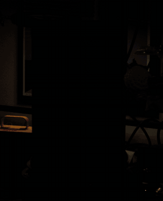
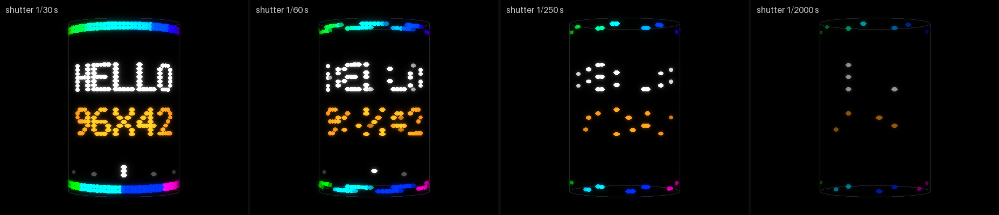
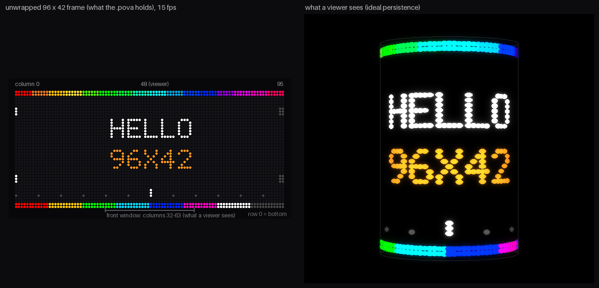

# POV LED Column

A spinning LED display you can talk to. 336 LEDs on a 3D-printed drum paint a 96 x 42 pixel picture all the way round
a cylinder, and an AI pipeline turns a spoken sentence into a new animation on it in about five seconds.

<p align="center">
  
</p>

<p align="center"><em>Real footage of the column, not a render. Camera: 4K 30p, 1/30 s shutter.</em></p>

**Video:** [The Single Engineer Solution: AI Designs Hardware Now](<VIDEO URL>) (Part 3).
Earlier: [Part 1, designing it with AI](https://youtu.be/DEDFU469XdU) and [Part 2, it spins, kinda](<PART 2 URL>).

[](LICENSE)
[](LICENSE-HARDWARE)
[](LICENSE-DOCS)

> **This is a working prototype, built in three weeks, and I'm a chemical engineer, not a mechanical one.** An AI
> (Claude Code) did the CAD, the firmware and the software, and I did the building, the measuring and a lot of the
> swearing. It runs and it films well. It has also never been balanced, it has no guard, and a lithium battery rides
> on the rotor. Read [Safety](#safety) before you spin anything.

## What it is

- A 160 mm x 250 mm printed tube with **24 LED strips** on it, 14 LEDs each: **336 LEDs** (SK9822, the clocked kind).
- It spins at **225 rpm**. An ESP32 inside the drum changes the LEDs' colours 96 times per turn, so your eye sees a
  picture **96 columns wide and 42 rows tall**, wrapped right round the cylinder and redrawn 30 times a second.
- A magnet on the base passes a hall sensor on the rotor once per turn. That one tick is all the ESP32 knows about
  where it is pointing, and it is enough to hold the picture still.
- You change what it shows from a PC or a phone over Wi-Fi: a stored animation, scrolling text, live frames (there
  is a small Pong-like game), or a sentence you say out loud.

| | |
|---|---|
| Picture | 96 x 42 pixels (4,032), 360 degrees, 30 Hz at 225 rpm |
| LEDs | 336 x SK9822 (APA102-compatible), 24 strips of 14, in 3 interleaved sets |
| Controller | ESP32 (DOIT DevKit V1, 30-pin) on the rotor, 2 SPI chains at 8 MHz through a 74AHCT125 |
| Sync | A3144 hall sensor, 2 stacked 6 x 3 mm magnets, one pulse per turn |
| Drive | 12 V JGB37-520 gearmotor, GT2 belt 20T : 40T, printed hub on a 6802 bearing, 4 drive pins |
| Rotor support | 6820ZZ ball bearing (100 x 125 x 13) in a printed collar; the rotor lifts off by hand |
| Rotor power | 5 V USB power bank riding on the rotor (as built), 3 A fuse |
| Measured | 224.5 rpm at 233 mA from a 12 V supply, LEDs on (2026-11-22) |
| Printed parts | 13 functional parts, about 42 h and 1.0 kg (PETG, PETG-CF, PET-CF) |

## How it works

**336 LEDs pretending to be 4,032 pixels.** A strip of 14 LEDs at 60 per metre has a 16.7 mm pitch, which would give
14 coarse rows. So the 24 strips sit in three sets, each set shifted up by a third of a pitch. Three sets of 14 make
42 rows at 5.6 mm. Every row belongs to 8 strips spaced 45 degrees apart, so each row is repainted 8 times per turn:
225 rpm / 60 x 8 = **30 Hz**.

**One turn is 96 slices.** The hall pulse gives the time of the last turn. The firmware divides the next turn into 96
equal slices and, at each one, sends every strip the image column that is under it right now (strip *s* sits 4
columns ahead of strip 0). A slice is 2.8 ms long, and pushing 704 bytes to the two chains takes 0.7 ms of it.
Because the turn is re-timed on every pulse, the picture stays put when the motor speed drifts.

**The simulator shows why cameras struggle.** Your eye blends the passes. A camera only sees what was lit while its
shutter was open, so the shutter has to cover one full repaint (1/30 s at 225 rpm) or the picture falls apart:



*Simulator output (`software/povsim/simulate.py`) for the test pattern in `software/examples/`.*

More detail: [software/README.md](software/README.md), the firmware's own
[README](software/firmware/README.md) and the reports in [docs/](docs/README.md).

## The AI pipeline: a sentence becomes light

It is not image generation. The display is a strange shape with a strange resolution, and at 96 x 42 a picture is
easier to describe as a short program than to paint. So a language model writes the program:

1. **Hear it.** Push-to-talk, transcribed on the PC (faster-whisper).
2. **Write it.** Claude Sonnet writes 15 to 20 lines of Python against a kit of tested parts (sky, sea, characters,
   props, with anchor points so things attach where they should). It writes the story, not the geometry.
3. **Run it.** A sandbox imports the script and draws about 90 frames.
4. **Check it like a part on a production line.** Does the loop close? Is the subject in the viewer's window? Does it
   flicker? How much current does the worst rotor angle of the worst frame pull? Over the limit means dimmer, not
   refused.
5. **Pack and send.** Run-length encoded into a `.pova` file under 64 KB, uploaded over Wi-Fi, and the ESP32 plays it.

The language model is the only step that can surprise you, and everything after it is checked by ordinary code.

**Honest timings** (all measured, sources in the linked reports):

| What | Time | Where it comes from |
|---|---|---|
| Sentence to a playable file, "Infinite Biscuit" gallery | **median 4.7 s** (the model's share 4.0 s); 48 of 48 clips rendered on the first try | [infinite-biscuit report](docs/2026-11-23-infinite-biscuit.md) |
| Prompt to *playing*, warm process, a request the kit covers | **about 4 s** (3.95 to 4.24 s, on a PC stand-in for the column with the real board's delays) | [live-demo report](docs/2026-11-23-live-demo-pipeline.md) |
| The same, counted from letting go of the talk key | about 6.7 s (speech to text is 2.4 s of it) | same |
| On the real column, in the video | 5 to 10 s from voice to display | the Part 3 video |
| A request the kit does not cover | 9 to 20 s, because the model plans before it writes (the same kind of request took 30 s before the changes in that report) | [live-demo report](docs/2026-11-23-live-demo-pipeline.md) |

How it got fast: an agent hand-building one animation took about an hour. Letting a big model write the whole program
took 102 s. Giving a smaller model a kit of tested parts took 5 s, and the results were better. That step is the one
worth stealing: [pipeline speed investigation](docs/2026-11-07-pipeline-speed-investigation.md).

The generation step runs your own [Claude Code](https://claude.com/claude-code) (`claude -p`), so it needs that
installed and signed in. Nothing else here calls a model: the simulator, the validator, the firmware tools and the
tests all run offline.

**What is not in this repository:** the animations from the videos. The code that makes them is all here (the kits,
the pipeline, the simulator), and so is a test pattern to start from.

## Quick start: the simulator first, no hardware needed

Python 3.11 or newer (developed on 3.14, on Windows). On Windows use `py`, elsewhere `python3`.

```
git clone https://github.com/KnockKnockGoose/POV-Column.git
cd POV-Column
py -m pip install -r requirements.txt

py software/examples/test_pattern.py
py software/povsim/simulate.py software/out/test_pattern/test_pattern.pova --stills --gif
```

The first command writes `software/out/test_pattern/test_pattern.pova` and prints the validator's report (peak
current, loop seam, file size). The second renders it as you would see it: the unwrapped frame, the cylinder, the
shutter comparison above and a GIF.



Then run the whole pipeline against a PC stand-in for the column (still no hardware, and no model call):

```
py software/firmware/tools/mock_board.py --http-port 18091 --no-arduino-ota
```

and in a second terminal:

```
py software/pipeline/pov_request.py "a goose running after a ball" --script software/povgen/gen_dog_ball.py --target http://127.0.0.1:18091 --out-dir software/out/demo --no-log --no-preview --wait-playing
```

With Claude Code installed, drop `--script ...` and the model writes the scene (the fast path from the video is the
default; `--classic` is the slow original). The tests:

```
py -m pytest software/tests -q
```

## Build one

The short version is below. The long version is [docs/BUILD.md](docs/BUILD.md), and the files to print are listed in
[cad/README.md](cad/README.md).

1. Print the 13 parts (about 42 h). Dry the PET-CF. Print the fit coupons first and let them choose two bores.
2. Build the perfboard carrier (ESP32, 74AHCT125, two 1000 uF capacitors) and test it on the bench before it goes in.
3. Cut 24 strips of 14 LEDs, solder their leads, test each one, slide them into the tube's rails (odd ones upside
   down) and join them into two chains.
4. Assemble the rotor: bottom plate, hub core with its four drive pins, rotor ring, tie rods, sled, tube, top cap.
5. Assemble the base: motor on its hanger, 20T pulley, belt, the 40T hub on its small bearing, the magnets.
6. **Flush the grease out of the big bearing and oil it.** This one step cost me four days. See below.
7. Lower the rotor on until the pins drop in. Spin up in steps. Trim the picture's angle. Flash over Wi-Fi from then on.

### What cost me days (so it doesn't cost you)

| Lesson | The number |
|---|---|
| A new 6820 bearing is packed with grease, and at this speed and load the grease is the whole load | 600 to 650 mA at the motor with the factory grease, 165 mA after flushing with isopropyl and adding a few drops of light oil |
| The rotor ring's spigot must *slide* into the bearing, never press | a tight printed ring cost 735 mA against 327 mA loose |
| Heat-set inserts that stand proud tilt whatever sits on them | 2 to 3 mm proud was enough to cock the motor and the hub; relieve the mating part or file them flush |
| Never let a screw bottom out in a blind insert hole | it split the printed pulley twice |
| One magnet too many makes the picture jump | 3 magnets double-triggered the hall sensor, 2 gave one clean pulse per turn |
| A belt wants far less tension than you think | 5 to 8 N per strand; "as tight as possible" loaded the small bearing with 30 to 40 N |
| Don't hang a rotor on a gearmotor's shaft | the top of the tube wobbled 3 to 5 mm until the big bearing carried it |
| Film it with the shutter open for one full repaint | 1/30 s at 225 rpm; at 1/60 s the picture shears into dashes |

The full story of each is in [docs/](docs/README.md): the reports are the working documents from the build, wrong
turns included.

## Bill of materials

What is on the machine today. Prices are what I paid or what the listing said in November 2026; the complete list
with fasteners and wire is [docs/BOM.md](docs/BOM.md) (and [docs/bom.csv](docs/bom.csv)).

| Part | Spec | Qty |
|---|---|---|
| LED strip | SK9822 (APA102-compatible), 60 LEDs/m, 5050, black PCB, 12 mm wide; cut into 14-LED pieces | 24 pieces (5.6 m of strip, so more than one 5 m reel) |
| Microcontroller | ESP32 DOIT DevKit V1, 30-pin (ESP-WROOM-32) | 1 |
| Level shifter | SN74AHCT125N, DIP-14 | 1 |
| Carrier board | 70 x 90 mm perfboard (26 x 31 holes), 2.54 mm screw terminals | 1 |
| Passives | 1000 uF x 2, 100 nF x 3, 1 nF x 1, 68 ohm x 4, 10 k x 5 | |
| Fuse | 5 x 20 mm fast-blow in an inline holder: 3 A fitted (the design says 4 A) | 1 |
| Rotor power | USB power bank, 10,000 mAh, a port rated 5 V 3 A (about 200 g) | 1 |
| Hall sensor and magnets | A3144 (TO-92); neodymium discs 6 x 3 mm | 1; 2 |
| Motor kit | JGB37-520 12 V gearmotor ("600 rpm", 540 rpm measured), with its PWM speed controller and knob | 1 |
| 12 V supply | bench supply or a 12 V 2 A adapter | 1 |
| Pulley and belt | GT2 20-tooth, 6 mm bore; GT2 closed loop, 6 mm wide, 122 mm (61 teeth) | 1; 1 |
| Bearings | 6820ZZ (100 x 125 x 13 mm); 6802-2RS (15 x 24 x 5 mm) | 1; 1 |
| Tie rods | M3 stainless threaded rod, cut to about 261 mm, with nyloc nuts | 4 |
| Drive pins | M3 threaded rod, locked with nuts | 4 |
| Inserts and screws | M3 heat-set inserts (about 29), M3 x 6 / x 8 / x 10 screws | |
| Filament | PETG about 0.37 kg, PETG-CF about 0.38 kg, PET-CF about 0.26 kg | |

Designed and bought but **not fitted yet**: a 12.5 mm capsule slip ring, three Mill-Max pogo pins and a 12 V to 5 V
buck converter. They move the battery off the rotor ("option D" in the [rev o report](docs/2026-11-20-rev-o-cad.md)).
The CAD for them is here; the bench result is not.

## Safety

This is a spinning machine with a battery in it. I built it for my bench and a camera, and it has no guard.

- **Spinning mass.** About 1.1 kg at 225 to 250 rpm, and the rim moves at about 2 m/s. The rotor is held on by gravity
  alone, which is what lets it lift off by hand. It has never been balanced. Clamp the base, do the first spins in a
  box, step up 100, 150, 225 rpm, keep hands and hair away from the top-cap nuts, the belt and the gap at the collar,
  and don't go above 300 rpm.
- **Battery.** A lithium power bank rides on the rotor, strapped near the axis. Never spin one that is swollen,
  dented or has been dropped. Moving it off the rotor is the next change (option D above).
- **Current.** All 336 LEDs at full white would draw about 16 A going by my bench reading of one strip, and 20 A in
  the firmware's model, which assumes 20 mA per colour. The limit is **2.6 A** for the LEDs (plus 0.12 A for
  the ESP32), set by the power bank's 3 A port. The PC checks every animation before it sends it, and the firmware
  checks it again when it loads the file: it takes the worst of the 96 rotor angles in the worst frame, and dims the
  whole animation until that fits. A **3 A fast-blow fuse** sits in the 5 V lead (the design calls for 4 A).
  Two honest caveats: the real worst case is an estimate from single-strip measurements (2.25 to 2.55 A), not yet a
  reading on the spinning column; and the live-frame, text and caption paths have known gaps in the cap (findings F1
  to F3 in the [check-pack-send audit](docs/2026-11-23-check-pack-send-audit.md)). Don't stream full-white live
  frames at full brightness.
- **Light.** The picture is redrawn 25 to 30 times a second and looks like flicker to some people and to every
  camera. If you are sensitive to flashing light, this is not a display for you. Don't stare into the stopped
  column at full white.
- **Wi-Fi defaults.** Firmware built without your own `wifi_secrets.h` starts an access point called `POV-Column`
  with a published password, has no API token, and accepts updates with a placeholder password. Fine for a first
  test on the bench, wrong for anything else. See [SECURITY.md](SECURITY.md).

No warranty, as the licences say. If you build one, you are the engineer.

## What is in here

| Folder | What |
|---|---|
| [`cad/`](cad/README.md) | **Hardware.** STL and 3MF of every printed part in print orientation, Bambu Studio projects with the print settings, the scripts that made the late rev o parts. The STEP assembly and the sliced plates are attached to the [release](https://github.com/KnockKnockGoose/POV-Column/releases). |
| [`software/firmware/`](software/firmware/README.md) | The ESP32 firmware (PlatformIO): column engine, `.pova` player, web API, WebSocket live mode, captions, OTA with rollback. Its logic is in `lib/povcore` and is unit-tested on the PC. |
| [`software/povgen/`](software/README.md) | The animation DSL (`povanim.py`: geometry, LED map, file format, validator) and the kits the model writes against (`scenekit.py`, `biscuit_kit.py`, `columnkit.py`). |
| [`software/pipeline/`](software/README.md) | Prompt to light: `pov_request.py`, the warm-process server with the live step view (`pov_serve.py`), the endless gallery (`infinite_biscuit.py`), the prompts. |
| `software/povsim/` | The simulator: unwrapped view, cylinder view, camera-shutter model, GIF and MP4. |
| `software/games/` | Orbit Rally: a one-player paddle game streamed to the column's live mode. |
| `software/captions/` | Live captions on the column from streaming speech recognition (works in the simulator). |
| `software/elec/` | The scripts that draw the schematics, the carrier-board layout and the wiring guide's figures. |
| `software/examples/` | The test pattern: the smallest complete example of a scene script. |
| `software/tests/` | The Python tests, including the check-pack-send audit that compiles the firmware's own checks for the PC. |
| `calc/` | The engineering numbers behind the design: sizing, power, bearings, balance, tolerance checks. |
| [`docs/`](docs/README.md) | The build guide, the BOM, the electrical design and wiring guide, and the dated engineering reports written during the build. |
| `media/` | The pictures in this README. |

## How the AI was used

I describe what I want and give it measurements. Claude Code writes Python that drives Autodesk Fusion, renders the
result to check its own work, runs clearance and fit checks (258 of them on rev o), slices the parts and writes the
report. The same loop wrote the firmware, the simulator and the pipeline. It was very good at CAD, software and
electronics, where a measurement closes the question. It was slower at mechanical diagnosis until I gave it data
(240 fps video, audio, motor current). It also told me the bearing was fine, once, three days before we found out it
was the problem. The reports in [docs/](docs/README.md) are its working documents, lightly redacted.

The Fusion scripts live in a separate tool of mine that is not public yet, so the parametric source is not in this
repository. The exported geometry is: STL, 3MF and STEP.

## Contributing

Issues are welcome, especially from anyone who builds one: [CONTRIBUTING.md](CONTRIBUTING.md). This is a one-person
project around a video series, so I may be slow.

## Licence

- Software: [MIT](LICENSE)
- Hardware design files: [CERN-OHL-P v2](LICENSE-HARDWARE) (permissive)
- Documentation and images: [CC BY 4.0](LICENSE-DOCS)

What each one covers, and the third-party notices: [LICENSING.md](LICENSING.md).

---

Brian Mahoney · YouTube [@BrianTalksToHimself](https://www.youtube.com/@BrianTalksToHimself) · GitHub [KnockKnockGoose](https://github.com/KnockKnockGoose)

Built with [Claude Code](https://claude.com/claude-code), Autodesk Fusion and a Bambu Lab H2D. The dog is Biscuit.
