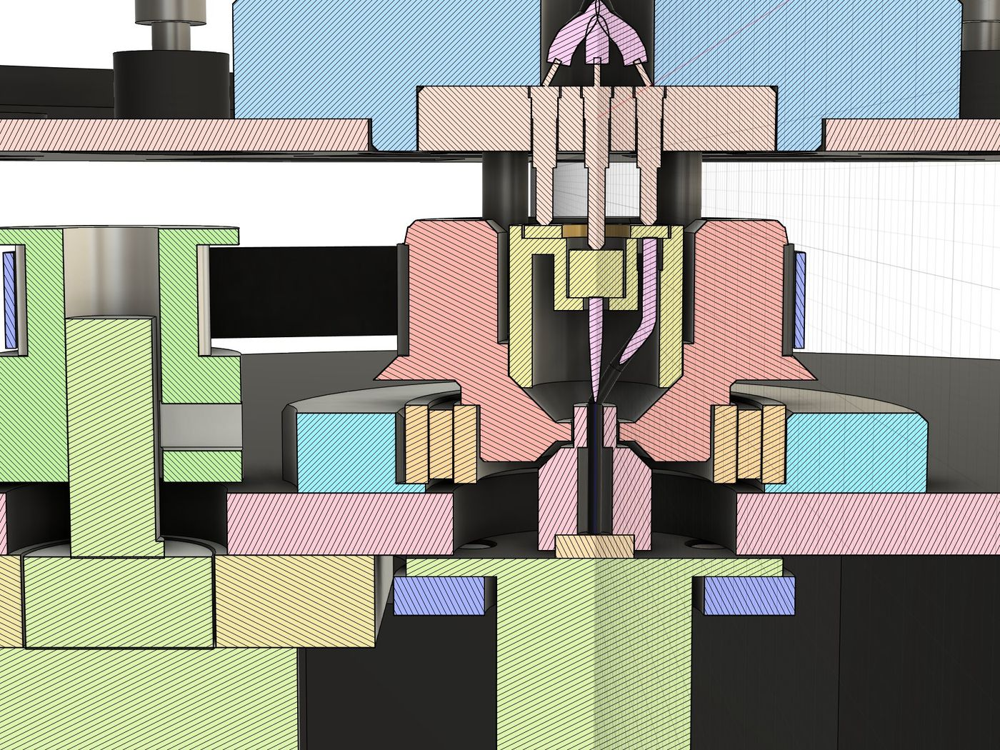

# Hardware: CAD and print files

Everything printed on the column as it runs today ("rev o", November 2026), plus the jigs that put it together.

- **STL** in print orientation and a **3MF** of each part: this folder.
- **Bambu Studio projects** with the print settings I used (`*.3mf`), per revision: [`print/`](print/README.md).
- **Sliced plates** for a Bambu Lab H2D (`*.gcode.3mf`) and the **STEP assembly**: attached to the
  [release](https://github.com/KnockKnockGoose/POV-Column/releases), not stored in git (about 75 MB together).
- The bill of materials: [`docs/BOM.md`](../docs/BOM.md). The build order: [`docs/BUILD.md`](../docs/BUILD.md).
  Wiring: the [electrical design](../docs/2026-11-02-electrical-design.md) and the
  [wiring build guide](../docs/2026-11-04-wiring-build-guide.md).

The machine is a mix of revisions, because each redesign replaced only what was wrong. The folder names under
`print/` say when a part was last changed, not which machine it belongs to. **This page is the list to print from.**

## Print these (13 parts, about 42 h, about 1.0 kg)

| # | Part | STL in this folder | Project in `print/` | Material | Time | Mass |
|---|---|---|---|---|---|---|
| 1 | Rotor tube (the drum, with rails for the 24 strips) | `rotor_tube` | `rev-j_CURRENT/rotor_tube_PETG` | PETG | 15.3 h | 280 g |
| 2 | Top cap | `rotor_top_cap` | `rev-j_CURRENT/rotor_top_cap_PET-CF` | PET-CF | 2.0 h | 67 g |
| 3 | Bottom-cap plate (hall-sensor pocket, sled bosses) | `rotor_bottom_cap_o_relief` | `rev-o_CURRENT/rotor_bottom_cap_o_relief_PETG-CF` | PETG-CF | 2.3 h | 51 g |
| 4 | Hub core (carries the four drive pins) + 4 hex keys | `revo_core_and_keys_plate` | `rev-o_CURRENT/revo_core_and_keys_plate_PET-CF` | PET-CF | 0.9 h | 15 g |
| 5 | Rotor ring (its spigot sits in the big bearing) | `rotor_ring_n_ribs100p80` | `rev-n_CURRENT/rotor_ring_refit/rotor_ring_n_ribs100p80_PET-CF` | PET-CF | 3.0 h | 83 g |
| 6 | Sled (holds the carrier board; no battery cradle) | `rotor_sled_m` | `rev-m_CURRENT/rotor_sled_m_PETG` | PETG or PETG-CF | 1.3 to 1.6 h | 26 to 29 g |
| 7 | Nut plate (captive nuts for the drive pins) | `revn_nut_plate` | `rev-n_CURRENT/alternates/revn_nut_plate_x2_PET-CF` | PET-CF | 0.3 h | 3 g |
| 8 | Base shell | `base_shell_m2` | `rev-m_CURRENT/base_shell_m2_PETG-CF` | PETG-CF | 8.8 h | 270 g |
| 9 | Base bottom plate | `base_bottom_plate` | `rev-j_CURRENT/base_bottom_plate_PETG` | PETG | 2.4 h | 93 g |
| 10 | Bearing collar (holds the 6820) | `base_bearing_collar_k` | `rev-k_CURRENT/base_bearing_collar_k_PET-CF` | PET-CF | 3.3 h | 90 g |
| 11 | Magnet riser (on the small-parts plate) | `magnet_riser_k` | `rev-k_CURRENT/revk_small_parts_PET-CF` | PET-CF | 0.5 h | 8 g |
| 12 | Motor hanger | `revo_motor_hanger_relief` (or `revm_motor_hanger`) | `rev-o_CURRENT/revo_motor_hanger_relief_PETG-CF` | PETG-CF | 0.9 h | 15 g |
| 13 | 40-tooth drive hub + bearing cup v2 | `revo_hub_and_cup_plate` (`revo_drive_hub_j15p10`, `revo_bearing_cup_v2_b24p10_relief`) | `rev-o_CURRENT/revo_hub_and_cup_plate_PETG-CF` | PETG-CF | 1.1 h | 14 g |

Times and masses are the slicer's figures for a Bambu Lab H2D with 0.4 mm nozzles, 0.2 mm layers. The walls, infill
and orientation of each part, and why, are in [`print/README.md`](print/README.md) (rev j and rev k parts) and in the
READMEs of `print/rev-m_CURRENT/`, `rev-n_CURRENT/` and `rev-o_CURRENT/`.

Three rows are "as far as the bench log says":

- **Sled (6):** the one on the machine was printed in PETG-CF. The project file here is the PETG one, with the same
  geometry.
- **Nut plate (7):** the rev n plate is the one fitted. `revo_nut_plate_v2` is for the pogo pins below.
- **Motor hanger (12):** I filed the proud inserts flush under the original hanger (`revm_motor_hanger`). The relief
  version has pockets for them, so you don't have to.

## Print these first: coupons and jigs

| What | STL | Why |
|---|---|---|
| Fit coupons | `revo_fit_coupons` | A ladder of bores and journals in 0.05 mm steps. Your printer picks the cup bore and the hub journal. Mine picked 24.10 and 15.10 |
| Bearing-cup variants | `revo_cup_variants/` | The cup at each bore the coupons offer (24.05 to 24.35) |
| Rotor-ring fit test | `rotor_ring_fit_test_4x_100p30-101p00` | Four thin test rings. Pick the spigot that **slides** into the 6820 with one hand |
| Centring jig v3 | `revo_centring_jig_v3` (three bores: `_b25p15`, `_b25p30`, `_b25p45`) | Centres the hub's cup under the big bearing before its screws go tight |
| Pin-centring jig | `revo_rotor_pin_centring_jig` | Sets the four drive pins on their circle |
| Tube end rings, footprint coupon, motor-face coupon | `tube_end_rings_fitcheck`, `coupon_base_footprints`, `motor_face_test_coupon` | 20-minute checks of the lip fit, the base's hole pattern and your motor's face, before the long prints |

## Designed for rev o, not fitted yet ("option D")

These take the battery off the rotor: a capsule slip ring fixed under the deck, turned by a printed mast, feeding
brass contacts in the hub's crown through pogo pins. The first versions were printed on 2026-11-20. The chain has
not been assembled or run yet.

`revo_slipring_bracket`, `revo_slipring_mast` (and `_v2_k1`, `_k2`, `_k3`: three key sizes), `revo_contact_head`,
`revo_contact_head_v2`, `revo_mast_head_v2_plate`, `revo_nut_plate_v2`, `revo_drive_parts_plate`, and
`revo_rotor_ring_compliant` (a ring with flexing ribs, only if scraping the plain one fails; I did not need it).

## In the `print/` folders, but not part of the machine any more

Kept because the READMEs explain what went wrong with each. Don't print: the rev j base shell, sled and bottom-cap
plate, the plain hub core, the rev k rotor ring and the Oldham coupling parts, the rev m drive spool, lead guide and
clamp ring, the rev n hub, cup, stand-in bush and centring jig.

## The STEP assembly

`pov_led_column_assembly_revo.step` (in the release's STEP archive) is the whole machine as designed on 2026-11-19,
exported from Autodesk Fusion: about 40 named components. Three things to know:

- **Every body was modelled for this project.** There is no vendor CAD in it. The gearmotor, the bearings, the slip
  ring, the ESP32 board and the power parts are stand-in bodies drawn from caliper readings and datasheets. They have
  the right envelope and the wrong details.
- **It is two days older than the machine.** The changes made on 11-20 and 11-21 exist only as STL and 3MF: the
  insert reliefs (`*_o_relief`, `revo_motor_hanger_relief`), the hub's 15.10 journal, the cup's 24.10 bore, the mast
  and contact head v2, centring jig v3 and the pin jig. The `make_*.py` scripts in this folder made those from the
  STLs (trimesh + manifold3d). Three superseded meshes are here only because those scripts read them:
  `revn_drive_hub`, `rotor_hub_core` and `rotor_bottom_cap_f`.
- **A native Fusion archive is not here yet.** The design is built by Python scripts that drive Fusion, and they
  live in a tool of mine that is not public. An F3D export is on the to-do list.

## Materials, in one paragraph

PETG for the big, thin, forgiving parts (the tube, the bottom plate). PETG-CF for the base shell and the drive parts.
PET-CF only where stiffness or creep matters: the caps, the rotor ring, the collar round the bearing. The first top
cap and bottom plate were PETG and flexed when the rotor spun; the same geometry in PET-CF fixed it. The reasoning,
part by part, is in the [FDM optimisation report](../docs/2026-11-03-fdm-optimisation.md).

## Licence

The design files in this folder are Open Hardware under the [CERN-OHL-P v2](../LICENSE-HARDWARE): copy them, change
them, make and sell products from them, and keep the notices. The Python scripts here are [MIT](../LICENSE).
Details and the notice text: [LICENSING.md](../LICENSING.md).
