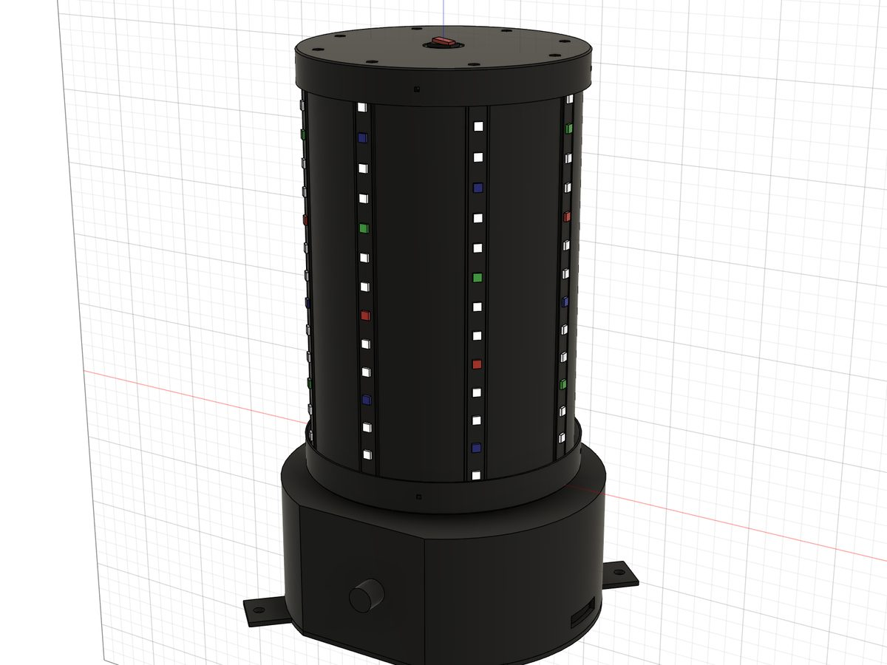
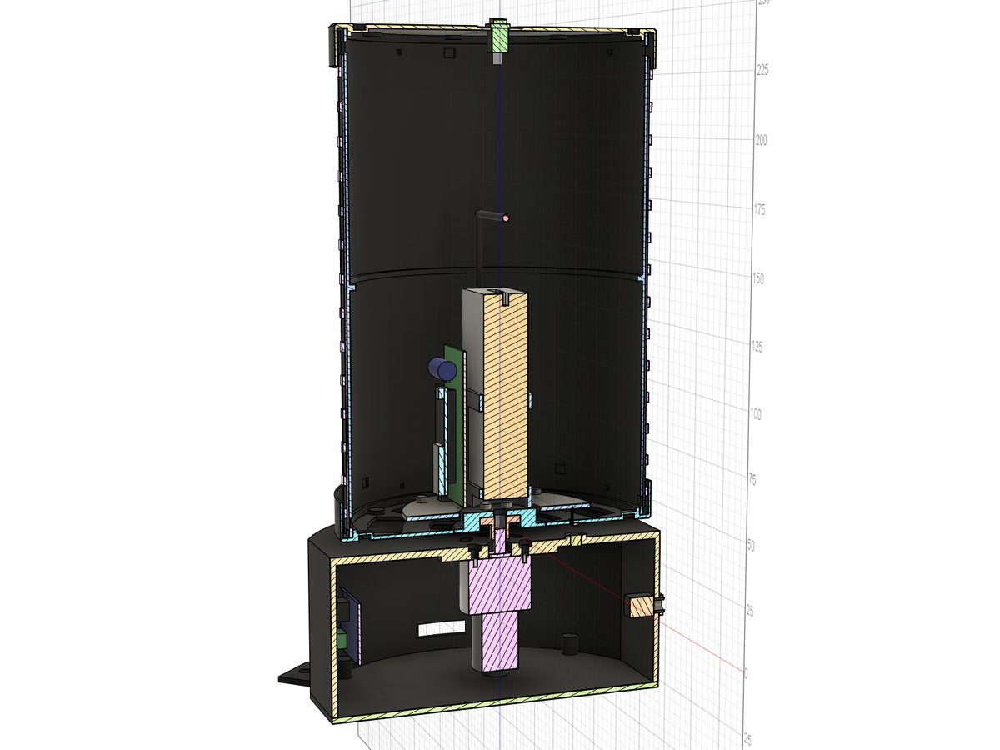
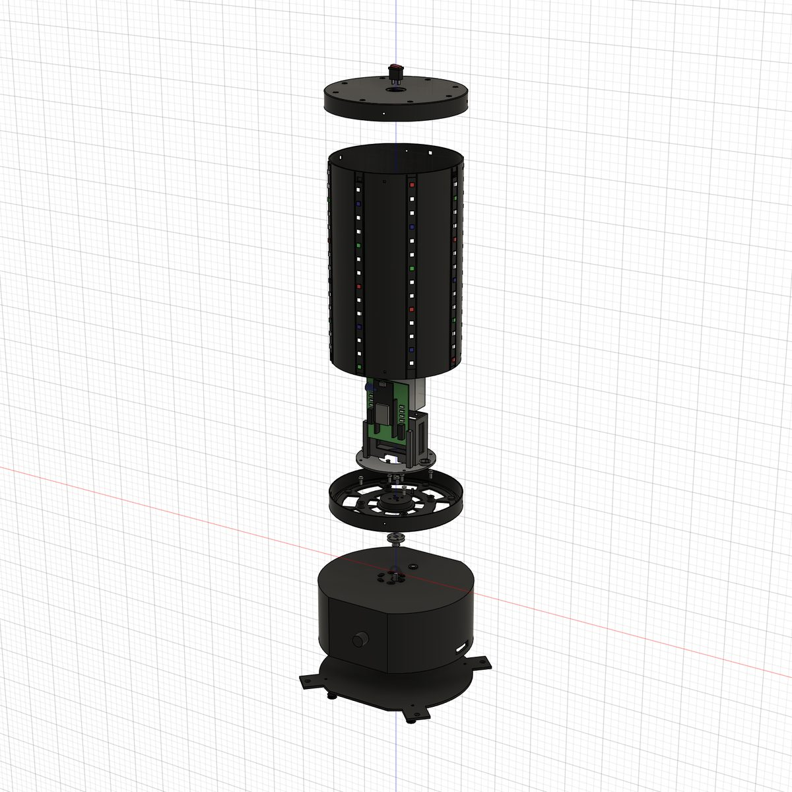
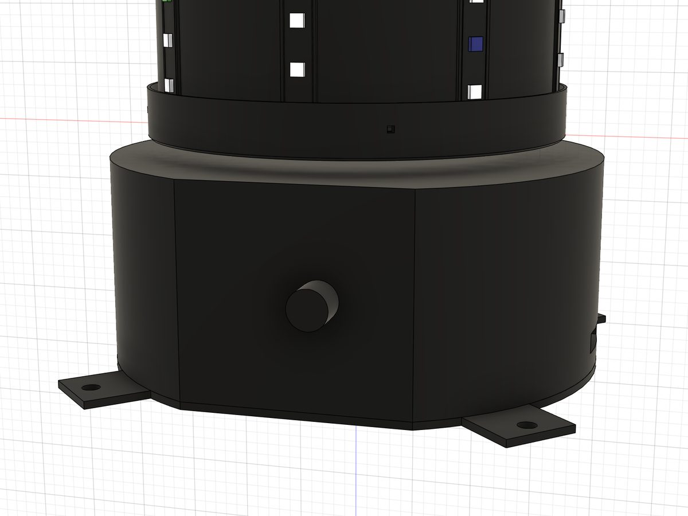
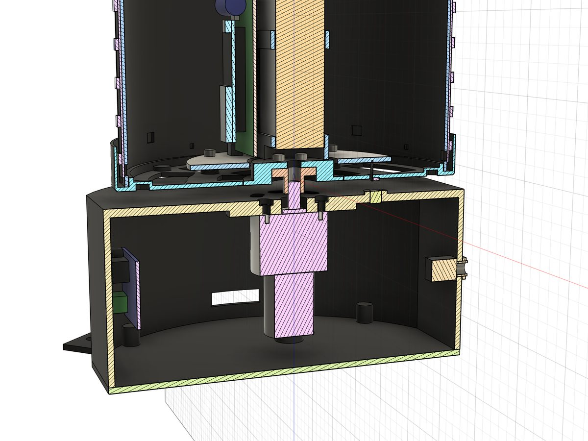

# POV LED Column: CAD Build Report (Fusion assembly, printable parts, fits and balance)

**Prepared for Brian** · Claude (Fable 5.1), CAD build agent on the desktop PC · 2026-11-01
Inputs: `docs/2026-11-01-feasibility.md` (rev b, Sections 5-8, 10, 13, Appendix B), `docs/2026-11-01-parts-and-links.md` (the parts actually ordered), Brian's decisions of 2026-11-01 (8 strip slots, printed base, PWM controller and 12 V jack in the base).
Outputs: Fusion document "POV LED Column" (unsaved, on the desktop PC), STL/3MF/STEP in `cad/`, renders in `docs/img/` (originals in `fusionclaude/renders/071-073_pov_*.png`), scripts `fusionclaude/scripts/062-075_pov_*.py`, design note `fusionclaude/designs/pov-led-column.md`, time-lapse frames in `<video>\2026-11-01 POV CAD frames\`.

---

## Abstract

The whole machine is modelled as a 20-component Fusion assembly: a Ø160 × 250 mm rotor tube with eight rail pairs and 112 individual 5050 LED bodies, a hub cap that bolts to the kit's 6 mm flange coupling, a sled on the spin axis carrying the INIU power bank, the ESP32 and the level-shifter board, a top cap with the power switch and eight balance-nut pockets, and a printed D-shaped base holding the JGB37-520 gearmotor, the kit's PWM controller (knob through the front flat), a 5.5 mm DC jack (back flat) and the hall magnet. **All 29 exact clearance checks pass** (≥ 3 mm between parts that must not touch, designed fits of 0.2-0.4 mm where parts seat). The rotor comes out at **781 g** with an inertia of **2.72 × 10⁻³ kg·m²** (the feasibility report assumed 612 g and 2.3 × 10⁻³); the 0.28 kgf·cm motor still spins it up in about **5 s**. The design unbalance is **53 g·mm**, half the ISO G6.3 budget of 104 g·mm, before any trim nuts. Six printable parts (≈ 16 h, ≈ 910 g of black PLA) fit the 256 mm bed, print without supports in the exported orientation, and are exported as STL and 3MF; a 10-minute test coupon checks the motor bolt pattern before the 5.5 h base print. Three items are on the panel for Brian (DC jack type, ESP32 pin pitch, power-bank wake behaviour); none blocks printing the rotor tonight.

---

## 1. What was modelled

| # | Component (Fusion name) | Printed? | Mass | What it is |
|---|---|---|---|---|
| 1 | B01 base shell | PLA, 340 g | D-shaped drum Ø200 with flats at ±90 mm, 3 mm walls, 4 mm deck + Ø64 × 3 mm motor pad, 6 slotted M3 holes with counterbores, magnet pad, PWM standoffs, knob and jack holes, insert bosses, two side slots |
| 2 | B02 base bottom plate | PLA, 123 g | 3 mm plate with four clamp ears (Ø7 holes) on the diagonals, four countersunk M3 |
| 3 | B07 rubber feet | bought | Four Ø12 × 4 adhesive feet (Sparcore kit) |
| 4 | B03 gearmotor JGB37-520 | bought | Ø37 × 29 gearbox, Ø24.4 × 31 can, 6 × 15 D-shaft offset 7 mm from the gearbox axis |
| 5 | B04 PWM controller | bought (kit) | 50 × 32 board on four 11 mm standoffs inside the front flat, pot shaft through an Ø8 hole, knob outside |
| 6 | B05 DC barrel jack | bought | DC-022B style in an Ø8 hole in the back flat (Q24) |
| 7 | B06 hall magnet | bought | Two 6 × 3 mm discs stacked in a pocket in the deck pad at r 42, top flush at z −8 |
| 8 | R01 flange coupling | bought (kit) | Ø22 × 4 flange, Ø10 × 8 hub, bore 6, 4 × M3 on a 16 mm circle |
| 9 | R02 bottom cap / hub | PLA, 68 g | 2 mm plate, 18 mm skirt over the strip ends, 4 mm lip inside the tube, Ø40 hub with a Ø22.4 coupling pocket, four sled bosses with M3 inserts, eight balance pockets, hall pocket, lightening windows |
| 10 | R03 hall sensor | bought | A3144 TO-92 glued flat in the cap underside, face 5.0 mm above the magnet |
| 11 | R13 screws | owned | 4 × M3×8 coupling, 4 × M3×8 sled |
| 12 | R04 sled | PLA, 47 g | Ø100 plate on the cap bosses, bank cradle (offset 3 mm for balance), card guides for the carrier board, two M6 trim pockets |
| 13 | R07 carrier board | owned | 60 × 80 mm protoboard: 2 × 74AHCT125, 8 × 330 Ω, 1000 µF, female headers for the ESP32, 5 V bus |
| 14 | R06 ESP32 | owned | 38-pin DevKitC plugged into the carrier, micro-USB pointing up (reachable with the top cap off) |
| 15 | R05 power bank | bought | INIU BI-B61 105.4 × 66 × 23.9 mm standing on end, ports up |
| 16 | R08 USB pigtail | bought | USB-A plug in the +x port, cable over the bank top and down the −x side to the carrier |
| 17 | R09 tube | PLA, 259 g | Ø160 × 250, 1.6 mm wall, 8 rail pairs at 45°, 12 wire slots, mid-height stiffening ring |
| 18 | R10 LED strips | owned | 8 × 14 WS2812B as real 10 mm strips with individual 5050 bodies (lit RGB wave pattern in the renders) |
| 19 | R11 top cap | PLA, 74 g | Solid 2 mm lid, 18 mm skirt, lip, eight balance pockets on top, recess + cutout for the KCD11 |
| 20 | R12 rocker switch | bought | KCD11 on the spin axis |

The order above is the assembly order and the order for the build-up animation (components appear one by one).

---

## 2. Key dimensions

Coordinates: Z is the spin axis; z = 0 is the bottom of the tube, which is also the top face of the bottom-cap plate. The base deck top is at z = −9.5.

### 2.1 Rotor tube and strips

| Item | Value |
|---|---|
| Tube | OD 160, wall 1.6 (ID 156.8), height 250; prints vertically in one piece |
| Rails | 1.2 wide × 1.0 tall, pairs with inner faces 10.6 apart (10 mm strip + 0.3 per side), z 1-249, at 0°, 45°, … 315° |
| Strips | 233.3 mm (14 × 16.67 pitch), 10 wide, DIN at the bottom. Set A (strips 0, 2, 4, 6): first LED centre at z 12.5. Set B (1, 3, 5, 7): z 20.83, i.e. half a pitch higher. Strip ends A 4.2-237.5, B 12.5-245.8. The 28 interleaved rows sit at 8.33 mm pitch, as in the feasibility report |
| Wire slots | 6 × 5 mm through the wall right above each strip's bottom end (set A z 5.0-10.0, set B 13.3-18.3), plus four above set A's top ends (238.5-243.5) for the chained-strip fallback. The three wires of each strip go through its own slot, so all eight bundles are identical |
| Stiffening ring | 3 mm tall × 3 mm inward at z 125 (inside), keeps the tall thin wall round while printing |
| Cap screw holes | Optional Ø2.5 radial holes at z 9 and z 241, θ 22.5° + 90°k, for M3 thread-forming screws through the skirts; CA glue is the alternative |

### 2.2 Caps and hub

| Item | Value |
|---|---|
| Plates | 2.0 mm, Ø168.8 overall |
| Skirt | r 83.2-84.4 (1.2 wall), 18 mm tall, clears the LED tops (r 82.6) by 0.6 mm and hides both strip ends and the solder joints; 1 mm chamfer on the outer edge |
| Lip | r 76.0-78.2, 4 mm tall, 0.2 mm radial to the tube bore: it locates the tube; the skirt is only a cover |
| Hub | Ø40 × 8 mm boss; Ø22.4 pocket from below up to z 5 seats the coupling flange (0.2 mm radial); Ø7 shaft clearance; 4 × Ø3.4 clearance holes on the 16 mm circle, screwed from inside the rotor with M3×8 into the coupling's threaded flange |
| Sled bosses | 4 × Ø9 × 6 mm at r 45 (45° + 90°k), Ø4.1 × 6 holes for M3 brass heat-set inserts |
| Balance pockets | 8 hex pockets 6.0 AF × 2.8 deep at r 72 (M3 nut = 5.5 AF × 2.4): top cap on the top face, bottom cap on the underside (bosses behind them keep 1.2-1.6 mm of floor). One M3 nut at r 72 = 26 g·mm |
| Windows (bottom cap) | 8 at r 50-68 and 8 at r 24-36, each 30° wide, between the bosses; saves 18 g at the hub end |
| Hall pocket | 4.5 × 3.5 × 0.5 mm recess + 1.4 × 4.5 lead slot at r 42, θ 90°, underside; the TO-92 is glued face-down, its face ends at z −3.0 |
| Switch (top cap) | Ø24 × 0.8 recess (so the panel is 1.2 mm where the KCD11 clips grip) and a 13.8 × 9.3 cutout (13.5 × 9 nominal + 0.3 print allowance) |

### 2.3 Sled and electronics

| Item | Value |
|---|---|
| Plate | Ø100 × 2.4 at z 6-8.4 (it rests on the four 6 mm bosses, leaving a 6 mm wire channel underneath), Ø44 centre hole over the hub, 4 × Ø3.4 |
| Bank cradle | Inside 66.8 × 24.7 (bank 66 × 23.9 + 0.4 per side), walls 2 mm, 60 mm tall; floor at z 14 with a Ø30 hole so the coupling screws stay visible; 44 × 40 windows in the wide walls and 12 × 40 in the narrow ones (lighter, and they reach the bank's button); zip-tie slots 4 × 2.5 at the rim. Cradle centre offset **+3.0 mm in y** to balance the one-sided board stack |
| Carrier board | 60 × 80 × 1.6 standing at y = −19 in two 6 × 6 × 48 card guides (slot 2.2 wide, board bottom at z 11), solder side 9 mm from the bank; components point away from the bank |
| ESP32 | Female headers at 25.4 mm row pitch (38-pin DevKitC; Q25), board plane at y −29, module face at y −33; the micro-USB connector is at the top (z 73) so the first flash is a cable from above with the top cap off |
| Trim pockets | Ø14 × 4 bosses at x ±42.5 with 10.2 AF × 5.2 hex pockets: one M6 nut (2.5 g) = 106 g·mm, fitted opposite the USB plug if the first spin asks for it |
| Pigtail | Plug in the +x USB-A port (z 113-149 incl. overmold), cable up to z 157, across the bank top and down the −x side (x −41, 3.8 mm from the cradle) to the carrier's 5 V pads |

### 2.4 Base

| Item | Value |
|---|---|
| Shell | D-shape: circle r 100 cut by flats at |y| = 90 (footprint 200 × 180), 3 mm walls, drum from z −92 to −9.5; deck 4 mm thick plus a Ø64 × 3 mm pad under the motor, so the gearbox face sits at z −16.5 |
| Motor mount | Gearbox bolted straight to the deck from above: 6 × M3×8 through Ø3.4 holes on the 31 mm circle around the gearbox axis (which is 7 mm off the shaft axis), each hole slotted ±8° because the clocking of the real pattern is unknown; Ø6.2 × 2.5 counterbores keep the heads below the deck top; Ø12.6 hole for the Ø12 bearing boss. The kit's L-bracket is not needed |
| Rotor gap | Deck top −9.5, coupling −7 to +5, cap plate underside −2: **7.5 mm** between the spinning rotor and the base; the coupling set screw (z −4) is reachable through the gap with a 1.5 mm hex key, which is how the rotor comes off |
| Magnet | Ø12 × 1.5 pad at (0, 42) with a Ø6.3 × 6.5 pocket for two stacked 6 × 3 discs, top flush at z −8.0: hall face to magnet 5.0 mm. Estimated field there 650 G (470 G with one disc), against the A3144's 350 G worst-case operate point |
| PWM controller | Board plane parallel to the front flat, 11 mm standoffs (Ø6 posts, Ø2.6 holes for thread-forming screws) at a 44.5 × 26 pattern centred at x −8, z −50; pot at x +10 through an Ø8 hole, knob outside at y −92 to −106 (knob to the spinning rotor: 42 mm) |
| DC jack | Ø8 hole at (0, z −50) in the back flat; body inside, nut outside |
| Bottom plate | 3 mm, same D outline, four 30 × 25 ears with Ø7 holes at the diagonals (clamp or screw the base to the bench; overall 250 mm across), four Ø3.4 countersunk M3 into inserts in Ø9 × 10 bosses inside the drum; four rubber feet at r 85 |
| Side slots | Two 30 × 8 mm slots low in the curved walls (air, and a route for the motor leads if the bench supply is used instead of the jack) |

---

## 3. Fits and clearances (script 070, all PASS)

Rule used: ≥ 3 mm between parts that must never touch; designed fits have their own targets. The H2D prints holes about 0.3 mm undersized (knowledge base), so every hole below carries that allowance.

| Check | Measured | Limit |
|---|---|---|
| Rotor cap underside to base deck | 6.0 (plate edge chamfer) / 7.5 nominal | ≥ 5 |
| Hall face to magnet top (sensing gap) | 5.0 | 3-6 |
| Hall sensor to magnet pad / deck | 5.0 | ≥ 4 |
| Coupling bottom to deck (hole edge) | 2.8 | ≥ 2 (designed 2.5) |
| LED bodies to bottom / top skirt | 0.56 / 0.56 | ≥ 0.5 (designed) |
| ESP32 to tube wall / sled / bank | 44.2 / 9.6 / 19.4 | ≥ 3 |
| Level-shifter chips to guide posts | 3.3 | ≥ 3 |
| Carrier board solder side to bank | 9.3 | ≥ 3 |
| Pigtail cable to sled / carrier | 3.8 / 22.1 | ≥ 3 |
| USB plug to tube, mid ring, top cap, switch | 32.5 / 84.1 / 74.0 | ≥ 3 |
| Coupling screw heads to bank bottom | 3.0 | ≥ 3 |
| Motor can to base wall / rear to bottom plate | 28.9 / 11.0 | ≥ 3 |
| PWM components to the front wall | 2.3 | ≥ 1 |
| Knob to the spinning rotor | 41.5 | ≥ 3 |
| Sled to tube wall / strips | 28.4 / 30.0 | ≥ 3 |

| Designed fit | Nominal clearance | Notes |
|---|---|---|
| Tube bore on cap lip | 0.2 radial | lip Ø156.4 in Ø156.8 |
| Strip between rails | 0.3 per side | 10.6 slot |
| Power bank in cradle | 0.4 per side | 66.8 × 24.7 |
| Carrier PCB in guide slot | 0.3 per side | 2.2 slot, 1.6 board |
| Coupling flange in hub pocket | 0.2 radial | Ø22.4 pocket |
| Motor boss in deck hole | 0.3 radial | Ø12.6 |
| M3 clearance holes / insert holes | 3.4 / 4.1 | inserts M3 × 4-5 mm brass |
| Magnet pocket | 6.3 for Ø6 | light press after the 0.3 shrink |
| KCD11 cutout | 13.8 × 9.3 | 13.5 × 9 nominal |
| Nut pockets | 6.0 AF (M3), 10.2 AF (M6) | nuts 5.5 / 10 AF |

Two problems were found and fixed by the checks before anything was exported: the ESP32's header pins collided with its card guides (DevKit pin rows sit 1.3 mm from the board edge, so a card guide cannot grip the board; the ESP32 now plugs into female headers on the carrier board, which has bare edges), and the hall sensor was modelled at a different angle from the magnet, so the sensing gap had never actually been measured (both are now at θ = 90°, 5.0 mm apart).

---

## 4. Masses, balance and motor margin

Computed from Fusion volumes and centroids (PLA 1.24 g/cm³, steel 7.85; bought parts at their listed masses: bank 200 g, motor 164 g, ESP32 10 g, carrier 20 g, pigtail 15 g, switch 3 g).

| Rotor item | Mass | Rotor item | Mass |
|---|---|---|---|
| Tube (with rails, ring) | 259 g | Power bank | 200 g |
| 8 strips (5.8 g each) | 46 g | Carrier board + ESP32 | 30 g |
| Bottom cap / hub | 68 g | Pigtail | 15 g |
| Top cap | 74 g | Switch, hall, screws | 11 g |
| Sled | 47 g | Coupling | 13 g |
| Unmodelled wires, inserts, glue | 18 g | **Rotor total** | **781 g** |

| Quantity | Value | Feasibility report | Comment |
|---|---|---|---|
| Rotor mass | 781 g | 612 g | caps 142 g vs 90 g assumed; sled 47 g; bank 200 g |
| I_zz about the spin axis | 2.72 × 10⁻³ kg·m² | 2.3 × 10⁻³ | tube + strips + skirts are 80 % of it |
| Stored energy at 450 rpm | 3.0 J | 2.5 J | |
| Spin-up 0 → 450 rpm | 5.1 s at 27 mN·m (Copkim, 0.28 kgf·cm); 2.7 s at 49 mN·m (ZVKV) | 4.3 s | ramp the knob over ~5 s |
| Steady-state torque margin | ≈ 13× (2 mN·m drag vs 27 mN·m rated) | ≈ 10× | |
| Axial load on the gearbox bearing | 7.7 N | 6 N | fine for a 37 mm gearbox |
| Design unbalance U (CG offset × mass) | **53 g·mm** (CG 0.07 mm off axis) | — | before trim nuts |
| G6.3 budget at 450 rpm | 104 g·mm (e = 134 µm) | 82 g·mm for 612 g | 4 M3 nuts at r 72 |
| Rotating force from 53 g·mm | 0.12 N | — | vs 7 N of friction under the 1.44 kg machine |

Where the balance comes from: the eight strips, rails, slots and wire bundles are symmetric; the bank is on the axis (offset 3.0 mm to cancel the 30 g board stack on the −y side); the switch is on the axis; the pigtail plug (+x) is countered by its cable running down the −x side. What is left is trimmed with M3 nuts in the sixteen r 72 pockets and, if needed, an M6 nut in the sled pocket opposite the heavy side. Procedure: spin up in steps 150 → 300 → 450 rpm inside a box, mark the heavy side with the hall-triggered strobe or by feel, add nuts opposite, repeat.

Base: 655 g (shell 340, plate 123, motor 164, PWM 20, jack 5, magnets, feet). With the rotor the machine is 1.44 kg on a 200 × 180 mm footprint (250 mm across the ears). The tipping moment from a 1 N residual unbalance at the 190 mm rotor CG height is 0.19 N·m against a 1.3 N·m restoring moment, so it will not walk if balanced to within 4× the G6.3 budget; clamp the ears or put a 1 kg bag of sand inside the drum for the first spins anyway.

---

## 5. Printing

All parts fit a 256 × 256 × 256 mm bed and print without supports in the exported orientation. Bambu PLA Basic Black, 0.4 nozzle, 0.2 mm layers, 4 walls (the 1.6 mm tube is then 100 % perimeters), 3 top/bottom layers, 15 % infill (only the hub and bosses have any), outer wall ≤ 120 mm/s on the tube, brim 5 mm on the tube. Times are flow-rate estimates (12-15 mm³/s effective); Bambu Studio's number is the one to trust.

| File (`cad/`) | Orientation as exported | Volume | PLA | Est. time |
|---|---|---|---|---|
| `rotor_tube` | vertical, open ends; prints as one 250 mm tube | 208.5 cm³ | 259 g | ~5 h |
| `rotor_bottom_cap_hub` | underside on the bed (pockets become holes in the first layers), skirt and lip grow up | 54.5 cm³ | 68 g | ~1.2 h |
| `rotor_top_cap` | top face on the bed (exported already flipped), skirt and lip grow up | 59.9 cm³ | 74 g | ~1.3 h |
| `rotor_sled` | plate down; the 44 mm cradle windows bridge | 37.9 cm³ | 47 g | ~1.0 h |
| `base_shell` | deck on the bed (exported flipped), drum grows up; knob/jack holes are in vertical walls | 274.1 cm³ | 340 g | ~5.5 h |
| `base_bottom_plate` | flat | 99.2 cm³ | 123 g | ~2 h |
| `motor_face_test_coupon` | flat; Ø50 × 2 with the slotted bolt pattern, a 6.3 magnet pocket and a 4.1 insert hole | 3.9 cm³ | 5 g | 10 min |
| **Total** | | 738 cm³ | **915 g** | **~16 h** |

Suggested order: coupon + tube tonight (Sunday), caps and sled Monday daytime, base shell Monday night, plate Tuesday. Print the coupon first and bolt the motor to it: if the six slots do not line up with the gearbox, change `MOTOR_PCD`/`MOTOR_SLOT_DEG` in `lib/povlib.py` and re-run `069` before the base goes on the bed.

Hardware to add to the BOM (all in Brian's kits): 14 × M3×8 socket head (4 coupling, 4 sled, 6 motor), 4 × M3×8 countersunk (bottom plate), 8 × M3 brass heat-set inserts (4 cap bosses, 4 base bosses), 4 × M2.5 or M3×6 thread-forming (PWM board), 8-16 × M3 nuts and 1-2 × M6 nuts (balance), 2 zip ties, one 2-pin JST pair (switch), rubber feet, CA glue, Kapton.

---

## 6. Assembly order

1. **Base.** Press the four inserts into the shell bosses. Mount the PWM board on its standoffs with the knob through the front hole (if the board's holes differ from 44.5 × 26, drill the 6 mm pads). Fit the DC jack in the back flat. Glue the two magnets into the pad (pole that triggers the A3144 facing up; test with the sensor on 5 V first). Bolt the motor to the deck from above with six M3×8 (coupon-checked). Wire jack → PWM IN, PWM OUT → motor. Screw on the bottom plate (four countersunk M3), stick the feet on.
2. **Rotor cap.** Press four inserts into the sled bosses. Glue the A3144 face-down into its pocket, leads up through the slot (5 V, GND, OUT with a 10 kΩ pull-up to 3.3 V on the carrier). Bolt the coupling into the hub pocket from inside with four M3×8.
3. **Strips.** Stick the eight 14-LED strips between the rails, DIN at the bottom, each bottom end just above its wire slot (set A on the low slots, set B on the high slots; the slots are the height gauge). Solder 5 V, GND and DIN wires at each bottom end and feed them through the slot; a drop of CA or Kapton at each end.
4. **Tube onto the cap** (lip inside, skirt outside); optional four radial screws at z 9, or CA.
5. **Carrier board.** Solder the female headers, two 74AHCT125 (VCC 5 V), 8 × 330 Ω on the outputs, the 1000 µF across the 5 V bus, the hall pull-up; plug the ESP32 in (USB up). Slide the board into the guides, connect the eight data and eight power pairs and the hall leads. Screw the sled onto the cap bosses (four M3×8).
6. **Rotor onto the motor.** Lower the rotor + coupling onto the D-shaft and tighten the set screw through the 7.5 mm gap (1.5 mm hex). The rotor comes off the same way, bank and all.
7. **Bank.** Drop it into the cradle (ports up), zip-tie the top, plug the pigtail into the +x USB-A port, cable over the top and down the −x side to the carrier's 5 V pads via the switch.
8. **Top cap.** Fit the KCD11 in the recess, connect its JST pair, press the cap on (lip in, skirt out).
9. **First flash** over micro-USB from above before step 8; after that, OTA.
10. **Balance** as in Section 4, then film.

---

## 7. Wiring (for the diagram)

- **5 V rail:** INIU bank USB-A (+x port) → 22 AWG pigtail → KCD11 rocker on the top cap (2-pin JST, one wire pair down the +x side) → 5 V bus on the carrier board, with the 1000 µF capacitor across 5 V/GND. From the bus: eight 22 AWG pairs to the strips (star, one per wire slot) and the ESP32 VIN/5V pin.
- **Data:** ESP32 GPIO 16, 17, 18, 19, 21, 22, 23, 25 → inputs of the two 74AHCT125 (VCC 5 V, OE pins to GND) → 330 Ω → strip DIN 0-7 (strip s sits at θ = 45°·s, strip 0 at +x).
- **Hall:** A3144 VCC 5 V, GND; OUT → 10 kΩ to 3.3 V → GPIO 27. The sensor is under the bottom cap at (r 42, θ 90°); the magnet is in the base deck at the same radius.
- **Base:** DC jack (12 V from the bench supply) → PWM controller IN; PWM OUT → motor terminals. Knob on the front flat sets the speed; the ESP32's web page shows the measured rpm.
- Every rotor wire bundle leaves the tube through its own slot and runs under the sled plate to the carrier, so the eight bundles are identical and balanced.

---

## 8. Time-lapse capture

Every mutating step saved a 2560 × 1440 transparent frame from one fixed camera (target (0, 0, 77) mm, 1300 mm away, azimuth −58°, elevation 22°, perspective 22.6°): `<video>\2026-11-01 POV CAD frames\0001_pov_tube … 0007_pov_base`, plus `0008_section` and `0009_exploded`, a 120-frame 360° orbit of the finished assembly (`orbit\o_000-119.png`) and a 40-frame exploded orbit (`orbit_exploded\`). Frames 0001-0003 were recaptured after the camera distance was fixed, so the set is complete and consistent. The build-up order for a reveal animation is the component order in Section 1.

---

## 9. Open questions and things to verify on the real parts

| # | Item | Default in the CAD | What to do |
|---|---|---|---|
| Q24 (panel, ask) | Which 5.5 mm DC jack | DC-022B, Ø8 hole | DC-099 needs Ø11.5: drill, no reprint |
| Q25 (panel, think) | ESP32 pin-row pitch | 25.4 mm (38-pin DevKitC) | 30-pin boards are often 22.86 mm; only the carrier's header position changes |
| Q26 (panel, think) | Does the INIU bank wake when the rocker closes the circuit? | assumed yes (load detection) | if it needs its button, the cradle windows reach it with the top cap off; otherwise move the switch to the bank's output and leave it on |
| — | Motor bolt-pattern clocking and hole depth | 6 × M3 on 31 mm around the gearbox axis, slotted ±8° | print the coupon first |
| — | Coupling flange thickness and whether its holes are threaded | 4 mm, threaded | if they are plain holes, use M3×12 with nuts in the pocket |
| — | PWM board size and holes (kit's "CCM6N" vs the 50 × 32 generic) | 50 × 32, 44.5 × 26 | drill the standoff pads to suit; the knob hole stays |
| — | Power-bank mass (195-238 g in listings) | 200 g | a 40 g difference moves the balance by 120 g·mm, within the trim range |
| — | Finger safety | 7.5 mm gap, 1 mm chamfers, knob 42 mm below the rotor | a cardboard box or acrylic sleeve for the first spins; hair and cables away |

---

## Explain it

- **Put everything heavy on the axis and let symmetry do the balancing.** The bank stands on the spin axis, the switch sits on it, the eight wire bundles are identical, and the only one-sided masses (board stack, USB plug) are cancelled by a 3 mm cradle offset and a cable route. The result is 53 g·mm of design unbalance against a 104 g·mm ISO G6.3 budget before a single trim nut.
- **Balance in g·mm is something you can count.** G6.3 at 450 rpm means the centre of mass may sit 134 µm off the axis; for 781 g that is 104 g·mm, and one M3 nut in a pocket at r 72 is 26 g·mm. The pockets turn balancing into "add two nuts here".
- **The exact checks earned their keep again.** Two errors a render would never show: an ESP32 header colliding with its card guide (DevKit pins sit 1.3 mm from the edge, so socket it on a carrier instead), and a hall sensor modelled 112° away from its magnet, so the sensing gap had never been measured.
- **Scaling the feasibility numbers to real parts.** The caps came out 50 g heavier than the paper estimate and the rotor 170 g heavier; inertia went from 2.3 to 2.7 mN·m·s², and the spin-up on the 0.28 kgf·cm motor from 4.3 to 5.1 s. Still fine, but it is why the mass check is in the script.
- **Hall sensing gap is a field calculation, not a guess.** A 6 × 3 mm N35 disc gives roughly 470 G at 5 mm, 650 G with two stacked; the A3144 needs ≤ 350 G worst case, so a raised 1.5 mm pad buys the gap without shrinking the rotor clearance.
- **Fusion automation lessons:** the default new document is a Part (one component), so an assembly has to be created through the API; bodies inside components need assembly-context proxies before Fusion will measure them; and a time-lapse is cheap if every step script is followed by one read-only capture from a camera fixed to the final assembly's extents.
