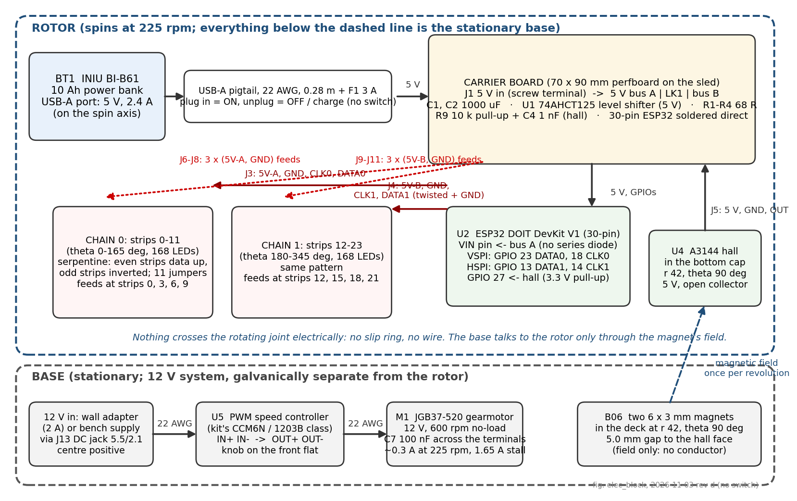
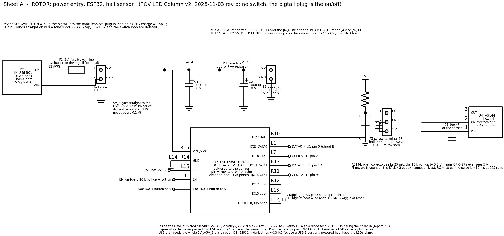
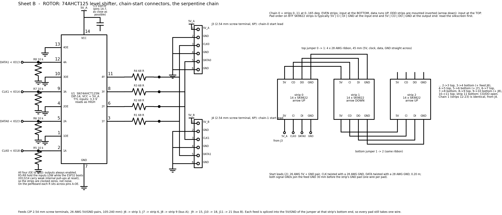
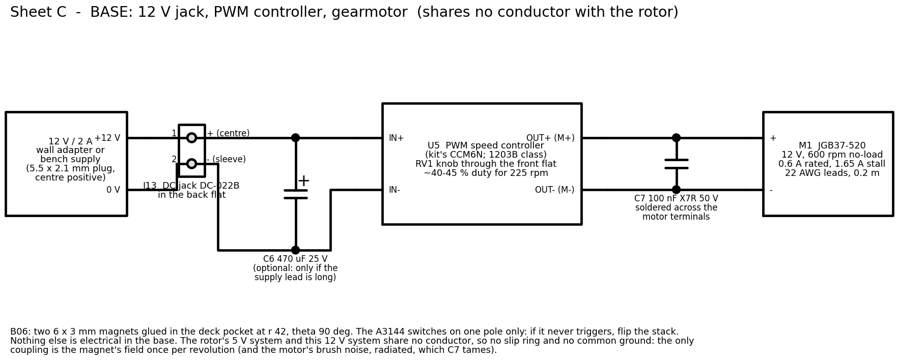
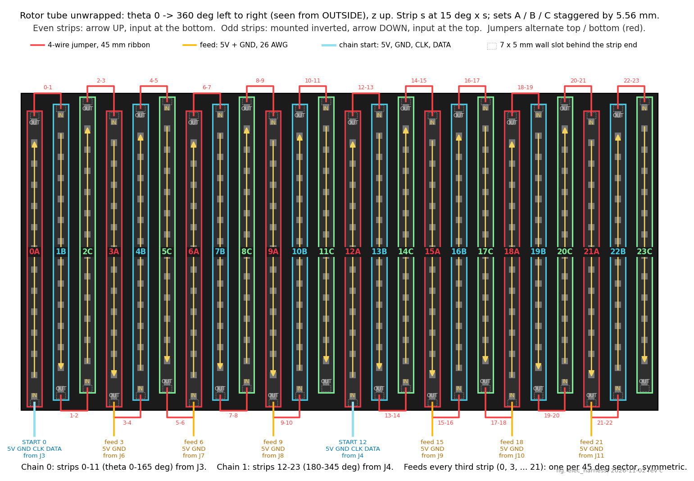

# POV LED Column v2: Electrical Design (schematic, power, signal integrity, perfboard carrier, strip harness, soldering, bring-up, BOM)

**Prepared for Brian** · Claude (Fable 5.1), electrical design agent on the laptop · 2026-11-02
Inputs: Brian's request of 2026-11-02 ("the whole electrical engineering suite": schematic, how everything hooks up to the ESP32, the perfboard carrier; wires soldered **directly to the strip pads**, no pierce-through clips; connectors only where they earn their place), the v2 hardware report `docs/2026-11-02-v2-24-strips-tie-rods.md` (24 SK9822 strips at 15° in three sets, two 12-strip serpentine chains on VSPI 23/18 and HSPI 13/14 at 8 MHz, 336 LEDs, 225 rpm, INIU 2.4 A port, 2.0 A cap, one 74AHCT125, measured strip 12.0 × 0.46 mm), the software report `docs/2026-11-02-software-and-ai-content.md` (pins, hall on GPIO 27 falling edge, the 704-byte frame, the 2.0 A cap in the 5-bit field, the dog's 0.89 A peak, phase-0 bench checks), `docs/2026-11-01-cad-build.md` (sled, card guides, carrier at y −19, pigtail route, switch on the axis, hall pocket, magnet, base layout), `docs/2026-11-01-feasibility.md`, `docs/2026-11-01-parts-and-links.md` (what was bought), `software/firmware/src/main.cpp` and `povmap.h` (pin defines, hall ISR, chain mapping), `fusionclaude/designs/pov-led-column.md` and `fusionclaude/lib/povlib.py` (slot heights, strip ends, guide geometry; read only, nothing in Fusion was touched), the shop inventory, and web checks cited inline (ESP32-DevKitC V4 power path, INIU BI-B61 port ratings and trickle mode, A3144, strapping pins).
Outputs: this report (`.md` + `.html`); figures `docs/img/elec_block`, `elec_sch_a_power_esp32`, `elec_sch_b_shifter_chains`, `elec_sch_c_base`, `elec_carrier_layout`, `elec_harness` (SVG + PNG each); the build lists `docs/img/elec_carrier_netlist.txt` and `docs/img/elec_wiring_table.csv`; the numbers script `calc/elec_calc.py`; the figure scripts `software/elec/elec_block.py`, `elec_schematic.py` (schemdraw), `elec_carrier.py` (with a hole-to-net check), `elec_harness.py`, and `md2html.py`.
Provenance: the analysis, the numbers script and every figure were produced by a first agent session on 2026-11-02 that lost its API connection the moment it began writing the text; a second session re-ran the scripts, re-read the sources, found and fixed the figure errors listed in section 0, and wrote the document. Every number quoted here is printed by `py calc/elec_calc.py`; assumptions are marked and the bench plan says which measurement replaces each.

> **Revised 2026-11-04 (rev i: the carrier on the counted 26 × 31 hole grid; carrier agent on the desktop PC, Fable 5.1 / Opus 5.5).** Brian counted the holes on his 70 × 90 Rindion board (`docs/measurements.md` #31): **26 × 31**, columns printed **A–Z** across the 70 mm side and rows **1–31** along the 90 mm side, margins 3.25 mm each side across, 7.5 mm from the row-1 edge and 5.5 mm from the row-31 edge (rev h assumed 27 × 35). **Orientation: hole A1 at the bottom left with the component side facing you; the row-1 end goes down into the sled.** The rev h layout is kept hole for hole with **every row number 2 lower** (row 1 lies 7.5 mm up, 0.08 mm under where rev h had its row 2) and the columns unchanged (C–X used; A, B, Y, Z and rows 30–31 spare), and **every hole is now named by its printed label**, column letter + row number (U1 pin 1 = D21), in the layout figure, the build list and the netlist JSON, beside its grid coordinates. With 26 columns the board's centre line falls between M and N, so the DevKit (centred on column N) cannot sit on both the board's centre and the rotor axis: the CAD keeps every part and wire where rev h had them and moves the **board outline and both card guides 1.27 mm toward −x** (posts at x −37.77 / +35.23, slot centred at −1.27). That keeps every wire route, cut length, the cut list and the harness valid, leaves the pigtail cable 1.10 mm from the board's −x edge (limit 1.0; the +x choice would have left 3.45 mm but doubled the unbalance) and moves the unbalance the right way. The card-guide rule is now geometric: the guides grip the outer 1.5 mm of each long edge up to z 56.4 (beside rows 1–16) and the nearest holes are 3.25 mm in, so no pad reaches the grip. `elec_carrier.py` rev i passes the same checks (213 holes, 122 wire ends, no overlap, no keep-out hit, S-bend room under the bottom terminals 8.58 mm ≥ 8) and its JSON was verified against the committed rev h netlist (278 points: every row − 2, CAD x identical, z −0.08 mm); U1's body is now drawn from its own pins. CAD (`fusionclaude/scripts/143`–`149`; backup `cad/backup/2026-11-04_0953_POV_LED_Column_v8_pre-rev-i-carrier-26x31.f3d`): carrier R07 / R06 rebuilt (806 holes, the same wire lengths), sled R04 with the moved guides, **325 checks pass** (the 309 rev h rows plus rows for the counted grid and margins, board_x = PROTO_X, the DevKit on the axis, the pads against the grip, the S-bend room and every start lead, feed, hall lead and pigtail end still inside its terminal), rotor **928 g, U = 34.0 g·mm = 14 % of 248** (rev h 40.7), and the document saved to the cloud. Print files: **`cad/print/rev-i_CURRENT/`** (`rotor_sled_i_PETG` 2.13 h / 39.6 g, PLA draft 1.77 h / 36.1 g; every other file is the rev h file, unchanged); the rev h sled files are in `rev-h_superseded/`. E17, E2 and E3 are closed (#31–33). Sections changed: abstract, 2.4, 2.5, 2.8, 5.1–5.4, 6.4, 7.3, 7.5, 9, 10, 12, Files; `elec_carrier_layout`, the netlist files and the carrier renders regenerated. The step-by-step build with every wire is section 5 of `docs/2026-11-04-wiring-build-guide.md`. The hole numbers in the revision notes below are in their own revision's numbering.
>
> **Revised 2026-11-03 (rev h: the carrier is the uncut 70 × 90 mm perfboard; carrier-board agent on the desktop PC).** Brian's Rindion assortment has **70 × 90 mm** boards, not 60 × 80 (he calipered one at 70 × 90, `docs/measurements.md` #27), so the carrier is now the **70 × 90 board used uncut**, still an upright card in the sled's guides (70 wide, 90 tall; the rotated option would put the guide posts off the Ø100 sled plate). It fits with nothing else touched: the board's top corners sit 38 mm from the tube wall and 11 mm from the bank, the top edge (z 101) is 149 mm under the top cap, the pigtail cable passes the wider board by 2.3 mm, and the bank cradle Brian's PLA fit-check proved is **exactly as it was**. **The layout is the rev d layout shifted two columns to the right** (every column number below = rev d + 2; rows unchanged) so the DevKit stays on the board's centre line; the hole grid is assumed **27 × 35** (count it, E17); columns 0–1 / 25–26 and rows 31–34 are spare; no net, part or wire changed (`elec_carrier.py` rev h passes the same hole-to-net check, 213 holes / 122 wire ends, and its JSON was verified to be the rev d netlist + 2 columns). CAD (`fusionclaude/scripts/136`–`140`): carrier R07/R06 rebuilt (945 holes, 42.5 g FR4-and-parts + 9.0 g DevKit), **sled rev h** = the rev f sled with its card guides at x ±36.5 (slot 70.6 × 2.2, posts 4.8 mm inside the plate edge, 6.4 mm from the cradle wall), **309 checks pass** (the 285 rev g rows plus 24 new ones: pigtail to the board, posts to the cradle / trim bosses / screw holes / wire slots, board corners to the tube, rods and bank, edge grip 45 mm; the terminals are now 6.8 mm from the guide posts instead of 1.8, U1 9.6 instead of 5.5). Nothing that ends at the carrier moved (same hole x and z), so **every wire route, cut length, the harness figures and the cut list are unchanged**. Balance improves: rotor **928 g**, CG (0.03, −0.03) mm, **U = 41 g·mm = 16 % of the 248 g·mm budget** (was 55 / 22 %: the extra 3 g of FR4 sits opposite the bank). Print files: **`cad/print/rev-h_CURRENT/`** (sled `rotor_sled_h_PETG` 2.13 h / 39.6 g, PLA draft 1.77 h / 36.1 g; the rev g tube and top cap files are unchanged and moved into the rev h set); the rev g sled files are in `rev-g_superseded/`. Sections changed: abstract, 2.4, 2.5, 2.8, 5.1–5.4, 7.3, 7.5, 9 (hole numbers), 6.4 (balance), 10 (BOM), 12 (E17); `elec_carrier_layout`, the netlist files and `elec_block` regenerated; the carrier renders in the wiring report re-shot. The hole numbers in the earlier revision notes below are in the rev d numbering.
>
> **Revised 2026-11-03 (rev g, QA finding B2: the second end of every jumper; B2 agent on the desktop PC, Fable max effort).** The QA found that a 40 mm ribbon soldered to both strips on the bench cannot be threaded through two wall slots, so one end of every jumper (44 joints) would have had to be soldered through a 7 × 5 mm slot from inside the tube, and that the 7 mm slot was probably narrower than the strip's end-pad span. Decided with numbers (`calc/b2_jumper_calc.py`): **the jumpers stay inside the wall.** The outside route (QA option 2: both ends on the bench to the front pads, ribbons under the cap skirts) fails at **14 of the 44 ribbon ends**, the set-A bottoms and set-C tops, where only 2.78 mm of tube lies beyond the cut end for a four-wire ribbon stack that needs 6.8 mm, and it would show 30 joints on the dark strip ends. Instead: **the wall slots widen to 10 × 5 mm** (the outer pads of the assumed 9 mm span show through, 1.3 mm of wall stays to each rail root, 16 % of the end-ring circumference is open; E15 confirms the span), and **every ribbon is cut at 80 mm so that its second end is soldered pads-up beside the tube with 27 mm of ribbon pulled out of the slot, then pushed back in as a loop up the wall under the tape** (section 7.6, the QA's option 3). No joint is made through a slot, and a dead strip's joints come back out the same way (6.5). The loop sits at strip s+1 of every jumper except the two bottom jumpers that end on a feed strip (5–6 and 17–18: loop at strip 5 / 17, so strips 6 and 18 go on before 5 and 17). The pad order is mirrored on the inverted strip of every pair, so the ribbon makes a half turn inside the wall: solder by pad label (6.2). CAD (`fusionclaude/scripts/128`–`135`): tube rebuilt, chain wiring rebuilt with the loops, **285 checks pass** (new rows for the pad span in the slot, the pad zone inside the slot footprint, the wall left to the rail root, the slot bridge, the loops against the cap lips, trim bosses, rods, sled, bank, carrier, feeds and hall lead, the pull-out length, the fold radius and the cut length), views re-rendered, tube and cap plate exported, the Fusion document saved. Folded in from Brian's measurements of the same afternoon: **nylocs 5.34 AF × 3.9 mm** (the bottom-cap pockets go 6.0 → **5.6 AF**; plate re-sliced), **strips 4 g** each (rotor **924 g**, U 55 g·mm = 22 % of the 247 g·mm budget, I_zz 3.37 × 10⁻³ kg·m²), and the strip cut-line offset (#26) as `CUT_IN` / `CUT_OUT` in `povlib.py` (E16: measure before the tube prints; the end-stops follow it). Print files: **`cad/print/rev-g_CURRENT/`** (tube 15.3 h / 280 g, a 0.28 mm option 13.9 h, tube end rings 2.5 h, cap plate re-sliced); the 7 mm-slot tube files are in `rev-f_superseded/`. Sections changed: abstract, 6.1–6.5, 7.1, 7.6 (new), 10, 12 (E15, E16), Explain-it; `elec_wiring_table.csv` and `wiring_cut_list.csv` regenerated (the cut-list script now always rewrites the CAD column, QA M6, and carries the v4 supply leads and pot cable). The harness figure's legend still reads "7 × 5 mm slot, 45 mm ribbon": read 10 × 5 and 80.
>
> **Revised 2026-11-03 (firmware build):** the firmware now compiles (three PlatformIO environments) and its logic is host-tested; the bring-up sketch for bench steps 2-9 is `software/firmware/src/phase0/phase0.cpp` (serial menu: one chain at a time, low current field, strip-number / row-ramp / last-LED patterns, SPI frame time, a 2.78 ms column clock, hall readout, the dense current-cap test, Wi-Fi + OTA round trip). The USB / bank rule of 2.7 is printed in its banner. The boot-window caveat in section 11 stands (nothing can clear the strips before `setup()`); `setup()` now blanks both chains before anything else. Details: `docs/2026-11-03-firmware-build.md`.
>
> **Revised 2026-11-03 (rev e): measured bank port and base parts (measured-parts agent on the laptop; `calc/elec_calc.py` carries the new constants).** The INIU's USB-A label reads **5 V 3 A** (the listing said 2.4): the firmware cap `CAP_MA` goes **2000 -> 2600 mA** (LEDs incl. dark current; with the ESP32's 0.12 A the rotor draws **2.72 A, 9 % under the port rating** and inside the 22 AWG pigtail's 3 A), and **F1 becomes a 4 A fast-blow** (2.72 A is 68 % of 4 A; it would have been 91 % of 3 A; I²t ≈ 18 A²s against the 0.06 A²s inrush; a 4 A fuse clears a hard short but not a 4.5 A SCP fault, where the bank's own protection stays the first line; its 12 mΩ makes the trunk **87 mΩ**). Trunk drop **236 mV at the cap -> bus 4.76 V** (LDO margin 0.26 V, the reason there is still no series diode; 4.92 V at the dog's 0.9 A). Runtime: the dense-text case is no longer capped, **2.47 A = 12.4 W, 2.4 h**; sparse text 4.1 h, the dog 6.7 h; per chain 1.30 A, per feed 0.33 A (worst node still 55 mV below the bus); thermal 13 W at the cap, ~4 K wall rise. Sheet C (base) in the CAD now has **no DC jack**: the bench supply's red/black 12 V pair enters through a notch in the bottom edge of the back flat, is zip-tied to a printed anchor and runs straight into the PWM's IN terminals; the PWM is the measured 76 x 46 board on the back flat; the speed pot is a separate WH148 B10K on a ~400 mm cable in the front flat. Firmware: a **front-only mode** (blank the LEDs over the back half of every revolution using the hall angle; the viewer's direction set in the web UI; default full 360) is written up and stubbed in `main.cpp` (`settings.front_only / front_deg`, parsed on `/api/settings`, reported on `/api/status`) but not implemented. Unchanged: every net and value, the carrier, the harness; the per-animation limiter and the validator (`povanim.CAP_MA` 2600) pick the new cap up automatically (36 tests pass).
>
> **Revised 2026-11-03: rocker switch removed (rev d, switch-removal agent on the desktop PC).** Brian decided to drop the KCD11 rocker: **plugging the pigtail's USB-A plug into the INIU bank is the on/off** (top cap off, plug in, cap on; unplug to stop or to charge). Deleted: SW1, its 2 × 0.30 m 22 AWG loop up the tube wall, the J2 terminal, the 5V_IN net and the switch cutout in the top cap. J1 pin 1 now lands straight on bus A through one short 22 AWG tap ((1,27) → (2,25)); F1 stays inline on the pigtail. Effects, all re-run rather than edited: trunk **161 → 90 mΩ**, so the bus sits at **4.92 V** at 0.90 A and **4.81 V** at the 2.12 A cap (was 4.85 / 4.66 V; the ESP32 regulator's margin doubles from 0.16 to 0.31 V); the carrier passes its hole-to-net check with 213 holes and 122 wire ends; the CAD rotor is **991 g** (was 996) with **U = 68 g·mm, 26 % of the G6.3 budget** (was 182 g·mm, 68 %: the switch loop and J2 sat on the +x side), so **no M6 trim nut** (the rev c advice of one M6 in the −x pocket would now make it worse); the plain top cap prints in 1.9 h / 66 g of PETG Matte. The firmware claim that the LEDs stay dark without hall pulses was checked in `main.cpp` (section 11, with one caveat about the boot window). Sections changed: abstract, 1, 2.1, 2.4, 2.7, 3.2–3.5, 3.7, 3.8, 5.1, 5.2, 5.6, 6.2, 6.4, 6.5, 7.3, 7.5, 9, 10, 11, 12 and the Explain-it list; figures `elec_block`, `elec_sch_a_power_esp32`, `elec_carrier_layout` (+ netlist), `elec_wiring_table.csv` and `wiring_cut_list.csv` regenerated.
>
> **Explain it:** a switch on a spinning rotor is a part that adds resistance (72 mΩ, a third of the trunk), a 0.6 m wire loop that has to cross from a removable cap to the board, a connector that exists only so the cap can come off, and an off-axis mass; the USB plug already makes and breaks the same circuit, is rated for it, and has to be handled anyway for charging. Deleting the switch made the supply stiffer, the build shorter and the rotor better balanced, at the cost of taking the cap off to switch on.

> **Revised 2026-11-02 for the 30-pin board (rev c, carrier-fix agent on the desktop PC).** Brian measured his ESP32: a **30-pin DOIT ESP32 DevKit V1** (15 pins per side, 25.4 mm row pitch, both measured), and chose to **solder it straight to the perfboard** (no female headers) and to use **2.54 mm PCB screw terminals** (his 46-piece kit) instead of JST-XH for the switch loop, the chain-start leads, the feeds and the hall lead; electrical tape instead of Kapton is fine. Everything that depended on the 38-pin DevKitC in headers was redone and regenerated, not edited: the pin table and strapping check (2.5, sheet A), the carrier layout, netlist and build order (5; `elec_carrier.py` rev c, which now also checks component-side body overlap, the space under the DevKit and a USB plug's path), the connector table (5.6), the wiring-table notes (6.2), the perfboard soldering and continuity steps (7.3, 7.5), the bring-up order (9: the DevKit is tested on USB **before** it is soldered in), the BOM (10) and the open questions (E2 and E6 closed, E12 added). The wiring CAD was rebuilt on the new layout the same evening (`docs/2026-11-02-wiring-cad.md`, revised). Unchanged: every net, value and number in sections 1, 3, 4, 6.1, 6.3–6.6, 7.1–7.2, 8 and 11; the strip harness and the base.

---

## Abstract

The column is **two electrically separate machines**: a 5 V battery system that spins (power bank, perfboard carrier with the ESP32 and one 74AHCT125, two SPI chains of twelve SK9822 strips, a hall switch) and a 12 V system that stands still (DC jack, PWM controller, gearmotor, a magnet). **Nothing crosses the rotating joint**: no slip ring, no wire, no common ground; the only coupling is the magnet's field passing the hall sensor once per revolution (confirmed on every drawing and in the CAD: the rotor's lowest conductor is the hall sensor's face 5.0 mm above the magnet). The rotor runs from the INIU bank's USB-A port through a 22 AWG pigtail (whose USB plug is the on/off switch: rev d, no rocker) and a screw terminal into a **70 × 90 mm perfboard carrier** (rev h/i: Brian's uncut Rindion board, 26 × 31 holes as counted) standing in the sled's card guides. On the carrier: two 1000 µF bulk capacitors, a 5 V bus split into A and B halves joined by a wire link (so a second pigtail on the bank's other port can double the current budget later), the 30-pin ESP32 DevKit V1 soldered straight to the board, the 74AHCT125 with 10 kΩ pull-downs on its inputs and **68 Ω series resistors** on its four outputs, a 10 kΩ pull-up to 3.3 V plus a 1 nF filter for the A3144, and eleven screw terminals (nine 2.54 mm, two 5 mm) facing the strip wire exits. Power leaves the carrier on **eight feeds** (one per 45° sector, at the bottom end of every third strip; two of them carry clock and data as well): a nodal solution of the strip-copper network puts the worst node **55 mV** below the bus at the 2.0 A cap, against 282 mV with feeds at the chain ends only. At the cap the rotor draws **2.12 A** of the port's 2.4 A (12 % headroom) and the bus sits at about **4.81 V** after 90 mΩ of trunk; realistic content (the dog, 0.89 A) leaves it at 4.92 V. The dark strips plus the ESP32 draw **0.46 A** with every LED off, which is ten times any power-bank auto-off threshold, so no keep-alive is needed. At 225 rpm the strips see **4.5 g** (8.0 g at 300 rpm); a 0.3 m 26 AWG feed (0.6 g) pulls 0.03 N, a thousand times less than a strip pad's peel strength, so strain relief is for handling and fatigue, not for speed. Signals run at 8 MHz (125 ns period) from a 5 V TTL-input buffer through 68 Ω into twisted pairs with their own ground wires; the SK9822 re-drives clock and data at every LED, so each 45 mm jumper is a point-to-point link and the serpentine costs nothing electrically.

Brian's build choices are designed in: wires are **soldered to the strips' back-side pads on the bench** (strip face down, 26 AWG silicone for power, 28 AWG for signals, four-wire ribbon for the 22 jumpers, pads tinned first, 320 °C, two seconds, flux), then the strips go into their rails with the wires through the 10 × 5 mm wall slots (rev g: 10 mm wide for the pad span; each jumper's second end is soldered pads-up beside the tube and its slack pushed back in as a loop, 7.6), Kapton over every slot. Connectors appear only where something must come apart, and every one is a screw terminal (Brian's choice, 2026-11-02): the owned 5 mm terminal for the pigtail, and 2.54 mm terminals for the two chain-start leads, the six feeds and the hall lead (a strip set or the hall lead comes off with a screwdriver, nothing is crimped); the trade-offs against JST-XH and direct soldering are in section 5.6. The base is three parts and five wires. The report ends with a bench-first bring-up on a current-limited supply, a fault-finding table, a have-versus-buy BOM (to buy: 26 and 28 AWG silicone wire, through-hole ceramics if the 0805 book is not used, a flux pen, an optional inline fuse; the screw-terminal kit, the tape and the ESP32 are owned) and the safety case.

**Three things need Brian before soldering starts** (section 12; the first two are closed on 2026-11-02: back pads confirmed, and the ESP32 measured as a 30-pin board at 25.4 mm): check that the SK9822 reel has solder pads on the **back** of the strip (the tube's wall slots are behind the strip ends and the printed end-stop blocks the bottom cut end, so front-only pads would need a slot change before the tube print is used); read the four corner pin labels off the 30-pin board against the table in section 2.5 (a different silkscreen order is a one-table edit); and do a diode test on the DevKit's VIN path **before the board is soldered in**, which decides the USB-while-powered rule in section 2.7.

---

## 0. Figure corrections made in this session

The brief said to use the first session's figures as they are and to regenerate one only on finding an error. Reading them against the schematic and the CAD found these, all fixed and re-rendered (the figure scripts say "rev b"):

| Figure | Error found | Fix |
|---|---|---|
| `elec_carrier_layout` | The 74AHCT125 footprint was mirrored: pin 1 was drawn at the top-right with pins 1–7 running down the right column, which no orientation of a real DIP gives when seen from the component side. Built as drawn, VCC would have landed on 1OE and GND on an output | Footprint redrawn with the notch up and pin 1 top-left (pins 1–7 down c = 1, 8–14 up c = 4); the twelve wires that touch U1 re-routed; a pin-1 dot added |
| `elec_carrier_layout` | Chain-0 clock and data wires ended on J3 pins 2 and 4, which are ground pins; chain 1 was right | CLK0 → J3 pin 3, DATA0 → J3 pin 5 |
| `elec_carrier_layout` | C1's ground tap left from its positive hole (a dead short across bus A); C2 was wired with its positive lead at the bottom but labelled "+ at top" | C1 tap moved to the negative hole; C2 labelled "+ at BOTTOM" with a + mark at the positive hole |
| `elec_carrier_layout` | The GND ring ran along hole columns 0 and 22, which sit inside the sled's card guides (the guides grip the outer 1.5 mm of each 80 mm edge up to z 59, row 18); solder bumps there jam a 2.2 mm slot. J2's second pin was labelled "G" though both pins carry 5 V | Right leg moved to column 21, left leg kept only above row 18, U1's ground routed to the bottom leg; J2 pins labelled IN/BUS and swapped so the 5 V-in wire crosses no bare bus wire |
| `elec_carrier.py` | No check existed | A hole-to-net check now assigns a net to every part pin, bus hole and wire end and aborts on a conflict or on solder in the guide zone; it passes (225 holes, 128 wire ends) |
| `elec_sch_c_base`, `elec_block` | The base DC jack and the carrier's optional second pigtail input were both "J12" | The jack is **J13** |
| `elec_sch_a_power_esp32` | The USB note said the strips stay dark when the ESP32 runs from USB and suggested a data-only cable. Wrong on both counts: the 5V pin is the 5V_A bus, so USB feeds every strip's dark current through the DevKit's diode, and the DevKit's USB-serial chip is powered from the cable's VBUS, so a data-only cable disables flashing | Note rewritten (section 2.7) |
| `elec_wiring_table.csv` | Each feed was told to splice into the jumper at the strip's **top** end (the formula picked the wrong jumper); 30 mm from the pad would also have been inside the next strip's slot | Feeds now go onto the strip's own bottom-end pads as a second wire (soldered on the bench), with the 3-way splice into the **bottom** jumper as the alternative; ribbon colours made consecutive (red, orange, yellow, green) |

Unchanged: `elec_sch_b_shifter_chains`, `elec_harness` (the drawing was right; only its table changed), the block diagram apart from the J13 label, and `calc/elec_calc.py`.

---

## 1. System block diagram

The block diagram above is the contract between the subsystems. Reading it left to right on the rotor: **BT1**, the INIU BI-B61 bank standing on the spin axis, feeds its +x USB-A port into the 22 AWG pigtail (0.28 m, over the bank's top and down the −x side), through **F1** (an optional 3 A fuse in an inline holder on the pigtail) to the carrier's screw terminal **J1**, whose pin 1 lands straight on the carrier's **bus A** (rev d: there is no switch; plugging the pigtail into the bank turns the rotor on). Bus A carries C1, the ESP32's 5V pin, U1's VCC, the chain-0 start connector J3, the feeds J6–J8 and the hall supply; the wire link **LK1** joins it to **bus B** (C2, J4, J9–J11, the optional second-pigtail terminal J12). The ESP32 drives the four SPI lines into **U1** (74AHCT125 at 5 V), whose outputs leave through 68 Ω on J3 and J4 to strips 0 and 12; the hall switch **U4** (A3144 in the bottom cap at r 42, θ 90°) comes back on J5. The base is **J13** (DC jack) → **U5** (the kit's PWM controller, knob through the front flat) → **M1** (JGB37-520) with **C7** across the motor terminals, and the two stacked magnets **B06** in the deck.

| Subsystem | Supply | Lives | Connected to the other side by |
|---|---|---|---|
| Rotor electronics (bank, carrier, ESP32, U1, hall) | 5 V from the bank, 2.0 A cap + 0.12 A ESP32 | spins at 225 rpm (240–300 for viewing) | nothing |
| LED chains (2 × 12 strips) | bus A / bus B via 8 feeds | tube wall, r 80 | nothing |
| Base (jack, PWM, motor) | 12 V, 2 A adapter or the bench supply | stationary | the magnet's field, once per revolution; radiated motor brush noise, snubbed by C7 |

**No slip ring, confirmed.** The CAD's lowest rotor conductor is the A3144's face at z −3.0; the highest base conductor is the magnet's top at z −8.0 (a conductor, but connected to nothing). The motor shaft and the steel coupling are the only metal that crosses the joint, and they touch only the plastic hub; nothing electrical on the rotor reaches them (the bank's bottom clears the coupling screw heads by 3.0 mm in the CAD, the carrier is 9 mm from the bank). The rotor's 5 V negative and the base's 12 V negative are therefore never joined, which is why section 8 says the base needs no connection to the rotor's ground and why a USB cable into the rotor is the only way a second ground reference ever appears (section 2.7).

---

## 2. Full schematic

Three sheets, drawn with schemdraw from `software/elec/elec_schematic.py`. Reference designators are unique across all sheets (U3 is deliberately unused so the numbering of the earlier two-chip carrier is not reused).

### 2.1 Sheet A: rotor power entry, ESP32, hall sensor

- **Power path (rev d):** BT1 USB-A → pigtail → F1 (optional) → J1 → bus A. The plug in the bank's port is the on/off. C1 (1000 µF 10 V) is on bus A, C2 (1000 µF 10 V) on bus B; LK1 is a bare wire link on the carrier between the two buses, snipped only if a second pigtail is fitted on J12 (section 3.1). TP1, TP2, TP3 are bare-wire loops on the carrier for a meter or scope ground.
- **ESP32:** 5V_A goes straight to the DevKit's **VIN pin** (the USB-end pin of the EN side, R15 in the sheet's numbering; the 30-pin board calls the DevKitC's 5V net VIN). No series diode: the board's AMS1117-class regulator needs about 1.0–1.3 V of headroom and the bus can be as low as 4.66 V at the cap (section 3.2), so the 0.3–0.4 V of a Schottky would leave the 3.3 V rail marginal under Wi-Fi peaks. GND to the bus; the 3V3 pin feeds only R9. EN and IO0 stay on the board's own pull-ups and buttons. IO23/IO18 (VSPI MOSI/SCK) and IO13/IO14 (HSPI MOSI/SCK) go to U1 on sheet B; IO27 is the hall input.
- **Hall network:** U4's open-collector output is pulled up by **R9 10 kΩ to 3.3 V** (so GPIO 27 never sees 5 V), filtered by **C4 1 nF** (RC = 10 µs), and read on the falling edge, as `main.cpp` does (`attachInterrupt(..., FALLING)` with `INPUT_PULLUP`, whose ~45 kΩ internal pull-up simply parallels R9). U4 runs from 5 V (the A3144 needs ≥ 4.5 V) with **C5 100 nF** across its supply; the layout puts C5 on the carrier next to J5, which is adequate, and soldering it across the sensor's legs instead (as the sheet draws it) is slightly better. J5 carries OUT, GND, 5 V on three twisted 28 AWG wires, 0.12 m.

### 2.2 Sheet B: the 74AHCT125 and the two chains

- **U1 SN74AHCT125N** at VCC = 5V_A with **C3 100 nF** across pins 14 and 7. The AHCT input threshold is TTL (V_IH = 2.0 V), so the ESP32's 3.3 V is read cleanly as high, and the outputs swing to 5 V, which the SK9822's input (threshold about 0.7 × VDD ≈ 3.5 V) needs. A 74HC125 would not do: its CMOS threshold at 5 V is about 3.5 V, exactly the marginal case the buffer exists to remove.
- **All four /OE pins to ground**: outputs always enabled. **R5–R8 10 kΩ** from each input (A) to ground, placed on the solder side across the adjacent A and /OE pins: they hold the buffer inputs low while the ESP32 is in reset or booting, when GPIO 14 (and possibly 13) carry weak internal pull-ups and the JTAG pins can wiggle, so the strips see clocked zeros rather than noise before the firmware's first frame.
- **R1–R4 68 Ω** series on each output (section 4 explains the value; 47 or 100 Ω also work if 68 is not in the kit).
- **J3 and J4** are 6-position 2.54 mm screw terminals: 5 V, GND, CLK, GND, DATA, GND, so each signal has a ground beside it in the terminal and can be twisted with it in the lead.
- **The chain:** strip 0 (even, arrow up) takes 5V_A, CLK0, DATA0, GND at its **bottom** pads; its top CO/DO/5V/GND go on a 45 mm four-wire ribbon to strip 1's **top** pads (strip 1 is mounted inverted); strip 1's bottom output goes to strip 2's bottom input, and so on to strip 11, whose bottom CO/DO are left open. Feeds J6/J7/J8 add 5 V and GND at the bottom ends of strips 3, 6, 9. Chain 1 is the same from J4 (strips 12–23, feeds at 15, 18, 21 on bus B). The BTF pad order is typically 5V | CI | DI | GND at the input end and 5V | CO | DO | GND at the output end; read the silkscreen on the reel before soldering anything.

### 2.3 Sheet C: the base

J13 (DC-022B jack in the back flat, centre positive) → U5 (the Copkim kit's PWM controller: IN+/IN− from the jack, OUT+/OUT− to the motor, the potentiometer RV1 is on the board with its knob through the front flat) → M1 with **C7 100 nF X7R 50 V** soldered directly across the motor terminals. **C6 470 µF 25 V** across the jack is optional and only matters if the supply lead is long. Section 8 has the wiring and the knob setting.

### 2.4 Parts, designators and values

| Ref | Part | Value / type | Where | Note |
|---|---|---|---|---|
| BT1 | INIU BI-B61 10 Ah power bank | USB-A port, 5 V, 2.4 A planning figure | sled cradle, on the axis | bought; read the port label when it arrives (listings say 2.4 A, the official sheet 5 V 4.5 A under SCP) |
| F1 | fuse, fast-blow 5 × 20 | 3 A | inline holder on the pigtail | optional; section 3.6 |
| ~~SW1~~ | ~~KCD11 rocker~~ | — | — | **removed in rev d** (the pigtail plug is the on/off); the 5 bought stay in the drawer |
| J1 | screw terminal | 2-pin, 5 mm pitch | carrier D26 / D28, top-left; pin 1 taps bus A at E24 | owned (DIANN); the kit's 2.54 mm 2P would also take the 22 AWG |
| ~~J2~~ | — | — | — | **removed in rev d** with the switch loop; holes W23 / W24 are free |
| J3, J4 | screw terminal | 2.54 mm, 6-position | carrier bottom edge, row 4, columns 3–8 and 18–23, wires in from below | chain-start leads |
| J5 | screw terminal | 2.54 mm, 3-position | carrier bottom edge, row 4, columns 10–12, wires in from below | hall lead: OUT, GND, 5 V |
| J6–J8 | screw terminal | 2.54 mm, 2-position | carrier right edge, column 22, wires in from the ESP32 side | feeds to strips 3, 6, 9 (bus A) |
| J9–J11 | screw terminal | 2.54 mm, 2-position | carrier right edge, column 22, wires in from the ESP32 side | feeds to strips 15, 18, 21 (bus B) |
| J12 | screw terminal | 2-pin, 5 mm pitch | carrier W26 / W28, top-right | optional second pigtail, bus B only |
| J13 | DC jack DC-022B | 5.5 × 2.1 mm | base, back flat | bought |
| LK1 | wire link | insulated 22 AWG, V11–V13 (over the empty V12) | carrier | cut only with two pigtails |
| C1, C2 | electrolytic | 1000 µF ≥ 10 V, 105 °C preferred | carrier | from the ALLECIN assortment (confirm 1000 µF, ≥ 10 V) |
| C3 | ceramic | 100 nF | carrier, across U1 pins 14–7 | X7R |
| C4 | ceramic | 1 nF | carrier, hall node to GND | |
| C5 | ceramic | 100 nF | carrier at J5 (or on the sensor legs) | |
| C6 | electrolytic | 470 µF 25 V | base, across the jack | optional |
| C7 | ceramic | 100 nF X7R 50 V | across the motor terminals | |
| R1–R4 | resistor | 68 Ω (47–100 Ω) | carrier | series on U1's outputs |
| R5–R8 | resistor | 10 kΩ | carrier, solder side | pull-downs on U1's inputs |
| R9 | resistor | 10 kΩ | carrier | hall pull-up to 3V3 |
| U1 | SN74AHCT125N | DIP-14 | carrier (3..6, 16..22) | bought (10); the second chip is a spare |
| U2 | ESP32-WROOM-32 **DOIT DevKit V1** | 30-pin, 2 × 15 at 25.4 mm | carrier columns I and S, rows 8–22, **soldered direct**, USB up | owned (measured 2026-11-02); corner labels confirmed (#32), D1 fitted (#33); first flash before soldering |
| U4 | A3144 hall switch | TO-92 | bottom cap, r 42, θ 90°, face 5.0 mm above the magnet | bought |
| U5 | PWM motor controller | kit's CCM6N, 1203B class | base, front flat | with RV1 |
| M1 | JGB37-520 gearmotor | 12 V, 600 rpm, 0.6 A rated, 1.65 A stall | base deck | bought |
| B06 | neodymium discs | 2 × Ø6 × 3 | base deck pocket, r 42 | bought |
| TP1–TP3 | bare-wire loops | 5V_A, 5V_B, GND | carrier G25, U25, J29 | |

### 2.5 ESP32 DevKit V1 (30-pin) pins, strapping and input-only check

Brian's board is the 30-pin **DOIT ESP32 DevKit V1**: two rows of 15 at 25.4 mm (both measured on 2026-11-02; on the perfboard the rows drop into holes ten columns apart). Pin order from the Mischianti high-resolution pinout of that board ([mischianti.org, "DOIT ESP32 DEV KIT v1: high resolution pinout and specs"](https://mischianti.org/doit-esp32-dev-kit-v1-high-resolution-pinout-and-specs/), diagram [ESP32-DOIT-DEV-KIT-v1-pinout-mischianti.png](https://mischianti.org/wp-content/uploads/2020/11/ESP32-DOIT-DEV-KIT-v1-pinout-mischianti.png)); the board outline 51.45 × 28.33 mm and "BOOT (IO0) is a button, not a header pin" from [espboards.dev](https://www.espboards.dev/esp32/esp32doit-devkit-v1/); the on-board LED on GPIO 2 from [CircuitState's pinout reference](https://circuitstate.com/esp32dkpinref). **Seen from the component side with the micro-USB at the bottom** (the way every pinout picture is drawn):

| # from the USB end | Left column (EN side) | Right column (D23 side) | Used here |
|---|---|---|---|
| 1 (next to the USB) | **VIN** | **3V3** | VIN ← bus A (5V_A); 3V3 → R9 |
| 2 | GND | GND | both → bus |
| 3 | D13 | D15 | D13 = **DATA1** (HSPI MOSI) → U1 pin 12 |
| 4 | D12 | D2 (on-board LED) | 12 stays open (strapping, see below) |
| 5 | D14 | D4 | D14 = **CLK1** (HSPI SCK) → U1 pin 9 |
| 6 | D27 | RX2 (16) | D27 = **HALL** (R9, C4, J5) |
| 7 | D26 | TX2 (17) | |
| 8 | D25 | D5 | |
| 9 | D33 | D18 | D18 = **CLK0** (VSPI SCK) → U1 pin 2 |
| 10 | D32 | D19 | |
| 11 | D35 | D21 | |
| 12 | D34 | RX0 | |
| 13 | VN (39) | TX0 | |
| 14 | VP (36) | D22 | |
| 15 (antenna end) | **EN** | **D23** | D23 = **DATA0** (VSPI MOSI) → U1 pin 5 |

On the carrier the board is turned USB **up**, so (component side toward you) the columns swap sides and read bottom to top: the **left header, column I** is D23, D22, TX0, RX0, D21, D19, D18, D5, TX2, RX2, D4, D2, D15, GND, 3V3 (rows 8–22); the **right header, column S** is EN, VP, VN, D34, D35, D32, D33, D25, D26, D27, D14, D12, D13, GND, VIN. The schematic labels pins "L7" (IO18), "L1" (IO23), "R10" (IO27), "R11" (IO14), "R13" (IO13), "L15" (3V3), "R15" (VIN), "L14 / R14" (GND) with that convention, counting from the antenna end. All eight nets the carrier needs are on the header: IO23, IO18, IO13, IO14, IO27, 3V3, GND, VIN.

**Corner pins to read off the real board before soldering** (silkscreens differ between 30-pin clones; if these four do not match, edit `ESP_L` / `ESP_R` in `elec_carrier.py` and rerun it, nothing else): with the USB at the bottom and the module facing you, **bottom-left VIN, bottom-right 3V3, top-left EN, top-right D23**; and the two pins above VIN should read **GND then D13** (some pinout drawings from memory put the GND between D12 and D13; the Mischianti photo of the DOIT board shows D13, GND, VIN). The QA review's "typical 30-pin order" had that GND one place higher: check the board, not a drawing.

| GPIO | Boot role | Needs at reset | Here | Verdict |
|---|---|---|---|---|
| 0 | boot-mode select | high (board pull-up) for a normal boot | BOOT button only; **not on the 30-pin header** | OK |
| 2 | download-mode condition; drives the DOIT board's blue LED | low or floating when IO0 is low | open (header pin D2, nothing connected) | OK |
| 5 | SDIO timing, VSPI CS default | pulled up by the chip | open; the firmware sets `spics_io_num = −1` | OK |
| 12 (MTDI) | flash voltage select | **must be low** (3.3 V flash); high = no boot | header pin D12 at S19, between D14 and D13, open; no bare bus wire runs near column S | OK: never add a pull-up or sensor here |
| 15 (MTDO) | boot log / SDIO timing | pulled up by the chip | open (header pin D15) | OK |
| 13 (MTCK) | JTAG | — | DATA1 into an AHCT input with a 10 kΩ pull-down | OK; may wiggle for a few ms at reset, which only clocks zeros into chain 1 |
| 14 (MTMS) | JTAG, internal pull-up at reset | — | CLK1, same | OK |
| 18, 23 | none | — | CLK0, DATA0 | OK |
| 27 | none (ADC2, RTC) | — | hall input, external 10 kΩ pull-up | OK; it is a full GPIO, not input-only |
| 34–39 | input-only, no pull-ups | — | unused (D34, D35, VP, VN on the header) | never drive from them; do not use for the hall without an external pull-up (27 is better) |
| 6–11 (flash SD0–SD3, CLK, CMD) | flash | must stay open | **not on the 30-pin header** at all | OK |

### 2.6 The 74AHCT125

| Pin | Name | Net | Pin | Name | Net |
|---|---|---|---|---|---|
| 1 | 1OE | GND | 14 | VCC | 5V_A (C3 to pin 7) |
| 2 | 1A | IO18 (R5 to GND) | 13 | 4OE | GND |
| 3 | 1Y | R1 → J3.3 CLK0 | 12 | 4A | IO13 (R8 to GND) |
| 4 | 2OE | GND | 11 | 4Y | R4 → J4.5 DATA1 |
| 5 | 2A | IO23 (R6 to GND) | 10 | 3OE | GND |
| 6 | 2Y | R2 → J3.5 DATA0 | 9 | 3A | IO14 (R7 to GND) |
| 7 | GND | GND | 8 | 3Y | R3 → J4.3 CLK1 |

Channel 1 = chain-0 clock, 2 = chain-0 data, 3 = chain-1 clock, 4 = chain-1 data. The AHCT125's propagation delay is about 5–7 ns and its outputs source or sink 8 mA, enough to drive the 68 Ω and a 0.2 m pair at 8 MHz with room to spare (section 4).

### 2.7 Power entry, USB and the back-feed rule

The DevKitC V4, and the DOIT DevKit V1 whose header calls the same net **VIN**, power their 3.3 V regulator from a 5 V net that is reached either from the micro-USB VBUS through a Schottky diode (D1 on the official DevKitC schematic, [Espressif's DevKitC V4 drawing](https://dl.espressif.com/dl/schematics/esp32_devkitc_v4_sch.pdf)) or from the VIN / 5V header pin directly. Clones differ: some omit D1 and tie VBUS straight to the 5V pin ([esp32.com thread on clone boards](https://esp32.com/viewtopic.php?p=22812)). Espressif's own rule is that the supply options are mutually exclusive ([DevKitC user guide](https://docs.espressif.com/projects/esp-dev-kits/en/latest/esp32/esp32-devkitc/user_guide.html)). What that means on this rotor, where the VIN pin **is** bus A:

1. **Diode test first, before the board is soldered in** (bench step 2 in section 9; a soldered-in DevKit cannot be swapped): meter in diode mode, red lead on the USB connector's VBUS (the shell-side pad or the middle-pin pad of the micro-USB), black on the VIN pin. A reading of 0.2–0.4 V one way and open the other means D1 is there; near 0 V both ways means a direct tie.
2. **Pigtail unplugged whenever a USB cable is plugged in** (rev d: the plug is the switch). With D1 present and the pigtail out, USB then feeds the whole 5 V bus through D1: the ESP32 (0.12–0.4 A) plus the dark current of 336 LEDs (about 0.2–0.35 A) is 0.3–0.5 A, which is at or over a USB 2.0 port's 0.5 A. Use a USB 3 port or a powered hub, keep the LEDs blank while flashing (the firmware does, without hall pulses), and expect the port to hiccup once at plug-in while C1 + C2 (2000 µF) charge through D1. The first flash happens on the bench with the ESP32 alone, and every later update is OTA, so this case is rare.
3. **Never both** if D1 is absent: the bank's boost converter and the PC port would fight. With D1 present, both at once is survivable (the PC port may trip when the bus sags below VBUS − 0.3 V and D1 starts conducting), but there is no reason to do it.
4. A data-only cable does **not** help: the DevKit's USB-serial chip is bus-powered from the cable.

Alternative considered and parked: a Schottky from bus A into the VIN pin would isolate the bus from USB at the price of 0.3 V on the regulator's input; fit one only if TP1 measures ≥ 4.8 V with the dense-text pattern running at the 2.0 A cap (section 3.2). An ideal-diode controller (LM66100 class) would do it without the drop and is the answer if USB debugging on the assembled rotor turns out to be frequent.

### 2.8 Test points

TP1 (5V_A, a tap off the top rail at G25, left of the DevKit's top end), TP2 (5V_B, the bus-B junction hole U25) and TP3 (GND, on the top ring at J29) are bare 22 AWG loops a meter clip or a scope ground spring can grab. For the signals, probe J3 pins 3 and 5 (CLK0, DATA0 after the 68 Ω) and, once the strips are in, strip 0's CI and DI pads through its bottom slot.

---

## 3. Power design

All numbers from `calc/elec_calc.py` (SI; assumptions in the script's header and marked here). The LED model is APA102-class: 20 mA per colour channel at full value and full global brightness, 1 mA per LED idle; the first bench measurement of one strip replaces both (section 9, step 4).

### 3.1 Current budget on the 5 V rail

| Load case | LEDs | + dark (336 × 1 mA) | + ESP32 | Total | After the 2.0 A cap (LEDs + dark) | Power | Runtime on ~30 Wh |
|---|---|---|---|---|---|---|---|
| Blank (every LED off) | 0 | 0.34 A | 0.12 A | **0.46 A** | 0.46 A | 2.3 W | 13 h |
| Dog animation, validator peak (software report) | 0.43 A | 0.34 A | 0.12 A | **0.89 A** | 0.89 A | 4.4 W | **6.7 h** |
| Sparse text, 15 % lit, one channel | 1.01 A | 0.34 A | 0.12 A | 1.46 A | 1.46 A | 7.3 W | 4.1 h |
| Dense text, 30 % lit | 2.02 A | 0.34 A | 0.12 A | 2.47 A | **2.12 A** | 10.6 W | 2.8 h |
| All white at 255 (never) | 20.2 A | 0.34 A | 0.12 A | 20.6 A | 2.12 A | 10.6 W | 2.8 h |

The cap is the firmware's `CAP_MA = 2000` (LEDs including dark current; the ESP32's 0.12 A sits on top), applied per animation through the SK9822's 5-bit current field so colours are not clipped. **Per chain** that is 1.0 A; **per feed**, with four feeds per chain, 0.25 A. Against the bank's 2.4 A port the capped total of **2.12 A leaves 12 %**. The runtime column uses ~30 Wh delivered at 5 V from the 37 Wh (10 Ah × 3.7 V) cell.

**Two pigtails (the LK1 option).** The bank has two USB-A ports (22.5 W total). With a second pigtail on J12 and LK1 cut, bus A (chain 0, ESP32) and bus B (chain 1) each have their own 2.4 A port, and the cap can rise to about 1.8 A per chain, 3.6 A total, which lets dense text run at full brightness instead of 80 %. The carrier is laid out for it; nothing else changes. Panel question Q29 from the v2 report.

### 3.2 Trunk drop from the bank to the bus

| Element in series (assumed values) | mΩ |
|---|---|
| USB-A plug and receptacle contacts (2 × 15) | 30 |
| Pigtail 22 AWG, 0.28 m × 2 (53 mΩ/m) | 30 |
| J1 screw terminal (2 contacts) | 10 |
| F1 3 A fuse and clips | 15 |
| Bus wire and joints (incl. the J1 → bus A tap) | 5 |
| **Total (rev d)** | **90** |
| *Removed in rev d: switch loop 22 AWG 2 × 0.30 m (32), KCD11 contact (20), J2 terminal (20)* | *(72; rev c total 161)* |

V = I·R: **81 mV at 0.90 A, 190 mV at 2.12 A**, so the bus sits at **4.92 V (typical content) to 4.81 V (at the cap)** from a 5.00 V port (rev c with the switch loop: 4.85 / 4.66 V; removing it gains 65 / 152 mV). The two things that care are the ESP32's regulator (needs ≥ 4.4–4.6 V at its input: margin 0.31 V at the cap, the reason for no series diode in section 2.1) and the far strips (section 3.3). The pigtail (30 mΩ) and the USB contacts (30 mΩ) are now two thirds of the trunk; if TP1 reads below 4.75 V with the dense pattern, the fixes in order of cost are: trim the 280 mm pigtail to its 150 mm route, skip F1, or go to two pigtails.

### 3.3 Where to inject power: the strip-copper network

Each strip's 5 V and GND rails are about 0.30 Ω/m of copper each (assumption; measure one strip end to end, expect ~0.07 Ω per rail), so a 233 mm strip is **0.14 Ω round trip** and a 45 mm 28 AWG jumper 0.019 Ω. The script solves the 24-node network of one chain (12 strips, 11 jumpers, uniform load, half of each strip's share at each end) with the feeds as voltage sources behind their own wire resistance:

| Feed scheme (one chain at its 1.0 A cap, bus at 4.81 V) | Worst node | Drop below the bus | Feed currents |
|---|---|---|---|
| **8 feeds per rotor: strips 0, 3, 6, 9 (and 12, 15, 18, 21)** | 4.755 V | **55 mV** | 0.17 / 0.25 / 0.25 / 0.32 A |
| 4 feeds per rotor: chain ends only (0 and 11) | 4.527 V | 282 mV | 0.51 / 0.49 A |
| 8 feeds at the dog's realistic 0.38 A per chain | | 21 mV | |

So: **inject at the bottom end of every third strip**, which the CAD already provides for (one feed per 45° sector, symmetric for balance), and do not bother with per-strip feeds (24 wires for a gain of a few tens of millivolts). The SK9822 is a constant-current driver, so a 55 mV gradient costs no visible brightness; 282 mV would still work but heats the strip copper and eats regulator margin. Feeds at both ends of each chain are not needed because the serpentine's jumpers already make the chain a ladder, not a line.

**Feed wire lengths** from the CAD (bottom slot of strip s at r 77, θ 15°·s, z 5, radially inward under the sled plate to r 50, then to the carrier connector; plus 60 mm routing allowance, rounded up to 50 mm):

| Strip | θ | Path + allowance | Cut length | Connector |
|---|---|---|---|---|
| 0 | 0° | 153 mm | **200 mm** | J3 (start lead, bus A) |
| 3 | 45° | 144 mm | 150 mm | J6 |
| 6 | 90° | 160 mm | 200 mm | J7 |
| 9 | 135° | 167 mm | 200 mm | J8 |
| 12 | 180° | 153 mm | **200 mm** | J4 (start lead, bus B) |
| 15 | 225° | 148 mm | 150 mm | J9 |
| 18 | 270° | 127 mm | 150 mm | J10 |
| 21 | 315° | 111 mm | 150 mm | J11 |

Jumpers: the chord between neighbouring strip ends at r 77.6 is 20.3 mm; with 2 × (1.6 mm wall + 6 mm inside + 4 mm stripped) the **cut length is 45 mm**. (Wiring CAD 2026-11-02: routed 29-32 mm including the pad runs and the two wall passes, cut 40; the feed lengths above were straight-line estimates, the routed values are in the note under the wiring table in 6.2.)

### 3.4 Wire gauges

| Wire | Current | Gauge / type | Why |
|---|---|---|---|
| Pigtail | 2.12 A (fault: up to the port's limit) | 22 AWG as bought (3 A rated) | 30 mΩ |
| Carrier bus wires | 2.12 A | bare tinned 22 AWG solid (strip the owned TUOFENG) | |
| Feeds (6) | ≤ 0.32 A | **26 AWG silicone** (buy); the owned 22 AWG works but is bulky on a 2 mm pad | 0.2 m × 2 × 134 mΩ/m × 0.3 A = 16 mV |
| Start leads, power pair (2) | ≤ 0.25 A | 26 AWG silicone | |
| Start leads, clock and data (2 × 2) | signal | **28 AWG**, each twisted with its own 28 AWG ground | section 4 |
| Jumpers (22) | ≤ 0.5 A through the 5 V/GND wires | 4-wire **28 AWG ribbon** peeled from the owned rainbow IDC cable, 45 mm | 19 mΩ per jumper; a 45 mm run has nothing to gain from a heavier wire |
| Hall lead | < 1 mA | 3 × 28 AWG twisted, 0.12 m | |
| Base: jack → PWM → motor | 0.6 A rated, 1.65 A stall | 22 AWG | 35 mV at stall, nothing |

Silicone insulation for everything that flexes or is soldered near a pad (it does not shrink back from the iron); the PVC ribbon is fine for the short jumpers.

### 3.5 Bulk capacitance, wire inductance, inrush

The LED current steps column by column (a 1–2 A step in about 1 µs when a column switches from dark to bright). The trunk is roughly 0.8 m of loop, about **1 µH**; without a local capacitor, V = L·di/dt = 1 µH × 1 A / 1 µs = **1 V**, and the bus would collapse every column. With C1 + C2 on the carrier the step is served locally and the trunk current ramps at L/R ≈ 6 µs; the bank's converter catches up within 100–200 µs.

| Bulk C | 1 A step, 100 µs | 2 A step, 200 µs |
|---|---|---|
| 1000 µF | 100 mV droop | 400 mV droop |
| **2000 µF (C1 + C2)** | **50 mV** | **200 mV** |

Hence two 1000 µF parts, one per bus half. Ripple current is column-rate bursts (~20 kHz); a general-purpose 1000 µF 10 V electrolytic (ripple rating ~1 A) is fine, 105 °C low-ESR preferred if the assortment offers it. **Inrush:** charging 2000 µF from 0 to 5 V at the port's limit takes 2–3 ms (3.3 ms at 3 A, 2.2 ms at 4.5 A; the ideal peak V/R = 56 A with the rev d 90 mΩ trunk is never reached because the bank limits first). Rev d: the inrush now happens as the USB plug mates, which USB-A contacts are designed for (hot-plug, ~1,500 mating cycles: one per session is years); stored energy 25 mJ. If the bank's protection refuses to start into that (section 9 step 7 checks), fit a 1–2 Ω NTC inrush limiter in the pigtail or drop C2.

### 3.6 Fuse or polyfuse

The bank's own over-current protection is the first line, but its SCP-capable port can deliver up to 4.5 A, and a chafed 28 AWG ribbon wire at 4.5 A gets hot before anything trips. **F1 = 3 A fast-blow 5 × 20 in an inline holder on the pigtail** (optional, cheap): it carries the 2.12 A cap indefinitely, survives the 2–3 ms inrush (I²t of a 3 A fast fuse ≈ 10 A²s against 0.06 A²s), and clears a hard short. A PTC instead is a worse fit: 3 A-hold parts add 20–50 mΩ (another 40–100 mV at the cap), 2.5 A-hold parts derate to about 2.2 A at 40 °C, too close to 2.12 A, and a PTC trips at twice its hold, so a 2.4–4.5 A port may never trip one.

### 3.7 The bank's auto-off, trickle mode and keep-alive

The INIU manual says the bank enters a **trickle-charge mode automatically for low-power devices** (earbuds, watches) and lists that mode as a reason a normal device may not charge; nothing in the manual describes a timed auto-off ([INIU product page](https://iniushop.com/products/iniu-flash-pd-22-5w-10000mah-portable-charger), [manual](https://manuals.plus/asin/B09176JCKZ)). Low-current thresholds on banks of this class are 50–100 mA. The rotor's **blank-screen draw is 0.46 A** (dark LEDs 0.34 A + ESP32 0.12 A; 0.29 A even if the dark current is only 0.5 mA per LED), five to ten times above any such threshold, so the column keeps the bank awake by itself and **no keep-alive load is needed**. Two things remain to be seen on the bench (section 9 step 7): whether the bank switches its output on when the pigtail is plugged in or needs its button (rev d: most banks wake on plug-in load detection; if this one does not, press the button through the cradle window with the top cap off), and the real current limit of the un-negotiated 5 V output (listings say 2.4 A, the official sheet 3 A on USB-C and up to 4.5 A SCP on USB-A).

### 3.8 Thermal

At the cap the strips take 10 W; about 55 % of that is heat in the driver ICs (VDD − V_f) = 5.5 W over 24 strips on a spinning 0.13 m² tube in a 1.9 m/s self-generated airflow (h ≈ 15 W/m²K): wall rise **~3 K**. The bank's boost converter at ~88 % puts 1.4 W inside its case: ~14 K rise in still rotor air, warm and fine. The ESP32's regulator dissipates (4.8 − 3.3) V × 0.15 A = 0.23 W; U1 at 8 MHz into 4 × 25 pF is under 10 mW. Nothing on the rotor needs a heatsink.

### 3.9 Rotor loads, so the wiring numbers are in context

| rpm | ω | r 80 (strips, slots) | r 42 (hall) | r 30 (carrier edge) | r 12 (bank CG) |
|---|---|---|---|---|---|
| **225** | 23.6 rad/s | **4.5 g** | 2.4 g | 1.7 g | 0.68 g |
| 270 | 28.3 | 6.5 g | 3.4 g | 2.4 g | 0.98 g |
| 300 | 31.4 | 8.0 g | 4.2 g | 3.0 g | 1.2 g |

a = ω²r. A 45 mm 28 AWG jumper (0.06 g) pulls 0.003 N at r 80; a 0.3 m 26 AWG feed (0.6 g) 0.027 N; a 1 g blob of hot glue 0.044 N. A strip pad peels at roughly 5–10 N. The wiring is therefore never loaded by speed; strain relief (section 6.4) is about handling, vibration fatigue and keeping wires off the LED face.

---

## 4. Signal integrity at 8 MHz

- **The numbers.** Clock period 125 ns, half period 62.5 ns. A 0.30 m lead has a one-way delay of about 1.5 ns at 5 ns/m, only two to three times shorter than the AHCT's 2–4 ns edge, so the chain-start leads are short transmission lines and deserve a source termination; the 45 mm jumpers (0.2 ns, ~2 pF) are not and need nothing.
- **Why 68 Ω.** The buffer's output resistance is about 25 Ω; 68 Ω in series makes ~93 Ω, matched to the ~100 Ω of a twisted pair, so the wave that reflects off the high-impedance SK9822 input is absorbed at the source instead of ringing. Rise time into the 25 pF of lead plus input: 2.2·RC = **5.1 ns**, far inside a 15 ns budget. 33 Ω (3.2 ns) and 100 Ω (6.9 ns) both work; 330 Ω, the WS2812B-era value, would give 19.5 ns edges and a mis-matched line, so do not reuse it here.
- **5 V drive.** The SK9822's input high threshold is about 0.7 × VDD ≈ 3.5 V; the ESP32's 3.3 V would be below it on a good day and the rotor is no place for a marginal receiver. The AHCT at 5 V gives 4.4 V minimum high. Nothing else in the signal path is marginal: the SK9822 **regenerates clock and data at every LED** (the clock is re-timed with a half-period shift, which is why the end-frame needs n/2 bits), so each strip-to-strip hop is a fresh point-to-point link and chain length does not degrade the edges.
- **Twisted pairs with a ground return.** On the two 0.2 m start leads, clock and data are each twisted with their own 28 AWG ground wire and the 6-pin J3/J4 put a ground pin beside each signal. Two parallel 28 AWG wires at 1.27 mm over 0.3 m share ~15 pF of mutual capacitance; a 5 V clock edge couples a few hundred millivolts into an unshielded data wire at exactly the sampling instant. A ground conductor between them cuts that by an order of magnitude. Keep clock and data on opposite sides of the ribbon's ground wire in the jumpers too (the red-orange-yellow-green order 5V | CLK | DATA | GND puts DATA next to GND; the pads come in that order, so the ribbon lies flat).
- **Grounding on the carrier.** The 74AHCT125's ground pin goes to the bottom bus by its own wire, C3 sits across pins 14–7, and the two chain-start connectors' three ground pins each tie to the bus. The level shifter's return current then flows in the bus, not through the ESP32's ground pins.
- **What a bad chain looks like, and how to find it:**

| Symptom | Likely cause | Check |
|---|---|---|
| Whole chain dark, current ≈ dark current only | clock or data open before strip 0; CI/DI swapped at the pad; U1 unpowered (VCC or C3 joint); R5–R8 shorting an output instead of an input | scope J3.3/J3.5: 5 V bursts at 8 MHz during a frame? Continuity J3.3 → strip 0 CI |
| Strips 0..n right, the rest dark or frozen | a jumper's CLK or DATA open after strip n (cold joint, pad lift) | meter from strip n's CO/DO pad to strip n+1's CI/DI pad; wiggle test with power off |
| Random sparkle on the whole chain, worse with Wi-Fi or at speed | ground bounce: signal ground missing or only joined at one end; series R too large; U1's ground wire open and returning through the ESP32 | scope DATA at strip 0 relative to the strip's own GND pad with a ground spring: look for > 1 V of noise on the low level |
| Colours wrong but stable | colour order (the firmware uses BGR) or a missing 4-byte start frame so the brightness byte is misaligned | software; test with R, G, B, W single colours |
| Last LED of a chain one column late or stale | the SK9822 latch quirk: end frame too short | the firmware's extra zero frame; phase-0 check |
| Brightness dips when a bright column passes, or the ESP32 resets | bus sag (trunk, feeds, bank limit) | TP1 under the dense pattern; meter in series with J1 |
| Odd strips show the picture upside down | mapping, not wiring (`POV_LED_ROW` inverts odd strips) | the row-ramp pattern |
| Glitch once per revolution | hall edge coupling into a signal, or the ISR swapping buffers mid-frame | scope IO27 and DATA together |
| Chain works on the bench, fails on the rotor | a joint broken while threading a slot; a jumper pinched under a cap lip | continuity strip by strip through the slots |

- **Logic analyser note.** A cheap 24 MS/s USB analyser samples an 8 MHz clock three times per period and aliases the edges; for decoding, drop `SPI_HZ` to 2 MHz for the test or use a 100 MS/s+ unit. The owned Rigol DHO814 (100 MHz, 1.25 GS/s) is the right tool: probe CLK and DATA at strip 0's pads with the ground spring, expect 125 ns period, < 10 ns edges and under 0.5 V of overshoot with the 68 Ω fitted.

---

## 5. Perfboard carrier board

### 5.1 Board, orientation, what sits where

- **Board (rev i, 2026-11-04):** the **uncut 70 × 90 mm double-sided, plated-through perfboard** from the owned Rindion assortment, with the **26 × 31 holes Brian counted** (`measurements.md` #31): columns printed **A–Z** across the 70 mm side, rows printed **1–31** along the 90 mm side, margins 3.25 mm each side across, 7.5 mm from the row-1 edge and 5.5 mm from the row-31 edge. The layout uses columns C–X and rows 1–29; columns A, B, Y, Z and rows 30–31 are spare. It is the rev h layout (the rev d 60 × 80 layout + 2 columns) with every row number 2 lower; no net, part or wire changed. Perfboard, not stripboard: the board carries two separate 5 V buses, a ground bus and twelve signal wires that cross each other, and on stripboard that would mean cutting thirty-odd tracks and still running jumpers; on plated perfboard the bare bus wires are the "tracks", every other net is an insulated wire on the solder side, and nothing has to be cut. The plated-through holes let a wire be tacked from either side.
- **Orientation:** **hole A1 at the bottom left with the component side facing you**. That face is the component side and faces −y, away from the bank; the **row-1 end goes down** into the sled's card guides (90 mm edges in the slots, board bottom on the slot floors at z 11, top at z 101); the ESP32's **micro-USB points up** so the first flash can be done with the top cap off. Every hole is named by its printed label, column letter + row number (D21); behind it the grid coordinates are c = 0–25 (A–Z) and r = row − 1, at z = 18.5 + 2.54 r mm. With 26 columns the board's centre line falls between M and N; the DevKit is centred on **column N**, 1.27 mm right of it. The CAD keeps the DevKit and every part on the rotor axis exactly where rev h had them (0.08 mm lower) and puts the board outline and both card guides 1.27 mm toward −x (posts at x −37.77 / +35.23), which keeps every wire and cut length valid.
- **Rule from the mechanics:** the guides grip the outer 1.5 mm of each 90 mm edge from the bottom (z 11) up to the post tops (z 56.4, beside rows 1–16). Columns A and Z are 3.25 mm from the edges, so no pad reaches the grip (0.75 mm clear even at A / Z; the nearest used pad, in column C, 5.8 mm); rev h's "no solder on columns 0 / 26 below row 18" is gone. Keep solder and parts off the edges anyway.
- **The ESP32 sits flat on the board.** The 30-pin DevKit V1 is soldered straight in: its 2 × 15 male pins go through **columns I and S, rows 8–22** (25.4 mm = ten hole columns apart), the DevKit's PCB rests on the male header's plastic spacers 2.5 mm above the carrier, antenna end down (its edge at z 28), micro-USB up (z 79). Two keep-out rules follow, and the layout script enforces both: nothing taller than 1.5 mm under the DevKit's outline (14.2 mm either side of column N, z 28–79), and nothing tall in a USB plug's path above its top edge (5.5 mm either side of column N, z 79–99; the plug's overmold is 1.7 mm off the carrier surface). That is why the hall network R9 / C4 sits at the top left (H26–H28, J26–J28), C2 to the right of centre (S27–S29), C5 at the bottom beside J5 (O3–O1), and TP1 at G25.
- **Placement logic:** the nine 2.54 mm screw terminals sit on the edges the wires come from, and their wire entries point where a wire can actually arrive (a side-entry block takes its wire in the board plane, never from the bay side). J3, J5, J4 (chain-0 start, hall, chain-1 start) are along the **bottom edge in row 3** (D3–I3, K3–M3, S3–X3), entries facing **down**: the leads come up out of the sled's two pass-through slots and S-bend into the clamps, which needs 8 mm above the board's bottom edge (8.58 mm here); the DevKit's antenna end clears the terminal bodies by 1.8 mm. The six feeds J9, J10, J11 (bus B) and J6, J7, J8 (bus A) stand up **column W** (W5–W6 … W20–W21), three rows apart; their entries face the **ESP32** (between a block and the card guide there is no room for a wire to turn, and the 4.7 mm gap to the DevKit's edge is enough for a 26 AWG bend). J1 (pigtail, D26–D28) and J12 (optional second pigtail, W26–W28) keep the owned 5 mm terminals at the top corners. U1 sits left of the DevKit in columns D / G, rows 15–21 (pin 1 D21), between the chain-0 signals and J3; R1–R4 directly below it (D12–G12 folded to D10–G10); C1 at the bottom left above J3 (+ F8); C2 at the top right beside TP2; C3 above U1 (G23–E23).
- **Buses:** a bare tinned 22 AWG **ground ring**, open on one side: along row 2 from D2 to X2, up column X to X29, along row 29 to C29 and down column C to C17; **bus A** is bare wire up column V (V13–V24) and along row 24 from V24 to E24, with J1's pin 1 tapping its left end at E24 through one short insulated 22 AWG wire (rev d); **bus B** is bare wire on column V (V4–V11); **LK1** is an insulated link from V11 to V13 over the empty hole V12, the one wire to snip for the two-pigtail option. J4's pin 6 (X3) and C2's negative lead (S29) sit directly on the ring (no tap); every other ground is a one-hole tap.
- **Build list:** `docs/img/elec_carrier_netlist.txt` lists every part with its holes (printed label and grid coordinates) and every wire as a hole-to-hole path (fractional coordinates are the lane the insulated wire follows). The script that writes it assigns a net to each hole and refuses to render if any wire end lands on a hole of another net, if a bare bus wire would cross a part pin, if a solder pad would reach the card guides' grip, if two component-side bodies come within 0.5 mm of each other (standing resistors may touch), if anything stands under the DevKit or in the USB plug's path, or if the bottom terminals lose their S-bend room; it passes (rev i as rev h: 213 holes, 122 insulated wire ends; the rev i JSON was checked to be the rev h netlist with every row − 2). The same tables, with the labels, go out as `docs/img/elec_carrier_netlist.json`, which the Fusion wiring CAD builds its board from, so the 3D board can no longer drift from the checked layout. Three wire ends share the bus-B junction hole U25, which is also TP2: solder them in one go.

### 5.2 Build order for the carrier

The wiring guide (`docs/2026-11-04-wiring-build-guide.md`, section 5) is the step-by-step version of this list, with every wire numbered (W01–W61), cut lengths, figures and a test after each step.

1. **Mark the board.** Find **A1** and hold it at the bottom left: the face toward you is the component side (if the labels are printed on one face only, read A1 there and turn the board until A1 is at the bottom left with row 1 along the bottom edge). Pencil "USB ↑" at the row-31 end and circle A1. The holes are counted (26 × 31, #31). Drop the ESP32 into columns I and S, rows 8–22, to confirm the 25.4 mm pitch and the corner labels (2.5; E2 done, #32), then take it out again.
2. **Bare bus wires first** (solder side). Strip 22 AWG solid, pull it straight, lay the ground ring (row 2 from D2 to X2, column X up to X29, row 29 to C29, column C down to C17), then bus A (column V from V13 to V24 and row 24 from V24 to E24), then bus B (column V from V4 to V11). Tack each at both ends, then at every hole a tap will use. Keep the bus wire flat against the board; it must not stand up into the lane of a terminal pin.
3. **The screw terminals.** The 2.54 mm blocks go in with their entries facing the right way (the layout's arrows): J3 at D3–I3, J5 at K3–M3 and J4 at S3–X3 with the wire holes toward the board's **bottom edge**; J9 W5–W6, J10 W8–W9, J11 W11–W12, J6 W14–W15, J7 W17–W18, J8 W20–W21 with the wire holes toward the **ESP32**. Solder one pin, press the block flat and square, then the rest. Then J1 (D26–D28) and J12 (W26–W28) (5 mm, wire holes toward the board edges).
4. **U1.** Notch up, pin 1 at D21. A DIP-14 socket is nicer for a first build if one is to hand; the chip can also go in directly (solder two diagonal pins, check, then the rest).
5. **Passives and small parts:** R1–R4 standing on D12–G12 with the folded leads into D10–G10; R9 on H26 folded to H28; C3 G23–E23; C4 J26–J28; C5 O3–O1; then **C1 with + at F8** and − at F6, **C2 with + at S27** and − on the top ring at S29; and the three test-point loops TP1 G25, TP2 U25, TP3 J29.
6. **Solder-side parts:** R5–R8 (10 kΩ) each across U1's A and /OE pins: 1–2 (D21–D20), 4–5 (D18–D17), 9–10 (G16–G17), 12–13 (G19–G20); LK1 from V11 to V13.
7. **Insulated wires, net by net**, ticking the build list: ground taps (the terminals' GND pins one row down to the bottom ring, the feeds' one column across to the right ring, C1− F6 onto J3's pin 2 E3, C4 and C5, the ESP32's left GND I21 up to the top ring and its right GND S21 across to the right ring, U1's grounds); the J1 tap from D26 to the rail's left end E24 in 22 AWG (rev d, no switch); the bus-A taps (the three bus-A feeds, VIN at S22 to S24, TP1, U1's VCC via C3) and the runs down the left to C1+, on to J3 pin 1, and down lane c 12.4 to J5 pin 3 and C5; the bus-B taps (three feeds, J4 pin 1 under the bus, the riser from V9 to the junction U25, C2+, J12); the four signal wires ESP32 → U1 (IO23 from I8 and IO18 from I14 round the left of U1; IO14 from S18 and IO13 from S20 under the DevKit along lanes r 12.4 / 12.2); Y1–Y4 from U1 down to R1–R4; CLK0 and DATA0 from R1/R2 down to J3 pins 3 and 5 from above; CLK1 and DATA1 from R3/R4 down lanes c 8.6 / 9.4, along lanes r 0.7 / 0.2 under the ground ring and up into J4 pins 3 and 5 from below; the hall chain J5 pin 1 → R9 → C4 → IO27 at S17; the 3V3 wire from I22 to R9's top. 22 AWG for the 5 V runs, 26–28 AWG for everything else.
8. **Inspect and test before the ESP32 goes in:** section 7.5, with the DevKit still out.
9. **The ESP32 last.** On USB, before it is soldered: the diode test (done, #33: D1 fitted), the first flash, serial, Wi-Fi and an OTA round trip (section 9 step 2). Then its 30 pins through columns I and S, rows 8–22 with the USB up, the PCB resting on its spacers: solder two diagonal corner pins, check it sits flat and parallel to the carrier, solder the rest, trim the pins on the solder side to about 1.5 mm (the bank is 8 mm away even untrimmed).
10. **Mount:** slide the board into the guides, row-1 end down, hot-glue the foot to the sled plate (the v2 retention table's note: friction alone does not hold it), bring each lead up through its sled slot into its terminal (26 AWG ends twisted bare, wiring guide 4.3), tighten, tug-test, a dot of nail varnish on every screw, zip-tie the bundles under the plate so a tug reaches the tie, not the clamp.

### 5.3 How the carrier meets the CAD

The CAD's carrier is "70 × 90 × 1.6 at y = −19, components toward −y, solder side 9 mm from the bank" (rev h; 60 × 80 before; `docs/2026-11-02-cad-build.md` 2.3, revised in `docs/2026-11-02-wiring-cad.md`); rev i centres the board at x −1.27 with its 806 holes, the sled's guides with it. With the DevKit soldered direct its PCB plane is at y −23.1 and the module face at y −27.1 (the headered DevKitC was at −29 / −33); its micro-USB is at z 76–79 and reachable from above with the top cap off, and the CAD checks that a plug body (11 × 8 × 20 mm, centred on the DevKit) clears everything on the carrier, the sled and the bank. The tallest parts (C1 and C2 at 16.6 mm, the DIP socket stack at 10 mm, the 2.54 mm terminals at 8.8 mm) are on the −y side; the terminals' wire exits and the S-bends into the sled's pass-through slots are modelled wire by wire, and the clearances are in the wiring report's section 5.

### 5.4 Mounting holes

None are needed: the card guides locate the board and hot glue at the foot retains it. Should a screw be wanted later, the spare corner holes of the board (A1–B2 and Y1–Z2 at the bottom, A30–B31 and Y30–Z31 at the top) line up with nothing, and an M2 would fit between them; the sled has no matching bosses, so this is a CAD change, not a board change.

### 5.5 Stripboard, if preferred

It is not recommended (5.1), but if Brian prefers stripboard: run the strips **horizontally** (across the 60 mm width) and cut every track between the two ESP32 pin columns (15 cuts in a row under the module), under U1 (7 cuts), and between the pairs of adjacent passives; the two buses become two tracks each. The netlist would need re-doing; the perfboard version is the one checked.

### 5.6 Connector choices and trade-offs

| Joint | Chosen | Why | Alternatives |
|---|---|---|---|
| Pigtail → carrier | **2-pin screw terminal J1** (owned, 5 mm) | bare 22 AWG ends, no crimping, re-doable on the bench, 10 mΩ, the pigtail is the one lead that gets handled when the bank comes out | the kit's 2.54 mm 2P (18–26 AWG covers 22; same thing, smaller); solder direct |
| ~~Switch loop → carrier~~ | removed in rev d | the pigtail plug is the on/off; no joint has to separate when the cap comes off any more | — |
| Chain-start leads → carrier | **2.54 mm screw terminal, 6P (J3, J4)** | six wires with a ground beside each signal; a chain comes off with a screwdriver to test on the bench or replace strips; no crimping | JST-XH 6 (keyed so clock and data cannot swap: here the pin numbers on the block and the wire colours do that job); solder direct |
| Feeds → carrier | **2.54 mm screw terminal, 2P (J6–J11)** | one per sector, each removable, no crimping | JST-XH 2; solder direct |
| Hall lead → carrier | **2.54 mm screw terminal, 3P (J5)** | the sensor is glued into the cap; the lead must separate when the sled comes off | solder direct |
| Strip pads | **direct solder** (Brian's choice) | pierce-through clips rejected: unreliable on 0.46 mm PCB, bulky in a 7 mm slot | — |
| Strip-to-strip jumpers | **direct solder, ribbon** | 45 mm, no connector would fit inside the wall | — |

The 2.54 mm blocks in Brian's kit are the KF128-2.54 class: 8.8 mm tall, M1.6 screws, rated 8 A and **18–26 AWG** ([LCSC / Cixi Kefa listing](https://www.lcsc.com/product-detail/New-Quadratic-Unclassified-Data_Cixi-Kefa-Elec-KF128-2-54-2P_C474920.html), [makerselectronics](https://makerselectronics.com/product/terminal-block-2-pin-kf128-2-54mm/)). They take the 22 and 26 AWG wires as they are; the 28 AWG signal wires and the hall lead get **tinned ends folded double** so the clamp has something to bite. A screw terminal has no latch: after tightening, a **dot of nail varnish on each screw** and a tug test (the XH latch they replace was vibration-proof by design). The block's depth and the pin's offset from its back face are not on the datasheets; the layout and the CAD assume 6.5 and 2.5 mm (E12: measure one). Two things a side-entry block cannot do, and the layout respects: take a wire from the bay side (the wire always arrives in the board plane, which is why the bottom row faces down and the right edge faces the ESP32), and gang end to end with zero play (the blocks here are not ganged).

## 6. Strip wiring harness

### 6.1 The serpentine on the tube

*Per-wire harness (rev g, `software/elec/elec_harness_detailed.py`): every conductor with its colour, gauge and cut length from `wiring_cut_list.csv`; close-up of strips 0–3 with the soldering sequence in `img/elec_harness_strips0-2.png`.*

- Strip s sits at θ = 15°·s; set A/B/C = s mod 3 (LED 0 at z 11.11 / 16.67 / 22.22 mm; strip cut ends A 2.78–236.11, B 8.33–241.67, C 13.89–247.22); chain = s // 12.
- **Even strips** (0, 2, 4 …) are mounted **arrow up**: input pads at the bottom, data runs up. **Odd strips** are mounted **inverted, arrow down**: input at the top. The firmware's `POV_LED_ROW` table already reverses the odd strips' LED order (`3·(13 − i) + set` for odd s), so the mapping is in software and the wiring is the simplest possible.
- **Jumpers** connect strip s's output end to strip s+1's input end at the **same end of the tube**: top jumpers 0–1, 2–3, 4–5, 6–7, 8–9, 10–11, 12–13, 14–15, 16–17, 18–19, 20–21, 22–23; bottom jumpers 1–2, 3–4, 5–6, 7–8, 9–10, 13–14, 15–16, 17–18, 19–20, 21–22. There is no jumper 11–12 (the chains are separate) and strip 11's and strip 23's bottom CO/DO are left open.
- **Start leads** enter strip 0 and strip 12 at the bottom (5 V, GND, CLK, DATA from J3 and J4). **Feeds** enter the bottom ends of strips 3, 6, 9, 15, 18, 21 (5 V and GND from J6–J11). Every joint is at a strip end behind which the tube has a **10 × 5 mm wall slot** (rev g: 10 mm wide, was 7, so all four back pads of the 12 mm strip show through it; bottom slots A 3.8–8.8, B 9.3–14.3, C 14.9–19.9; top slots A 230.1–235.1, B 235.7–240.7, C 241.2–246.2, from `povlib.py`); the four wires of a joint pass through that slot, and the jumpers run along the inside of the wall (chord 20.3 mm at r 77.8), with the slack loop of the second-soldered end lying up the wall beside its slot (6.3, 7.6).
- **One pad, one wire** everywhere except the six feed strips, where the 5 V and GND pads at the bottom end take the feed wire beside the jumper wire (soldered together on the bench, section 7.2); the alternative is a 3-way splice of the feed into the bottom jumper's 5 V and GND wires 10–15 mm from the pad. On the two start leads the clock and data wires' 28 AWG ground mates are spliced into the 26 AWG ground wire 30 mm before the pad, so the strip's GND pad still takes one wire.

### 6.2 Wiring table

The full table (34 rows: 2 start leads, 6 feeds, 22 jumpers, hall lead, pigtail, 2 base leads; rev d dropped the switch loop) is `docs/img/elec_wiring_table.csv` with from, to, colour, gauge, cut length and route for each wire. The pattern:

| Wire | From | To | Colour | Gauge / type | Cut | Route |
|---|---|---|---|---|---|---|
| start lead 0 / 12 | J3 / J4 pins 1–6 | strip 0 / 12 bottom pads 5V, CI, DI, GND | red, black, orange+black twisted (CLK), yellow+black twisted (DATA) (colours per Brian's convention, 2026-11-03: red 5V, black GND, orange CLK, yellow DATA) | 26 AWG (5 V, GND), 28 AWG (CLK, DATA, two signal GNDs) | 200 mm | through the strip's bottom slot; signal GNDs spliced into the 26 AWG GND 30 mm before the pad |
| feed 3, 6, 9, 15, 18, 21 | J6–J11 pins 1–2 | that strip's bottom 5V and GND pads, second wire beside the jumper wire | red, black | 26 AWG silicone | 150–200 mm (table 3.3) | under the sled plate, out to the wall, up through the bottom slot |
| jumper s–(s+1), 22 of them | strip s output pads 5V, CO, DO, GND | strip s+1 input pads 5V, CI, DI, GND | ribbon red, orange, yellow, green = 5V, CLK, DATA, GND | 4 × 28 AWG ribbon, peeled from the rainbow IDC cable | **80 mm** (rev g: 61–68 routed incl. the 27 mm slack loop; was 45) | first end on the bench, in through one slot, along the inside of the wall, out through the other, second end soldered pads-up beside the tube, the slack pushed back in as a loop up the wall; tape over both slots and the loop (7.6) |
| hall lead | J5 pins 1–3 (OUT, GND, 5 V) | A3144 legs 3, 2, 1 (flat face toward you, legs down: 1 VCC, 2 GND, 3 OUT) | white, black, red | 3 × 28 AWG twisted | 120 mm | through the cap's 1.4 × 4.5 mm lead slot, under the sled plate |
| pigtail | bank USB-A (+x port) | J1 (red = 5 V, black = GND; **verify with a meter**, pigtail colours are not guaranteed); J1 pin 1 is bus A | red, black | 22 AWG as bought | 280 mm | over the bank's top, down the −x side, zip-tied to the cradle; **its plug is the on/off** (rev d) |

Use the same four ribbon colours at every joint, colour = net. One strip of every pair is mounted inverted, so the pad order reads **mirrored** at the two ends of a jumper (5V | C | D | GND on the upright strip is GND | D | C | 5V on the inverted one, seen from the same side): inside the wall the ribbon makes a half turn, or the four peeled wires simply cross; at the pads, match colour to the pad label and never to position (rev g; the earlier "no wire crosses another" was wrong for the inside route). A wrong joint is still visible from a metre away because the colours name the nets. At the carrier every lead ends in a 2.54 mm screw terminal (rev c): strip 5 mm, tin, fold the 28 AWG ends double, clamp, tug, varnish the screw (5.6).

> **Wiring CAD update (2026-11-02, `docs/2026-11-02-wiring-cad.md`, re-run for the 30-pin carrier the same evening):** every wire above was routed as a body in Fusion and measured. The cut lengths in `elec_wiring_table.csv` are the CAD values (the old column is kept): start leads 165-170 mm (not 200), feeds 120-250 by sector (not 150/200), jumpers 40 (45 still fits), hall lead 160, jack leads 320 (rev d: the switch loop, 2 x 340, is gone), motor leads 125; the 280 mm pigtail is 130 mm longer than its 150 mm route. The feeds and start leads reach the carrier through two slots in the sled plate, run in lanes under it and come up into the screw terminals (start leads and hall lead from below, feeds from the ESP32 side); the full cut list is `docs/img/wiring_cut_list.csv`.

### 6.3 Direct soldering to the strip pads: the design

- **Which pads.** The wires go on the **back-side pads** at the strip ends, so that the wire passes straight through the wall slot and nothing stands proud of the LED face (the CAD was drawn this way; the printed end-stop under every bottom end also blocks any wire from going round the cut end). Back pads confirmed (E1). **Rev g:** the slot is **10 mm wide** so the outer pads are not hidden behind the wall (a 7 mm slot would have covered 1 mm of each outer pad for the assumed 9 mm pad span); it still starts **1.0 mm above the cut line** (it cannot go lower: the cap lips sit right under the set-A bottom and set-C top slots), so **solder on the part of the pad that faces the slot** (from 1 mm above the cut line up) and keep the first millimetre of pad bare: a solder bump there would sit between the strip and the wall and hold the strip end off the tube. The pad span and the pad zone are assumed until measured (E15: 9.0 mm outer edge to outer edge, pads 0.5–3.0 mm from the cut line).
- **Where the wire points.** On the bench, with the strip face down, the wire lies **along the strip from the pad toward LED 0** (not out past the cut end), is soldered to the pad, and the first 6 mm of the strip's back then carries the wire; that is exactly where the slot is, so the wire drops through the wall as the strip is laid into its rails (a flexible strip is laid in radially, cut end first onto its stop, and pressed along its rails; it is not slid 250 mm down them with wires attached). The adhesive is peeled only over that 6 mm.
- **Wire.** 26 AWG silicone for 5 V and GND (0.40 mm conductor, flexible, the insulation does not creep back from the iron), 28 AWG for signals; the 80 mm jumpers in 28 AWG ribbon are the exception, stiff enough to hold their shape inside the wall. Strip 2.5 mm, pre-tin.
- **Strain relief.** Three layers: the slot itself (the wire bends 90° through the wall and cannot pull on the pad in the direction a pad lifts), a **Kapton patch over each slot** on the inside of the wall holding the four wires flat (the v2 retention table's requirement; at 22 of the 46 slots the patch runs on over the jumper's slack loop beside it), and a **small drop of CA at the pad end** of the wire where it leaves the solder, so handling loads go into the PCB, not the joint. Hot glue is the fallback for bundling inside the wall; it adds mass (a 1 g blob at r 80 is 0.044 N at 225 rpm, trivial, but keep the blobs symmetric). With 4.5 g at the wall the wires' own loads are a thousandth of a pad's strength (section 3.9); the enemies are flexing while the strips are fitted and vibration over hours of running, which the Kapton and CA address.
- **Keep the LED face clean.** No wire, glue or tape on the front of a strip inside the lit band (z 8.6–241.4): it would shadow an LED or catch the skirt (1.1 mm radial clearance).

### 6.4 Balance

Each wire's mass times its radius, from the script:

| Item | Count | Mass each | r | Moment each |
|---|---|---|---|---|
| Chain-start leads (6 wires, 0.3 m) | 2 | 2.8 g | ~40 mm | 110 g·mm |
| Feeds (2 × 26 AWG, 0.3 m) | 6 | 1.2 g | ~40 mm | 48 g·mm |
| Jumpers (4 × 28 AWG, 80 mm incl. the rev g slack loop) | 22 | 0.28 g | ~78 mm | 22 g·mm |
| Hall lead | 1 | 0.5 g | ~30 mm | 14 g·mm |

The two start leads sit at 0° and 180°, the six feeds at 45° intervals between them, the jumpers at every strip: all pairs cancel if they are routed alike. The worst single asymmetry, one feed routed differently from its opposite, is 48 g·mm against the rotor's 259 g·mm G6.3 budget (of which 53 g·mm is already used by the board stack). So: cut all feeds to the table's lengths, route every one the same way (under the plate, radially out, up), and trim what is left with the M3 nuts in the r 72 pockets as the v2 report describes.

**Rev d, from the CAD (script 109, every wire modelled):** removing the KCD11 (3 g on the axis), the switch loop (2 × 22 AWG up the wall at θ 352.5°, 2.3 g with its four Kapton patches), the J2 block and the J1 → J2 wire takes the rotor from **996 g to 991 g** and its unbalance from **U = 182 g·mm (68 % of the 265 g·mm G6.3 budget at 225 rpm) to 68 g·mm (26 %)**, CG (0.02, 0.07) mm, I_zz 3.78 × 10⁻³ kg·m². The rev c trim advice (one M6 nut in the sled's −x pocket) is withdrawn: it would now raise U to 103 g·mm. If trimming is wanted at all, about 2.6 M3 nuts (0.36 g each at r 72) in the 270° pocket bring U to ~0; at 26 % of budget the rotor can run untrimmed for the first spins.

**Rev i, from the CAD (script 146):** with the board and both card guides 1.27 mm toward −x (the DevKit and every part where rev h had them) the rotor is **928 g**, CG (0.00, -0.04, 99.4) mm, **U = 34.0 g·mm = 14 % of the 248 g·mm G6.3 budget** (rev h 40.7): the x component is now about zero and what is left is the bank's −y side. Trim, if wanted: about 1.3 M3 nuts in the 96° pocket; untrimmed is fine.

**Rev h, from the CAD (script 138):** the uncut 70 × 90 board adds about 3 g of FR4 at y −19, on the side opposite the bank, and the carrier stack is now 42.5 + 9.0 g; the rotor is **928 g**, CG (0.03, −0.03, 99.4) mm, **U = 40.7 g·mm = 16 % of the 248 g·mm G6.3 budget** at 225 rpm (rev g 55 / 22 %), I_zz 3.38 × 10⁻³ kg·m². The wires did not move. Trim, if wanted: about 1.6 M3 nuts in the 137° pocket; untrimmed is fine.

**Rev g, from the CAD (script 131, every wire modelled):** the 22 slack loops add 2.6 g of ribbon (6.2 g of four-wire ribbon on the rotor in 88 wires), one loop per strip end, so the centre of mass does not move. With Brian's measured **4 g strips** (96 g for the 24, not the 161 g estimated) the rotor is **924 g**, CG (0.03, 0.05, 99.6) mm, **U = 55 g·mm = 22 % of the 247 g·mm G6.3 budget at 225 rpm** (the budget shrank with the mass), I_zz 3.37 × 10⁻³ kg·m² (0.94 J, spin-up 3.0 s). Trim, if wanted: about two M3 nuts in the 237° pocket; untrimmed is fine for the first spins.

### 6.5 Replacing a strip later

1. Top cap off (four nylocs), pigtail unplugged from the bank (rev d: that is the off), bank out. Unplug that chain's start lead and feeds at the carrier; for a bottom-end joint lift the tube 20 mm off the hub (the feeds have slack) or take it off.
2. **Rev g: nothing is soldered through a slot.** From the open tube end, cut the tape over the dead strip's two slots and pull each of its ribbons' slack loops out through the slot (27 mm of ribbon comes out of each); if the loop of a ribbon sits at the neighbour's end instead (7.6), pull it out through the neighbour's slot and feed the ribbon back through the dead strip's slot. Lift the strip off the tube (step 3) with the ribbon ends and the feed wires still attached, pads up, and unsolder the four or eight joints on the bench.
3. Peel the strip up from its bottom end (a thin blade under the cut end; the rails and end-stop keep the neighbours in place). Clean the tube face with IPA.
4. Solder the new strip pads-up with the same ribbon ends and feed wires (trim and re-tin them; a ribbon that has lost its slack gets a 30 mm splice with heat-shrink), the same orientation (check the arrow), lay it into its rails cut end first onto its stop while pushing the loops back in through the slots, tape, reconnect, bench-test the chain on the current-limited supply before the cap goes back on.

### 6.6 Attaching the strips to the tube: precise and reversible (Brian's hook-and-loop question, 2026-11-02)

Brian asked for a way to attach and detach the strips, because the strip's own 3M tape gives one shot and a misaligned strip is a ruined strip. Three facts frame the answer:

- **Alignment is already mechanical, not adhesive.** The rail pair holds each strip laterally to ±0.3 mm and the printed end-stop puts its cut end at z0 ± 0.1 mm; the row interleave tolerates ±1.4 mm of end error and the strip is cut on its cut line to ±0.5 mm. A strip slid down between its rails until it rests on its stop cannot be misaligned, whatever holds it there afterwards.
- **The retention needed is tiny.** Radial load on a strip at 225 rpm is 6.7 g × ω²r = **0.30 N** (0.53 N at 300 rpm) over 28 cm² of back: 0.11 kPa. The only requirement is that the strip does not lift by a millimetre (1.1 mm radial LED-to-skirt clearance).
- **Nothing thick fits.** The rails are 1.0 mm tall and the strip is 0.46 mm plus ~0.2 mm of tape; the thinnest woven hook-and-loop is ~2 mm engaged and 3M Dual Lock 2.5 mm. Either would lift the LEDs above the rails (so the rails no longer locate the strip) and into the skirt bore. **Hook-and-loop is out for the v2 geometry.**

| Option | How | Reversible | Verdict |
|---|---|---|---|
| **A. Liner on, mechanical capture only** | leave the 3M liner in place; slide the strip down the rails onto its stop; a dab of hot glue at each end over the strip's edge onto the rail (the jumpers through the slots also tie each end to its neighbour), Kapton over the end slots as in 6.3 | yes: cut the two dabs, lift the strip out upward | **recommended for the first build**: every strip stays replaceable until the mapping and the picture are proven |
| **B. Slide first, then peel** | slide the strip in with the liner on, its bottom end folded back on itself so a tab sticks out above the strip's top end; with the strip on its stop and square, pull the tab to draw the liner out from under the strip while pressing the strip down from the top; the tape touches only a strip that is already registered | no, but the one-shot risk is gone | the permanent option; practise on one strip; the way to convert from A later if the camera wants the strips perfectly flat |
| C. Removable double-sided tape at the ends | peel the strip's own tape off (heat helps) and use a removable mounting tape (3M 9415PC class) on the last 15 mm of each end | yes, with a plastic spudger | fine, more work than A for no gain |
| D. The strip's tape at the ends only | peel the liner over the last 15 mm at each end, slide in, press the ends | mostly: a hair dryer at 60–70 °C and a card lift it (PETG softens ~80 °C, PLA ~55 °C: careful with a PLA tube) | middle ground |
| E. Heat a fully taped strip off | hair dryer from one end, plastic card, peel slowly | once | the rescue, not the plan |

Build with **A**, run the calibration patterns (section 9), and only then decide strip by strip whether to convert to **B**. Replacing a strip (6.5) is the same job in reverse either way; with A it needs no heat.

---

## 7. Soldering procedure

Tools on hand: YIHUA 939D+ station, 60/40 0.6 mm rosin-core solder, Ginsco heat-shrink, Starbond CA, hot glue, KNIPEX stripper (10–24 AWG; use the haisstronica or a blade for 26–28 AWG), the 10× magnifier lamp, the fume extractor, the DHO814. To buy: a **flux pen** (the solder paste in the inventory is not a flux), solder wick, Kapton if none is left, IPA.

### 7.1 SK9822 strip pads

- **Iron:** a small chisel tip (1.5–2 mm), **320 °C for 60/40** (340 °C if the joint will not wet in two seconds; never park the iron on the pad while waiting). The PCB is 0.46 mm thick with a thin copper pad on a black solder mask: the pad lifts after about 4–5 seconds of heat or on any sideways pull while the solder is molten.
- **Prep:** cut on the cut line with sharp scissors (the end-stop references the cut end: ±0.5 mm). Clean the pads with IPA. Flux-pen the four pads. Tin each pad with a small bead: iron on the pad, feed solder for one second, lift. Tin the wire ends (2.5 mm stripped, twisted, fluxed, dipped or ironed).
- **Joint:** strip face **down** on a silicone mat, the first 6 mm of adhesive liner peeled back. Lay the tinned wire along the pad pointing toward LED 0, its tinned end starting **1 mm or more above the cut line** (inside the slot's footprint, 6.3), hold it with tweezers, touch the iron to the top of the wire for **one to two seconds** until the two tinned surfaces flow together, lift the iron, hold still for three seconds. A good joint is a bright concave fillet that wets the whole pad; a grey, lumpy or ball-shaped joint is cold: re-flux and reflow once, never twice without cleaning.
- **Two wires on one pad** (the six feed strips): tin both, lay them side by side on the pad (the 28 AWG ribbon wire first, the 26 AWG feed beside it), one joint. If the pad is too narrow for both, use the 3-way splice instead (7.3).
- **Order per joint:** GND, 5V, then CLK, DATA (the signal pads are innermost and are easiest with the outer wires already in place). Four pads, four wires, one minute, then **a drop of CA** where the wires leave the joints, and 10 mm of Kapton over the four wires on the strip's back.
- **Inspection** under the magnifier: every fillet wets pad and wire; no bridge between the 2.5 mm-spaced pads (wick off any); no solder on the LED side; the wire exits along the strip, not up. Tug each wire gently with tweezers.
- **Clean** flux residue with IPA and a brush before the Kapton goes on (rosin residue is not corrosive, but it hides cracks and the CA bonds badly to it).
- **Heat-shrink** is for the splices and the connector ends, not the pads (there is no room under the slot; the Kapton patch does the job there).

### 7.2 The two kinds of joint beyond the pads

- **Chain-start lead ground splice:** the two 28 AWG ground mates (twisted with CLK and DATA) and the 26 AWG ground meet 30 mm before the strip: strip 4 mm of all three, twist the two thin ones around the 26 AWG, solder, slide a 15 mm piece of 2 mm heat-shrink (put on the 26 AWG beforehand) over the joint, shrink.
- **3-way splice (if used for a feed):** cut the jumper's 5 V wire 10–15 mm from the pad, strip both ends and the feed's end, twist the three together inline, solder, heat-shrink (slid onto the feed wire first), lay flat against the inside of the wall under Kapton. Same for GND.

### 7.3 Perfboard

- Iron at 340–350 °C for the bare 22 AWG bus wire (it sinks heat), 320 °C for everything else. Bus wire: tin the wire, tack at the ends, then at each tap hole with a dab that joins the wire to the plated hole.
- The ESP32 goes in **last**, after the continuity table (7.5) passes and after its own USB test (section 9 step 2; a soldered-in board cannot be swapped): 30 male pins through rows 8–22 of columns I and S, USB up, the PCB resting on its header spacers; solder two diagonal corner pins, check it sits flat and parallel, then the rest; trim the pins to ~1.5 mm on the solder side.
- Screw terminals: the 2.54 mm blocks go in with their wire entries facing as the layout's arrows show (J3 / J5 / J4 toward the bottom edge, J6–J11 toward the ESP32); solder one pin, press the block flat, then the others. Wires into them: strip 5 mm, tin, 28 AWG folded double, clamp, tug, a dot of nail varnish on the screw.
- The electrolytics: **polarity marked on the layout** (C1 + at F8 top, C2 + at S27 bottom, its negative lead on the top ring at S29); the stripe on the can is the negative lead. A reversed 1000 µF across 5 V vents within minutes.
- Insulated wires: 22 AWG silicone for the 5 V runs, ribbon or 26–28 AWG for the rest; strip 3 mm, tin, push through from the solder side into the hole, solder on the solder side, trim. Lanes in the netlist are the path to lay the wire on; wires may cross each other but not lie along a bare bus wire.
- R5–R8 on the solder side: the body lies across the two adjacent pins' solder joints; bend the leads to 2.5 mm, solder to the pin joints.

### 7.4 Base

The PWM board's screw terminals take the bare 22 AWG; the motor's tabs get soldered leads with 3 mm heat-shrink; C7's leads are soldered straight across the motor tabs under the heat-shrink of the leads. The jack's centre pin is positive (DC-022B: centre pin and the sleeve tab; test with the adapter and a meter before trusting the markings).

### 7.5 Continuity and short checks before any power

Meter on the carrier, nothing in the terminals, the ESP32 not yet soldered in, no strips:

| Between | Expect | Finds |
|---|---|---|
| TP1 (5V_A) – TP3 (GND) | > 1 kΩ after the capacitor charge (reading climbs) | a short on bus A, reversed C1 |
| TP2 (5V_B) – TP3 | same | bus B |
| TP1 – TP2 | 0 Ω (LK1 in) | LK1 missing |
| J1 pin 1 – TP1 | 0 Ω | the J1 → bus A tap (rev d: no switch in between) |
| J1 pin 1 – J1 pin 2 | > 1 kΩ after the capacitor charge | a short at the input terminal (the pigtail would put the bank straight onto it) |
| J3 pin 1 – TP1; J4 pin 1 – TP2 | 0 Ω | start-lead supply |
| J3 pins 2, 4, 6; J4 pins 2, 4, 6; J5 pin 2; J6–J11 pin 2; J1 pin 2 – TP3 | 0 Ω | every ground tap |
| J6/J7/J8 pin 1 – TP1; J9/J10/J11 pin 1 – TP2 | 0 Ω | feed taps |
| J3 pin 3 – U1 pin 3; J3 pin 5 – U1 pin 6; J4 pin 3 – U1 pin 8; J4 pin 5 – U1 pin 11 | 68 Ω | output paths and R1–R4 |
| J3 pin 3, J3 pin 5, J4 pin 3, J4 pin 5 – TP3 | open (> 1 MΩ) | a signal landed on a ground pin |
| U1 pin 14 – TP1; U1 pin 7 – TP3; U1 pins 1, 4, 10, 13 – TP3 | 0 Ω | supply, ground, the four /OE |
| U1 pins 2, 5, 9, 12 – TP3 | 10 kΩ | R5–R8 |
| DevKit hole IO18 I14 – U1 pin 2; IO23 I8 – pin 5; IO14 S18 – pin 9; IO13 S20 – pin 12 | 0 Ω | the four input wires |
| DevKit hole VIN S22 – TP1; the two GND holes I21, S21 – TP3; 3V3 hole I22 – R9 top H28 | 0 Ω | ESP32 supply |
| J5 pin 1 – DevKit hole IO27 S17 | 0 Ω; and 10 kΩ to the 3V3 hole I22 | hall network |
| J5 pin 3 – TP1 | 0 Ω | hall supply |
| Columns A, B, Y, Z and rows 30–31 (rev i: nothing is placed there; no hole lies in the card guides' grip) | no solder, by eye | a part or wire one hole off |
| Every 2.54 mm terminal pin – its net (TP1 / TP2 / TP3 / the U1 pin) | 0 Ω with the screw open and a probe in the clamp | a block soldered one hole off |

Then the strips: for each chain before it goes on the tube, 5V-to-GND resistance at the start pads (> 100 Ω, climbing), CI-to-GND and DI-to-GND open, and CO/DO of the last strip to GND open; for each joint, CO of strip s to CI of strip s+1 = 0 Ω.

---

### 7.6 The 22 jumpers: first end on the bench, second end beside the tube (rev g, QA B2)

A ribbon soldered to two strips is a closed loop and cannot be threaded through two wall slots, and 44 joints made through a 10 × 5 mm window to pads that face the wall are 44 joints nobody can inspect. So every ribbon gets its two joints at different times, both pads-up:

1. **Bench session, all 24 strips.** Cut the strips on their cut lines, lay them out in chain order with the arrows alternating (even strips up, odd strips down) and label both ends of each strip with its number and IN / OUT. Cut 22 ribbons at **80 mm** (four wires each, red / orange / yellow / green = 5V / CLK / DATA / GND). On each strip solder, pads-up as in 7.1, the wires whose other end is still free: the **first end** of its outgoing ribbon (see the loop rule below), the feed pair on strips 3, 6, 9, 15, 18, 21, the start lead on strips 0 and 12. Every strip now carries one ribbon with a free end (strips 11 and 23 carry none at the bottom, strips 0 and 12 only the start lead there).
2. **Tube session, one strip at a time, in chain order.** Mount strip s: poke its bench-soldered wires (ribbon, feed, start lead) through its slot(s) from outside, lay the strip into its rails cut end first onto the stop, press it along. Then reach in through the open tube end (every slot is within 20 mm of an end; the tube is off the hub), push the free end of the ribbon that is waiting for strip s+1 out through strip s+1's slot, and pull it out by **27 mm** (the slack the CAD provides: a 10 mm loop up the wall with a 2.3 mm fold).
3. **Second joint.** Lay strip s+1 face down on the tube beside its rails with the ribbon running onto its back pads (the loop makes the ribbon reach the pads with the strip lying flat), solder the four pads as in 7.1, CA, inspect. Then lift the strip, push the slack back through the slot and lay the strip into its rails. Inside, fold the loop **up the wall toward the tube centre** (down at the top end), flat against the wall, and tape over the slot and the loop in one patch (the four wires can be peeled apart over the loop so they bend freely).
4. **Loop rule.** The loop (the second-soldered end) is at strip s+1 of every jumper **except the two bottom jumpers that end on a feed strip, 5–6 and 17–18**: their loop is at strip 5 / 17, because a feed strip's bottom slot already carries the feed pair in its upper row. So strips 6 and 18 are fully bench-wired (both ribbon first ends plus the feed) and go on **before** strips 5 and 17: the mounting order is 0, 1, 2, 3, 4, **6, 5**, 7, 8, 9, 10, 11 and 12, 13, 14, 15, 16, **18, 17**, 19, 20, 21, 22, 23.
5. **Half turn.** The pad order is mirrored on the inverted strip (6.2): between the slots the ribbon turns over once, or the peeled wires cross. Match colour to pad label at every joint.
6. **Practise on the first pair** (strips 0 and 1 at the top end) and meter the chain strip by strip (CO/DO of s to CI/DI of s+1, 5V to 5V, GND to GND) before the next strip goes on; a pair that fails comes apart by pulling its loop back out.

What the loop costs: 35 mm more ribbon per jumper (1.76 m of four-wire ribbon in all, from the owned 2 × 16 ft reels) and about 2.7 g on the rotor, placed symmetrically (every strip has one loop at one end; the CAD rows for the loops against the cap lips, trim bosses, rods, sled, bank, carrier and feeds all pass, `calc/wiring_cad_checks.txt`). What it buys: 88 pads-up joints, no soldering inside the tube, and a strip that can be replaced from outside the wall (6.5).

---

## 8. Base electrical

- **Wiring:** 12 V adapter (5.5 × 2.1 mm, centre positive, 2 A) or the bench supply → J13 jack in the back flat → two 22 AWG leads (150 mm) → U5's IN+ / IN− screw terminals → U5's OUT+ / OUT− → two 22 AWG leads (200 mm) → M1's tabs, with **C7 100 nF X7R 50 V across the tabs**. Red to +, black to −, and keep IN− and OUT− as the controller has them: on several boards of this class the two negatives must not be tied together externally or the PWM stage stops working. If the board's terminals are labelled differently from "IN/OUT", photograph the silkscreen before wiring; the kit's CCM6N is a 6–30 V, 6 A-class board on some listings and a 6–28 V 3 A 1203B on others, either of which covers the motor's 1.65 A stall.
- **The knob.** M1 is a 600 rpm no-load motor at 12 V; 225 rpm is 38 % of that, so expect the knob at about **40–45 % duty** once the rotor's drag and the gearbox are in, 45–55 % for 270–300 rpm. Mark the 225 rpm position once the hall tells the firmware's web page the real rpm; the knob is the only speed control (the rotor has no wire to the base).
- **Supply.** The 2 A adapter covers 0.6 A rated and the 1.65 A stall if the knob is ramped over a few seconds from zero (the 3.3 s spin-up at the rated torque); a bench supply at 12 V with a 2 A limit does the same and shows the current. C6 (470 µF 25 V across the jack) is optional: fit it if the adapter lead is more than a metre and the controller resets at start.
- **Noise.** The brushed motor and the controller's PWM radiate; the rotor shares no conductor with the base, so the only path into the rotor's electronics is radiated, and the hall line has 10 kΩ + 1 nF and 0.12 m of twisted wire. C7 across the motor terminals is the standard brush snubber; two 47 nF from each terminal to the motor can are a second step if the hall line ever shows spikes on the scope.
- **The magnet.** Two 6 × 3 mm discs stacked in the deck pocket at r 42, θ 90°, top 1.5 mm proud, 5.0 mm under the A3144's face (about 650 G at the sensor, well over the A3144's 350 G worst-case operate point, from the CAD report). The A3144 switches on one pole only: if it never triggers, flip the stack. CA, not a press fit, so it can be flipped.
- **Power on the base versus the rotor.** They are separate on purpose. The rotor's power is the bank on the axis (no slip ring at 225 rpm, no stationary supply to route); the base's 12 V stays on the bench or in the wall adapter. The one shared element is the magnet, and the one shared signal is the field it leaves in the hall sensor once per turn. A future base ESP32 (v2 of the software plan, ESP-NOW speed control) would also be powered from the 12 V side through its own buck and still share nothing with the rotor.

---

## 9. Bring-up and test plan

Bench first, rotor last; every step has a current limit and an expected reading. The software report's phase 0 (one strip, then a 168-LED chain, frame time, last-LED latch, `gb = 8` banding, heap/PSRAM) is steps 4–6 here. Needed: the bench supply set to **5.00 V** with its current limit (confirm it can deliver 2.5 A at 5 V; if not, test one chain at a time with the cap at 1.0 A), a meter, the DHO814, a phone tachometer app, a magnet on a stick.

| Step | Setup | Limit | Do | Expect / exit |
|---|---|---|---|---|
| 1 | carrier alone, no ESP32, no strips, bench supply on J1 | 0.3 A | power up, measure TP1, TP2 | 5.0 V on both; current < 5 mA; nothing warm; U1 pin 14 at 5 V, its outputs low (R5–R8 hold the inputs low) |
| 2 | ESP32 alone on USB, **before it is soldered in** | — | diode test VBUS → VIN pin (section 2.7); flash the phase-0 sketch (FastLED `SK9822, 23, 18, BGR, 8 MHz`, brightness capped by `setMaxPowerInVoltsAndMilliamps(5, 1000)`); serial at 115200; Wi-Fi join; an OTA round trip | D1 result noted; serial boot log; `pov.local` answers; `ESP.getPsramSize()` = 0 and free heap > 200 kB logged; only then solder it in (7.3) |
| 3 | ESP32 soldered into the carrier, bench on J1, **no USB** | 0.5 A | power up; scope J3 pin 3 (CLK0) and J3 pin 5 (DATA0) against TP3 while the sketch shows a frame | 0.10–0.20 A; 3V3 pin at 3.3 V; 8 MHz bursts of 5 V amplitude, 704 bytes ≈ 0.70 ms long, edges < 10 ns, overshoot < 0.5 V; the same on J4 |
| 4 | one 14-LED strip on a 200 mm start lead into J3 | 1.0 A | R, G, B, white at 255 with gb 31, then white at gb 8 and gb 1; measure the current at each | colour order right (fix BGR if not); white at gb 31 ≈ 0.8–0.85 A (this replaces the 20 mA assumption); dark strip 7–15 mA (replaces the 1 mA per LED); gb 8 is dimmer with no dashes when the strip is waved |
| 5 | chain 0: 12 strips joined on the bench (or already on the tube), J3 | 1.5 A | strip-number pattern (strip s lights LED s), row ramp, all-dark-but-last-LED, a frame every 2.78 ms from a timer; `esp_timer` around the transaction | every LED addressable; the **last LED updates every frame** (SK9822 end-frame check); frame time 0.70 ms (if ~1.3 ms, FastLED is byte-by-byte: the `spi_master` path is the fix); voltage at strip 11's pads ≥ bus − 0.1 V with the dense pattern at the 1.0 A per-chain cap |
| 6 | chain 1 on J4, then both | 2.5 A | as 5; then both chains with the dense pattern at the 2.0 A cap | 2.1 A total; TP1 ≥ 4.7 V (if lower, section 3.2 fixes); U1 and the bus wires cool |
| 7 | **switch to the bank**: pigtail on J1, meter (10 A range) in series with the 5 V lead, motor off, no magnet near the hall | bank | plug the pigtail into the bank (rev d: that is the on switch): does the bank start on its own, and do the strips stay dark through the ESP32's boot (watch for a flash in the first ~0.5 s, section 11)? run blank for 10 min, then the dog, then dense text | starts on plug-in (or needs its button: note which); strips dark after boot; blank **0.46 A** and no shut-off in 10 min; dog 0.89 A; dense 2.12 A with no cut-out; TP1 under dense ≥ 4.7 V; if the bank refuses the inrush, section 3.5 |
| 8 | hall: A3144 on J5, magnet on a stick | — | pass the magnet 5 mm from the face, south pole toward the branded face; scope IO27 | a clean 3.3 → 0 V pulse, ~10 ms when swept at 1 m/s; no bounce after C4; the firmware counts one pulse per pass; flip the magnet if nothing |
| 9 | hall on a drill-spun mock (or the assembled rotor spun by hand) | — | serial rpm versus the phone tachometer; stop it | rpm agrees within 2 %; blank within 0.5 s of stopping; no double pulses (quarter-revolution lockout) |
| 10 | **assembled rotor**, top cap on, in a box, base clamped | bank | 100 → 150 → 225 rpm on the knob; calibration patterns (row ramp, column ramp, set colours, strip numbers, an "F"); `late_cols` on `/api/status` | row ramp monotonic (interleave and odd-strip inversion right), columns line up across the 24 strips, the "F" upright, `late_cols` = 0 for a minute at 225 and 300 rpm; nothing rattles; balance within the trim pockets |
| 11 | USB rule check on the assembled rotor | — | with the pigtail **unplugged**, plug USB into a USB 3 port; flash; unplug the USB; plug the pigtail back in | the port survives the 2000 µF plug-in (a hub if not); the ESP32 boots on USB alone with the strips dark |

Fault-finding beyond section 4's chain table:

| Symptom | Look at |
|---|---|
| Bench supply hits its limit at power-up with nothing lit | reversed C1/C2, a bus-to-ground short (TP1–TP3 with the meter), U1 in backwards (pin 1 top-left) |
| ESP32 boots on USB but not from the bus | VIN pin not on bus A (DevKit hole VIN S22 to TP1), bus below 4.4 V, a strapping pin pulled (section 2.5) |
| ESP32 reboots when a bright column passes | bus sag: TP1 on the scope with a 1 ms/div sweep; C1/C2 joints; trunk resistance (section 3.2) |
| Chain 0 fine, chain 1 dead | J4 wiring, R3/R4, U1 pins 8/11, IO13/IO14 wires under the ESP32; bus B (LK1) |
| Both chains dead after the rotor is assembled | a start-lead wire pulled out of its clamp (tug test, varnish), or a start-lead joint broken while threading its slot |
| Hall never triggers | pole (flip), gap (≤ 5 mm), VCC at the sensor 5 V, R9 to 3V3, J5 pin order (OUT, GND, 5 V on the board; VCC, GND, OUT on the part) |
| Hall triggers at random | C4 missing, the lead not twisted, the lead running beside a clock wire; the motor's brush noise (C7) |
| Picture mirrored or rotated | software trims (`dir`, `offset_x8`), not wiring |
| Bank shuts off after a minute | it entered trickle mode or timed out: measure the blank current (should be 0.46 A); if the bank still sleeps, it is a bank quirk: try the other port, or keep a dim idle pattern |
| Rotor runs on the bench supply but not on the bank | the bank's current limit (it is 2.4 A on paper): lower `CAP_MA`, or two pigtails |

---

## 10. Electrical BOM: have versus buy

"Have" is from `docs/2026-11-01-parts-and-links.md` (bought 2026-11-01, delivered 11-02) and the shop inventory; "check" means the inventory lists a kit that probably contains it.

| Item | Qty | Status | Note |
|---|---|---|---|
| ESP32 DOIT DevKit V1, 30-pin (2 × 15 at 25.4 mm) | 1 (+2) | have (3-pack; measured 2026-11-02) | soldered in; diode test + first flash before soldering; confirm the corner labels (2.5) |
| SN74AHCT125N DIP-14 | 1 (+1 spare on hand) | have (10) | |
| A3144 hall switch | 1 | have (20) | |
| Ø6 × 3 mm neodymium discs | 2 | have (80) | |
| INIU BI-B61 10 Ah bank | 1 | have | |
| USB-A to bare-wire pigtail, 22 AWG | 1 (+1) | have (2) | the second is the two-pigtail option |
| ~~KCD11 rocker~~ | 0 | have (5), **not used** (rev d) | the pigtail plug is the on/off |
| JGB37-520 motor kit with PWM controller and couplings | 1 | have | |
| DC jack DC-022B | 1 | have | |
| 12 V 2 A adapter, 5.5 × 2.1 centre positive | 1 | check | or the bench supply |
| SK9822 60/m black-PCB strip, 24 × 14 LEDs = 5.6 m | 2 reels | have | cut on the cut lines |
| Perfboard **70 × 90 mm**, double-sided plated, uncut (rev h/i) | 1 | have (Rindion; measured 70 × 90) | **26 × 31 holes** (counted, #31), printed A–Z / 1–31 |
| 2-pin screw terminal, 5 mm pitch | 2 | have (DIANN) | J1, J12 |
| 2.54 mm PCB screw terminals: 6-position × 2 (J3, J4), 3-position × 1 (J5), 2-position × 6 (J6–J11) | 9 | have (46-pc kit) | KF128-2.54 class: 8.8 mm tall, M1.6 screws, 18–26 AWG, 8 A; 28 AWG ends tinned + folded; nail varnish on the screws |
| Electrolytic 1000 µF ≥ 10 V | 2 | have (assortment) | confirm the value and a 10 V+ rating |
| Electrolytic 470 µF 25 V | 1 (optional) | have (assortment) | C6 |
| Ceramic 100 nF (C3, C5, C7) and 1 nF (C4), through-hole | 3 + 1 | **check / buy** | the 0805 book has them: an 0805 soldered across two adjacent pads on the perfboard works; through-hole is easier |
| Resistor 68 Ω (or 47 / 100 Ω) | 4 | check (BOJACK kit) | |
| Resistor 10 kΩ | 5 | have | |
| 22 AWG silicone wire | ~0.5 m | have (NAOEVO) | bus runs, the J1 tap (rev d: no switch loop) |
| 22 AWG solid (bus wire, stripped bare) | ~0.5 m | have (TUOFENG) | |
| **26 AWG silicone wire**, red + black | ~3 m | **buy** | feeds and start-lead power pairs (the owned 22 AWG works if not) |
| **28 AWG silicone wire**, 4 colours | ~2 m | **buy** (or peel ribbon) | start-lead signals and grounds, hall lead |
| 28 AWG rainbow IDC ribbon | ~1.8 m | have (16 ft × 2) | 22 jumpers × **80 mm** (rev g: 61–68 mm routed incl. the 27 mm slack loop), 4 wires |
| Heat-shrink 2–3 mm | | have (Ginsco) | |
| Electrical tape (Kapton optional) | 1 roll | have | 46 slot patches, 22 of them long enough to cover a jumper's slack loop (about 12 × 30 mm); Brian: electrical tape is fine |
| CA glue | | have (Starbond) | |
| Hot glue | | have | board foot, strip ends |
| **Flux pen** (rosin or no-clean) | 1 | **buy** | |
| Solder wick | 1 | check / buy | |
| IPA 90 %+ | | check | |
| 60/40 solder 0.6 mm | | have | |
| Inline 5 × 20 fuse holder + 3 A fast fuses | 1 + 3 (optional) | **buy** | F1 |
| DIP-14 socket | 1 (optional) | check | |
| Zip ties, small | 4 | have | |
| Nail varnish (any) | 1 | have / household | a dot on each terminal screw |
| Bench supply 5 V ≥ 2.5 A with current limit | 1 | have; confirm the rating | |
| Multimeter; DHO814 scope | | have | |

Rough cost of the buy column: $20–30 (wire $12–15, through-hole ceramics $3–5 if the 0805 book is not used, flux pen $6, fuse holder and fuses $6); the terminals, the tape and the ESP32 mounting cost nothing more.

---

## 11. Safety

- **The battery.** A 10 Ah lithium pack rides on the rotor. It sits on the spin axis, where its own acceleration is under 1 g at 225 rpm (0.68 g at 12 mm CG offset) and 1.2 g at 300 rpm; the cradle captures it on four sides and the floor with two zip ties, 0.33 N of radial load against a 5 N limit in the v2 retention table. Never spin a bank that is swollen, dented or has been dropped; charge it stationary (USB-C under the top cap) or out of the rotor; keep the cradle windows clear so it can vent; do not exceed 300 rpm. Its own protection (over-current, over-temperature, short) is the second line behind F1.
- **No mains anywhere.** The rotor is a 5 V battery system, the base is 12 V from a wall adapter or the bench supply (SELV on both counts); the highest voltage in the machine is 12 V DC, the highest energy source the bank's 37 Wh. There is nothing to earth and nothing that can shock.
- **A wire coming loose at speed.** Everything on the rotor is inside the closed tube: a freed wire whips at up to 1.9 m/s against the inside of the wall and cannot leave the rotor or reach the base (nothing crosses the joint), and it cannot reach the LED face. The electrical risk is a 5 V short, which F1 or the bank's protection clears within milliseconds; the mechanical risk is a 0.3 m wire wrapping a tie rod and unbalancing the rotor by up to 48 g·mm, well inside the trim range. The protections are the Kapton at every slot, the CA at every pad, the zip ties on the start leads, and the practice of running the rotor in a box at 150 rpm before 225.
- **Heat.** 10 W at the cap spread over 24 strips (3 K wall rise), 1.4 W in the bank (14 K), 0.2 W in the ESP32's regulator. Nothing reaches 45 °C. A chafed 28 AWG wire carrying the port's fault current can, which is the case for F1.
- **Light.** 336 LEDs at 10 W is bright at arm's length; it is designed to be looked at from 1–3 m. Keep the brightness cap for the first spins, and do not stare into the stationary column at full white.
- **USB and the bank together** (section 2.7): pigtail unplugged before a USB cable goes in. Two supplies into one node is the one way to damage either the DevKit or the bank.
- **Rotating machinery.** From the earlier reports: clamp the base's ears for the first spins, balance in a box in 150 → 225 rpm steps, keep hands and the pigtail clear of the top cap's nylocs, and check the four tie-rod nuts and the coupling set screw before each session. The electrical side adds: pigtail unplugged and bank out before any soldering on the rotor; rotor stopped before touching the knob.
- **Plug-in is the switch (rev d).** The rotor powers up the moment the plug meets the bank's port, with the top cap off and hands near the strips and the carrier: motor stopped (knob at zero) before the cap comes off, plug in, then cap on, then spin up; to stop, knob to zero, wait for the rotor to stop, cap off, unplug. 5 V cannot hurt a hand, so the hazard is mechanical and is the same one the rocker had (it was also on the cap). **Firmware check (`software/firmware/src/main.cpp`, read 2026-11-03):** `setup()` sends `blank_all()` (every LED at brightness 0) right after the two SPI buses are set up, before Wi-Fi; the column task blanks and stays blank while `rev_us == 0` (no pulse yet), when the last hall pulse is older than 0.5 s (`NO_PULSE_BLANK_US`) or when the period is slower than 100 rpm (`REV_US_MAX`), and a single stray pulse (a hand turning the rotor) leaves `rev_us` over that limit. So with the rotor stopped the strips stay dark. **Caveat, flagged:** between plug-in and `setup()` (the ROM and second-stage bootloader, roughly 0.3–0.5 s) nothing has written the strips; SK9822 / APA102 parts power up in an undefined state and can show random colours for that moment (R5–R8 only keep clock and data low, they do not clear the LEDs). It is harmless at 5 V and capped by the bank's limit, but expect a possible flicker at plug-in; bench step 7 looks for it. The firmware is still an uncompiled skeleton, so this is a code reading, not a measurement.
- **Forgetting to unplug.** With no switch, a stopped rotor left plugged in draws the blank-screen 0.46 A (dark strips 0.34 A + ESP32) and empties the bank in about 13 h; firmware cannot help, because the strips' dark current does not depend on the ESP32. Unplug after every session (the same cap-off step that charging needs).

---

## 12. Open questions for Brian

| # | Question | Why it matters | Default if unanswered |
|---|---|---|---|
| E1 | ~~Does the SK9822 reel have solder pads on the back of the strip?~~ **Closed 2026-11-02: yes, Brian confirmed back-side pads.** | the tube's wall slots behind the strip ends work as drawn; no slot change | back pads (confirmed) |
| E2 | ~~Which ESP32 board exactly?~~ **Closed 2026-11-02: a 30-pin DOIT DevKit V1, 15 per side, 25.4 mm row pitch (Brian measured both), soldered direct.** Corner labels read 2026-11-04 (#32): bottom-left VIN, then GND, D13; bottom-right 3V3; top-left EN; top-right D23, matching section 2.5 | — | as drawn |
| E3 | ~~D1 present on the DevKit's VIN path?~~ **Closed 2026-11-04 (#33):** diode mode VBUS → VIN 0.49 V, reversed about 1.0 V (a sneak path through the board, not a tie): **D1 fitted** | the USB rule is "pigtail out when USB is in" (rev d) | D1 present |
| E4 | One pigtail (2.0 A cap, dense text at 80 %) or two (LK1 cut, J12, ~3.6 A)? (Q29) | brightness on dense content versus one more lead and connector | one pigtail, LK1 in |
| E5 | Fit F1 (inline 3 A fuse, ~$6)? | insurance against a chafed wire at the port's 4.5 A fault current | fit it |
| E6 | ~~JST-XH at the carrier for the start leads and feeds, or solder direct?~~ **Closed 2026-11-02: 2.54 mm screw terminals from the 46-pc kit for J2–J11; J1 / J12 stay the owned 5 mm terminals.** | no crimping; a chain or the hall lead comes off with a screwdriver; 28 AWG ends tinned and folded; varnish on the screws | as drawn |
| E7 | Does the bank start on plug-in, and what does its USB-A port really deliver at 5 V un-negotiated? (Q26, bench step 7) | rev d relies on plug-in wake (else press the button through the cradle window); the cap | 2.4 A, starts on plug-in |
| E8 | 68 Ω in the resistor kit? | otherwise 47 or 100 Ω | either |
| E9 | Measure one strip white at gb 31 and dark (bench step 4) | replaces the 20 mA / 1 mA assumptions behind every current number | 0.8–0.85 A / 7–15 mA per strip |
| E10 | Bench supply rating at 5 V? | whether both chains can be tested together on the bench | one chain at a time |
| E11 | Strip attachment for the first build: liner on + hot-glue dabs (reversible, 6.6 A) or slide-then-peel (6.6 B)? Hook-and-loop does not fit the 1 mm rails | whether the strips stay replaceable through phase 2 | A, convert to B later if wanted |
| E13 | Rev d means the top cap comes off at least twice per session (on and off), and the nylocs are good for about five reinstallations. Switch the four top nuts to thumb nuts / knurled nuts (Q30), or plain nuts with wave washers? | the nylocs will lose their grip within a few sessions | keep nylocs for the first spins, then thumb nuts |
| E14 | Re-slice or retire `cad/print/rotor_top_cap_PLA.*`? It still has the old switch cutout (only the PETG file was re-sliced in rev d) | a stale print file could be printed by mistake | **closed 2026-11-03**: deleted; the PLA draft is `rotor_top_cap_PLA-fitcheck` (rev d geometry) |
| E12 | Measure one 2.54 mm screw terminal from the kit: body depth and the pin's distance from the back face (height 8.8 mm is from the datasheet; the layout and CAD assume 6.5 and 2.5 mm) | only the wire entry points and the S-bends into the sled slots move; the holes do not | 6.5 / 2.5 |
| E15 | **Rev g (QA B2).** On a peeled reel end measure the strip's four back pads: the span from the outer edge of the first pad to the outer edge of the last, and the pad zone from the cut line (where the copper starts and ends), plus the pad order across the strip. Rule in `povlib.py`: `WIRE_SLOT_W` ≥ span + 1 mm; ≥ 1.5 mm of pad must lie inside the slot footprint, which starts 1.0 mm above the cut line | sets the slot width the tube is printed with (a span over 9 mm needs an 11 mm slot and a re-slice: 10 min); says where on the pad the joint goes | span 9.0 mm, pads 0.5–3.0 mm from the cut → the 10 × 5 slot from +1.0 as sliced |
| E17 | ~~Count the holes on the 70 × 90 board~~ **Closed 2026-11-04 (rev i):** **26 × 31** (#31), columns A–Z across the 70 mm side, rows 1–31 along the 90 mm side, margins 3.25 mm across, 7.5 mm below row 1, 5.5 mm above row 31 | the carrier was refitted: the rev h layout with every row − 2, the holes named by their printed labels, the board and card guides 1.27 mm toward −x (rev i note) | — |
| E16 | **Measurement #26 (Brian, 2026-11-03, before the tube prints).** On a cut 14-LED piece: cut edge to the centre of the nearest LED at each end (a at the input end, b at the output end; a + b should be 16.67). `povlib.py` now carries them as `CUT_IN` / `CUT_OUT` and derives every strip's cut-end z from them (even strips sit on their input end, odd strips on their output end), so the LED rows stay on the 5.556 mm interleave whatever the cut line does | if a ≠ b the printed end-stops move (`129` → `133` → re-slice, 10 min) | midway, 8.33 / 8.33: the tube as sliced |

---

## Explain it

- **The best switch is the one you already have to touch (rev d).** The rocker added 72 mΩ (a third of the trunk), a 0.6 m loop from a removable cap down to the board, a connector that existed only so the cap could come off, and 3 g off-axis. The USB plug already makes and breaks the circuit, is rated for hot-plugging, and has to be handled for charging anyway. Removing the switch lifted the bus from 4.66 to 4.81 V at the cap and cut the rotor's unbalance from 68 % to 26 % of budget; the price is taking the cap off to switch on.
- **Two machines, one magnet.** The cleanest way to power a spinning display is to put the battery on the rotor and never cross the joint; the only thing the base sends the rotor is a magnetic field once a turn. No slip ring, no noise coupling, no common ground, and the whole 12 V motor side is three parts and five wires.
- **Level shifting is a threshold problem.** The ESP32 says "high" at 3.3 V; the SK9822 listens at about 3.5 V. A 74AHCT125 has TTL inputs (2.0 V threshold) and 5 V outputs, so it translates in one hop; a 74HC125 would not, because its threshold at 5 V is the same 3.5 V. One chip, four channels, two chains.
- **Series resistors are terminations, not current limiters.** The 68 Ω plus the buffer's 25 Ω match a 100 Ω twisted pair, so the edge that reflects off the open LED input dies at the source. The old 330 Ω WS2812B value would make 20 ns edges and a mismatched line at 8 MHz.
- **The strips re-time the signal.** SK9822/APA102 regenerate clock and data at every LED, so a twelve-strip serpentine with 45 mm jumpers is eleven short point-to-point links, not one long line. That is why the serpentine is free electrically and why only the two 0.2 m start leads need twisted pairs.
- **Solve the copper, don't guess it.** Modelling the chain as a 24-node resistor ladder (strip rails, jumpers, feed wires) answers "where do I inject power" in one `np.linalg.solve`: eight feeds give 55 mV of drop at the cap, four give 282 mV, 24 would gain tens of millivolts. The CAD had already left a slot at every third strip.
- **Bulk capacitance is about inductance.** A metre of trunk is a microhenry; a 1 A column step in a microsecond across it is a volt. 2000 µF on the carrier serves the step locally and the trunk only sees a 6 µs ramp; the cost is a 3 ms inrush at plug-in that a power bank may or may not like.
- **The battery sets the brightness.** 336 LEDs could draw 20 A; the USB port gives 2.4; one firmware constant (`CAP_MA`) is the governor and the runtime table follows from it. The carrier's split bus with a wire link is the upgrade path: cut one wire, add a second pigtail, double the budget.
- **The dark current is the keep-alive.** Power banks sleep under ~100 mA; 336 dark SK9822s plus an ESP32 draw 0.46 A, so the display keeps its own supply awake with every LED off.
- **4.5 g is not a wiring problem.** At 225 rpm a 0.3 m wire pulls 0.03 N; a strip pad holds 5–10 N. Strain relief on a rotor is about handling and fatigue (Kapton, CA, a 90° bend through the wall), not about speed.
- **Check the drawing against the part.** The first draft's chip footprint was mirrored, two signals landed on ground pins, a capacitor's ground tap was on its positive lead, and the ground ring sat inside the card guides. A 40-line hole-to-net check in the layout script now refuses to render any of those. Perfboard layouts deserve the same discipline as PCBs.
- **A soldered-in board changes the geometry.** Dropping the female headers brought the DevKit from 8.5 mm to 2.5 mm off the carrier, which turned the space under it and a USB plug's path above it into keep-out zones; the layout script now checks both, and on the first run caught the hall network and C2 standing exactly where a plug goes. Screw terminals are side-entry: the wire arrives in the board plane, so each block's orientation is a routing decision, not a cosmetic one.
- **Solder on the bench, assemble on the tube.** Strip face down, wire along the strip toward LED 0, one joint per pad, then thread the wires through the wall as the strip is laid into its rails. The slot is the strain relief and the Kapton is the insurance.
- **Slack is a jig (rev g, QA B2).** A ribbon soldered at both ends cannot be threaded through two holes, and 44 joints through a 10 × 5 mm window to pads that face away from you is not a procedure. Leave 27 mm of slack: the second end is soldered pads-up beside the tube with the ribbon pulled out of its slot, and the slack goes back in as a loop under the tape. The same loop makes every joint reachable from outside the wall when a strip dies. The numbers that killed the alternative (jumpers on the outside of the tube under the skirts): 14 of the 44 ribbon ends sit where only 2.78 mm of tube lies beyond the cut end, and a four-wire ribbon stack needs 6.8 mm.

---

## Files

| File | What |
|---|---|
| `calc/elec_calc.py` | every number in this report (`py calc/elec_calc.py`); replace the marked assumptions with bench measurements |
| `software/elec/elec_block.py` → `docs/img/elec_block.svg/.png` | block diagram |
| `software/elec/elec_schematic.py` → `docs/img/elec_sch_a_power_esp32`, `elec_sch_b_shifter_chains`, `elec_sch_c_base` | the three schematic sheets (schemdraw 0.23) |
| `software/elec/elec_carrier.py` → `docs/img/elec_carrier_layout.svg/.png`, `docs/img/elec_carrier_netlist.txt`, `docs/img/elec_carrier_netlist.json` | the perfboard layout (rev i: the counted 26 × 31 grid, the rev h layout with every row − 2, every hole named by its printed label; rev h: the uncut 70 × 90 board, rev d layout + 2 columns), its build list, the hole-to-net check and (rev c) the body-overlap, under-DevKit and USB-plug keep-out checks; the JSON is what the Fusion wiring CAD builds the board from |
| `software/elec/elec_harness.py` → `docs/img/elec_harness.svg/.png`, `docs/img/elec_wiring_table.csv` | the unwrapped-tube harness drawing and the wiring table |
| `software/elec/md2html.py` | renders this report's `.html` (`py software/elec/md2html.py docs/2026-11-02-electrical-design.md`) |
| `software/firmware/src/main.cpp`, `povmap.h` | the pins (23/18, 13/14, 27: unchanged by the 30-pin board, all on its header), 8 MHz, `CAP_MA`, the chain mapping this harness implements |
