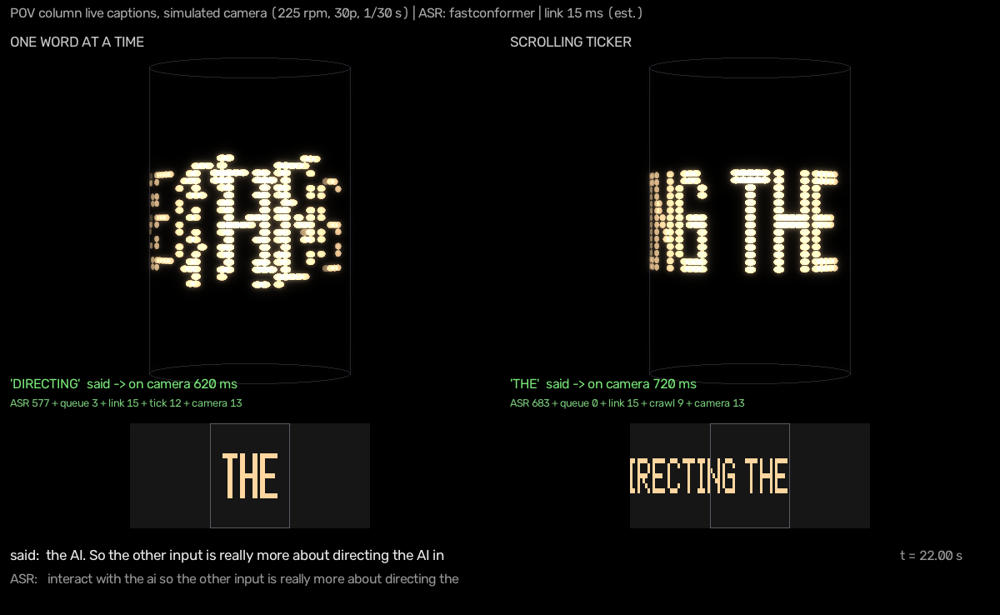
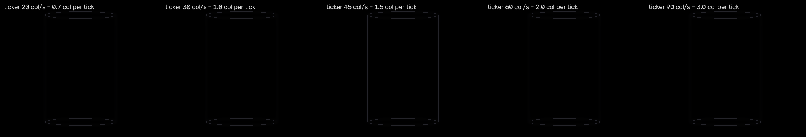
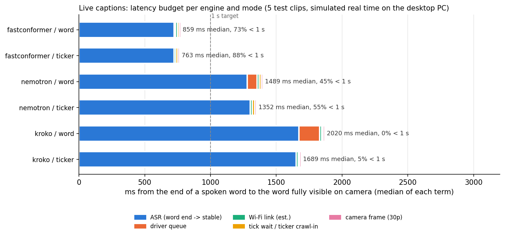
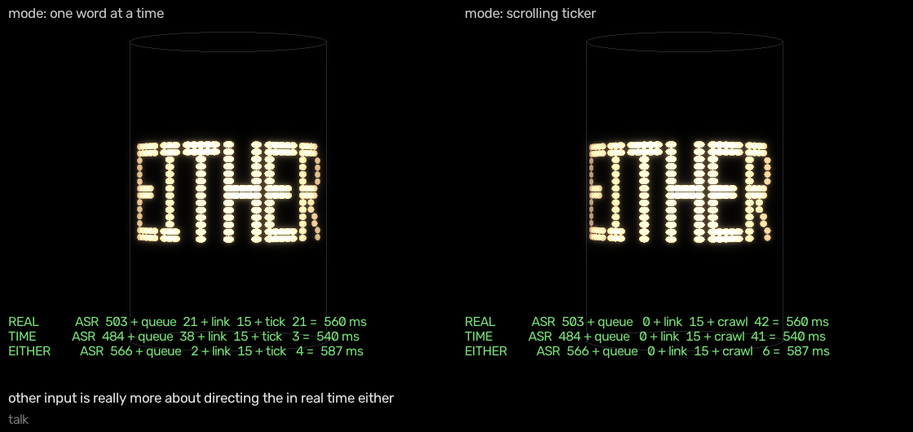

# POV LED Column: Live Captions (streaming speech recognition → the spinning column, word mode and ticker mode)

**Prepared for Brian** · Claude (Opus 5.5), live-captions build agent on the desktop PC · 2026-11-02
Inputs: Brian's request of 2026-11-02 (live captions behind him on camera, both modes as options, lowest possible latency), `docs/2026-11-02-software-and-ai-content.md` (firmware modes, WebSocket live mode, the 32-column window at column 48, the simulator's shutter model), `docs/2026-11-02-v2-24-strips-tie-rods.md` (42 × 96 at 225 rpm, 30 Hz refresh), `software/` (povanim, povsim, firmware skeleton, tests), Brain-Dump-Button `ptt/ptt.py` (mic/device handling, read only), the knowledge base (the desktop PC has no CUDA; Whisper notes).
Outputs: **`software/captions/`** (streaming ASR, caption engine, column model, fonts, transport, simulator preview, live app, MP4 renderer, benchmark), firmware additions **`software/firmware/src/captions.h`**, **`captions_font.h`** and the caption/live-frame hooks in `main.cpp` (**uncompiled**), 28 new tests in `software/tests/test_captions.py` (36 pass in total), figures `docs/img/cap_*`, MP4s in `software/out/captions/` (gitignored), metrics in `software/captions/bench/{results,latency,link}.json`. Test audio and transcripts stayed in `%LOCALAPPDATA%\POVColumn\captions\` (never committed).

---

> **Revised 2026-11-03 (firmware build, `docs/2026-11-03-firmware-build.md`):** `captions.h` is compiled now (Arduino core 3.3.12) and host-tested against `column_model.py`: five scripted sessions (word mode with the jump mini-scroll, the hybrid ticker, the crawl ticker with drops, the current limiter on a white ticker, cfg changes) replayed tick by tick give the same 42 x 96 frame at every tick (CRC per tick, 476 ticks), the same tape position, speed, current field and drop count. The port lives in `software/firmware/lib/povcore/captions.h`; the FreeRTOS queue became a lock-free ring so the same file runs on the host; the tape word buffer grew from 24 to 48 characters (the 34-letter limiter test word was being cut); the ticker maths uses `double` so it matches Python bit for bit. One deliberate difference on the device: a frame drawn on a message wake has the word's tick counter at 0 where the model has 1, so a long word's mini-scroll starts one tick (33 ms) later than in the simulator. The limiter's default cap is 2,720 mA in this model's units (LEDs + idle + ESP32 = the electrical report's 2,600 mA cap plus the ESP32). The X-POV-Token check on the WebSocket upgrade (section 6) is in. Still untested: the real link, acks and tick timing on an ESP32.

## Summary

**It works end to end in simulation: a median of 0.86 s (word mode) and 0.76 s (ticker) from the end of a spoken word to the word fully visible on camera, with 73 % and 88 % of words under 1 s** (FastConformer, five clips, 256 words; table in section 4). Over a real Wi-Fi link to a stand-in column on the Pi, the live app (file → ASR → WebSocket → column model → ack) showed 587 ms median and 850 ms p90 from speech to column, with 0 words dropped.

- **Engine (section 2): sherpa-onnx NeMo FastConformer streaming transducer (80 ms chunks, int8) is the default**: 0.72 s median from word end to stable word, 16.6 % WER against a large-v3 reference, **0.23 CPU cores**. Nemotron-3.5 0.6B streaming is a little more accurate (13.3 % WER) at a similar latency but needs **1.75 cores** and falls behind real time as soon as the desktop PC is busy. Kroko Zipformer is the lightest (0.03 cores, 12 % WER) but slow (1.6 s), because it decodes in 1.28 s chunks. **faster-whisper with LocalAgreement cannot keep up on the desktop PC's CPU** (base.en: RTF 1.0, 3.1 s; small.en: 4.3 cores, falls 14 s behind). The desktop PC's GPU is an AMD RX 5700 with no CUDA, so "streaming ASR on the GPU" was not available to any of these engines, and every number here is CPU.
- **A physics finding changed the ticker design (section 3.3):** at 30p and 1/30 s, each column is captured at a different instant within the exposure, so **moving text is torn on camera**, whatever the firmware does. At the speed speech needs (~75 col/s) it is unreadable; even a slow 1 col/tick crawl is only borderline. The default ticker therefore **holds still while Brian talks, and each new word jumps the tape so the word is fully in the window at the next tick** (the older words shift left round the drum). After 1.5 s of silence the text drifts away. Measured on the take2 clip: **88 % clean camera frames and 700 ms speech-to-camera for this "hybrid" ticker, against 0 % clean and 1,580 ms for the smooth speed-controlled crawl** Brian described. That crawl (speed up, then drop to the newest words) is built, tested and selectable with `--ticker-style crawl`. Long words in word mode scroll one character every 3 ticks for the same reason (`--scroll-style smooth` gives the 120 col/s scroll).
- **Transport:** 30–60-byte JSON caption messages over the column's WebSocket, drawn by a new ESP32 procedural mode with built-in fonts. Frames swap at refresh-tick boundaries (≤ 33 ms) instead of at the hall pulse (up to 267 ms). Fallback: the PC renders and streams 4,032-byte frames over the live mode. A Wi-Fi power-save effect showed up on the Pi link and is mitigated with a keep-alive.
- **Power:** a white ticker around the whole drum would draw 5.3 A. Caption mode has its own per-frame current limiter (2.0 A cap), tested.
- **Untested until the hardware exists:** all firmware (it passes a strict syntax/type check with stubs, but has never been compiled for the ESP32), the real ESP32 Wi-Fi delay, the real camera, and the live mic path with Brian talking (the live app was run on recorded clips, not on the mic).

One command per mode:

```powershell
py software/captions/live.py --mode word          # preview window, mic, default engine
py software/captions/live.py --mode tick
py software/captions/live.py --mode word --to ws://pov.local/ws     # when the column exists
```

---

## 1. What was built

```
 mic (sounddevice, 20 ms blocks)                                         ESP32 on the rotor (captions.h, UNTESTED)
   │ 16 kHz                                                               ┌───────────────────────────────────────┐
   ▼                                                                      │ on_ws: {"cap":...} -> queue           │
 asr.py: FastConformer (sherpa-onnx)  ── stable words + partial ──┐        │ caption task (core 0): apply, draw    │
         or Nemotron / Kroko / Whisper+LocalAgreement             │        │   word: auto font, jump-scroll        │
                                                                  ▼        │   ticker: still, each word jumps in   │
 engine.py: CaptionDriver  (UPPERCASE, light punct., pacing,     WS JSON   │   current limiter -> gb               │
            drops > 1 s behind, clear after 2 s silence) ─────────────────▶│ stage frame; column task swaps it at  │
   │                                                                       │ the next 1/8-rev tick, acks {"ack":id}│
   ├─▶ transport.py: CaptionWS (TCP_NODELAY, keep-alive, ack RTT)          └───────────────────────────────────────┘
   │               FrameStreamWS (fallback: 4,032 B frames, 30 Hz)
   └─▶ session.py + column_model.py (the same logic as captions.h) ─▶ sim.py camera model ─▶ live window / MP4
```

| Piece | What it does | Status |
|---|---|---|
| `asr.py` | One interface (`accept`, `poll` → stable words + partial + word end times, `finish`) over sherpa-onnx streaming transducers and faster-whisper + LocalAgreement-2 | verified on 5 clips |
| `engine.py` | UPPERCASE, light punctuation (`. , ? ! '`, plus `% $ :` inside numbers), digits kept as digits; word mode: show on arrival, hold until the next word, pace bursts at ≥ 0.15 s, drop the oldest if more than 1 s behind, clear after 2 s of silence; ticker: append at once | tested |
| `column_model.py` | Reference model of the ESP32 caption mode: auto font (7×9 if the word fits 32 columns, else 5×7, else a mini-scroll), ticker (hybrid or crawl), current limiter; messages take effect at the next refresh tick | tested; ported to `captions.h` |
| `font.py` | Hand-drawn uppercase 5×7 and bold 7×9 faces (2-px stems), proportional; `--header` generates `captions_font.h` | tested |
| `transport.py`, `mock_column.py`, `probe_link.py` | Caption messages over WebSocket (with ack round trips), frame-stream fallback, a Python stand-in for the ESP32 and a link probe | measured over Wi-Fi to the Pi |
| `session.py`, `sim.py`, `live.py`, `render_clip.py` | One clock-driven session shared by the live window and the offline renderer; a fast camera-model renderer (povsim's projection as a sparse matrix, ~40 ms per view); the live app; the MP4 renderer with audio and a latency overlay | run on clips |
| `bench/` | Clip cutting + large-v3 references, the engine benchmark, the latency chart | results in `bench/*.json` |
| `firmware/src/captions.h`, `captions_font.h`, `main.cpp` | Caption mode, live-frame mode, tick-aligned buffer swap, acks, TCP_NODELAY | **uncompiled**; `captions.h` passes `avr-g++ -fsyntax-only -Wall -Wextra` with stubs |

---

## 2. Streaming ASR: engine comparison

**Method.** Five 40 s clips of Brian: three from the Video 1 script take (camera mic, talking to the camera, the same situation as captions), two from desk-mic brain dumps (natural speech; metrics only, nothing quoted). 301 reference words in all. The reference is faster-whisper large-v3 (beam 5, word timestamps): a pseudo-reference, good for comparing engines but not an absolute accuracy. Every engine ran in **simulated real time**: audio arrives at 1 s per second, each poll's wall time is measured, and a slow poll delays everything after it, so an engine slower than real time falls behind exactly as it would live. **Latency** is the time from a word's end in the reference to the moment the engine returned it as stable (it includes the compute time). **CPU** is process CPU seconds per audio second (1.0 = one core fully busy). Run on the desktop PC (Ryzen 7 5700G, 8 cores) with other agents idle in the background.

| Engine (config) | WER | Word end → stable, median (p10–p90) | CPU cores | RTF | Max lag | RAM | Notes |
|---|---|---|---|---|---|---|---|
| **NeMo FastConformer streaming transducer, 80 ms, int8, 1 thread, hold 0.25 s (default)** | **16.6 %** | **0.72 s** (0.54–0.97) | **0.23** | 0.22 | 0.05 s | 255 MB | lowercase, no punctuation; numbers spelled out |
| same, hold 0.35 s | 16.3 % | 0.76 s (0.55–1.10) | 0.23 | 0.23 | 0.06 s | 256 MB | 0 late extensions |
| same, 2 threads | 16.6 % | 0.71 s | 0.64 | 0.19 | 0.05 s | 255 MB | 2 threads cost 3× the CPU for nothing |
| Nemotron-3.5 ASR streaming 0.6B, 160 ms, int8, 2 threads | 13.3 % | 0.83 s (0.63–1.18) | **1.75** | 0.71 | 0.15 s | 828 MB | cased + punctuation; falls behind when the desktop PC is busy (section 4) |
| Kroko streaming Zipformer EN (2025-08-06), 1 thread | 12.0 % | 1.64 s (1.04–2.40) | 0.03 | 0.03 | 0.05 s | 209 MB | cased + punctuation; decodes in 1.28 s chunks (token delay ~1.0 s) |
| faster-whisper base.en + LocalAgreement-2, 2 threads, 0.5 s step | 9.3 % | 3.13 s (2.28–6.87) | 2.03 | 1.00 | 10.5 s | 233 MB | cannot keep up: real time factor 1.0 |
| same, 4 threads, 1.0 s step, 8 s buffer | 10.0 % | 3.39 s (2.03–9.03) | 3.22 | 0.81 | 7.5 s | 227 MB | keeps up on average, not in bursts |
| faster-whisper small.en + LocalAgreement-2, 4 threads, 1.0 s step | 5.3 % | 6.12 s (4.90–10.35) | 4.27 | 1.03 | 13.7 s | 405 MB | most accurate, unusable live on CPU |
| faster-whisper distil-small.en + LocalAgreement-2, 4 threads | 35.2 % | 5.74 s | 4.36 | 1.04 | 12.8 s | 328 MB | falls behind, loses audio at the buffer cuts |

Per clip (WER, %): FastConformer 7.0 / 9.8 / 22.0 / 8.2 / 47.9 (take1, take2, take3, desk1, desk2); Nemotron 7.0 / 8.5 / 22.0 / 9.6 / 27.1; Kroko 8.8 / 7.3 / 26.8 / 8.2 / 16.7; whisper small.en 0.0 / 1.2 / 22.0 / 5.5 / 4.2. Take3 is hard for every engine (mumbled and repeated lines in the take). Desk2 is FastConformer's weak clip: it is a quieter, faster stretch of brain-dump speech. On the clean camera clips, FastConformer is within 1–3 points of Nemotron.

**Choice.** FastConformer is the default because latency is the goal and it leaves the desktop PC's CPU free: about a quarter of one core, against 1.75 cores for Nemotron and 2–4 for Whisper. Nemotron (`--engine nemotron`) is the accuracy option when nothing else is running. Kroko (`--engine kroko`) is the near-zero-load option if a 1.6 s delay is acceptable. Whisper (`--engine whisper-base|whisper-small`) stays selectable for a future CUDA machine; on the desktop PC it is too slow live.

**Three bugs found and fixed during the benchmark** (all recorded in the knowledge base):
1. *Resetting the sherpa stream at an endpoint lost the next word.* Endpoint detection after 0.6 s of silence, followed by `reset()`, dropped the first word of every new utterance. Nemotron went from 28.9 % to 13.3 % WER, and FastConformer from 24.2 % to 16.3 %, once the stream was kept continuous (it is now only recreated after 4 s with no tokens and a long history).
2. *The "word is finished" timer has to count decoded audio, not fed audio.* Kroko decodes in 1.28 s bursts, so a 0.35 s silence timer measured on fed audio closed words mid-burst (26 premature commits in 301 words). Measured on decoded audio, there are 2.
3. *Distil-Whisper and small.en fall behind*, and LocalAgreement then trims audio it never transcribed. On a CPU, a Whisper policy needs a model at least 2× faster than real time.

How a streaming transducer decides a word is stable: greedy transducer output only ever appends tokens, so a word is final once a later token starts a new word (a token with a leading space), or once the decoder has run 0.25 s further without adding anything (end of a phrase). That is why the default shows **stable words only, with no flicker or rewrites**. The optional `--partial` shows the growing word dimmer (palette index 2, 30 % brightness).

---

## 3. The caption engine and the column

### 3.1 Fonts and fit (`font.py`)

Uppercase only: capitals need no descenders, so a 9-row face is the whole line, and capitals read better at 5 mm pixels on camera. Both faces are proportional (I, 1, punctuation are narrow). In word mode the text is stretched ×2 vertically (7×9 → 18 rows, 100 mm tall on the drum; 5×7 → 14 rows), which reads as a tall LED-sign face. On Brian's speech (301 words), **64 % of words fit the 32-column window in 7×9 (≤ 4 letters), 11 % fit in 5×7 (5 letters), 24 % need the mini-scroll** (median 0.40 s at 120 col/s, about 0.8 s with the default jump scroll). A wider window (±75°, 40 columns) or a condensed 4-pixel face would move most 6-letter words out of the scroll group (option D3 in section 7).



### 3.2 Word mode

Each stable word appears at the next refresh tick after it arrives, centred on column 48, and stays until the next word replaces it, so there is no blanking between words. Bursts are paced (≥ 0.15 s per word), a word queue that would leave the column more than 1 s behind drops its oldest words, and the column clears after 2 s of silence. On the five clips the driver queue added a median of 3–30 ms, and 2 of 256 words were dropped (fast bursts in the desk clips); none on the camera clips.

### 3.3 Ticker mode, and why it crawls at 1 column per tick

The first version was the marquee Brian described: words are appended to a tape that crawls around the drum, the speed adapts to the backlog (a deadline controller that gets every word fully into the window within 1.0 s), and it drops the oldest waiting words if even the maximum speed can't keep within 1.5 s. It is tested and kept as `--ticker-style crawl`. The simulator then showed that **moving text is torn on camera** at the speeds speech needs.



Why: eight strips repaint every pixel every 1/30 s. A 1/30 s exposure therefore captures each pixel exactly once, but each strip sweeps its own 12-column arc during the exposure, so neighbouring arcs are captured up to 1/30 s apart. Text moving at *v* columns per second is displaced by about *v*/30 columns between arcs, at 8 boundaries around the drum. At 1 column per tick (30 col/s) the tear is one column and the text reads. At 2–3 columns per tick (60–90 col/s) it falls apart. Brian's speech at 133 wpm needs about 75 col/s in 5×7. No firmware trick removes the tear: offsetting each column by its own paint time only moves the tear to the arc boundaries. A slower shutter double-exposes instead.

A first fix, crawling at exactly 1 column per tick and jumping only when that could not keep up, still tore: on 5-pixel-wide glyphs a one-column shift at 16 boundaries is enough to garble letters (the 30 col/s tile above is borderline). The rule that works on camera is **don't move text while anyone is reading it**. So the **default `hybrid` ticker holds the tape still while words arrive. Each new word jumps the tape at the next tick, so the word is fully in the window and the older words shift left round the drum (a word-by-word marquee).** Each jump costs one changed camera frame. After 1.5 s without a word the tape drifts away at 1 col/tick, when nobody is reading it. Measured with the clean-frame metric (the share of 30p frames whose exposure saw no change in the visible window): **88 % clean for the hybrid ticker vs 0 % for the smooth crawl** on take2. Its crawl-in term is one tick (≤ 33 ms), and it drops nothing even at 300 wpm (tested). Long words in word mode follow the same rule: they scroll one character (6 columns) every 3 ticks (`--scroll-style smooth` gives the requested fast scroll; only ~24 % of words scroll, so the difference is small, 88 % vs 86 % clean).

Compare both in `software/out/captions/take2_fastconformer.mp4` (defaults) and `take2_fastconformer_crawl-smooth.mp4` (smooth crawl and smooth scroll).

### 3.4 Current limiter

Captions are not files, so the per-animation current cap of `.pova` playback does not apply. The worst case, a white ticker of "WWWW…" all round the drum, models at 5.3 A at full brightness. `column_model.py` (and `captions.h`) score every frame with the same model as `povanim.current_profile`: they take the worst of the 96 rotor positions, set the largest 5-bit current field that keeps it under 2.0 A, lower it at once when needed, and raise it by 1 step every 3 ticks, so the brightness does not pump word to word. Normal captions (one word in the window, or 5×7 text on the tape) stay at full brightness. Warm white (255, 214, 160) is the default colour.

---

## 4. Latency, end to end

Measured in the simulator on all five clips (`render_clip.py`, simulated real time, reference word times). "On camera" = the start of the first 30p frame that shows the word completely. Link = **15 ms assumed** (Wi-Fi + parse on the ESP32; see 4.1). Medians of each term, pooled over the clips:

| Engine / mode | Words | ASR | Queue | Link | Tick wait / crawl-in | Camera frame | **Speech → on camera, median** | p90 | Under 1 s | Clean camera frames |
|---|---|---|---|---|---|---|---|---|---|---|
| **fastconformer / word** | 256 | 722 | 11 | 15 | 13 | 13 | **859 ms** (clips 780–947) | 1214 ms | 73 % | 89 % |
| **fastconformer / ticker** | 260 | 722 | 0 | 15 | 14 | 13 | **763 ms** (clips 700–820) | 998 ms | 88 % | 86 % |
| nemotron / word | 252 | 1278 | 76 | 15 | 17 | 13 | **1489 ms** (clips 920–3240) | 2340 ms | 45 % | 89 % |
| nemotron / ticker | 261 | 1302 | 0 | 15 | 19 | 13 | **1352 ms** (clips 857–2747) | 2175 ms | 55 % | 82 % |
| kroko / word | 253 | 1672 | 158 | 15 | 10 | 13 | **2020 ms** (clips 1863–2163) | 2535 ms | 0 % | 89 % |
| kroko / ticker | 265 | 1651 | 0 | 15 | 11 | 13 | **1689 ms** (clips 1620–1780) | 2429 ms | 5 % | 88 % |
| fastconformer / word, smooth scroll (take2 only) | 76 | 658 | 4 | 15 | 12 | 13 | 740 ms | 917 ms | 93 % | 86 % |
| fastconformer / ticker, smooth crawl (take2 only) | 76 | 658 | 0 | 15 | 910 | 13 | 1580 ms | 1770 ms | 4 % | 0 % |
Dropped words (word-mode pacing, all in fast bursts): fastconformer / word: 2 dropped; nemotron / word: 6 dropped; kroko / word: 8 dropped. The ticker dropped none.




**Reading it:** about 85 % of the delay is the recogniser waiting to be sure a word is finished; the link, the tick wait and the camera frame add about 40 ms together, as the budget predicted (tick ≤ 33 ms, camera frame ≤ 33 ms). **With FastConformer the 1 s target is met at the median in both modes, and for 73 % (word) and 88 % (ticker) of words**. Most misses are the last word before a pause (the recogniser holds it 0.25 s) and words in fast bursts, which word mode paces at ≥ 0.15 s each; the ticker shows a burst in one jump, so it is faster. Nemotron was 0.92–1.0 s median on four clips but **fell 2–3 s behind on the fastest-speech clip (desk1) in two separate batches**, with only the usual background agents running on the desktop PC: 1.75 cores is too much to rely on there. The live window, using the engine's own word-end estimates instead of the reference, shows 540–600 ms (`cap_live_window.png`); the engine places word ends later than large-v3 does, so the reference-based numbers above are the honest ones.



### 4.1 The link, measured where possible

| Measurement | Result |
|---|---|
| WebSocket ping round trip, the desktop PC → Pi 5 (both on Wi-Fi), 180 samples, steady traffic every 1/3 s (`probe_link.py`) | **7.8 ms median**, 17 ms p90, 680 ms worst (one Wi-Fi retry) |
| Caption word → ack after the next tick on the mock column (same link) | 27.9 ms median, 48 ms p90 |
| Full live chain on a clip (file → FastConformer → WebSocket → mock column on the Pi), 83 words | speech → column **587 ms median, 850 ms p90**, 0 dropped |
| Ack round trip in that run, bursts after speech pauses | 532 ms p90 without keep-alive, **283 ms with a 250 ms keep-alive** |

The Pi's Wi-Fi runs with power save **on** (`iw dev wlan0 get power_save`), so the first message after a pause in speech waits for its radio to wake. The ESP32 firmware disables Wi-Fi sleep (`WiFi.setSleep(false)`, already in the skeleton), and `CaptionWS` now sends a 20-byte keep-alive every 250 ms. On the ESP32 the steady numbers (≈ 4 ms one way) are the expectation, which makes the 15 ms assumption conservative. `probe_link.py ws://pov.local/ws` measures the real figure in one minute once the column is up.

---

## 5. Simulator preview and renders

- **Live window:** `py software/captions/live.py --mode both` shows both modes side by side as the Sony would film them (225 rpm, 30p, 1/30 s), with the last three words' latency terms, the transcript, the unstable tail, and a drop counter. It renders each view in ~40 ms. `--file clip.wav` replays a recording instead of the mic. Snapshot: `docs/img/cap_live_window.png`.
- **MP4s with audio** (gitignored, regenerate with `render_clip.py`): `software/out/captions/take1_fastconformer.mp4`, `take2_fastconformer.mp4`, `take3_fastconformer.mp4` (40 s each: both modes side by side as filmed at 30p/1/30 s, the unwrapped 96 × 42 frame under each, what was said and what the ASR heard, and each word's latency terms), plus `take2_fastconformer_crawl-smooth.mp4` (the smooth crawl and smooth scroll, to see the tearing). About 2.5 min to render each.
- **Stills:** `docs/img/cap_take{1,2,3}_fastconformer_{0,1,2}.png` (at 30 %, 55 % and 80 % of each clip), `cap_take2_fastconformer_crawl-smooth_*.png`, `cap_ticker_speed_tearing.png`, `cap_latency_budget.png`, `cap_live_window.png`.

---

## 6. What is untested until the hardware arrives

| Item | Risk | How to test |
|---|---|---|
| `captions.h` + the `main.cpp` hooks (caption task, tick-aligned swap, acks, live frames) have **never been compiled** for the ESP32 | medium: API details (AsyncWebSocket frame info, `setNoDelay`, FreeRTOS from the WS task) | phase 4 build; `probe_link.py` + the mock-free live run |
| Swapping frames at the 1/8-revolution tick instead of the hall pulse (it changes `.pova` playback too) | low: the report already planned tick-aligned frame advance | the dog animation still loops cleanly; captions show ≤ 33 ms tick wait |
| ESP32 Wi-Fi one-way delay and stalls | low to medium | `probe_link.py`; watch `late_cols` while captions stream |
| The camera model itself (tearing, half-changed frames) | low: same model as the report's shutter figures | film the ticker at 30p, 1/30 s: does 1 col/tick read and 3 col/tick tear? |
| Live mic path with Brian talking (MicSource, the default device, room noise) | low: the device code is the F9 service's | `live.py --mode word` and talk; the log in `%LOCALAPPDATA%` holds the latency terms |
| The current limiter on real LEDs (model vs measurement) | low | USB meter on the bank while a full ticker runs |
| X-POV-Token check on the WebSocket upgrade | open TODO in `main.cpp` | add before the column leaves the bench |

---

## 7. Decisions for Brian

| # | Item | Default now | Options |
|---|---|---|---|
| D1 | Ticker style | **hybrid**: still while talking, each word jumps in at the next tick, drifts away after 1.5 s of silence (88 % clean frames, ~0.7 s) | `crawl`: the smooth speed-up/drop marquee as originally described (0 % clean frames at speech speed, ~1.6 s) |
| D2 | Default engine | **FastConformer** (0.72 s, 0.23 cores, 16.6 % WER, no punctuation) | Nemotron (13 % WER, punctuation, 1.75 cores, needs a quiet desktop PC); Kroko (lightest, 1.6 s) |
| D3 | Word-mode window | 32 columns (as asked): 24 % of words scroll | 40 columns (±75°, edges foreshortened) or a condensed 4-pixel face: most 6-letter words would fit |
| D4 | Numbers | as the engine writes them; the streaming models spell numbers ("F NINE") | add a small inverse-text-normalisation step (numbers → digits) after the stable-word stage |
| D5 | Colour | warm white (255, 214, 160) | any; `{"cap":"cfg","rgb":[...]}` |
| D6 | Show the unstable word dimmer | off (no flicker) | `--partial` |

---

## 8. How to explain it

- **Latency is a pipeline budget, so measure every term.** Each word carries five timestamps (said, recognised, sent, on the column, on camera). The result is that ~90 % of the delay is the recogniser deciding a word has ended; the network, the 30 Hz frame swap and the camera together are ~50 ms.
- **Pick the model by the deadline, not the leaderboard.** Whisper is the most accurate engine here and the worst live: it re-reads a growing audio buffer and needs two agreeing passes before it commits a word. A streaming transducer emits each token once, 80 ms at a time, at a quarter of a CPU core.
- **Benchmark in simulated real time.** Feeding audio faster than real time hides the one failure that matters live: an engine falling behind. Charging every poll's wall time to the clock exposed it (Whisper small.en ended up 14 s behind).
- **The camera is part of the display.** The simulator's shutter model predicted that moving text tears at 1/30 s, before any hardware exists. A clean-frame metric turned "looks torn" into a number (0 % vs 88 %), and that changed the ticker from a smooth crawl to a still tape that jumps word by word.
- **Send words, not pixels.** A caption message is 40 bytes; a frame is 4,032. The ESP32 draws with built-in fonts, so the link carries 100× less data and the PC fallback (streaming frames) is there if the firmware mode misbehaves.
- **One reference implementation.** The Python column model is what the tests exercise, what the simulator draws and what the C++ was ported from. The fonts and the LED map are generated headers, so Python and firmware cannot drift apart.

---

## 9. Addendum: Brian's video idea (2026-11-02), prototype

**The idea (Brian, mid-build):** a short clip of Brian, say waving with his face in it, shown as a super-pixelated version on the column, alongside the original video it came from, synced together.

**Prototype: `software/videopix/videopix.py`.** It finds the face (OpenCV Haar), crops head and shoulders at the window's aspect (0.72), applies local contrast (CLAHE) so eyes, mouth and hands survive the shrink, scales to the 32 × 42 camera window, grades for LEDs (dark room → off, mid-tones lifted, saturation up), plays it at 15 fps, and renders the original and the column (camera model, 30p, 1/30 s) side by side with the clip's audio. A 6 s talking-head stretch of the Video 1 take ran in ~20 s: `software/out/videopix/take_talk/take_talk_side_by_side.mp4`.

*[Figure omitted from the public release: Original (crop box in yellow) and the same instant on the column, simulated camera]*

What it showed:
- **The face reads.** Eyes, nose, mouth, hairline and the shirt collar are all there at 32 × 42, and the motion (talking, head turns) carries the likeness more than any single frame.
- **Film the clip against a dark background.** The bright wall behind Brian lights the corners white, competes with the face and pushes the peak current to 1.9 A (near the 2.0 A cap). A dark backdrop (or the room light off behind him) makes the LEDs show only Brian. For a wave, frame wider (`--crop x,y,w,h`) so the hand stays inside the window.
- **Playback on the column:** 6 s at 15 fps of photo content is 157 KB as a 32-colour `.pova`, over the 64 KB in-RAM limit, so it goes through the live-frame stream (`transport.py` `frames:` path, 4 KB frames at 15 fps = 60 KB/s), or as a shorter or 10 fps loop.
- **Sync for the video:** play the original on the PC screen and stream the frames at the same moment from one script (they share the PC clock); in the edit, the clip's audio (or a clap) lines up the column footage with the original. The camera-model side-by-side MP4 is the preview and an animatic for the edit.

Next steps if Brian likes it: record a 3–5 s wave against a dark background, run `py software/videopix/videopix.py <clip> --start <s> --dur 5 --name wave`, and add a `--stream ws://pov.local/ws` option that plays the frames live alongside the original once the column exists (about an hour's work).

## Appendix: files and commands

| Path | Purpose |
|---|---|
| `software/captions/README.md` | how to run, model download commands |
| `software/captions/bench/results.json`, `latency.json`, `link.json` | metrics only (no transcripts) |
| `software/captions/bench/make_clips.py` | cut clips + large-v3 references (local only) |
| `software/videopix/videopix.py` | the video pixel-mirror prototype (section 9) |
| `software/tests/test_captions.py` | 28 tests: fonts, fit, mini-scroll, normalisation, word timing, pacing, drops, silence clear, tick wait, ticker keep-up / drops / speed-up / hybrid / jump scroll, current limiter, LocalAgreement |

```powershell
py -m pytest software/tests -q
py software/captions/bench/bench_asr.py --all
py software/captions/render_clip.py take2 --stills docs/img
py software/captions/probe_link.py ws://pov.local/ws
py software/captions/font.py --header software/firmware/src/captions_font.h
```
