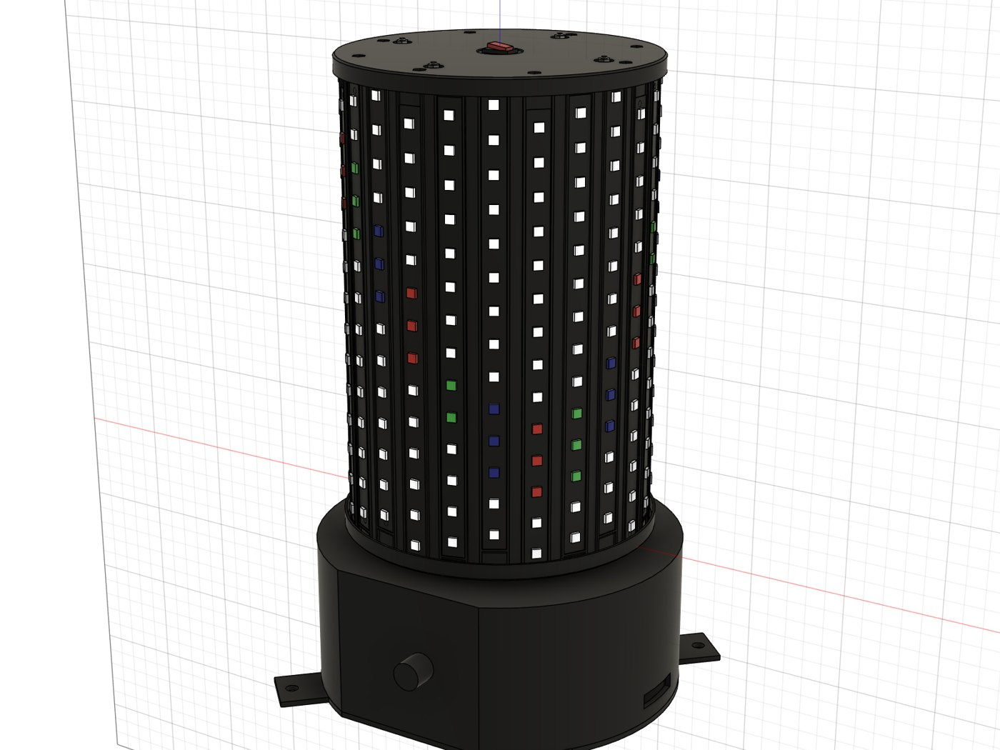
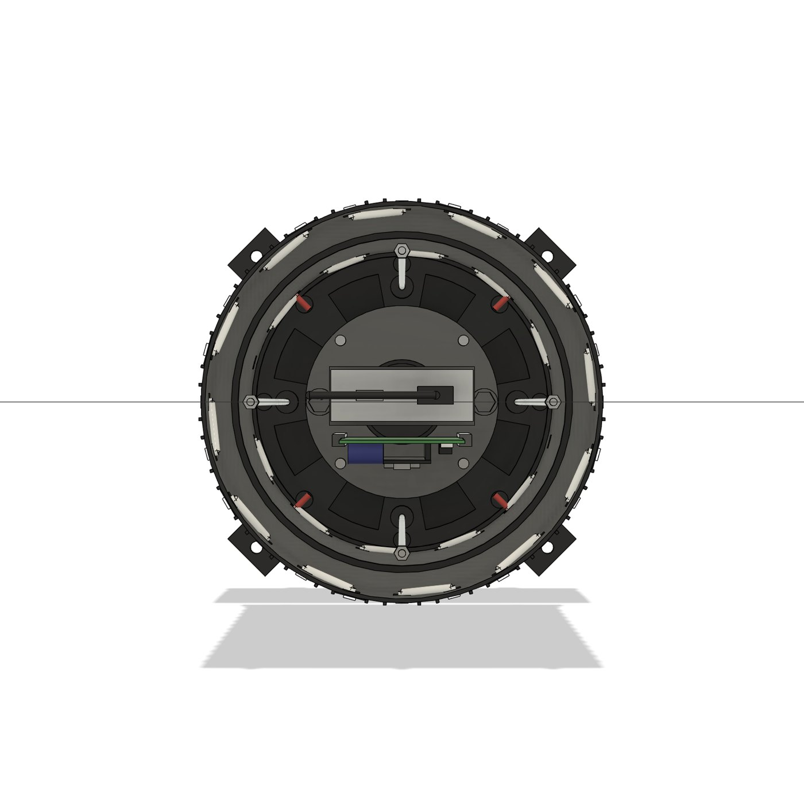
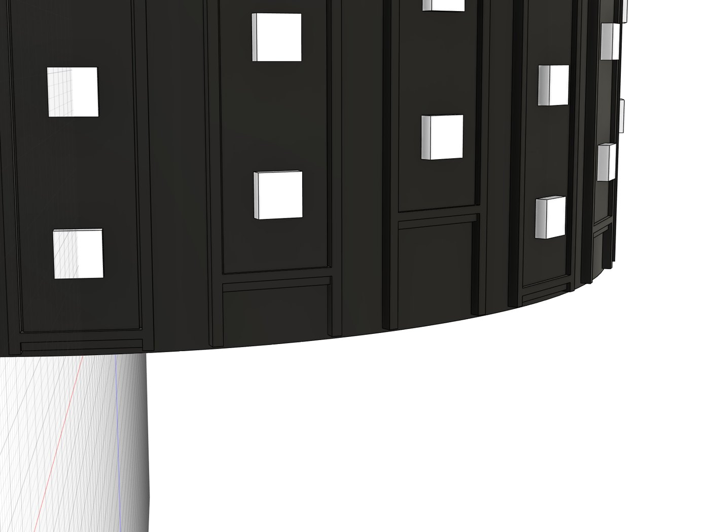
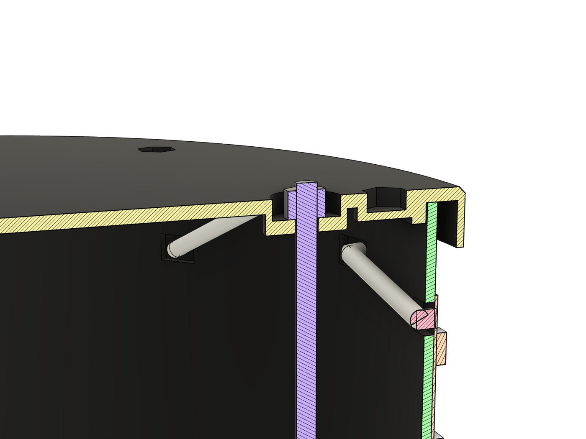
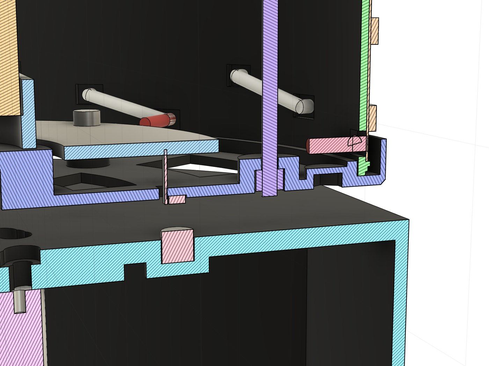
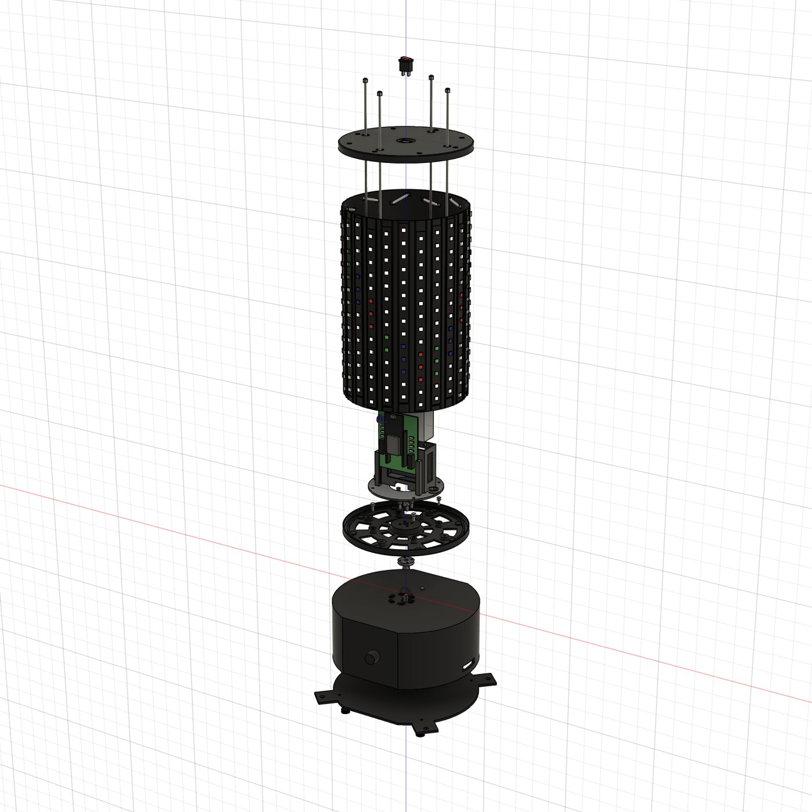
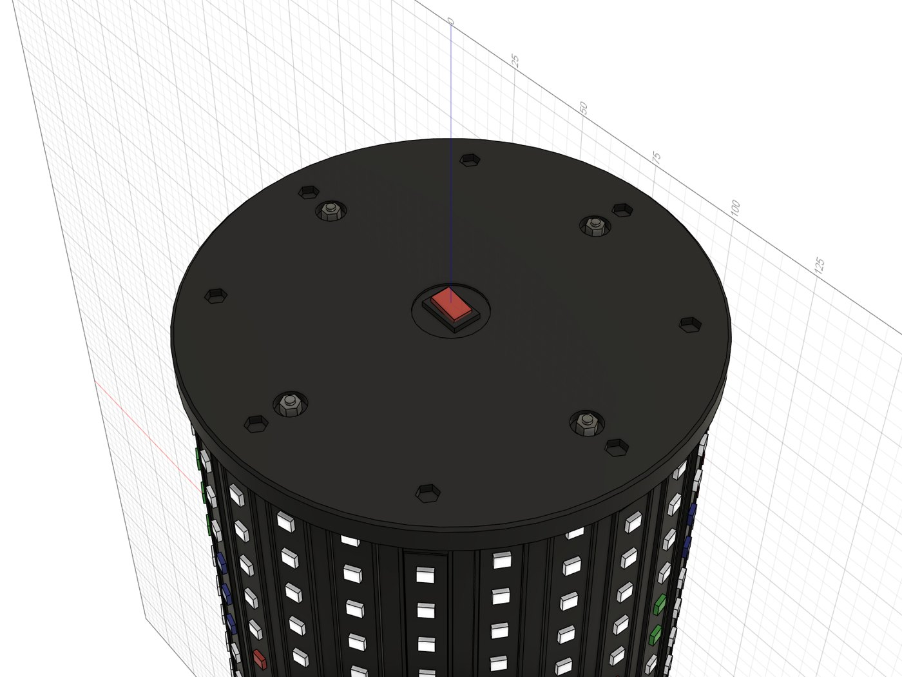

# POV LED Column v2: 24 SK9822 Strips, Steel Tie Rods, Flat-Bottom Base (CAD revision, analysis and print files)

**Prepared for Brian** · Claude (Fable 5.1), CAD revision agent on the desktop PC · 2026-11-02
Inputs: Brian's decisions of 2026-11-02 (**24 LED strips**, **steel M3 tie rods** to hold the caps, **matte black behind the LEDs, black-PCB strips**, and, later the same day, **SK9822 for all 24 strips** after buying a second BTF SK9822 reel and measuring the strip: 12.0 mm wide, 0.46 mm PCB, 5 × 5 mm LEDs, 16.67 mm pitch), the v1 build report `docs/2026-11-01-cad-build.md`, the feasibility study `docs/2026-11-01-feasibility.md`, the parts list `docs/2026-11-01-parts-and-links.md`, the design note `fusionclaude/designs/pov-led-column.md`.
Outputs: Fusion document "POV LED Column" (unsaved, on the desktop PC, now v2), scripts `fusionclaude/scripts/076-089_pov2_*.py`, numbers in `calc/v2_calc.py`, STL/3MF/STEP in `cad/` (v1 files in `cad/v1/`), print projects in `cad/print/`, renders in `docs/img/` (originals `fusionclaude/renders/083-089_pov2_*.png`), time-lapse frames in `<video>\2026-11-02 POV v2 CAD frames\` and `<video>\2026-11-02 POV v2 CAD timelapse.mp4`.

> **Rev i (2026-11-04, the carrier on Brian's counted 26 × 31 hole grid): see the rev i notes in `docs/2026-11-02-electrical-design.md` and `docs/2026-11-02-wiring-cad.md`.** The layout is unchanged (every row − 2, every hole named by the board's printed label, A1 at the bottom left with the component side facing you); the board and its card guides sit 1.27 mm toward −x; 325 CAD checks pass; rotor 928 g, U = 34.0 g·mm (14 % of 248).
>
> **Rev h (2026-11-03, the carrier is the uncut 70 × 90 mm perfboard; carrier-board agent on the desktop PC): see the rev h notes in `docs/2026-11-02-electrical-design.md` and `docs/2026-11-02-wiring-cad.md`.** Brian's Rindion assortment has 70 × 90 boards, not 60 × 80 (measured), so the carrier is the 70 × 90 board used uncut, still an upright card (70 wide, 90 tall, z 11–101). **One printed part changes: the sled** (`fusionclaude/scripts/137`, `cad/rotor_sled_h.*`): its card-guide posts move from x ±31.5 to **±36.5** (6 × 6 × 48, outer corner 4.8 mm inside the Ø100 plate edge, 6.4 mm from the cradle wall, 9.0 mm from the M6 trim bosses) and the slot becomes 70.6 × 2.2; **the bank cradle, cone, doorway, windows, trim bosses, wire slots and tie holes are exactly rev f** (the PLA sled fit-check Brian printed still proves the cradle and ports; only the card slot is new). The tube, both caps, hub core, base shell and plate do not change. Checks (`138`): **309 rows, all pass**; rotor **928 g**, **U 40.7 g·mm = 16 % of 248** (rev g 55 / 22 %). Print files: **`cad/print/rev-h_CURRENT/`** is the complete set (sled `rotor_sled_h_PETG` 2.13 h / 39.6 g, PLA draft `fitcheck-PLA/rotor_sled_h_PLA-fitcheck` 1.77 h / 36.1 g; every other file is the rev g file moved over); the rev g sled files are in `rev-g_superseded/`. Still assumed: the board's hole count, 27 × 35 (electrical E17).
>
> **Rev g (2026-11-03, QA B2 + the afternoon's measurements): see the rev g notes in `docs/2026-11-02-electrical-design.md` (section 7.6 is the jumper procedure) and `docs/2026-11-02-wiring-cad.md`.** The wall slots behind the strip ends are **10 × 5 mm** (were 7 × 5) so all four back pads show through them (span assumed 9.0 mm, E15 to measure); the 22 jumper ribbons are cut at **80 mm** with a 27 mm slack loop so both joints of every ribbon are made pads-up, none through a slot (section 9 step 2 below and the "7 × 5" in section 2.1 are superseded); the bottom cap's nyloc pockets are **5.6 AF** for Brian's measured 5.34 AF × 3.9 nuts; the strips weigh **4 g** each (rotor 924 g, U 55 g·mm = 22 % of 247); the strip cut-line offset (measurement #26) is `CUT_IN` / `CUT_OUT` in `povlib.py` and the end-stops follow it (measure before the tube prints). 285 checks pass. Print files now live in **`cad/print/rev-g_CURRENT/`** (tube re-sliced 15.3 h / 280 g, cap plate re-sliced); the 7 mm-slot tube is in `rev-f_superseded/`, the rev e parts in `rev-e_superseded/`.
>
> **Rev f (2026-11-03, FDM optimisation): see `docs/2026-11-03-fdm-optimisation.md`.** The hub is split into a 12 g **PET-CF hub core** (coupling pocket + floor, printed pocket-up so the flange seat is a top layer, not a bridged ceiling) on a **PETG bottom-cap plate** (4 x M3 x 8 countersunk into inserts, d28 spigot); the **sled is PETG** with a 45 deg cone under the cradle floor (rev e bridged 44 mm with 0.4 mm over the hub top), a gable doorway and gabled windows; the base shell's 30 mm side-slot bridges are 45 deg vent diamonds; the **bottom plate is PETG**. Tube and top cap unchanged. Rev f print files are `cad/print/*_f_*` and `rotor_hub_core_*`; every rev e file below is untouched and remains the fallback. 263 checks pass, rotor 986 g, U 55 g mm (21 %).
>
> **Revised 2026-11-03 (rev e): Brian's measured parts folded in** (`docs/measurements.md`, rows marked "yes"; CAD v4 = `fusionclaude/scripts/112-120_pov4_*.py`, `lib/povlib.py` v4 parameters; design note `fusionclaude/designs/pov-led-column.md` "v4"). What changed:
>
> | Item | v2-v3c | **rev e** | Why |
> |---|---|---|---|
> | Motor mount | 6 x M3 x 8 straight into the gearbox through the deck, slotted holes, motor-face coupon | **kit steel L-bracket (1.46)**: motor hangs shaft-up from its horizontal leg on the supplied M3 x 5.5 screws (4.0 mm in the gearbox); the 40 x 40 vertical leg screws to a **printed post under the deck** (10 x 44, two 45 deg gussets) with 4 x M3 x 6 inserts + M3 x 8 | Brian's bracket; the supplied screws are too short for a 4.5 mm plate; the 6-hole pattern (60 deg, PCD 30, shaft 7.0 off-centre) is now the bracket's problem |
> | Deck | d12.6 boss hole, 3 mm motor pad | **d18 hole** (the coupling hub spins 4.1 mm clear), no pad, **six d7.5 x 2.5 pockets** in the underside for the motor screw heads; bracket top 0.79 mm under the deck | the measured 5.89 mm boss puts the coupling bottom 0.36 mm below the deck plane |
> | Coupling / hub pocket | flange guessed d22 x 4, pocket ceiling z 5 | measured **d21.97 x 1.98**, hub d9.86 x 9.88, M3 tapped PCD 16: **pocket ceiling z 2.0**, hub floor 6.0, M3 x 8 = 2.0 mm of steel thread; coupling **seated on the boss** (rotor weight on the shoulder); shaft stub 3.31 above the flange with 12 mm of open hole; set screw at z -5.73 = mid-gap, 3.0 mm for a 1.5 mm hex key each way | measured |
> | PWM controller | 50 x 32 generic board on the front flat, pot on the board | measured **76.13 x 46.0** (holes 64.58 x 37.0, ~28 tall) on the **back flat**: d7 x 10 standoffs with 45 deg webs, **M3 x 4 inserts in d4.0 x 8 holes**, M3 x 8, 7 mm under-board clearance, heat sink toward the drum | the 76 mm board and the pot cannot share the 86 mm front flat |
> | Speed pot | on the PWM board | **WH148 B10K on a cable** in the front flat centre: d7.5 hole + 2.7 x 1.4 tab slot 8.3 above it, wall 3 (<= 4), knob outside; cable ~360 mm round the drum to the board's pot connector | Brian's pot |
> | DC jack | DC-022B in the back flat | **none**: 8 x 6 notch in the back-flat bottom edge under the IN terminal; the bench-supply red/black 22 AWG pair runs 4 mm above the bottom plate under an **8 mm staple bar printed on the plate** (zip tie lashes pair + bar) and straight up into IN+/IN- | not bought; bench supply. A staple on the wall would hang unsupported in the deck-down print |
> | Bank / sled | 66 x 23.9 x 105.4 (listing), 200 g | measured **66.3 x 25.0 x 105.7, 199 g**: cradle inside **67.1 x 25.8** (0.4/side), ports at x +-16.25 (open 10.6 from the side), button covered by the cradle wall; top +0.3 mm (130 mm to the top cap) | measured |
> | Inserts | d4.1 x 6 | **d4.0, depth L + 1** (Brian's INCLY M3 x 4/6/8/10, 4.2 OD); hub and plate bosses d4.0 x 7 for M3 x 6 | measured |
> | Electrical | 2.4 A port, cap 2.0 A, F1 3 A | port label **5 V 3 A**: **cap 2.6 A** (`CAP_MA` 2600; 2.72 A with the ESP32, 9 % headroom), **F1 4 A** (68 % of rating; 3 A was 91 %), trunk 87 mOhm -> **236 mV, bus 4.76 V** at the cap (LDO margin 0.26 V); dense text now uncapped at 2.47 A = 12.4 W, **2.4 h**; sparse 4.1 h, dog 6.7 h. **Front-only mode** (blank the back half of each revolution from the hall angle, front direction in the web UI, default 360) stubbed in the firmware as a flag + design note | `docs/2026-11-02-electrical-design.md` rev e |
>
> **Checks (script 118): 217 rows, all pass** (clearances, designed fits, retention / load path, bend radii, mass). Tightest: coupling to the motor screw heads 3.10, boss in the deck hole 3.0, bracket leg to the deck underside 0.79, screw heads in their pockets 1.0, shaft stub in the hub's d7 hole 0.53, supply pair on the anchor bar 0.35, hex key 3.0 to the cap and the deck, the v3 wiring values unchanged. Rotor **987 g** (bank 199), CG (0.03, 0.07) mm, **U 73 g mm = 28 %** of the 264 g mm G6.3 budget at 225 rpm (3 M3 trim nuts), I_zz 3.78e-3 kg m2; base **740 g** (shell 362, plate 123, motor 164, bracket 33, PWM 30, pot 12), device 1.73 kg.
>
> **Print files (`cad/print/`, same profiles as below): base_shell_PETG 8.06 h / 295 g** (deck-down; the post, gussets, standoff webs and the open-upward head pockets add nothing unsupported: the exported mesh's only print-down faces are the 8 mm side-slot bridges and the tops of the horizontal insert holes), **base_bottom_plate_PLA 2.33 h / 93 g** (new file: the zip-tie staple; if the v1 plate is already printed, a stick-on tie mount at the same spot does the job), **rotor_bottom_cap_hub_PET-CF 2.60 h / 63.8 g, rotor_sled_PET-CF 2.10 h / 44.9 g**, and the new **`coupon_base_footprints_PETG` 0.62 h / 14.8 g** (116 x 46 x 1.6 plate: the bracket's 30.0 x 23.9 insert rectangle in an 8 mm pad, the PWM 64.58 x 37.0 pattern on d8 bosses with d4.0 x 5 insert holes, the pot's d7.5 hole + tab slot, the coupling's d22.4 x 1 seat with PCD-16 holes). Print the coupon first; the tube and top cap files are unchanged. Renders: `fusionclaude/renders/119_pov4_*.png`.
>
> **PLA fit-check prints (added 2026-11-03):** cheap PLA drafts to prove every fit before spending PET-CF / PETG. Same STL, orientation, plate position (175, 160), 0.2 mm layers and no-supports / brim logic as each part's real file, so the fits print the same; **Bambu PLA Matte @BBL H2D**, textured PEI, slot 1 -> left nozzle, profile `fusionclaude/slicer/process/0.20mm PLA Fitcheck @BBL H2D.json` (Balanced Strength + **2 walls, 3 top / 3 bottom, 10 % gyroid**, outer wall speed left at the default 60 mm/s so the outside dimensions match). Files `cad/print/<part>_PLA-fitcheck.3mf` (project) + `.gcode.3mf` (sliced, verified: 220/55 °C, layer counts as the real files, nothing outside the plate). Times are short of the real files mostly in the infill: these parts are thin walls and plates, so the saving is ~20 % (base 1.3 h), not 2x.
>
> | Part | File | Time | g | What to check |
> |---|---|---|---|---|
> | Hub / bottom cap | `rotor_bottom_cap_hub_PLA-fitcheck` | 2.12 h | 54.6 | coupling flange seats flat in the hub pocket (ceiling z 2.0) and the 4 M3 x 8 reach the tapped flange; shaft stub clears the d7 hole; set screw reachable with the 1.5 key; M3 x 6 inserts take in the 4 sled bosses (d4.0 x 7); tie-rod holes / nyloc pockets (6.0 AF) take a nut; lip into the tube ring |
> | Sled | `rotor_sled_PLA-fitcheck` | 1.70 h | 37.7 | bank slides into the 67.1 x 25.8 cradle (0.4/side) with the ports in their openings; carrier card in its slot; ESP32 + pigtail routing slots; 4 holes line up with the hub bosses (M3 x 8) |
> | Base shell | `base_shell_PLA-fitcheck` | 6.76 h | 208.3 | L-bracket bolts to the post (4 x M3 x 6 inserts, M3 x 8), motor-screw heads sit in the six deck pockets, coupling hub spins clear in the d18 deck hole; PWM board on the d7 standoffs (M3 x 4 inserts; ream the board holes to 3.2 if tight); WH148 pot + tab through the front flat (d7.5 + 2.7 x 1.4 slot, wall 3), knob clear; supply-lead notch; bottom-plate bosses (M3 x 6 inserts) |
> | Top cap (rev d, no switch) | `rotor_top_cap_PLA-fitcheck` | 1.76 h | 60.4 | lip into the top ring; tie-rod counterbores + nyloc pockets; trim-nut pockets; skirt clears the strip ends |
> | Tube end rings (new) | `tube_end_rings_PLA-fitcheck` | 2.53 h | 42.4 | see below |
> | **Total** | | **14.9 h** | **403 g** | |
>
> **Tube end rings** (`cad/tube_end_rings_fitcheck.stl`, cut by `cad/make_tube_end_rings.py`: z 0-20 and z 230-250 of `rotor_tube.stl`, intersected with a slab by manifold3d so the cut faces are capped and both bodies are watertight; the top ring keeps its tube orientation with the z 230 cut face on the bed; both rings on one plate, diagonal, 14.6 mm apart; **3 walls** (the 1.6 mm wall) and the tube's 5 mm outer brim). They test: the **cap lips** (3 mm spigots, 0.2 radial) into the bottom ring (hub) and the top ring (top cap), plus the tube end bearing flat on each cap face; the **strip rails at the ends**: slide a strip offcut into the 12.6 mm rails from the cut end down to the printed **end-stops** (z 1-3 bottom, 247-249 top), and the **four-wire slots** (z 4-8 / 10-18 bottom, 232-240 / 242-246 top); the chamfered tube ends. **Not tested by the rings: tie-rod clearance**: the rods run at r 60, 18 mm inside the tube wall (r 78.4), and nothing in the tube touches them; check rod holes and nyloc pockets on the caps themselves (a short M3 screw + nyloc through each cap). Removed: `rotor_top_cap_PLA.*` (old switch cutout, E14); `rotor_tube_PLA.*` is kept (current geometry, the PLA Matte alternative to the PETG tube).
>
> **Bill of screws and inserts per joint (rev e):**
>
> | Joint | Fastener | Qty | Insert / thread | Printed hole | Engagement |
> |---|---|---|---|---|---|
> | Motor -> L-bracket | M3 x ~5.5 pan (supplied with the kit) | 6 | tapped gearbox face | bracket d3.4 | 4.0 mm |
> | L-bracket -> post (base shell) | M3 x 8 SHCS | 4 | M3 x 6 heat-set | d4.0 x 7, horizontal, in the post | 6.0 in the insert (6.54 reach) |
> | Coupling -> hub (bottom cap) | M3 x 8 SHCS (M3 x 10 gains nothing) | 4 | M3 tapped steel flange, 1.98 thick | hub d3.4 | 2.0 mm (= the flange) |
> | Coupling -> motor shaft | M3 set screw (with the coupling) | 1 | - | - | on the D flat, 4.1 above the boss; hub seated on the boss |
> | Sled -> hub bosses | M3 x 8 SHCS | 4 | M3 x 6 heat-set | d4.0 x 7 | 5.6 |
> | PWM board -> standoffs | M3 x 8 SHCS (ream the d3.0 board holes to 3.2 if tight) | 4 | M3 x 4 heat-set | d4.0 x 8 | 4.0 (6.4 reach) |
> | Bottom plate -> shell bosses | M3 x 8 countersunk | 4 | M3 x 6 heat-set | d4.0 x 7 | 5.0 |
> | Top cap - tube - bottom cap | M3 rod 256.8 + nyloc each end | 4 + 8 | - | d3.4 | rod 1.1 / 1.0 past the nylon ring |
> | Pot -> front flat | M7 nut + washer (with the pot) | 1 | - | d7.5 + 2.7 x 1.4 slot | wall 3 |
> | 12 V leads -> base | zip tie at the staple anchor | 1 | - | - | - |
> | Trim | M3 nuts in the r 72 pockets | ~3 | - | - | 26 g mm each |
>
> Totals: **16 x M3 x 8 SHCS, 4 x M3 x 8 countersunk, 6 x kit M3 x 5.5; inserts 12 x M3 x 6 + 4 x M3 x 4; 4 rods, 8 nylocs**, 2 + 1 + 1 zip ties, M3 trim nuts. Still pending from Brian (not blocking): nyloc AF (#21; 5.5 assumed in the 6.0 AF pockets), strip weight (#23; 6.7 g each assumed), threaded rod (#24). To confirm on the real parts: the D-flat's length along the shaft, the PWM board's terminal / connector positions (terminals assumed on the bottom edge, entries facing down), the kit pot cable's length (~400 mm cut needed), the gearbox holes >= 4.5 deep.
>
> **Revised 2026-11-03 (rev d):** the KCD11 rocker switch and its cutout in the top cap are gone (Brian: plugging the pigtail into the bank is the on/off). The top cap is now a plain plate with the same tie-rod counterbores, trim pockets, skirt and lip; `cad/rotor_top_cap.stl/.3mf` and `cad/print/rev-f_CURRENT/rotor_top_cap_PETG.*` were regenerated (PETG Matte, 1.92 h, 66.2 g). `cad/print/rotor_top_cap_PLA.*` was not re-sliced (old cutout) and was deleted in rev e; the PLA draft is now `rotor_top_cap_PLA-fitcheck`. Switch rows in the tables below are history; see `docs/2026-11-02-electrical-design.md` rev d.

---

## Abstract

The rotor now carries **24 straight SK9822 strips at 15°, in three interleaved sets of eight** (336 LEDs, 42 rows at 5.56 mm), driven as **two 12-strip serpentine chains on the ESP32's two hardware SPI buses**, and its caps are held on by **four M3 stainless tie rods at r 60 with a nyloc nut at each end** (cut length **256.8 mm**), which closes the v1 cap-retention gap. Eight strips share every row, so the display refreshes at 30 Hz at **225 rpm** (Brian's slower speed); with 96 columns per revolution the pixels are 5.2 × 5.6 mm, a **42 × 96 = 4,032-pixel** image. A 168-LED SPI chain updates in **0.69 ms** against a 2.78 ms column (75 % margin), and the SK9822's ~4.7 kHz PWM and 5-bit global brightness remove the dashed-arc problem that forced v1 onto a 0/255 palette. The base shell's magnet pad moved into a boss under the deck, so the deck prints flat on the plate; the tube's inner ring, the PWM standoffs and the plate bosses were made self-supporting. **44 exact clearance checks, 16 designed fits and a new 23-row retention/load-path table all pass.** The rotor is **969 g**, I_zz **3.70 × 10⁻³ kg·m²** (+36 % on v1), residual unbalance **53 g·mm against a 259 g·mm G6.3 budget at 225 rpm**, stored energy 1.0 J (v1: 3.0 J at 450 rpm), spin-up 3.3 s on the Copkim motor. Two findings still need Brian: the INIU bank's 2.4 A USB-A port limits brightness (FastLED cap 2.0 A, 2.8–4.1 h runtime), and nylocs on a cap that comes off for every charge are rated for ~5 reuses. Print files (matte black: PET-CF hub and sled, PETG or PLA Matte tube, top cap and base) are sliced and verified; the hub and sled wait for the real motor, coupling, bank and ESP32 to be measured.

---

## 1. What changed and why

| Item | v1 (2026-11-01) | **v2 (2026-11-02)** | Why |
|---|---|---|---|
| Strips | 8 × WS2812B 10 mm at 45°, 2 sets (half-pitch) | **24 × SK9822 12 mm black PCB at 15°, 3 sets (third-pitch)** | Brian: 24 strips; then SK9822 (he owns two 5 m 60/m reels, 10 m for 5.6 m needed). Rows 28 → **42** at 5.56 mm, K = 8 passes per row |
| Drive | 8 RMT lines, 1-wire, 30 µs per LED | **2 SPI chains (clock + data) of 12 strips / 168 LEDs at 8 MHz, 0.69 ms per update** | no serial-data ceiling, no PWM banding (Section 4.3) |
| Operating speed | 450 rpm (30 Hz with K = 4) | **225 rpm (30 Hz with K = 8)**; 240–300 rpm for live viewing | Brian prefers slower; KE 3.0 J → 1.0 J, rim 18 g → 4.5 g |
| Columns | 72 (7.0 mm pixels) | **96** (5.24 mm, aspect 0.94; 4 columns per 15° strip step) | square-ish pixels; the 5 mm LED package limits beyond ~M 100 |
| Cap retention | slip-fit lips only (open item) | **4 × M3 stainless tie rods, r 60, nyloc each end; lips 3 mm as spigots** | Brian: tie rods; retention/load-path check added to the verification |
| Skirts | 18 mm (hid 8 LEDs, see 2.2) | **7 mm** | lit band z 8.6–241.4 must stay visible |
| Tube | 16 rails, 12 slots, square mid ring, 8 useless Ø2.5 holes | **48 rails (12.6 mm slots), 24 printed end-stops, 48 four-wire slots, 45° mid ring, no holes** | strip z datum ±0.5 mm; four wires per joint; printable without supports |
| Base shell | Ø12 × 1.5 magnet pad on the deck (only bed contact) | **magnet pocket sunk into a Ø12 × 3 boss under the deck; 45° webs under the PWM standoffs; cones under the plate bosses** | flat first layer, no supports |
| Colour | black PLA | **matte black everywhere behind the LEDs (black PETG bought); black-PCB strips** | Brian, POV contrast |
| Unchanged | motor, coupling, hub pocket, sled, carrier/ESP32, bank, pigtail, switch, PWM, jack, bottom plate, feet | | |

The CAD was rebuilt in the same Fusion document: each v2 script (`076` tube, `077` strips + chain wiring, `078` bottom cap, `079` top cap, `080` tie rods, `081` base) deletes and recreates the component it owns, so the unchanged v1 components (`067` sled stack, `068` coupling + motor) stayed in place. All dimensions live in `fusionclaude/lib/povlib.py` with the v1 values in comments; the strip width, thickness, pitch and package are parameters, so the measured strip went in as four numbers and two script re-runs.

---

## 2. Geometry

Coordinates as in v1: Z is the spin axis, z = 0 at the tube bottom (top face of the bottom-cap plate), base deck top at z −9.5.

### 2.1 Strips, rows, rails, end-stops, slots, chains

| Item | Value |
|---|---|
| Strips | 24 × 14 LEDs, **SK9822 60/m, measured by Brian: 12.0 wide, 0.46 mm PCB, 5 × 5 mm LEDs, 16.67 pitch**, 233.3 long, black PCB, strip s at θ = 15°·s; the 3M tape (~0.2 mm, not measured) stays under the strip |
| Sets | A = s mod 3 = 0, B = 1, C = 2; set offsets p/3 = 5.556 mm. LED0 at z **11.11 / 16.67 / 22.22**; 42 rows at 5.556 mm span 227.8 mm, centred in the 250 mm tube (8.6 mm margins) |
| Strip ends | A 2.78–236.11, B 8.33–241.67, C 13.89–247.22 (staggered by design; the 7 mm skirts cover only the outermost ends; the ends are black PCB on a black tube with the solder on the back) |
| Rails | 48, 1.2 × 1.0, pairs **12.6** apart (0.3 per side), z 0.5–249.5; a rail pair is 15.0 mm wide, the arc per strip at r 80 is 20.94 mm, so **5.9 mm of bare tube** separates neighbouring pairs (no shared rails needed). The 1.0 mm rail stands 0.3–0.5 mm proud of the 0.46 + 0.2 mm strip face, so it still locates the strip edge |
| End-stops | one under every strip's bottom end, rail to rail (15.0 wide), 2 mm tall in two 1.0 mm steps (0.5 and 1.0 mm proud) so they print without support. The strip's **cut end** sits on the stop; LED0 is then 8.33 mm above it. Error budget: print ±0.1 + cutting on the cut line ±0.5 = **±0.6 mm against a 5.56 mm row pitch** (rows still interleave if the error stays under ±1.4) |
| Wire slots | 48 × (**7 × 5 mm**, four wires) through the wall **behind** every strip end: bottom (A 3.8–8.8, B 9.3–14.3, C 14.9–19.9) and top (A 230.1–235.1, B 235.7–240.7, C 241.2–246.2). Wires solder to the strips' back-side pads (peel the tape over the slot) and pass straight through, so nothing stands proud of the LED face |
| Mid ring | 3 mm inward at z 121.5–126.5 with a 45° underside (v1's square ring was a 3 mm 90° overhang) |

**Chains (2, one per SPI host).** Chain 0 is strips 0–11 (0°–165°), chain 1 is strips 12–23. Within a chain the data snakes 0 → 1 → 2 …: **even strips take clock and data at the bottom and run up, odd strips are mounted inverted (input at the top)**, so each of the 22 inter-strip jumpers is ~25 mm (5 V, GND, CLK, DATA through the slots behind the strip ends and along the inside of the wall) and no wire runs the length of the tube; the firmware reverses the index of the odd strips. Power is injected at the **bottom end of every third strip** (0, 3, 6 … 21: eight feeds, one per 45° sector, symmetric), and clock + data ride on feeds 0 and 12. Every strip is within 1.5 strip lengths of a feed (52 mV at the 0.25 A per feed cap; SK9822 is constant-current, so this costs nothing). The jumpers and feeds are modelled (component "R15 chain wiring") so the exact checks cover them.

### 2.2 Tie rods and caps

| Item | Value |
|---|---|
| Rods | 4 × M3 304 stainless, r **60**, θ 0°/90°/180°/270°, z −2.8 … 254.0 → **cut length 256.8 mm** (±0.5; from an M3 × 300 rod; cut all four alike), 14.3 g each |
| Bottom nut | M3 nyloc (5.5 AF × 4.0) in a **6.0 AF × 4.3 hex pocket** open on the cap underside, inside a Ø12 × 4.5 boss; floor above the nut 2.2 mm; rod end 1.1 mm past the nylon ring, 6.7 mm above the base deck. Fit the bottom nuts with a drop of medium threadlocker: the four rods become studs standing up from the hub |
| Top nut | M3 nyloc in a **Ø10 × 3.0 round counterbore** in the top face (a 5.5 mm nut driver fits), boss Ø12 × 3 under the plate, floor 2.0 mm, nut 1.0 mm proud, rod end 1.0 mm past the nylon ring (2.0 mm above the top face). **Top cap off = four nuts** |
| Lips | 3 mm tall (was 4), 0.2 mm radial to the tube bore: locating spigots only |
| Skirts | 7 mm (was 18). v1's 18 mm skirts covered z 0–18 and 232–250 while set A's first LED sat at z 10–15 and set B's last at 235–240: **8 of the 112 LEDs were behind the skirts**. v2's band (8.6–241.4) clears both skirts by 1.8 mm axially; radially the LED tops (r 82.06, 82.26 with tape) clear the skirt bore by 1.1 mm |
| Preload | snug: finger-tight plus 1/8 turn, about 0.1 N·m ≈ 150 N per rod → 30 MPa in the rod, 8.8 MPa under the nut faces (PET-CF/PLA creep limit ~25 MPa), 0.75 MPa on the tube's end rings against 13 MPa thin-shell buckling (factor 17). **Retention does not depend on preload**: the nylocs hold if creep or a cold room slackens the clamp |
| Thermal | PLA/PETG grow ~53 ppm/K more than steel: a **+10 K warm-up adds ~1 kN** of clamp (k_rod 22 MN/m, k_tube 11 MN/m), a cold room loosens it. Reason for "snug, not torqued"; optional M3 wave washers under the top nuts keep the clamp constant |
| Dynamics | rod lateral natural frequency ~200–230 Hz vs 3.75–7.5 Hz rotation; centrifugal bow 0.03 mm at 225 rpm |
| Inertia | the four rods add 2.1 × 10⁻⁴ kg·m² (6 % of I); r 55 would be possible (3.5 mm to the sled rim) but buys only 1 % |
| Trim pockets | the 16 v1 hex pockets at r 72 stay as trim-weight pockets (no conflict: rod bosses r 54–66, trim bosses r 67.5–76.5) |
| Removed | the Ø2.5 radial holes in the tube and both skirts (they hit nothing in v1) |

### 2.3 Base shell

The v1 base exported deck-down had only the Ø12 × 1.5 magnet pad on the bed. v2 removes the pad: the Ø6.3 × 6.0 pocket is sunk from the flat deck face into a **Ø12 × 3 boss under the deck** (floor 2.5 mm), the two stacked 6 × 3 magnets seat on the pocket floor with their top at z −8.0, **1.5 mm proud of the deck and 6.0 mm under the spinning cap; the hall gap stays 5.0 mm** (measured 5.00). Two further print fixes came from checking the exported mesh rather than the Fusion model: the four PWM standoffs are horizontal Ø6 × 11 cantilevers in print orientation and now carry 45° webs from their axis on the print-down side, and the four Ø9 bottom-plate bosses, whose end faces hang 8.5 mm into the drum at the top of the print, now end in 45° cones. The whole 29,700 mm² deck face sits on the plate. Nothing else in the base changed.

### 2.4 Unchanged

Tube OD/wall/height, hub and coupling pocket, sled bosses, sled with cradle and card guides, carrier board (now carrying one 74AHCT125 for the four SPI lines instead of two for eight RMT lines; the mock still shows both chips), ESP32, bank, pigtail, rocker switch, motor mount, PWM controller, DC jack, bottom plate, feet. The sled's print file was regenerated so all files come from one run, but its geometry is identical to v1.

---

## 3. Compute and timing

Refresh = K × f_rot with K = 8 strips per set. An SK9822 chain of 168 LEDs is 32 + 168 × 32 + 88 = 5,496 bits: **0.69 ms at 8 MHz** (0.55 ms at 10 MHz), both chains in parallel on VSPI and HSPI; all 336 on one bus would be 1.37 ms.

| rpm | Refresh | M | Pixel w × h (mm) | t_col (µs) | Margin, 2 chains at 8 MHz | Max M at 8 MHz | (v2a WS2812B, 8 RMT chains × 42: margin) |
|---|---|---|---|---|---|---|---|
| **225** | **30 Hz** | **96** | **5.24 × 5.56** | **2778** | **+75 %** | 388 | +45 % |
| 225 | 30 Hz | 120 | 4.19 × 5.56 | 2222 | +69 % | | +31 % |
| 225 | 30 Hz | 144 | 3.49 × 5.56 | 1852 | +63 % | | +17 % |
| 270 | 36 Hz | 96 | 5.24 × 5.56 | 2315 | +70 % | 324 | +33 % |
| 300 | 40 Hz | 96 | 5.24 × 5.56 | 2083 | +67 % | 291 | +26 % |

**Recommendation: 225 rpm and 96 columns** for filming (30 Hz, ZV-E10 at 30p with a 1/30 s shutter; 24p → 180 rpm), 240–270 rpm (32–36 Hz) when people look at it directly. M = 96 gives 4 columns per 15° strip step (integer phase offsets: 48 per chain), 42 × 96 = 4,032 pixels; the 5 mm LED package is 0.95 columns at M 96 and 1.2 at M 120, so more columns than ~100 only add smear, not resolution. With SPI the data budget is no longer a constraint at any sensible speed (even 300 rpm at M 144 has 51 % margin), which is the main reason SK9822 was worth the switch. Hall jitter of 20 µs is 0.03° at 225 rpm.

| Memory and data | M = 96 |
|---|---|
| Frame (336 LEDs × 96 × 3 B) | 94.5 KiB (3 in the 300 KB heap, 15 in 1.5 MB LittleFS) |
| LED data rate at 225 rpm | 2.9 Mbit/s useful (SPI runs at 8 Mbit/s in bursts) |
| PWM | SK9822 ~4.7 kHz = 13 cycles per 2.78 ms column (WS2812B: 1–6) → solid mid-tone arcs; the 5-bit global brightness (31 steps) dims without losing colour depth |

Pins: chain 0 on VSPI (DATA 23, CLK 18), chain 1 on HSPI (DATA 13, CLK 14), both at their hardware defaults so FastLED (`addLeds<SK9822, DATA, CLK, BGR, DATA_RATE_MHZ(8)>`) uses hardware SPI with DMA; hall on GPIO 27 as before; GPIO 12/15 (strapping) stay free. Four level-shifter channels (2 × CLK + 2 × DATA) fit in **one 74AHCT125**; the second chip of the pair is spare. 33–100 Ω series resistors on clock and data are optional at 8 MHz.

---

## 4. Power, battery and the LED supply

### 4.1 Current and runtime (5 V rail, 336 LEDs; SK9822 draws the same ~20 mA per channel and ~1 mA idle as WS2812B)

| Load case | LEDs | + dark 1 mA/LED | + ESP32 | Total | After the FastLED cap | Power | Runtime on ~30 Wh |
|---|---|---|---|---|---|---|---|
| Sparse text, 15 % lit, one channel | 1.01 A | 0.34 A | 0.12 A | 1.46 A | 1.46 A | 7.3 W | **≈ 4.1 h** |
| Dense text, 30 % lit | 2.02 A | 0.34 A | 0.12 A | 2.47 A | 2.12 A | 10.6 W | **≈ 2.8 h** |
| All white (never) | 20.2 A | | | 20.6 A | 2.12 A | 10.6 W | ≈ 2.8 h |

The INIU BI-B61's USB-A port is **2.4 A at 5 V** per the live-listing check of 2026-11-01 (some INIU material says 3 A; read the label when it arrives). With three times v1's LED count the port, not the LEDs, now sets the brightness: set `FastLED.setMaxPowerInVoltsAndMilliamps(5, 2000)` (FastLED counts the dark current), which leaves 2.12 A total, 12 % under the port rating and within the 22 AWG pigtail's 3 A. Dense content is then scaled to about 80 %; with SK9822 that scaling can go into the 5-bit global brightness instead of the 8-bit colour values. Runtime uses ~30 Wh delivered at 5 V from the 37 Wh (10 Ah × 3.7 V) bank. If Brian wants full brightness on dense content, a second pigtail on the bank's other USB-A port (one chain each) is the route; panel Q29. v1 for comparison: 0.90 A typical, 6 h.

**Wiring gauge.** Trunk (pigtail → KCD11 → carrier 5 V bus): 22 AWG, 90 mV drop over a 0.8 m loop at 2.1 A, 1000 µF across the bus. Eight power feeds (≤ 0.25 A each at the cap): 24 AWG silicone, or the owned 22 AWG. Two clock + data pairs: 28 AWG twisted or ribbon from the 74AHCT125 outputs. Twenty-two jumpers: 28 AWG 4-wire ribbon, ~30 mm. Star the grounds at the carrier; Kapton or CA at every slot as strain relief.

### 4.2 Strip supply

24 × 233.3 mm = **5.60 m**. Brian's WS2812B black-PCB reel is 5 m (300 LEDs, 21 strips short by three); he owned one BTF SK9822 5 m 60/m black-PCB reel and on 2026-11-02 bought a second (BTF-LIGHTING SK9822 5 m 60/m non-waterproof black PCB, $43.99, https://www.amazon.com/dp/B07BPYFB28, verified live in chat 2026-11-02, delivery Nov 3), so **10 m of SK9822 covers the 5.6 m with 4.4 m spare**. The WS2812B option that was on the table (second black reel, https://www.amazon.com/dp/B088BPGMXB, $13.99) is no longer needed. Panel Q31 is closed with this decision.

### 4.3 LED choice: why SK9822 (and what it costs)

| | WS2812B 60/m (v2a, the first pass of this revision) | **SK9822 / APA102-class 60/m (chosen)** |
|---|---|---|
| Interface | 1-wire, 800 kbit/s, 30 µs per LED, latch 50–280 µs → 8 parallel RMT chains of 42 LEDs, 1.54 ms per update, M = 96 only if the RMT driver really runs 8 channels at once | clocked SPI (data + clock) at 8–10 MHz: **two chains of 168 LEDs, 0.69 ms**, no per-channel limit, no latch, DMA from the two hardware SPI hosts |
| Columns at 225 rpm | 96 with 45 % margin (173 max) | 96 with 75 % margin (388 max); the LED package is the limit |
| PWM | ~0.4–2 kHz: mid-tones draw dashed arcs → 0/255 palette | ~4.7 kHz plus a 5-bit global brightness: smooth greys and photos |
| Wires per joint | 3 | 4 (clock + data); 22 jumpers instead of 16, 8 feeds instead of 16 |
| Level shifting | 8 lines → 2 × 74AHCT125 | 4 lines → 1 × 74AHCT125 |
| Strip | 10 mm, 1.0 mm (modelled) | **12.0 × 0.46 mm measured** → 12.6 mm slots, 15.0 mm rail pairs, 5.9 mm between neighbours; +22 g on the rotor |
| Cost | owned reel + $13.99 | owned reel + $43.99 (bought) |
| Firmware | FastLED WS2812B on RMT, Wi-Fi refill caveat | FastLED SK9822 on hardware SPI; same `.pov` format; no Wi-Fi interrupt sensitivity |

Mixing the two families in one display is not an option (different protocols and colour rendering). SK9822 removes the two real limits of the v1/v2a design, the serial-data ceiling and the PWM banding, for one extra wire per joint and a wider slot; with both reels in hand it was the better choice for the Friday build as well as for photo content later.

---

## 5. Mass, balance, inertia and the motor

From Fusion volumes and centroids (PLA 1.24, PET-CF 1.30, PETG 1.27, 304 steel 7.9 g/cm³; bought parts at listed masses; SK9822 strips at 6.7 g each, an estimate from 28 g/m: weigh one, ±1 g per strip is ±24 g on the rotor; 18 g of unmodelled bus wiring, inserts and glue).

| Rotor item | Mass | Rotor item | Mass |
|---|---|---|---|
| Tube (48 rails, 24 stops, ring) | 274 g (PLA) | Power bank | 200 g |
| 24 strips + chain wiring | 165 g | Carrier board + ESP32 | 30 g |
| Bottom cap / hub (PET-CF) | 68 g | Pigtail, switch, hall, screws | 26 g |
| Top cap (PLA) | 65 g | Coupling | 13 g |
| Sled (PET-CF) | 49 g | **Tie rods + 8 nylocs** | **62 g** |
| Unmodelled wiring, inserts, glue | 18 g | **Rotor total** | **969 g** (v1 781) |

| Quantity | 225 rpm | 300 rpm | 450 rpm (v1 speed) |
|---|---|---|---|
| I_zz (rim 75 %, rods 6 %) | 3.70 × 10⁻³ kg·m² | | (v1: 2.72 × 10⁻³) |
| Stored energy | **1.03 J** | 1.83 J | 4.1 J |
| G6.3 eccentricity / budget U | 267 µm / **259 g·mm** | 201 µm / 194 g·mm | 134 µm / 130 g·mm |
| Design unbalance (CG 0.05 mm off axis) | **53 g·mm = 20 %** | 27 % | 41 % |
| Rim acceleration | 4.5 g | 8.0 g | 18 g |
| Drag torque | 0.54 mN·m (0.01 W) | 0.88 mN·m | 1.8 mN·m |
| Spin-up, Copkim 0.28 kgf·cm (27 mN·m) | **3.3 s** | 4.5 s | 6.9 s |
| Spin-up, ZVKV 0.5 kgf·cm (49 mN·m) | 1.8 s | 2.4 s | 3.7 s |
| Steady torque margin (Copkim) | 51× | 31× | 15× |

Centrifugal load per strip at 225 rpm: 0.30 N (0.11 kPa on its adhesive); one missing strip would be 536 g·mm = 2× the budget, so all 24 go on. Axial load on the gearbox bearing 9.5 N. Base 665 g, machine 1.64 kg; a 1 N residual unbalance at the 110 mm CG height gives 0.11 N·m against 1.4 N·m restoring, so it does not walk; clamp the ears for the first spins anyway. The three sets of eight strips are each balanced statically and dynamically; the tie rods are four identical masses at 90°; the eight power feeds sit one per 45° sector; the residual 53 g·mm is the same board-stack/pigtail asymmetry as v1 and is trimmed with M3 nuts in the sixteen r 72 pockets (one nut = 26 g·mm).

---

## 6. Verification: clearances, fits, retention

### 6.1 Exact clearances (script 082, all 44 pass; selection)

| Check | Measured | Limit |
|---|---|---|
| Rotor cap underside to base deck | 7.50 | ≥ 5 |
| Tie-rod bottom ends to base deck | 6.70 | ≥ 5 |
| Hall face to magnet top (sensing gap) | 5.00 | 3–6 |
| Cap underside to the proud magnet | 6.00 | ≥ 4 |
| Coupling bottom to deck | 2.82 | ≥ 2 (designed 2.5) |
| LED bodies to bottom / top skirt | 1.80 / 1.80 | ≥ 0.5 |
| Tie rods to sled rim and trim bosses | 7.76 | ≥ 3 |
| Tie rods to bank / carrier / ESP32 / pigtail | 25.5 / 29.8 / 25.5 / 15.9 | ≥ 3 |
| Tie rods to tube wall, hall sensor, screws, switch | 13.9 / 13.7 / 37.2 / 49.2 | ≥ 3 |
| Tie rods to strip feeds and jumpers | 5.42 | ≥ 3 |
| Top jumpers to top cap; bottom feeds to bottom cap | 4.49 / 2.03 | ≥ 1 |
| Level-shifter chips to guide posts | 3.30 | ≥ 3 |
| Coupling screw heads to bank bottom | 3.00 | ≥ 3 |
| Pigtail cable to sled | 3.80 | ≥ 3 |
| Knob to spinning rotor | 41.5 | ≥ 3 |

Designed fits (16): tube bore on lip 0.2 radial, strip in slot 0.3 per side, 5.9 mm between rail pairs, LED top to skirt bore 1.14 radial, lit band 1.6 mm clear of each skirt axially, rod in cap hole 0.2 radial, nyloc in hex pocket 0.25 per flat, nyloc in the Ø10 counterbore 1.8 to the hex corners, bank 0.4, carrier 0.3, coupling flange 0.2, shaft boss 0.3, magnet 0.15, M3 holes 3.4, KCD11 +0.3.

### 6.2 Retention and load path (new; 23 rows, all pass, 3 notes)

| Interface | What holds it | Measure | Value | Limit |
|---|---|---|---|---|
| Top cap – tube – bottom cap | 4 × M3 tie rods in tension, nyloc each end, tube in compression | rod past the bottom / top nylon ring | 1.1 / 1.0 mm | ≥ 1 |
| | | floor above bottom nut / under top nut | 2.2 / 2.0 mm | ≥ 1.5 |
| | | nut bearing stress at 150 N per rod | 8.8 MPa | ≤ 25 |
| | | tube end compression at 4 × 150 N | 0.75 MPa | ≤ 13 (shell buckling) |
| | | rods pass through both cap plates (body bbox) | z −2.8…254.0 | yes |
| Tube – caps (radial) | 3 mm lips, 0.2 radial | lip engagement | 3.0 mm | ≥ 2 |
| Bottom cap – coupling | 4 × M3×8 from inside into the threaded steel flange | thread engagement | 4.0 mm | ≥ 3 |
| Coupling – motor shaft | M3 set screw on the D flat + rotor weight on the shoulder | set screw position on the flat | 8.5 mm from its start | ≥ 1 |
| Sled – bottom cap | 4 × M3×8 into heat-set inserts (6 mm) | screw in insert | 5.6 mm | ≥ 4 |
| Strips – tube | adhesive + rails (0.3/side, 0.3–0.5 mm proud of the strip) + printed end-stop | adhesive load at 225 rpm | 0.11 kPa | ≤ 5 |
| | | end-stop z error vs row pitch/4 | 0.6 mm | ≤ 1.4 |
| Power bank – sled | cradle captured on 4 sides + floor, 2 zip ties | radial load at 3 mm offset | 0.33 N | ≤ 5 |
| Carrier board – sled | card guides: gravity + friction only | axial retention | **NOTE** | hot-glue the board foot or zip-tie through the guide |
| ESP32 – carrier | female headers (friction) | axial retention | **NOTE** | dab of hot glue at both header ends |
| Switch – top cap | KCD11 snap clips in the 1.2 mm recess floor | panel thickness | 1.2 mm | 1–3 |
| Hall sensor – cap | CA in the 0.5 mm pocket | pocket depth | 0.5 mm | ≥ 0.4 |
| Motor – deck | 6 × M3×8 through 4.5 mm under the counterbore into the gearbox | thread engagement | 3.5 mm | ≥ 3; **NOTE: M3×10 (5.5 mm) if the gearbox holes are ≥ 6 deep, check on the coupon** |
| Bottom plate – shell | 4 × M3×8 countersunk into inserts | screw in insert | 5.0 mm | ≥ 4 |
| Magnets – deck | Ø6.3 × 6 pocket, seated on the floor, CA | engaged below the deck face | 4.5 mm | ≥ 3 |
| Rotor – base | rotor weight on the gearbox bearing, no top bearing | cap-to-deck gap | 7.5 mm | ≥ 5 |
| Strip feeds and jumpers | 48 wall slots behind the strip ends | strain relief | Kapton / CA at every slot | note |

This table is the lesson from v1, which passed 29 clearance checks while nothing held its caps on: every interface now names what holds it and shows the engagement that fastener actually achieves in the modelled geometry.

---

## 7. Print list

All parts fit a 256 mm bed, print without supports in the exported orientation (checked from the exported mesh: the only down-facing areas above the bed are ≤ 8 mm bridges, 45° chamfers/webs/cones and the tops of small horizontal screw holes), Bambu H2D 0.4 nozzle, 0.2 mm layers, textured PEI plate, slot 1 → left extruder. Projects (`*.3mf`, open and re-slice in Bambu Studio) and verified slices (`*.gcode.3mf`) are in `cad/print/`; the v1 files moved to `cad/v1/`. **Colour: matte black for every printed part behind the LEDs. Brian bought black PETG (brand not stated) for the tube, top cap and base shell; the Bambu PETG Matte system profile is the assumption (panel Q28, one command to re-slice); hub and sled stay Fiberon PET-CF.** Times and grams are Bambu Studio's.

| # | Part | Material / profile | File (`cad/print/`) | Time | Grams | Print when |
|---|---|---|---|---|---|---|
| 1 | Motor-face test coupon | any PLA (v1 file `cad/motor_face_test_coupon.stl`) | — | 10 min | 5 | **First**, as soon as the motor arrives (11/2) |
| 2 | Rotor tube (upright, 5 mm brim, 1,250 layers; 12.6 mm slots for the measured 12.0 mm strips) | **black PETG (PETG Matte profile)**, 4 walls, 20 % gyroid | `rotor_tube_PETG` | **15.3 h** | 281 | Tonight (overnight). PLA Matte alternative `rotor_tube_PLA`: 13.9 h, 279 g |
| 3 | Top cap (top face down) | black PETG | `rotor_top_cap_PETG` | 1.9 h | 66 | After the tube (PLA fit check: `rotor_top_cap_PLA-fitcheck`, 1.8 h, 60 g) |
| 4 | Base shell (deck down, flat) | black PETG, 4 walls | `base_shell_PETG` | 7.8 h | 286 | After the coupon confirms the bolt pattern |
| 5 | Base bottom plate (flat) | PLA, v1 file `cad/base_bottom_plate.stl` (unchanged) | — | ~2 h | 123 | Any time |
| 6 | Hub / bottom cap (underside down) | **Fiberon PET-CF**, 5 walls, 40 % gyroid, 300 °C / 70 °C | `rotor_bottom_cap_hub_PET-CF` | 2.6 h | 63 | **Wait**: measure the motor and coupling (flange Ø and thickness, hole pattern, shaft) first |
| 7 | Sled (plate down) | Fiberon PET-CF | `rotor_sled_PET-CF` | 2.0 h | 45 | **Wait**: measure the power bank and the ESP32 pin pitch first |
| | **Total** | 633 g PETG + 108 g PET-CF + 128 g PLA | | **≈ 32 h** | 869 g | |

Slicer verification per file: nozzle/plate temperatures match the profile (PET-CF 300/70, PETG Matte 245/70, PLA Matte 220/55), layer 0.2, wall count as set, print extent inside the plate (tube 168.9 × 168.8 with brim, base 199.6 × 179.6), layer counts 50 / 312 / 413 / 45 / 1,250. Bambu's "floating cantilever / floating regions" warning remains on the sled (the two anchored bridges accepted in v1) and on the base shell, where the mesh check shows only the 8 mm side-slot bridges, the Ø6.2 counterbore ceilings and the tops of the Ø2.6 standoff holes.

Hardware: 14 × M3×8 socket head (4 coupling, 4 sled, 6 motor; M3×10 for the motor if the gearbox holes allow), 4 × M3×8 countersunk, 8 × M3 brass inserts, 4 × M2.5/M3×6 thread-forming (PWM), **4 × M3 rods cut to 256.8 mm, 8 × M3 nylocs**, 8–16 M3 nuts (trim), 2 zip ties, one 2-pin JST pair, Kapton, CA, threadlocker.

---

## 8. Shopping additions

| Item | Link | Price | Note |
|---|---|---|---|
| Litoexpe M3 × 300 mm stainless threaded rod, 5-pack | https://www.amazon.com/dp/B0D22S97D2 | $5.79 | cut 4 × 256.8 mm (hacksaw or cut-off wheel, chamfer the ends, run a nut on before cutting to chase the thread) |
| M3 nyloc nuts 304, 50-pack | https://www.amazon.com/dp/B0H57P32S4 | $5.99 | 8 used; spares for the top cap (nylocs are rated ~5 reinstallations) |
| BTF-LIGHTING SK9822 5 m 60/m black PCB | https://www.amazon.com/dp/B07BPYFB28 | $43.99 | **bought 2026-11-02**; with the owned reel: 10 m for 5.6 m |
| (not needed now) BTF-LIGHTING WS2812B 5 m 60/m black PCB | https://www.amazon.com/dp/B088BPGMXB | $13.99 | the WS2812B route's missing 36 LEDs |
| (optional) M3 wave washers, M3 knurled thumb nuts | — | — | constant clamp over temperature; tool-free top cap (panel Q30) |

Brian buys these himself. Everything else is in the 2026-11-01 order or the inventory (black PETG already bought).

---

## 9. Assembly and wiring notes (delta to the v1 report)

1. **Rods first.** Cut four rods to 256.8 mm, deburr. Press a nyloc into each hex pocket under the hub, thread the rods in from above until 1 mm shows below the nut, add a drop of threadlocker: the hub now has four studs.
2. **Strips.** Cut exactly on the cut lines (the end-stop references the cut end). Slide each strip down between its rails until it sits on the stop; set A on the lowest stops, B in the middle, C highest; **odd-numbered strips go in upside down** (arrows pointing down). Peel the tape over the slot and solder on the back pads: strip 0 and 12 bottoms take 5 V, GND, CLK, DATA from the carrier; every third strip's bottom takes 5 V and GND; each strip's top joins the next strip's top (even → odd) and each odd strip's bottom joins the next even strip's bottom with a 4-wire jumper. Kapton over each slot.
3. **Tube onto the hub** over the four studs (lip inside), route the eight feeds and two clock/data pairs under the sled plate to the carrier bus. Electronics and bank as in v1; one 74AHCT125 is enough.
4. **Top cap** over the studs, nylocs snug with a 5.5 mm driver (finger-tight plus an eighth turn). Charging: four nuts off, cap off, USB-C on the bank's top face.
5. **Firmware:** two SK9822 controllers (VSPI 23/18, HSPI 13/14, 8 MHz); chain c, position k = strip s = 12c + k; LED index i of strip s maps to row 3·(i if s even else 13 − i) + (s mod 3) and column offset 4·s at M = 96; global brightness in the 5-bit field.
6. **Balance** at 150 → 225 rpm in a box, trim with M3 nuts at r 72.

---

## 10. Time-lapse and renders

- Frames: `<video>\2026-11-02 POV v2 CAD frames\` — `0001–0006` the six revision steps as they replaced the v1 parts (WS2812B pass; 0001 and 0002 show Fusion's origin planes, switched off afterwards), `0007/0008` section and exploded of that pass, `0009/0010` the SK9822 tube and strips, `0011_section`, `0012_exploded`, **`buildup\b_00…08`** (clean component build-up from the fixed HERO camera: base → motor → hub → sled + electronics → bank → tube → strips → rods → top cap), `orbit\o_000…119` (360°), `orbit_exploded\x_000…039`, all with the final SK9822 geometry. Same camera as v1 (target (0, 0, 77) mm, 1300 mm, az −58°, el 22°, 2560 × 1440 transparent).
- **`<video>\2026-11-02 POV v2 CAD timelapse.mp4`**: 16.1 s, 1920 × 1080, 30 fps, H.264 crf 18, light background #d9dce1 (build-up 0.8 s per step, orbit 4 s, section 1.2 s, exploded orbit 1.3 s, exploded hold). The light backdrop is only the video background; the parts themselves are matte black.
- Renders (`fusionclaude/renders/`, JPGs in `docs/img/`): `083_pov2_hero`, `083_pov2_front`, `083_pov2_top_detail`, `083_pov2_underside`, `083_pov2_rod_nut_top`, `084_pov2_section`, `084_pov2_section_lower`, `084_pov2_section_rod_top`, `084_pov2_section_rod_bottom`, `084_pov2_top_jumpers`, `085_pov2_exploded`, `089_pov2_topdown`, `089_pov2_strip_ends`, `089_pov2_strip_ends_low`.

---

## 11. Open questions and decisions for Brian

| # | Item | Default in the CAD / plan | Options |
|---|---|---|---|
| Q28 (panel, ask) | Which black PETG (brand) for tube, top cap, base shell | Bambu PETG Matte profile | name it; re-slice is one command |
| Q29 (panel, think) | Brightness is port-limited (2.4 A USB-A) | FastLED cap 2.0 A, one pigtail | two pigtails on both USB-A ports, one chain each |
| Q30 (panel, think) | Nylocs on the removable top cap (~5 reuses) | nylocs + spares from the 50-pack | M3 thumb nuts on top (rods are permanent studs either way) |
| closed | Q31 reel shortfall → second SK9822 reel bought; Q32/Q33 strip measured (12.0 × 0.46, 5050, 16.67) | | |
| — | Strip mass | 6.7 g per strip estimated | weigh one; ±1 g per strip = ±24 g on the rotor, no design change |
| — | Operating rpm | 225 for filming, 240–270 for viewing | 300 rpm is fine with SPI at any M ≤ 144 |
| — | Motor screw length | M3×8 (3.5 mm engagement) | M3×10 if the gearbox holes are ≥ 6 deep (coupon) |
| — | Carrier board and ESP32 retention | friction | hot glue / zip tie before the first spin |
| Q24–Q26 | DC jack type, ESP32 pin pitch, bank wake behaviour | as in v1 | unchanged |
| — | Hub and sled | print files ready | **wait for the measured motor, coupling, bank and ESP32** |

---

## Explain it

- **Three sets of eight.** Interleaving a third set of strips triples the vertical resolution without changing the LED pitch: rows at p/3 = 5.56 mm. Because eight strips share every row, the refresh is 8 × f_rot, so the rotor turns at half of v1's speed for the same 30 Hz, and stored energy drops from 3 J to 1 J while the picture goes from 28 × 72 to 42 × 96.
- **Clocked LEDs change the architecture.** A 1-wire WS2812B costs 30 µs per LED, so the design had to split 336 LEDs over eight parallel channels and hope the driver really ran them in parallel. A clocked SK9822 chain of 168 LEDs clears in 0.69 ms on a hardware SPI bus, so two chains and one level-shifter chip do the job with 75 % margin, and the 4.7 kHz PWM means greys are solid arcs instead of dashes. The price is a fourth wire at every joint and a 12 mm slot instead of 10.
- **Serpentine chains.** Putting twelve strips on one data line would normally mean a jumper the length of the tube between each pair; mounting every other strip upside down makes every jumper 25 mm and costs one index reversal in software.
- **The check that was missing.** v1 passed 29 clearance checks and still had caps that nothing held on. v2 adds a retention table: for each interface, what holds it and how far the fastener actually reaches into material. It immediately flagged two friction-only joints and a 3.5 mm screw engagement.
- **Steel rods on a plastic tube.** The clamp is a thermal gauge: PLA grows 53 ppm/K more than steel, so ten degrees adds about a kilonewton. The design answer is to make retention independent of preload (nylocs) and tighten only snug; a wave washer makes it a spring instead of a solid stack.
- **The power supply became the brightness limit.** Tripling the LEDs made a 2.4 A USB port the constraint, not the LEDs or the ESP32; one firmware constant (`setMaxPowerInVoltsAndMilliamps`) is the governor, and the runtime table follows from it.
- **Measure, then parametrise.** The strip arrived as four numbers (12.0 × 0.46 mm, 5050, 16.67 pitch); because width, thickness, pitch and package are parameters, the CAD followed in two script re-runs, and the fits table showed what moved (LED-to-skirt clearance 0.6 → 1.1 mm, rails still 0.3 mm proud).
- **Check the mesh you print, not the model you drew.** A histogram of down-facing area in the exported STL found a 3 mm inward ring, horizontal standoffs and hanging boss faces that the slicer only reported as "floating cantilever" without saying where. All three became 45° features.
- **Count the reel.** 24 × 14 LEDs is 5.6 m; one reel is 5 m. The arithmetic belongs in the design calc, next to the mass budget, and it is what sent the design to the two SK9822 reels.
