# POV LED Column v2: Wiring and Circuit-Board CAD (carrier board on the perfboard grid, every wire as a body, clearances, balance, cut list)

**Prepared for Brian** · Claude (Fable 5.1), wiring CAD agent on the desktop PC · 2026-11-02
Inputs: Brian's request of 2026-11-02 (model all the wiring and the boards in Fusion from the finished electrical design), `docs/2026-11-02-electrical-design.md` (the three schematic sheets, the perfboard layout and netlist `docs/img/elec_carrier_netlist.txt`, the harness drawing and wiring table `docs/img/elec_wiring_table.csv`, wire gauges, connectors, strain relief), `docs/2026-11-02-v2-24-strips-tie-rods.md` (the v2 mechanical design), `fusionclaude/designs/pov-led-column.md` and `lib/povlib.py` (the live dimensions), `software/elec/elec_carrier.py` (the layout as data, copied into the CAD library so the board is built from the same hole list that passed the hole-to-net check).
Outputs: the Fusion cloud document "POV LED Column" (saved twice during the job; Fusion shows the cloud version as a "vN" suffix on the name, so the "v1" it was found as was version 1, and the content is the v2 rotor with the wiring), scripts `fusionclaude/scripts/090-100_pov3_*.py` and libraries `lib/povwire.py`, `lib/povcarrier.py`, renders `docs/img/wiring_*.jpg` (originals `fusionclaude/renders/096_wiring_*.png`), `cad/pov_led_column_assembly.step` (updated), `cad/rotor_sled.stl/.3mf` + re-sliced `cad/print/rev-e_superseded/rotor_sled_PET-CF.*` (the one printed part that changed; the v2 sled files are in `cad/v2/`), the pre-change backup `cad/backup/2026-11-02_1745_POV_LED_Column_v1_pre-wiring.f3d`, the cut list `docs/img/wiring_cut_list.csv`, the route and check data `calc/wiring_cad_routes*.json`, `calc/wiring_cad_checks.json/.txt`, the cut-list script `calc/wiring_cut_list.py`, time-lapse frames in `<video>\2026-11-02 POV wiring CAD frames\` and the orbit `<video>\2026-11-02 POV wiring CAD orbit (glass tube).mp4`.

> **Revised 2026-11-04 (rev i: Brian's counted 26 × 31 hole grid; scripts `143`–`149`, carrier agent on the desktop PC).** Brian counted the carrier's holes: **26 × 31** (`measurements.md` #31), columns printed A–Z, rows 1–31, row 1 7.5 mm above the bottom edge (the row-1 end goes down; hole A1 at the bottom left with the component side facing you). The layout (`elec_carrier.py` rev i) is rev h's with every row − 2, so **every part, pin and wire end sits where rev h had it, 0.08 mm lower**. The even column count puts the board's centre line between columns M and N, so the **board outline, its 806 holes and both card guides move 1.27 mm toward −x** (board x −36.27..+33.73, posts at x −37.77 / +35.23) while the DevKit's centre column N stays on the axis. `povlib.py` gains `PROTO_X = −1.27`; `povcarrier.py` places holes from the JSON's `c_axis`, the board at its `board_x` (and raises if that differs from `PROTO_X`), and centres the DevKit bodies on its pin columns. **Backup** `cad/backup/2026-11-04_0953_POV_LED_Column_v8_pre-rev-i-carrier-26x31.f3d` (cloud v8 = rev h, user-saved that morning). **R07 / R06 rebuilt by `144`** (806 holes; bus 292 mm, 22 AWG 224 mm, 26/28 AWG 713 mm, all unchanged), **R04 by `145`** (44.2 g PETG, as rev h). The rotor wiring R15 / R16 / R08 was **not rebuilt**, so no route, cut length or the cut list changed. **Checks `146`: 325 rows, 0 FAIL**: the 309 rev h rows with the board and post rows at x −1.27 and the USB plug on the DevKit's centre, plus rev i rows for the counted grid and margins, board_x = PROTO_X, the DevKit on the axis, the nearest used pad 5.83 mm from the guides' grip (A / Z pads 0.75 mm), the bottom terminals' S-bend room 8.58 mm, and every start lead, feed, hall lead and pigtail end still inside its terminal's entry hole (gap ≤ 0.32 mm, as in rev h). The tightest new clearance is the pigtail cable to the board's −x edge, **1.10 ≥ 1.0** mm, predicted offline from the filleted route before the −x side was chosen (+x would have left 3.45 mm but put U near 63 g·mm). **Rotor 928 g, CG (0.00, -0.04) mm, U = 34.0 g·mm = 14 % of 248** (rev h 40.7). Exports `147`: `cad/rotor_sled_i.stl/.3mf`, the STEP; renders `148` → `docs/img/wiring_carrier_component_side`, `_oblique`, `_solder_side` and `wiring_connector_bay` re-shot, new `148_pov8_sled_top.jpg` and `148_pov8_sled_carrier_stack.jpg`; time-lapse frames in `<video>\2026-11-04 POV rev i carrier 26x31 frames`. Print files `cad/print/rev-i_CURRENT/` (sled 2.13 h / 39.6 g PETG, PLA draft 1.77 h / 36.1 g; the post centres measured back from the exported mesh at −37.77 / +35.23). The document was **saved to the cloud as v9** (`149`). Data: `calc/revi_checks.json` + `calc/wiring_cad_checks.json/.txt`. The hole numbers in the carrier figures below are rev h's (rev i = rows − 2; the printed labels are in `docs/img/elec_carrier_netlist.txt`).
>
> **Revised 2026-11-03 (rev h: the uncut 70 × 90 mm carrier board; scripts `136`–`140`, carrier-board agent on the desktop PC).** Brian's Rindion boards are 70 × 90 mm (calipered), not 60 × 80, so the carrier is the **70 × 90 board uncut**, upright in the sled's card guides as before (90 mm edges in the slots, board x ±35, z 11–101). **R07 / R06 rebuilt by `136`** from the rev h netlist (`elec_carrier.py`: the rev d layout shifted two columns right on an assumed 27 × 35 grid, verified hole for hole; `povcarrier.py` now reads the grid origin and board size from the JSON and checks them against `povlib.PROTO`): 945 plated holes, the same 292 mm of bare bus, 224 mm of 22 AWG and 713 mm of 26/28 AWG, hole x and z unchanged, so every rotor wire (R15, R16, R08) still ends exactly in its clamp and **no route, cut length, the cut list or the harness figures changed**. **R04 sled rebuilt by `137`** (rev f geometry; the guide posts move from x ±31.5 to **±36.5**, the slot to 70.6 × 2.2; the bank cradle, cone, doorway, windows, trim bosses, wire slots and tie holes are untouched; 44.2 g PETG, the same 38 mm² of flat ceiling = the zip slots). **Checks `138`: 309 rows, 0 FAIL** (every rev g row plus 24 rev h rows: pigtail cable to the wider board 2.28 ≥ 1, pigtail tails 3.05, board corners to the tube 38.2, to the bank 10.7, to the rods 29.4, top edge to the top cap 148; guide posts 4.8 mm inside the plate edge, 6.4 from the cradle wall, 9.0 from the trim bosses, 8.1 from the sled screw holes, 6.3 from the wire slots; terminals to the posts now 6.83 (was 1.83), U1 9.58 (was 5.46), solder side to the bank 8.26). **Rotor 928 g**, CG (0.03, −0.03, 99.4), **U = 40.7 g·mm = 16 % of 248** (rev g 55 / 22 %: the extra FR4 sits opposite the bank), I_zz 3.38 × 10⁻³. Exports `139`: `cad/rotor_sled_h.stl/.3mf`, STEP; renders `140` → `docs/img/wiring_carrier_component_side`, `wiring_carrier_oblique`, `wiring_carrier_solder_side`, `wiring_connector_bay` re-shot, new `140_pov7_sled_top.jpg` / `140_pov7_sled_carrier_stack.jpg`; print files `cad/print/rev-h_CURRENT/` (sled 2.13 h / 39.6 g PETG, PLA draft 1.77 h / 36.1 g). Data: `calc/revh_checks.json` + `calc/wiring_cad_checks.json/.txt` (309 rows). The Fusion document ("POV LED Column v7") was left **modified and unsaved**. The 60 × 80 numbers in the body below (713 holes, x = (c − 11) × 2.54, posts at ±31.5, columns 0 / 22, 39.5 g) are rev c–g history; the hole numbers in the carrier figures are rev h.
>
> **Revised 2026-11-03 (rev g, QA B2: the jumpers' second ends; scripts `128`–`135`, B2 agent on the desktop PC).** The 22 ribbon jumpers were rebuilt for the procedure in the electrical report's new section 7.6: each ribbon still dives through the wall slot behind strip s, runs flat along the inside of the wall and comes out through strip s+1's slot, but it now carries **27 mm of slack as a hairpin loop up the wall beside the second slot** (10 mm up, a 2.3 mm fold, back down one fold diameter inside the wall layer; down the wall at the top end), which is the ribbon Brian pulls out of the slot to solder that end pads-up beside the tube. The **wall slots are 10 × 5 mm** (`WIRE_SLOT_W` 7 → 10, `129`), so the ribbon and feed ends now sit at the real pad offsets (±3.75 / ±1.25 mm, unclamped). The loop is at strip s+1 except for jumpers 5–6 and 17–18 (loop at strips 5 and 17: a feed strip's slot carries the feed pair in its upper row, so no loop goes there). Routed length **61–68 mm → cut 80** (was 40); 1.76 m of ribbon. The checks (`131`, from `125`) are **285 rows, all pass**; the new rows are in section 5. Also folded in: the measured nylocs (5.34 AF × 3.9, bottom-cap pockets 5.6 AF, `122` + `080` rerun) and the measured **4 g strips**: rotor **924 g**, CG (0.03, 0.05) mm, **U = 55 g·mm, 22 % of the 247 g·mm budget**, I_zz 3.37 × 10⁻³ kg·m². Renders re-shot from the `096` cameras plus three new close-ups (`132`); tube and cap plate re-exported (`133`, `135`) and re-sliced into `cad/print/rev-g_CURRENT/`; the pre-change backup is `cad/backup/2026-11-03_1616_*_pre-b2-jumper-fix.f3d`; the Fusion document was **saved** (cloud version 6, Brian's go-ahead in the B2 brief). Sections 1, 3.1, 5, 6, 7, 8 and 9 carry the rev g numbers. The option that was rejected, and why, is in `calc/b2_jumper_calc.py` and the electrical report's rev g note (the outside route fails at 14 of 44 ribbon ends).
>
> **Revised 2026-11-03: rocker switch removed (rev d, scripts `108`-`111`, switch-removal agent on the desktop PC).** Brian dropped the KCD11: plugging the pigtail into the bank is the on/off. In Fusion: the top cap was rebuilt without the switch recess and cutout (`108`, PETG 67.0 g modelled), **R12 rocker switch** was deleted, and the two `switch_loop` wires and four `kapton_switch` patches were removed from R16 (54 bodies left); the carrier R07 was rebuilt by re-running `102` on the rev d netlist (J2 and the J1 -> J2 wire gone, J1 tapped onto bus A; 125 bodies). Checks (`109`, the `104` set minus the switch rows plus top cap to bank): **114 rows, all pass**; rotor **991 g** (was 996), CG (0.02, 0.07) mm, **U = 68 g mm, 26 % of the 265 g mm budget** (was 182, 68 %), I_zz 3.78e-3 kg m^2. The rev c advice of one M6 nut in the sled's -x pocket is withdrawn (it would raise U to 103 g mm). The switch-loop rows below (routes, cut list, the `wiring_switch_loop_top` render) are history: `calc/wiring_cad_routes.json` no longer carries them and the cut list was regenerated. STEP re-exported; top cap STL/3MF + `cad/print/rev-f_CURRENT/rotor_top_cap_PETG.*` re-sliced (1.92 h, 66.2 g). The Fusion document was left **modified and unsaved** (no save without Brian's go-ahead). Details: `docs/2026-11-02-electrical-design.md` rev d.

> **Revised 2026-11-02 for the 30-pin board (ESP32-30 fix, scripts `101`–`107`, carrier-fix agent on the desktop PC).** The carrier was rebuilt for Brian's measured ESP32 (a **30-pin DOIT DevKit V1**, 25.4 mm row pitch, **soldered straight to the perfboard**) and his connector choice (**2.54 mm screw terminals** instead of JST-XH), from the revised layout `docs/img/elec_carrier_netlist.json` (the CAD now reads the netlist file instead of carrying a copy of the tables). Every rotor wire that ends at the carrier was re-routed to the terminals' wire entries (bottom row from below, feeds from the ESP32 side, J2 from the board edge); the checks were rerun with twelve new ones (DevKit-to-terminal, terminals-to-sled, the feed and switch wires to the DevKit, the glue bead, and a micro-USB plug's path above the soldered-in board); the balance was recomputed (**U 182 g·mm, 68 % of budget**, trim with one M6 nut); the renders, cut list, STEP, the pre-fix backup `cad/backup/*_pre-esp30-fix.f3d` and the Fusion document were regenerated. **The sled did not change**: the bank offset +5.3 still cancels the carrier stack (the y-moment is 0.1 mm of bank travel from zero). Sections 1, 2, 3.2, 3.3, 5, 6, 7, 8 and 9 carry the new numbers; the strip jumpers, the base wiring and the under-plate lane plan are unchanged.

---

## Abstract

Every conductor in the electrical design now exists as a body in the Fusion assembly: the **60 × 80 mm perfboard carrier built hole by hole from the layout's netlist** (713 plated holes, the bare 22 AWG bus ring and the two 5 V buses, 62 insulated solder-side wires on their lanes, 215 solder joints, the 74AHCT125 in a DIP socket with the four 10 kΩ pull-downs on the solder side, R1–R4, R9, C1–C5, the two 5 mm screw terminals, the **ten 2.54 mm screw terminals** that replaced the JST-XH, the three test-point loops and the **30-pin ESP32 DevKit V1 soldered flat on its header spacers**), **120 wires on the rotor and the base** at the report's insulation diameters (22 ribbon jumpers of four 28 AWG wires through the wall slots and along the inside of the tube, six 26 AWG feed pairs and two six-wire chain-start bundles routed through two new slots in the sled plate into the 6 mm channel under it, the three-wire hall lead, the 22 AWG switch loop up the wall to the KCD11, the USB pigtail with the inline fuse holder over the bank, the jack and motor leads with the 100 nF snubber), and the strain relief the report calls for (46 Kapton patches over the wall slots, four on the switch loop, hot-glue bead at the carrier foot and dabs at all 48 strip ends, zip ties on the start-lead bundles and the pigtail; the DevKit is held by its 30 soldered pins, the leads by the terminal clamps). **The exact checks pass: 81 clearances (twelve added for the soldered-in DevKit, the screw terminals and a USB plug's path), 17 designed fits, 11 strain-relief rows, interior bend radii of every wire family, and a rotor-envelope check (nothing inside the tube reaches r 80).** The hall gap is still 5.00 mm, the wires stay 4.3 mm from the tie rods and 9.2 mm from the base deck.

Two things the CAD found that the reports had assumed differently: the **carrier board is 40 g, not 20 g** (a 60 × 80 FR4 board is 14 g before the twelve screw terminals, two 1000 µF cans and the socketed chip go on; the 30-pin DevKit adds 9 g), and with the wiring gathered on the connector side the rotor's centre of mass had sat 0.58 mm off the axis toward the carrier (U 592 g·mm, 2.2 × the G6.3 budget) before the fix the v1 design already used: the bank cradle moved from y +3.0 to **y +5.3 mm**. With the ESP32-30 carrier that lever still cancels the y-moment to within 0.1 mm of bank travel; what remains is an x-moment from the heavier right-edge terminals: **U = 182 g·mm (68 % of the 266 g·mm budget at 225 rpm, CG 0.18 mm toward +x)**, which one M6 nut in the sled's −x trim pocket brings to **86 g·mm** and three M3 nuts at the 180° pocket to about zero. The rotor is **996 g** (v2: 969 g), of which the modelled wiring, Kapton, glue, ties, plug and fuse holder are 32 g (16.0 g of wire: 10.3 g copper, 5.7 g insulation); I_zz is 3.79 × 10⁻³ kg·m². **Cut lengths from the CAD replace the report's estimates** in `elec_wiring_table.csv` (old values kept in a column): the start leads are 165–170 mm, not 200; feeds run 120–250 mm instead of 150–200; the jumpers cut at 40 mm, not 45; the switch loop needs 2 × 340 mm, not 250; the hall lead 160; the base's jack leads 320 (the report's 150 is a straight-line guess, the real path runs round the drum wall). **One printed part changed: the sled** (two 17.5 × 6 mm wire slots and four zip-tie holes behind the connector bay, cradle at +5.3); it is re-sliced and still waits for the bank and ESP32 measurements before printing.

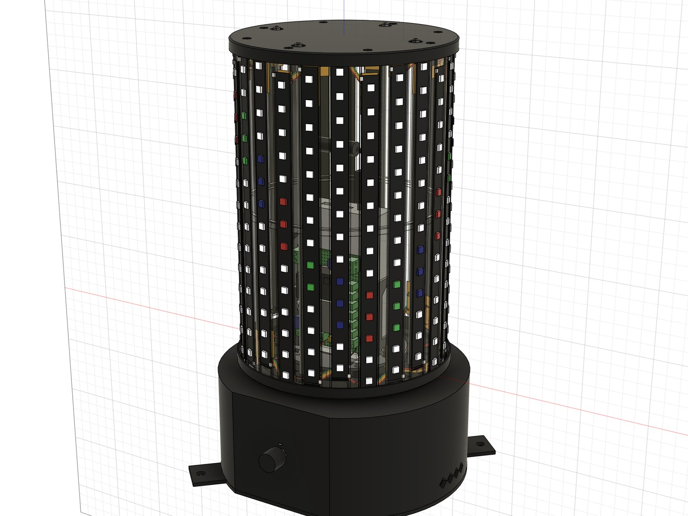

---

## 1. What was modelled

| Component (Fusion) | Bodies | What it is | Script |
|---|---|---|---|
| R07 carrier board (level shifters) | 128 | 60 × 80 × 1.6 plated perfboard with all 713 holes; J1/J12 5 mm screw terminals, **J2–J11 2.54 mm screw terminals** (KF128-2.54 class: n × 2.54 long, 6.5 deep, 8.8 tall, with their wire-entry and screw holes), U1 in a DIP-14 socket (notch up, pin-1 dot), R5–R8 lying on the solder side across the A/OE pins, R1–R4 and R9 standing (1/4 W on a 5.08 pitch), C1/C2 Ø10 × 16 cans (polarity as the layout), C3/C4/C5 radial ceramics, TP1–TP3 bare loops; bare bus wires (Ø0.64) on the board, insulated wires one layer up on the netlist's lanes with drops into their holes; 215 solder bumps | 102 |
| R06 ESP32 | 10 | **DOIT DevKit V1, 30-pin, soldered direct**: two male header spacers (2.54 mm) with 2 × 15 pins through the carrier (rows 9–23), PCB 28.33 × 51.45 × 1.6 at y −23.1, WROOM module, micro-USB up (z 79), EN/BOOT buttons, USB-UART | 102 |
| R15 chain wiring | 158 | 22 four-wire ribbon jumpers (88 wires, Ø1.0 at 1.27 pitch: through the pad-end slot, 90° twist, flat on the wall, twist into the second slot's row, **rev g: 13 mm up the wall and back as a hairpin loop one fold diameter inside the wall layer**, out through the slot), 6 feed pairs (26 AWG Ø1.5), 2 six-wire chain-start bundles (26 + 28 AWG, with the signal-ground splice and its heat-shrink), 46 Kapton patches over the used wall slots (22 of them extended over a loop); the feeds and start leads end inside the terminals' clamps | 103 → 130 |
| R16 rotor harness | 60 | hall lead (3 × 28 AWG, into J5 from below), switch loop (2 × 22 AWG Ø1.7, out of J2's board-edge side) with 4 Kapton patches, zip ties on both sled slots, hot glue: carrier foot bead, 48 strip-end dabs (no header dabs: the DevKit is soldered in) | 103 |
| R08 USB pigtail | 8 | plug shell + overmold in the +x port, jacketed cable Ø3.6 up, across the bank top through the **inline 5 × 20 fuse holder F1** (Ø11 × 40 at x −32..8, z 166), down the −x side at x −41, split into the red/black tails into J1; zip tie at the cradle window | 103 |
| R03 hall sensor | 4 | A3144 body as before; the three legs now bend inward under the cap and come up through the 1.4 × 4.5 lead slot to z 3.4 (v2's legs reached z 7, inside the sled plate) | 103 |
| B08 base wiring | 7 | jack → PWM IN (2 × 22 AWG along the drum wall at r 92, z −62), PWM OUT → motor tabs (2 × 22 AWG under the rear cap), C7 100 nF across the tabs with its leads | 094 |
| R04 sled (v3) | 1 | the v2 sled + two wire slots + four tie holes, cradle at y +5.3 | 091 |
| R05 power bank | 1 | re-seated at y +5.3 | 099 |

Unchanged: tube, strips, caps, tie rods, coupling, screws, base shell and plate, motor, PWM board, jack, magnet. After the ESP32-30 fix the carrier is 128 bodies, the DevKit 10 and the harness 60. Everything is still direct-design temporary-BRep geometry (`lib/povlib.py` primitives); wires are polylines turned into pipes by `lib/povwire.py` (cylinder per segment, sphere at every corner, corners filleted to a radius of 2 × OD for the thin wires and 4 × OD for 22 AWG, reduced where the path is too short and the reduction recorded as the wire's bend-radius result).

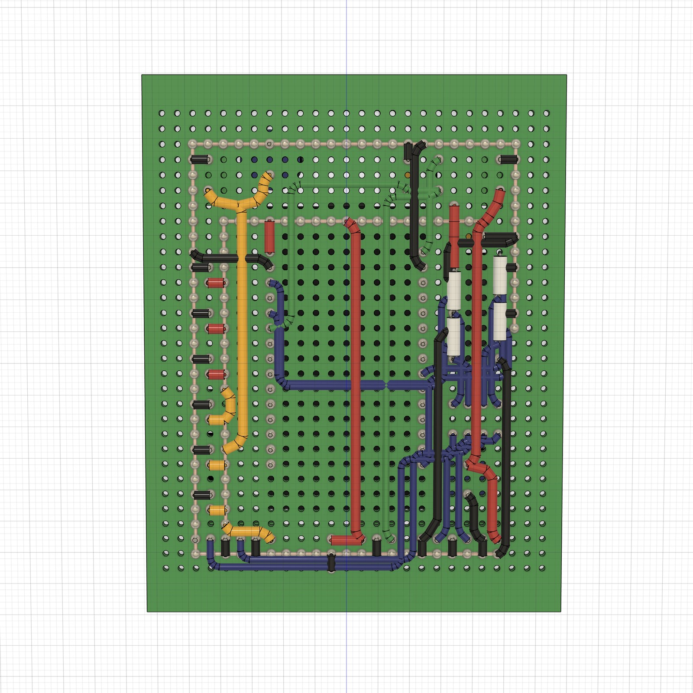

---

## 2. The carrier board, from the netlist to bodies

`lib/povcarrier.py` loads the `parts`, `U1` and `nets` tables from `docs/img/elec_carrier_netlist.json`, which `software/elec/elec_carrier.py` writes only after its hole-to-net, body-overlap and keep-out checks pass (hole (c, r) → x = (c − 11) × 2.54, z = 13.5 + 2.54 r, component side toward −y at y −19.8, solder side at y −18.2), so the board in the CAD is the checked layout and cannot drift from it. What the 3D version adds and what it checked:

- **Component heights against the sled**: the DIP socket + chip stack reaches 10 mm, the 2.54 mm screw terminals 8.8 mm, the electrolytics 16.6 mm, the DevKit's module face 7.3 mm off the board (15.7 mm when it sat in headers). The tightest are the 74AHCT125 to the guide post at **5.46 mm** and the bottom-row terminals to the guide posts at **1.83 mm**; the DevKit's PCB edge clears the bottom-row terminal bodies by **1.80 mm** and its WROOM antenna tip, which overhangs the PCB edge by a millimetre, by 0.80 mm. The solder-side wire layer (insulated wires lying over the bare bus, 2.4 mm off the board) is **8.85 mm** from the bank.
- **A USB plug in the soldered-in DevKit**: the micro-USB now sits 3 mm off the carrier surface, so a plug's overmold (modelled as 11 × 8 × 20 mm beyond the DevKit's top edge) sweeps the top rows of the board. The layout keeps that lane clear (hall network to the left, C2 to the right of it) and the check measures **1.59 mm** to the nearest carrier part (the perfboard itself), 16.5 mm to the sled and 14.7 mm to the bank: the first flash can be done with the sled stacked and the top cap off.
- **The card-guide rule as geometry**: every solder bump is a body, and the exact check "carrier board to sled ≥ 0.3 mm" (the designed slot clearance) passes only because the netlist keeps columns 0 and 22 clean below row 18, where the guides grip.
- **Mass**: FR4 14.2 g, two 1000 µF cans 4.0 g, two 5 mm screw terminals 3.7 g, ten 2.54 mm screw terminals about 8 g (modelled at 2.6 g/cm³ for the plastic-and-brass blocks), socket + chip 2.0 g, wires and bumps 2.8 g, the rest small: **39.5 g**, plus the DevKit at **9.0 g** (30 pins and spacers included, no female headers; the v3 CAD had 33.2 + 13.3 g with headers and XH housings). The v2 balance had assumed 20 + 10 g at y −19 and −29. Weigh the real board stack once it is soldered; ±5 g at y −22 is ±110 g·mm.
- **Wire entries**: a 2.54 mm screw terminal takes its wire in the board plane, not from the bay, so each block's orientation is a routing choice. The bottom row (J3, J5, J4 at row 4) takes its wires from **below**, straight out of the sled's pass-through slots through an S-bend; the six feed terminals on the right edge take theirs from the **ESP32 side** (the wire turns 90° into the bay 1 mm clear of the DevKit's edge; between a block and the card guide there is no room to turn); J2 takes the switch loop from the **board edge**, above the guide posts, and heads straight for the wall. `povcarrier.term254_entry()` hands the routing script the entry and clamp point of every pin, so the routes follow the parts.

The scripts do not model solder on the strip pads, the CA drops, the nail varnish on the terminal screws, or the twist of the twisted pairs (the two pairs of the start leads run side by side in the bundle; their lengths are the straight-run lengths, and twisting adds about 5 %, which the cut list's 10 % slack covers).

---

## 3. The harness: where every wire goes

### 3.1 Jumpers (22 × 4 wires)

Strip s's output pads to strip s + 1's input pads at the same end of the tube, as the electrical report's serpentine. In the CAD each ribbon wire starts on the strip's back inside the slot opening (the wire's lower edge is kept inside the 5 mm slot height, so the pad sits 1.65 mm from the slot's edge) at its pad's lateral offset (rev g: ±3.75 / ±1.25 mm for the assumed 2.5 mm pad pitch; the 10 mm slot no longer clamps them), runs 1.7 mm along the strip, dives through the wall, twists 90° so the ribbon lies flat against the inside of the wall (wires stacked in z at 1.27 pitch, 0.1 mm off the wall), runs the 15° arc to the next slot and twists back into that slot's row. **Rev g:** there, instead of going straight out to the pad, the four wires run **13 mm up the wall** (down at the top end), fold through a **2.3 mm-radius hairpin** standing off the wall, come back down **one fold diameter inside the wall layer** (r 73.2 against 77.8) to the slot's height and only then go out through the slot to the pad: that hairpin is the 27 mm of slack (2 × 10 + π × 2.3) Brian pulls out of the slot to solder the second end pads-up beside the tube, and the Kapton patch at that slot runs 20 mm further up the wall to tape it flat (the real loop collapses to a two-layer stack under the tape; the model keeps the fold standing so the clearance rows see the worst case). The loop is at strip s + 1 except for the two bottom jumpers that end on a feed strip (5–6, 17–18: loop at strips 5 and 17), because a feed strip's slot already carries the feed pair in its upper row, 0.85 mm above the ribbon row. Routed length **61–68 mm** (61 for an A–B pair, 68 for the C–A pairs whose ends sit 11.1 mm apart in z), cut **80 mm**. The four wires are drawn in a fixed order at both ends (the model is for clearances and lengths); on the real tube one strip of every pair is inverted, so the pad order is mirrored and the ribbon makes a half turn inside the wall (electrical 6.2). The four wires sit 0.6 mm below the cap lips at the set-C top slots and the set-A bottom slots, which is why the report's ribbon-row-plus-feed-row arrangement in the slot was kept (the ribbon dives 0.6 mm below the slot centre where a feed shares the slot, 0.4 mm above it elsewhere). The jumpers' interior bend radius is 2.0 mm (2 × OD) with the loop's fold at 2.3; the pad dive and the wall turn are sharper by nature (0.8 mm, the wall is 1.6 mm thick) and are reported separately.

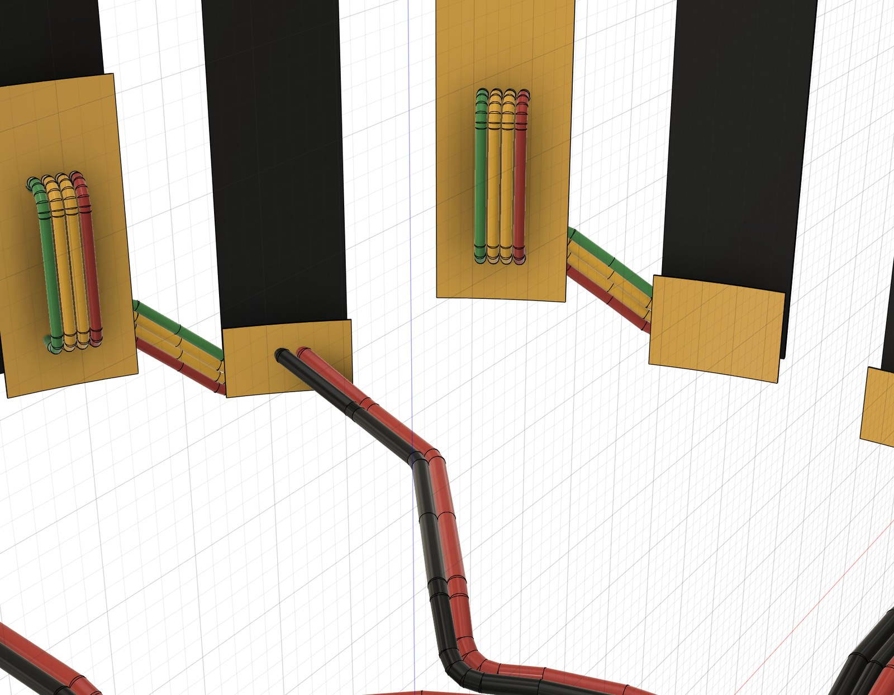

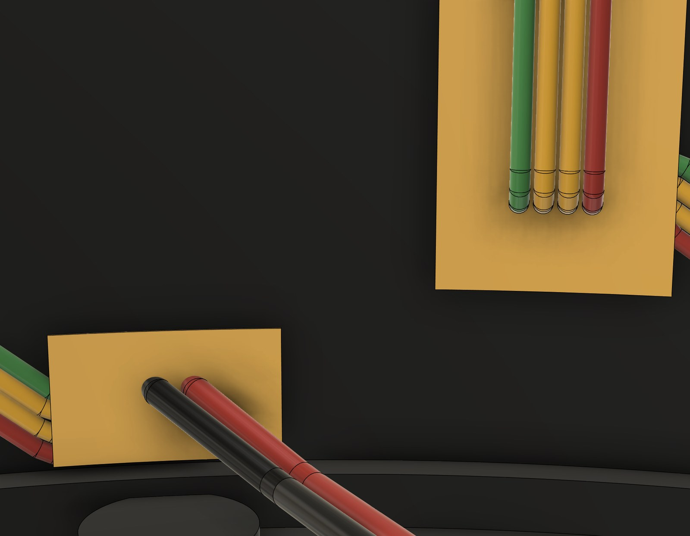

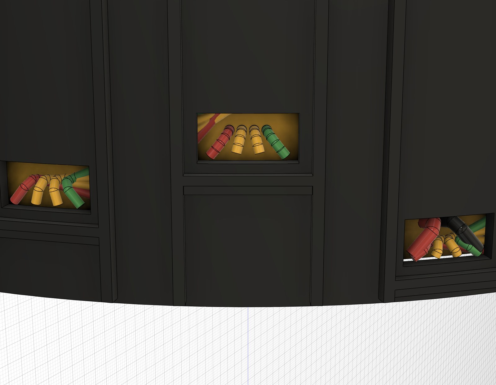

### 3.2 Feeds, chain-start leads and the hall lead: the channel under the sled plate

The report says "under the sled plate". The CAD makes that concrete:

- **Two pass-through slots in the sled plate**, 17.5 × 6 mm at (±18.5, −31.3), right behind the connector bay, unchanged by the ESP32-30 fix. Each wire comes up through its slot and, once clear of the plate (z 9.5), angles toward its terminal: the start leads and the hall lead into the bottom-row clamps from below (an S of 7 mm in y over 10 mm of height, 3.0 / 2.4 mm fillets), the feeds up in front of the right-edge blocks at y −32 to their own pin's height, then across to x 16 and into the clamp along +x. Below the plate they run in the channel between the cap plate (z 0) and the sled plate underside (z 6) exactly as before. Row A of each slot (y −30) carries the six-wire start bundle (J3 on the left, J4 on the right), row B (y −32.3) the feed pairs on the right (x 11.8, 14.4, 16.9, 19.4, 21.7, 24.0 for feeds 18, 15, 9, 6, 3, 21) and the hall trio on the left (x −12.5). A **Ø2.6 zip-tie hole** 6.5 mm either side of each slot lets a tie capture the bundles under the plate (modelled), 10 mm below the terminals, so a tug reaches the tie, not the clamp.
- **Lanes**: under the plate the cables run on concentric lanes at r 37.6 / 33.6 / 29.6 / 25.6 in two layers (z 1.2 and 3.0; a six-wire bundle takes both layers at one radius as a 3 × 2 stack). The inward run from a wall slot crosses the lanes at z 4.7 (0.55 mm below the plate) and drops into its lane; it swings 5°/10°/11° sideways on the way in to clear the tie-rod boss (Ø12 at r 60) and the sled boss (Ø9 at r 45) that sit on every feed's angle. A greedy assignment by angular interval gives: start 0 → r 37.6 (both layers) clockwise 347° → 252°; start 12 → r 33.6 (both) 194° → 288°; feed 3 → r 33.6 lower, clockwise 30° → 318°; feed 6 → r 29.6 lower, 76° → 315°; feed 9 → r 29.6 lower, 150° → 284°; feed 15 → r 25.6 lower, 240° → 280°; hall → r 37.6 lower, 100° → 235° (the outer lane is blocked at 86–94° where the hall legs stand); feeds 18 and 21 are close enough to go straight from their dodge point to the slot at z 4.7, so they take no lane. The lanes keep 2.15 mm to the sled bosses and 4.85 mm to the hub; the whole stack is 2.25 mm under the channel height.
- **The two 28 AWG signal grounds** of each start lead end at the splice on the 26 AWG ground 30 mm before the strip, with a Ø3.2 × 9 heat-shrink body there; the pads then take one wire each as the report requires.

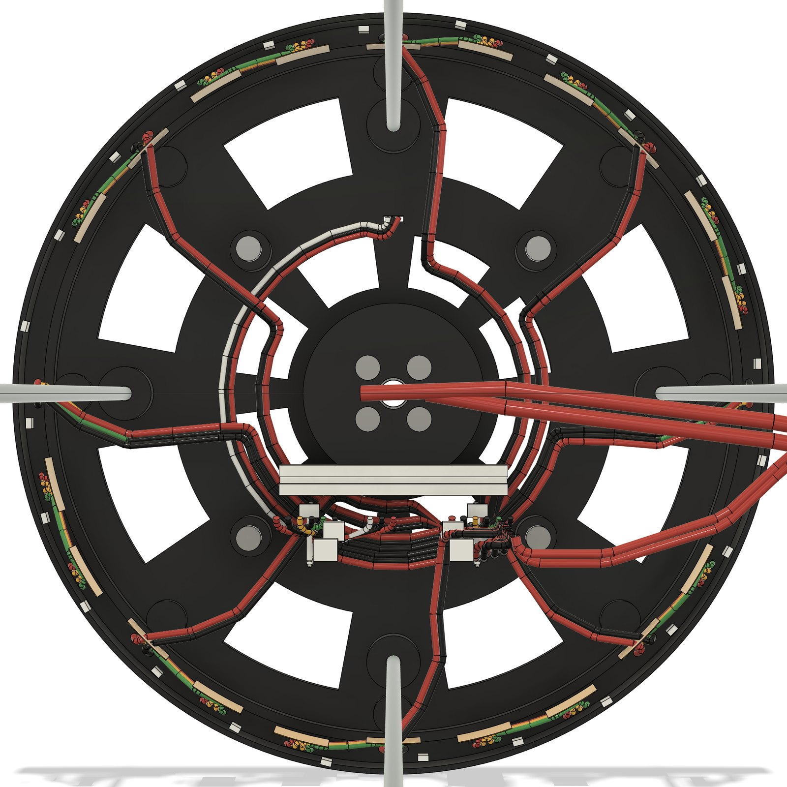

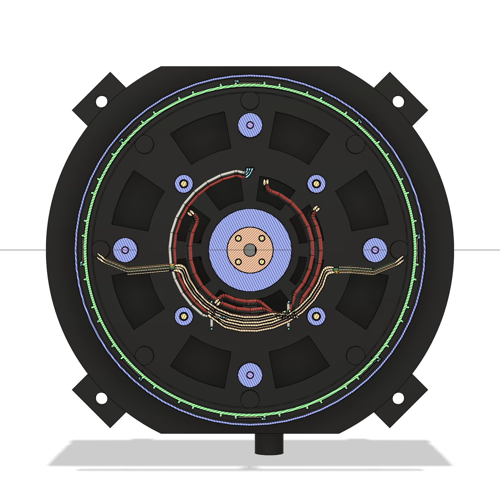

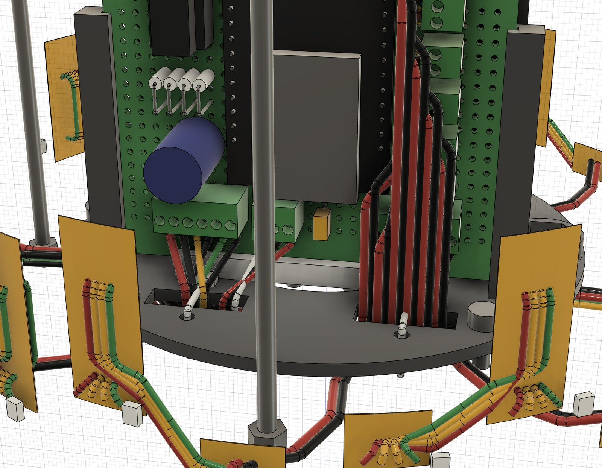

### 3.3 Switch loop, pigtail, fuse, hall legs

- **Switch loop**: out of J2's board-edge entry (x 26.9, z 74.5 and 77.0) straight across to the wall at θ 352.5° (between strips 23 and 0, the one gap with no jumper at either end), up the inside wall at r 77.45 with Kapton at z 95, 145, 195, 232, stepping 3 mm inward around the mid ring (z 118–130, 0.25 mm off the ring bore), then at z 236 inward under the top cap to the KCD11's two tabs. Each wire 299 mm routed, **cut 340 mm** (the report said 250). The run passes the tie rod at (60, 0) by 4.1 mm.
- **Pigtail**: plug in the +x port, cable up to z 166 (room for a 7 mm bend out of the plug), across the bank top through F1, to x −41 and down the −x side (5.8 mm off the cradle wall), zip-tied through the cradle's narrow-wall window at z 58, split 10 mm before J1, tails into the terminal from the −x face. Routed length **150 mm**; the bought pigtail is 280, so either trim the bare-wire end or coil the slack on the bank top (open question W3). **F1** is a 7 g lump at r 13 (93 g·mm on its own) hanging on the cable; the retention table flags it: tape it to the bank top, or skip F1 (open question W2).
- **Hall legs**: the TO-92 lies in its pocket under the cap; its legs exit at mid-thickness (z −2.25), turn inward 1.6 mm to the lead slot and come up to z 3.4, 2.6 mm below the sled plate (v2's straight 10 mm legs would have reached into the plate). The 3 × 28 AWG lead solders to the leg tops there.

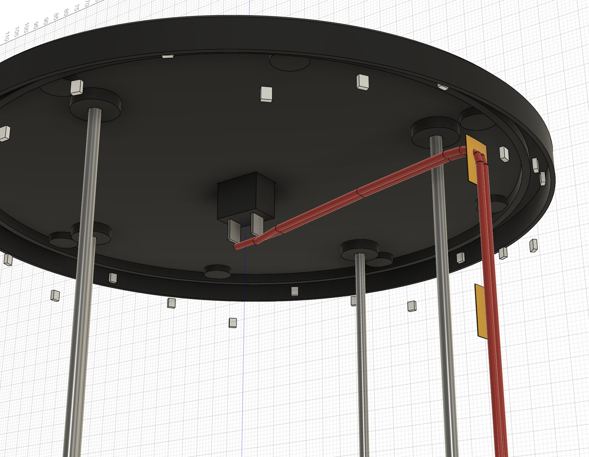

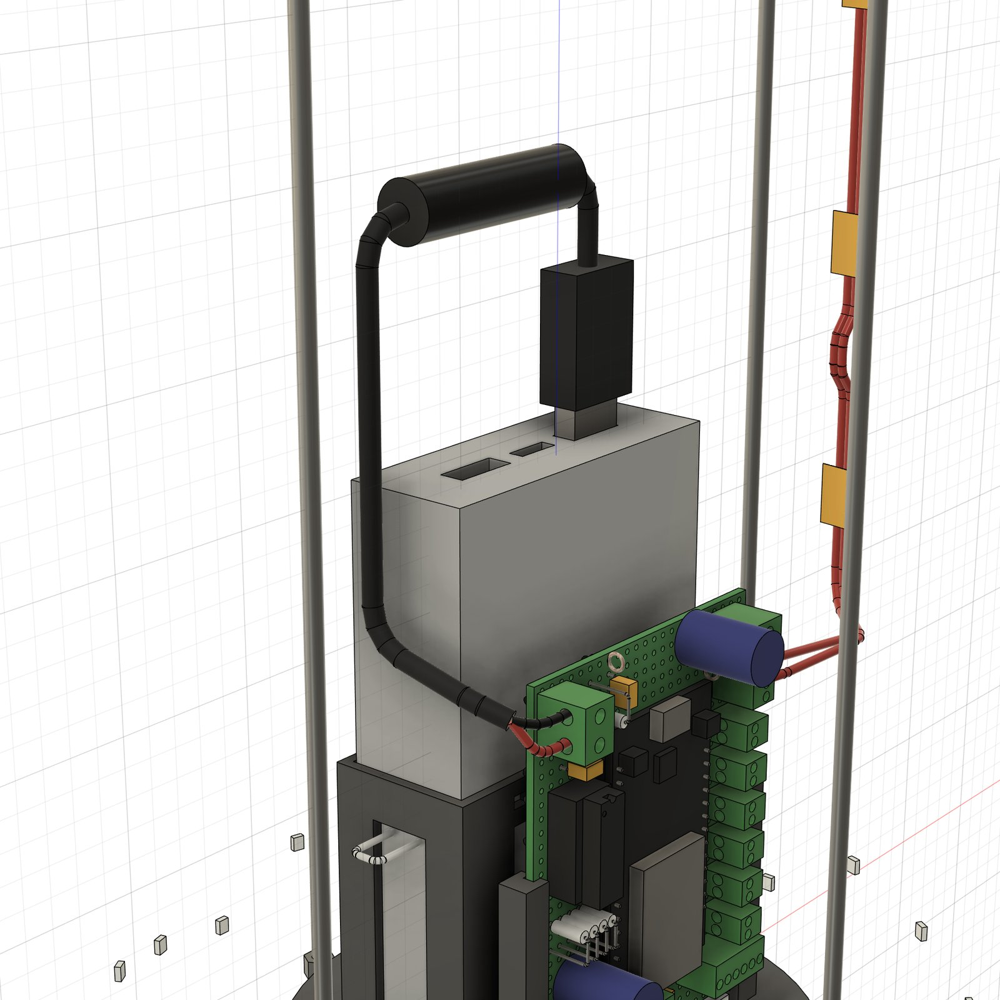

### 3.4 Base

Jack tabs → down to z −62 → along the inside of the drum wall at r 92 on the −x half → under the IN terminal from below (the leads enter at x −24/−22, clear of the PWM standoff at x −30.25 by 1.2 mm). OUT terminal → down to z −72 → under the motor's rear cap at z −83.5 (3.65 mm below the can) → the tabs at x −16 and +2; C7 bridges the tabs with its leads. Jack leads **320 mm** cut (the report's 150 was point-to-point), motor leads 125 (the report's 200 was generous). C6 across the jack is optional and not modelled.

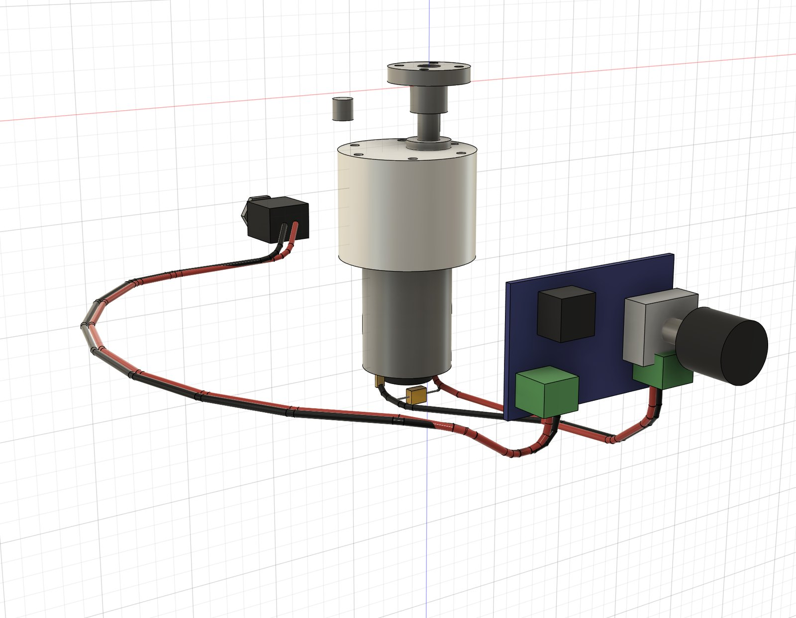

---

## 4. Printed-part changes (all in the sled; nothing else touched)

| Change | Where | Why | Numbers |
|---|---|---|---|
| Two wire pass-through slots | sled plate, 17.5 × 6 mm centred at (±18.5, −31.3) | the feeds, start leads and hall lead drop from the carrier's connectors (screw terminals since the ESP32-30 fix) straight into the under-plate channel instead of climbing over the plate rim | web to the sled screw hole 2.9 mm; slot outer corner at r 43.4 (plate r 50); 6 feed pairs + a six-wire bundle fit across one slot with 0.2 mm spare |
| Four zip-tie holes | Ø2.6 at (±18.5, −24.8) and (±18.5, −37.8) | capture each slot's bundles under the plate | — |
| Cradle offset | bank centre y +3.0 → **+5.3** | balance: the real carrier + ESP32 stack is 46 g at y −22 | U 592 → 115 g·mm; radial load on the bank 0.3 g at 225 rpm |

Print file: `cad/rotor_sled_PET-CF.3mf` / `.gcode.3mf` re-sliced (Fiberon PET-CF, 0.2 mm, 5 walls, 40 % gyroid, 312 layers, 99.6 × 99.6 mm, ~2.0 h, the same accepted "floating cantilever" note as v2 for the two anchored bridges). The sled still waits for the real bank and ESP32 measurements before printing. The v2 sled files moved to `cad/v2/`. The tube, both caps, the base shell and the plate are unchanged, so their print files stand.

---

## 5. Checks (script 095, all pass)

The full table is `calc/wiring_cad_checks.txt` (**rev g, script `131`: 285 rows, all pass**: every rev f row of script `125` rerun on the 10 mm slots and the looped jumpers, plus the rows below; `calc/b2_checks.json` is the same data). The rev g rows:

| Check (rev g, B2) | Measured | Limit |
|---|---|---|
| End-pad span (assumed 9.0, outer edge to outer edge) in the 10 mm slot, spare per side; solderable pad inside the slot footprint (pad zone 0.5–3.0 assumed, slot from +1.0) | 0.50; 2.00 | ≥ 0.5; ≥ 1.5 |
| Pad-end wire offsets ±3.75 inside the slot's half width minus the ribbon radius | 0.75 | ≥ 0.3 |
| Wall left between the slot edge and the rail root; slot bridge span in the upright print; end-ring perforation per z band | 1.30; 10; 15.9 % | ≥ 1; ≤ 12; ≤ 25 % |
| Ribbon + 26 AWG feed pair in the slot width / ribbon row + feed row in the slot height / six-wire start lead (spare) | 4.92 / 1.90 / 1.40 | ≥ 1 |
| Set-A bottom ribbon's lowest wire above the 3 mm cap lip | 1.27 | ≥ 0.2 |
| Jumper ribbons + loops to the bottom cap lip / trim bosses; to the top cap lip / trim bosses | 0.50; 1.50 | ≥ 0.2; ≥ 0.5 |
| Jumper loops to the tie rods / sled rim / bank / carrier / hall lead | 14.8 / 23.4 / 35.1 / 29.5 / 1.53 | ≥ 3 / 3 / 3 / 3 / 1 |
| Jumper ribbons to the feeds and start leads (they share the 5V / GND pads at the six feed strips) | 0.00 | ≥ 0 (contact by design) |
| Pull-out slack = 2 × 10 + π × 2.3; fold radius vs the 2 × OD limit; loop height from a set-C bottom slot to the mid ring | 27.2; 0.3 spare; 87 | ≥ 20; ≥ 0; ≥ 50 |
| Ribbon interior bend radius (88 wires, loops included); ribbon cut length | 2.00; 80 | ≥ 2.0; ≤ 80 |
| Rotor wiring inside r 80.05 (worst: a top ribbon wire in its slot) | 0.10 | > 0 |

The ESP32-30 fix had added these:

| Check (ESP32-30 fix) | Measured | Limit |
|---|---|---|
| DevKit PCB edge to the bottom-row terminal bodies; its WROOM antenna tip (1 mm overhang) to them | 1.80; 0.80 | ≥ 1; ≥ 0.5 |
| DevKit PCB / USB / buttons to the carrier's other tall parts (caps, resistors, test points) | 1.16 | ≥ 1 |
| 2.54 mm screw terminals to the sled guide posts | 1.83 | ≥ 1 |
| Feed wires turning into the right-edge terminals, and the switch loop, to the DevKit | 2.16; 9.70 | ≥ 1 |
| A micro-USB plug's overmold above the soldered-in DevKit to the carrier / sled / bank / harness / pigtail | 1.59 / 16.5 / 14.7 / 18.4 / 20.4 | ≥ 1 |
| Feeds and start leads, and the hall lead, to the carrier-foot glue bead | 2.89; 3.41 | ≥ 0.3 |
| Fits: DevKit antenna end above the terminal bodies; DevKit PCB underside above the carrier (spacer) | 1.80; 2.54 | ≥ 1; ≥ 2 |

and the v3 wiring checks were:

| Check | Measured | Limit |
|---|---|---|
| Hall face to magnet top (sensing gap) | 5.00 | 3–6 |
| Jumpers / feeds / start leads to tie rods | 4.34 | ≥ 3 |
| Hall lead / switch loop / glue to tie rods | 4.10 | ≥ 3 |
| Pigtail + fuse holder to tie rods | 14.35 | ≥ 3 |
| Rotor wiring (R15 / R16 / pigtail) to base deck | 9.95 / 9.20 / 66.9 | ≥ 5 |
| Under-plate wiring to the proud magnet; hall lead to the magnet | 12.83 / 9.73 | ≥ 4 |
| Base wiring to the spinning cap / rod ends | 47.3 / 47.7 | ≥ 5 |
| Nothing on the rotor outside r 80.05 (worst: a top ribbon wire) | 0.10 inside | > 0 |
| 74AHCT125 to sled guide posts; ESP32 to sled / bank | 5.46; 7.65 / 10.05 | ≥ 3 |
| Carrier solder side (wires, bumps) to the bank | 8.85 | ≥ 3 |
| Under-plate wiring to the sled plate (channel + slots) | 0.35 | ≥ 0.3 (designed) |
| Under-plate wiring / bottom ribbons to the bottom cap (plate, lip, bosses) | 0.42 | ≥ 0.2 |
| Top ribbons to the top-cap lip and bosses | 0.60 | ≥ 0.5 |
| Ribbons and feeds in the slots / on the wall (lie on the wall) | 0.10 | ≥ 0.05 |
| Switch loop on the wall; to the top cap; to the bank | 0.09; 1.23; 9.16 | ≥ 0.05; 0.5; 2 |
| Pigtail cable + fuse holder to the bank body / cradle / tube / top cap | 6.2 / 20.0 / 32.3 / 78.5 | ≥ 2 / 2 / 3 / 3 |
| Under-plate lanes to the hall legs; to the sled and coupling screws | 5.38; 3.42 | ≥ 0.5; 1 |
| Motor leads to the can; base leads to the shell wall and PWM standoffs | 3.65; 1.20 | ≥ 1 |
| Soldered / clamped ends (strip pads, KCD11 tabs, screw-terminal clamps, PWM terminals, motor tabs) | 0.06 / 0.08 / 0.00 / 0 / 0 | ≥ 0 (contact by design) |
| Fits: ribbon + feed pair in the 7 × 5 slot (width / height spare) | 1.92 / 1.90 | ≥ 1 |
| Fit: six-wire start lead in the slot (spare) | 1.40 | ≥ 1 |
| Fit: crossing runs under the sled plate | 0.55 | ≥ 0.3 |
| Fit: outer lane to the sled boss; inner lane to the hub | 2.15; 4.85 | ≥ 1 |
| Bend radius, interior corners: 26 AWG feeds / start power; 28 AWG hall / start signals; 28 AWG ribbon; 22 AWG switch loop; pigtail cable | 3.0; 2.4; 2.0; 5.0; 6.3 | ≥ 2 × OD (3.0 / 2.4 / 2.0 / 3.4 / 5.0) |

Strain relief as modelled: Kapton over all 46 used wall slots (strips 11 and 23 have no bottom wire), four patches on the switch loop, the carrier-foot bead (50 mm, both faces and under the edge), 48 strip-end dabs (the DevKit is held by its 30 soldered pins; the leads in the ten screw terminals by their clamps, with a dot of nail varnish on each screw) (section 6.6 A of the electrical report: liner on, dab over the strip edge onto the rail), two slot zip ties, one pigtail zip tie. Not modelled: the CA drop at each pad, heat-shrink on the crimps, tape under the fuse holder.

Bend-radius note: the limits are 2 × OD at the interior corners (the pad dive through the 1.6 mm wall and the entry into a connector housing are excluded and reported separately; they are 0.7–0.9 mm, which is what a wire soldered to a pad and bent through a slot really does). The fillets in the model are the same 2 × OD, so a wire whose model is tighter than the limit is one whose path is too short to bend properly; the under-plate routes were reshaped until none was.

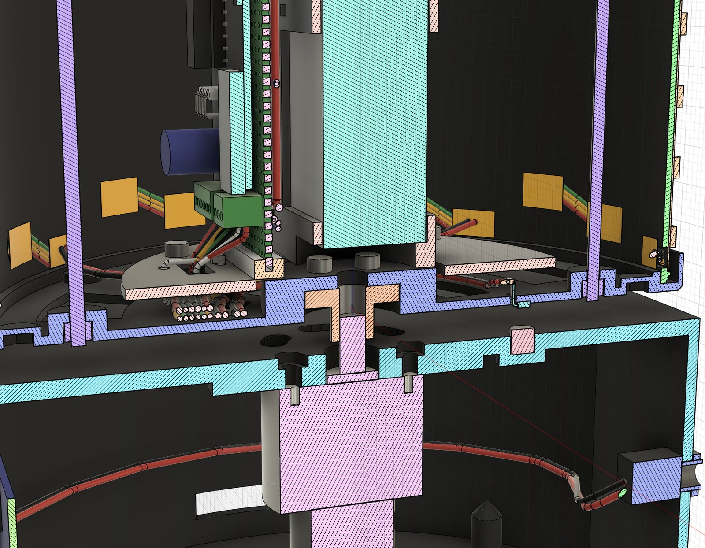

---

## 6. Wire lengths: the CAD against the report's table

`docs/img/wiring_cut_list.csv` (37 items). Cut = routed centreline + 2 × 5 mm for stripping + 10 % slack, rounded up to 5 mm (jumpers: + 2 × 4 mm, rounded to 5). The electrical report's `elec_wiring_table.csv` now carries the CAD cut lengths with the old values kept in a second column.

| Item | Qty | Gauge | Routed (CAD) | Cut (CAD) | Report had | Note |
|---|---|---|---|---|---|---|
| Start lead 0 (5V, GND) | 2 | 26 AWG | 143 | **170** | 200 | bundle of 6 under the plate at r 37.6; into J3 from below |
| Start lead 0 signals (CLK + GND, DATA + GND) | 4 | 28 AWG | 141 | **165** | 200 | the two grounds 30 mm shorter (splice) |
| Start lead 12 (5V, GND) / signals | 2 + 4 | 26 / 28 | 138 / 139 | **165 / 165** | 200 | r 33.6; into J4 from below |
| Feed 3 / 6 / 9 (J6 / J7 / J8) | 2 each | 26 AWG | 170 / 201 / 214 | **200 / 235 / 250** | 150 / 200 / 200 | the +y-side feeds run half the circle under the plate; into the terminals from the ESP32 side |
| Feed 15 / 18 / 21 (J9 / J10 / J11) | 2 each | 26 AWG | 129 / 97 / 100 | **155 / 120 / 120** | 150 / 150 / 150 | |
| Jumpers (22) | 4 each | 28 AWG ribbon | **61–68** (rev g, incl. the 27 mm slack loop; was 29–32) | **80** (was 40) | 45 | the loop is the slack for the second joint (electrical 7.6); cut = routed + 2 × 4, no extra slack |
| Hall lead | 3 | 28 AWG | 134 | **160** | 120 | round the lane to the −x slot; into J5 from below |
| Switch loop | 2 | 22 AWG | 299 | 340 | 250 | **rev d: gone** (plug-in is the switch) |
| Pigtail | 1 | 22 AWG 2-core | 151 | as bought 280 | 280 | trim or coil 130 mm (W3) |
| Supply leads (base; v4: no jack) | 2 | 22 AWG | 49 inside the base | **65** | — | the bench supply's pair through the back-flat notch, under the staple bar, into the PWM IN terminal |
| Pot cable (base, v4) | 1 | kit 3-wire | 362 | **410** | — | along the drum wall at r 92 to the PWM's pot connector; the kit cable must be ≥ 410 mm |
| Motor leads (base) | 2 | 22 AWG | 97 | **120** | 200 | |

Totals to buy or cut (rev g): 26 AWG silicone **2.8 m** (red + black), 28 AWG silicone **1.8 m** (incl. the twisted hall lead), ribbon **1.76 m** of 4-wire (22 × 80), 22 AWG for the base **0.4 m**. Every lead that ends at the carrier gets 5 mm stripped and tinned for its clamp; the 28 AWG ends are folded double. The report's "~3 m of 26 AWG, ~2 m of 28 AWG" still covers it.

---

## 7. Mass and balance

| Item | Mass | Note |
|---|---|---|
| Rotor wire (123 wires), copper / insulation | 16.0 g: 10.3 / 5.7 g | from the modelled lengths × the gauge's g/m (22 AWG 3.8, 26 AWG 2.0, 28 AWG 1.3, ribbon 1.1, jacketed pigtail 12 g/m) |
| Kapton (50 patches), glue (53 dabs + bead), zip ties, heat-shrink | 3.3 g | |
| Plug + overmold, fuse holder | 9 + 7 g | the holder is the one unsecured mass (W2) |
| Carrier board + ESP32 | 39.5 + 9.0 g | v2 assumed 20 + 10; the v3 CAD had 33.2 + 13.3 (female headers, XH housings) |
| Rotor total | **996 g** | v2: 969 (which included an 18 g wiring allowance) |
| I_zz | 3.79 × 10⁻³ kg·m² | v2: 3.70; KE 1.05 J at 225 rpm, spin-up 3.4 s at 27 mN·m |
| CG offset, bank at +3.0 (v2 position) | 0.58 mm toward −y | U 592 g·mm = 223 % of budget |
| CG offset, bank at **+5.3**, ESP32-30 carrier | (0.18, 0.02) mm | **U = 182 g·mm = 68 %** of the 266 g·mm G6.3 budget at 225 rpm (92 % of the 199 at 300 rpm): the y-moment is cancelled, the rest is the heavier terminals on the +x edge (the v3 XH carrier gave 115) |
| Trim | one M6 nut (2.3 g) in the sled's **−x** pocket | residual **86 g·mm (32 %)**, then three M3 nuts at the 180° pocket (26 g·mm each) to about zero; or seven M3 nuts without the M6 |
| **Rev g (script `131`)**: rotor with the looped jumpers (6.2 g of ribbon), Brian's measured 4 g strips (96 g for 24) and the measured nylocs | **924 g**, CG (0.03, 0.05, 99.6) mm | **U = 55 g·mm = 22 % of the 247 g·mm budget** at 225 rpm; I_zz 3.37 × 10⁻³ kg·m², 0.94 J, spin-up 3.0 s; trim about two M3 nuts at 237° if wanted (the rev d / f advice of none stands) |

Where the moment comes from after the ESP32-30 fix: the 48.5 g carrier stack at y −22 is cancelled by the bank at +5.3 to within 0.1 mm of bank travel (so the sled's cradle offset stands), and the 181 g·mm that remain point along +x: the ten screw terminals (about 8 g at x +20) and C2 to the right of the DevKit against J1, U1, C1 and the hall network on the left; one M6 nut in the −x sled pocket is the designed answer. In the v3 (XH) version the moment came from: the switch loop and its Kapton on the +x wall (R16, 4.8 g at x +28) and the lanes (R15, 9.5 g at (3.4, −10.4)) against the pigtail cable and fuse on the −x side (R08, 17.6 g at x −0.2); the carrier stack (46 g at y −22) is now cancelled by the bank (200 g at +5.3). Everything on the rotor was weighed from geometry except the bought parts (bank 200, switch 3, magnet 1.3, fuse holder 7, plug 9); the strips are still the 6.7 g estimate. Weigh the soldered carrier and the bank when they exist: a 10 g error at y −22 is 220 g·mm, i.e. the bank offset would want to move by 1 mm per 10 g.

---

## 8. Outputs

- **Renders** (`docs/img/wiring_*.jpg`, 1600 px; originals `fusionclaude/renders/096_wiring_*.png`): `hero_clear` (tube as clear glass), `hero_frosted`, `hero_bay_side`, `lower_glass`, `top_glass`, `carrier_component_side`, `carrier_oblique`, `carrier_solder_side`, `carrier_solder_oblique`, `connector_bay`, `under_plate_lanes`, `section_x0`, `section_x0_lower`, `section_z3p5_lanes`, `harness_only` (strips + every wire + the boards, nothing else), `harness_bare`, `strip_joints_bottom/top`, `switch_loop_top`, `pigtail_fuse`, `base`, `base_below`, `exploded`; ESP32-30 fix: the views that show the carrier were re-rendered from `105_wiring_*.png` plus a new `connector_bay_right` (the right-edge terminals and their wire entries); `top_glass`, `under_plate_lanes`, `section_z3p5_lanes`, `strip_joints_*`, `switch_loop_top`, `base*` are the v3 renders (nothing in them changed).
- **CAD**: `cad/pov_led_column_assembly.step` (19.7 MB, every wire included), `cad/rotor_sled.stl/.3mf` + `cad/print/rev-e_superseded/rotor_sled_PET-CF.3mf/.gcode.3mf` (v3), `cad/v2/rotor_sled.*` (previous), `cad/backup/*_pre-wiring.f3d` (the document as found, before any change), `cad/backup/*_pre-esp30-fix.f3d` (the v3 wiring document before the ESP32-30 fix).
- **Data**: `docs/img/wiring_cut_list.csv`, `docs/img/elec_wiring_table.csv` (updated), `calc/wiring_cad_routes.json` (every wire: gauge, colour, routed length, bend radii, worst corner), `calc/wiring_cad_routes_base.json`, `calc/wiring_cad_checks.json/.txt`.
- **Video**: `<video>\2026-11-02 POV wiring CAD frames\0001–0012` (hero camera after each step: sled slots, carrier, rotor wiring, base wiring, bank shift, final, glass hero, section, exploded; 2560 × 1440 transparent) and `orbit_glass\g_000–119` (360° with the clear tube), assembled as `<video>\2026-11-02 POV wiring CAD orbit (glass tube).mp4` (4 s, 1080p30, light background); ESP32-30 fix: `<video>\2026-11-02 POV ESP32-30 fix frames\0001–0008` (backup, carrier, wiring, carrier again, hero glass, carrier close-up, section, exploded).
- **Fusion**: the document is saved to its cloud project (version history keeps the pre-wiring state as well; the .f3d backup is the belt and braces). Replay: `062` → `076`–`081` (v2 parts) → `091` sled v3 → `099` bank → `092` carrier → `093` rotor wiring → `094` base wiring → `095` checks → `096`/`097`/`098` renders, orbit, export (each followed by `--undo`) → `100` save; then the ESP32-30 fix `101` backup → `102` carrier → `103` rotor wiring → `104` checks → `105` renders (`--undo`) → `106` export → `107` save.
- **Rev g (2026-11-03)**: renders `fusionclaude/renders/132_wiring_*.png` → `docs/img/wiring_{hero_clear, hero_frosted, hero_bay_side, lower_glass, top_glass, harness_only, harness_bare, strip_joints_bottom, strip_joints_top, section_x0, exploded}.jpg` re-shot from the `096` cameras, plus the new `wiring_jumper_loops_inside.jpg`, `wiring_jumper_loops_inside_top.jpg` and `wiring_slots_outside.jpg`; CAD `cad/rotor_tube.stl/.3mf` (10 mm slots), `cad/rotor_bottom_cap_f.stl/.3mf` (5.6 AF pockets), `cad/tube_end_rings_fitcheck.stl`, the STEP; print files `cad/print/rev-g_CURRENT/` (see its README); data `calc/b2_jumper_calc.py` (the decision), `calc/b2_checks.json` + `calc/wiring_cad_checks.json/.txt` (the 285 rows), `calc/wiring_cad_routes.json` (R15 rows replaced, R16 / R08 kept); backup `cad/backup/2026-11-03_1616_POV_LED_Column_v5_pre-b2-jumper-fix.f3d`; frames `<video>\2026-11-03 POV B2 jumper fix frames\` (backup, tube, wiring, hero glass, section, exploded, cap plate, rods, save). Replay on the saved v6: `128` backup → `129` tube → `130` chain wiring → `131` checks (`--ro`) → `132` renders (`--undo`) → `133` export (`--undo`) → `122` + `080` (nyloc pockets and nuts) → `135` export (`--undo`) → `134` save.

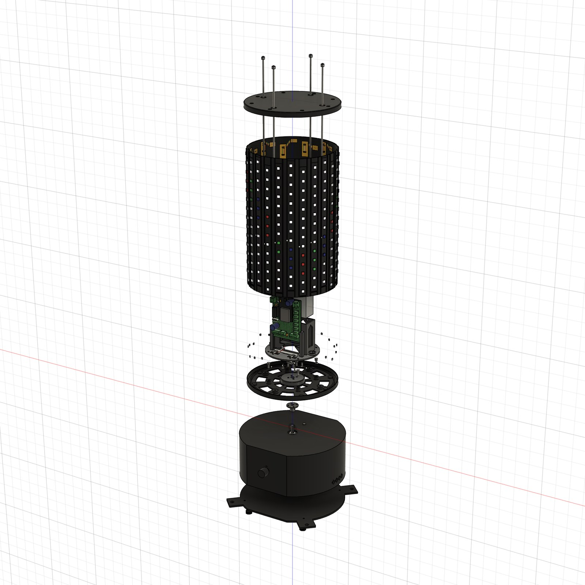

---

## 9. Open questions for Brian

| # | Question | Default |
|---|---|---|
| W1 | Keep the bank cradle at y +5.3 (the balance fix)? The alternative is +3.0 and ~23 M3 trim nuts, which the pockets cannot take. Panel Q34 | keep +5.3; weigh the soldered carrier and re-check with `095` |
| W2 | Fit F1 (inline 3 A fuse, 7 g over the bank top, needs a strip of double-sided tape to the bank) or skip it (−93 g·mm)? Panel Q35; electrical E5 | fit + tape |
| W3 | The bought 280 mm pigtail against a 150 mm route: trim the bare end or coil the slack on the bank top? Panel Q36 | trim to 150 |
| W4 | Print the sled v3 file (`rotor_sled_PET-CF.gcode.3mf`, 2.0 h) once the bank is weighed; the ESP32 is measured and the ESP32-30 fix did not move the sled (BANK_Y +5.3 stands). Panel Q37 | yes |
| W5 | Trim: one M6 nut in the sled's −x pocket (residual 17 g·mm) is the modelled answer; confirm on the real rotor at 150 → 225 rpm | M6 nut, then M3 nuts at r 72 |
| W6 | ~~Jumper ribbon at 40 mm: the report said 45.~~ **Closed 2026-11-03 (rev g): 80 mm**, the 27 mm slack loop is the second joint's jig (electrical 7.6) | 80 |
| W9 | **Rev g:** the slot width and the pad position are assumed (9.0 mm span, pads 0.5–3.0 mm from the cut line) until Brian measures a peeled reel end (electrical E15), and the strip cut-line offset (#26, electrical E16) sets where the end-stops go: both before the tube prints | 10 × 5 slot from +1.0; cut line midway |
| W7 | Trim after the ESP32-30 fix: one M6 nut in the −x sled pocket plus ~3 M3 nuts at 180° (U 182 → 86 → ~0 g·mm), or re-site C2 to the left of the DevKit to shave ~50 g·mm first? | M6 + M3 nuts, no layout change |
| W8 | Measure one 2.54 mm screw terminal from the kit (depth, pin offset from the back face): the CAD assumes 6.5 / 2.5 mm (height 8.8 from the datasheet). Only the wire entries move if it differs (electrical E12) | 6.5 / 2.5 |

Closed by the CAD: the hall legs (shortened and bent, no longer in the sled plate), the strip-pad wire exit (inside the slot's width and height), the screw-terminal wire entries (each block faces where its wire can arrive), the feeds' path (through the plate, not over its rim).

---

## Explain it

- **Build the board from the netlist, not from the picture.** The carrier's 3D model is generated from the same hole-by-hole tables that the layout script checks, so a hole-to-net error cannot creep in between the drawing and the CAD. The board's real mass came out of it for free (33 g, not 20), which is what moved the balance.
- **A wire is a polyline until the checks say otherwise.** Each wire is a list of waypoints turned into a pipe; corners get the wire's minimum bend radius, and where the path is too short to bend, the radius it actually got is the check result. Seven rounds of "which corner is 0.1 mm" turned waypoint lists into routes a hand can follow.
- **Route under the plate, through the plate.** Twelve cables had to get from a vertical board to the tube wall past a plate, four bosses and a hub. Two slots in the plate and a lane plan (radius × layer, assigned by angular interval like a timetable) did it with 0.35 mm to spare; the lane assignment is twenty lines of code.
- **Balance is a lever, not a nut count.** 46 g of board stack 22 mm off the axis is 1,000 g·mm; 200 g of battery moves 2.3 mm to cancel it. The v1 design had already put the bank 3 mm off-axis for this reason; the CAD re-measured the lever once the boards were real.
- **Soldered-in means keep-out.** Without headers the DevKit sits 2.5 mm off the carrier: a USB cable's plug now sweeps the top of the board and anything under the DevKit must be flat. Two keep-out boxes in the layout script and one plug body in the CAD check turned that into numbers (1.6 mm to the nearest part).
- **Screw terminals are side-entry.** The wire arrives in the board plane, so the bottom row moved up a row and the DevKit four, and the feeds enter from the ESP32 side; `term254_entry()` hands the routing script the exact entry and clamp points, so the routes follow the parts rather than the other way round.
- **The fuse holder is the heaviest wire.** Seven grams at r 13 is a third of the wiring's unbalance; the model places it on the axis side of the bank and the retention table says what holds it, which the schematic could not.
- **Save the document before it costs you.** Fusion was at 7 GB after six hours of script runs; the document was saved to its cloud project halfway and again at the end, with an .f3d export taken before the first change.
- **Model the procedure, not just the part (rev g).** The jumper that could not be built was a correct-looking 30 mm ribbon; what fixed it was 27 mm of slack drawn as a hairpin so the clearance rows could see where the slack lies. Three tries taught the pipe builder's limits: a wire path that revisits its own start (the exit passing the loop's foot 0.3 mm away) breaks the boolean, a collinear vertex between two cylinders does too, and a z-stack reversal spliced into a 20 mm arc makes a kink no 2 mm fillet survives, so the loop runs up the wall, starts 3 mm above the exit, and the half turn is text, not geometry.

---

## Files

| File | What |
|---|---|
| `fusionclaude/lib/povwire.py` | wire helpers: gauge table (OD, g/m, copper area), polyline fillets with recorded radii, parallel-transport offsets for bundles, pipe bodies, under-plate lane assignment |
| `fusionclaude/lib/povcarrier.py` | loads the carrier netlist from `docs/img/elec_carrier_netlist.json`; part builders (2.54 mm and 5 mm screw terminals with wire-entry geometry and `term254_entry()`, electrolytics, DIP socket, the soldered-in DevKit, solder bumps, bus and lane wires) |
| `fusionclaude/scripts/090_pov3_backup.py` … `100_pov3_save.py` | backup, sled v3, carrier, rotor wiring, base wiring, checks, renders, orbit, export, bank, save |
| `fusionclaude/scripts/101_pov3b_backup_esp30.py` … `107_pov3b_save_esp30.py` | the ESP32-30 fix: backup, carrier, rotor wiring, checks, renders, export, save |
| `fusionclaude/scripts/128_pov6_backup_b2.py` … `135_pov6_export_cap_b2.py` | rev g (B2): backup, tube with 10 mm slots, chain wiring with the slack loops, 285-row checks, renders, tube export, save, cap-plate export; `lib/povlib.py` carries `WIRE_SLOT_W` 10, `PAD_SPAN` / `PAD_PITCH` / `PAD_Z` (assumed), `JUMPER_LOOP` / `JUMPER_FOLD_R`, the measured nylocs, `CUT_IN` / `CUT_OUT` |
| `calc/b2_jumper_calc.py`, `calc/b2_checks.json` | the B2 decision numbers (outside vs inside route) and the rev g check rows |
| `calc/wiring_cut_list.py` | routes JSON → cut list CSV + the updated electrical wiring table (rev g: always rewrites the CAD column, QA M6; knows the v4 supply leads and pot cable) |
| `calc/wiring_cad_routes*.json`, `calc/wiring_cad_checks.json/.txt` | every wire's length and bend radii; every check with its value |
| `docs/img/wiring_cut_list.csv`, `docs/img/elec_wiring_table.csv` | the build's cut list; the report table with CAD lengths |
| `docs/2026-11-02-electrical-design.md` | revised the same evening (rev c): 30-pin pin table, carrier layout and build order, connector table, BOM |
