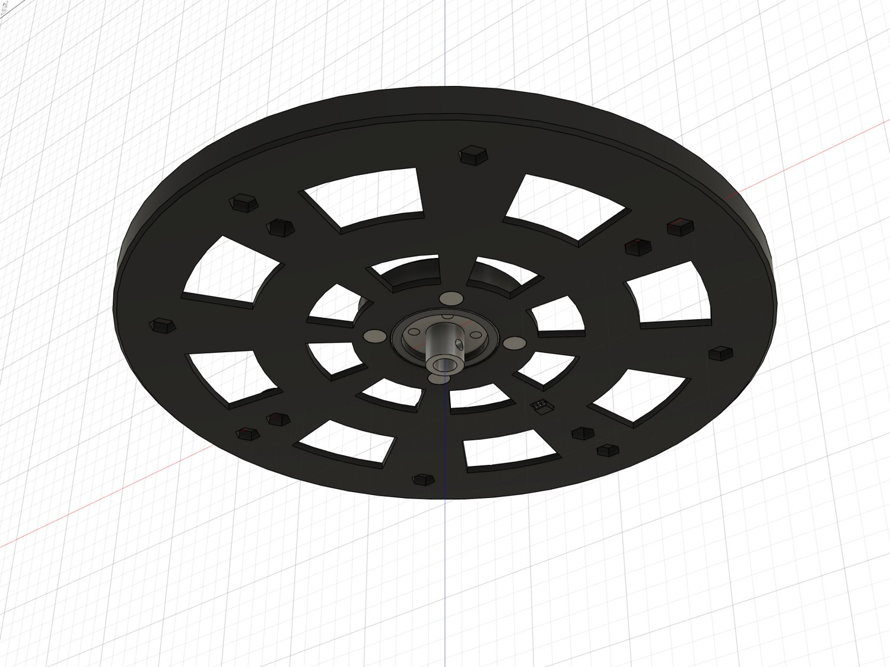
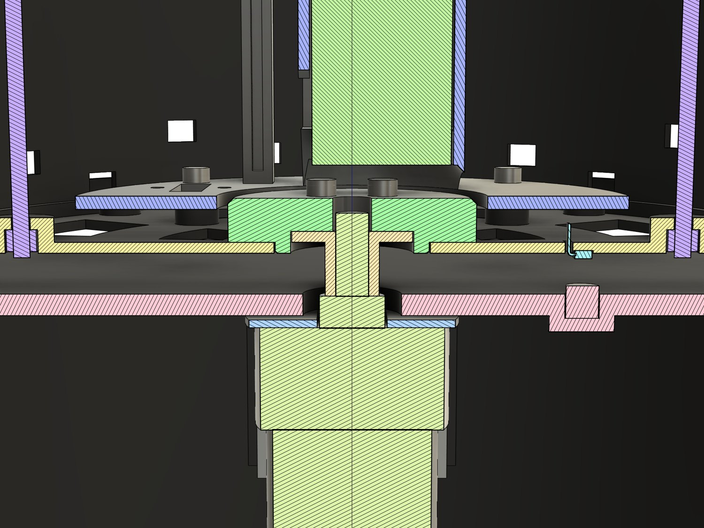
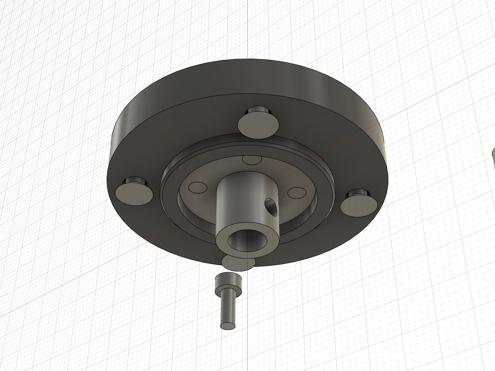
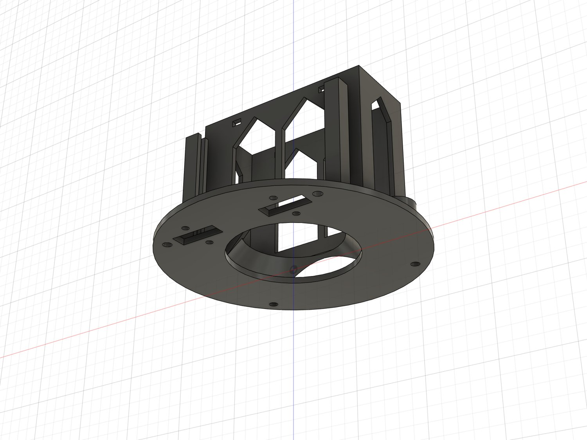
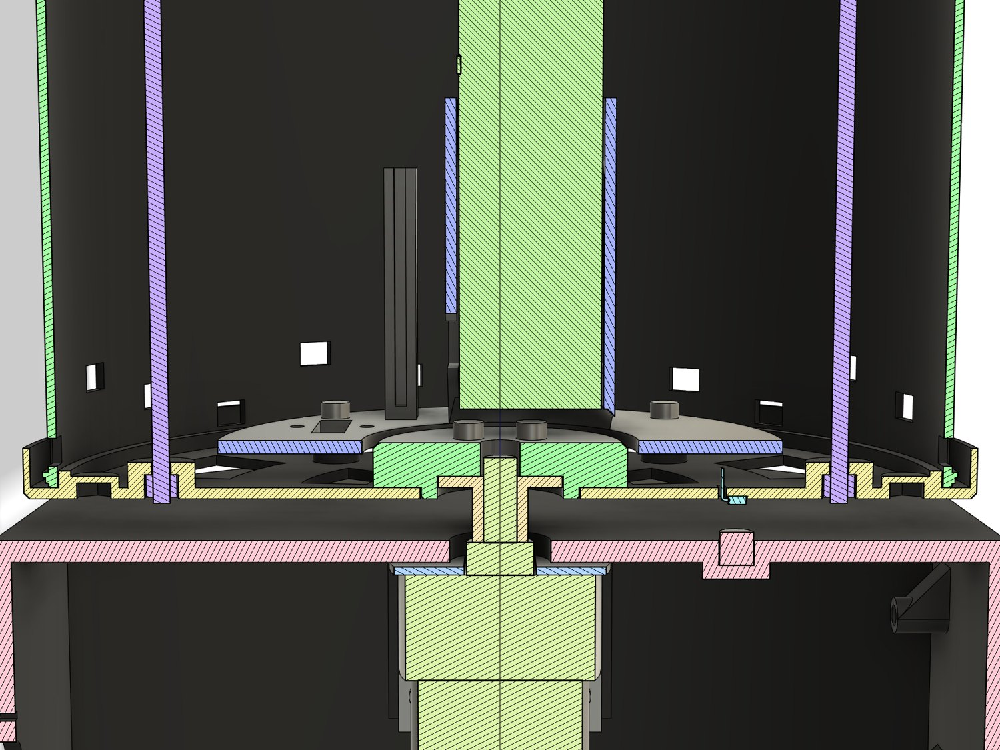
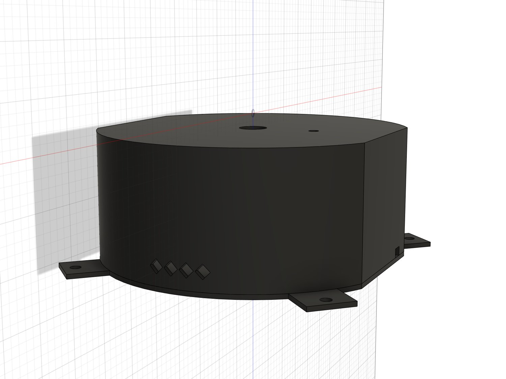

# POV LED Column rev f: FDM Print Optimisation (PET-CF only where the load goes)

**Prepared for Brian** · Claude (Fable 5.1), FDM optimisation agent on the desktop PC · 2026-11-03
Inputs: Brian's request of 2026-11-03 (optimise every printed part for the H2D; evaluate printing only the highly loaded sections in PET-CF as small parts on larger PETG parts; consider the H2D's two nozzles instead; production parts in **PETG and PET-CF only**, PLA for fit-checks, PA6-GF out of scope), the rev e design (`docs/2026-11-02-v2-24-strips-tie-rods.md` rev e section, `docs/measurements.md`, `fusionclaude/designs/pov-led-column.md` v4), the rev e print files in `cad/print/`.
Outputs: Fusion document "POV LED Column v5" (the desktop PC, still unsaved: rev f on top of rev e), scripts `fusionclaude/scripts/122-127_pov5_*.py`, parameters in `fusionclaude/lib/povlib.py` (rev f block), numbers in `calc/fdm_calc.py` (`calc/fdm_print_table.json`), checks in `calc/fdm_checks_f.json`, new parts and print files in `cad/` and `cad/print/` **alongside the untouched rev e files**, renders in `docs/img/126_pov5_*.jpg` (originals `fusionclaude/renders/126_pov5_*.png`).

> **Rev j (2026-11-05): two print failures fixed, no fit changes.** (1) **Sled:** on the −y (doorway) wall the 45° doorway gable (peak at print z 24.94) ran into the two gabled windows above it (sills z 14), so the 3 mm mullion between the windows ended at z 23.44 over the open doorway: a 25 mm stalactite whose first layers had nothing under them (Brian's rev i PETG print failed there). The two −y windows' sills are raised to **z 28** (springing z 48, gable peaks z 58 unchanged), leaving 3.06 mm of wall above the doorway peak; the doorway itself, the +y and end walls, cone, card guides (x −37.77 / +35.23, 70.6 × 2.2 slot), cradle and plate are the rev i geometry (mesh diff: +0.94 cm³ / +1.2 g, all inside x ±21.5, z 14..28 of the −y wall; sections at y +19 and x ±34.5 identical). (2) **Base shell:** each bottom-plate insert ear (d9 boss at r 93 on the diagonals, printed rim-up) stood on a centred 45° cone whose apex (print z 68) hung 4 mm off the wall's inner face (r 97); the shell print failed at layer ~356 (z ≈ 71). Each cone is replaced by a **45° corbel** that grows out of the wall (lowest line on the wall face at z 64, meeting the ear's inner edge at z 72.5); ear tops, insert holes, rim, deck, vents and everything else unchanged (+0.73 cm³, all inside the four ear zones). Built in Fusion by `fusionclaude/scripts/153` (document **not saved**), STLs `cad/rotor_sled_j.stl` / `cad/base_shell_j.stl` built by mesh boolean on the rev i / rev f STLs (`scripts/150`, `152`; same volumes as the Fusion bodies); **325 checks, 0 FAIL** (`scripts/154`, `calc/revj_checks.json`; rotor U 44 g·mm = 18 % of the G6.3 limit). A new layer-by-layer island check (`scripts/151`, 0.2 mm slices, flags any region with no contact with the layer below) finds the mullion (rev i sled) and the four ear cones (rev f shell) and nothing in the rev j parts or any other part of the print set; its 3 mm² / 50 % rule alone misses both, because a 45° V tip starts as a sliver. Print **`cad/print/rev-j_CURRENT/rotor_sled_j_PETG`** (2.14 h / 40.8 g; PLA draft 1.81 h / 37.3 g) and **`base_shell_j_PETG`** (8.21 h / 295.9 g; PLA draft 6.86 h / 209.5 g); rev i sled and rev f shell files are in `rev-i_superseded/`. Lesson: a gable or cone tip is only printable if it is attached to something below it, so check every opening's peak against what stands over it, and every cone apex against the wall it should grow from.
>
> **Rev i (2026-11-04):** Brian counted the carrier board's holes (26 × 31, `measurements.md` #31). The board's centre line now falls between two hole columns, so the board and the sled's two **card guides moved 1.27 mm toward −x** (posts at x −37.77 / +35.23, the 70.6 × 2.2 slot centred at −1.27; `fusionclaude/scripts/145`), keeping the DevKit on the axis; nothing else on the sled changed. Print **`cad/print/rev-i_CURRENT/rotor_sled_i_PETG`** (2.13 h / 39.6 g, as rev h; PLA draft `fitcheck-PLA/rotor_sled_i_PLA-fitcheck` 1.77 h / 36.1 g); the rev h sled files are in `rev-h_superseded/`. See the rev i note in `docs/2026-11-02-electrical-design.md`.
>
> **Rev h (2026-11-03, evening):** the carrier board is now Brian's **uncut 70 × 90 mm Rindion perfboard** (he has no 60 × 80), so the **sled** was rebuilt as rev h (`fusionclaude/scripts/137`): the rev f sled with its card-guide posts moved out to x ±36.5 (slot 70.6 × 2.2); the cradle, cone, doorway, windows and everything else in section 5 are unchanged, and so is the print analysis (plate down, the same 38 mm² of flat ceiling = the zip slots, "floating regions" accepted). Re-sliced with the settings in section 10: **`cad/print/rev-h_CURRENT/rotor_sled_h_PETG` 2.13 h / 39.6 g** (rev f 2.11 h / 39.5 g) and a PLA draft `fitcheck-PLA/rotor_sled_h_PLA-fitcheck` 1.77 h / 36.1 g (worth printing: the card slot is the one fit the printed rev e draft does not prove). The complete print set is now in `cad/print/rev-h_CURRENT/` (every other file is the rev g file moved over); 309 checks pass, rotor 928 g, U 41 g·mm (16 %). Details: the rev h notes in `docs/2026-11-02-electrical-design.md` and `docs/2026-11-02-wiring-cad.md`.
>
> **Rev g (2026-11-03, later the same day):** two of this report's parts were rebuilt and re-sliced with the settings below and the document was saved (cloud v6): the **tube** with 10 × 5 mm wall slots (QA B2; `cad/print/rev-g_CURRENT/rotor_tube_PETG` 15.27 h / 279.5 g, the 0.28 mm option 13.94 h / 273 g in `alternates/`, the end-ring draft 2.48 h / 41 g in `fitcheck-PLA/`) and the **bottom-cap plate** with 5.6 AF nyloc pockets for the measured 5.34 AF × 3.9 nuts (`rotor_bottom_cap_f_PETG` and its PLA draft re-sliced). With Brian's measured 4 g strips the rotor is 924 g (U 55 g·mm = 22 % of 247). Everything else in the print set is unchanged and now lives in **`cad/print/rev-g_CURRENT/`** (the 7 mm-slot tube files in `rev-f_superseded/`). Measurement #26 (the strip's cut-line offset) can still move the tube's end-stops: measure it before the tube prints (electrical report E16).

---

## Abstract

Every printed part was taken through the same questions: what load actually reaches it, which face it prints on, what the exported mesh hangs in the air, which direction the layer lines run relative to that load, and which fits the printer has to hit. The load audit is short: at 225 rpm the printed rotor carries **9.7 N of weight, 0.027 N·m of torque and 0.03–0.15 N of unbalance force**; the only sustained loads worth a material choice are the **bolt preloads** (hundreds of newtons under M3 heads and nuts) and the one **precision face that sets the rotor's axis**, the coupling-flange seat. Brian's idea of PET-CF only where the load goes therefore reduces to one part: a **Ø45 × 8 mm PET-CF hub core** (11.6 g, 40 min) holding the coupling pocket, the 6 mm floor and the four coupling screws, bolted to a **PETG bottom-cap plate** by four countersunk M3 x 8 into heat-set inserts, centred by a Ø28 spigot. The split pays for itself in a way the material cost never could: printed **pocket-up as a separate part, the flange seat becomes a top layer instead of a bridged Ø22.4 ceiling**. The seat's flatness is the rotor's largest unbalance lever (CG 101 mm above a 22 mm seat: **0.05 mm of seat error is 227 g·mm, 86 % of the G6.3 budget; the rev e bridge's 0.2–0.4 mm sag would have been 3–7 budgets**). The sled moves to PETG with a 45° cone under its cradle floor (rev e bridged 44 mm with 0.4 mm over the hub top), a gable doorway and gabled windows; the base shell's two 30 mm slot bridges become rows of 45° vent diamonds; the bottom plate moves to PETG. The tube and top cap are unchanged. Rev f prints in **32.6 h / 843 g (rev e 32.3 h / 843 g) with PET-CF down from 109 g / 4.7 h to 12 g / 0.7 h**; the rotor is 986 g, U = 55 g·mm (21 % of budget), and **263 exact checks pass**. The H2D's second nozzle is best used to print the PET-CF core and the PETG plate on one plate, not to mix materials inside a part. Of the PLA fit-checks printed so far only the hub's coupling pocket is superseded (a 23-minute core fit-check replaces it); the sled, base, top cap and tube-ring checks stay valid.

---

## 1. Scope and method

Brian's brief: optimise the design for FDM on the Bambu H2D (two nozzles, hardened 0.4 mm on the left for PET-CF, textured PEI plate), and specifically test the idea of printing only the highly loaded sections in PET-CF as small parts that connect to larger PETG parts; keep the rev e files as the fallback, keep balance, clearances, retention, the shaft on axis, the hall gap, the strip geometry and the electrical layout; say which of today's PLA fit-checks each change invalidates. Brian's later clarification fixes the materials: **PETG and PET-CF for production, PLA only for fit-checks, PA6-GF out of scope**, and the bottom plate to PETG.

Method, per part: (1) load path from the rev e retention table and the physics (`calc/fdm_calc.py`); (2) a mesh audit of the exported, print-oriented STL that clusters every down-facing face steeper than 45° into regions with their z, area and span (the slicer's "floating regions" warning names the object, this names the feature); (3) orientation, layer-line direction against the load, fits and inserts; (4) a design change where it buys print quality or removes a risk, implemented in the Fusion document as rev f components and verified with the full rev e check set plus new rows (script 125: 263 rows); (5) re-slicing with the project's pipeline (PET-CF, PETG Matte and PLA fit-check profiles, filament 1 black).

---

## 2. Where the load actually goes

| Load on the printed rotor | Value at 225 rpm (300 rpm) | Where it lands | Stress |
|---|---|---|---|
| Rotor weight (986 g) | 9.7 N | coupling flange seat in the hub core (compression), 4 coupling screws (2.4 N each in tension) | < 0.1 MPa |
| Motor torque (spin-up = steady, Copkim 0.28 kgf·cm) | 0.027 N·m | flange → core → plate → tube; a hand grab stopping it in 0.2 s is 0.44 N·m | friction in the core joint carries 3.6 N·m |
| Unbalance force | 0.03 N at the geometric 55 g·mm; 0.15 N at the full 264 g·mm budget (0.26 N) | gearbox bearing via the coupling | nil |
| Rim acceleration | 4.5 g (8.0 g) | strips (0.3 N each), bank (0.33 N at its 5.3 mm offset) | 0.11 kPa on the strip adhesive |
| Tie-rod clamp | 4 × 150 N snug; +400 N per rod per +10 K with a PETG tube (rev e with PLA: +1 kN) | nyloc faces on both caps (PETG) | 8.8 MPa, 24 MPa at +10 K: PETG yields locally and relaxes, nylocs retain |
| **Bolt preload** | M3 at 0.1 / 0.2 / 0.5 N·m = 167 / 333 / 833 N | every screw head and nut on plastic | 11 / 23 / 57 MPa under an M3 socket head; 8 / 16 / 40 MPa under a countersunk head or a Ø7 washer |
| Motor + bracket weight | 2.0 N at 34 mm | printed post under the deck (PETG) | 0.56 MPa at the root |

Two conclusions drive the design. First, **nothing in the rotor needs PET-CF for strength**: the stresses are two orders of magnitude under PETG's yield. Second, the sustained loads that do matter are the **bolt preloads** (creep under heads and nuts, which loosens joints) and **one precision face**, the flange seat, whose angle error is multiplied by the CG height over the seat diameter (101 / 22 = 4.6) into a CG offset. PET-CF's virtues (3× the stiffness, a fibre-carried load that creeps 3–4× less, low shrink, a seat that stays flat under the four coupling screws' 333 N each) are only needed at the hub core. Everywhere else PETG at snug torque with threadlocker, plus washers where a socket head bears on PETG, is the right material.

### 2.1 Materials (typical datasheet-class values for printed parts in XY, ± 20 %)

| | PETG (Bambu Matte, black) | PET-CF (Fiberon) | PLA (fit-checks only) |
|---|---|---|---|
| Modulus / strength | 2.0 GPa / 50 MPa | ~6 GPa / ~90 MPa | 3.5 GPa / 60 MPa |
| Sustained (creep) stress at room temperature | ~20 MPa | ~40 MPa (fibres carry it) | ~10 MPa, and it keeps going |
| Tg / use limit | 80 °C | 80 °C matrix (higher HDT quoted after annealing; not relied on) | 55–60 °C |
| CTE | ~70 ppm/K | ~30 ppm/K | ~70 ppm/K |
| Density / cost | 1.27 g/cm³ / ~$22 per kg | 1.30 / ~$45 | 1.24 / ~$20 |
| Printing | 245 / 70 °C, bridges poorly (droops), strings, fine with heat-set inserts | 300 / 70 °C hardened nozzle, must be dry, abrasive, bridges and overhangs well, very low warp | 220 / 55 °C, bridges best of the three |
| In this design | tube, top cap, bottom-cap plate, sled, base shell, bottom plate | hub core | fit-check drafts of hub core, cap plate, sled; the existing rev e drafts |

Cost of the material choice is not the argument: the 97 g of PET-CF the split saves is about $2.20. The arguments are print quality (orientation of the one precision face), 4 hours less at 300 °C on the hardened nozzle, and one dried spool instead of two parts' worth.

---

## 3. Per-part print analysis

| Part | Material (rev e → f) | Prints on | Mesh audit, rev e (flat ceilings above the bed) | Rev f change | Layer lines vs load | Time / g (rev f) |
|---|---|---|---|---|---|---|
| Hub / bottom cap | PET-CF → **PETG plate + PET-CF core** | cap: underside; core: head face (pocket up) | **Ø22.4 coupling seat bridged at z 4 (318 mm²)**, 8 trim hex pockets (7 mm, 31 mm² each), 4 nyloc hex pockets (6 mm), hall pocket (4.5 mm) | hub region removed from the plate; separate core with the seat as a top layer; 4 countersunk M3 from below into inserts; Ø28 spigot | plate: rods and sled bosses load across layers in compression (fine); core: flange pushes up on the seat (compression), inserts pulled along the hole axis (10 N) | 2.13 h / 56.1 g + 0.66 h / 11.6 g |
| Sled | PET-CF → **PETG** | plate | **cradle floor bridged 44 mm over the Ø44 plate hole (528 mm²) with 0.4 mm to the hub top**; window tops 44 mm (2 × 88 mm²) and 12 mm; wall-foot notch 26 mm (49 mm²); zip slots 4 mm | plate hole Ø49, floor underside a 45° cone to Ø37.8 at the floor top, gable doorway in the −y wall, two gabled 20 × 34 windows per long wall and a gabled 14 × 36 per end wall | cradle walls vertical (bank weight and the 0.33 N radial load in-plane); 4 through-holes under screw heads | 2.11 h / 39.5 g |
| Top cap | PETG | top face | 4 × Ø10 counterbore floors (10 mm bridges, nut faces), 8 hex pockets (7 mm) | **none** (small bridges accepted; a nut flattens them) | rods clamp across layers | 1.92 h / 66.2 g (unchanged file) |
| Tube | PETG | bottom ring, 5 mm brim | 48 wire slots (7 mm bridges), mid ring 45°, stepped end-stops; nothing flat | **none**; 0.28 mm layers tested: 14.2 h instead of 15.3, not recommended (end-stop z error 0.1 → 0.14 mm, coarser outside for 1.1 h) | hoop and rod loads in-plane / across layers in compression | 15.30 h / 281 g (unchanged file) |
| Base shell | PETG | deck (29,900 mm² on the bed) | **two 30 × 8 side slots = 30 mm bridges (2 × 90 mm²)**, magnet pocket floor Ø6.3 (31 mm²), pot tab slot 2.7 mm, insert-hole tops | slots → 4 × 9 mm 45° vent diamonds per side (162 mm² open vs 240); rest unchanged | post is a pillar off the deck: the motor's 0.56 MPa root bending runs across layers with two gussets | 8.14 h / 295 g |
| Bottom plate | PLA → **PETG** | flat | staple bar 8 mm bridge | material only | in-plane | 2.37 h / 93 g |
| Coupon | PETG | flat | none | none | | 0.62 h / 15 g (unchanged) |

Tolerances the H2D has to hit, and which draft proves them: tube bore on the cap lips 0.2 radial (rings draft, printed); strip in its rails 0.3 per side (rings); coupling flange in the core pocket 0.2 radial and the shaft stub in the Ø7 hole 0.53 (**core draft, new**); core spigot in the plate's Ø28.4 hole 0.2 radial (**cap-f draft, optional: a Ø28.4 hole is easy to ream**); bank in the cradle 0.4 per side and the carrier in its 2.2 mm slot (rev e sled draft, still valid); insert holes Ø4.0 for the 4.2 mm INCLY inserts, depth L + 1 (all parts, Brian's measured rule); M3 clearance 3.4; nylocs in 6.0 AF pockets (rev e hub draft, still valid). The H2D prints bores 0.1–0.15 mm small and outside dimensions within 0.05, so every 0.2 radial fit is really 0.05–0.1: the drafts are there to catch a press fit, not a rattle.

---

## 4. The split hub

### 4.1 Geometry

| Item | Value |
|---|---|
| Hub core (R02b, PET-CF) | Ø45 × 8 (z 0–8) on the plate's top face; Ø28 × 2 spigot (z −2–0) in the plate's Ø28.4 hole; coupling pocket Ø22.4 from the bottom to the seat at **z 2.0 (`POCKET_TOP`, unchanged)**, floor 6.0; Ø7 shaft hole; 4 × Ø3.4 on PCD 16 for the M3 x 8 coupling screws; 4 × Ø4.0 × 7 insert holes from the bottom face at r 18 on the coupling-hole angles (45° + 90°k); 0.4 mm lead-in on the spigot, 1.0 mm chamfer on the top edge |
| Walls in the core | spigot round the pocket 2.8; insert hole to pocket 4.8; insert hole to OD 2.5; 1.0 above the insert holes; coupling head edge to core screw hole 5.55 |
| Cap plate (R02, PETG) | as rev e minus the hub: Ø28.4 centre hole, 4 × Ø3.4 with 90° countersinks Ø6.2 × 1.4 from the underside (0.6 mm cylindrical land, 0.7 mm to the centre hole); skirt, lip, sled bosses with inserts, rod bosses with nyloc pockets, windows, trim pockets, hall pocket, chamfer unchanged |
| Joint | 4 × M3 x 8 countersunk, up through the plate into M3 x 6 inserts (6 mm in the insert, 7 mm hole); heads flush with the underside so the 7.5 mm gap to the deck and the hex-key path to the set screw are unchanged |
| Stack-up | the seat stays at z 2.0, so the coupling, motor boss, gearbox face, bracket and base are exactly rev e |
| Masses | core 15.0 g solid in Fusion (11.6 g printed at 40 % gyroid), plate 55.2 g; rev e one-piece 63.8 g; rotor 986 g (rev e 987) |
| Sled hole | Ø49 (2.0 radial to the core; 2.4 mm from the cone to the core's chamfered edge) |

Print orientation of the core: **pocket up**. The head face (world top) lies on the bed; the plate-contact face and the pocket floor (the seat) are both top-facing layers at print heights 8 and 6, so they are parallel to each other and to the bed to the printer's layer flatness, and the inserts' holes, the shaft hole and the screw holes are all vertical. The core has no bridge and no flat ceiling at all (mesh audit: 0 mm²).

### 4.2 Why the seat decides it

The flange is bolted to the seat, the coupling bore is on the shaft, so the rotor's axis is the seat's normal. A seat error δ across the Ø22 flange tilts the axis by δ / 22 and moves the rotor's CG (101 mm up) sideways by 4.6 δ:

| Seat error δ over Ø22 | Tilt | CG shift | Unbalance | Share of the 264 g·mm G6.3 budget | Trim nuts (26 g·mm each) | Runout at the top of the tube |
|---|---|---|---|---|---|---|
| 0.03 mm (printed top layer) | 1.4 mrad | 0.14 mm | 136 g·mm | 51 % | 5 | 0.34 mm |
| 0.05 mm (top layer, worse) | 2.3 mrad | 0.23 mm | 227 g·mm | 86 % | 9 | 0.57 mm |
| 0.20 mm (rev e bridged ceiling, even sag) | 9.1 mrad | 0.92 mm | 906 g·mm | 343 % | 35 | 2.3 mm |
| 0.40 mm (bridged, asymmetric) | 18 mrad | 1.84 mm | 1,812 g·mm | 687 % | 70 | 4.6 mm |

So the geometric unbalance the CAD reports (55 g·mm) is not the number that will be measured; the seat is. A bridged seat is a line contact along the bridge's sag ridge that the flange rocks on, and nothing in a one-piece underside-down cap can print that face well (the only other orientation, hub face down, floats the whole plate 8 mm in the air). Printing the seat as a top layer brings the expected error into the range the 16 trim pockets can absorb, and a 30-second lap of the core's seat on 400-grit paper on glass takes the layer waviness out of it. Also worth knowing: the Ø28 spigot's 0.2 mm radial clearance is 197 g·mm if the core sits hard against one side; the H2D will print the hole about 0.1 small, so expect ≤ 0.1 mm (≤ 99 g·mm), trimmed like the rest.

### 4.3 Joint calculations

| Check | Value | Limit / note |
|---|---|---|
| Core screws in the inserts | 6.0 mm (7 mm hole) | ≥ 4 |
| Preload per screw at the specified snug 0.1 N·m | 167 N (K = 0.2) | insert pull-out in PET-CF ~400–600 N: factor 2.4; the rotor's weight adds 2.4 N per screw |
| Countersink bearing on the PETG plate | 7.9 MPa at 0.1 N·m, 15.8 at 0.2 | ≤ 20 MPa sustained (PETG creep); hence snug + blue threadlocker, never 0.5 N·m (40 MPa) |
| Torque the joint can carry by friction alone | 0.3 × 4 × 167 N × 18 mm = 3.6 N·m | 130 × the motor torque, 8 × a 0.2 s hand grab; the four screws' shear (87 N·m) is the backstop |
| Coupling screws on the core's top face | 333 N at 0.2 N·m → 22.6 MPa on PET-CF | ≤ 40; 2.0 mm of steel thread in the flange is the engagement (unchanged) |
| Flange seat flatness → runout at the top of the tube | 0.34–0.57 mm for 0.03–0.05 | ≤ 1 |
| Rotor axis location by the spigot | 0.2 radial (printed ~0.1) | trim |
| Sled cone to the core's chamfered edge / to the coupling heads | 2.4 / 8.3 mm | ≥ 2 / ≥ 3 |
| Hex key at the set screw to the core's spigot | 3.0 mm | ≥ 2 |

### 4.4 What else was on the table

| Option | Why not |
|---|---|
| One-piece PET-CF hub (rev e) | the seat is a bridge; 64 g and 2.6 h at 300 °C for one 22 mm face |
| One-piece PETG cap with the hub, supports under the seat from the second nozzle (PLA interface) | a supported ceiling finishes at 0.1–0.2 mm (450–900 g·mm by the table above); ~20 nozzle swaps; still PETG under 4 × 333 N of coupling preload |
| One-piece cap, PET-CF hub region + PETG plate in one print (multi-material object) | the seat is still a bridge (orientation unchanged); ~40 per-layer swaps, +13 min and ~32 g of purge; PET and PETG bond well, so the interface itself is fine |
| Core bolted from above with nuts under the plate (M3 x 16 + nylocs) | nylocs 4 mm proud in the 7.5 mm gap, one of them in the hex-key path; four more loose parts |
| Core screws from below with socket heads | heads 3 mm proud: 0.02 mm from the hex-key path; button heads (2 mm) would clear by 1 mm, countersunk clears everything |
| Smaller core (Ø40 as the old hub) | the countersinks at r 18 would break into the Ø28.4 centre hole at r < 18; at Ø40 the wall outside the inserts is 0.5 mm. Ø45 gives 2.5 mm and costs 2.5 mm of sled-hole radius |
| Pocket from the top of the plate (flange on a floor below it, no bridge even in one piece) | moves the coupling 4–6 mm up: the set screw ends up inside the cap and the bracket hits the deck; the stack is derived from the seat height |

---

## 5. Sled (PETG)

Rev e's sled had three things the slicer bridged: the cradle floor over the Ø44 plate hole (44 mm, and its underside sat **0.4 mm above the hub top**, so any sag would have held the sled off its bosses), the tops of the 44 mm windows in a 2 mm wall (PETG droops; strands would hang into the 0.4 mm bank clearance), and the wall-foot notch over the floor hole (26 mm). Rev f:

- **Cone:** the plate hole is Ø49 for the Ø45 core; from the plate's top (z 8.4) the hole closes at 45° to Ø37.8 at the floor top (z 14). Over the core the cone is 2.4 mm from its chamfered edge, 8.3 mm from the coupling heads; the bank's seat is flat at z 14 outside r 18.9 (pads 16 mm long on the bank's −y edge, 28 mm on the +y edge).
- **Doorway:** the −y cradle wall crosses the hole (it is at r 7.6–9.6 at x = 0 because the cradle sits 5.3 mm toward +y for balance); instead of a 31 mm flat ceiling at z 14 it gets a 45° gable doorway 45 mm wide at the plate, apex at z 30.9. The bank is retained by the wall above it and by the full-height wall at |x| > 22.5. The +y wall's foot follows the cone (a 10 mm flat at most).
- **Windows:** two 20 × 34 per long wall with a 3 mm pier (gable apex z 64, 4.4 mm below the cradle top), one 14 × 36 per end wall (apex z 63); the pigtail zip tie at z 58 still has 10 mm of opening (two strands need 7.2). Zip slots unchanged (4 mm bridges).
- **Carrier foot:** the guide-slot floor now exists only at |x| > 15.5 (rev e: > 11); the board stands on its ends and is held by the guides and the glue bead, which goes where the floor is. The modelled bead is a straight run, hence the 0.3 mm check row with that note.

Mesh audit after: 2 + 5 + 32 mm² of flat ceiling (the zip slots) instead of 528 + 224 + 49 + 32. Mass 44.2 g PETG (rev e 49.9 g PET-CF). The sled draft printing today (rev e, PLA) still proves everything the sled has to fit: the bank, the carrier slot, the ESP32 routing slots and the four boss holes at r 45; none of those moved.

---

## 6. Base shell and bottom plate (PETG)

The base carries the motor (2 N at 34 mm on the post, 0.56 MPa) and the device's weight; nothing in it wants PET-CF, and the deck-down print already put the whole deck on the bed. The mesh audit found one thing worth changing: the two 30 × 8 side slots, which the rev e report had counted as 8 mm bridges, are 30 mm bridges in a 3 mm wall at the top of the print. They are now **four 9 mm diamonds per side** (45° squares, 162 mm² open each side against 240, cooling only: the leads leave through the back notch). What remains: the magnet pocket's Ø6.3 floor (31 mm²; the magnets seat on it, so a 0.1 mm sag puts the hall gap at 5.1 instead of 5.0, inside the 3–6 window), the pot's 2.7 mm tab slot, the insert-hole tops. The bottom plate changes material only: PETG, 2.37 h / 93 g, same STL; its 8 mm staple bridge is fine in PETG.

---

## 7. Tube and top cap: unchanged

The tube's only ceilings are the 48 wire slots (7 mm) and the 45° mid ring; it has no better orientation and its 15.3 h is the perimeter length of 48 rails, not something a layer height fixes (0.28 mm layers: 14.2 h, −6 g, and the printed end-stop z error grows from 0.1 to 0.14 mm; kept as an option file, not recommended). The top cap's four Ø10 counterbore floors and eight hex pockets are 7–10 mm bridges whose only job is to be flattened by a nut; a 45° cone there would leave no flat nut face. Both stay PETG with their rev e files, and both PLA drafts stay valid.

---

## 8. The H2D's two nozzles

| Use | Estimate | Verdict |
|---|---|---|
| Mixed materials inside one part (PET-CF hub region in a PETG cap) | ~40 layers with both materials → ~40 swaps, +13 min, ~32 g purge; the seat stays a bridge | no |
| PLA-interface supports under PETG ceilings | ~20 swaps, +7 min for the rev e seat; finish 0.1–0.2 mm; good for ceilings that cannot be designed out | fallback only; rev f designed every ceiling out |
| **PET-CF core (left, 300 °C) and PETG parts (right, 245 °C) on one plate, print by object** | no per-layer swaps, same 70 °C bed; cap-f (Ø169) and core fit a 256 mm plate together, as do sled + core | **yes**: one job for the rotor's bottom stack if Brian wants it (the sliced files are per part; merge in Bambu Studio) |

---

## 9. Verification

Script 125 reruns every rev e row on the rev f model and adds the core, plate and cone rows: **263 rows, 0 fail** (clearances, designed fits, retention and load path, bend radii, mass). Tightest new values: core to the sled's hole 2.0 (≥ 2), cone to the core's chamfered edge 2.4, core spigot to the deck 7.5, countersink edge to the centre hole 0.7, core wall outside the inserts 2.5, hex key to the spigot 3.0, flange and coupling hub to the plate's hole 3.2. Unchanged values that prove nothing moved: hall gap 5.00, coupling to the deck hole 4.07, boss in the deck hole 3.0, bracket to the deck 0.79, shaft stub in the Ø7 hole 0.53, set-screw key room 3.0 both ways. Rotor **986 g**, CG (0.03, 0.05, 101.1) mm, **U 55 g·mm = 21 % of 264** (rev e 73 / 28 %), I_zz 3.78 × 10⁻³ kg·m², spin-up 3.4 s; base 743 g (shell 362, plate 126 PETG, motor 164, bracket 41, PWM 30, pot 12); device 1.73 kg. Masses use solid volumes, so the printed parts (20–40 % infill) come in a little lighter than the table.

The mesh audit, before → after (flat ceiling area above the bed): hub 672 → 0 (core) + 354 (plate: hex pockets and hall pocket, 4–7 mm spans) mm²; sled 833 → 39 mm²; base shell 221 → 48 mm²; tube, top cap, plate unchanged (7–10 mm spans). The slicer still prints "floating regions" for the sled (the 4 mm zip slots) and the base (the Ø6.3 magnet floor and the tab slot); both are accepted bridges.

---

## 10. Print files and the plan for the week

All rev e files stay in `cad/` and `cad/print/`. Rev f adds (H2D 0.4, 0.2 mm layers, textured PEI, slot 1 → left nozzle, filament 1 black, no supports):

| # | Part | Material / profile | File (`cad/print/`) | Time | g | Print when |
|---|---|---|---|---|---|---|
| 1 | Rotor tube (rev e file) | PETG Matte, 4 walls, 5 mm brim | `rotor_tube_PETG` | 15.30 h | 281 | **tonight, overnight** (option `rotor_tube_PETG-0.28`: 14.21 h / 275 g) |
| 2 | Hub core, PLA draft | PLA Matte fit-check | `rotor_hub_core_PLA-fitcheck` | 0.39 h | 7 | first thing: flange seats flat, 4 × M3 x 8 reach the tapped flange, shaft stub clears Ø7, inserts take in the Ø4.0 × 7 holes, spigot against a Ø28.4 hole (the cap-f draft or a drilled scrap) |
| 3 | **Hub core** | **Fiberon PET-CF**, 5 walls, 6/5, 40 % gyroid, 300/70 °C, dry the spool | `rotor_hub_core_PET-CF` | 0.66 h | 11.6 | after the draft; lap the seat lightly on 400-grit on glass |
| 4 | Bottom cap plate | PETG Matte, 4 walls, 5/5 (solid 2 mm plate), 20 % | `rotor_bottom_cap_f_PETG` | 2.13 h | 56 | day 2 (optional draft `rotor_bottom_cap_f_PLA-fitcheck` 1.95 h / 50 g: spigot hole and countersinks; or ream the Ø28.4 if the core is tight) |
| 5 | Top cap (rev e file) | PETG Matte | `rotor_top_cap_PETG` | 1.92 h | 66 | day 2 |
| 6 | Sled | PETG Matte, 4 walls, 4/4, 20 % | `rotor_sled_f_PETG` | 2.11 h | 40 | day 2 (the rev e PLA sled draft covers its fits; `rotor_sled_f_PLA-fitcheck` 1.76 h exists but is not needed) |
| 7 | Base shell | PETG Matte, 4 walls | `base_shell_f_PETG` | 8.14 h | 295 | night 2 (the rev e PLA base draft covers the bracket, PWM, pot and plate-boss fits; the vents change no fit) |
| 8 | Bottom plate | **PETG Matte** (was PLA) | `base_bottom_plate_PETG` | 2.37 h | 93 | day 3 |
| 9 | Footprint coupon (rev e file) | PETG | `coupon_base_footprints_PETG` | 0.62 h | 15 | if not yet printed, before 7 |
| | **Production total** | | | **32.6 h** | **843 g** (PETG 831, PET-CF 12) | rev e: 32.3 h, 843 g (PETG 642, PET-CF 109, PLA 93) |

Hardware delta against the rev e bill: **+4 M3 x 6 heat-set inserts** (hub core) and **+4 M3 x 8 countersunk** (core screws; the plate already needs 4, so 8 in total), blue threadlocker on the core and sled screws. Totals: 16 × M3 x 8 SHCS, 8 × M3 x 8 countersunk, 6 × kit M3 x 5.5, inserts 16 × M3 x 6 + 4 × M3 x 4, 4 rods, 8 nylocs.

Assembly delta: press the four inserts into the core's bottom face; drop the core's spigot into the plate's hole from above and fit the four countersunk screws from below, snug (0.1 N·m) with a dot of threadlocker; then the coupling into the pocket with its four M3 x 8 from above (0.2 N·m) as before. The core's Ø45 body sits inside the sled's Ø49 hole, so the sled goes on after the core.

### 10.1 What today's PLA fit-checks still prove

| Draft (rev e, PLA) | Status under rev f | Still proves | No longer proves | Replacement |
|---|---|---|---|---|
| Hub / bottom cap (printed) | geometry changed (hub removed, Ø28.4 hole, countersinks) | lip in the tube ring, rod holes and nyloc pockets, trim pockets, sled bosses and their inserts, hall pocket | the coupling pocket, seat and screw pattern; the spigot hole | `rotor_hub_core_PLA-fitcheck` (0.39 h) for the pocket; the cap-f draft only if Brian wants the spigot fit proven before PETG |
| Sled (printing now) | geometry changed only in the hub zone and windows | bank cradle, ports, card slot, ESP32 and pigtail routing, boss holes, trim pockets | nothing that is a fit | none needed |
| Base shell (printed) | vents only | bracket post inserts, motor-head pockets, deck hole, PWM standoffs, pot hole and tab, lead notch, plate bosses | nothing | none needed |
| Top cap, tube end rings | unchanged | everything | | |

---

## 11. Decisions and open questions for Brian

| # | Item | Default in the files | Options |
|---|---|---|---|
| F1 | Cap-f PLA draft (1.95 h) before the PETG cap? | skip; print the core draft (23 min), test its spigot in a Ø28.4 hole, ream the PETG cap's hole if the core is tight | print the draft |
| F2 | Countersunk M3 x 8 stock (8 needed) | assumed in the M3 assortment | button heads (2 mm, clears the hex-key path by 1 mm); socket heads do **not** fit (0.02 mm) |
| F3 | Core and sled screw torque | snug 0.1 N·m + threadlocker (PETG bearing 8 MPa) | Ø7 washers under the sled screw heads if Brian prefers 0.2 N·m |
| F4 | Lap the core's seat | recommended (400-grit on glass, 30 s) | skip and balance it out |
| F5 | Tube layer height | 0.20 (file unchanged) | 0.28 saves 1.1 h, −6 g; end-stop z error 0.14 mm |
| F6 | Vents: 4 × 9 mm diamonds per side (162 mm²) | as modelled | more or larger diamonds; or none |
| F7 | Core + cap-f (or core + sled) on one plate, two nozzles, print by object | separate files | merge in Bambu Studio: core on the left (PET-CF), the rest on the right |
| F8 | PET-CF drying before the core print | dry (AMS 80 °C or oven) | the core is 40 min of printing: a wet spool shows as pops and a rough seat |
| F9 | Balance procedure now that the seat dominates | balance after assembly at 150 → 225 rpm, nuts at r 72 on both caps (couple as well as static) | add a dial indicator on the top skirt to read the tilt directly |

---

## Explain it

- **Find the load before choosing the material.** Three numbers (9.7 N, 0.027 N·m, 0.15 N) said no printed rotor part needs a carbon-fibre filament for strength. What does need attention is sustained bolt preload (creep) and one precision face. "PET-CF where the load goes" became "PET-CF where the preload and the precision go", which is one 12-gram part.
- **Orientation is a design input.** A face that must be flat has to be a bed face or a top layer. The flange seat was a bridged ceiling in a part that could not be turned over; making the hub a separate part let it print pocket-up, and the seat became a top layer. That is the whole case for the split, worth more than the $2 of filament it saves.
- **Seat error is multiplied by CG height over seat diameter.** 101 mm / 22 mm = 4.6: a 0.05 mm seat error is a 0.23 mm CG offset, 86 % of the balance budget; a 0.2 mm bridge sag would have been 3.4 budgets. The CAD's 55 g·mm "geometric" unbalance was never going to be the measured number.
- **Every ceiling has a 45° answer.** A flat floor over a hole becomes a cone; a wall crossing a hole gets a gable doorway; a rectangular window gets a pointed top; a vent slot becomes a row of diamonds. None of them needed supports or a second material, and the exported mesh's down-facing-area audit shows the result as a number (sled 833 → 39 mm²).
- **The second nozzle is for one-plate jobs, not for mixing inside a part.** Mixing materials costs a swap per layer and does not fix orientation; support interfaces are a fallback for ceilings you cannot design out. Printing the PET-CF core beside the PETG plate on one plate costs nothing.
- **Plastic under a screw head is the real material question.** 167 N at a snug 0.1 N·m is 11 MPa under an M3 socket head; PETG creeps above ~20 MPa, so snug plus threadlocker, or a washer. Numbers like that, not "PETG is weaker", decide where PET-CF goes.
- **Keep the fallback printable.** Rev e files were not touched; rev f files sit beside them; the parameter file carries both; and a draft that proves a fit is not invalidated by a change that only improves print quality.

---

## Appendix: files

- Fusion: `scripts/122_pov5_hub_split.py` (R02 plate, R02b core, R13 screws), `123_pov5_sled_f.py`, `124_pov5_base_shell_vents.py`, `125_pov5_checks_f.py` (read-only, from 118), `126_pov5_renders_f.py` (`--undo`), `127_pov5_export_f.py` (`--undo`); rev f parameters at the end of `lib/povlib.py` (`CORE_*`, `WINDOW_F*`, `VENT_*`, `SLED_HOLE_R` 24.5). Replay on a rev e document: 122 → 123 → 124 → 125 → 126 → 127.
- CAD: `cad/rotor_hub_core.stl/.3mf` (pocket up), `rotor_bottom_cap_f`, `rotor_sled_f`, `base_shell_f`, `pov_led_column_assembly.step` (rev f); rev e `rotor_bottom_cap_hub`, `rotor_sled`, `base_shell` untouched.
- Print: `cad/print/rev-f_CURRENT/rotor_hub_core_PET-CF`, `rotor_bottom_cap_f_PETG`, `rotor_sled_f_PETG`, `base_shell_f_PETG`, `base_bottom_plate_PETG`, `rotor_tube_PETG-0.28` (option), drafts `rotor_hub_core_PLA-fitcheck`, `rotor_bottom_cap_f_PLA-fitcheck`, `rotor_sled_f_PLA-fitcheck`; each as `.3mf` (project, filament 1 black) + `.gcode.3mf` (verified slice).
- Numbers: `calc/fdm_calc.py` → `calc/fdm_print_table.json`; checks `calc/fdm_checks_f.json` (263 rows); mesh audit script in the session scratchpad (`overhang.py`, trimesh: down-facing faces steeper than 45° above the bed, clustered by adjacency, with span and flat-ceiling area by z).
