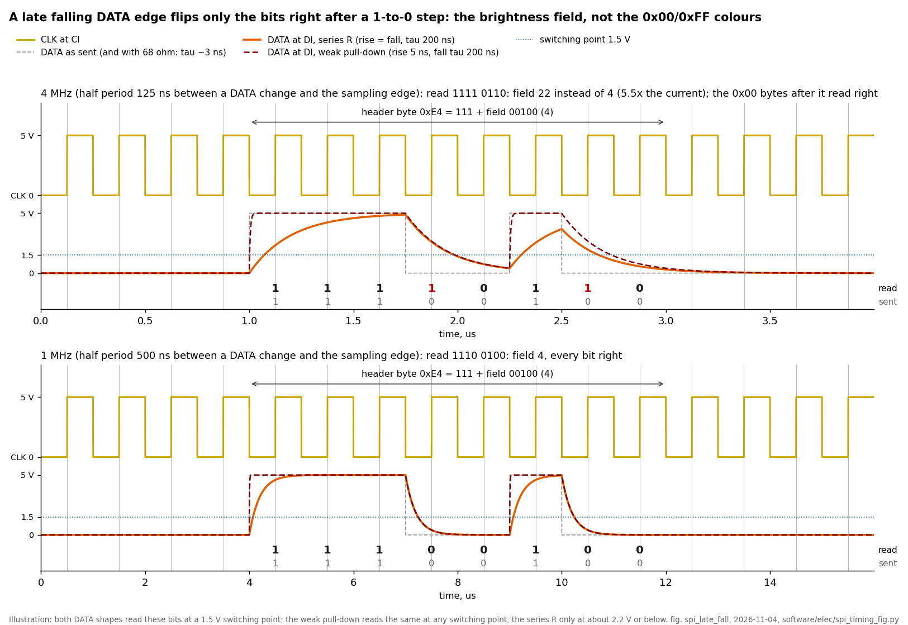

# POV LED Column v2: SPI Signal Investigation (why the test strip only works at 1 MHz, and the bench plan)

**Prepared for Brian** · Claude (Opus 5.5), SPI signal-investigation agent on the desktop PC · 2026-11-04
Inputs: Brian's brief of 2026-11-04:
- the phase-0 rig of wiring guide §1 as built (`docs/img/guide_rig_breadboard.png`);
- the 1 / 4 / 8 MHz observations;
- the uncommitted bench edits to `phase0.cpp`.

Also read: `software/firmware/lib/povcore/povframe.h`; electrical report §2.6 and §4; the ESP-IDF 5.5.5 / Arduino-ESP32 3.3.12 headers and a disassembly of `libhal.a` installed on the desktop PC. The SK9822 / APA102 datasheets, ESP32 technical reference manual (TRM) and field reports in §2 were gathered by a research sub-agent and are cited with their URLs.

Outputs:
- this report (`.md` + `.html`);
- `software/firmware/src/phase0/phase0.cpp`: Brian's `s` / `v` / 100 ms-resend edits kept, eleven bench commands added; **compiled on the desktop PC, not flashed**;
- `calc/spi_bit_model.py`: what the strip reads and draws under each bit-error model and each physical lag model; every mA figure below comes from it;
- `software/elec/spi_timing_fig.py` → `docs/img/spi_late_fall.svg/.png`.

---

## Summary

**Top hypothesis: DATA's falling edge reaches the strip late.** The fault is in the timing of DATA's 1-to-0 steps, not in how the strip treats the brightness byte.

**Why the colours survive.** In every test pattern so far the colour bytes are 0x00 or 0xFF: runs of eight equal bits with no level change inside them. The header byte (0xE0 | field) is the only byte with 1→0 steps inside it; field 4 is `1110 0100`, with two.

**What a late falling edge does.** If a falling DATA edge crosses the SK9822's switching point after the next CLK rising edge, the strip reads a 1 for the bit after the step. Field 4 then reads as **field 22** (`1111 0110`), or as **field 20** if only the first, longer fall is late.

**The numbers fit.** The SK9822 datasheet's current table is linear in the field: 2.324 mA per colour at 4/31, 11.62 mA at 20/31, 18 mA at 31/31. Brian's 1 MHz reading of 2.29 mA per LED matches it. So the red pattern should draw **168–187 mA**, and Brian measured **174–178 mA at 4 MHz**. A one-bit shift either way gives 72–80 mA, and a late rising edge gives a dark strip. No other simple model fits. The same mechanism also explains the earlier damaged-strip notes:
- at 8 MHz the lag covers more than a bit, so fields 1, 4 and 31 all read 25–31 ("barely changed the current");
- odd fields add blue to red ("purple for red").

**Where the late edge comes from.** At 4 MHz the strip gets 125 ns between a DATA change and its sampling edge; at 1 MHz it gets 500 ns. A simulation of the DI pad fits the readings in two ways:
- **A weak pull-down:** DATA rises fast but falls with a 105–730 ns time constant. This fits whatever the strip's switching point is.
- **A kilohm-class series resistance:** τ 105–310 ns, rise and fall alike. This fits only if the strip switches at or below about 2.2 V.

The design path gives about **3 ns** (68 Ω plus the buffer's ~25 Ω into ~30 pF), so either way something on the rig is a hundred times too slow. The suspects, most likely first:
1. **The 74AHCT125's channel 2 with a weakened output.** If the first strip was on the rig's terminal when it was powered reversed, its clamp diodes fed current through 68 Ω into this IC's outputs.
2. **R2 not being 68 Ω** (a 6.8 kΩ, or one of the 10 kΩ pull-downs, in its place).
3. **A high-resistance contact.**

A genuine SK9822 is rated for 15–30 MHz with 10 ns of setup, and no field report shows this signature, so the strip itself is the second suspect, not the first. The 220 Ω on CLK changing nothing fits: the clock is not the problem.

**First bench commands** (after Main flashes the new build):
1. `n7`.
2. **`xF60000FF`** at the default 1 MHz: red sent correctly at field 22, expect ≈ 96 mA. (`xF40000FF`, field 20, gives ≈ 88.)
3. **`s4000`**, then `1`.

A reading between 88 and 96 mA confirms the late falling edge. `g1` then says which kind: purple means a weak pull-down; plain red means a series resistance near a 2 V switching point. The DHO814 on U1 pin 6, terminal pin 5 and the DI pad finds the part (§5).

**For the carrier:** if the fault is on the rig, nothing in the carrier changes. 68 Ω stays and so does the **8 MHz** target. The carrier gains three checks:
- an Ω reading of R1–R4;
- one scope look at strip 0's DI pad;
- polarity before power on every start lead, because a reversed strip can damage U1 the same way.

If the strip itself is slow, the clock drops to the highest clean rig clock ÷ 1.3. The design needs **≥ 3 MHz**: the 704 B frame takes 1.88 ms of the 2.78 ms column at 3 MHz and 1.41 ms at 4 MHz. The electrical report needs a short revision note either way (§6). Its numbers change only in the strip case.

---

## 1. The clue: the colours survive, the brightness byte doesn't

| Byte (red, field 4) | Bits sent | 1→0 steps at or inside it | A late falling edge makes the strip read |
|---|---|---|---|
| header 0xE4 | `1110 0100` | 2 (bits 3 and 6) | `1111 0110` = field **22** (or `1111 0100` = **20** if only the first is late) |
| B 0x00 | `0000 0000` | 0 (the header ends in 0) | 0x00, unchanged |
| G 0x00 | `0000 0000` | 0 | 0x00, unchanged |
| R 0xFF | `1111 1111` | 0 (a 0→1 step at its start only) | 0xFF, unchanged |

The asymmetry is in the test patterns, not in the strip. A timing error can only show where DATA changes level, and the brightness byte is the only place it does.

`calc/spi_bit_model.py` sends the real phase-0 frame through simple models of what the first LED reads. Every LED re-drives CLK and DATA cleanly, so an error made at the strip's input is what all fourteen LEDs show. The current model is calibrated on Brian's 1 MHz readings: dark strip 8 mA; red, green and blue 2.29 / 2.21 / 2.21 mA per LED at field 4; linear in the field, as the datasheet table says.

| Model (what the first LED reads) | Red at field 4, 14 LEDs | Matches |
|---|---|---|
| ok: what was sent | 40 mA | 1 MHz (measured 40) |
| **F1: every 1→0 step arrives late by under one bit** | **184 mA** (field 22; 187 with the datasheet's 18 mA) | **4 MHz, fresh strip: 174–178 measured** |
| **only the first 1→0 step late** (it falls from a full 5 V after eleven 1s; the second follows a lone 1 that never charged fully) | **168 mA** (field 20; 171 with the datasheet) | **the same 174–178** |
| F2: late by one to two bits | 256 mA (field 31) | 8 MHz, damaged strip: 211–243 with field 1, 4 or 31 |
| R1: a 0→1 step arrives late | dark (the header loses its `111` marker) | nothing observed |
| L1: every bit read one clock late | 80 mA (field 18, red at half duty) | no |
| E1: every bit read one clock early | 72 mA (field 8) | no |

The measurement sits between the two late-fall readings. The current alone can't tell 20 from 22, and a bit sitting right at the switching point may even alternate between them from frame to frame. F1 also predicts things nobody has looked for yet:

- **Odd fields turn red purple.** The header then ends in 1, so B's first bit reads 1 (blue at 50 %). Field 1 reads as field 17 with 50 % blue. The "first step only" variant reads field 17 but stays plain red, so `g1` tells the two apart.
- **Green turns yellow-green** (R reads 0x80) and **blue turns azure** (G reads 0x80), in both variants.
- **White at field 4 jumps to ~525 mA.** Don't run white at 4 MHz on the 0.30 A limit.
- **The field map for F1** (sent → read, with F2 after the slash): 1→17/25, 2→19/27, 4→22/31, 8→28/30, 16→24/28, 31→31/31. The `a` ladder (fields 1, 2, 4, 8, 16) looks flat and bright instead of doubling LED to LED.



**Where a late falling edge comes from.** The script also simulates the DI pad as a first-order lag with its own rise and fall time constants, sampled at mid-bit against a switching point. It keeps every case that reads 165–190 mA at 4 MHz and still 40 mA at 1 MHz:

- **Weak pull-down** (rise 5 ns, slow fall). It fits at every switching point from 1.5 to 3.0 V, with a fall time constant of 105–730 ns (longer for a higher switching point). Every fit reads field 22, turns `g1` purple (109 mA with 7 LEDs) and green yellow-green: exactly F1. This is what an output with a damaged pull-down transistor looks like.
- **Series resistance** (rise = fall). It fits only for a switching point of 2.2 V or below, with τ = 105–310 ns. At 1.5 V it reads field 22. At 1.8–2.2 V it reads field 20 (shorter τ) or 22 (longer), and `g1` mostly stays plain red at 76 mA. At 2.5 V nothing fits: the rising edge is late too and the header loses its `111`.

The newer SK9822 sheets give VIL ≤ 0.3 VDD (1.6 V) and VIH ≥ 0.75 VDD (3.4 V). The real switching point is therefore somewhere between 1.6 and 3.4 V. A weak pull-down fits wherever it is; a series resistance needs it near the bottom. Either way the lag is a hundred times the design's ~3 ns: in resistance terms, a 4–15 kΩ series path or a pull-down of that order into ~30 pF.

---

## 2. The candidate causes, ranked

| # | Cause | Mechanism and numbers | Fits the bench? | Test |
|---|---|---|---|---|
| 1 | **A slow DATA path on the rig**: (a) U1 channel 2 pulling down weakly; (b) R2 not 68 Ω (68 Ω is blue-grey-black, 6.8 kΩ blue-grey-red; seven 10 kΩ are on the bench); (c) a high-resistance breadboard, terminal or DI contact | τ ≈ 100–600 ns at DI against ~3 ns by design: late 1→0 steps at 4 MHz, worse at 8 MHz, finished in time at 1 MHz. Both strips failed the same way on this rig. If the first strip was on the rig's terminal when it was powered reversed, its clamp diodes fed current from its GND pad (then at +5 V) through 68 Ω into U1's low outputs, up to the 50 mA supply limit, against TI's ±25 mA rating for an AHCT output | all of it: 168–187 vs 176 mA, the 8 MHz saturation, purple for red, CLK resistor irrelevant | scope at 2Y, T5 and DI; meter R2 |
| 2 | **The strip's own DI input is slow** (an off-spec "SK9822") | the same signature, made inside the LED. A genuine SK9822 is rated 15–30 MHz with 10 ns setup; cpldcpu ran 4 MHz without trouble and others 10 MHz and up; no field report shows this signature | equally well; the current alone can't separate 1 from 2 | DI clean and fast on the scope but the fingerprint stays; then `u25` (75 % setup) should fix it; try another piece |
| 3 | CLK→DATA crosstalk in the ribbon (DATA sits between 5V and CLK, no ground beside it) | ~2–3 pF mutual over 150 mm; with a 68 Ω drive about 0.1–0.3 V on DATA at each CLK edge, far from a threshold. It only adds to #1 if DATA is high-impedance | partly | spikes on CH2 at every CLK edge; > 1 V is a problem |
| 4 | CLK ringing or extra edges (breadboard + 150 mm lead) | the lead is 0.75 ns long against 3–5 ns edges, Z₀ ≈ 80–100 Ω, damped by the series R. An extra clock edge adds a bit and shifts everything after it, which would scramble the colours | no: colours right, and 220 Ω changed nothing | CH1 crossing 2.5 V more than once per edge |
| 5 | ESP32 output timing (mode-0 edge, IO_MUX vs GPIO matrix, dummy bits, half duplex, input delay) | checked in the driver and the TRM (§3): DATA changes on the falling edge, no MOSI delay, IO_MUX pins. A same-edge race would fail at every clock, 1 MHz included | no | DATA steps in line with CLK falling edges at U1's inputs |
| 6 | 74AHCT125 channel skew | about 1 ns against a 125 ns half period | no (a damaged channel is #1) | as #1 |
| 7 | Ground return / ground bounce | DC offset 0.18 A × ~0.1 Ω ≈ 20 mV. L·di/dt spikes at the LEDs' PWM edges give random sparkle, not a steady 5× field | no | noise on DATA's low level at the pad |
| 8 | SK9822 protocol quirks (latch on the next start frame, n/2 end clocks, header handling, clone frame lengths) | bit-count effects, identical at every clock, so they cannot make 1 MHz right and 4 MHz wrong | no | `o1 e1`, `z8`, `r2` change nothing (2 min, optional) |

**What the datasheets and field reports say:**

- **Speed:**
  - SK9822 serial input to 30 MHz (Jercio SK9822 REV.01 [1]; Normand SK9822-EC20 Rev 05 [2]; Opsco SK9822-A-000 [4]), or 15 MHz on the newest Opsco sheets [3].
  - Setup ≥ 10 ns, clock high and low ≥ 17–30 ns; no hold time is given.
  - 4 MHz is far inside all of them. Only the APA102C sheet recommends 0–5 MHz (and "below 2MHz" for lighting) [5].
- **Thresholds:** VIH 0.75 VDD or ≥ 3.4 V, VIL 0.3 VDD or ≤ 1.6 V (Opsco [3, 4]). The older sheets give none (Pololu: "not specified in the SK9822 datasheet" [6]).
- **Brightness:**
  - "5-Bit (level 32) brightness adjustment (simultaneous control of OUTR\OUTG\OUTB three port current)" [1]. It is a current source, not a second PWM (cpldcpu [7]).
  - It is linear: 2.324 mA at 4/31, 11.62 at 20/31, 18 at 31/31 [2].
- **Edges:** DATA is sampled on CKI's rising edge. Each LED forwards it on an inverted clock, half a cycle later [8], so every hop down the strip gets half a period of setup again.
- **Field reports:**
  - SK9822 / APA102 speed failures are on long strips at 12–24 MHz. Examples: FastLED #341, 160 SK9822 at 24 MHz, fixed at 12 MHz [9]; FastLED's 6 MHz APA102 default for "clock degradation" on long strips [10]; a 1,600-LED SK9822 install that ran at 4–6 MHz [11]. They were fixed by a slower clock or better power.
  - cpldcpu: "I had no issues with 4 MHz and others have successfully tested 10 MHz and above" [8].
  - **Nothing anywhere shows a 14-LED strip failing at 4 MHz, or the brightness field going wrong while the colours stay right.** That points at the rig rather than the part.
- **Mode 0 vs 3:** no A/B evidence either way. Adafruit DotStar uses mode 0 at 8 MHz; Google's periph driver uses mode 3 at 20 MHz.

[1] https://cdn.hackaday.io/files/272011163767584/SK9822%20REV.01%20%20EN(NUT).pdf · [2] https://www.mikrocontroller.net/attachment/618244/EC20-9822_SK9822-2020__LED_Datasheet.pdf · [3] https://atta.szlcsc.com/upload/public/pdf/source/20260416/E4DCAAFBB2137EA7091D3254EFF36D6F.pdf (SK9822-001) · [4] https://atta.szlcsc.com/upload/public/pdf/source/20241205/6F2E2F48F9B25EA4238171E6B7FB0A4F.pdf (SK9822-A-000) · [5] https://www.lcd-module.de/eng/pdf/zubehoer/APA102C.pdf · [6] https://www.pololu.com/product/3089 · [7] https://cpldcpu.com/2016/12/13/sk9822-a-clone-of-the-apa102/ · [8] https://cpldcpu.com/2014/11/30/understanding-the-apa102-superled/ · [9] https://github.com/FastLED/FastLED/issues/341 · [10] https://fastled.io/docs/d3/de8/apa102_8h_source.html · [11] https://forum.makerforums.info/t/teensy-3-2-sk9822-strips-fastled-3-1-3/59310 · ESP32 TRM: https://www.espressif.com/sites/default/files/documentation/esp32_technical_reference_manual_en.pdf

---

## 3. What the ESP32 actually puts on the wire (checked, not assumed)

Read in the toolchain installed on the desktop PC (`C:\pio\packages\framework-arduinoespressif32-libs\esp32\include\hal\esp32\include\hal\spi_ll.h`, `soc\esp32\register\soc\spi_struct.h`, a disassembly of `libhal.a`) and in the ESP32 TRM §20.4.1:

- **Mode 0** sets `ck_idle_edge = 0, ck_out_edge = 0`. In the TRM's words: "data changes on the falling edge of the SPI clock and is sampled on the rising edge". That gives DATA half a period of setup before the SK9822 samples on the rising edge.
  - **Mode 3** (`ck_idle_edge = 1, ck_out_edge = 0`) has the same edges with CLK idling high, so `p3` should change nothing.
  - Modes 1 and 2 (`ck_out_edge = 1`) change DATA on the rising edge: diagnostic only.
- **No hidden MOSI delay.** `SPI_CTRL2_REG` holds `mosi_delay_mode` (half or whole clock) and `mosi_delay_num` (0–7 APB cycles of 12.5 ns); the TRM's master table has both at 0 in every mode.
  - Bus init clears the register (`ctrl2.val = 0`).
  - Per device, the driver writes only the CS setup and hold fields; per transaction, only the MISO-delay fields. In `libhal.a`, `spi_hal_setup_device` and `spi_hal_setup_trans` read-modify-write bits 0–7 and 16–20 and never touch the MOSI bits 21–25.
  - That makes the delay a usable bench knob (`d`), and `q` reads it back to prove it held.
- **Dummy bits, `input_delay_ns`, `SPI_DEVICE_HALFDUPLEX`, `SPI_DEVICE_NO_DUMMY`** only compensate the MISO read path. Dummy cycles are added only when a half-duplex transfer has a receive buffer. Our transfers are transmit-only, so none of them moves MOSI or SCLK.
- **IO_MUX vs GPIO matrix:** 23/18 are VSPI's IO_MUX pins and 13/14 HSPI's, so the driver routes them directly; `q` and `i` print what it reports. The TRM says "output signals will not be delayed" through the GPIO matrix anyway, and its 40 MHz limit is irrelevant at 1–8 MHz.
- **Clock and duty:** 80 MHz ÷ an integer gives exactly 1, 2, 4, 5 and 8 MHz; 3 MHz comes out as 2.963 MHz. `duty_cycle_pos` defaults to 50 %. At 4 MHz the divider is 20 counts, so `u25` is exactly 25 % high / 75 % low; at 8 MHz it is 10 counts, in 10 % steps.

---

## 4. The new bench commands (phase0.cpp, compiled on the desktop PC, not flashed)

Brian's edits stay as they were: `sNNNN` clock in kHz, `vNNN` colour value, the frame re-sent every 100 ms, 1 MHz default. Added:

| Command | Does | Tests |
|---|---|---|
| `xHHHHHHHH` | the first n LEDs get these 4 raw bytes: header, B, G, R (no gamma, no field logic) | sends exactly what a model says the strip reads (`xF60000FF` = red at field 22, `xF40000FF` = field 20) |
| `a` | field ladder: LED k red at `v`, fields 1, 2, 4, 8, 16 repeating | one field bit per LED; right = brightness doubles LED to LED |
| `pN` | SPI mode 0–3 | mode 3 should match mode 0; modes 1 / 2 put the DATA change on the sampling edge |
| `uNN` | CLK high time 10–90 % (default 50) | in modes 0 / 3 the low time is DATA's setup before the sampling edge: `u25` = 75 % setup |
| `dN` | DATA delay after its CLK edge: 0–7 × 12.5 ns, `d8` = half a period | a late-falling-edge fault gets worse; a late-sampling strip would get better |
| `zN` `eN` `lN` | start zeros 0–16 B [4], end 0xFF 0–32 B [24], latch zeros 0–8 B [4] | clone frame-length quirks |
| `o0` / `o1` | all 168 LED slots [o0] or only the n lit ones | makes the end frame matter for a 14-LED strip |
| `rN` | each frame sent N times back to back (1–3) | "applies data one frame late" quirks |
| `q` | the hardware read back (actual kHz, mode bits, CLK high count, MOSI-delay register, IO_MUX) plus the frame layout and SPI error count | that each knob really took effect |

`t` and `i` now report the wire time at the actual clock (they said "at 8 MHz"). The predicted-mA line uses each LED's own field.

---

## 5. Bench plan for after lunch (15–20 min)

**Setup:**
- Main flashes the new phase0 (`git pull` first; `tools\pio.cmd run -e phase0 -t upload`) and keeps its held-open serial bridge, since opening the port resets the board.
- Supply **5.00 V, limit 0.30 A**, strip T on the rig.
- **Every step runs with `n7`**: LEDs 0–6 lit, 7–13 dark, so even the worst model stays under 0.25 A.
- Read the supply current about 2 s after each command.

| # | Type | ok (mA, colour) | late fall, F1 type (weak pull-down, or series R with a low switching point) | late fall, series R near 2 V |
|---|---|---|---|---|
| 1 | `c0` `n7` `g4` `1` (1 MHz) | 24, red | (1 MHz stays right in every fit) | |
| 2 | `xF40000FF` | 88, red (field 20 sent correctly) | | |
| 3 | `xF60000FF` | 96, red (field 22 sent correctly) | | |
| 4 | `g31` `1` | 132, red: linearity check, (88−8)/(132−8) ≈ 20/31 and (96−8)/(132−8) ≈ 22/31 | | |
| 5 | `g4` `1`, then **`s4000`** | 24, red | **96, red** | **88, red** |
| 6 | `g1` | 12, dim red | **109, purple** | **76, red** |
| 7 | `g4` `2` | 24, green | 137, yellow-green | 126, yellow-green |
| 8 | `1`, then `s2000`, `s3000`, `s4000`, `s5000`, `s8000` (read each) | 24 at every clock | 88–96 at the first failing clock; above it anything from ~50 to ~190 | |
| 9 | at 4 MHz: `u25` then `u50`; `p3` then `p0` | `u25`: back to 24 if the fall now finishes within 187 ns; `p3`: no change | | |

**Reading the table:**
- Step 5 between steps 2 and 3 (88–96 mA) confirms a late falling edge, and step 6 says which kind.
- The first wrong clock in step 8 dates the edge. Right at 3 MHz and wrong at 4 MHz means DATA reaches the switching point 125–167 ns after the CLK edge.

**Scope (DHO814), at 4 MHz, pattern `1`, `g4`, `n7`, about 6 min:**

- **Probes:** **CH1 = CLK at the CI pad** (the yellow joint), **CH2 = DATA at the DI pad** (orange). Both ground clips on the GND pad (green joint), or the shortest ground you can get. 10× probes with the probe ratio set to 10×, 2 V/div, CLK shifted up 3 div.
- **Trigger:** Edge, CH2, rising, 2.5 V, sweep Normal, **holdoff 10 ms**. The scope then fires on the first DATA rising edge of each frame: the first 1 of LED 0's header, right after the 32 start zeros.
- **Overview:** **500 ns/div**, trigger point 1 div from the left. The header (`1110 0100`) fills the first 2 µs, then B.
- **Zoom:** **50 ns/div** with the trigger offset at **+750 ns**, which is the header's first 1→0 step (bit 3). Measure CH2's fall time and the time from the CLK falling edge to DATA crossing ~1.5–2.5 V. The next CLK rising edge comes 125 ns after the falling edge.
- **Good:** DATA falls in under 10 ns, in step with CLK's falling edge (within ~15 ns), and sits flat at 0 V when CLK rises. Rise and fall look alike, with under 1 V of overshoot.
- **Bad:** DATA is still sloping down when CLK rises, above ~1.5 V. It either rises fast and falls on a slow curve (weak pull-down) or rises and falls on slow curves (series R).
  - A second tell: touching the probe to DI makes the supply current jump (96 → ~130 mA), because the probe's ~15 pF only matters to a high-impedance node.
- **Also look for:** CH1 crossing 2.5 V twice on one edge (cause 4), or spikes > 1 V on CH2 at every CLK edge (cause 3).

**Decision tree:**

```
Step 5 reads 88-96 mA (field 20-22): a late falling DATA edge. Move CH2 back along the path:
|- slow already at U1 pin 6 (2Y)       -> U1 channel 2 (weak pull-down): fit the carrier's 74AHCT125 for the test,
|                                         mark this one bad
|- fast at pin 6, slow at T5 (after R2) -> R2: power off, meter it (68 ohm = blue-grey-black); replace
|- fast at T5, slow at the DI pad       -> the orange conductor: re-seat it in the terminal, re-make the DI joint
|- fast everywhere, still 88-96 mA      -> the strip's input (cause 2): u25, then step 8 with it; try another piece
|  after any fix: step 8 up to 8 MHz -> 24 mA at every clock and no purple at g1 -> 8 MHz stands; then E9, t, k
Step 5 reads 24 mA                      -> intermittent contact: wiggle the rig at 4 MHz, re-seat, step 8
Colours scrambled or frozen             -> CLK: extra edges on CH1, crosstalk on CH2 (causes 3-4)
```

**Optional (2 min, only if nothing above fits):** `o1` `e1` (short frame, one end byte), `z8`, `r2`. Expect no change.

**E9** (white at field 31, guide step 1.4.6) is valid at 1 MHz, the sketch's default. Don't take it at 4–8 MHz until this is fixed.

---

## 6. What this means for the carrier, the harness and the electrical report

- **Cause 1 (rig fault, most likely): the design stands.** The carrier has the same 74AHCT125 + 68 Ω on all four outputs, soldered joints, and a U1 that never sat on the rig, so the 8 MHz target holds once the rig passes at 8 MHz. Add three checks:
  - **Test 5c:** meter R1–R4 at 68 Ω in circuit. The buffer output and the open terminal are both high-impedance, so they read true.
  - **Bring-up step 3/4** (electrical §9): look at both DATA edges at J3.5 / J4.5 and at strip 0's DI pad at 8 MHz; each should take under 10 ns.
  - **Polarity before power on every start lead and feed.** A strip powered reversed on a live carrier can stress U1's outputs exactly the way it may have stressed the rig's.
- **Series R values:** keep 68 Ω. At 8 MHz a late-fall error starts once DATA needs ~62 ns to cross the switching point, so the RC on the DATA node must stay well under ~50 ns. Anything up to a few hundred ohms works; kilohms never do. The rig's 220 Ω on CLK (τ ≈ 7 ns) is harmless and can stay.
- **Twisted pairs:** keep them on the 0.2–0.3 m start leads, CLK and DATA each twisted with its own ground. They are about crosstalk and the ground return at 8 MHz, not this fault.
- **The jumpers:** the 80 mm jumpers are driven LED to LED. Their ribbon order is now 5V | DATA | CLK | GND (Brian's pad-order decision), so DATA no longer has ground beside it. At 80 mm that costs ~1–2 pF of coupling into a low-impedance LED driver, which is small. Prove it once with two strips chained on the rig at the target clock before the tube.
- **Cause 2 (the strip is slow): the clock target changes.**
  - Set `SPI_HZ` in `main.cpp` to the highest clean rig clock ÷ 1.3; `SPI_US` and the scheduler follow it automatically.
  - If `u25` helped, set `duty_cycle_pos = 64` there too.
  - The floor is ~2.5 MHz at 225 rpm, because the frame plus the column build must fit the 2.78 ms column: 2.25 ms at 2.5 MHz, 1.88 ms at 3 MHz, 1.41 ms at 4 MHz. Below that the design needs fewer LEDs per chain or more chains.
- **Electrical report: yes, a small change, after the bench result.** It gets one edit, with the measured answer, instead of two, so it is untouched today. The edit:
  - a revision note with this finding;
  - a row in the §4 fault table: "colours right, brightness wrong, odd fields purple, worse at higher clocks → a late falling DATA edge: check the buffer channel, the DATA series R and the contacts; scope DI";
  - the polarity-before-power rule;
  - the stale §4 sentence that says the ribbon order "5V | CLK | DATA | GND puts DATA next to GND". The as-built order is 5V | DATA | CLK | GND;
  - under cause 2 only, the 8 MHz figures in the abstract and §4.

---

## 7. Explain it

- **The story:**
  - The strip's colours were right, but above 1 MHz it drew 5× the current its brightness setting allowed.
  - The test colours were all-zero or all-one bytes, so the only byte with internal 1-to-0 steps was the brightness byte. A late falling DATA edge could corrupt that byte and nothing else.
  - A few lines of Python pushed the real frame through candidate error models. A slow-edge simulation then bracketed the measured 176 mA between field 20 (168) and field 22 (184), and ruled out everything else.
  - It also predicted two new symptoms to check before touching the hardware: odd brightness values turn red purple, and the reading jumps at a specific clock.
- **The method:** turn a qualitative symptom into a number (the current at the supply). Write down the simple ways the bits could go wrong and compute what each predicts. Pick the next measurement where the models disagree: `xF60000FF` at 1 MHz vs red at 4 MHz; `g1` purple or red; the scope at 2Y, T5 and DI.
- **For the video:** show the red-to-purple flip as the field goes from 4 to 1 at 4 MHz, next to the scope trace of the slow DATA edge and the figure above. Together they explain a signal-integrity bug in one shot.

---

## Files

| File | What |
|---|---|
| `software/firmware/src/phase0/phase0.cpp` | bench sketch: Brian's `s` / `v` / resend edits + `x a p u d z e l o r q`; builds with `tools\pio.cmd run -e phase0` (1,016,149 B flash, 56,016 B RAM, no warnings in the sketch) |
| `calc/spi_bit_model.py` | the bit-error models, the lag models and their fits, the tables in §1 and §5, the field map, the frame-time budget |
| `software/elec/spi_timing_fig.py` | `docs/img/spi_late_fall.svg/.png` |
| `docs/2026-11-04-spi-signal-investigation.md` / `.html` | this report (`py software/elec/md2html.py docs/2026-11-04-spi-signal-investigation.md`) |
