# POV LED Column v2: Wiring Build Guide (rev i), sub-assembly by sub-assembly

**Prepared for Brian** · Claude (Opus 5.5), wiring-guide agent on the laptop · 2026-11-04
**Revised 2026-11-04: test checklists added** (Brian's follow-up of 2026-11-03: "include any continuity testing ... a quick checklist to do at the end of each sub-assembly"). Every section ends with a tick-box test; the one-page master checklist is the last page.
**Revised 2026-11-04 (later): the strip pads as measured** (`measurements.md` #28–30). The silkscreen reads **GND, CO, DO, 5V** / **GND, CI, DI, 5V** (clock next to GND, not 5V), the pads span **11 mm** (not 9.0) and each is **2.5 × 2.5 mm with copper from the cut edge**. The tube keeps its 10 mm slots, so: solder on the half of each pad toward the LED (1.0–2.5 mm from the cut), and on GND / 5V on the inner half; dry-fit the first strip at its slot; file a slot only if its strip rocks (max 0.5 mm per side). Pad figures, the jumper's half turn, the probe, T's lead and Tests 2 and 3 are corrected (sections 0.1, 2.2, 2.4, 3.4, 10).
**Revised 2026-11-04 (bench decision, Brian): orange = DATA, yellow = CLK, everywhere.** With the pads in the order GND, C, D, 5V, the flat red-orange-yellow-green band lands green on GND, yellow on C, orange on D, red on 5V with no crossing (test strip T is soldered that way). So: ribbon red / orange / yellow / green = **5V / DATA / CLK / GND**; 26 AWG ID bands **orange = DATA, yellow = CLK**, white = hall OUT; carrier 28 AWG **orange = data nets, yellow = clock nets**; rig and J3 / J4 leads **red → 1, green → 2, yellow → 3 (CLK), orange → 5 (DATA)**. Text, cut sheet, tests, checklist and figures all changed (section 10 #21); the half-turn geometry is unchanged.
**Revised 2026-11-04 (rev i): the carrier on your real board** (`measurements.md` #31–33; carrier agent on the desktop PC). Your 70 × 90 board has **26 × 31 holes**, not the assumed 27 × 35, so section 5 was redone for it. **Every hole is now named by the label printed on your board** (column letter A–Z, row number 1–31, e.g. D21), and the orientation is **hole A1 at the bottom left with the component side facing you; the row-1 end goes down into the sled**. The layout is rev h's hole for hole with every row number 2 lower, so every part, wire and cut length is unchanged; only the names changed. **If you printed section 5 or its figures before this, discard them: every row number is different.** E17, E2 and E3 are done (#31–33). Also updated: the carrier figures and `guide_carrier_wires.csv`, the landing map (4.3), the pigtail's J1 pins (6.2), 8.1, the master checklist and section 10 #9–11; #22 is new. The sled's card guides moved 1.27 mm, so print the sled from `cad/print/rev-i_CURRENT/` (`rotor_sled_i_PETG`).

Sources, newest first (where they disagree the newest wins, and section 10 lists each disagreement): the rev c/d/e/g/h/i notes and sections 5, 7 and 9 of `docs/2026-11-02-electrical-design.md`, `docs/2026-11-02-wiring-cad.md` (rev g/h), `docs/2026-11-03-qa-review-2.md` (wiring findings N5, m-c, m-d, m-f and m-i applied), `docs/img/wiring_cut_list.csv`, `docs/img/elec_wiring_table.csv`, `docs/img/elec_carrier_netlist.txt` (rev i), `docs/measurements.md`, `docs/2026-11-03-firmware-build.md` (the phase-0 sketch) and `docs/2026-11-03-fdm-optimisation.md`. The guide's figures are drawn by `software/elec/guide/*.py` into `docs/img/guide_*.svg/.png`; the carrier's wire list is `docs/img/guide_carrier_wires.csv`.

> **How to use it.** Build the sections in order. Each one ends with a test box, and you don't start the next sub-assembly until that box passes, so a fault is always in the last thing you touched. Every step has a spec line (wire, colour, cut length, strip length at each end, tin or not, heat-shrink, joint, torque, the check, time). Print the **cut sheet** (after section 1) and the **master checklist** (last page).

**What this guide decides, because it changes what you cut:**

1. **Every wire that ends in a 2.54 mm screw terminal is 26 AWG and is clamped bare: twisted, not tinned** (QA-2 N5). That covers both start leads (all six conductors) and the hall lead, in addition to the feeds. Solder under a screw cold-flows and the clamp loosens with vibration, and a loose CLK wire means a dead chain at speed. Only red and black 26 AWG are on hand, so the signal conductors are **black with a coloured ID band**: orange = DATA, yellow = CLK, white = hall OUT.
2. **All 22 jumpers are cut at 80 mm** (QA-2 m-d). The cut list's 75 mm for 14 of them comes from rounding a 64–66 mm route plus 8 mm. Every report and the slack-loop procedure assume 80, and 5 mm more ribbon inside a loop costs nothing. One length means one jig and no sorting.
3. **F1 is a 4 A fast-blow** (rev e; QA-2 m-c). Don't fit a 3 A fuse: at 2.72 A it runs at 91 %.
4. **Second joints on the tube:** put a card or silicone mat over the mounted neighbours (QA-2 m-f), and light the chain after every strip.
5. **Jumpers 5–6 and 17–18:** the first end goes on strip **6 / 18** at the bench and the loop end on strip 5 / 17 (electrical 7.6 step 4). The cut list's from/to columns are right; its route text reads the other way round.
6. **The carrier (rev i):** fitted to your board's printed grid. Hold **A1 at the bottom left, component side facing you, row 1 down into the sled**; every hole in section 5 is a printed label (D21), not a grid number.
7. **The strip pads, as measured today (#28, #29):** order **GND, C, D, 5V** at both ends, **11 mm** span, each pad **2.5 × 2.5 mm starting at the cut edge** (#30). Every pad figure is drawn that way. The tube's 10 mm slots stay, so **every joint sits on the half of its pad toward the LED (1.0–2.5 mm from the cut)** and the **outer pads (GND, 5V) take their wire on the inner half**. With **orange = DATA, yellow = CLK** (Brian's bench decision, test strip T), the ribbon lies flat on the pads in its own order: **flip the band so green is on GND and red on 5V; yellow lands on C and orange on D, no crossing**. Solder by label, always.

---

## 0. Bench setup and tools (30 min)

### 0.1 Five quick measurements first (15 min), because later steps wait on them

| # | Do | Why it can't wait |
|---|---|---|
| **E15** | **Done 2026-11-04** (`measurements.md` #28–30): the four pads span **11 mm** (not 9.0) and read **GND, C, D, 5V** at both ends, with the clock pad next to GND (expected order at an OUT end **GND, CO, DO, 5V**, at an IN end **GND, CI, DI, 5V**; check yours against the silkscreen). #30: each pad **2.5 × 2.5 mm**, copper from **0 to 2.5 mm** from the cut edge. | The tube is already printing with its 10 mm slots (window 1.0–6.0 mm from the cut end, ±5.0 mm across), so every joint goes on the **LED half of its pad (1.0–2.5 mm)** and the **outer pads (GND, 5V) on their inner half** (section 2.4). Dry-fit the first strip at its slot; if a strip rocks, file that slot only, max 0.5 mm per side. |
| **E17** | **Done 2026-11-04** (`measurements.md` #31): **26 × 31 holes**, columns A–Z across the 70 mm side, rows 1–31 along the 90 mm side; margins 3.25 mm across, 7.5 mm below row 1, 5.5 mm above row 31. | The carrier was refitted to it (rev i): the same layout, every hole named by its printed label (section 5). |
| **E2** | **Done** (#32): with the USB at the bottom and the module facing you, bottom-left **VIN**, then **GND**, **D13** going up; bottom-right **3V3**; top-left **EN**; top-right **D23**. | It matches the carrier's pin map: nothing changes. |
| **E3** | **Done** (#33): diode mode, VBUS → VIN **0.49 V**, reversed about **1.0 V** (repeated). The forward drop means D1 is fitted; the reverse reading is a sneak path through the board's other parts, not a direct tie. | The rule stands: pigtail out whenever USB is in (sections 5.7 and 8.2). |
| parts | Check the parts are there: 68 Ω × 6 (4 carrier + 2 rig; 47 or 100 Ω also work), 10 kΩ × 7, 100 nF × 4, 1 nF × 1, 1000 µF ≥ 10 V × 3, a **4 A** 5 × 20 fast fuse and holder, a DIP-14 socket if you have one. | So you don't stop mid-board. |

### 0.2 Iron, solder, flux

| Item | Use |
|---|---|
| Station | YIHUA 939D+ |
| Tip | **small chisel, 1.5–2 mm.** Its flat puts heat into a pad in 1–2 s. A fine conical tip is fine on the carrier but too slow on the strip pads. |
| Temperature | **320 °C** for the strip pads, the carrier's insulated wires and all splices. **340 °C** if a joint won't wet in 2 s (never leave the iron parked on a strip pad, which lifts after 4–5 s). **340–350 °C** for the bare 22 AWG bus wire and for terminal or capacitor pins that sit on the ground ring. |
| Solder | 60/40 rosin-core, 0.6 mm |
| Flux | flux pen (rosin or no-clean) on every strip pad, splice and bus tack. With no pen, tin with fresh solder only, because the core's flux is used up on a second reflow. |
| Clean | IPA 90 %+ and a stiff brush after every strip end (CA bonds badly to rosin), brass wool for the tip, wick for bridges |
| Around it | fume extractor on, 10× magnifier lamp, glasses when you cut bare wire |

### 0.3 Wire stock, and what each one is for

| Stock | Goes to | Colours used |
|---|---|---|
| **22 AWG silicone, stranded** (NAOEVO) | carrier 5 V runs, LK1, the J1 tap; base motor and supply leads | red = 5 V / +, black = GND / −, yellow = LK1 |
| **26 AWG silicone, red and black** | start leads (all six conductors), feeds, hall lead, the carrier's GND taps | red = 5 V, black = GND, **black + ID band = signal** |
| **28 AWG rainbow IDC ribbon**, 10 wires (2 × 16 ft) | the 22 jumpers (four adjacent conductors, red-orange-yellow-green), the carrier's signal wires (single conductors), the rig leads | conductor order brown, red, orange, yellow, green, blue, violet, grey, white, black |
| **22 AWG solid** (TUOFENG), insulation stripped off | the carrier's bare buses and one-hole links, the test-point loops, the rig's breadboard links (the BOJACK jumpers are fine too) | bare |

**Colour code, everywhere:**

- **Single wires:** red = 5 V, black = GND. Black + **orange** band = DATA, black + **yellow** band = CLK, black + **white** band = hall OUT.
- **Ribbon jumpers:** red = 5V, orange = DATA, yellow = CLK, **green = GND** (flipped, the band lies flat on GND, C, D, 5V: green, yellow, orange, red). Green means GND only inside a ribbon.
- **Carrier 28 AWG:** orange = data nets, yellow = clock nets, white = hall, violet = 3V3.

### 0.4 Heat-shrink (Ginsco 2:1 kit): sizes and where each goes

| Size (before shrinking) | Piece | Qty | Where |
|---|---|---|---|
| 1.5 mm | 6 mm | 10 | ID bands, 15 mm from each end of the signal conductors: orange × 4 (two DATA wires × 2 ends), yellow × 4 (CLK), white × 2 (hall OUT). If the kit has no orange, use rings instead: 1 ring = CLK, 2 rings = DATA, 3 rings = hall OUT, in any colour except red or black. |
| 3 mm | 15 mm | 2 | the start-lead ground splices (section 4). Slide it on **before** you solder. |
| 2 mm | 8 mm | 3 | the three A3144 leg joints (section 6) |
| 3 mm | 15 mm | 2 | the fuse-holder splices on the pigtail's VBUS wire (section 6), if the holder has its own leads |
| 3 mm | 10 mm | 2 | the motor-tab leads (section 7); C7 sits under them |
| none | | | strip pads (tape instead: no room under the slot), screw-terminal ends (bare wire), carrier wires |

Tape: plain electrical tape is fine (Brian, 2026-11-02). Cut **12 × 6 mm** patches for the strips' backs (one per bench strip end, 24 today, over the joints only). The 46 slot patches (22 long at 19 × 35 mm over a slot and its loop, 24 short at 19 × 15 mm) are for the tube session later.

### 0.5 Stripping and cutting

- **22 AWG:** KNIPEX automatic stripper (10–24 AWG).
- **26 and 28 AWG** are below both strippers' range. Use a fresh hobby blade: roll the wire under it with light pressure so it cuts the insulation and not the strands, then pull the slug off with a fingernail. Check that no strands came off. The ribbon's PVC also strips with the iron: touch for 1 s, then pull.
- **Ribbon:** nick the web between two conductors with the blade and tear by hand; it tears straight. Peel the four-wide **red-orange-yellow-green** band away from brown on one side and blue on the other. Keep the blue-to-black five-wide band for the rig leads and the pot cable.
- **Strip-length gauge:** stick a strip of tape on the bench edge marked 2.5, 3, 5 and 12 mm. You will strip about 300 ends today.
- Flush cutters to trim, sharp scissors for strip cut lines.

### 0.6 Holding the work

Silicone mat, painter's tape to hold a strip face down, a third hand or clip for wire pairs, fine tweezers, CA (Starbond) with a needle applicator, a fine marker and masking tape for labels.

### 0.7 Test gear and meter modes

Multimeter, bench supply (5.00 V with a current limit; confirm its 5 V current rating, E10), DHO814 (optional), and the phase-0 rig from section 1.

| Meter mode | Used for | Pass | Note |
|---|---|---|---|
| **Continuity (beep)** | wire end to pad, terminal pin to net, conductor to conductor | beep, **< 1 Ω** | touch the probes together first and subtract the leads (≈ 0.2 Ω) |
| **Ω (auto or 20 kΩ)** | resistors in circuit, 5 V to GND across a strip or a board | the value in the box | readings across capacitors **climb** as the meter charges them: wait 5 s and read the settled value |
| **Diode** | E3 on the DevKit | 0.2–0.4 V one way, open (OL) the other | |
| **DC V** | rails, pins | as stated | black probe on GND (TP3 on the carrier) |
| **Supply's current readout** | power-up checks | as stated | trust it at mA level only if it shows mA; otherwise use the meter in series on the mA range |

**Setting the current limit:** with the output off, short the leads, switch on, turn the current knob until the display reads the limit, then switch off and remove the short. Set 5.00 V with the output open.

### Test 0: bench ready (5 min)

| ☐ | Check | How | Pass | If it fails |
|---|---|---|---|---|
| ☐ | Meter zero | continuity, probes together | beep, ≤ 0.3 Ω | probe leads or battery |
| ☐ | Supply | output open, then shorted | 5.00 V open; the limit holds at 0.30 A shorted | wrong knob or mode (CV/CC) |
| ☐ | Iron | tin the tip, touch a pad offcut | solder flows in 1 s at 320 °C | tip oxidised (brass wool, re-tin), wrong tip |
| ☐ | E15, E17, E2, E3 | section 0.1 | all four recorded | |
| ☐ | Parts | section 0.1 | all present, fuse is 4 A | order the missing parts now; nothing in sections 1–4 needs them except the rig's 68 Ω |

---

## 1. The single-strip breadboard test, which then stays as the test rig (about 1 h)

**What it proves before any of the 24 strips has a permanent joint:** that the chain ESP32 → 74AHCT125 → 68 Ω → SK9822 works at 8 MHz, the colour order, the end frame (last LED), and the real current of one strip (E9, which replaces the 20 mA/LED assumption behind every current number). The rig then **stays built**: sections 2–4 test every strip, start lead and jumper on it. It is the carrier's chain-0 circuit on a breadboard, with the same pin order on its output terminal as J3.

**Parts:** a **spare DevKit** (one of the three; keep the carrier's DevKit for section 5), the spare 74AHCT125, 2 × 68 Ω, 2 × 10 kΩ, 100 nF, a 100–1000 µF ≥ 10 V electrolytic, 2.54 mm screw terminals making **six positions** (a 6P, or 3P + 3P side by side), the 1660-point breadboard and jumpers. You also need **test strip T**: a **14-LED piece cut from the reel remainder** (the two 5 m reels left about 4.4 m after the 24 strips), cut on its cut lines and labelled "T". It never goes on the rotor; later it is the spare.

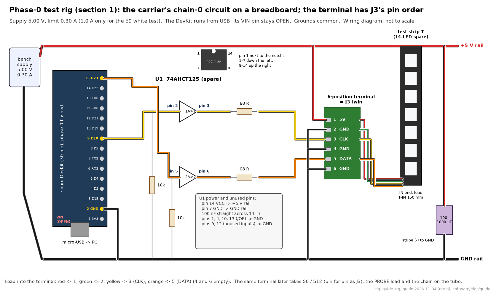

### 1.1 Solder T's lead: this is also your practice joint

| Wire | Colour | Cut | Strip (T end / terminal end) | Tin | Heat-shrink | Joint | Torque | Check | Time |
|---|---|---|---|---|---|---|---|---|---|
| 4-wire ribbon "T-IN" | red / orange / yellow / green = 5V / DATA / CLK / GND | 150 mm | split 12 mm; 2.5 / 5 | T end yes; terminal end **no** (twist) | none; 12 × 6 mm tape over the joints | T's **IN** pads (this reel: GND, CI, DI, 5V, #29), wire laid along the strip toward LED 0, as in section 2 | terminal: snug, then a firm tug | continuity pad to wire end, < 1 Ω × 4; 5V to GND on T > 100 Ω | 15 min |

### 1.2 Build the rig (supply OFF, USB out)

| # | From | To | Note |
|---|---|---|---|
| 1 | bench supply + | breadboard + rail | set 5.00 V and a **0.30 A** limit first |
| 2 | bench supply − | breadboard − rail (GND) | |
| 3 | 100–1000 µF electrolytic | + rail / − rail, next to the terminal | **stripe to −** |
| 4 | U1 (74AHCT125), across the centre channel | | notch to the left; pin 1 is next to the notch |
| 5 | U1 pin 14 (VCC) | + rail | |
| 6 | U1 pin 7 (GND) | − rail | |
| 7 | 100 nF | straight across U1 pin 14 to pin 7 | as short as possible |
| 8 | U1 pins 1, 4, 10, 13 (the four /OE) | − rail | outputs always on, as on the carrier |
| 9 | U1 pins 9 and 12 (unused inputs 3A, 4A) | − rail | never leave a CMOS input floating |
| 10 | 10 kΩ | U1 pin 2 to the − rail | pull-down (R5 on the carrier) |
| 11 | 10 kΩ | U1 pin 5 to the − rail | pull-down (R6) |
| 12 | DevKit **D18** | U1 pin 2 (1A) | CLK0 |
| 13 | DevKit **D23** | U1 pin 5 (2A) | DATA0 |
| 14 | DevKit **GND** | − rail | common ground with the supply |
| 15 | DevKit **VIN** | **nothing** | the DevKit runs from USB. Never put the bench 5 V on VIN while USB is in. |
| 16 | U1 pin 3 (1Y) | 68 Ω → terminal pin **3** (CLK) | R1 |
| 17 | U1 pin 6 (2Y) | 68 Ω → terminal pin **5** (DATA) | R2 |
| 18 | terminal pin 1 | + rail | 5V |
| 19 | terminal pins 2, 4, 6 | − rail | GND |

D18, D23 and GND are all on **one** header: with the USB at the bottom, the right-hand column is 3V3, GND (2nd from the USB end), … D18 (9th), … D23 (top, antenna end). Only that header needs free breadboard holes. The 30-pin board is 28 mm wide, so let the other header overhang the edge of a terminal strip.

### 1.3 Flash phase-0 on the rig DevKit

From `software/firmware`: `tools\pio.cmd run -e phase0 -t upload`, then `tools\pio.cmd device monitor` (115200 baud, `?` for help). PlatformIO is installed on the desktop PC; on the laptop, any 115200 serial terminal works once the board is flashed. The commands used here (firmware report §3): `c0` chain 0, `n14` 14 LEDs, `g4` field 4 of 31, then `0` off, `1` red, `2` green, `3` blue, `4` white, `5` strip numbers (strip s lights its LED s, so one strip shows LED 0 only), `7` last LED only, `8` walking LED, `t` frame time, `k` column clock.

### 1.4 Run it

1. **Rig alone (T out), supply on, no USB:** do the first four checks in the box below.
2. **USB in:** the banner prints the USB/bank rule. Type `c0`, `n14`, `g4`, `0`.
3. **Supply off, T's lead into the terminal** (red → 1, green → 2, yellow → 3, orange → 5), supply on, `0` (a fresh strip powers up with random colours until a frame arrives).
4. `1`, `2`, `3`, `4`: all 14 LEDs in the named colour. The sketch prints its predicted mA; white at g4 is about 0.1 A.
5. `8`: one LED walks from **LED 0 at the lead end** to LED 13. Then `7` (LED 13 only) and `5` (LED 0 only).
6. **E9:** raise the limit to **1.0 A**, type `g31` then `4`, read the current, then type `0` within 10 s. Then set `g4` and put the limit back to 0.30 A. Record the white reading and the dark reading from step 3 in `docs/measurements.md` as the next free row (#34: #31-33 went to the carrier board and the DevKit checks).
7. `t`: the frame time (about 704 µs plus a few tens). `k`: the last LED should look white-ish; a single colour means the end frame didn't latch it.
8. Optional, with the scope: terminal pins 3 and 5 against GND show 8 MHz bursts, 5 V tall, edges under 10 ns, overshoot under 0.5 V.

**Spec, the rig as a whole:** 22 AWG solid or BOJACK jumpers, push-in; no solder except T's lead; supply 5.00 V, 0.30 A (1.0 A only for E9); time 30 min to build, 15 min to test.

### Test 1: the rig and test strip T

| ☐ | Check | Meter mode | Pass | If it fails, look at |
|---|---|---|---|---|
| ☐ | + rail to − rail, supply off | Ω | > 1 kΩ, climbing (the capacitor charging) | < 10 Ω: a bridge, the capacitor's legs in one row, U1 in backwards |
| ☐ | DevKit VIN to + rail | continuity | **no beep** | a jumper on VIN: remove it |
| ☐ | supply on, no USB, T out | supply current | **< 5 mA** | U1 backwards (pin 1 next to the notch), a short |
| ☐ | U1 pin 14; terminal pins 3 and 5 | DC V | 4.95–5.05 V; < 0.1 V | rail break; a pull-down or /OE not grounded |
| ☐ | USB in | serial | banner, `i` shows free heap > 200 kB | COM port, a charge-only cable, the driver |
| ☐ | T in, pattern `0` | supply current | **7–15 mA** (dark strip; record it) | > 50 mA: T damaged or a bridge at T's pads |
| ☐ | `1` `2` `3` `4` at g4 | eye | all 14 LEDs, correct colour | nothing lit: CLK and DATA swapped (lead, or the 68 Ω on pins 3/6); wrong colours: the BGR order in the firmware, not the wiring |
| ☐ | `8`, `7`, `5` | eye | the walk starts at the lead end; LED 13 only; LED 0 only | the walk starts at the far end: T's lead is on the OUT pads |
| ☐ | E9: `g31` `4`, 1.0 A limit | supply current | **0.80–0.85 A** (record) | supply in CC (limit too low); much less: the field isn't 31 |
| ☐ | `t`, `k` | serial, eye | ≈ 704 µs + tens; last LED white-ish | ≈ 1.3 ms: software (firmware report); a single colour: end frame |

## CUT SHEET: every wire for today (print this; one to two pages)

Lengths are **cut** lengths: they include the strip at each end and the routing slack. **Strip:** 2.5 mm at a strip pad (tinned), **5 mm at a screw terminal (bare, twisted, not tinned)**, 3 mm on the carrier (tinned). Label every piece with a masking-tape flag as you cut it. Cut groups A–C now. Cut group D's carrier wires as you reach them in section 5 and hold each against the board first: they are lane lengths plus 3 + 3 mm of strip and 3 mm of slack. Cut the base wires once the base shell is printed.

**A. 28 AWG rainbow ribbon, four-wide band red | orange | yellow | green** (5V | DATA | CLK | GND)

| ☐ | Qty | Cut mm | Labels | Goes to | Strip |
|---|---|---|---|---|---|
| ☐ | 22 | **80** | 0-1, 1-2, 2-3, 3-4, 4-5, 5-6, 6-7, 7-8, 8-9, 9-10, 10-11 · 12-13, 13-14, 14-15, 15-16, 16-17, 17-18, 18-19, 19-20, 20-21, 21-22, 22-23 (there is **no 11-12**) | jumpers (section 3); first end on the lower-numbered strip, **except 5-6 on strip 6 and 17-18 on strip 18** | split 12, strip 2.5 at both ends |
| ☐ | 1 | 150 | T-IN | rig: test strip T to the terminal (section 1) | 2.5 / 5 |
| ☐ | 1 | 200 | PROBE | rig: the strip probe, tips taped at the pad pitch (section 2) | 3 / 5 |

That is 2.11 m of the four-wide band (the 2 × 16 ft reels hold 9.7 m). Keep the blue-violet-grey-white-black remainder.

**B. 26 AWG silicone, red** (9 wires, 1,580 mm)

| ☐ | Label | Cut mm | From → to |
|---|---|---|---|
| ☐ | S0-5V | 170 | J3 pin 1 → strip 0 bottom (IN) 5V pad |
| ☐ | S12-5V | 165 | J4 pin 1 → strip 12 bottom (IN) 5V pad |
| ☐ | F3+ · F6+ · F9+ | 200 · 235 · 250 | J6 · J7 · J8 pin 1 → strip 3 · 6 · 9 bottom 5V pad |
| ☐ | F15+ · F18+ · F21+ | 155 · 120 · 125 | J9 · J10 · J11 pin 1 → strip 15 · 18 · 21 bottom 5V pad |
| ☐ | H-5V | 160 | J5 pin 3 → A3144 leg 1 (VCC) |

**C. 26 AWG silicone, black** (18 harness wires, 2,940 mm; ID bands are 1.5 mm heat-shrink, 6 mm long, 15 mm from each end)

| ☐ | Label | Cut mm | From → to |
|---|---|---|---|
| ☐ | S0-G | 170 | J3 pin 2 → strip 0 GND pad (the two returns splice onto it 30 mm before the pad) |
| ☐ | S12-G | 165 | J4 pin 2 → strip 12 GND pad (same splice) |
| ☐ | S0-C **yellow band** · S0-D **orange band** | 165 · 165 | J3 pin 3 → strip 0 CI · J3 pin 5 → strip 0 DI |
| ☐ | S12-C **yellow band** · S12-D **orange band** | 165 · 165 | J4 pin 3 → strip 12 CI · J4 pin 5 → strip 12 DI |
| ☐ | S0-CR · S0-DR · S12-CR · S12-DR (signal returns) | 135 each | J3 pin 4 · J3 pin 6 · J4 pin 4 · J4 pin 6 → the GND splice |
| ☐ | F3− · F6− · F9− | 200 · 235 · 250 | J6 · J7 · J8 pin 2 → strip 3 · 6 · 9 bottom GND pad |
| ☐ | F15− · F18− · F21− | 155 · 120 · 125 | J9 · J10 · J11 pin 2 → strip 15 · 18 · 21 bottom GND pad |
| ☐ | H-G · H-OUT **white band** | 160 · 160 | J5 pin 2 → leg 2 (GND) · J5 pin 1 → leg 3 (OUT) |
| ☐ | carrier GND (section 5) | W02 20 · W18 35 · W19 25 · W20 45 · W23 50 · W24 30 · W25 15 | see the carrier table (7 wires, 220 mm) |

**D. 22 AWG, and 28 AWG single conductors (carrier and base)**

| ☐ | Stock | Pieces, cut mm | Where |
|---|---|---|---|
| ☐ | 22 AWG silicone **red** | W26 15 · W30 15 · W32 15 · W34 55 · W35 30 · W36 65 · W37 15 · W42 20 · W43 55 · W44 20 · W45 20 (11 wires, 325 mm) | carrier 5 V runs (section 5) |
| ☐ | 22 AWG silicone **yellow** | W38 15 | LK1, the bus A–B link |
| ☐ | 22 AWG solid, **stripped bare** | GND ring 65 (row 3) · 80 (column 23) · 65 (row 30) · 45 (column 2), or one 215 bent at the corners; bus A 85 (an L: column 21, then row 25); bus B 30; TP1–TP3 3 × 15; 22 one-hole links from offcuts or resistor leads | carrier buses (section 5) |
| ☐ | 28 AWG single conductors, peeled from **one 300 mm length** of the ribbon | **orange (data)** W47 50 · W49 75 · W51 25 · W53 30 · W55 35 · W57 80 · **yellow (clock)** W46 40 · W48 60 · W50 30 · W52 20 · W54 35 · W56 75 · **white** W58 80 · W59 15 · W60 60 · **violet** W61 30 (16 wires, 740 mm) | carrier clock, data, hall and 3V3 wires |
| ☐ | 22 AWG silicone **red / black** | M+ / M− 120 each; PS+ / PS− ≈ 1,100 each (bench supply → PWM IN, 65 of it inside the base) | base (section 7), after the base shell prints |
| ☐ | USB-A pigtail (as bought, 22 AWG) | keep it 280 mm until the sled fit, then trim to ≈ 170 (CAD route 151 + 20); 4 A holder in the **VBUS** wire (settled live, 6.2), 40–60 mm from the plug | section 6 |
| ☐ | pot cable (kit) | needs ≥ 410 mm; if shorter, splice in 3 conductors of the blue-violet-grey ribbon (410 − kit length + 30) | section 7 |

**E. Heat-shrink and tape**

| ☐ | Item | Qty |
|---|---|---|
| ☐ | 1.5 mm × 6 mm ID bands: orange · yellow · white | 4 · 4 · 2 |
| ☐ | 3 mm × 15 mm (start-lead GND splices; fuse-holder splices) | 2 + 2 |
| ☐ | 2 mm × 8 mm (A3144 legs) · 3 mm × 10 mm (motor tabs) | 3 · 2 |
| ☐ | electrical tape 12 × 6 mm (strip backs at the bench, over the joints) · 19 × 35 and 19 × 15 (slot patches, tube session) | 24 · 22 + 24 |

**Totals.** Harness and rig, cut today: **24 ribbons + 27 × 26 AWG (9 red, 18 black) = 51 pieces**, plus 10 ID bands. Carrier, as you go: **16 × 28 AWG + 7 × 26 AWG + 12 × 22 AWG + 9 bare pieces = 44**, plus 22 offcut links. Base: **4 × 22 AWG**. **99 cut pieces in all**, plus the pigtail and the pot cable as bought.

## 2. The strip harnesses: the bench session, all 24 strips (about 5–6 h)

Today every strip gets the wires whose other end is still free: the **first end of its outgoing ribbon**, the **feed pair** on strips 3, 6, 9, 15, 18, 21, and the **start lead** on strips 0 and 12. The ribbons' second ends are soldered beside the tube once it is printed (section 3).

### 2.1 The strip map: numbering, orientation, who gets what

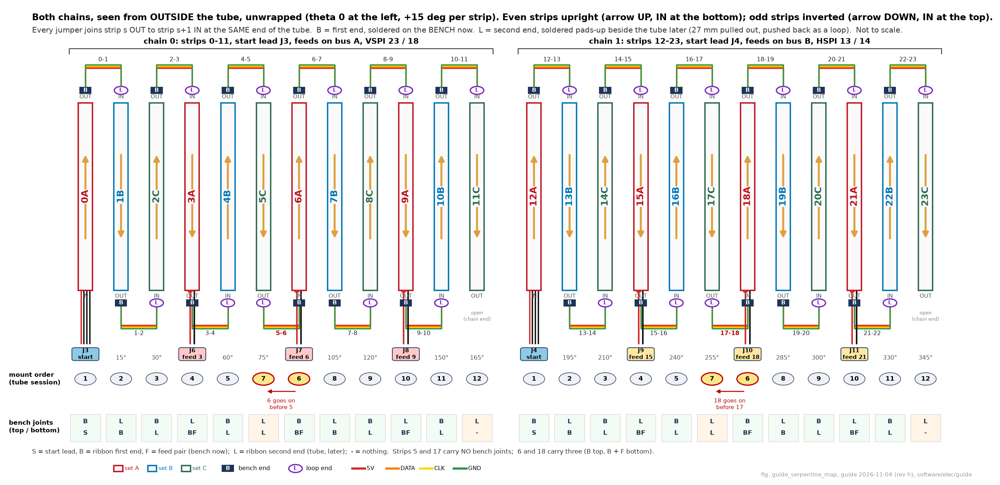

- **Strip s** sits at θ = 15° × s. Its **set** (A/B/C) is s mod 3, which sets its height on the tube. Its **chain** is s // 12 (chain 0 = strips 0–11 on J3, chain 1 = strips 12–23 on J4).
- **Even strips are mounted upright** (arrow up, IN at the bottom). **Odd strips are inverted** (arrow down, IN at the top). The arrow printed on the strip runs from IN (CI/DI pads) to OUT (CO/DO pads). The firmware reverses the odd strips' LED order, so this is all the wiring has to do.
- **Cut line:** all 24 are cut. Measurement #26 put the cut edge 8.01 / 8.66 mm from the nearest LED centres on a crooked cut, and 8.18 / 8.49 by the uncut-section reading. The tube's end-stops sit midway (8.33), which is 0.16 mm off and inside the 0.6 mm budget, so nothing to do. E15 records which end is the longer one.

| Strip | Set | Mounted | Bottom end | Top end | **Bench joints today** | Terminal |
|---|---|---|---|---|---|---|
| 0 | A | upright | IN: **start lead S0** | OUT: **ribbon 0-1** | 2 ends | J3 |
| 1 | B | inverted | OUT: **ribbon 1-2** | IN: loop of 0-1 (tube) | 1 | |
| 2 | C | upright | IN: loop of 1-2 | OUT: **ribbon 2-3** | 1 | |
| 3 | A | inverted | OUT: **ribbon 3-4 + feed F3** | IN: loop of 2-3 | 1 (5V, GND doubled) | J6 |
| 4 | B | upright | IN: loop of 3-4 | OUT: **ribbon 4-5** | 1 | |
| 5 | C | inverted | OUT: loop of 5-6 | IN: loop of 4-5 | **none** | |
| 6 | A | upright | IN: **ribbon 5-6 + feed F6** | OUT: **ribbon 6-7** | 2 ends | J7 |
| 7 | B | inverted | OUT: **ribbon 7-8** | IN: loop of 6-7 | 1 | |
| 8 | C | upright | IN: loop of 7-8 | OUT: **ribbon 8-9** | 1 | |
| 9 | A | inverted | OUT: **ribbon 9-10 + feed F9** | IN: loop of 8-9 | 1 (doubled) | J8 |
| 10 | B | upright | IN: loop of 9-10 | OUT: **ribbon 10-11** | 1 | |
| 11 | C | inverted | OUT: open (chain end) | IN: loop of 10-11 | **none** | |
| 12 | A | upright | IN: **start lead S12** | OUT: **ribbon 12-13** | 2 ends | J4 |
| 13 | B | inverted | OUT: **ribbon 13-14** | IN: loop of 12-13 | 1 | |
| 14 | C | upright | IN: loop of 13-14 | OUT: **ribbon 14-15** | 1 | |
| 15 | A | inverted | OUT: **ribbon 15-16 + feed F15** | IN: loop of 14-15 | 1 (doubled) | J9 |
| 16 | B | upright | IN: loop of 15-16 | OUT: **ribbon 16-17** | 1 | |
| 17 | C | inverted | OUT: loop of 17-18 | IN: loop of 16-17 | **none** | |
| 18 | A | upright | IN: **ribbon 17-18 + feed F18** | OUT: **ribbon 18-19** | 2 ends | J10 |
| 19 | B | inverted | OUT: **ribbon 19-20** | IN: loop of 18-19 | 1 | |
| 20 | C | upright | IN: loop of 19-20 | OUT: **ribbon 20-21** | 1 | |
| 21 | A | inverted | OUT: **ribbon 21-22 + feed F21** | IN: loop of 20-21 | 1 (doubled) | J11 |
| 22 | B | upright | IN: loop of 21-22 | OUT: **ribbon 22-23** | 1 | |
| 23 | C | inverted | OUT: open (chain end) | IN: loop of 22-23 | **none** | |

That is **24 bench strip ends = 96 pad joints**, 12 of them with two wires on the pad. Strips 5, 11, 17 and 23 get nothing today.

### 2.2 Prepare the strips (all 24 first, about 45 min)

1. **Label** both ends on the liner with a fine marker: strip number and IN or OUT (e.g. "3 IN", "3 OUT"). The liner stays on (strip attachment option A).
2. **Lay them out** in two rows, 0–11 and 12–23, arrows alternating as in the map. That is how they sit on the tube seen from outside.
3. **Inspect** each cut end under the lamp: a straight cut, all four pads with copper, nothing lifted.
4. **Open the pad zone** at each end that gets a joint today: with a blade, slice the tape across 6 mm from the cut edge and peel the 6 mm piece off (tape and liner), exposing the four pads. Leave the rest of the liner on.
5. **Clean and tin:** IPA, flux pen, then tin each pad **thin**: iron on the pad, 1 s of solder, lift. You want a flat, shiny coat, not a dome. The copper starts **at the cut edge** (#30), but the first 1.0 mm of every pad sits on solid wall: nothing may stand proud there (a bump holds the strip off the wall), so the tin is a flat film at most, and the joint goes on **1.0–2.5 mm**, the half of the pad toward the LED. On the outer pads (GND, 5V), keep the joint to the **inner half** as well: the pads span 11 mm, the slot 10 mm, so the outer 0.5 mm of each sits behind the wall. Tin the IN pads of every strip too, including those soldered on the tube later, so the probe test has something to touch.
6. **Probe test every strip** before it gets a wire (Test 2, line 1): it costs 30 s and finds a dead strip before 4–8 joints are invested in it.

**The probe** (cut-sheet label PROBE): 200 mm of the four-wide ribbon. At one end, split the four conductors 15 mm, strip 3 mm and tin them. Tape them side by side to the end of a lolly stick or a plastic card in the pad order **GND, CI, DI, 5V = green, yellow, orange, red** (the band's own order, flat), at the pad pitch of **2.8 mm** (four 2.5 mm pads over 11 mm; a 2.54 mm header does not match it, and the gaps between pads are only about 0.3 mm, so press straight down). The other end goes into the rig terminal: red → 1, green → 2, yellow → 3 (CLK), orange → 5 (DATA). Strip face down, press the four tips onto the four tinned IN pads: green on **GND**, red on **5V** (read the label). Limit **0.30 A**. If the probe is fiddly, keep it for the pre-test only and rely on the after-joint continuity checks plus the chain light test on the tube (section 3).

### 2.3 Make the wires (about 1 h, before the first joint)

- **22 ribbons:** split, strip and tin both ends per **section 3.1**.
- **Start leads S0 and S12:** bands, twisted pairs and the GND splice per **section 4.1** (figure `guide_leads`).
- **Feeds F3–F21:** twist each red/black pair, strip and tin the pad end, strip the terminal end bare, per **section 4.2**.

### 2.4 The joint

| Wire | Colour | Cut | Strip at the pad | Tin | Heat-shrink | Joint | Torque | Check | Time |
|---|---|---|---|---|---|---|---|---|---|
| ribbon conductor (first end) | red 5V, orange DO, yellow CO, green GND | 80 mm | 2.5 mm (12 mm split) | wire and pad | none at the pad; **12 × 6 mm tape** over the four joints after the CA | lap joint, wire **along the strip toward its middle**, tip 1.0 mm from the cut edge, fillet on **1.0–2.5 mm** (GND / 5V: inner half); 320 °C, 1–2 s, hold still 3 s | — | fillet, tug, Test 2 | 5 min per end incl. CA, tape |
| feed (26 AWG) on a feed strip's bottom end | red on **5V**, black on **GND** | per cut sheet | 2.5 mm | yes | as above | **two wires, one joint, on the pad's inner half**: the ribbon conductor first, the 26 AWG stacked on top of it, both tinned, one touch of the iron (no room: the 3-way splice, section 4.2) | — | both wires beep to the pad | +3 min |
| start lead (26 AWG) on strip 0 / 12 IN | red 5V, black + yellow band CI, black + orange band DI, black GND (the spliced one) | 170 / 165 | 2.5 mm | yes | as above | as the ribbon | — | Test 2 + the rig through the lead | 6 min |

**Where the joint goes on the pad (#28, #30).** Each pad is 2.5 × 2.5 mm and its copper starts at the cut edge (0–2.5 mm). The tube's slot window starts 1.0 mm above the cut end and is 10 mm wide, while the four pads span 11 mm. So:

- **Along the strip:** solder only on the half of each pad **away from the cut edge** (toward the LED), 1.0–2.5 mm. The first 1.0 mm sits on solid wall: keep it flat.
- **Across the strip:** on the outer pads (**5V and GND**) solder on the **inner half** (the side toward C / D), so the bump stays inside the 10 mm window; the outer 0.5 mm of those pads sits behind the wall (grey hatch in the figure).
- **Usable area:** about **2.0 × 1.5 mm** on GND and 5V, **2.5 × 1.5 mm** on C and D. The 2.5 mm tinned wire tip, laid from 1.0 mm, runs about 1 mm past the pad onto the solder mask; that is fine, it is still inside the slot window (to 6.0 mm).
- **The gaps between pads are only about 0.3 mm** (four 2.5 mm pads in 11 mm), so a bridge is the likely fault: small solder, one touch, and check every neighbour pair (Test 2).
- **Dry-fit the first strip at its slot** as soon as the tube is printed: lay it in its rails onto the end-stop. If a strip rocks (a joint bearing on the slot edge), file **that slot only**, at most **0.5 mm per side** (to 11 mm; that leaves 0.8 mm to the rail root, QA-2 N1). Never file all 48 by default.

**Order at each end:** GND, 5V, then CLK, DATA (the signal pads are innermost, easiest with the outer wires in place). **The ribbon:** flip the band so green lies on GND and red on 5V; it then lies flat in its own order, **yellow on C (CLK), orange on D (DATA)**, no crossing (orange = DATA, yellow = CLK, Brian's bench decision). Then a **drop of CA** where each wire leaves its joint, on the last 0.5 mm of bare conductor and the end of the insulation (CA grips silicone poorly, so don't run it along the insulation). One minute to cure. Then the 12 × 6 mm tape patch over the joints only, ending 6 mm from the cut edge so the wires can still bend into the slot beyond it. **Inspect** under the lamp: every fillet wets pad and wire and is bright and concave, no bridge to the neighbouring pad (only about 0.3 mm away: wick it off), the fillet on the LED half of the pad (1.0–2.5 mm) and, on GND / 5V, on the inner half, no solder on the LED side, the wire leaving along the strip and not upward. A grey or balled joint is cold: re-flux and reflow once, never twice without cleaning. Clean with IPA before the CA.

**Sequence:** strip by strip in chain order, 0 → 23 (skip 5, 11, 17, 23), each tested before the next. Strip T in section 1 was the practice.

### Test 2: every strip, after its bench joints (≈ 3 min per strip; tick in the master checklist's strip grid)

| ☐ | Check | Meter mode | Pass | If it fails, look at |
|---|---|---|---|---|
| ☐ | **Before any joint** (line 1): probe on the IN pads, `c0 n14 g4`, then `8` | eye | one LED walks LED 0 → 13 from the IN end | LEDs dark from LED k on: that LED or the copper is damaged; use T as the spare |
| ☐ | Each wire: its pad to the far end of the wire (ribbon free end, lead's terminal end) | continuity | beep, < 1 Ω, all four (both wires on a doubled pad) | a cold joint, strands cut while stripping |
| ☐ | Neighbouring pads at the joined end, in their real order GND–C, C–D, D–5V (#29) | continuity | **no beep** | a bridge across the 0.3 mm gap: wick |
| ☐ | Joint position (#28, #30), under the lamp | eye | every fillet on 1.0–2.5 mm from the cut edge, nothing proud on 0–1.0; on GND and 5V nothing on the outer 0.5 mm (the joint on the inner half) | solder on the cut-edge half or the outer edge: wick it flat, reflow on the right spot |
| ☐ | First strip only, once the tube is printed: dry-fit at its slot | eye, fingers | lies flat in its rails on the end-stop, no rocking | rocks: the joint bears on the slot edge. File that slot only, ≤ 0.5 mm per side, then re-check |
| ☐ | 5V to GND pads | Ω | **> 100 Ω**, normally kΩ and climbing; a dead short reads < 10 Ω | a bridge between the 5V and GND pads, a solder ball under a wire |
| ☐ | Light test after the joints: strips 0 and 12 through their own start lead clamped in the rig terminal (pin for pin as J3); strips 6 and 18 through their IN-end ribbon (red → 1, green → 2, yellow → 3, orange → 5); every other strip with the probe. `4` at g4, then `8` | eye | all 14 LEDs light, including the LED next to the joints | the LED by the joints dark: heat damage (replace the strip with T); nothing lit through the lead: S0-C and S0-D swapped, or a band on the wrong wire |
| ☐ | Optional tail test (ribbon at the OUT end): ribbon free end and T-IN clamped together in a loose 4-position terminal (red, orange, yellow, green to 1–4), probe on the strip's IN pads, `n28 8` | eye | the walk runs through the strip **and on into T** | T dark: CO and DO swapped, or a cold CO / DO joint |

---

## 3. The jumper ribbons (22): first end at the bench today, second end on the tube later

A ribbon soldered at both ends can't be threaded through two wall slots, so each one gets its two joints at different times, both pads-up (electrical 7.6): the **first end at the bench now** (section 2), and the **second end beside the tube** once the tube is printed, with 27 mm pulled out of the slot and then pushed back in as a loop up the wall.

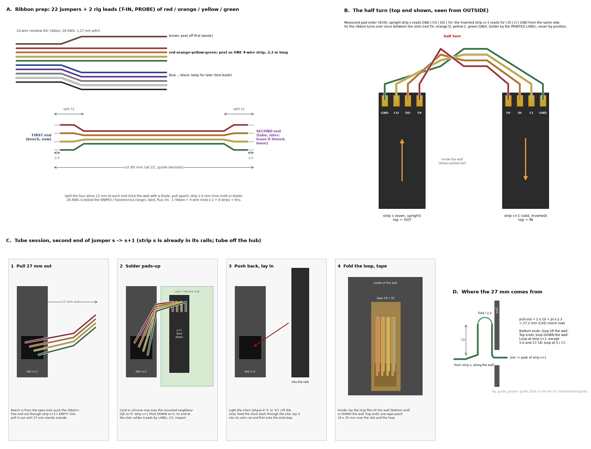

### 3.1 Prepare the 22 ribbons (bench, now, about 40 min)

| Wire | Colour | Cut | Strip (each end) | Tin | Heat-shrink | Joint | Torque | Check | Time |
|---|---|---|---|---|---|---|---|---|---|
| 4 × 28 AWG ribbon, the band peeled from the 10-wire rainbow | red 5V, orange DATA, yellow CLK, green GND | **80 mm** (all 22) | split **12 mm**, strip **2.5 mm**, both ends | yes, both ends (twist, flux, tin) | none | first end: section 2.4; second end: 3.3 | — | conductors intact, tips not touching | 2 min each |

Peel a 2.2 m length of the red-orange-yellow-green band (it also gives the rig's T-IN and PROBE leads, which the figure calls the two spares), cut 22 × 80 mm, and flag each one with its pair number (0-1 … 22-23, no 11-12). To split the ends, nick the web between conductors with a blade 12 mm from the end and pull them apart. To strip, roll a blade or melt the PVC with the iron for 1 s. Tin thinly so the tip stays straight.

### 3.2 Where each first end goes

On the **OUT end of the lower-numbered strip** (strip s's CO/DO end) for 20 of the 22. **Jumpers 5-6 and 17-18** are the exceptions: their first end goes on the **IN end of strip 6 / 18** (with the feed), and their loop is at strip 5 / 17. That is why strips 6 and 18 carry three bench wires and strips 5 and 17 none.

### 3.3 The second end, on the tube (a later session, about 4 h for 22)

Do this with the tube off the hub, strips going on **one at a time in this mounting order**: **0, 1, 2, 3, 4, 6, 5, 7, 8, 9, 10, 11** and **12, 13, 14, 15, 16, 18, 17, 19, 20, 21, 22, 23** (6 before 5 and 18 before 17, because their loops sit at 5 and 17). Wire the rig to the chain's start lead first, so you can light the chain after every strip.

1. **Mount strip s:** poke its bench-soldered wires (ribbon, feed, start lead) through its slots from outside. Lay the strip into its rails cut end first onto the end-stop and press it along. If it rocks at a slot (a joint bearing on the wall), file that slot only, max 0.5 mm per side (#28). Every slot is within 20 mm of an end, so you can reach in through the open tube end.
2. **Pull 27 mm out:** reach in, push the free end of the ribbon waiting for strip s+1 out through strip s+1's still-empty slot, and pull until **27 mm** stands outside (the CAD's 2 × 10 mm loop + π × 2.3 mm fold).
3. **Solder pads-up:** put a **card or a strip of silicone mat over the mounted neighbours' LEDs** (QA m-f: the rails are 5.9 mm apart, so a 12 mm strip lying face down would sit on them). Lay strip s+1 face down on the card with its end at the slot and the ribbon running onto its back pads. Solder the four pads **by the printed label** (3.4), 320 °C, 1–2 s each, then CA and inspect, exactly as in 2.4.
4. **Test** (Test 3 below), before the loop is taped.
5. **Push back and lay in:** lift strip s+1, feed the slack back through the slot and lay the strip into its rails onto its stop. Inside, fold the loop flat **up the wall at a bottom end, down the wall at a top end**. Peel the four wires apart over the loop so they bend freely.
6. **Tape:** one 19 × 35 mm patch inside over the slot and its loop. The 24 slots without a loop get a 19 × 15 mm patch. When the whole chain lights, put a dab of hot glue at each strip end over its edge onto the rail (attachment option A: cut the dab to remove a strip).

A pair that fails comes apart by pulling its loop back out through the slot (electrical 6.5); nothing is ever soldered through a slot.

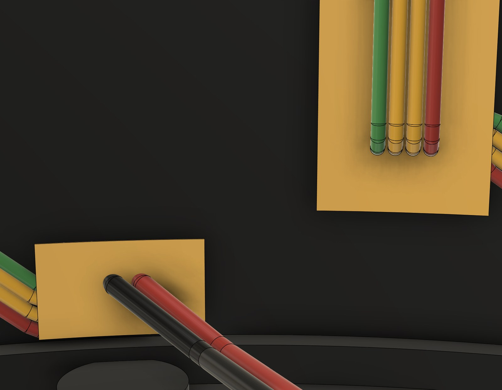

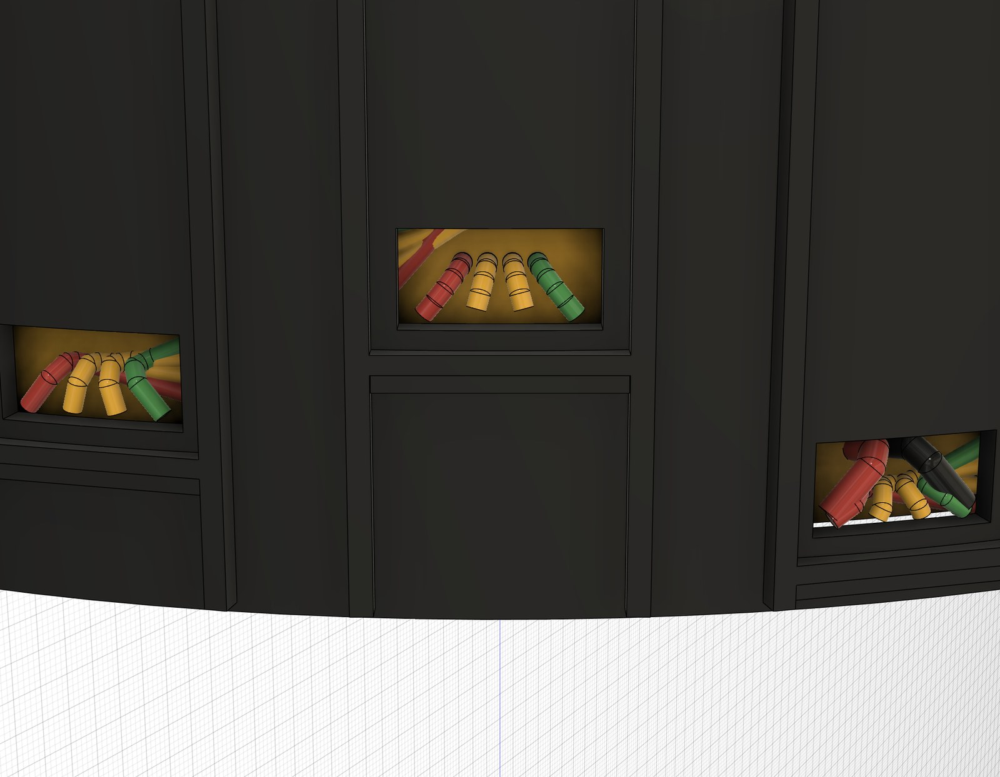

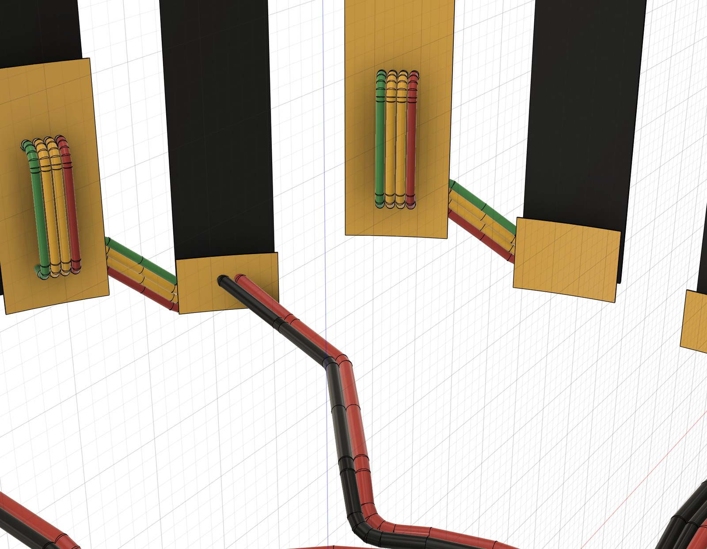

### 3.4 The half turn: solder by label, never by position

The upright strip of a pair reads **GND | CO | DO | 5V** across its end (measured, #29). The inverted neighbour, seen from the same side, reads **5V | DI | CI | GND**. So between the slots the ribbon turns over once (panel B), or the peeled wires cross. At every second joint: **red to 5V, yellow to CI, orange to DI, green to GND**, whatever position they land in. A wrong joint still shows from a metre away, because the colours name the nets.

| Spec, second end | Value |
|---|---|
| Wire | the ribbon's free end, already split 12, stripped 2.5 and tinned in 3.1 (re-flux it) |
| Joint | strip s+1's pads (IN end), face down on a card beside the tube; lap joint toward the strip's middle, tip 1.0 mm from the cut edge, fillet on 1.0–2.5 mm and on GND / 5V on the inner half (2.4), 320 °C, 1–2 s |
| Heat-shrink / tape | none at the pad; 12 × 6 mm over the joints, then the inside slot patch (19 × 35 or 19 × 15) |
| Check | Test 3 |
| Time | about 10 min per jumper, including the test and the tape |

### Test 3: each jumper, after its second joint (before the loop is taped)

The chain's start lead is clamped in the rig terminal (pin for pin as J3), and strips 0 … s+1 are joined.

| ☐ | Check | Meter mode | Pass | If it fails, look at |
|---|---|---|---|---|
| ☐ | Start lead red (5V, at its terminal end) to strip s+1's **5V** pad | continuity | beep | red not on the 5V pad, or a cold joint |
| ☐ | Start lead black GND to strip s+1's **GND** pad | continuity | beep | green not on GND |
| ☐ | Start lead 5V to GND (the whole chain so far) | Ω | **> 100 Ω**, climbing; it falls a little with every strip added | < 10 Ω: a bridge on the new joint (5V–GND pads). **Don't power up** until this and the two beeps above pass: a red/green swap would reverse-power the new strip. |
| ☐ | Strip s+1's neighbouring pads in their real order (#29): GND–CI, CI–DI, DI–5V; then CI and DI each to 5V and to GND | continuity | **no beep** | a bridge across the 0.3 mm gap (GND–CI is the new neighbour pair: it used to be 5V–CI), or orange and yellow on one pad |
| ☐ | Light: supply 5.00 V, limit **0.50 A**, `c0` (`c1` for chain 1), `g4`, `n` = 14 × (strips joined), then `5` and `8` | eye | `5`: every strip lights its own LED number (strip k of the chain lights LED k); `8`: the walk runs through every strip in order and **into the new one** | the new strip dark: orange and yellow swapped at the second joint (CI/DI), a cold CI/DI joint, or a heat-damaged first LED. Garbage colours on the new strip: DATA open. Never use `4` (all white) on more than 2 strips at this limit: 14 LEDs at g4 is about 0.1 A per strip. |

After strip 11 (and 23), run the chain test of section 8.2.

---

## 4. The chain-start leads (2) and the power feeds (6), and where each one lands

Make these before the strip joints in section 2 (step 2.3). They are clamped into the carrier in section 8, and you can test them on the rig in the meantime: its terminal has J3's pin order.

### 4.1 Start leads S0 (strip 0 → J3) and S12 (strip 12 → J4), about 25 min each

| Wire | Colour | Cut S0 / S12 | Strip pad / terminal | Tin pad / terminal | Heat-shrink | Lands on | Torque | Check | Time |
|---|---|---|---|---|---|---|---|---|---|
| 5V | 26 AWG red | 170 / 165 | 2.5 / 5 | yes / **no** | — | 5V pad · J3/J4 pin 1 | snug | Test 4 | 25 min per lead, all six conductors |
| GND (main, carries the splice) | 26 AWG black | 170 / 165 | 2.5 / 5 | yes / no | 3 mm × 15 mm over the splice | GND pad · pin 2 | snug | | |
| CLK | 26 AWG black + **yellow** bands | 165 | 2.5 / 5 | yes / no | 1.5 × 6 mm bands, 15 mm from each end | CI pad · pin 3 | snug | | |
| CLK return | 26 AWG black | 135 | splice 5 / 5 | splice yes / no | (in the splice sleeve) | splice · pin 4 | snug | | |
| DATA | 26 AWG black + **orange** bands | 165 | 2.5 / 5 | yes / no | bands | DI pad · pin 5 | snug | | |
| DATA return | 26 AWG black | 135 | splice 5 / 5 | splice yes / no | (in the splice sleeve) | splice · pin 6 | snug | | |

1. **Band** the CLK and DATA wires: slide on the 6 mm bands 15 mm from each end and shrink them (hot air, or the side of the iron without touching).
2. **Align all six at the terminal end.** Twist CLK with its return, about **one turn per 10 mm**, over the return's whole 135 mm (clip one end, twirl the other); the same for DATA with its return. Lay 5V and GND alongside, loosely twisted together (one turn per 25 mm). The twist takes about 10 mm of length, which the cut lengths allow for.
3. **GND splice, 30 mm from the main GND's pad end:** slide the 15 mm sleeve of 3 mm heat-shrink onto the main GND first and park it. Window-strip 5 mm of insulation there (two ring cuts with the blade, slit, peel). Strip the two returns 5 mm and wrap them round the window, flux, and solder at 320 °C for 2–3 s until it flows through. Let it cool, slide the sleeve over, shrink. One wire per pad stays true at the strip.
4. **Pad end:** strip 2.5 mm and tin (5V, CLK, DATA, GND). **Terminal end:** strip 5 mm, twist the strands tight, and **don't tin** (QA-2 N5).
5. Flag each lead **S0** or **S12** at both ends. Then solder it to strip 0 / 12 as in section 2.4 (5V → 5V, yellow band → **CI**, orange band → **DI**, the spliced GND → GND).

### 4.2 The six feeds, about 5 min each

| Wire | Colour | Cut | Strip pad / terminal | Tin pad / terminal | Heat-shrink | Lands on | Torque | Check | Time |
|---|---|---|---|---|---|---|---|---|---|
| F3, F6, F9 (bus A) | 26 AWG red + black pair | 200, 235, 250 | 2.5 / 5 | yes / **no** | — | the strip's bottom 5V / GND pads beside the ribbon wire · J6, J7, J8 pins 1 (red) / 2 (black) | snug | Test 4 | 5 min |
| F15, F18, F21 (bus B) | same | 155, 120, 125 | 2.5 / 5 | yes / no | — | strip 15 / 18 / 21 · J9, J10, J11 | snug | | |

Twist each pair loosely (one turn per 25 mm), leaving 20 mm untwisted at the pad end so the two wires can reach the two outer pads. If a pad won't take two wires side by side, use the **3-way splice** instead (electrical 7.2): cut the ribbon's 5V (and GND) conductor 10–15 mm from the pad, strip both ends and the feed's end 4 mm, twist the three inline, solder, and slide on 15 mm of 2 mm heat-shrink (put on the feed first). It lies flat against the inside of the wall under the tape. Route all six feeds the same way, under the sled plate, radially out and up through their bottom slots: the balance relies on it.

### 4.3 The landing map: every wire into its terminal (done in section 8)

| Terminal (rev i holes, printed labels) | Entry | Pin 1 | Pin 2 | Pin 3 | Pin 4 | Pin 5 | Pin 6 |
|---|---|---|---|---|---|---|---|
| **J3** chain 0, 6P D3–I3 | from **below** | S0 5V red | S0 GND | S0 CLK (yellow band) | S0 CLK return | S0 DATA (orange band) | S0 DATA return |
| **J5** hall, 3P K3–M3 | from below | H OUT (white band) | H GND | H 5V red | | | |
| **J4** chain 1, 6P S3–X3 | from below | S12 5V red | S12 GND | S12 CLK (yellow) | S12 CLK return | S12 DATA (orange) | S12 DATA return |
| **J9 / J10 / J11** W5–W6 / W8–W9 / W11–W12, bus B | from the **ESP32 side** | F15 / F18 / F21 red | black | | | | |
| **J6 / J7 / J8** W14–W15 / W17–W18 / W20–W21, bus A | from the ESP32 side | F3 / F6 / F9 red | black | | | | |
| **J1** pigtail, 5 mm D26 (pin 1) / D28 (pin 2) | from the board edge | pigtail 5 V (**meter-checked**) | pigtail GND | | | | |
| J12 W26 / W28 | | unused (the optional second pigtail) | | | | | |

**Clamping, every 2.54 mm terminal:** strip 5 mm, twist, **no solder**, insert fully so the insulation touches the clamp and no copper shows past the block. Screw **snug**: firm with two fingers on a 2 mm flat blade, about 0.15–0.2 N·m (the M1.6 thread strips if you lean on it). Tug each wire (a firm 0.5 kg pull), then a dot of nail varnish on the screw. The 5 mm J1: strip 6 mm, snug, tug, varnish.

### Test 4: each start lead and feed (after making it; repeat the last two lines once it is clamped)

| ☐ | Check | Meter mode | Pass | If it fails, look at |
|---|---|---|---|---|
| ☐ | Each conductor pad end to terminal end (S0: 6 wires; feed: 2) | continuity | beep, < 1 Ω | strands cut while stripping, the splice |
| ☐ | Both returns (terminal end) to the main GND's pad end | continuity | beep (through the splice) | a cold splice: reflow inside a fresh sleeve |
| ☐ | Terminal end, neighbours: 1–2, 2–3, 3–4, 4–5, 5–6 (S0) and 1–2 (feeds), **before** the pad end is soldered | continuity | no beep, except 2–4–6 (all GND: beep) | bare strands touching, a nick in the insulation |
| ☐ | **After the strip joint:** J-pin to its pad (1 → 5V, 3 → CI, 5 → DI, 2/4/6 → GND; feed 1 → 5V, 2 → GND) | continuity | beep | the bands on the wrong wires, a crossed joint |
| ☐ | After the strip joint: pin 1 to pin 2 | Ω | > 100 Ω, climbing (the strip) | a bridge at the strip pads |
| ☐ | S0 / S12 clamped in the rig terminal: `c0 n14 g4 8` | eye | strip 0 / 12 walks from LED 0 | CLK and DATA swapped at the pads or the terminal |
| ☐ | Clamped (section 8): tug, varnish on every screw | hand, eye | nothing moves | re-strip, re-clamp |

## 5. The carrier board (rev i: your 70 × 90 board, 26 × 31 holes), about 5 h

**Read this first: orientation and hole names (rev i).** Every hole in this section is named by the label **printed on your board**: column letter **A–Z** across the 70 mm side, row number **1–31** up the 90 mm side, so D21 is column D, row 21. **Hold the board with hole A1 at the bottom left and the component side facing you**: that face is the component side, the **row-1 end** (the end with the wider 7.5 mm margin) goes **down into the sled**, and row 31 is the top, where "USB ↑" goes. Seen from the solder side, A1 is at the bottom **right** and the letters run Z..A from left to right; the solder-side figures are drawn that way. If the letters are printed on one face only, read A1 there, then turn the board so that hole is at the bottom left with row 1 along the bottom edge: whichever face is then toward you is the component side, so pencil a mark on it before you start. This is the rev h layout hole for hole with every row number 2 lower (rev h assumed 27 × 35 holes and numbered from 0), so every part, wire, lane and cut length is unchanged. **If you printed an earlier section 5 or its figures, discard them: every row number changed.**

**What stays empty:** columns A, B, Y, Z and rows 30–31 carry nothing. The sled's card guides grip the outer 1.5 mm of each long edge from the bottom up to row 16; your nearest holes (columns A and Z) are 3.25 mm in, so **no hole is inside the grip** (rev h's "no solder below row 18" rule is gone). The complete wire list is `docs/img/guide_carrier_wires.csv` (W01–W61 plus the buses, each hole as its label and its grid coordinates). **Nine wire ends land on ESP32 pin holes** (W18, W19, W30, W46–W49, W60, W61). Route those wires now with that end tinned and left free, and lap it onto the pin stub after the DevKit is in (C9).

| Step | What | Figure | Time |
|---|---|---|---|
| C1 | find A1, mark the board, dry-fit the DevKit | `guide_carrier_1` | 10 min |
| C2 | the 11 screw terminals | `guide_carrier_1` | 20 min |
| C3 | the three bare buses (solder side) | `guide_carrier_2` | 30 min |
| C4, C5 | U1 (socket), then the small parts | `guide_carrier_3` | 30 min |
| C6, C7a | R5–R8 on the solder side, then every GND wire | `guide_carrier_4` | 40 min |
| C7b | the 5 V wires and LK1 | `guide_carrier_5` | 30 min |
| C7c, C7d | clock, data, hall and 3V3 wires | `guide_carrier_6`, `6b` | 50 min |
| C8 | tests, power-up without U1 and ESP32, the DevKit on USB | — | 40 min |
| C9 | the ESP32, then the nine waiting wire ends | `guide_carrier_7` | 25 min |

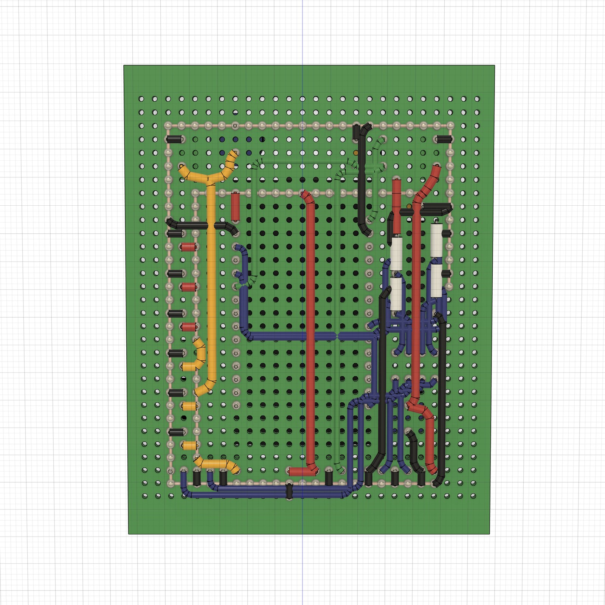

### 5.1 C1 + C2: mark the board, fit the screw terminals

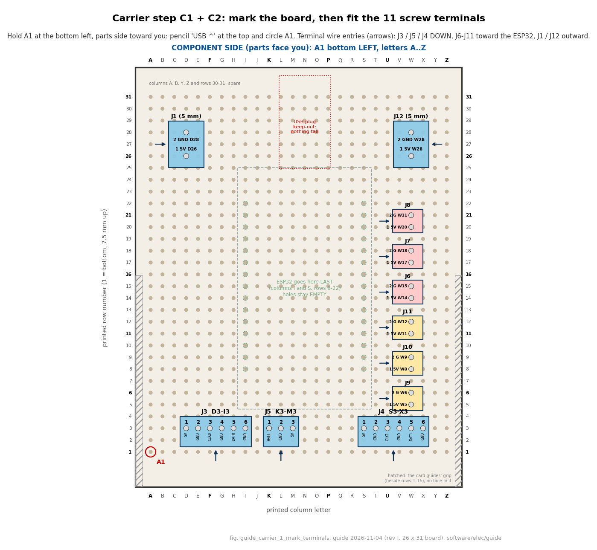

1. **Find A1 and mark** the component side in pencil: hold A1 at the bottom left, write "USB ↑" at the top (the row-31 end) and circle A1. (E17 is done: your board has 26 × 31 holes, `measurements.md` #31, and this section is fitted to it.)
2. **Dry-fit the DevKit** into columns I and S, rows 8–22, USB up, to prove the 25.4 mm pitch, then take it out again. (E2 is done, #32: the corner labels match.)
3. **Fit the terminals with their entries as the arrows show:** J3 D3–I3, J5 K3–M3, J4 S3–X3, all entries facing **down** (toward the bottom edge). J9 W5–W6, J10 W8–W9, J11 W11–W12, J6 W14–W15, J7 W17–W18, J8 W20–W21, entries facing **the ESP32**. J1 D26–D28 and J12 W26–W28, the 5 mm blocks, entries facing outward. Solder one pin, press the block flat and square, then solder the rest. Don't flood the holes that also take a wire (J3.2 at E3, J3.6 at I3, J5.3 at M3), and leave **J4 pin 6 at X3 for C3**: it sits on the GND ring.

| Part | Joint | Temp | Check | Time |
|---|---|---|---|---|
| 9 × 2.54 mm terminals (6P, 6P, 3P, 6 × 2P), 2 × 5 mm terminals | pins through, soldered on the solder side, cone-shaped fillet, pin not trimmed (they are short) | 320 °C (340 for the 5 mm blocks) | flat on the board, entries the right way, Test 5a | 20 min |

### 5.2 C3: the three bare buses (solder side)

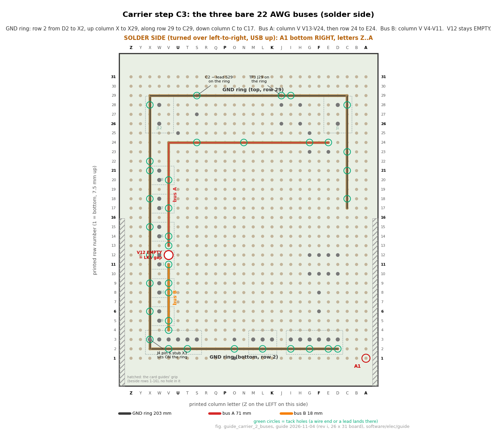

| Wire | Colour | Cut | Strip | Tin | Heat-shrink | Joint | Check | Time |
|---|---|---|---|---|---|---|---|---|
| GND ring: row 2 from D2 to X2, up column X to X29, along row 29 to C29, down column C to C17 | bare 22 AWG solid | 65 + 80 + 65 + 45 (or one 215 bent at the corners) | all the insulation off | yes (pull it straight, then tin) | — | laid flat against the pads; tack at both ends, then at every tack hole (green): C18 C21 C23 C28 D2 E2 G2 I2 I29 J29 L2 O2 S29 T2 V2 **X3 with J4 pin 6** X6 X9 X12 X15 X18 X21 X22 X28 | Test 5b | 15 min |
| Bus A: column V from V13 up to V24, then along row 24 to E24 | bare | 85 (an L) | — | yes | — | tack E24 G24 N24 S24 V13 V14 V17 V20 | | 10 min |
| Bus B: column V from V4 up to V11 | bare | 30 | — | yes | — | tack V4 V5 V8 V9 V11; **V12 stays empty** (the LK1 gap) | | 5 min |

Iron at 340–350 °C for the bus wire. Keep it flat: it must not stand up into the lane of a terminal pin.

### Test 5a + 5b: terminals, then buses (meter only, nothing powered)

| ☐ | Check | Meter mode | Pass | If it fails, look at |
|---|---|---|---|---|
| ☐ | Every pair of neighbouring pins on each terminal (J3, J4: 1–2 … 5–6; J5; each 2P) | continuity | no beep (they are bridged later through the ring, not now) | a solder bridge between pins |
| ☐ | GND ring end to end: C17 to D2 to X29 | continuity | beep | a broken tack, a corner joint |
| ☐ | Bus A E24 to V13; bus B V4 to V11 | continuity | beep | |
| ☐ | **GND ring to bus A, GND ring to bus B, bus A to bus B** | continuity, then Ω | **all three open (OL)**. LK1 isn't in yet; once it is (C7b), A–B reads 0 Ω | the bus wire touching a pad of another net (look along the wire), solder bridging V11–V12–V13 |
| ☐ | J4 pin 6 to the ring | continuity | beep | the X3 joint |

### 5.3 C4 + C5: U1 (socket), then the small parts (component side)

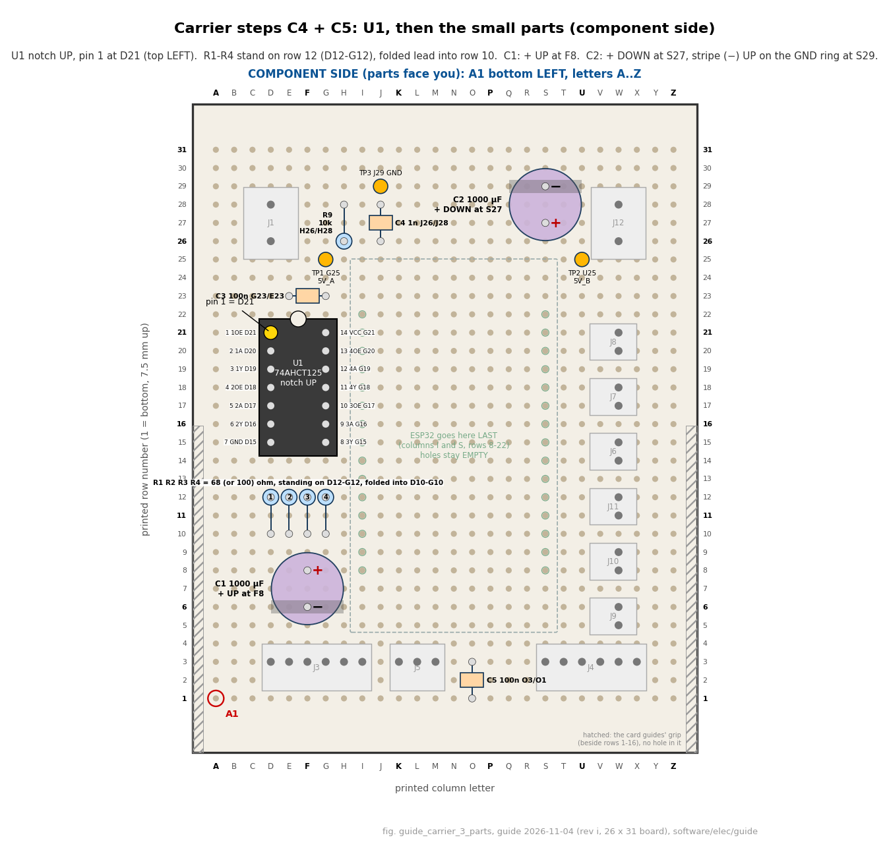

**Use a DIP-14 socket for U1 if you have one:** the power-up test in C8 is then done with the socket empty, and U1 goes in afterwards. Without a socket, U1 is soldered here and tests 5f and 5g merge.

| Part | Holes | Orientation | Temp | Time |
|---|---|---|---|---|
| U1 socket (or the 74AHCT125) | pins 1–7 down column D from D21 to D15; 8–14 up column G from G15 to G21 | **notch up, pin 1 top-left at D21**; solder two diagonal pins, check it is flat, then the rest | 320 °C | 8 min |
| R1–R4 68 Ω (47 or 100 Ω also work) | standing on D12–G12, folded lead into D10–G10 | body on row 12 | 320 | 6 min |
| R9 10 kΩ | H26 folded to H28 | standing | 320 | 2 min |
| C3 100 nF | G23–E23 | | 320 | 2 min |
| C4 1 nF · C5 100 nF | J26–J28 · O3–O1 | | 320 | 3 min |
| **C1 1000 µF ≥ 10 V** | **+ at F8**, − at F6 | stripe (−) **down** | 320 | 2 min |
| **C2 1000 µF ≥ 10 V** | **+ at S27**, − at S29 on the ring | stripe (−) **up** | 340 (the − lead is on the ring) | 2 min |
| TP1 · TP2 · TP3 | G25 · U25 · J29 | bare 22 AWG loops, 15 mm, standing 5 mm proud | 320 | 5 min |

Trim the leads to about 1.5 mm on the solder side. **Keep R1–R4's and R9's long lead offcuts**: they make the bare one-hole links in C7.

### Test 5c: parts in circuit (meter only)

| ☐ | Check | Meter mode | Pass | If it fails, look at |
|---|---|---|---|---|
| ☐ | R1–R4: top hole D12–G12 to bottom hole D10–G10 | Ω | 66–70 Ω (or 47 / 100 Ω if fitted) | a wrong value from the kit (colour bands: blue-grey-black-gold = 68 Ω) |
| ☐ | R9 H26 to H28 | Ω | 9.5–10.5 kΩ | |
| ☐ | C1 and C2: the + lead where the figure shows it | eye | the stripe (−) is at F6 and at S29 | reversed: take it out now (a reversed 1000 µF across 5 V vents within minutes) |
| ☐ | C2's − lead to the ring | continuity | beep | the S29 joint |

### 5.4 C6 + C7a: R5–R8 on the solder side, then every GND wire

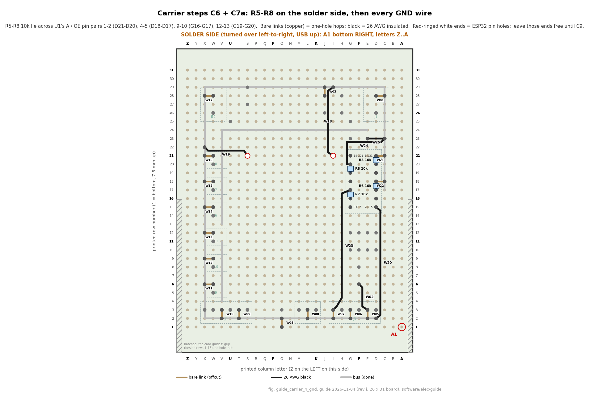

**R5–R8 (10 kΩ)** lie on the solder side, each body across one pair of U1's adjacent pin joints: 1–2 (D21–D20), 4–5 (D18–D17), 9–10 (G16–G17), 12–13 (G19–G20). Bend the leads to 2.5 mm and solder them to the pin joints. **Every bare link** is a one-hole hop from an offcut: lay it across the two pads and solder both ends. **Insulated wires:** strip 3 mm, tin, then either push the end into an empty hole from the solder side or lap it onto the lead or pin already in the hole, and solder on the solder side. Wires may cross each other but must never lie along a bare bus. Route column: holes by their printed label; the bracketed points are the lane the wire follows between holes, as grid positions (c, r): c counts the columns from A = 0 (so c 4.6 lies between E and F, nearer F) and r = row number − 1 (r 4.6 lies between rows 5 and 6). The figure above shows the same path.

**C7a: GND wires (25 wires).** Cut lengths include 3 mm stripped at each end (tinned) and 3 mm of slack; hold each wire against the board before cutting. **C9** marks an ESP32 pin-hole end: tinned and left free until C9.

| W | Net | Wire | From | To | Route (lanes) | Cut mm | Strip mm |
|---|---|---|---|---|---|---|---|
| W01 | GND | bare link | J1.2 D28 | GND bus C28 | adjacent hole | ≈ 5 | - |
| W02 | GND | 26 black | C1- F6 | J3.2 E3 | F6 → (4.6,4.6) → (4.6,2.4) → E3 | 20 | 3 / 3 |
| W03 | GND | bare link | C4.top J28 | TP3 / on GND bus J29 | adjacent hole | ≈ 5 | - |
| W04 | GND | bare link | C5.bottom O1 | GND bus O2 | adjacent hole | ≈ 5 | - |
| W05 | GND | bare link | J3.2 E3 | GND bus E2 | adjacent hole | ≈ 5 | - |
| W06 | GND | bare link | J3.4 G3 | GND bus G2 | adjacent hole | ≈ 5 | - |
| W07 | GND | bare link | J3.6 I3 | GND bus I2 | adjacent hole | ≈ 5 | - |
| W08 | GND | bare link | J5.2 L3 | GND bus L2 | adjacent hole | ≈ 5 | - |
| W09 | GND | bare link | J4.2 T3 | GND bus T2 | adjacent hole | ≈ 5 | - |
| W10 | GND | bare link | J4.4 V3 | GND bus V2 | adjacent hole | ≈ 5 | - |
| W11 | GND | bare link | J9.2 W6 | GND bus X6 | adjacent hole | ≈ 5 | - |
| W12 | GND | bare link | J10.2 W9 | GND bus X9 | adjacent hole | ≈ 5 | - |
| W13 | GND | bare link | J11.2 W12 | GND bus X12 | adjacent hole | ≈ 5 | - |
| W14 | GND | bare link | J6.2 W15 | GND bus X15 | adjacent hole | ≈ 5 | - |
| W15 | GND | bare link | J7.2 W18 | GND bus X18 | adjacent hole | ≈ 5 | - |
| W16 | GND | bare link | J8.2 W21 | GND bus X21 | adjacent hole | ≈ 5 | - |
| W17 | GND | bare link | J12.2 W28 | GND bus X28 | adjacent hole | ≈ 5 | - |
| W18 | GND | 26 black | ESP GND I21 **C9** | GND bus I29 | I21 → (8.6,20.4) → (8.6,27.6) → I29 | 35 | 3 / 3 |
| W19 | GND | 26 black | ESP GND S21 **C9** | GND bus X22 | S21 → (18.4,20.6) → (22.6,20.6) → X22 | 25 | 3 / 3 |
| W20 | GND | 26 black | U1.7 GND D15 | GND bus D2 | D15 → (2.5,13.6) → (2.5,1.4) → D2 | 45 | 3 / 3 |
| W21 | GND | bare link | U1.1 1OE D21 | GND bus C21 | adjacent hole | ≈ 5 | - |
| W22 | GND | bare link | U1.4 2OE D18 | GND bus C18 | adjacent hole | ≈ 5 | - |
| W23 | GND | 26 black | U1.10 3OE G17 | J3.6 I3 | G17 → (7,15.6) → (7,3.4) → (7.6,2.4) → I3 | 50 | 3 / 3 |
| W24 | GND | 26 black | U1.13 4OE G20 | GND bus C23 | G20 → (6.4,19) → (6.4,21.6) → (2.4,21.6) → C23 | 30 | 3 / 3 |
| W25 | GND | 26 black | C3.2 E23 | GND bus C23 | E23 → C23 | 15 | 3 / 3 |

### 5.5 C7b: the 5 V wires and LK1

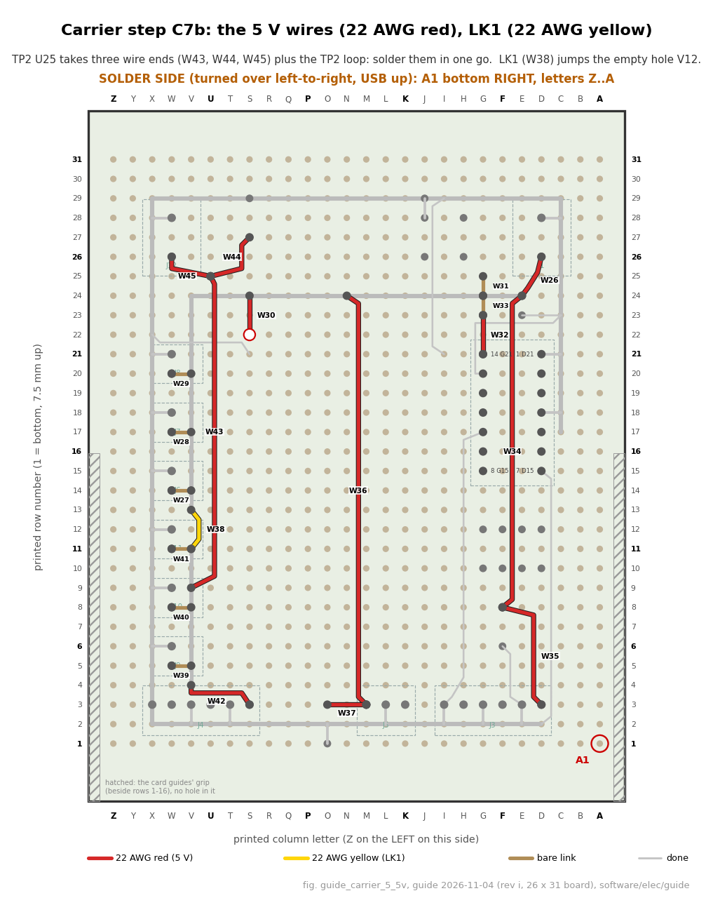

**C7b: 5 V wires (bus A, bus B, LK1) (20 wires).** Cut lengths include 3 mm stripped at each end (tinned) and 3 mm of slack; hold each wire against the board before cutting. **C9** marks an ESP32 pin-hole end: tinned and left free until C9.

| W | Net | Wire | From | To | Route (lanes) | Cut mm | Strip mm |
|---|---|---|---|---|---|---|---|
| W26 | 5V_A | 22 red | J1.1 D26 | bus A E24 | D26 → (3.2,24.2) → (3.7,23.4) → E24 | 15 | 3 / 3 |
| W27 | 5V_A | bare link | J6.1 W14 | bus A V14 | adjacent hole | ≈ 5 | - |
| W28 | 5V_A | bare link | J7.1 W17 | bus A V17 | adjacent hole | ≈ 5 | - |
| W29 | 5V_A | bare link | J8.1 W20 | bus A V20 | adjacent hole | ≈ 5 | - |
| W30 | 5V_A | 22 red | ESP VIN S22 **C9** | bus A S24 | S22 → S24 | 15 | 3 / 3 |
| W31 | 5V_A | bare link | TP1 G25 | bus A G24 | adjacent hole | ≈ 5 | - |
| W32 | 5V_A | 22 red | U1.14 VCC G21 | C3.1 G23 | G21 → G23 | 15 | 3 / 3 |
| W33 | 5V_A | bare link | C3.1 G23 | bus A G24 | adjacent hole | ≈ 5 | - |
| W34 | 5V_A | 22 red | bus A E24 | C1+ F8 | E24 → (4.5,22.6) → (4.5,7.4) → F8 | 55 | 3 / 3 |
| W35 | 5V_A | 22 red | C1+ F8 | J3.1 D3 | F8 → (3.4,6.6) → (3.4,2.4) → D3 | 30 | 3 / 3 |
| W36 | 5V_A | 22 red | bus A N24 | J5.3 M3 | N24 → (12.4,22.6) → (12.4,2.4) → M3 | 65 | 3 / 3 |
| W37 | 5V_A | 22 red | J5.3 M3 | C5.top O3 | M3 → O3 | 15 | 3 / 3 |
| W38 | LK1 | 22 yellow | bus B V11 | bus A V13 | V11 → (20.6,10.5) → (20.6,11.5) → V13 | 15 | 3 / 3 |
| W39 | 5V_B | bare link | J9.1 W5 | bus B V5 | adjacent hole | ≈ 5 | - |
| W40 | 5V_B | bare link | J10.1 W8 | bus B V8 | adjacent hole | ≈ 5 | - |
| W41 | 5V_B | bare link | J11.1 W11 | bus B V11 | adjacent hole | ≈ 5 | - |
| W42 | 5V_B | 22 red | bus B V4 | J4.1 S3 | V4 → (21,2.6) → (18.4,2.6) → S3 | 20 | 3 / 3 |
| W43 | 5V_B | 22 red | bus B V9 | TP2 U25 | V9 → (19.8,8.6) → (19.8,23.6) → U25 | 55 | 3 / 3 |
| W44 | 5V_B | 22 red | TP2 U25 | C2+ S27 | U25 → (18.4,24.4) → (18.4,25.6) → S27 | 20 | 3 / 3 |
| W45 | 5V_B | 22 red | TP2 U25 | J12.1 W26 | U25 → (22,24.4) → W26 | 20 | 3 / 3 |

**TP2 (U25)** takes W43, W44 and W45 plus the TP2 loop: solder them in one go. **LK1 (W38)** jumps the empty hole V12. It is the one wire to snip if a second pigtail is ever fitted on J12.

### Test 5d: every terminal pin to its net (meter only; the 2000 µF makes 5 V–GND readings climb)

| ☐ | Check | Meter mode | Pass | If it fails, look at |
|---|---|---|---|---|
| ☐ | TP1 (5V_A) to TP2 (5V_B) | continuity | **beep** (LK1 in) | LK1 |
| ☐ | TP1 to TP3 (GND) | Ω | **climbs** from tens of Ω through kΩ to **> 1 kΩ** within ~10 s, and keeps climbing | stays < 100 Ω: a 5 V–GND short (a bus touching the ring, a reversed C1/C2, a wire on the wrong hole) |
| ☐ | J1 pin 1 to TP1; J1 pin 1 to J1 pin 2 | continuity; Ω | beep; climbs to > 1 kΩ | the W26 tap; a short at the input terminal (the pigtail would put the bank straight on it) |
| ☐ | J3 pin 1 to TP1; J4 pin 1 to TP2; J5 pin 3 to TP1 | continuity | beep | W35, W42, W36 |
| ☐ | J6, J7, J8 pin 1 to TP1; J9, J10, J11 pin 1 to TP2 | continuity | beep | the bare links W27–W29, W39–W41 |
| ☐ | J1 pin 2; J3 pins 2, 4, 6; J4 pins 2, 4, 6; J5 pin 2; J6–J11 pin 2 to TP3 | continuity | beep | the GND links W01, W05–W17 |
| ☐ | Every 2.54 mm terminal pin to its net with the screw open and the probe in the clamp | continuity | beep | a block soldered one hole off |
| ☐ | U1 socket pin 14 to TP1; pin 7 and pins 1, 4, 10, 13 to TP3 | continuity | beep | W32/W33, W20–W24 |

Why the reading climbs: the meter's Ω range drives a small test current, and the 2 × 1000 µF across 5 V–GND have to charge through it before the meter sees the real (megohm) resistance. A **short** reads low and **stays** low. Reverse the probes and it climbs again from the other side.

### 5.6 C7c + C7d: clock, data, hall and 3V3 wires (28 AWG)

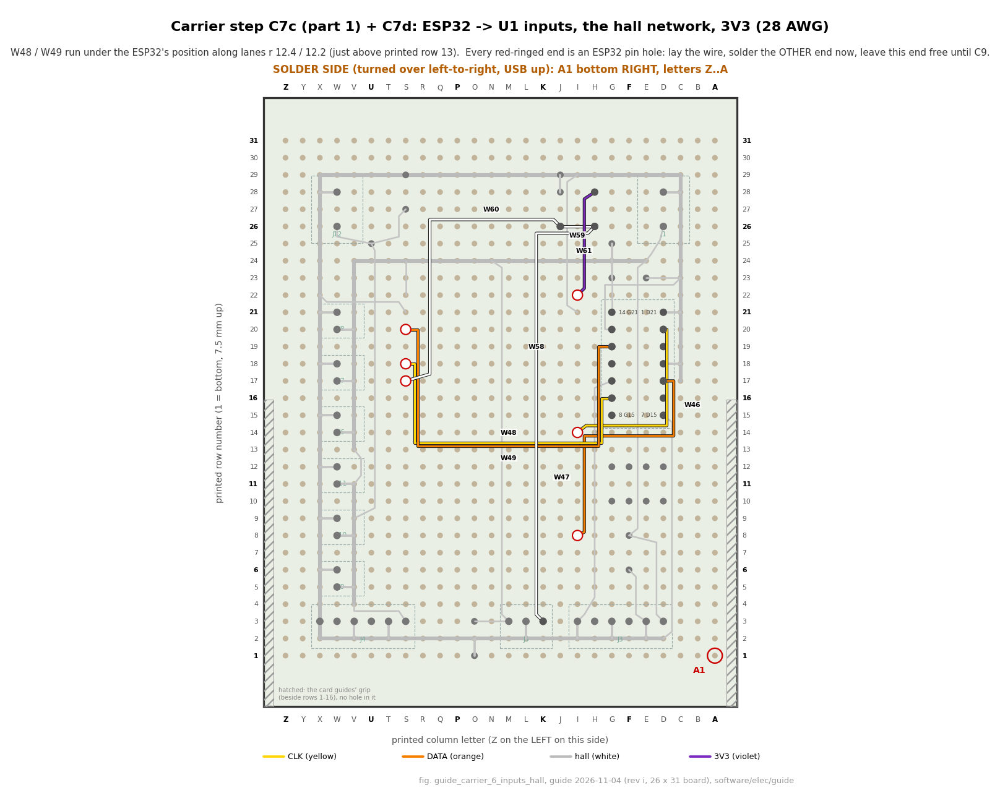

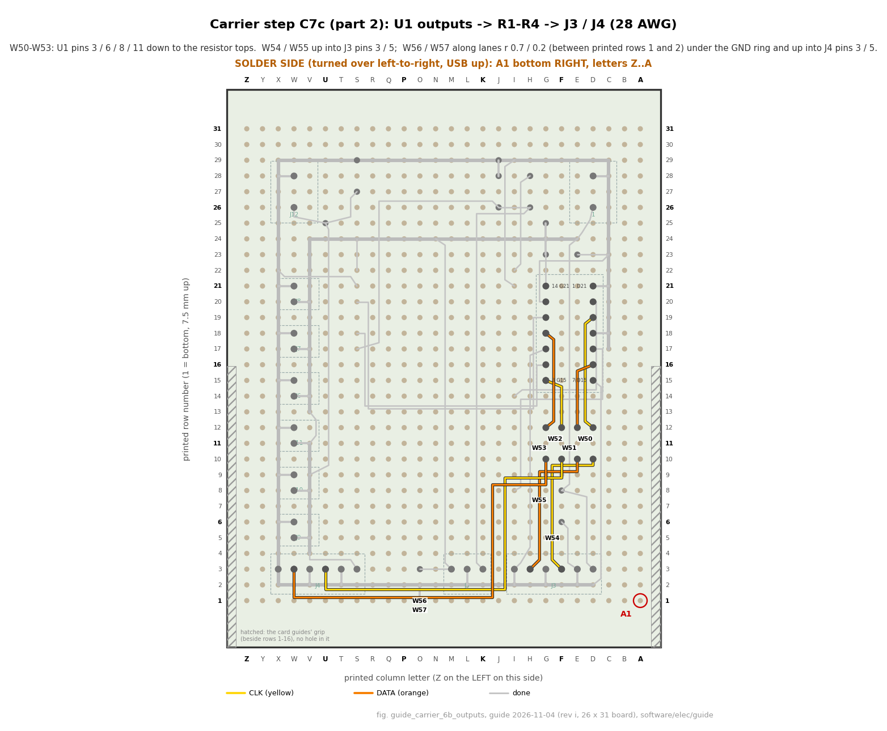

**C7c: clock and data wires (12 wires).** Cut lengths include 3 mm stripped at each end (tinned) and 3 mm of slack; hold each wire against the board before cutting. **C9** marks an ESP32 pin-hole end: tinned and left free until C9.

| W | Net | Wire | From | To | Route (lanes) | Cut mm | Strip mm |
|---|---|---|---|---|---|---|---|
| W46 | IO18 | 28 yellow | ESP IO18 I14 **C9** | U1.2 1A D20 | I14 → (7.5,13.4) → (2.8,13.4) → (2.8,19) → D20 | 40 | 3 / 3 |
| W47 | IO23 | 28 orange | ESP IO23 I8 **C9** | U1.5 2A D17 | I8 → (7.6,7.2) → (7.6,12.8) → (2.4,12.8) → (2.4,16) → D17 | 50 | 3 / 3 |
| W48 | IO14 | 28 yellow | ESP IO14 S18 **C9** | U1.9 3A G16 | S18 → (17.5,17) → (17.5,12.4) → (6.6,12.4) → (6.6,15) → G16 | 60 | 3 / 3 |
| W49 | IO13 | 28 orange | ESP IO13 S20 **C9** | U1.12 4A G19 | S20 → (17.3,19) → (17.3,12.2) → (6.8,12.2) → (6.8,18) → G19 | 75 | 3 / 3 |
| W50 | Y1 | 28 yellow | U1.3 1Y D19 | R1.top D12 | D19 → (3.5,17.6) → (3.5,11.4) → D12 | 30 | 3 / 3 |
| W51 | Y2 | 28 orange | U1.6 2Y D16 | R2.top E12 | D16 → (4,14.6) → (4,11.4) → E12 | 25 | 3 / 3 |
| W52 | Y3 | 28 yellow | U1.8 3Y G15 | R3.top F12 | G15 → (5,13.6) → F12 | 20 | 3 / 3 |
| W53 | Y4 | 28 orange | U1.11 4Y G18 | R4.top G12 | G18 → (5.5,16.6) → (5.5,11.4) → G12 | 30 | 3 / 3 |
| W54 | CLK0 | 28 yellow | R1.bottom D10 | J3.3 F3 | D10 → (3,8.6) → (5.6,8.6) → (5.6,2.6) → F3 | 35 | 3 / 3 |
| W55 | DATA0 | 28 orange | R2.bottom E10 | J3.5 H3 | E10 → (4,8.2) → (6.4,8.2) → (6.4,2.6) → H3 | 35 | 3 / 3 |
| W56 | CLK1 | 28 yellow | R3.bottom F10 | J4.3 U3 | F10 → (5,7.8) → (8.6,7.8) → (8.6,0.7) → (20,0.7) → U3 | 75 | 3 / 3 |
| W57 | DATA1 | 28 orange | R4.bottom G10 | J4.5 W3 | G10 → (6,7.4) → (9.4,7.4) → (9.4,0.2) → (22,0.2) → W3 | 80 | 3 / 3 |

**C7d: hall and 3V3 wires (4 wires).** Cut lengths include 3 mm stripped at each end (tinned) and 3 mm of slack; hold each wire against the board before cutting. **C9** marks an ESP32 pin-hole end: tinned and left free until C9.

| W | Net | Wire | From | To | Route (lanes) | Cut mm | Strip mm |
|---|---|---|---|---|---|---|---|
| W58 | HALL | 28 white | J5.1 K3 | R9.bottom H26 | K3 → (10.4,2.4) → (10.4,24.6) → (7.4,24.6) → H26 | 80 | 3 / 3 |
| W59 | HALL | 28 white | R9.bottom H26 | C4.bottom J26 | H26 → J26 | 15 | 3 / 3 |
| W60 | HALL | 28 white | C4.bottom J26 | ESP IO27 S17 **C9** | J26 → (9.4,25.4) → (16.6,25.4) → (16.6,16.4) → S17 | 60 | 3 / 3 |
| W61 | 3V3 | 28 violet | ESP 3V3 I22 **C9** | R9.top H28 | I22 → (7.6,21.4) → (7.6,26.6) → H28 | 30 | 3 / 3 |

The 28 AWG conductors are peeled from the ribbon and have PVC insulation, so be quick (320 °C, under 2 s per end) or the insulation shrinks back from the joint. The ESP32 ends (W46–W49, W60, W61, and W18, W19, W30 from the earlier steps) stay **tinned and free**, with a scrap of tape over each tip until C9.

### Test 5e: the signal paths (meter only)

| ☐ | Check | Meter mode | Pass | If it fails, look at |
|---|---|---|---|---|
| ☐ | J3 pin 3 to U1 pin 3; J3 pin 5 to U1 pin 6; J4 pin 3 to U1 pin 8; J4 pin 5 to U1 pin 11 | Ω | **68 Ω** each (R1–R4 in the path) | 0 Ω: a resistor bypassed; open: a missing Y or CLK/DATA wire |
| ☐ | J3 pins 3 and 5, J4 pins 3 and 5 to TP3 | Ω | **open** (> 1 MΩ) | a signal landed on a ground pin (the rev b error) |
| ☐ | U1 pins 2, 5, 9, 12 to TP3 | Ω | **10 kΩ** (R5–R8) | a pull-down missing or across the wrong pair |
| ☐ | Free ends W46, W47, W48, W49 to U1 pins 2, 5, 9, 12 | continuity | beep | the input wires under the DevKit's footprint |
| ☐ | J5 pin 1 to W60's free end; J5 pin 1 to W61's free end (the 3V3 end) | continuity; Ω | beep; **10 kΩ** (R9) | the hall chain W58–W60, R9 |
| ☐ | W30's free end (VIN) to TP1; W18 and W19's free ends to TP3 | continuity | beep | |
| ☐ | Columns A, B, Y, Z and rows 30–31 | eye | nothing soldered (all spare) | a part or wire one hole off |

### 5.7 C8: power-up with U1 out (empty socket) and no ESP32, then U1 in

Bench supply **5.00 V, limit 0.10 A**, on J1 (red → pin 1, black → pin 2, clamped bare). Nothing in J3–J11, the ESP32 not fitted, the free wire tips taped.

| ☐ | Check | How | Pass | If it fails, look at |
|---|---|---|---|---|
| ☐ | **(f)** switch on, U1 socket **empty** | supply current | an inrush blip (2000 µF charging at the 0.1 A limit: about 0.1 s), then **< 1 mA** | stays at the limit: a short; 5d's TP1–TP3 line missed it |
| ☐ | TP1, TP2 to TP3 | DC V | 4.95–5.05 V | LK1, J1 polarity |
| ☐ | socket pin 14; W30's tip (VIN); J3.1, J4.1, J5.3; J6–J11 pin 1, each to TP3 | DC V | 5.0 V at each | the tap to that point (5d) |
| ☐ | socket pins 2, 5, 9, 12 (U1 inputs) | DC V | 0 V | |
| ☐ | Nothing warm after 1 min | finger | cool | |
| ☐ | **(g)** power off, insert **U1 notch up** (pin 1 top-left), power on | supply current | **< 1 mA** (the AHCT's quiescent is µA) | jumps to the limit: U1 in backwards (pull it immediately) |
| ☐ | U1 pins 1, 4, 7, 10, 13 · pins 2, 5, 9, 12 · pins 3, 6, 8, 11 | DC V | 0 V · 0 V (pulled down) · **0 V** (outputs low) | an /OE not grounded (outputs float), a missing pull-down |

**The DevKit on USB before it is soldered (bench step 2; do it now, at the PC):**

| ☐ | Check | How | Pass | If it fails, look at |
|---|---|---|---|---|
| ☐ | **E2** corner labels | eye, USB at the bottom | **done 2026-11-04** (#32): bottom-left VIN, then GND, D13 going up; bottom-right 3V3; top-left EN; top-right D23, as the carrier expects | |
| ☐ | **E3** diode test, red on the USB VBUS pad, black on VIN | diode | **done** (#33): 0.49 V one way, about 1.0 V reversed = **D1 fitted** (the reverse reading is a sneak path through the board, not a tie) | the rule stands: pigtail out whenever USB is in |
| ☐ | Flash `phase0`, `tools\pio.cmd device monitor` | serial | the banner with the USB/bank rule | driver, cable |
| ☐ | `i` | serial | PSRAM 0, free heap > 200 kB | |
| ☐ | `w` (needs `src/wifi_secrets.h`) | serial | joins Wi-Fi, prints its IP; optional OTA round trip (`-e pov_ota`) | the secrets file |

### 5.8 C9: the ESP32, then the nine waiting wire ends

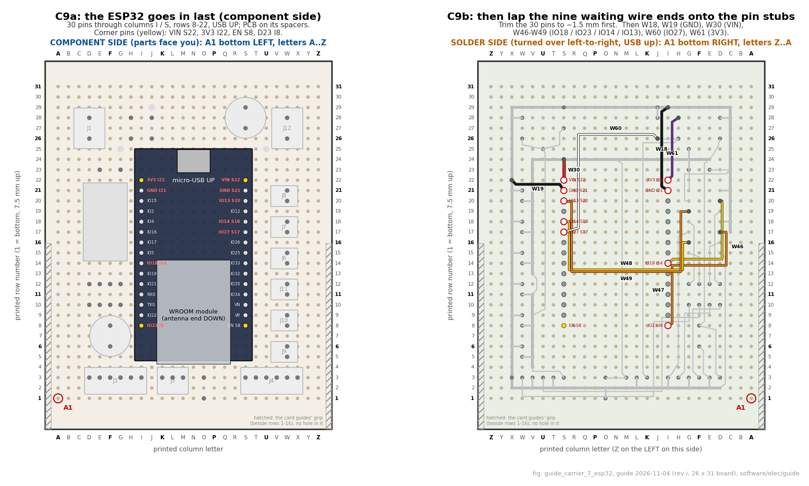

1. Power off, J1 unplugged. Lift the tape off the nine wire tips and bend them clear of the pin holes.
2. Drop the DevKit's 30 pins through columns I and S, rows 8–22, **USB up**, its PCB resting on the header spacers. Solder two diagonal corner pins at 320 °C, check that it sits flat and parallel to the carrier, then solder the other 28.
3. Trim the pins to about 1.5 mm on the solder side.
4. Lap each waiting wire end onto its pin stub and reflow: **W18** I21 GND, **W19** S21 GND, **W30** S22 VIN, **W46** I14 IO18, **W47** I8 IO23, **W48** S18 IO14, **W49** S20 IO13, **W60** S17 IO27, **W61** I22 3V3.
5. Inspect all 30 joints for bridges between neighbours (2.54 mm apart) under the lamp. **D12 at S19** must have nothing on it (strapping pin: anything that pulls it high stops the boot).

### Test 5f: the finished carrier (USB **or** the bench supply, never both)

| ☐ | Check | How | Pass | If it fails, look at |
|---|---|---|---|---|
| ☐ | J1 unplugged, terminals empty, **USB in** (a USB 3 port or a powered hub: the 2000 µF charge through D1) | serial | the banner; `i` as before | VIN not on bus A, D12 bridged, bus below 4.4 V |
| ☐ | 3V3 pin I22 and TP1, to TP3 | DC V | 3.25–3.35 V; 4.6–5.0 V (USB through D1) | |
| ☐ | T's lead into **J3** (red 1, green 2, yellow 3, orange 5): `c0 n14 g4 8` | eye | T walks (a frame every 100 ms) | the chain-0 path: W46/W47, U1 ch 1/2, R1/R2, W54/W55; re-check 5e |
| ☐ | T's lead into **J4**: `c1 8` | eye | T walks | W48/W49 under the DevKit, R3/R4, W56/W57 |
| ☐ | Optional scope: J3.3 / J3.5 against TP3 | DHO814 | 8 MHz bursts, 5 V, edges < 10 ns, overshoot < 0.5 V | |
| ☐ | Hall lead on J5 (section 6) with `h`, and a magnet 5 mm from the face | serial | one pulse per pass, falling edge | the pole (flip the magnet), the J5 order |
| ☐ | **USB out**, bench supply 5.00 V / 0.50 A limit on J1 | supply current | 0.10–0.20 A after boot; 3V3 at 3.3 V | the ESP32 doesn't boot from the bus: VIN tap, D12 |
| ☐ | The rule, written on the carrier in marker: **"USB in = J1/pigtail out"** | eye | done | |

---

## 6. The hall sensor lead, and the pigtail with the 4 A fuse (about 45 min)

### 6.1 The hall lead (make it today; solder it to the sensor once the bottom cap is printed)

The A3144 is glued face-down in its pocket in the bottom cap (r 42, θ 90°). **Its legs, not the wires, pass up through the cap's 1.4 × 4.5 mm lead slot**, and the lead is soldered to the leg tops there, 2.6 mm under the sled plate (wiring CAD 3.3). So today: make the lead and bench-test the sensor; the leg joints wait for the cap. See figure `guide_leads`, panel C.

| Wire | Colour | Cut | Strip sensor / terminal | Tin | Heat-shrink | Joint | Torque | Check | Time |
|---|---|---|---|---|---|---|---|---|---|
| H-5V | 26 AWG red | 160 | 3 / 5 | sensor end yes; terminal **no** | 2 mm × 8 mm over the leg joint | **leg 1 (VCC)** · J5 **pin 3** | snug | Test 6 | 15 min for the lead; 10 min at the cap |
| H-G | 26 AWG black | 160 | 3 / 5 | yes / no | 2 × 8 | **leg 2 (GND)** · J5 **pin 2** | snug | | |
| H-OUT | **28 AWG green** (as built 2026-11-12; replaces 26 AWG black + white bands) | 160 | 3 / 5 (terminal end: fold the strip back on itself before clamping) | yes / no | 2 × 8 | **leg 3 (OUT)** · J5 **pin 1** | snug | | |

A3144 with its flat (branded) face toward you, legs down: **1 = VCC, 2 = GND, 3 = OUT**. J5 is **1 = OUT, 2 = GND, 3 = 5V**, so the outer two swap. Twist the three, one turn per 15 mm. C5 (100 nF) is already on the carrier next to J5. Soldering it across legs 1–2 at the sensor is slightly better, but there is no room under the plate: leave it on the carrier.

**Bench test of the bare sensor (2 min, before it disappears into the cap):** leg 1 to the bench supply +5 V (limit 0.05 A), leg 2 to GND, a 10 kΩ from leg 3 to +5 V, meter (DC V) on leg 3. With no magnet: about 5 V. With a magnet's **south pole** 5 mm from the branded face: under 0.4 V. If nothing happens, flip the magnet (the A3144 switches on one pole only).

### 6.2 The pigtail and F1 (4 A fast-blow)

| Item | Spec |
|---|---|
| Pigtail | USB-A to bare wire, 22 AWG, as bought, **280 mm**: keep it full length until the first fit in the sled, then trim the bare end to about 170 mm (the CAD route is 151) |
| Polarity, before anything | the plug's two **outer** contacts (the longer ones) are VBUS and GND; the middle two are data and unused. **Settle it live before splicing:** plug the pigtail into the bank with the tails held apart, meter on DC V, red probe on the red tail. **+5 V** means red is VBUS. **−5 V** means the colours are swapped: mark the black tail with red tape as VBUS. 0 V means the bank wants its button (note it for E7). Unplug. Pigtail colours are not guaranteed, so never skip this. |
| F1 | 5 × 20 mm inline holder with a **4 A fast-blow** fuse (not 3 A: at 2.72 A it would run at 91 %), in the **5 V conductor only**, 40–60 mm from the plug, so it lies across the bank's top |
| Splice | slit the jacket back 50 mm at the holder. Cut the 5 V conductor and strip 6 mm of each end and of the holder's two leads. Slide 15 mm of 3 mm heat-shrink on, twist inline, solder (340 °C: the holder's leads are heavy), shrink. Tape the holder and the GND conductor together. If the holder has solder cups instead of leads: 6 mm into each cup, then heat-shrink over the cup |
| J1 end | strip 6 mm, twist, **bare** (no tin): VBUS → J1 pin 1 (D26), GND → J1 pin 2 (D28). Snug, tug, varnish |
| Route (later) | plug in the bank's +x port, up, across the bank's top through F1, down the −x side, zip-tied through the cradle's window, split 10 mm before J1. Tape F1 to the bank's top (a 7 g lump at r 13) |
| Time | 20 min |

### Test 6: hall lead, pigtail, fuse

| ☐ | Check | Meter mode | Pass | If it fails, look at |
|---|---|---|---|---|
| ☐ | Bare A3144 on the bench supply (6.1) | DC V on leg 3 | ≈ 5 V, then < 0.4 V with a magnet's south pole 5 mm away | flip the magnet; leg order (VCC is leg 1 with the flat face toward you) |
| ☐ | Hall lead, each conductor end to end | continuity | beep | |
| ☐ | Hall lead terminal end, neighbours (1–2, 2–3) | continuity | no beep | |
| ☐ | After the leg joints (at the cap): J5-end conductors to legs 3, 2, 1 | continuity | beep, in that order | the outer two not swapped |
| ☐ | Live polarity, **before** the splice (6.2) | DC V, red probe on the red tail | +4.9 to +5.1 V, or −5 V and the tails re-marked | 0 V: the bank's button, an empty bank |
| ☐ | After the splice: the VBUS contact to the VBUS tail **through F1** | continuity | beep (< 1 Ω) | the splice, the fuse not seated |
| ☐ | The same with the fuse **out** of the holder | continuity | open | the holder bridged, or F1 in the GND conductor |
| ☐ | The GND contact to the GND tail; VBUS tail to GND tail; the plug shell to the VBUS tail | continuity | beep; **no beep**; no beep | a short in the pigtail: use the spare |
| ☐ | Live again after the splice, tails apart | DC V on the VBUS tail | +4.9 to +5.1 V through F1 | the fuse, the splice |

---

## 7. The base: supply leads into the PWM, the pot cable, the motor leads with the 100 nF snubber (about 45 min)

Rev e: there is **no DC jack**. The bench supply's red/black pair comes in through the 8 × 6 mm notch in the bottom edge of the back flat, is zip-tied to the staple bar on the bottom plate, and goes straight up into the PWM board's IN terminals. The base shares **no conductor** with the rotor. The CAD's base render `wiring_base.jpg` predates rev e (it still shows the jack), so this section has no current CAD view.

| Wire | Colour | Cut | Strip | Tin | Heat-shrink | Joint | Torque | Check | Time |
|---|---|---|---|---|---|---|---|---|---|
| PS+ / PS− (bench supply → PWM IN+ / IN−) | 22 AWG red / black | ≈ 1,100 each (bench to the base; 65 of it inside) | 6 at the PWM; the supply end to suit its posts (banana plugs or bare under the binding posts) | **no** (screw clamps) | — | PWM **IN+ / IN−** screw terminals | snug | Test 7 | 10 min |
| M+ / M− (PWM OUT → motor tabs) | 22 AWG red / black | 120 each | 6 at the PWM, 5 at the tabs | PWM end no; tab end yes | 3 mm × 10 mm over each tab joint, with C7's leads under it | PWM **OUT+ / OUT−**; the motor's two tabs (hook through the tab hole, crimp with pliers, solder at 340 °C) | snug | | 15 min |
| C7 100 nF X7R 50 V | — | leads cut to span the two tabs | — | — | under the motor leads' heat-shrink | soldered **straight across the two motor tabs**, with the leads' joints | — | | 5 min |
| Pot cable (WH148 B10K, kit) | as supplied | the kit cable; it must reach **≥ 410 mm** | — | — | 1.5 mm × 10 mm per splice if extended | kit connector at the PWM's −x end; pot in the front flat (7.5 mm hole, the tab in its slot) | pot nut snug by hand plus 1/8 turn | | 10 min (+10 if extended) |

1. **Measure the kit's pot cable.** If it is under 410 mm, cut it in the middle and splice in three conductors of the blue-violet-grey ribbon (length = 410 − kit + 30 mm). Stagger the three splices 15 mm apart, each in 1.5 mm heat-shrink, then tape them together.
2. **Motor polarity only sets the direction.** The firmware's `dir` setting matches the picture to either, so put red on the tab marked + (either one if unmarked) and note the direction at the first spin.
3. **Keep IN− and OUT− separate.** Don't tie them together outside the board: on this class of controller that stops the PWM stage working.
4. **Label + and − at the notch** with tape (QA m-i). The PWM board has no reverse-polarity protection: swapped leads kill it.

### Test 7: the base (motor off the rotor, or the rotor not on yet)

| ☐ | Check | Meter mode / setting | Pass | If it fails, look at |
|---|---|---|---|---|
| ☐ | Supply leads, before connecting: IN+ lead to the supply's + post, IN− lead to − | continuity | beep, beep | the labels at the notch |
| ☐ | Supply set **12.0 V, limit 2.0 A**, output off; the knob **at zero** | supply | set | |
| ☐ | Output on, nothing turning: IN+ to IN− at the PWM | DC V | **+12.0 V** (positive with the red probe on IN+) | negative: switch off **now** and swap the leads |
| ☐ | Knob up slowly from zero | eye, supply current | the motor starts smoothly at low duty and speeds up with the knob, current 0.1–0.4 A unloaded | no start: OUT terminals, a tab joint; the supply at its limit: a short or a stalled motor |
| ☐ | Knob through its whole range | ear, eye | smooth, no jumps or dead spots | a pot wire, a cold splice |
| ☐ | C7 in place | eye | across the two tabs, under the heat-shrink | |
| ☐ | Knob back to zero, output off | | | |

The rotor's spin-up at a fixed knob position takes about 8 s (QA m6). With the rotor on, expect about 40–45 % of the knob for 225 rpm; mark that position once the hall readout gives the real rpm.

## 8. Bring-up once the parts meet, and what today can realistically finish

### 8.1 Today (Wed 11-04), without the tube, the sled or the caps

| Block | Time | Today? |
|---|---|---|
| 0: bench (E15, E17, E2 and E3 are done, #28–33, and the tube is printing) | 0.5 h | yes, first thing |
| 1: the rig, test strip T, E9 | 1 h | yes |
| Cut sheet A–C | 1 h | yes |
| 3.1 the ribbons; 4 the start leads and feeds | 1.5 h | yes |
| 2: the 24 strips' bench joints, tested one by one | 5–6 h | most, maybe all |
| 6: the hall lead (not its leg joints), the pigtail with F1 | 0.75 h | yes, if time |
| 5: the carrier | 5 h | **tomorrow** (tonight if the strips go fast) |
| 7: the base | 0.75 h | once the base shell is printed |
| 3.3: the 22 second ends on the tube | 4 h | after the tube prints |
| 8.2: bring-up B5 onward | — | as the parts meet |

That is a 9–10 h day for blocks 0, 1, the cut sheet, 3.1, 4 and 2. The tube's 15 h print is the long pole; the PLA fit-checks and the sled (which also waits for B7) follow the FDM report's plan.

### 8.2 Bring-up order (electrical §9 with the rev e numbers; phase-0 commands)

| Step | Setup | Limit | Do | Pass |
|---|---|---|---|---|
| B1 | carrier, no U1, no ESP32 (5.7) | 0.10 A | power up | < 1 mA; 5.0 V everywhere |
| B2 | DevKit on USB, before soldering (5.7) | — | E2, E3, flash, `i`, `w` | as Test 5 |
| B3 | finished carrier (Test 5f) | 0.50 A | T on J3, then J4, `8` | T walks on both |
| B4 | one strip (T, section 1) | 1.0 A | `g31 4`: E9 | 0.80–0.85 A |
| B5 | **chain 0 on the tube** on J3 (after 3.3 for strips 0–11) | 1.5 A | `c0 n168`, then `5`, `6`, `7`, `t`, `k`; then `m1300 9` | `5`: every strip lights its LED number; `6`: the row ramp is monotonic (odd strips reversed by the firmware); `7`: the last LED latches; frame ≈ 0.70 ms; at `9`, strip 11's pads ≥ bus − 0.1 V |
| B6 | chain 1 on J4, then both | 3.0 A (one chain at a time if the supply can't, E10) | `c1 …`, then `cb m2600 9` | about 2.7 A total; TP1 ≥ 4.7 V; U1 and the buses cool |
| B7 | **the bank** (QA-2 N2: before the sled prints), carrier with both chains, pigtail on J1 through the meter on its 10 A range, **no USB** | bank | plug in: that is the switch | it starts on plug-in (or note that it needs the button); at most a 0.5 s flicker at plug-in, then dark; **blank 0.46 A** held for 10 min with no shut-off |
| B7b | the 2.7 A load, on the **rig** (phase-0 takes commands only over USB, and the column firmware stays blank with the rotor stopped) | bank | **bench supply leads off the rails**, the rig strips powered from the pigtail tails clamped into the rig terminal's pins 1/2 (the current then never runs through the breadboard's springs), the meter in the 5 V tail; the DevKit on USB with VIN open (allowed: USB and the bank share no 5 V node there); strip 0 + T through the coupler, `n28 g31 4` (≈ 1.7 A), more strips if wired | the port holds the current at ≥ 4.75 V at the plug with no cut-out. That sets `CAP_MA`: 2,600 if it holds 2.7 A, else 2,000 (QA-2 Q3) |
| B8 | hall on J5, a magnet on a stick, `h` (USB) | — | sweep the magnet 5 mm past the face | one clean pulse per pass |
| B9 | hall on a spinning mock (drill) | — | serial rpm vs a phone tachometer | within 2 % |
| B10 | the assembled rotor, cap on, in a box, base clamped | bank | knob 100 → 150 → 225 rpm, calibration patterns from the web page, balance with trial nuts (QA-2 N6) | `late_cols` = 0 for a minute; nothing rattles |
| B11 | the USB rule on the assembled rotor | — | pigtail **out**, USB in, flash, USB out, pigtail in | the port survives the 2000 µF inrush; the strips stay dark on USB alone |

**Serial and the bench supply together (B3–B6).** The phase-0 menu needs USB while the bench supply on J1 carries the load. That is acceptable **only if E3 found D1**: set the bench supply to 5.10 V so D1 stays reverse-biased, and plug the USB through a powered hub. **Without D1, never both.** Run the light patterns (`5`, `7`, `8`: 12 dark strips plus the ESP32 is about 0.3 A) on USB alone from a USB 3 port. Do the heavy ones (`6`, `9`) on the rig, which has VIN open, or wait for the column firmware's web page with the rotor spinning.

### Test 8: everything together, before the first full power-on from the bank (B7)

| ☐ | Check | How | Pass | If it fails, look at |
|---|---|---|---|---|
| ☐ | Every lead in its terminal per the landing map (4.3), tugged, varnished | hand, eye | nothing moves | |
| ☐ | Pigtail unplugged: J1 pin 1 to pin 2 (24 strips + 2000 µF) | Ω | > 100 Ω and climbing | low: unclamp the chains one at a time (J3, J4, then the feeds) until it climbs, and the fault is in the last one removed |
| ☐ | J1 pin 1 is the meter-checked VBUS tail; F1 is 4 A | eye | yes | |
| ☐ | **No USB cable** in the DevKit; the rule is written on the carrier | eye | yes | |
| ☐ | B5 and B6 passed on the bench supply | the sheet | ticked | |
| ☐ | Motor knob at zero, base supply off, rotor free to turn, hands clear | eye | yes | |
| ☐ | Plug in, meter in series | 10 A range | 0.46 A blank after boot, strips dark | > 1 A: unplug, look for a short; nothing: the bank's button (E7) |

## 9. Master checklist (print this page)

Meter: **beep** = continuity < 1 Ω; **open** = no beep; **climbs** = an Ω reading rising as capacitance charges. "–" = nothing to test there.

**0 Bench** ☐ meter zero ☐ supply 5.00 V, limit holds ☐ iron 320 °C wets in 1 s ☐ **E15 done (#28–30)** ☐ **E17, E2, E3 done (#31–33)** ☐ parts present, F1 = 4 A

**1 Rig + T** ☐ rails > 1 kΩ climbing ☐ VIN open ☐ < 5 mA without USB ☐ U1 pin 14 = 5.0 V, outputs 0 V ☐ banner ☐ T dark 7–15 mA ☐ R G B W ☐ walk, last LED, LED 0 ☐ **E9 white 0.80–0.85 A** recorded ☐ `t` ≈ 704 µs, `k` white-ish

**2 Strips** (pre = probe walk before joints; jnt = every wire beeps to its pad, no neighbour bridges, 5V–GND > 100 Ω; lit = all 14 after the joints)

| Strip | 0 | 1 | 2 | 3 | 4 | 5 | 6 | 7 | 8 | 9 | 10 | 11 |
|---|---|---|---|---|---|---|---|---|---|---|---|---|
| pre | ☐ | ☐ | ☐ | ☐ | ☐ | ☐ | ☐ | ☐ | ☐ | ☐ | ☐ | ☐ |
| jnt | ☐ | ☐ | ☐ | ☐ | ☐ | – | ☐ | ☐ | ☐ | ☐ | ☐ | – |
| lit | ☐ | ☐ | ☐ | ☐ | ☐ | – | ☐ | ☐ | ☐ | ☐ | ☐ | – |
| **Strip** | **12** | **13** | **14** | **15** | **16** | **17** | **18** | **19** | **20** | **21** | **22** | **23** |
| pre | ☐ | ☐ | ☐ | ☐ | ☐ | ☐ | ☐ | ☐ | ☐ | ☐ | ☐ | ☐ |
| jnt | ☐ | ☐ | ☐ | ☐ | ☐ | – | ☐ | ☐ | ☐ | ☐ | ☐ | – |
| lit | ☐ | ☐ | ☐ | ☐ | ☐ | – | ☐ | ☐ | ☐ | ☐ | ☐ | – |

**4 Leads** S0: ☐ 6 conductors ☐ returns via splice ☐ neighbours open ☐ pins → pads ☐ walks on the rig · S12: ☐ ☐ ☐ ☐ ☐ · Feeds (2 conductors, open between, pins → pads): F3 ☐ F6 ☐ F9 ☐ F15 ☐ F18 ☐ F21 ☐

**3 Jumpers, second end on the tube** (5V beep, GND beep, chain 5V–GND > 100 Ω, CI/DI open, new strip lights in `5` and `8`):

| 0-1 | 1-2 | 2-3 | 3-4 | 4-5 | 6 on, 5-6 | 6-7 | 7-8 | 8-9 | 9-10 | 10-11 |
|---|---|---|---|---|---|---|---|---|---|---|
| ☐ | ☐ | ☐ | ☐ | ☐ | ☐ | ☐ | ☐ | ☐ | ☐ | ☐ |
| **12-13** | **13-14** | **14-15** | **15-16** | **16-17** | **18 on, 17-18** | **18-19** | **19-20** | **20-21** | **21-22** | **22-23** |
| ☐ | ☐ | ☐ | ☐ | ☐ | ☐ | ☐ | ☐ | ☐ | ☐ | ☐ |

**5 Carrier** 5a ☐ no bridges between terminal pins · 5b ☐ ring, bus A, bus B each continuous ☐ **ring / A / B mutually open** ☐ J4.6 on the ring · 5c ☐ R1–R4 68 Ω ☐ R9 10 kΩ ☐ C1, C2 stripes at F6, S29 · 5d ☐ TP1–TP2 beep (LK1) ☐ **TP1–TP3 climbs > 1 kΩ** ☐ J1 tap ☐ every terminal pin to its net · 5e ☐ J3/J4 signal pins 68 Ω to U1 ☐ signal pins open to GND ☐ U1 inputs 10 kΩ to GND ☐ input wires ☐ hall 10 kΩ to 3V3 ☐ columns A, B, Y, Z clean · 5.7 ☐ **empty socket < 1 mA, 5.0 V at every point** ☐ U1 in: < 1 mA, all pins 0 V ☐ DevKit (E2, E3 done) flash, `i`, `w` · 5f ☐ USB banner ☐ 3V3 3.3 V ☐ T walks on J3 ☐ on J4 ☐ hall pulses ☐ bench supply alone 0.10–0.20 A ☐ rule written on the board

**6 Hall, pigtail** ☐ bare A3144 switches ☐ lead continuity ☐ legs 3 / 2 / 1 to J5 pins 1 / 2 / 3 ☐ **live polarity before the splice** ☐ VBUS through F1 ☐ fuse out = open ☐ no short ☐ 5 V through F1

**7 Base** ☐ leads to the right posts ☐ 12.0 V, 2.0 A limit, knob at zero ☐ **+12 V at IN+** ☐ smooth start ☐ smooth range ☐ C7 across the tabs ☐ knob back to zero

**8 Everything together** ☐ all terminals tugged and varnished ☐ J1 > 100 Ω climbing ☐ VBUS tail on J1.1, F1 4 A ☐ **no USB** ☐ B5, B6 passed ☐ knob at zero ☐ 0.46 A blank on the bank

---

## 10. Where the sources disagree, and what this guide chose

| # | Topic | Older source says | Newer source | This guide, and why |
|---|---|---|---|---|
| 1 | Signal wires and hall lead into the screw clamps | electrical 5.6, 6.2, 7.3, the cut list: 28 AWG, **tinned and folded double** | QA-2 N5 (11-03 evening): 26 AWG clamped **bare**, or ferrules | 26 AWG bare for all six start-lead conductors and the hall lead; nothing tinned under a screw. Only red/black 26 AWG on hand, so signals are black + ID bands |
| 2 | Jumper cut length | `wiring_cut_list.csv`: 75 mm for 14 jumpers, 80 for 8; electrical 3.3/3.4/4/5.6: 45 mm | electrical rev g, 6.2, 7.6: 80 mm | **80 for all 22** (QA-2 m-d): one length, and the loop takes the extra 5 mm |
| 3 | Jumpers 5-6 and 17-18 | the cut list's route text reads from strip 5 / 17 | its own from/to columns and electrical 7.6 step 4: first end on 6 / 18 | first end on **6 / 18** (bench), loop at 5 / 17; mount 6 before 5 and 18 before 17 |
| 4 | Pad order across a jumper | `elec_wiring_table.csv`: "matches the pad order, no crossing" | rev g 6.2: mirrored on the inverted strip, half turn | **solder by label**; the ribbon turns over once |
| 5 | F1 rating | electrical 2.4, 3.6, 10, E5, the cut list's pigtail row: 3 A | rev e: 4 A | **4 A fast-blow** |
| 6 | Base supply | electrical 2.3, 7.4, 8, 10: DC jack J13 | rev e and measurement #13: no jack; bench supply leads through the notch | bench supply leads, + / − labelled at the notch (QA-2 m-i) |
| 7 | Current cap | electrical body: 2.0 A cap, 2.12 A, `CAP_MA` 2000 | rev e: 2.6 A cap, 2.72 A total | 2.6 A (`m2600`), confirmed or cut to 2.0 A by B7b |
| 8 | Start-lead, feed, hall, motor-lead lengths | electrical 3.3: start leads 200, feeds 150/200, hall 120, motor 200 | the CAD-routed cut list: 170/165, 120–250 by sector, hall 160, motor 120; the wiring report's note: feed 21 120, motor 125 | the cut list's CAD column (the newest generated data): **feed 21 = 125, motor = 120** |
| 9 | `elec_carrier_layout.png` (rev h, 11-03) | U1's body and pin-1 dot drawn at the rev d columns 1–4 | the pins, netlist and hole-to-net check: pins at columns 3 / 6 | **fixed** (re-rendered 11-04, netlist byte-identical); rev i draws every part from its own pins (U1 pin 1 = D21) |
| 10 | Carrier build order | electrical 5.2: bare buses, then terminals | the guide's step figures | terminals first: J4 pin 6, C2− and TP3 sit on the GND ring, so the ring is laid against pins already in place. Either order works if X3 (J4 pin 6) isn't flooded |
| 11 | Wires ending on ESP32 pin holes | electrical 7.5 checks "DevKit hole IO18 (rev h (8,15), now I14) …", implying wires in those holes before the DevKit | a hole can't take both a header pin and a wire | the nine wire ends wait, tinned and taped, and are lapped onto the pin stubs after the DevKit is soldered (C9); the 7.5 checks are made at the free tips |
| 12 | Hall lead through the cap | electrical 6.2: the lead passes the 1.4 × 4.5 mm lead slot | wiring CAD 3.3: the legs pass the slot, the lead is soldered to the leg tops under the sled plate | the CAD: make the lead today, solder it once the sensor is glued in the printed cap |
| 13 | Bench step 7 with the bank | electrical §9: blank, then the dog and dense text, rotor stopped | the column firmware blanks without hall pulses; phase-0 takes commands only over USB, and USB plus the bank is forbidden | B7 (wake, blank 0.46 A) on the carrier; B7b (the 2.7 A load) on the rig powered from the pigtail, its DevKit on USB with VIN open |
| 14 | Strip-back tape | electrical 7.1: "10 mm of Kapton over the four wires on the strip's back" | — (this guide) | 12 × 6 mm over the joints only, ending 6 mm from the cut edge: a longer patch would hold the wires flat past the point where they must bend through the slot |
| 15 | Which strips carry bench wires | electrical 7.6: "every strip now carries one ribbon with a free end" | the loop rule in the same section | strips 5, 11, 17, 23 carry none today; 6 and 18 carry two ribbons plus a feed |
| 16 | Phase-0 driver | electrical §9 step 2: FastLED | firmware report: FastLED dropped, `spi_master` | the firmware (the commands in section 1.3) |
| 17 | Pigtail length | the cut list: cut to 151 (the CAD route) | QA-2 W3: trim, after the fit | keep 280 until the sled fit, then trim to about 170 |
| 18 | Harness figure | `elec_harness.png` legend: 7 × 5 mm slots, 45 mm ribbon | rev g: 10 × 5, 80 | 10 × 5 and 80; the guide's serpentine map replaces that figure for the build |
| 19 | Serial during the bench steps | electrical §9 step 3: carrier on the bench supply, "no USB", yet steps 3–6 drive patterns from the phase-0 serial menu | the firmware report: the bench sketch over USB with the pigtail out (it doesn't mention the bench supply) | 8.2: USB plus the bench supply (at 5.10 V, through a powered hub) only if D1 is present; without D1, light patterns on USB alone and heavy patterns on the rig |
| 20 | Strip pad order and span | electrical 2.2, 6.2, 6.3, E15 and the first draft of every pad figure: 5V, C, D, GND over a 9.0 mm span | `measurements.md` #28–30 (2026-11-04): **GND, C, D, 5V** (clock next to GND), **11 mm**, each pad **2.5 × 2.5 mm from the cut edge** | figures redrawn; joints on the LED half of each pad (1.0–2.5 mm), outer pads on their inner half (usable ≈ 2.0 × 1.5 outer, 2.5 × 1.5 inner); dry-fit the first strip; the ribbon flipped (green on GND, red on 5V; with #21's colours it lies flat, no crossing); the probe taped at a 2.8 mm pitch; the 10 mm slots stay (the tube is printing), filed 0.5 mm per side only where a strip rocks |
| 21 | Ribbon and signal colours | the guide's first drafts, `guide_common.py`: ribbon red / orange / yellow / green = 5V / **CLK / DATA** / GND, orange band = CLK, yellow band = DATA, carrier orange = clock nets; with pads GND, C, D, 5V that needed the middle pair crossed | Brian at the bench, 2026-11-04: test strip T soldered with the flat ribbon, **orange = DATA, yellow = CLK** | **orange = DATA, yellow = CLK for the whole build**: ribbon 5V / DATA / CLK / GND lies flat on the pads (green GND, yellow C, orange D, red 5V); 26 AWG bands orange = DATA, yellow = CLK, white = hall; carrier 28 AWG orange = data, yellow = clock; rig / J3 / J4 yellow → 3, orange → 5. One rule, and T keeps its joints |
| 22 | The carrier's hole grid and hole names | electrical 5 and this guide's first section 5 (rev h): an assumed 27 × 35 grid, holes as (c, r) counted from 0 | `measurements.md` #31 (2026-11-04): **26 × 31**, printed A–Z / 1–31, margins 3.25 across, 7.5 below row 1, 5.5 above row 31 | **rev i**: the same layout with every row − 2; every hole named by its printed label; A1 at the bottom left with the component side facing you, row 1 down; the board and both card guides 1.27 mm toward −x so the DevKit stays on the rotor axis (sled `rotor_sled_i`); wiring and cut lengths unchanged |

**CAD views that don't exist yet (not rendered by this guide; Fusion was not touched):** (1) the **base wiring for rev e**: `wiring_base.jpg` (11-02) still shows the DC jack; (2) the **pigtail with F1 for rev d/e**: `wiring_pigtail_fuse.jpg` (11-02) still shows the switch loop; (3) nice to have, a close-up of the A3144's legs through the bottom cap's lead slot with the lead joints under the sled plate.

---

## Explain it

- **Test at every interface, so the fault is always in the last thing you touched.** Each sub-assembly ends with a box of meter readings and a light test. The rig is the carrier's chain-0 circuit on a breadboard with the same terminal pin order, so every strip, lead and jumper is proven before it meets the next part.
- **Power up empty first.** The carrier's first power-on is with the chip socket empty and no ESP32, at a 0.1 A limit: a short shows as a current, not as a dead part. 2000 µF of bulk capacitance is why the ohmmeter reading climbs, and a short is the reading that doesn't.
- **Screw terminals hate solder.** Tinned stranded wire under a screw cold-flows and loosens with vibration, so everything clamped is bare twisted 26 AWG. The ID bands carry the colour code where only red and black wire is on hand.
- **Mirrored pads mean solder by label, never by position.** Every other strip is upside down, so a ribbon between neighbours turns over once. The colours name the nets, so a mistake is visible from a metre.
- **Check the drawing against the data.** The rev h layout figure drew the chip two columns off its own pins. The netlist and the hole-to-net check were right, and only the picture was wrong, which is exactly the kind of error a builder follows. Fixing it was two lines.
- **Name holes the way the builder reads them (rev i).** The board has its own printed grid (A–Z, 1–31), so the build list uses those labels, derived from one rule in the layout script, instead of 0-based grid numbers. The orientation is stated as a corner (A1 bottom left, component side facing you), which fixes both the end and the face in one phrase. With an even 26 columns the board's centre line falls between two holes, so the DevKit could not sit on both the board's centre and the rotor's axis: moving the board and its card guides half a pitch kept every wire and cut length valid and lowered the unbalance (41 → 34 g·mm).

## Files

| File | What |
|---|---|
| `docs/2026-11-04-wiring-build-guide.md` / `.html` | this guide (`py software/elec/md2html.py docs/2026-11-04-wiring-build-guide.md`) |
| `software/elec/guide/guide_common.py` | shared colours, the jumper/loop/mount-order rules, drawing helpers |
| `software/elec/guide/carrier_data.py` | the carrier build model from the rev i netlist JSON: wires W01–W61 in build order, every hole as its printed label, cut and strip lengths, tack holes → `docs/img/guide_carrier_wires.csv` |
| `software/elec/guide/fig_carrier_steps.py` | `docs/img/guide_carrier_1_mark_terminals`, `_2_buses`, `_3_parts`, `_4_gnd`, `_5_5v`, `_6_inputs_hall`, `_6b_outputs`, `_7_esp32` |
| `software/elec/guide/fig_serpentine.py`, `fig_strip_end.py`, `fig_jumper.py`, `fig_leads.py`, `fig_rig.py` | `guide_serpentine_map`, `guide_strip_end`, `guide_jumper`, `guide_leads`, `guide_rig` (SVG + PNG each) |
| `software/elec/elec_carrier.py` | rev i: the layout refitted to the counted 26 × 31 grid (rows − 2), printed labels in the figure, build list and JSON, every body drawn from its own pins; `elec_carrier_layout.svg/.png` and the netlist regenerated |
