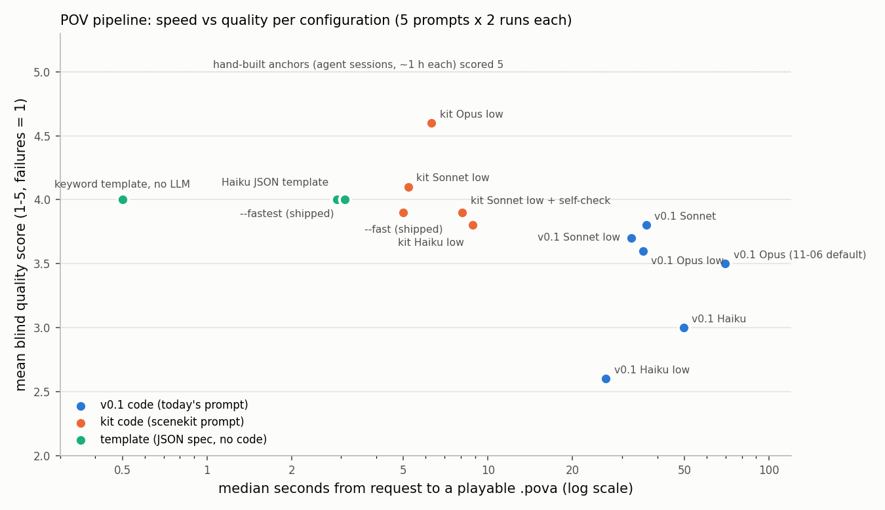

# POV pipeline speed investigation: from 70 s to 5 s per request (placeholder in 0.3 s)

*Prepared for Brian, 2026-11-07, by Claude (Opus 5.5) on the desktop PC. Overnight run. All timings are real `claude -p` calls on
the subscription (no API key), measured end to end. The column isn't built yet, so quality was judged from the flat
42 x 96 frames, not on the hardware.*

Outputs (every run's `.pova`, generated script, stage report and judge strip; the blind grids, `scores.json`,
`results.jsonl`): `<video>/2026-11-07 POV pipeline speed/` on the desktop PC (not in git).

## Lead table

Medians over 5 prompts x 2 runs: jet ski, sunglasses (both from the 11-06 test), plus "a goose skateboarding",
"fireworks over a city skyline" and "a cat chasing a laser dot". **Time** = request to a playable `.pova` (add 0.2 s
of Python start). **Quality** = mean blind score (1-5, rubric below). The hand-built 11-06 scenes, hidden in the grids
as anchors, scored 5.

| Configuration | Median s | Worst s | Quality | Recommended? |
|---|---|---|---|---|
| v0.1 prompt, Opus, CLI default effort (the 11-06 pipeline) | **69.8** | 134.2 | 3.5 | no (baseline) |
| v0.1 prompt, Opus, effort low | 35.6 | 49.7 | 3.6 | no |
| v0.1 prompt, Sonnet | 36.6 | 125.1 | 3.8 | no |
| v0.1 prompt, Sonnet, effort low | 32.3 | 88.9 | 3.7 | no |
| v0.1 prompt, Haiku (1 of 10 runs refused by the lint) | 49.7 | 69.9 | 3.0 | no |
| v0.1 prompt, Haiku, effort low (1 of 10 refused) | 26.3 | 63.3 | 2.6 | no |
| **kit prompt** (scenekit helpers), Opus low | 6.3 | 11.4 | **4.6** | quality option |
| **kit prompt, Sonnet low** | **5.2** | 8.1 | 4.1 | **yes: the code-writing lane** |
| kit prompt, Haiku low (1.5 attempts on average) | 8.8 | 12.3 | 3.8 | no |
| kit Sonnet low + visual self-check round | 8.1 | 25.9 | 3.9 | no (no gain) |
| kit Sonnet low, 2 candidates in parallel | 5.0 | 7.6 | 3.9 | no (no gain) |
| Template lane: Haiku returns a JSON spec, no code | 2.9 | 4.5 | 4.0 | yes, inside `--fastest` |
| Template lane: keyword match, no LLM | **0.5** | 0.7 | 4.0 | yes, as the placeholder |
| **`--fast` as shipped** (placeholder, then kit Sonnet low) | **5.0** (placeholder 0.08) | 8.8 | 3.9 | **yes: default** |
| **`--fastest` as shipped** (Haiku template first, kit code if no fit) | **3.1** | 3.6 | 4.0 | yes, for the video shoot |
| Warm daemon (`pov_serve.py`), `--fastest` / `--fast` | 2.1-2.4 / 4.2-4.8 | | same | yes, next step |
| Repeat request (library cache) | 0.01 | | same as the original | yes, in both presets |

Off-vocabulary prompts ("a rocket launching into space", "a dragon breathing fire", "a snowman waving in the snow":
nothing in the library draws them) x 2 runs:

| Configuration | Median s | Worst s | Quality |
|---|---|---|---|
| v0.1 prompt, Sonnet low | 33.0 | 42.5 | 3.0 |
| kit prompt, Sonnet low | **9.3** | 9.7 | **4.5** |
| kit prompt, Opus low | 12.6 | 14.9 | 3.2 |
| `--fast` (shipped) | **9.2** | 10.7 | 3.8 |
| `--fastest` (template declines honestly, then kit code) | 12.7 | 13.1 | 4.3 |

*[Figure omitted from the public release: Four --fast results: two from the library's art, two the model drew itself]*

## Recommended default

**`py software/pipeline/pov_request.py "<F9 line>" --fast`**, and later the same through the warm daemon.

| Step | What happens | Time (measured) |
|---|---|---|
| 0 | Python starts, scope and IP check | 0.2 s |
| 1 | Library cache: a repeat or near-repeat request is served from disk | 0.01 s, then done |
| 2 | Placeholder: a keyword match renders a ready-made scenekit template and uploads it at once | **0.08 s** (all 32 runs < 0.2 s) |
| 3 | Sonnet 5.5, effort low, kit prompt as `--system-prompt-file`, writes a 20-40 line scenekit script (~375 output tokens, no thinking) | 4-5 s |
| 4 | Sandbox render, validator, zero-latency auto-fix (seam, colours, current) | 0.3-0.5 s |
| 5 | Upload and replace the placeholder | network |

**Expected: about 0.3 s from the F9 line to something on the column, and about 5 s to the real scene (9 s when the
request asks for something the library can't draw, worst seen 10.7 s).** With `pov_serve.py` keeping a `claude`
process pre-spawned, that drops to about 4.5 s. Model cost is about $0.005 a request (API-equivalent, billed to the
subscription), against $0.20 for the 11-06 Opus default.

`--fastest` swaps step 3 for a Haiku JSON spec: **3.1 s** (2.1-2.4 s warm) when the request fits the template
vocabulary, with no placeholder swap on screen. It's 12.7 s when the request doesn't fit, because the template call
comes first.

## Why it got 14x faster (the one idea)

The 11-06 pipeline's time was almost all **output tokens**: Opus wrote 130-200 lines of pixel code plus 4-13k
thinking tokens, because every request redrew the dog, the waves and the sky from scratch against a 20-function
drawing API. The fix isn't a faster model. It's **giving the model less to write**:

- `povgen/scenekit.py` (new, ~750 lines) holds the art and the motion. It has dim skies, sea, city skyline, ground,
  stars, sun and moon. The characters are the bichon (side view and the big bust), the dog, the goose and a new cat.
  It also has a jet ski, skateboard, surfboard and rider poses; fireworks, splash, spray, sparkle and laser-dot
  effects; and loop-safe motion helpers (`seg`, `ease`, `jump`, `bob`, `scroll`, `orbit_col`).
- With that library, a scene is **~29 lines and ~375 output tokens** instead of ~147 lines and ~6.7k tokens, and
  Sonnet at low effort doesn't think at all. Tokens to script fell 18x; time fell 14x.
- Quality went **up**, not down (3.5 to 4.1). The library carries tested art (the bichon rider is the 11-06 hand-built
  sprite), and the kit prompt asks for 4-8 s loops with backgrounds and story beats ("story mode", 11-06 fix #1)
  instead of 1-3 s icons. Median loop length went from 1.6 s to 6.0 s.

The library is now **the quality lever**. Its fireworks were too small and dim in round 2 (every kit firework scored
3). One 15-minute library fix (chrysanthemum bursts, dimmer stars) moved every later firework, from any model or
lane, to 4-5. Hand-built work done once now pays off on every request.

## Findings, by question

### 1. Model and effort

- **Effort is the biggest knob for the v0.1 prompt.** Opus low halves the time (69.8 to 35.6 s) at the same quality,
  because thinking drops from ~3.8k to ~1k tokens.
- **Haiku is not faster here.** At default effort it thinks the most of all (median 8k thinking tokens), and it was
  the only model with refusals. One run copied `import os, sys` from the worked example and one used `random`;
  under v0.1 a lint refusal ended the run. Its quality was lowest too (2.6-3.0, failures counted as 1). Two more
  Haiku runs crashed on a NameError from my own mid-run refactor of `pov_request.py`; I re-ran those two (scored
  3 and 3, graded with the key visible), so they don't count against Haiku.
- **On the kit prompt, model choice barely matters for speed** (5-9 s), because there is so little to write. Opus low
  scored highest on the in-library prompts (4.6) but lowest on the off-vocabulary ones (3.2). Pooled over all 16
  runs, Sonnet low (~4.2) and Opus low (~4.1) are equal within noise, and Sonnet is about 20 % faster and 2-3x cheaper.
  Haiku low needed repairs (1.5 attempts) and was slower.

### 2. Fixed overhead (trivial Haiku turn, 3 runs per flag set)

| `claude -p` flags | Wall | Non-API overhead |
|---|---|---|
| no flags (loads settings, hooks, MCP servers, CLAUDE.md) | 6.3 s | 4.3 s |
| the pipeline's flags (`--tools "" --setting-sources "" --strict-mcp-config --no-session-persistence --disable-slash-commands`) | 2.0 s | 1.0 s |
| + `--system-prompt` (replaces Claude Code's own prompt) | 1.8 s | 1.0 s |
| + `--safe-mode` | 1.9 s | 1.0 s |
| `--bare` | fails: needs `ANTHROPIC_API_KEY` (OAuth is never read) | |
| **pre-spawned process** (`--input-format stream-json`, spawned 8 s before the request) | **0.8 s** (cold 1.9 s) | ~0.06 s |

- The 11-06 pipeline already had the lean flags, so the remaining CLI cost is ~1 s. A pre-spawned process removes
  most of it. The CLI boots before stdin arrives, and each process serves exactly one request, so no conversation
  builds up. This runs on the same logged-in subscription CLI; no API key or Agent SDK is needed.
  `pov_serve.py` does this: template lane 2.1-2.4 s warm vs 2.9-3.1 s cold, kit lane 4.2-4.8 s vs ~5.0 s.
- **Prompt placement and caching** (generator prompt as `--system-prompt-file` vs the whole prompt on stdin after
  Claude Code's own system prompt) made no measurable difference on the v0.1 prompt (38.1 vs 32.3 s, inside the
  noise). Input is ~8k tokens and cached; output dominates. The kit lane uses the system-prompt form anyway: it's
  smaller and gives a stable cacheable prefix.
- `--system-prompt-file` works but isn't listed in `--help` (only mentioned under `--bare`).

### 3. Output size

See "Why it got 14x faster". Tokens to script: v0.1 Opus ~6.7k output tokens (3.8k thinking) for a 147-line script;
kit Sonnet low ~375 tokens (0 thinking) for 29 lines. The kit prompt also says "do not deliberate at length", and at
effort low that holds: Sonnet and Opus produced 0-230 thinking tokens on every kit run.

### 4. Library cache and templates

- **Templates (`scenekit.compose(spec)`)**: a JSON spec (subject, action, vehicle, target, background, scenery,
  effects, mode, seconds) renders a full scene in 0.2-0.4 s with no code.
  - The **keyword matcher** (regex, no LLM) maps 5 of the 5 core prompts correctly and returns "fit 0/1" for things
    it can't draw.
  - The **Haiku spec picker** returns valid JSON in 1.9-3.9 s (median ~2.3 s), and was honest about fit. It gave
    the rocket "fit 0: no vehicle for a rocket, and no space background", so that request fell through to code
    generation.
  - Template quality is flat at 4.0: correct and well drawn, but every jet ski is the same jet ski. The code lane
    adds the variety (jumps, ollies, a sun, a pounce).
- **Library cache**: an append-only `library.jsonl` per output folder. A repeat or near-repeat request (Jaccard >=
  0.75 on content words, same scope) is served in 0.01 s.

### 5. Placeholder and parallel candidates

- **Placeholder**: the keyword template (or a neutral sparkle loop when nothing matches) renders and uploads in
  **0.08 s** median (max 0.17 s, 32 runs). That's the "see it within ~5 s" goal met 60x over. The cost is a visible
  swap when the real scene arrives ~5 s later.
- **Two candidates in parallel, first valid wins**: no gain (5.0 s vs 5.2 s). The kit lane's spread is already tight
  (worst 8.1 s), and the first candidate was valid in 8 of 10 runs. It would only pay off on the v0.1 lane's long
  tail (worst 134 s), which is gone. The losing process is killed, so it costs nothing beyond its tokens.

### 6. Story mode and the visual self-check (11-06 fixes 1 and 2): their price

- **Story mode is free**: it's built into the kit prompt (4-8 s loops, beats with `seg`/`ease`, backgrounds) and
  costs no time, because the beats are a few lines each.
- **Visual self-check** (Sonnet low sees 6 frames plus the validator warnings and either says OK or returns a fixed
  script): **+2.2 s** when it says OK (6 of 10), **+9 to +18 s** when it rewrites (4 of 10), median total 8.1 s,
  worst 25.9 s. **Quality didn't change** (3.9 vs 4.1 without). It "fixed" both laser scenes and one shades scene,
  and one fix failed to render. It isn't in either preset. It's still available as `--self-check` for an offline
  "make it better" pass.
- What did help is **zero-latency auto-fixes** for the warnings the models leave behind, mostly in the sunglasses
  gag. 16 of 20 kit shades runs had a loop seam (the shades go on and never come off). The fixes:
  - a seam becomes a **ping-pong loop** (frames forward then back, which always closes);
  - more than 32 colours are merged pairwise;
  - an over-cap peak current is stored as `meta["gb"]`, the brightness the column should play at.

  Auto-fix fired on 6 of the 32 final-round runs. Honest limit: ping-pong makes a launched rocket fly back down.

### 7. Local models and image models (paper estimate, not measured)

The desktop PC has no GPU runtime installed (torch 2.15 is CPU-only, onnxruntime has only the CPU provider), and the RX 5700
(8 GB, gfx1010) isn't supported by ROCm on Windows. A setup would have taken well over the 30-minute limit, so these
are estimates.

| Option | Estimate | Verdict |
|---|---|---|
| Local 7B code model (e.g. Qwen2.5-Coder-7B Q4, ~4.7 GB) via llama.cpp Vulkan on the RX 5700 | ~35-50 tok/s generation, ~400 tok/s prompt. A 375-token kit script plus a ~3k-token prompt = 10-15 s, plus model load. 7B models often invent API names, so expect repairs | slower than kit Sonnet low (5 s) and lower quality; offline fallback only |
| Same model on the CPU (Ryzen 7 5700G) | ~8-12 tok/s, 35-50 s | no |
| Local model for the JSON template spec only (~60 tokens out) | 1.5-3 s warm | about equal to Haiku (2.3 s); offline fallback for the template lane |
| SD 1.5 / SDXL-Turbo via DirectML (Amuse) + pixelate to 42 x 96, 16 colours | SD 1.5: 20 steps, ~10-15 s a still; SDXL-Turbo: ~2-4 s. Stills only (no frame-to-frame consistency); photo-style images pixelate to mush at 42 rows and need a black background | not for animations; maybe a "show me a picture of X" stills mode later |

## What I implemented

All behind flags; the old default (`pov_request.py "<prompt>"`, v0.1 prompt, Opus) behaves as before. Files:

- `software/povgen/scenekit.py`: the helper library and `compose(spec)` templates (described above).
- `software/pipeline/prompts/generator_kit.md`: the kit prompt (API reference plus a 20-line example).
  `prompts/template_spec.md` is the Haiku spec-picker prompt.
- `software/pipeline/fastlane.py`: library cache, keyword template matcher, spec parser, template script, contact
  strip.
- `software/pipeline/pov_request.py` (v0.2):
  - presets `--fast` and `--fastest`;
  - `--model`, `--effort`, `--variant v01|kit`, `--sys stdin|system`;
  - `--template off|keyword|llm`, `--template-model`, `--template-min-fit`;
  - `--placeholder`, `--candidates N`, `--self-check`, `--autofix`, `--cache`, `--cache-dir`;
  - `--report`, `--no-log`, and `playable_s` / `placeholder_s` in the report.
- Fixes found on the way:
  - `from __future__` was rejected by the import lint;
  - lint failures now go to the repair round, which before ended the run with exit 4;
  - repaired scripts are now linted too;
  - `claude.exe` is spawned without a shell (the system prompt passes as a file);
  - losing candidates are killed.
- `software/pipeline/pov_serve.py`: the warm daemon (HTTP `POST 127.0.0.1:8790/pov`, or `--demo`), which keeps one
  pre-spawned `claude` per lane.
- `software/pipeline/bench_speed.py`: the benchmark harness. `run` (configs x prompts x runs, in parallel),
  `summary`, `grid` (shuffled blind sheet plus key file) and `scores`.
- `software/tests/test_pipeline_fast.py`: 23 tests, no model calls. A guard fails any test that reaches Claude. They
  cover every template spec validating, odd specs never raising, keyword specs, honest no-fit, spec parsing, sandbox
  rendering of templates and of the prompt's example, the lint, the cache round trip, auto-fix, and an end-to-end
  keyword run with a cache hit. The whole suite passes (62 tests).

## What's left

1. **Wire Main (F9) to `--fast`**, ideally through `pov_serve.py` running as a background service on the desktop PC (not inside
   Main: a background task in Main blocks F9 delivery). One `POST` per spoken line.
2. **Firmware**: honour `meta["gb"]` (the auto-fix's brightness) and support "replace the playing animation"
   cleanly, so the placeholder swap is seamless (crossfade or cut on a frame boundary).
3. **Grow the library**, the quality lever. Cheap wins seen tonight:
   - templates with a jump/ollie beat (template scenes scored 4, the kit versions with a jump scored 5);
   - a brighter snowman/white-object palette (two dim grey snowmen scored 2);
   - a space background (the rocket);
   - a few more animals.

   Each addition also widens what the 3 s template lane can claim.
4. The `--self-check` round needs a better critic before it earns its 9-18 s. For example, check against the
   validator numbers rather than "does it read", or use Opus for the critic only.
5. Caveats on these numbers:
   - one grader (me), blind but not independent;
   - 2 runs per cell;
   - 4-5 jobs ran in parallel, which may add a little latency;
   - quality judged from flat frames, not the spinning column;
   - the 11-07 times are from late evening (API load varies; the 11-06 Opus runs took 100-175 s vs 70 s median
     tonight).

## Decision for Brian

**Should the default be progressive (`--fast`), or template-first (`--fastest`)?**
- `--fast` shows a placeholder in 0.3 s and then **swaps** to the generated scene at ~5 s. It's more varied (jumps,
  ollies, new objects), and 9 s when the request is outside the library.
- `--fastest` shows one final scene at ~3 s with no swap when the request fits the library's vocabulary. It's
  repetitive art, and 13 s when the request doesn't fit.

I recommend `--fast` day to day and `--fastest` while filming (no visible swap on camera).

## Method

- **Prompts**: the 5 core prompts above in every round, and the 3 off-vocabulary prompts in rounds 3b and 4. All
  runs used `--scope public --dry-run --no-preview` and wrote into the D: folder above.
- **Rounds**:
  - 1: v0.1 prompt x {Opus, Sonnet, Haiku} x {default, low effort}.
  - 2: kit prompt x 4 models, plus the v0.1 system-prompt variant.
  - 3: template lanes, kit on library v2, 2 candidates, self-check, off-vocabulary.
  - 4: the two shipped presets on all 8 prompts.
  - Overhead and warm-process probes ran separately.
- **Totals**: 246 pipeline runs plus ~30 overhead probes. API-equivalent model cost **about $6.80** (all on the
  subscription), of which the 10 Opus-default baseline runs were $1.97.
- **Quality rubric** (1-5): 5 = reads instantly as the prompt, with character identity, a setting, and an action
  that tells it; video-ready. 4 = clearly the prompt, minor gaps. 3 = recognisable but weak (an element hard to read,
  stiff motion). 2 = an important element missing or wrong. 1 = doesn't read (failed runs count as 1).
- **Blind grading**: each round's runs for one prompt were shuffled into one grid of 6-frame strips labelled A, B,
  C... and scored before the key was read. The 11-06 hand-built scenes were hidden in the round-2 grids as anchors
  and scored 5 both times.

## How to explain it

- **"Speed came from writing less, not from a faster model."** Latency in an LLM code generator is output tokens.
  Moving the art into a library cut the script from ~6.7k tokens to ~375, 14x faster, and quality went up because
  the library holds tested art. It's the same lesson as giving an agent good tools instead of asking it to do
  everything in one shot.
- **"Three lanes, cheapest first."** A cache (10 ms), then a template the LLM only parameterises (JSON, 3 s), then
  code generation against a domain library (5-9 s). Each lane is honest about what it can't do and hands off to the
  next. The placeholder means the user sees a reaction in 0.3 s whatever happens.
- **"Measure, blind."** 246 timed runs, shuffled grids with hidden hand-built anchors. The intuitive fixes (a
  self-check round, parallel candidates, a smaller model) measured as no gain or worse. The non-obvious ones (effort
  low, a helper library, a pre-spawned CLI process) carried the win.
- **On camera**: a split screen of the 11-06 pipeline (70 s spinner) next to `--fast` (placeholder at once, dragon
  breathing fire at 9 s), and the line: "one sentence, five seconds, 336 LEDs".
