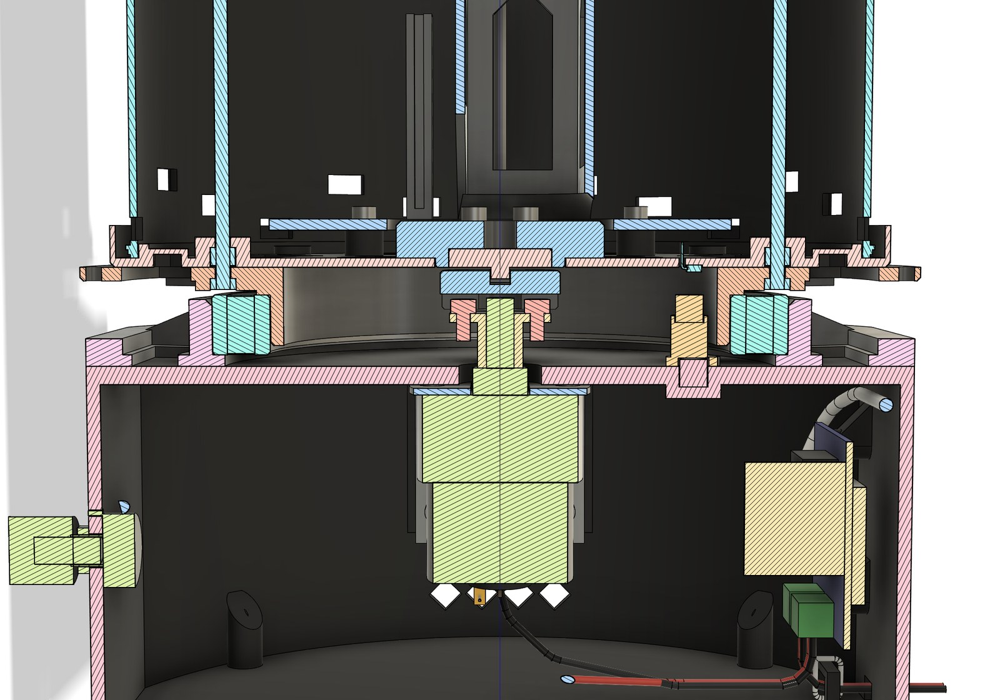
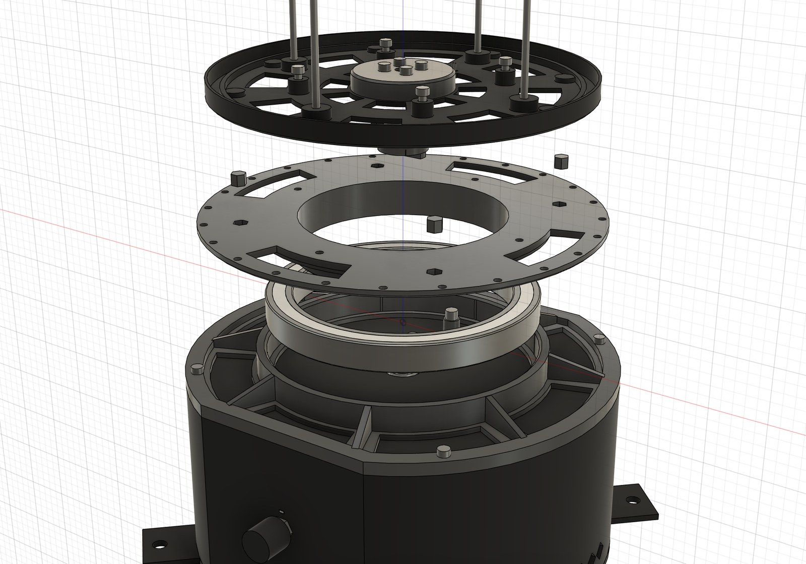
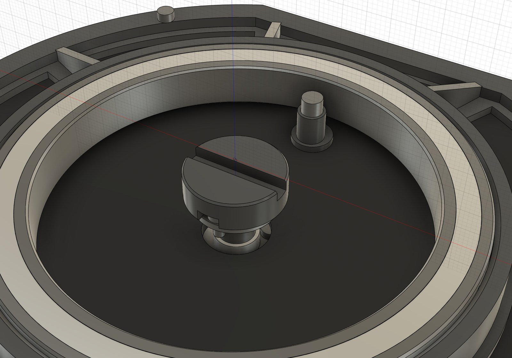
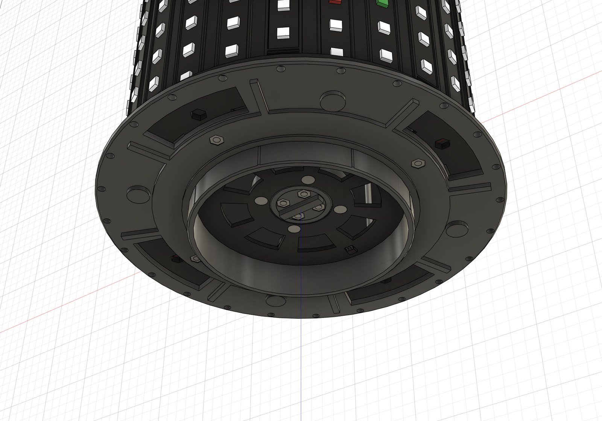

# POV LED Column rev k: Rim Bearing and Printed Oldham Coupling (fixing the tube wobble)

**Prepared for Brian** · Claude (Opus 5.5), rev k agent on the desktop PC · 2026-11-09
Inputs: Brian's report of 2026-11-09 (with the motor running and the tube on, the top edge of the tube wobbles about 3-5 mm, not measured; the bottom holder alone runs true) and the direction agreed with the Main session (a lazy-susan-style rim bearing on the base shell, a flexible coupling, the motor on its own stiff mount, keep the printed parts, balancing provision); `docs/measurements.md` (#1-#38), the rev j design (`fusionclaude/designs/pov-led-column.md`, `lib/povlib.py`), the FDM and electrical reports, `cad/print/README.md`, the live Fusion document "POV LED Column v10".
Outputs: Fusion document "POV LED Column v10" (the desktop PC, **modified and not saved**: rev k on top of the saved v10), scripts `fusionclaude/scripts/155-159_pov10_revk_*.py`, the rev k block in `fusionclaude/lib/povlib.py`, checks `calc/revk_checks.json`, numbers `calc/revk_rim_bearing_calc.py` (`calc/revk_calc.json`), balancing calculator `calc/balance_4run.py`, parts in `cad/*_k.stl/.3mf`, print files in `cad/print/rev-k_CURRENT/`, renders `docs/img/159_revk_*.jpg` (originals `fusionclaude/renders/159_revk_*.png`), time-lapse frames `<video>\2026-11-09 POV rev k frames\`.

---

## Abstract

The tube wobbles because the whole rotor hangs on the gearmotor's 6 mm output shaft. A 0.93 kg column, 270 mm tall, sits on a gearbox bushing with some angular free play, and the bushing is bolted through a 1.46 mm steel L-bracket and a printed post to the 4 mm PETG deck. Taken as a chain, that mount is only **46 N·m/rad** stiff. Its rocking mode sits at **7.6 Hz, exactly twice the 3.75 Hz spin**, and **0.03-0.08 mm of assumed bushing clearance** lets the top of the tube orbit by **2-4.5 mm peak to peak**, which is the size Brian sees. The fix separates support from drive. A **6820 thin-section ball bearing (100 × 125 × 13 mm)** in a PET-CF collar on the shell's deck now carries the rotor's weight and rocking moment, close to the shell wall. The motor only turns the rotor, through a **printed Oldham coupling**: two M3 screw heads on the steel flange coupling already on the shaft, a floating disc, and a dog in the hub core's coupling pocket. The rotor is **27× stiffer in rocking (1,225 N·m/rad)** with no free play. Its rocking mode moves to about **40 Hz, 11.7× the spin speed**, and the elastic wobble drops to about 0.01 mm. What remains is geometric runout of the printed interfaces, estimated at **0.4 mm peak to peak** at the top. Every printed part Brian has is kept: the PET-CF bottom-cap plate, hub core, tube, caps, sled, the rev j shell (4 drilled holes) and the motor with its bracket and post. New parts: a collar, a rotor ring and four small parts, **6.8 h / 181 g of PET-CF**. The tie rods are cut **4.0 mm longer (260.8 mm)**. **To order:** the bearing (**ACROPIX 6820ZZ, $22.01, arrives tomorrow Nov 10** if ordered by about 15:09 today) and a 5-pack of M3 × 300 rods ($5.79, tomorrow). No coupling needs buying. In the Fusion model, 73 exact checks give 0 failures; the rotor is 1,097 g with U = 42.5 g·mm (14 % of the G6.3 limit). One recommendation differs from the agreed direction: **the motor stays on its deck post**. Once the rotor rides on the bearing, the post only carries the motor, and a tower on the 3 mm bottom plate would be 4.5× softer than the deck (section 3.6).

| | rev j (on the gearmotor shaft) | rev k (on the 6820 rim bearing) |
|---|---|---|
| What carries the rotor | gearbox output bushing → L-bracket → printed post → 4 mm deck | 6820 bearing → PET-CF collar → deck edge over the 3 mm wall |
| Rocking stiffness | **46 N·m/rad** + free play (ASSUMED 0.002-0.007 rad) | **1,225 N·m/rad**, no free play (gravity preloads the bearing) |
| Rocking mode (at rest / synchronous critical) | 7.6 / 8.3 Hz: spin at 45 % of it, its 2× harmonic on it | 39 / 44 Hz: 11.7 × the spin |
| Top-edge wobble, predicted | 2.0-4.5 mm p-p (play + elastic, U 1,000 g·mm) | ≤ 0.02 mm elastic + ~0.4 mm geometric runout |
| Drive | rigid flange coupling (axis set by the gearbox) | printed Oldham: ±2.5 mm offset, ±3.3°, -1.5/+1.0 mm axial |
| Rotor | 929 g, CG 100 mm up | 1,097 g, CG 83 mm up, U 42.5 g·mm |

---

## 1. The problem

Brian, 2026-11-09: with the motor hooked up and the tube on, the top edge of the tube wobbles about 3-5 mm (an estimate, not measured); with only the bottom holder (the PET-CF bottom-cap plate and hub core) on the motor and no tube, it runs true. So the plate's flange seat and the motor's shaft are square enough. The problem appears when mass goes on a long lever, and it will grow when the strips, carrier, ESP32 and the 199 g bank go on. The PETG bottom-cap plate and top cap were already reprinted in PET-CF for stiffness (commits 521d5de, 043802e). That stiffens the rotor itself, which was never the weak link.

## 2. Diagnosis

The rotor's support was a chain of five parts in series. The rotor (CG 116 mm above the gearbox face) sits on the coupling flange, which sits on the 6 mm D-shaft. The shaft turns in the gearbox's output bushing. The gearbox face is screwed to the kit's 1.46 mm steel L-bracket, whose vertical leg bolts to a printed PETG post hanging from the 4 mm deck. The deck is clamped only at the shell wall, about 97 mm out. The rotor's rocking stiffness is the series sum of those links (`calc/revk_rim_bearing_calc.py`, thin-plate and beam formulas, printed PETG E = 2 GPa ASSUMED, the deck's 4 walls / 4 + 4 shells / 20 % infill taken as 80 % of a solid plate):

| Link | k (N·m/rad) | Note |
|---|---|---|
| L-bracket, about the bend axis | 89 | horizontal leg 138 + bend-to-bolt 253 in series (1.46 mm steel, 40 mm wide, measured #25) |
| L-bracket, in torsion | 213 | the other rocking axis |
| Printed post (PETG 10 × 44) | 815 | short and thick: not the problem |
| Deck (4 mm PETG, clamped at r 97, post as a Ø24 inclusion) | 111 | rigid inclusion in a clamped plate, k = 4πD(b² + a²) / [(b² + a²) ln(b/a) − (b² − a²)] |
| Gravity (the rotor is an inverted pendulum) | -1.1 | −m·g·h |
| **Total (softer axis)** | **46** | |

On top of that elasticity sits **free play** in the gearbox's output bushing. Cheap gearmotor bushings run with a few hundredths of a millimetre of diametral clearance. Over a 12-15 mm support span, **0.03-0.08 mm (ASSUMED, measure it: section 10, Q5)** is 0.002-0.007 rad of free tilt. Within that play nothing holds the rotor upright. Gravity leans it to one side, and any unbalance drags the lean around once per revolution. The top of a 270 mm lever then circles with a radius of 0.5-1.8 mm, whatever the unbalance.

The numbers fit what Brian sees:

- **Rocking mode at 7.6 Hz** (at rest; 8.3 Hz synchronous critical with the gyroscopic stiffening of the spinning rotor, Ω_c = √(k / (I_t − I_p)), with I_t = 2.01 × 10⁻² kg·m² about the gearbox face and I_p = 3.4 × 10⁻³ kg·m² from the Fusion mass properties). The spin runs at 45 % of the critical speed, which amplifies the response 1.25×. **The 2× harmonic (7.5 Hz) lands on the rest mode**, so any twice-per-revolution excitation rings it.
- **Elastic wobble:** with an unbalance of 1,000 g·mm (a plausible as-printed figure: the tube's wall and seam, the caps' lips, the rods) the force is F = U·ω² = 0.56 N at 23.6 rad/s. The moment is 0.064 N·m, and the top moves ±0.47 mm.
- **Play + elastic: 2.0-4.5 mm peak to peak at the top**, against Brian's 3-5 mm. The bottom holder alone has its CG a few millimetres above the shaft and an 84 mm rim, so the same play shows as a few tenths of a millimetre there: "runs true".

Brian's diagnosis (a compliant mount on top of the shell) is half of it. The gearbox's own play is probably the larger half, and it cannot be stiffened away: it disappears only if the rotor stops hanging on the shaft. Both halves have the same fix.

## 3. Design (rev k)

**Principle: separate support from drive.** A bearing near the outer wall carries the rotor's weight and every rocking moment. The motor supplies only torque, through a coupling that tolerates the two axes not quite agreeing. A rigid coupling plus a bearing would over-constrain the rotor (two axes fighting), which is why the coupling must be flexible.

**Stack-up** (model z, rotor coordinates: z = 0 at the bottom-cap plate's top face, as in every earlier rev). In the model, the base is moved 14 mm down; in reality the rotor rises 14 mm above the unchanged base.

| z (mm) | Part |
|---|---|
| -23.5 | top of the printed shell's deck (unchanged; was -9.5 when the rotor sat on the shaft) |
| -23.5 … -21.0 | collar base plate (2.5 mm PET-CF) on the deck; its top is the shoulder under the bearing's outer ring |
| -21.0 … -8.0 | 6820ZZ bearing (outer ring pressed into the collar, inner ring on the rotor ring's spigot) |
| -19.0 … -8.0 | rotor ring spigot inside the inner ring (11 of its 13 mm), 8 crush ribs |
| -8.0 | rotor ring land on the inner ring's top face (2.2 mm wide contact) |
| -7.0 … -2.0 | rotor ring hub (1.0 mm above the stationary outer ring), its top clamped to the plate underside |
| -12.0 | top of the steel flange coupling, still seated on the motor's boss (the motor has not moved) |
| -12.0 … -9.0 | the two M3 × 6 screw heads (Oldham lugs) |
| -11.25 … -2.75 | Oldham disc (0.75 mm gap each side) |
| -2.0 … +2.0 | Oldham rotor dog in the hub core's coupling pocket (where the flange used to be), its rib to -4.5 |
| -3.0 / -8.0 | hall sensor face (unchanged) / top of the two new magnets on the riser: **gap 5.0** |
| -6.8 | tie-rod bottom ends, flush with the rotor-ring nuts (rods 260.8 mm, was 256.8) |

### 3.1 The bearing: why a 6820 and not a lazy susan

The agreed direction was a lazy-susan / turntable ring of about 6". I checked what Amazon delivers tomorrow (the listings are in section 6):

| Option | Size | Verdict |
|---|---|---|
| Round aluminium lazy susans sold as "6 inch" (Dailydanny B0BTBR4PXP, TamBee B0GTQ7HGHY) | **140 mm OD, Ø89 bore**, 8-10 mm thick, 30-40 kg, 4 + 4 countersunk holes (inner on PCD 101, outer on PCD 128) | **no**: the Ø89 bore cannot pass the hall magnet column at r 42 (it needs Ø94+) without moving the hall sensor; reviews split on smoothness and noise ("bearing design criticised"); open races |
| Same family, next size up (B08CSMQT6Z) | 200 mm OD | no: bigger than the rotor (Ø169), overhangs the shell's flats by 10 mm |
| Square stamped 6" (Shepherd 9548 etc.) | 152 mm square | no: the spinning corners sweep r 107, beyond the rotor and the base |
| **6820 thin-section deep-groove ball bearing** (61820 / 6820ZZ) | **100 × 125 × 13 mm**, P6, Cr 19.6 kN, C0r 23 kN, 4,800 rpm limit | **yes**: precision raceways (P6 runout ~10-20 µm instead of tenths), sealed by metal shields (low drag), Ø100 bore leaves room for the hall magnet column and the Oldham, $18-22 |

A thin-section bearing is a turntable ring in the full sense. It carries axial, radial and moment loads together, and the rotor's weight preloads it axially. Under gravity alone it stays seated until the rocking moment exceeds about F_a·r_p/2 = 0.30 N·m. The worst case here is 0.054 N·m at U = 1,000 g·mm. Its race (pitch Ø 112.5) is 25 mm smaller than a 6" lazy susan's (Ø ~115-128). That costs nothing, because the stiffness that matters is in the printed collar (section 4).

### 3.2 Bearing collar (B11, PET-CF, new)

A D-shaped plate the exact outline of the shell's top (r 100, flats at y ±90), flush on the deck. On the same footprint it carries:

- a **Ø125.4 bore with eight crush ribs** (tips at Ø124.85, 0.075 mm interference on the outer ring) and a 45° lead-in;
- a **2.5 mm shoulder** under the outer ring, contacting r 59.8-61.9 only, clear of the shields and the inner ring;
- a **boss** around the bearing (r 62.7-67.5, top 1 mm below the bearing so the spinning ring never touches it);
- **eight radial ribs**, 3 mm wide and 14.5 mm tall at the boss, sloping to the rim, which carry the rocking moment out to the rim;
- a **6 mm rim** right over the shell wall, with **4 × M3 × 10 bolts at r 94.5 on the diagonals** into **M3 × 4 heat-set inserts in four Ø4.0 holes drilled through the deck** (the one change to the printed shell; the collar is the drilling template);
- windows in the base plate between the ribs.

The bolt heads sit outside the rotor's trim flange (2.25 mm clear for the hex key), so **the whole rotor and bearing come off by undoing 4 bolts from above**. 200 × 180 × 14.5 mm, 90 g, 3.32 h, prints base-down with no bridges at all.

### 3.3 Rotor ring (R17, PET-CF, new), hex keys (R18) and longer tie rods

The rotor ring is a Ø182 ring under the bottom-cap plate:

- **hub** r 47-66, 5 mm thick;
- **spigot** Ø99.6 with **8 crush ribs to Ø100.1** (0.05 mm on the bearing bore: a firm push seats or lifts the rotor; the collar's tighter ribs keep the bearing in the base), 11 mm deep;
- **land** that sits on the inner ring;
- **3 mm web** out to r 91 with 8 stiffening ribs;
- 4 windows over the plate's four free trim pockets;
- the **trim flange**: 24 × Ø3.4 holes at r 88, 15° apart, outside the plate's skirt, for balancing weights.

Fixing the ring needs no glue and no drilling:

- **Clamping:** the four tie rods pass through it, now **260.8 mm long (+4.0)**, and an M3 nut on each, sunk into a hex pocket in the ring, clamps the ring to the plate. The rods carry the whole rotor stack anyway (bottom cap, tube, top cap), so the ring joins the rotor's main load path. The rod ends sit flush with the nuts, 1.2 mm above the bearing.
- **Centring:** four printed **hex keys** (5.85 AF) sit half in the plate's existing trim pockets (6.0 AF, at 45°/135°/225°/315°) and half in matching pockets in the ring (±0.075 mm; the rods alone would allow ±0.4 mm, ~440 g·mm of unbalance).

The ring prints plate-face down. The face that clamps to the plate is the bed face, and the land on the bearing is a flat top surface printed in the same job, so the two are parallel by construction. 96 g, 3.01 h. The only bridges are the four 6 mm hex-pocket ceilings.

### 3.4 Printed Oldham coupling (R19 dog, R20 disc, 2 lug screws)

A commercial flexible coupling does not fit the space the bearing leaves. A 6-6 mm jaw or Oldham coupling is about 25 mm long and needs a 6 mm stub shaft on the rotor side. The rotor's flange coupling (11.9 mm) plus a stub plus the coupling would have raised the rotor about 32 mm instead of 14. The parts already on the machine make a better coupling:

- **Motor side:** the **steel flange coupling stays on the motor shaft**, seated on the boss with its set screw on the D-flat as now. Two **M3 × 6 socket screws** go into two opposite tapped holes of its flange from above, heads up and threadlocked. The two heads are the lugs.
- **Disc** (Ø26 × 8.5, PET-CF): a 5.9 × 3.5 mm groove underneath fits over the lug heads (0.2 mm per side), with a Ø11 relief around the shaft tip. A 4.4 × 3.0 mm groove on top, at 90° to the first, takes the dog's rib. It floats with a 0.75 mm gap above and below.
- **Rotor side:** a **dog** (Ø22.2 × 4, PET-CF) fills the hub core's Ø22.4 coupling pocket and hangs a 4.0 × 2.5 mm rib down into the disc's top groove. It is held by the same four holes the coupling screws used: M3 × 10 from the core's top into four M3 nuts in the dog.

An Oldham coupling is constant-velocity for any parallel offset, so the hall timing stays clean. It also separates axially: **the rotor lifts straight off**, and the disc stays on the lugs. Capacity: **±2.5 mm parallel offset** (the shaft relief), **±3.3° tilt** (face gaps), **axial -1.5 / +1.0 mm** (rotor lower / higher than nominal, keeping ≥ 0.75 mm of rib engaged). Expected misalignment is ≤ 0.5 mm and ≤ 1°. Loads: lug force 1.7 N running (27 mN·m drag at r 8 on two lugs) and 6.2 N at a 0.1 N·m spin-up. The Hertz line pressure of a screw head on PET-CF is 20 / 39 MPa, below PET-CF's ~70 MPa. **Turn the speed knob up gently**: a hard start at stall torque would dent the groove.

### 3.5 Hall sensor (B14 magnet riser, PET-CF, new)

The sensor stays where it is: in its pocket at r 42, θ 90° on the plate's underside, face at z -3.0, leads unchanged. Raising the rotor 14 mm opened the gap from 5.0 mm to 19 mm. On-axis field of two stacked 6 × 3 N35 discs (ASSUMED Br 1.2 T): 644 G at 5 mm, about 70 G at 19 mm. The A3144 needs up to 350 G worst case.

A printed **riser** puts **two new 6 × 3 magnets** (from the 80-pack) back at a **5.0 mm gap**. Its base is Ø12 × 2 with a recess that fits over the two old magnets still in the deck (1.5 mm proud); it is glued with CA. On top is a Ø8 column that leans 1 mm toward the axis, to r 41, keeping the magnets 2.0 mm from the spinning spigot. A small notch on the base's edge marks the side that faces **out**. The 1 mm offset costs about 3 % of the field.

### 3.6 Motor mount: kept on the deck post (a change from the agreed direction)

The agreed direction gave the motor its own mount straight down to the base bottom plate. The numbers argue against it:

- **The motor no longer carries the rotor.** The deck post now holds 0.2 kg of motor and bracket (0.04 mm sag) and reacts 27 mN·m of drive torque. Its flexing moves the motor shaft by hundredths of a millimetre, and the Oldham tolerates ±2.5 mm.
- **The bottom plate is the softer foundation.** It is 3 mm PETG on four feet: about **12 N/mm** at its centre, against **53 N/mm** for the 4 mm deck clamped at the wall. A tower on it would be 4.5× softer than the post it replaces, and it would add a print, holes in the bottom plate, a turned motor and re-routed leads.
- The motor's own vibration (gear mesh) goes into the base either way. The Oldham's sliding contact does not pass it to the rotor.

If Brian still wants the motor off the deck, the stiff version is a 4-legged spider from the four bottom-plate ear bosses, not a central tower. That is a design question for after the bearing is running. Nothing in rev k depends on it.

### 3.7 Balancing provision

There are two planes, both reachable with the rotor running on its bearing:

- **Bottom:** the **rotor ring's trim flange**, 24 × Ø3.4 holes at r 88. An M3 × 8 + nut is about 0.9 g, 80 g·mm per hole; a washer is about 0.1 g, 9 g·mm. Hole 0 is the one straight outside tie rod 0.
- **Top:** the **top cap's 8 trim pockets** (6.0 AF, r 72, open on top). An M3 nut is 0.3 g, 22 g·mm.

The G6.3 limit for the 1.1 kg rotor at 225 rpm is 293 g·mm. The four free trim pockets in the bottom-cap plate (0°/90°/180°/270°), exposed by the ring's windows, stay available for coarse static trim with the rotor off. The procedure is section 9.

### 3.8 What happens to the parts Brian already has

| Part | rev k |
|---|---|
| PET-CF bottom-cap plate, hub core, top cap; tube; sled (PETG/PET-CF); carrier; strips; bank | **unchanged** (the plate's 4 free trim pockets keep their use; 4 get hex keys) |
| Base shell (rev j PETG, printed) | **4 × Ø4.0 holes drilled through the deck** at r 94.5 on the diagonals + 4 heat-set inserts; nothing else |
| Bottom plate, PWM board, pot, wiring, motor + kit bracket + deck post | **unchanged** (the motor does not move) |
| Steel flange coupling | stays **on the motor shaft**; its 4 screws into the hub core come out; 2 × M3 × 6 go into its flange as lugs |
| Tie rods | **4 new rods, 260.8 mm** (was 256.8); bottom and top nylocs as before + 4 plain M3 nuts under the rotor ring |
| Old hall magnets | stay in the deck (the riser sits over them) |
| New prints | collar, rotor ring, Oldham dog + disc, magnet riser, 4 hex keys (section 7) |

## 4. Analysis (SI; `calc/revk_rim_bearing_calc.py`, rotor data from Fusion `calc/revk_checks.json`)

**Rotor, full load (Fusion mass properties, the rev j mass model: measured strips, bank, wires by gauge):** 1,097 g (rev j 929 g + 169 g of rev k parts: rotor ring 96 g, the bearing's inner ring and half its balls 65 g, the longer rods, nuts, dog, disc and keys). CG on the axis to 0.04 mm, **83.2 mm above the plate top** (rev j 99.8: the ring and bearing lower it). **U = 42.5 g·mm** geometric (14 % of 293), the rev k parts add 0.0 g·mm. I_zz = 4.02 × 10⁻³ kg·m² (spin-up at 27 mN·m: 3.6 s, was 3.0). I_t = 2.01 × 10⁻² kg·m² about the bearing centre (z -14.5). Device 2.03 kg.

**Unbalance force** F = U·ω², ω = 23.56 rad/s:

| U (g·mm) | F (N) | Moment on the mount (N·m) before / after | Top wobble, elastic (mm amplitude) before / after |
|---|---|---|---|
| 42.5 (the CAD rotor) | 0.024 | 0.0027 / 0.0023 | 0.020 / 0.0005 |
| 293 (G6.3 limit) | 0.163 | 0.019 / 0.016 | 0.14 / 0.004 |
| 1,000 (plausible unbalanced print) | 0.555 | 0.064 / 0.054 | 0.47 / 0.012 |

**Rocking stiffness after.** The chain is the rotor ring, the bearing and the collar on the deck, ending at the wall:

| Link | k (N·m/rad) |
|---|---|
| Collar + deck carrying the bearing load (r 60) out to the wall (r 97) | 1,554 |
| 6820 tilt stiffness under the 10.8 N gravity preload (32 balls, Hertz contacts, α ≈ 15°) | 13,900 |
| Rotor ring + spigot (order of magnitude) | 10,000 |
| **Total** | **1,225** |

The collar + deck row is deliberately conservative: radial cantilever strips with no hoop action, the deck, the collar's 2.5 mm base and its 8 ribs (PET-CF E = 4 GPa, ASSUMED) as stacked plates. Rest mode √(k/I_t)/2π = **39.3 Hz**; synchronous critical **43.9 Hz = 11.7 × the spin**; amplification 1.007. The rocking resonance moves off the first ten harmonics of the spin.

**What is left.** These are fixed tilts that turn with the rotor, so the top edge traces a small circle:

| Source | At the top (amplitude) |
|---|---|
| Bearing raceway axial runout (P6, ASSUMED 20 µm over the pitch circle) | 0.05 mm |
| Printed land vs the ring's clamp face (one print; ASSUMED 0.05 mm over Ø100) | 0.13 mm |
| Plate underside / tube end squareness (ASSUMED 0.1 mm over Ø160, the same in rev j) | 0.17 mm |
| **RSS** | **0.22 mm (0.44 mm peak to peak)** |

That is 7-10× better than today. If it shows, lap the land and the plate face (400 grit on glass, as the FDM report suggested for the flange seat).

**Bearing check (6820ZZ: Cr 19.6 kN, C0r 23 kN, 4,800 rpm).** Axial 10.8 N (the rotor's weight); radial ≤ 0.56 N; moment ≤ 0.054 N·m (< 0.30 N·m to unload one side). Equivalent load P = 0.56 F_r + 2.3 F_a = 25 N gives a static factor of 918 and an L10 life of 3.5 × 10¹⁰ h. Speed is 4.7 % of the grease limit. Friction about 2 mN·m (μ 0.0015) against the rotor's 27 mN·m air drag, so the motor current rises a few percent. With pure axial load every ball is loaded, so skidding is not a concern at 225 rpm.

**Hall:** 644 G at the 5.0 mm gap, 454 G at 6 mm (A3144 operates at ≤ 350 G worst case, so up to ~6.3 mm works).

## 5. Verification

- **Fusion checks (script 157, read-only): 73 rows, 0 FAIL** (`calc/revk_checks.json`).
  - **Rotating vs stationary:** rotor ring to collar 2.0, to the bearing's outer ring 1.0, land edge to the shields 0.55, rod ends and ring nuts to the outer ring 1.2, spigot to the magnet riser 2.0, plate to collar 7.0, trim-weight envelope (M3 × 10 + nut + washers at r 88) to the collar 2.5, hex-key path to the collar bolts 2.25.
  - **Oldham sliding fits:** 0.75 axial gaps, 0.2 per side in both grooves, 0.94 over the shaft tip.
  - **Designed contacts at 0:** collar on deck, outer ring on shoulder, land on inner ring, ring on plate, dog in core, nuts in pockets, lugs in flange.
  - **Hall gap 5.000**; old magnets 19 mm from the sensor.
  - **Base:** collar bolts and inserts 9.8 mm from the pot cable, 30.6 from the PWM board, 55 from the bracket.
- **Mass model** reproduces rev j: the rotor without the rev k parts is 929 g with U 42.5 g·mm (the rev j report gave 44.2 with PETG caps and sled).
- **Print checks:** the floating-island check (script 151) finds **0 island starts** in all three print files and all exported STLs. A layer-reach audit shows the only spans over air are the rotor ring's four 6 mm hex-pocket ceilings, the riser's 6.7 mm magnet-recess ceiling and the disc's 4.4 mm web. The collar has none.
- **Renders:** section, exploded, base, rotor underside, hero (`docs/img/159_revk_*.jpg`).

## 6. Parts to order (fastest delivery first)

Every link below was opened live on 2026-11-09 between 09:50 and 10:30 ET, in stock, with the delivery date shown on the page. Nothing was added to a cart.

| # | Part | Link | Price | Delivery seen on the page | Why this one |
|---|---|---|---|---|---|
| **1** | **ACROPIX 6820ZZ deep-groove ball bearing, 100 × 125 × 13 mm, P6, double metal shields** (Cr 19.6 kN, C0r 23 kN, 4,800 rpm) | https://www.amazon.com/dp/B0DJW6JN4R | **$22.01** | **FREE, Tomorrow Mon Nov 10**, "order within 4 hrs 43 mins" at 10:26 (by ~15:09 ET); **only 8 left** | the rotor's bearing; P6 is a precision grade above standard; metal shields have less drag than rubber seals |
| **2** | **Litoexpe M3 × 300 mm threaded rod, 5-pack, 304 stainless** (the rods already in the rotor) | https://www.amazon.com/dp/B0D22S97D2 | **$5.79** | **FREE, Tomorrow Mon Nov 10**, "order within 8 hrs 48 mins" at ~10:05 | 4 rods cut to 260.8 mm; the first pack has only 1 spare |
| 3 (backup for 1) | XIKE 6820-2RS, 100 × 125 × 13 mm, rubber seals | https://www.amazon.com/dp/B0CGQQCZP9 | $21.99 | FREE, Wed Nov 11; only 6 left; 4.3★ (4) | if the ACROPIX sells out; seals add a few mN·m of drag |
| 4 (backup for 1) | ACROPIX 6820ZZ P0, 100 × 125 × 13 mm, metal shields | https://www.amazon.com/dp/B0DD49X8XZ | $17.99 | FREE, Wed Nov 11; in stock | same size, standard precision |

**Not needed:** a coupling (printed Oldham), a shaft or stub, a flange.

**From Brian's kits** (NINDEJIN M3 SHCS kit, INCLY insert kit, the 80-pc magnet pack, Starbond CA):

- 4 × M3 × 10 SHCS (collar) + 4 × M3 × 10 SHCS (rotor dog, replacing the 4 × M3 × 8 coupling screws);
- 2 × M3 × 6 SHCS (Oldham lugs);
- 8 × M3 nuts (4 under the rotor ring, 4 in the dog), plus nuts, washers and M3 × 6-10 screws as trim weights;
- 4 × M3 × 4 heat-set inserts (deck);
- 2 × 6 × 3 magnets;
- CA glue; blue threadlocker or nail varnish;
- optional: a dab of grease on the Oldham grooves.

Together items 1 and 2 cost $27.80 before tax, both arriving Mon Nov 10.

Lazy-susan listings checked and rejected (section 3.1):

- **Dailydanny 140 mm** (https://www.amazon.com/dp/B0BTBR4PXP): $14.99, overnight on orders over $25, Ø89 bore, mixed smoothness reviews.
- **TamBee 140 mm** (https://www.amazon.com/dp/B0GTQ7HGHY): $14.99, tomorrow; 10 mm thick, 40 kg rating, Ø89 bore.
- **200 mm aluminium ring** (https://www.amazon.com/dp/B08CSMQT6Z): $17.99, overnight; too big for the base.

## 7. Print list (`cad/print/rev-k_CURRENT/`)

All in **Fiberon PET-CF**, using the setup proven on the bottom-cap plate:

- AMS-HT, **dry the spool (≈ 65 °C, 6-8 h)**;
- **hardened nozzle, extruder 1 (left)**;
- Textured PEI, 300 / 70 °C;
- 0.2 mm layers, no supports, no brim.

| File | Part | Settings | Time | g | Note |
|---|---|---|---|---|---|
| `revk_small_parts_PET-CF` | Oldham rotor dog, Oldham disc, magnet riser, 4 hex keys | 6 walls, 6/6, 85 % (solid) | **0.50 h** | **7.7** | print first: dry-fit the keys in the plate's trim pockets, the dog in the hub core's pocket, the disc over the lug heads |
| `base_bearing_collar_k_PET-CF` | bearing collar | 5 walls, 6/6, 40 % gyroid | **3.32 h** | **90.1** | base face down; no bridges |
| `rotor_ring_k_PET-CF` | rotor ring | 5 walls, 6/6, 40 % gyroid | **3.01 h** | **82.9** | plate face down; the land prints as a top surface |
| | **Total** | | **6.83 h** | **180.7** | |

Each has a project `.3mf` (open and re-slice in Bambu Studio), a sliced `.gcode.3mf` (send) and a local `.plate_1.gcode`. Source STLs in `cad/` in print orientation: `base_bearing_collar_k`, `rotor_ring_k`, `oldham_rotor_dog_k`, `oldham_disc_k`, `magnet_riser_k`, `hex_key_k`, `revk_small_parts`. **Fit:** no XY compensation. The crush ribs are there to be trimmed: if the bearing will not go into the collar, or the spigot into the bearing, with firm hand pressure, scrape or sand the rib tips. Dry-fit before forcing anything.

**The rev j print set stays current** (`rev-j_CURRENT/`): rev k only adds parts. It moves nothing to `*_superseded` until Brian confirms the bearing fits (`cad/print/README.md`).

## 8. Assembly

**Base**

1. **Separate the rotor from the motor.** With the rotor on the bench, undo the 4 × M3 × 8 screws on the hub core's top face (bank out, reach through the sled's centre hole). The flange coupling stays on the motor shaft, seated on the boss, set screw as it is.
2. **Lugs:** screw 2 × M3 × 6 SHCS into two opposite tapped holes of the flange, from above, heads up, with threadlocker (snug). Drop the **Oldham disc** on, the side with the Ø11 relief down, its groove over the two heads.
3. **Collar:**
   - Set it on the shell, outline flush with the D-shape.
   - Mark the 4 hole centres through its holes, then take it off.
   - **Drill Ø4.0 through the 4 mm deck** at the 4 marks. Stop as soon as the drill breaks through: the pot cable runs about 4 mm under the deck near the wall.
   - Press in 4 × M3 × 4 heat-set inserts from above, flush.
4. **Bearing into the collar:** collar flat on the table. Press the bearing in **by its outer ring only** (a flat board across it, hand or vise) until it sits on the shoulder. Never push on the inner ring.
5. **Bolt the collar** to the deck: 4 × M3 × 10, snug.
6. **Magnets:** find which face of a new magnet pair triggers the hall sensor (the A3144 switches on a south pole facing its branded face). Glue the pair (CA) into the riser's pocket with that face up. Glue the riser over the old magnets, **notch facing out** (away from the axis).

**Rotor**

7. **Tie rods:** cut 4 rods to **260.8 mm**. Chamfer the ends and chase the thread with a nut. Undo the top nylocs and lift the top cap. Unscrew the old rods from the bottom nylocs (captured in their pockets) and screw the new ones in until **4.8 mm** sticks out below the plate's underside (0.8 + 4.0). Refit the top cap and nylocs, snug.
8. **Rotor dog:** put 4 M3 nuts in its pockets, set it into the hub core's coupling pocket from below, rib out. Fit 4 × M3 × 10 from the core's top into the nuts, snug, threadlocker.
9. **Hex keys:** press 4 into the plate's trim pockets at 45°/135°/225°/315° (between the rods).
10. **Rotor ring:** spigot down, over the rod ends and the keys. Run a plain M3 nut onto each rod end from below into its pocket, snug, nail varnish. **No rod may stick out below a nut** (1.2 mm above the bearing).

**Mate and run**

11. Lower the rotor onto the base: spigot into the bearing's inner ring. Turn the rotor slowly until the dog's rib drops into the disc's groove, then press down until the land seats on the inner ring.
12. Turn by hand: no rubbing, and the rotor turns the motor through the Oldham.
13. Spin up **slowly** on the knob to 225 rpm and watch the top edge against a fixed pointer. Then balance (section 9).

To remove the rotor: pull it straight up. If the bearing comes with it, undo the 4 collar bolts.

## 9. Balancing (four-run method, no phase sensor needed)

The method needs only amplitudes, so a phone is enough. `calc/balance_4run.py` does the arithmetic (checked on a synthetic case: recovers 1.33 g at 250° exactly).

1. **Set up a measurement and keep it identical for every run:**
   - **Bottom plane (base shake):** a phone lying on the collar rim, running phyphox "Acceleration (without g)" or "Spectrum". Read the 3.75 Hz amplitude.
   - **Top plane (top-edge wobble):** a fixed pointer at the top edge. Read the peak-to-peak gap with feelers, or film it side-on at a fast shutter against a scale.
2. **Mark angle 0** on tie rod 0 with a paint pen. Angles count counter-clockwise seen from above. Trim-flange hole k sits at 15k°; top-cap pocket k at 45k°.
3. **Bottom plane:**
   - Run with no weight: **A0**.
   - Put a **trial weight** (e.g. an M3 × 8 + nut, weigh it: ~0.9 g) in hole 0: **A1**; move it to hole 8 (120°): **A2**; hole 16 (240°): **A3**.
   - Run `py calc/balance_4run.py A0 A1 A2 A3 --trial-g 0.9`. It prints the correction mass and angle, split over the two nearest holes.
   - Remove the trial weight, fit the correction and re-run. Expect the reading to drop by 70 % or more. If the trial weight changed the readings by less than 20 % of A0, use a heavier trial.
4. **Top plane**, only if the top edge still circles visibly: the same steps with top-cap pockets 0 / 3 / 6, `--angles 0 135 270 --plane top`, using the top-edge reading.
5. Write the final weights into `docs/measurements.md`.

## 10. Measure before printing (and on arrival)

The design uses the values marked ASSUMED where only the hardware can tell. None of them blocks printing (the Oldham and the riser have margin), but these settle them:

| # | What | Design value | Why |
|---|---|---|---|
| **Q1** | **Gap between the shell's deck top and the bottom-cap plate's underside**, with the rotor sitting on the motor as now (Brian offered this one) | 7.5 mm | Sets where the flange coupling actually sits, and so the Oldham's axial fit. **6.5-9.0 mm works as printed**; outside that I change the disc thickness (a 1-minute re-slice) |
| Q2 | Across the flats of one trim pocket on the plate's underside (r 72) | 6.0 AF (keys 5.85) | Hex-key fit. Or skip it and test-fit a key from the 30-min small-parts print |
| Q3 | How far the tie-rod ends stick out below the bottom-cap plate now | 0.8 mm | Confirms the new cut length: 256.8 + 4.0 + (0.8 - measured) |
| Q4 | How far the two hall magnets stick up above the deck | 1.5 mm | The riser's recess is 1.8 deep |
| Q5 | **Gearbox output-shaft play** (rotor off): rock the flange coupling by hand and read the movement at its rim (r 11) with a dial gauge or calipers against a fixed block | ASSUMED 0.03-0.08 mm diametral | Confirms the diagnosis. A visible wobble at the flange alone is the half that stiffening could never fix (good footage for Part 2) |
| Q6 | On arrival: the bearing's OD / ID / width with calipers | 125.00 / 100.00 / 13.00 | The crush ribs are set for these |
| Q7 | After printing: the collar's bore across two crush ribs, and the spigot across two ribs | ~124.85 / ~100.1 | Expect a firm push; trim the ribs if not |

## 11. Decisions, and how to explain it

**Decisions taken (and why):**

| Decision | Why |
|---|---|
| Separate support from drive (bearing + flexible coupling) | the only fix for the gearbox's free play, and 27× the stiffness |
| 6820 thin-section bearing instead of a lazy susan | the 140 mm rings' Ø89 bore clashes with the hall magnet; precision and sealing; arrives tomorrow |
| Printed Oldham on the existing steel flange coupling | 14 mm of rotor rise instead of ~32 mm for a bought coupling + stub; no new parts; constant velocity; lifts off |
| Rotor ring clamped by the tie rods, centred by hex keys | no glue, no drilling of the PET-CF plate; uses the rotor's own load path |
| Collar flush on the shell, 4 inserts over the wall | the load goes into the wall, not the middle of the deck; the rotor comes off by 4 bolts from above |
| Motor stays on the deck post | it no longer carries the rotor; the bottom plate would be 4.5× softer |
| Crush ribs for both bearing seats | printed bores are ±0.1 mm; ribs give a centred, adjustable light press |

**Open for Brian:**

- order items 1 and 2 (before ~15:09 ET for Monday delivery);
- Q1 (and Q2-Q4 if convenient);
- OK to drill the 4 holes in the deck;
- confirm keeping the motor on the deck post.

**The 30-second version:** "The column wobbled because the whole kilo of rotor was balanced on the motor's 6 mm shaft: a 27 cm lever on a gearbox bushing with a few hundredths of a millimetre of play, bolted through a bent steel bracket to a 4 mm plastic deck. The fix is the oldest rule in machine design: separate support from drive. A 100 mm ball bearing now carries the rotor right at the base wall, and the motor only turns it, through an Oldham coupling that doesn't care if the two axes are a couple of millimetres apart."

**Numbers that read well on camera:**

- 46 → 1,225 N·m/rad (27× stiffer);
- the rocking resonance moved from 7.6 Hz, exactly twice the 3.75 Hz spin, to about 40 Hz;
- predicted wobble from 2-4.5 mm to under half a millimetre;
- not one printed part thrown away.

**Shots:** the section render, the exploded stack, the Oldham disc sliding by hand with the motor offset, the before/after top-edge pointer, balancing with a phone.

**Talking points:**

- diagnosing a dynamics problem from a symptom: list the stiffness chain, find the weakest link, check the resonance against the running speed and its harmonics;
- over-constraint, and why a rigid coupling plus a bearing fight;
- design for reuse: the steel flange coupling becomes half the Oldham, the tie rods become the ring's fasteners;
- crush ribs for printed bearing seats;
- balancing without a phase sensor (the four-run method).

## 12. Files

| Path | What |
|---|---|
| `fusionclaude/lib/povlib.py` | rev k parameter block (`K_DROP` 14.0, bearing, collar, ring, Oldham, riser, `ROD_Z0_K`) |
| `fusionclaude/scripts/155_pov10_revk_base_drop.py` | base occurrences (and the flange coupling) 14 mm down, coupling turned 45° |
| `fusionclaude/scripts/156_pov10_revk_parts.py` | builds B11-B14, R17-R20, rebuilds R13 / R14, drills the 4 deck holes in B01 |
| `fusionclaude/scripts/157_pov10_revk_checks.py` | 73 checks, mass properties → `calc/revk_checks.json` |
| `fusionclaude/scripts/158_pov10_revk_export.py` | print-oriented STL / 3MF → `cad/` |
| `fusionclaude/scripts/159_pov10_revk_renders.py` | renders → `fusionclaude/renders/159_revk_*.png`, `docs/img/159_revk_*.jpg` |
| `calc/revk_rim_bearing_calc.py`, `calc/revk_calc.json` | the analysis in section 4 |
| `calc/balance_4run.py` | four-run balancing calculator |
| `cad/print/rev-k_CURRENT/` | the three print files |
| `docs/REV-K-DONE.txt` | the short summary |

Replay on the saved cloud v10 (rev j): `155` → `156` → `157 --ro` → `158` (+ `--undo`) → `159` (display only). The Fusion document is left modified and **not saved**; saving is Brian's call.
