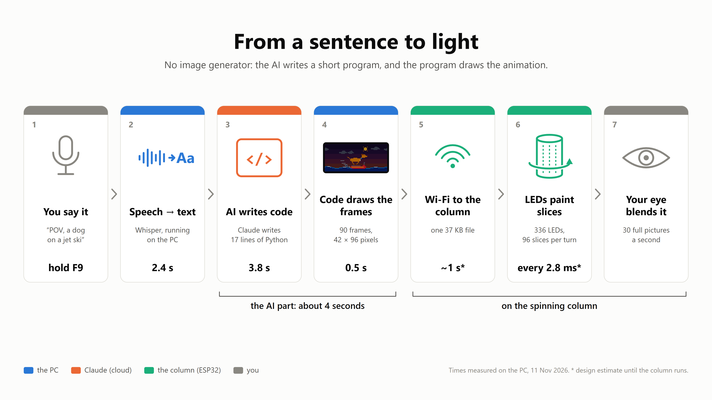
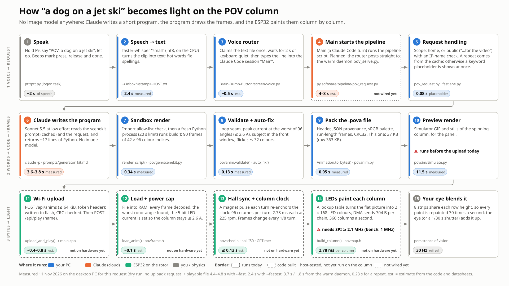
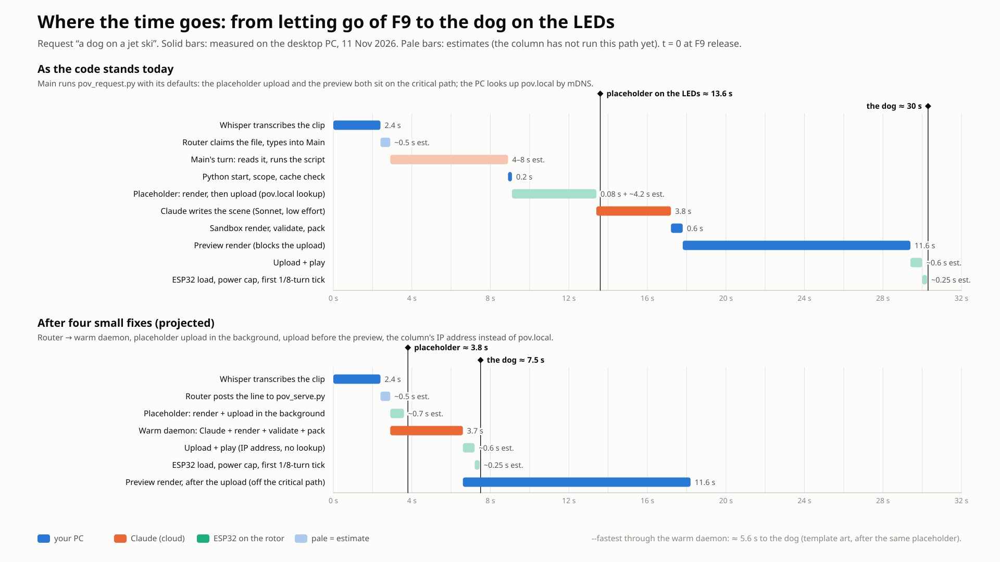

# From a sentence to light: how "a dog on a jet ski" becomes an animation on the POV column, with no image model

*Prepared for Brian, 2026-11-11, by Claude (Opus 5.5) on the desktop PC. Every stage was traced in the code (pipeline, firmware,
F9 voice path), not in the earlier reports. Timings come from 9 real runs of this exact request today (dry run, no
upload), from the F9 logs and from the 11-07 benchmark. Where the code has never run, the time is an estimate, marked
"est.".*

> **Status in one paragraph.** The voice half and the AI half are built and measured: from the typed request to a
> finished, validated animation file takes **4.4–4.8 s** with the default `--fast` preset, **2.4 s** with `--fastest`
> and **0.23 s** for a repeat. The light half (upload API, player, hall sync, column engine) is written, compiled and
> host-tested, but it has **never run on the column**. The board runs the phase-0 bench sketch, which has no upload or
> image playback, and the strips only behave at 1 MHz SPI so far, while the image path needs at least 2.1 MHz. The F9 →
> pipeline hand-off isn't wired yet either. Tracing the whole path also turned up **14 gaps** (section 6). Two would
> stop the first live run outright: files over 64 KiB are refused, and so are names over 28 characters, which covers
> every home-scope request.

## 1. The short version



When Brian says "POV, a dog on a jet ski", no picture is ever generated. Whisper turns the speech into text on the PC.
Claude, a *text* model, writes a 17-line Python program. The program uses a library of tested pixel-art parts (sky,
sea, a dog, a jet ski, splashes), and running it draws 90 frames of a 42 × 96-pixel picture: the dog rides the waves
and jumps once every 6 seconds. The frames are checked against the column's physics, packed into a 37 KB file and
sent over Wi-Fi to the ESP32 on the rotor. The ESP32 slices each flat frame into 96 vertical columns per turn and
lights each of the 336 LEDs for 2.78 ms as it passes the right angle. Eight strips share every row height, so every
point is repainted 30 times a second. Your eye blends that into one picture.

Three numbers for the video: **4.6 s** from words to a finished animation (measured), **17 lines** of code, **360**
column slices painted per second per LED chain.

## 2. The whole flow



| # | Stage | Code | In → out | Time | Status |
|---|---|---|---|---|---|
| 1 | Speak | `Brain-Dump-Button/ptt/ptt.py` | voice → 16 kHz audio | the sentence (~2 s) | runs |
| 2 | Speech → text | `ptt.py` (faster-whisper) | audio → `inbox/<stamp>-HOST.txt` | **2.4 s** median | runs |
| 3 | Voice router | `screen/voice.py` | text file → keystrokes in Main | ~0.5 s est. | runs |
| 4 | Main starts the pipeline | Main (Claude Code); planned `pov_serve.py` | line → `pov_request.py "…"` | 4–8 s est. | **not wired** |
| 5 | Request handling | `pov_request.main`, `fastlane.py` | prompt → scope, cache hit or placeholder | 0.2 s start, **0.08 s** placeholder | runs |
| 6 | Claude writes the program | `call_claude`, `prompts/generator_kit.md` | request → ~17-line scene script | **3.6–3.8 s** | runs |
| 7 | Sandbox render | `lint_imports`, `render_script`, `scenekit.py` | script → 90 frames × 42 × 96 indices | **0.34 s** | runs |
| 8 | Validate + auto-fix | `povanim.validate`, `auto_fix` | frames → numbers, warnings, fixes | **0.13 s** | runs |
| 9 | Pack the `.pova` | `Animation.to_bytes` | frames → 37 KB file + `.json` + `.py` | **0.05 s** | runs |
| 10 | Preview render | `povsim/simulate.py` | file → GIF + stills | **11.5 s** | runs (before the upload, see G4) |
| 11 | Wi-Fi upload | `upload_and_play` → `main.cpp` `setup_web` | file → `/anims/<name>.pova` in flash | ~0.4–0.8 s est. | code only |
| 12 | Load + power cap | `load_anim`, `povframe.h` | file → RAM, LED palette, current field | ~0.1 s est. | code only |
| 13 | Hall sync + column clock | `povsched.h`, `column_task` | magnet pulse → 96 column edges per turn | ≤ 0.13 s est. to the first frame | code only |
| 14 | LEDs paint each column | `build_column`, `povmap.h`, SPI DMA | frame + angle → 2 × 704-byte SK9822 frames | 2.78 ms per column | code only; needs SPI ≥ 2.1 MHz |
| 15 | Your eye blends it | physics | 30 repaints a second → one picture | 33 ms per repaint | — |

"Code only" = compiled and host-tested (44 native tests against Python reference vectors), never run on the column.

## 3. Stage by stage

### Act 1: voice → request (on the PC)

**1. Speak.** Brian holds F9, says "POV, a dog on a jet ski", and lets go.
`ptt_service.pyw --key f9,f13` (logon task "Brain Dump PTT") records the mic at its native rate, resamples to 16 kHz,
and beeps on press and on release. *Can fail:* a clip that is too quiet (peak under −46 dBFS gives a low beep and no
file), the wrong default mic.

**2. Speech → text.** faster-whisper `small`, int8 on the CPU, beam 5, English, VAD filter (retried without VAD if it
returns nothing). It uses a hot-word prompt so names are spelled right. It writes `inbox/<stamp>-HOST.txt` and a log
line, then double-beeps. *Measured* from `inbox/log-HOST.jsonl`: **2.4 s median for clips of 6 s or less** (121 clips,
p90 3.0 s); 2.9 s median over the last 300 clips of any length; the laptop is the same (2.5 s). *Can fail:* CPU starvation
by heavy jobs (a 9 s clip once took 114 s, before the priority fix); "POV" is not in `HOT_WORDS`, so expect "P.O.V." or
"pov" now and then.

**3. Voice router.** `screen/voice.py` runs inside the panel server (the desktop PC is in `voice_mode: panel`). It claims each
F9 file once, after its mtime is 0.4 s old (`STABLE_S`), and cross-checks it against the PTT log. It routes by name
prefix ("Fusion agent, …"); anything else goes to the session named **Main**. It waits for 2 s of keyboard and mouse
quiet (`INPUT_IDLE_S`; the F9 release counts, but Whisper's 2.4 s covers that wait) and for Main not to be at a
dialog. Then it types the line into Main's console (`WriteConsoleInputW`) and presses Enter after re-reading the
screen. The 11-10 **POV fast path** (`pov_fastpath.py`) sees every line first: a pattern command (rainbow, patriotic,
off, brighter…) goes straight to the board's TCP port 23. "A dog on a jet ski" matches no pattern, so nothing fires.
*Time:* about 0.5 s after the text file appears (**est.** from the constants). *Can fail:* Main is at a permission
prompt (the line is held), Main is mid-turn (the line is queued to the next tool boundary), the line is over 120 s
old (parked as stale until Send anyway). Also see G9: colour words in an animation request fire the fast path.

**4. Main starts the pipeline.** Main is a Claude Code session, so this step is a full model turn. Nothing tells Main
what to do with "POV, …" lines yet: `screen/agents/main.md` has no rule, there is no "POV" or "Column" library card,
and `pov_serve.py` is not running as a service. Main would run `py software/pipeline/pov_request.py "a dog on a jet
ski"` because the request asks for it and `now.md` says to use the pipeline. The planned, faster route is a direct
`POST 127.0.0.1:8790/pov` to the warm daemon `pov_serve.py`, which keeps one pre-spawned `claude` process per lane.
*Time:* 4–8 s **est.** (from the 11-10 fast-path notes: F9 → Main → TCP command took 9–14 s end to end). *Can fail:*
Main rewords the request, or is busy with something else.

**5. Request handling.** `pov_request.main()`:

- applies the preset (`--fast` is the default since 11-09);
- resolves the scope: `home` by default, `public` when the line says "for the video", "public", "on camera"…;
- in public scope, refuses about 50 famous names before any model call, with an original substitute (exit 3);
- picks the output folder: public → `software/content/public/`, home → `%LOCALAPPDATA%\POVColumn\home\`.

Then it tries the cheap answers first. "Play the goose" is a library hit. A repeat or near-repeat request is a
**cache hit** (`fastlane.Library`: Jaccard similarity ≥ 0.75 on content words, same scope, served from disk). Otherwise
it shows a **placeholder**. `fastlane.spec_from_keywords` matches keywords, and `scenekit.compose` renders a
ready-made scene that is uploaded at once. For this request the keyword spec is
`{subject: dog, action: ride, vehicle: jetski, background: sunset}`, fit 3 of 3.

*Measured:* Python start 0.2–0.3 s; placeholder 0.07–0.15 s; a repeat request 0.23 s wall. *Can fail:* a false cache
hit (G12); the placeholder upload blocks the next step (G5).

### Act 2: words → code → frames

**6. Claude writes the program.** `codegen()` → `generate()` → `call_claude()` runs:

```
claude -p --model claude-sonnet-5-5 --effort low --output-format json --tools "" --no-session-persistence
          --setting-sources "" --strict-mcp-config --disable-slash-commands --system-prompt-file <generator_kit.md>
stdin:    ## Request / scope: home / prompt: a dog on a jet ski
```

It runs on the subscription CLI, with no API key. The Claude Code session variables are stripped from the environment
so it doesn't start as a child session. The system prompt (`prompts/generator_kit.md`, about 4.9k input tokens,
cached for an hour) has three parts:

- **The display:** 42 rows × 96 columns wrapped round a drum, row 0 at the bottom; the viewer sees columns 32–63;
  15 fps; black = off.
- **The scenekit API:** skies, sea, skyline, characters (bichon, dog, cat, goose), vehicles and riders, effects, and
  loop-safe motion helpers (`seg`, `ease`, `jump`, `bob`, `scroll`).
- **Three rules and a worked example** (a bichon on a jet ski): one ```` ```python ```` block; `build()` returns
  `sc.done()`; imports only `math`, `numpy`, `scenekit`, `povanim`; no file I/O or unseeded randomness; no
  trademarked characters in public scope; dim backgrounds; 4–8 s loops that close.

For this request Sonnet returned **16–17 lines** (362–408 output tokens, **zero thinking tokens**), adapting the worked
example:

- a sunset sky and clouds;
- the sea scrolling left 3 laps per loop, so the jet ski seems to move right;
- one jump between 40 % and 60 % of the loop, then a landing splash;
- spray and speed lines.

*Measured:* **3.6–3.8 s** (API 2.4–2.7 s; the rest is CLI start-up). Cost, API-equivalent and billed to the
subscription: $0.004–0.007 per request when the prompt is cached, $0.013–0.023 in the runs that wrote the cache.

The other lanes:

- `--fastest` asks **Haiku 5.5** for a JSON template spec instead of code (`prompts/template_spec.md` →
  `parse_spec_reply` → `scenekit.compose`). Here it returned fit 2 with `{dog, ride, jetski, day, sea}`: 1.85 s for
  the call, 2.4 s to the file.
- `--classic` is the 11-02 pipeline: the v0.1 prompt with a worked example, Opus at default effort, ~150-line scripts,
  **70 s median** in the 11-07 benchmark.

*Can fail:* a CLI error or timeout (240 s) ends the run with exit 5. A traceback, an invented API name or a disallowed
import gets **one repair round**, with the error appended to the prompt.

**7. Sandbox render.** First `lint_imports` checks the script: only `math`, `numpy`, `povanim`, `characters`,
`scenekit` and `bichon_head` may be imported, and `open(`, `subprocess`, `socket`, `eval(`, `exec(`, `os.` and `sys.`
are rejected. Then `render_script` starts a fresh Python process with a 20 s timeout and a temporary working folder.
A tiny runner imports the script, calls `build()` and writes the `.pova`. Inside, `scenekit.Scene` owns the palette
and the animation. `for k, t, cv in sc.frames()` hands the script 90 blank canvases (6 s × 15 fps), each a 42 × 96
array of palette indices, with `t` running from 0 to 1 over the loop. The helpers draw into each canvas, so every pixel
is a function of `t`, which is why the loop closes. *Measured:* **0.34 s** median (5 runs). This is a guard against
honest mistakes, not a security boundary; the docstring says so. (It also says `-I`, but the call doesn't pass
`-I`.)

**8. Validate + auto-fix.** `povanim.validate` checks:

- **Loop seam:** the last→first step against the typical step, on blurred frames at two scales; a warning above 2.5×.
- **Peak current** at every one of the 96 rotor angles of every frame, using the same LED map and current model as the
  firmware (20 mA per channel at full gamma-corrected duty × gb/31, 1 mA idle per LED, 120 mA for the ESP32;
  cap 2,600 mA).
- **Framing:** ≥ 90 % of the subject's pixels inside the viewer's columns 32–63 in front mode.
- **Flicker:** more than 12 pixels toggling nearly every frame.
- More than 32 colours, or a loop under 0.5 s.

`auto_fix` (on in `--fast`) repairs three of these with no model call: a seam becomes a ping-pong loop, more than 32
colours are merged, and an over-cap current is stored as `meta["gb"]`. This request: 90 frames, 23 colours, peak
1,983 mA, seam ratio 2.13, 100 % in the window, clean. In one of the four `--fast` runs the seam check fired, and
ping-pong doubled the loop to 178 frames and the file to **71.5 KB** (G1). *Measured:* **0.13 s**. *Can fail:*
ping-pong plays the motion backwards for half the loop (the sea runs the wrong way); warnings that remain are kept and
the file still plays.

**9. Pack the `.pova` file.** `Animation.to_bytes`:

- a 16-byte header: `POVA`, version 1, flags (loop, RLE), 42, 96, frame count, fps × 10, palette size, meta length;
- the JSON metadata (prompt, scope, mode, model, generator, pipeline version, date);
- the palette: up to 32 sRGB entries, index 0 = off;
- each frame as hold, length and run-length pairs (run, index);
- a CRC32 at the end.

Beside it go a `.json` sidecar, the `.py` script (the provenance) and a `library.jsonl` entry for the cache. This
request: **37,245 bytes for 90 frames**, against 362,880 bytes of raw indices (about 10×). *Measured:* **0.05 s**
(plus ~0.06 s of writes). *Can fail:* nothing fails here, but nothing checks the firmware's limits here either
(G1–G3).

**10. Preview render.** `preview()` runs `povsim/simulate.py --gif --stills`: the flat frame, a contact sheet, the
cylinder view, the four-shutter comparison and a GIF, so Brian can check the animation before it goes on air.
*Measured:* **11.5 s and 11.8 s**. *Can fail:* it runs **before** the upload, which adds 11.5 s to the time-to-light
(G4). If the simulator raises, `main()` crashes and the upload never happens.

### Act 3: bytes → light (code built, not yet run on the column)

**11. Wi-Fi upload.** `upload_and_play` (Python `requests`) sends two requests:

- `POST http://pov.local/api/anims`: multipart `file`, header `X-POV-Token`;
- `POST /api/play {"name": <stem>, "loop": true}`.

On the ESP32 (`src/main.cpp` `setup_web`, ESPAsyncWebServer on core 0):

1. `authed()` checks the token (open when none is compiled in).
2. The chunks stream into LittleFS `/anims/<name>.pova`; past 65,536 bytes the file is dropped with a 400.
3. The file is read back, and `pova_parse` checks the magic, version, 42 × 96, ≤ 32 colours, ≤ 256 frames, every
   frame's length and the CRC32. A bad file is deleted.

Wi-Fi is station mode with modem sleep **off** (`WiFi.setSleep(false)` in both firmwares, for latency), hostname
`pov`, mDNS `pov.local`, and the access point "POV-Column" as a fallback.

*Time:* **est.** 0.4–0.8 s: about 0.1 s for a 37 KB HTTP transfer on the LAN, plus LittleFS writes (about nine 4 KB
flash sectors to erase at roughly 30–50 ms each, typical SPI-flash datasheet values), plus the read-back. The name
lookup comes on top. Windows took about **3.7 s to resolve `pov.local`** (11-10 fast-path measurement); today, with
the board off, a failed lookup took 4.3–4.7 s (G6). *Can fail:* file over 64 KiB (G1), name too long for
`/api/play` (G2), wrong token (401), column off ("no column at …").

**12. Load + power cap.** `/api/play` → `load_anim(name)`:

1. Checks the name is 28 characters or less and the file 24 B–64 KiB, then reads the whole file into RAM and parses it.
2. Decodes every frame and runs `worst_column_ma`: 96 angles × 336 LEDs, about 32k table lookups per frame.
3. `fit_gb` picks the largest 5-bit current field (at most the user's brightness setting) that keeps LED drive plus
   idle current under **2,600 mA**. The firmware does its own cap and doesn't read `meta["gb"]`; the two agree.
4. Stops playback for ~5 ms, swaps the animation in, and builds the LED palette (`publish_palette`): gamma 2.2 lookup,
   B-G-R byte order, the `0xE0` header byte plus the current field; entry 0 stays off.
5. Stages frame 0 and saves the name for autoplay after a reboot.

*Time:* ~0.1 s **est.** *Can fail:* a name over 28 characters returns 404 (G2); a 64 KB `malloc` failing on a
fragmented heap.

**13. Hall sync + column clock.** This is the firmware's `column_task` (`src/main.cpp`), pinned to core 1 at high
priority and driven by `lib/povcore/povsched.h`:

- **The magnet.** The A3144 hall sensor on GPIO 27 falls once per turn as it passes the magnet. The interrupt rejects
  bounces closer than 21.6 ms and keeps a filtered period (IIR, α = 1/4). The period is trusted once two consecutive
  turns agree within 5 %. Every pulse re-anchors the column count, so a timing error never builds up past one turn.
- **The clock.** `plan_next` picks the next of 96 column edges per turn. A one-shot GPTimer wakes the task 160 µs
  early (60 µs to build, 100 µs of slack). The task builds both chains' frames, busy-waits to the exact fire time and
  queues the two DMA transfers, so the LEDs latch on the column edge.
- **Frame changes.** Frames change only on refresh ticks, every 12 columns (1/8 turn), so all 24 strips switch
  together.
- **Blanking.** The LEDs go dark with no pulse for 0.5 s or below 100 rpm.

A new animation **does not wait for the magnet** (the 11-02 design said "the next hall pulse"; the code is better).
The column task picks up again from the current period estimate within ≤ 100 ms, its wake-up timeout after the short
stop. The new frame goes in at the next 1/8-turn tick (≤ 33 ms at 225 rpm), possibly after one tick of the old frame
drawn in the new palette. *Time:* ≤ 0.13 s **est.** from `/api/play` to the first new frame. From a standing start,
add about two turns for the period to settle. *Can fail:* the magnet angle is off (the `offset_x8` trim rotates the
picture), the motor turns the other way (the `dir` flag un-mirrors it), the speed hunts by more than 5 % (resync,
blank), Wi-Fi work steals time (kept on core 0; the `late_cols` and `skipped_cols` counters show it).

**14. LEDs paint each column: the unwrap.** The file holds a flat 96 × 42 picture of the unrolled cylinder:

- **Columns are angles.** Column *c* sits 3.75° × *c* from the magnet. Column 48 faces the viewer by convention, and
  the offset trim turns the whole picture to wherever the camera stands.
- **Rows are heights,** 5.56 mm apart. The strips carry 14 LEDs at 16.7 mm pitch in three height sets, each offset by
  a third of that pitch, which gives 42 rows.
- **Strips are offsets.** When strip 0 points at column *c*, strip *s* (15° further round) shows column
  (*c* + 4*s*) mod 96. LED *i* on strip *s* shows row 3*i* + (*s* mod 3), counted from the top on the odd strips,
  which are mounted upside down.

`pov::build_column` reads those two numbers per LED from `povmap.h`, a 2 × 168 table generated from `povanim.py` (the
single source of truth the validator also uses). It then copies the palette entry for each LED into the SK9822 frame:
4 zero bytes, 168 × 4 LED bytes, 24 bytes of `0xFF` end frame and 4 zero bytes, **704 bytes per chain**. Two chains
(VSPI 23/18 and HSPI 13/14, through the 74AHCT125) send in parallel by DMA at 8 MHz: 0.704 ms against a 2.78 ms column.
That is **360 column frames per second per chain**, or 120,960 LED updates a second. *Can fail:* **the SPI clock (G7).**
The bench strips only behave at 1 MHz so far. At 1 MHz a 704-byte frame takes 5.6 ms, twice the column time, so 96
columns at 225 rpm can't be painted. The minimum is 2.03 MHz (5,632 bits in 2.78 ms); 4–8 MHz gives margin. Also: the
SK9822 end frame and latch, power-bank sag (handled by the cap), and a cold joint, which shows as a dark arc on every
third row.

**15. Your eye blends it.** The 24 strips form three height sets of 8, so each row height is swept by 8 strips per
turn: every point is repainted **8 × 3.75 = 30 times a second** at 225 rpm.

- **Smear.** Each paint lasts one column time (2.78 ms) while the LED moves about 5.3 mm (the strips travel at about
  1.9 m/s), so a pixel is a ~10 mm dash with the 5 mm LED body. That is why the art uses 2-pixel strokes.
- **Brightness.** Each point is lit 8/96 = 1/12 of the time, so it looks about a twelfth as bright as a steady LED at
  the same current.
- **Flicker.** The eye blends light over a few tens of milliseconds, so 30 repaints a second hold together as one
  picture. Some flicker shows in bright scenes and at the edge of vision: 30 Hz is below the 50–60 Hz where flicker
  vanishes for bright fields.
- **Cameras.** A camera at 30p with a 1/30 s shutter catches exactly one repaint, every pixel once. Faster shutters
  catch only the strips:

*[Figure omitted from the public release: The same instant through four shutters (simulator): 1/30 s is the picture, 1/2000 s is the mechanism]*

*[Figure omitted from the public release: The flat 96 × 42 frame (column 48 faces the viewer) and the same frame on the cylinder (simulator)]*

*[Figure omitted from the public release: The cylinder view]*

The top-view mapping figure from the software report (`img/sw_fig_topview_mapping.png`) shows the strips, sets and
chains if the video needs the full detail.

### What happens if Brian tries it today

F9 → text → router → Main runs the pipeline. The pipeline makes the placeholder and tries to upload it. The phase-0
sketch has no web server, so the upload fails after the `pov.local` lookup and the pipeline carries on. Claude writes
the scene, it validates and the preview renders. The final upload fails the same way. Result: **a finished animation
file and preview in about 25 s, and nothing on the LEDs.** The F9 fast path does light the board today, for the
phase-0 patterns only (rainbow, patriotic and so on).

## 4. Latency budget, end to end



t = 0 is the F9 release. "Today, as coded" assumes the `pov` firmware is flashed and the rotor is spinning; the rest is
the code as it is now.

| Stage | Today, as coded (s) | After the fixes (s) | Basis |
|---|---|---|---|
| Speak | before t = 0 (~2) | same | the sentence |
| Whisper | 2.4 | 2.4 | measured, median of 121 short clips (p90 3.0) |
| Router claims and types | ~0.5 | ~0.5 (posts to the daemon) | est. from `STABLE_S` + typing |
| Main's turn | 4–8 (6 in the chart) | bypassed | est., 11-10 notes |
| Python start, scope, cache | 0.2 | 0 (warm daemon) | measured |
| Placeholder render | 0.08 | 0.08 | measured |
| Placeholder upload | ~4.2 (incl. ~3.7 lookup), **blocking** | ~0.6, in the background | est.; the lookup measured 11-10 |
| Claude writes the code | 3.8 | ~3.0 warm | measured (3.6–3.8 cold; 3.7 s warm daemon total) |
| Render, validate, pack, file | 0.6 | 0.6 | measured (0.34 + 0.13 + 0.05 + writes) |
| Preview render | 11.6, **before the upload** | after the upload | measured (11.5, 11.8) |
| Upload + play | ~0.6 | ~0.6 | est. |
| ESP32 load, cap, first tick | ~0.25 | ~0.25 | est. |
| **Placeholder on the LEDs** | **≈ 13.6** | **≈ 3.8** | |
| **The dog on the LEDs** | **≈ 30** | **≈ 7.5** | |

The four fixes behind the right-hand column (all small, all in the PC code):

1. The router posts "POV, …" animation lines straight to `pov_serve.py`, and Main gets a tagged copy, as the pattern
   fast path already does.
2. The placeholder upload runs in a background thread.
3. The upload comes before the preview.
4. `pov_config.json` targets the column's IP, with a DHCP reservation, not `pov.local`.

| Other cases (after the fixes) | To the dog on the LEDs |
|---|---|
| `--fastest` through the warm daemon (Haiku template) | ≈ 5.6 s, after the same placeholder |
| A repeat request (cache) | ≈ 3.8 s (no model call) |
| Off-library request ("a dragon"), `--fast` | ≈ 12–13 s (9.2 s pipeline median in the 11-07 benchmark) |
| Pattern command through the F9 fast path (phase 0, today) | ≈ 2.5–3 s **est.** (not yet timed on the board) |

## 5. Why a text model writes code instead of an image model drawing pictures

**In plain words, for the video:**

1. **The canvas is strange.** It's 42 × 96 pixels wrapped round a drum, on a black background, and a viewer sees only
   a third of it. Image models paint rectangular, photo-like pictures at around 1,000 pixels; shrunk to 42 rows they
   turn to mush, and they don't know the picture wraps round.
2. **An animation has to stay the same dog.** An image model makes one picture at a time. Here, 90 frames must show
   the same dog, and frame 90 must flow back into frame 1. A program gets both by construction: everything is a
   function of time running round a loop.
3. **It can be checked before it lights up.** The program's output goes through the same LED map and power model the
   firmware uses: under 2.6 A, the dog inside the viewer's window, a loop that closes. Pixels from an image model
   would need the same checks, and they couldn't be fixed by editing one line.
4. **It's small and fast.** 17 lines, about 400 tokens, in under 4 seconds; the frames pack into 37 KB. An image model
   needs seconds per still and minutes per video clip, and still wouldn't loop.
5. **It's editable and repeatable.** "Make the jump higher" means changing one number: the `7` in
   `jump(t, 0.40, 0.60, 7)`. Run the script again and you get exactly the same frames. The script is the asset and its
   own record of how it was made.
6. **The art comes from a library.** The model composes tested pixel art (the dog, the jet ski, the sea). Every
   improvement to the library improves every future request. That library is why the pipeline went from 70 s to 5 s
   *and* got better (11-07 report: blind quality 3.5 → 4.1).

*[Figure omitted from the public release: The whole program, next to two of the frames it draws]*

**The honest trade-offs:**

- **It can only draw what the library and primitives express.** Off-library requests (a rocket, a dragon) take ~9 s
  and look simpler. A famous character is the one place a pixel-art image service would beat it (home scope only).
- **Template art repeats.** Every template jet ski is the same jet ski; the code lane adds the variety.
- **It's never photographic.** A "show me a photo of Biscuit" stills mode would need an image model plus pixelation.
  The 11-07 estimate: SDXL-Turbo at 2–4 s a still, with no frame-to-frame consistency.
- **Code that runs can still look wrong.** The validator checks physics, not taste, and the visual self-check round
  measured as no gain on 11-07.
- **A new request needs the cloud model.** Offline, only the cache, templates and the placeholder still work.

## 6. Gaps found while tracing (what would break or slow the first live run)

| # | Gap | Evidence | Effect | Suggested fix |
|---|---|---|---|---|
| G1 | **64 KiB upload cap vs story-length scenes** | `pova.h:13` `POVA_MAX_FILE 65536`, `main.cpp:546`; 10 of the 32 final `--fast`/`--fastest` benchmark files are over 64 KiB (max 154 KB, fireworks); today's `fast3` run after ping-pong: 71.5 KB | upload refused with 400; the pipeline reports it as "no column at …" | the validator checks the firmware limits; when over, drop to 10 fps or shorten the loop and skip ping-pong; raise the cap only after measuring free heap on the bench (the WROOM-32 has no PSRAM) |
| G2 | **Names over 28 characters can't play** | `main.cpp:283` `strlen(name) > 28`; home names are `<stamp>_<slug>` = 16 + up to 40 characters; "a dog on a jet ski" → 34, the public version → 32 | upload works, `/api/play` returns 404, the placeholder stays up | upload under a short name (slug ≤ 20 + 4-character hash) and keep the long name in `meta` |
| G3 | 256-frame cap vs ping-pong (latent) | `pova.h:12`; `auto_fix` ping-pongs loops up to 150 frames → up to 298 | refused once a seam fix lands on a loop over 128 frames | ping-pong only up to 128 frames, else leave the seam warning |
| G4 | **Preview before upload** | `pov_request.py:781-793`; measured 11.5 s / 11.8 s | +11.5 s to light; a simulator error stops the upload | upload first, preview after (or in a thread) |
| G5 | **Placeholder upload blocks the model call** | `show_placeholder` calls `upload_and_play` synchronously (`pov_request.py:550`) | its network time (with the lookup ~4.2 s) is added before Claude even starts | upload the placeholder in a background thread |
| G6 | **`pov.local` lookups on Windows** | default target `http://pov.local` (`pov_request.py:45`); ~3.7 s per lookup (11-10), 4.3–4.7 s to fail today | seconds per HTTP request (up to four per run if Windows doesn't cache the answer) | IP in `pov_config.json` + a DHCP reservation, mDNS only as a fallback (what the fast path does) |
| G7 | **SPI clock** | `main.cpp:56` 8 MHz; bench strips good only at 1 MHz (11-04 investigation); a 704-byte frame needs ≥ 2.03 MHz to fit a 2.78 ms column | no full image at 225 rpm until fixed | the `s8000` test on carrier #2 is the gating bench item |
| G8 | The column firmware has never run on hardware | the board runs `phase0` 0.3.1 (patterns over TCP 23, no web server); the `pov` env compiles and passes 44 host tests | no upload or playback path exists on the board today | flash `pov` after the SPI test; run calibration patterns first (software report phase 2) |
| G9 | **F9 fast path fires on colour words** | tested `pov_fastpath.Matcher`: "POV, a white fluffy dog on a jet ski" → `cb 4` (all white); "Play a goose chasing a red ball on the column" → `cb 1` | the column flashes a pattern while Claude writes the scene; the fast path also only speaks phase 0's port 23, which the `pov` firmware doesn't have | fire only when the whole line is a pattern phrase; give the `pov` firmware a port-23 shim or teach the fast path `POST /api/pattern` |
| G10 | Main isn't wired | no rule in `screen/agents/main.md`, no "POV"/"Column" card, `pov_serve.py` not a service | relies on Main working it out; +4–8 s per request | decide the route (question 4) |
| G11 | Recording guard not connected | `recording()` reads `%LOCALAPPDATA%\ClaudePanel\recording.json`, which nothing writes | OBS recording does **not** force public scope; only "for the video", `--scope` or `POV_RECORDING=1` do | the panel writes the flag while OBS records |
| G12 | Cache false hits on short prompts | Jaccard 0.75: "a dog on a jet ski **at night**", "**in the snow**", "**two** dogs on a jet ski" all hit "a dog on a jet ski" | the old scene replays in 0.01 s for a changed request | require every content word of the new request to be covered, or a threshold of 0.9 for prompts under 5 words |
| G13 | `--fastest` still shows the placeholder | `FASTEST = dict(FAST, template="llm")` inherits `placeholder=True`; no `--no-placeholder` flag | the "no swap while filming" plan in the 11-07 report isn't what the code does | add `--no-placeholder`, or `placeholder=False` in `FASTEST` |
| G14 | Small things | `-I` named but not passed (`pov_request.py:375/379`); a 400 is reported as "no column"; up to one tick of the old frame in the new palette on a swap; ping-pong reverses the motion | cosmetic or rare | fix with G1–G5 |

Unit tests on either side couldn't catch G1–G3: the Python tests check Python, the 44 native tests check C++, and
nothing crosses the boundary. A **contract check** in the validator that mirrors `POVA_MAX_FILE`, `POVA_MAX_FRAMES`,
`POV_MAX_PAL` and the 28-character name would catch all three.

## 7. Video notes

**Suggested beats (a 2–3 minute "how the software works" section, or a video of its own):**

1. **Cold open:** F9, "POV, a dog on a jet ski", cut to the dog on the spinning column, with a running timer in the
   corner. (Needs G1–G8 fixed and the column running. Until then, use the simulator's cylinder render, labelled as a
   simulation.)
2. **"There is no image generator in this."** Build the audience diagram box by box.
3. **"Claude writes a program."** The code card. Zoom on `rider(sc, cv, "dog", "jetski", …)` and
   `jump(t, 0.40, 0.60, 7)`. Change the 7 to 12, re-run, and show the higher jump: the editability beat.
4. **"The program draws 90 frames."** Scroll the contact sheet, then the flat frame with the viewer's window marked.
5. **"A flat picture, re-sliced 360 times a second."** The unwrap: the flat frame wrapping onto the cylinder, strip 0
   at column *c*, strip *s* at *c* + 4*s*.
6. **"Your eye does the last step."** The four-shutter strip, then real footage at 1/30 s and 1/2000 s.
7. **Speed:** the 70 s → 5 s story from the 11-07 report, then the latency waterfall ("where the time goes, and the
   four fixes").
8. **Close:** "One sentence, five seconds, 336 LEDs."

**Screen recordings and B-roll to capture:**

- A live run with a timing overlay. `pov_request.py "a dog on a jet ski, for the video" --report rep.json` writes
  `placeholder_s`, the model seconds and `playable_s`; drive the overlay from that JSON so the numbers on screen are
  the real ones.
- The generated script appearing in an editor (typewriter reveal), and the 17 lines next to a `--classic` 150-line
  script scrolling (split screen: 70 s vs 4 s).
- Contact-sheet scroll (`*_sheet.png` from the simulator) and the flat → cylinder unwrap. A short animated wrap would
  be worth generating from `simulate.py`.
- The four shutters (`img/2026-11-11-prompt-to-light-dog-shutters.png`), then the real camera at 1/30 and 1/2000 s.
- F9 close-up with the beeps, and the panel's delivery toast.
- The latency waterfall built bar by bar (the SVG has one bar per row, easy to animate in Premiere).
- The hall sensor and magnet pass (slow motion exists in the CAD shot pack).

**One-liners:**

1. "There's no image generator in here. The AI writes a 17-line program, and the program draws the dog."
2. "One sentence, five seconds, 336 LEDs."
3. "The picture never exists as a picture. It's 90 flat frames that a microcontroller re-slices 360 times a second."
4. "The speed didn't come from a faster model. It came from giving the model less to write."
5. "Your eye does the last step: every dot is repainted 30 times a second, and your brain glues the slices together."

**Talking points (the key technical decisions):**

- **Code generation over diffusion:** fits the cylindrical 42 × 96 canvas, loops by construction, is deterministic,
  can be validated against physics, costs fractions of a cent, and its output is editable.
- **A domain library as the speed and quality lever.** Latency in LLM code generation is output tokens: ~6.7k → ~400
  tokens took 70 s → 5 s, and quality went up because the library holds tested art.
- **Lanes, cheapest first, each honest about fit:** cache (10 ms) → template, where Haiku only fills a JSON spec
  (2 s) → code (Sonnet, 4 s), plus a placeholder for perceived latency.
- **One source of truth for the hardware model.** `povanim.py` generates the firmware's LED map (`povmap.h`) and the
  test vectors; the Python validator and the C++ firmware use the same current model.
- **Image-space file, mapping at playback.** 4 KB per frame instead of 94.5 KB in LED space, and one file plays at
  any mounting angle (offset trim).
- **A real-time split on the ESP32:** the column engine on core 1 (hall re-anchor every turn, one-shot timer, DMA,
  tick-aligned swaps), Wi-Fi and the web server on core 0.
- **Honest guards:** an import allow-list and a subprocess (catches mistakes, not attacks), content scope (home/public,
  IP denylist), and a power cap enforced twice (validator and firmware).
- **Measure blind.** The intuitive fixes (a self-check round, parallel candidates) measured as no gain.
- **Test across boundaries:** this trace found contract mismatches (64 KiB, 256 frames, 28-character names) that unit
  tests on each side couldn't.

## 8. Open questions for Brian

1. **Which video?** A standalone "how the software works" video can be made now from the simulator, the screen
   recordings and these figures. The POV video's payoff shot (voice → dog on the real column) needs G1–G8 first.
   *Recommendation:* the software section can go in this week's video, using the simulator for the column shots,
   with the real cold open re-shot once it runs.
2. **Fix G1–G6, G12 and G13 now?** About 1–2 hours of pipeline work, all reversible, no hardware needed.
   *Recommendation:* yes, before the first live run.
3. **The size cap (G1):** make the pipeline fit 64 KiB (fewer frames or fps, no ping-pong), or raise the firmware cap?
   *Recommendation:* the pipeline adapts first; revisit the cap after measuring free heap on the bench.
4. **The F9 route:** should the router send "POV, …" animation lines straight to `pov_serve.py` (saves Main's 4–8 s;
   Main gets a tagged copy), or keep Main in the loop? *Recommendation:* straight to the daemon.
5. **Run `pov_serve.py` as an always-on service on the desktop PC** (a logon task)? Still open from 11-09.
6. **The F9 fast path after phase 0 (G9):** narrow the pattern matching, and add a port-23 shim to the `pov` firmware
   or switch the fast path to REST?
7. **Filming:** use `--fastest` without the placeholder (needs G13), or keep the placeholder → final swap on camera as
   a feature ("watch it think")?
8. **The SPI gate (G7):** is the `s8000` test on carrier #2 next on the bench? Nothing in act 3 can be filmed for real
   until a full chain behaves above about 2 MHz.

## Appendix A. How this was checked

- **Code read:** `software/pipeline/{pov_request,fastlane,pov_serve}.py` and the three prompts; `software/povgen/{povanim,scenekit}.py`;
  `software/firmware/src/main.cpp`, `src/phase0/phase0.cpp` and `lib/povcore/{povsched,povframe,pova}.h`;
  `Brain-Dump-Button/ptt/ptt.py`, `screen/voice.py`, `screen/pov_fastpath.py` and `.json`.
- **Docs cross-checked:** the 11-02 software report (sections 2, 3, 5, 7), the 11-07 speed investigation, the firmware
  README. Where the docs and the code disagree, the code wins: the frame swap is at the next tick, not the next hall
  pulse; `--fastest` does show a placeholder; there is no `-I`.
- **Runs today** (request "a dog on a jet ski", `--dry-run`, written to the session scratchpad; the public example is
  kept in `software/content/public/dog_jetski_front.*`):

| Run | Preset | Placeholder | Generator | Model time | Playable | Wall | File |
|---|---|---|---|---|---|---|---|
| fast1 | `--fast` + preview | 0.15 s | Sonnet low, 362 tokens | 3.6 s (API 2.4) | 4.5 s | 16.0 s incl. 11.5 s preview | 36.3 KB, 90 frames, clean |
| fast2 | `--fast` | 0.09 s | Sonnet low, 381 tokens | 3.7 s (2.6) | 4.4 s | 4.67 s | 33.4 KB, clean |
| fast3 | `--fast` | 0.08 s | Sonnet low, 408 tokens | 3.6 s (2.7) | 4.8 s | 4.98 s | 71.5 KB, 178 frames (seam → ping-pong) |
| public1 | `--fast`, "for the video" + preview | 0.09 s | Sonnet low, 405 tokens | 3.8 s (2.7) | 4.6 s | 16.4 s incl. 11.8 s preview | 37.2 KB, clean |
| fastest1 | `--fastest` | 0.09 s | Haiku spec, fit 2 | 1.86 s | 2.4 s | 2.68 s | 19.5 KB, 64 frames, clean |
| fastest2 | `--fastest` | 0.09 s | Haiku spec, fit 2 | 1.85 s | 2.4 s | 2.58 s | 19.5 KB, clean |
| cache | `--fast`, repeat | — | cache, similarity 1.0 | — | 0.0 s | 0.23 s | same file |
| warm fast | `pov_serve.py --demo` | | Sonnet, pre-spawned | | 3.7 s | 3.66 s | |
| warm fastest | `pov_serve.py --demo --preset fastest` | | Haiku, pre-spawned | | 1.8 s | 1.79 s | |

- **Micro-timings** (5 runs each, the public script): lint < 1 ms, sandbox render 0.34 s, validate 0.13 s, pack
  0.05 s, write 0.06 s.
- **Logs:** Whisper times computed from `inbox/log-HOST.jsonl` and `log-HOST.jsonl` (no transcript text used). The
  11-07 benchmark file sizes come from `<video>/2026-11-07 POV pipeline speed/results.jsonl`.
- **Board:** off during this work (<lan-ip> unreachable; `pov.local` lookup failed after 4.3–4.7 s). Port 23 was
  not touched. Nothing was flashed.
- **Tests:** `py -m pytest software/tests -q`: 62 pass.
- **Model cost of today's runs:** about $0.06 API-equivalent, on the subscription.

## Appendix B. Files

| File | What |
|---|---|
| `docs/img/2026-11-11-prompt-to-light-simple.{svg,png}` | audience diagram, 7 boxes (PNG 3840 × 2160) |
| `docs/img/2026-11-11-prompt-to-light-flow.{svg,png}` | technical flow, 15 stages |
| `docs/img/2026-11-11-prompt-to-light-latency.{svg,png}` | latency waterfall, today vs after the fixes |
| `docs/img/2026-11-11-prompt-to-light-code.{svg,png}` | the whole program + two frames |
| `docs/img/2026-11-11-prompt-to-light-dog-{flat,cylinder,shutters}.png` | simulator stills of the example |
| `software/povsim/prompt_to_light_figs.py` | regenerates all of the above: `py software/povsim/prompt_to_light_figs.py` (SVG, then PNG through headless Chrome) |
| `software/content/public/dog_jetski_front.{pova,json,py}` | the example animation, public scope, with provenance |

The figures share one style: the dataviz reference palette (blue = PC, orange = Claude, aqua = ESP32, validated for
colour-blind separation; aqua is under 3:1 contrast on white, so every coloured mark has an ink label), Segoe UI,
with every number taken from this report. Edit both together.
