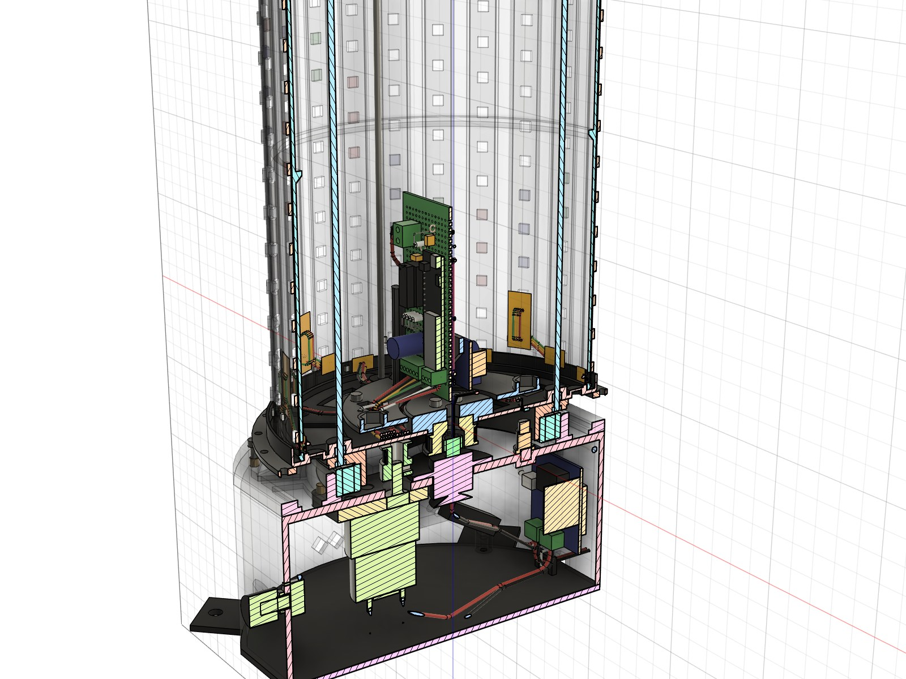
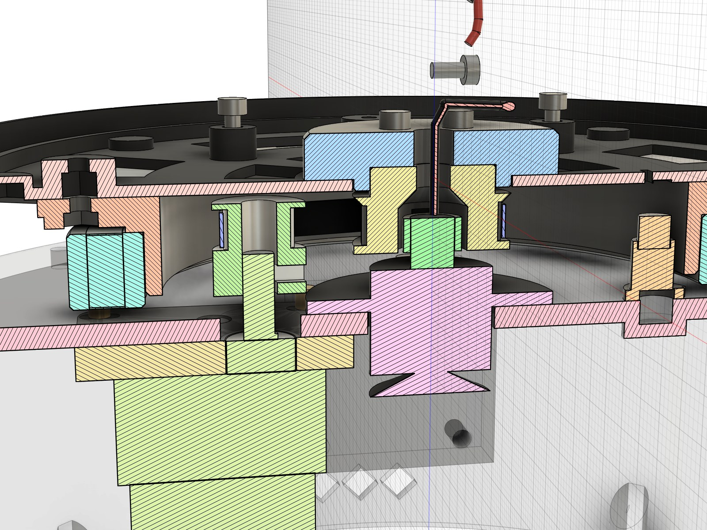
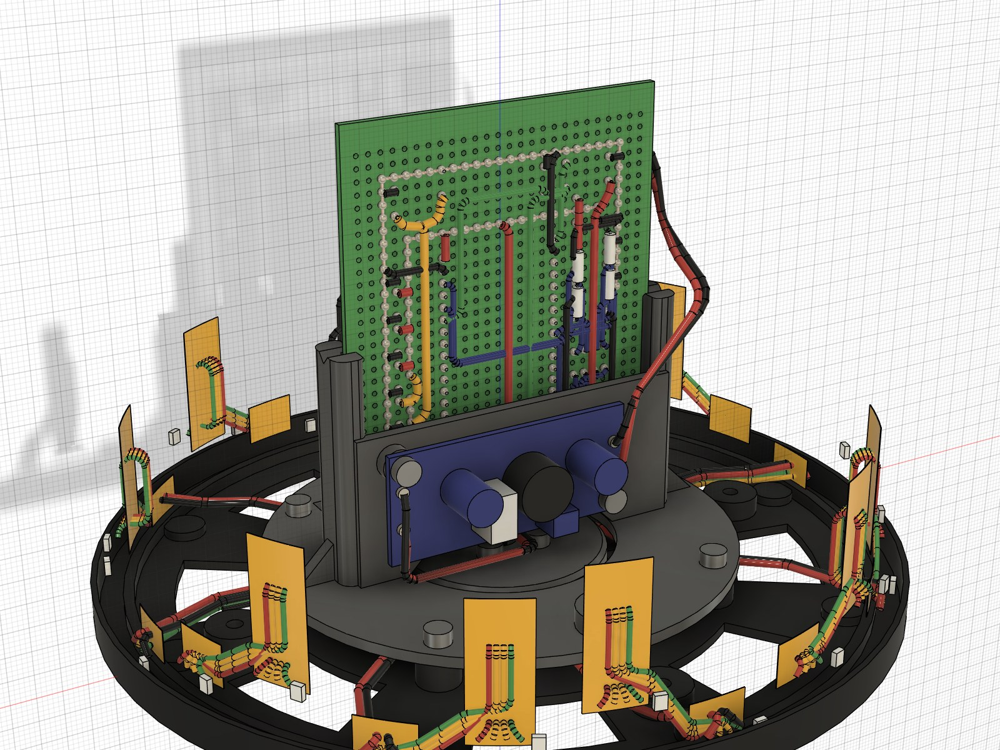
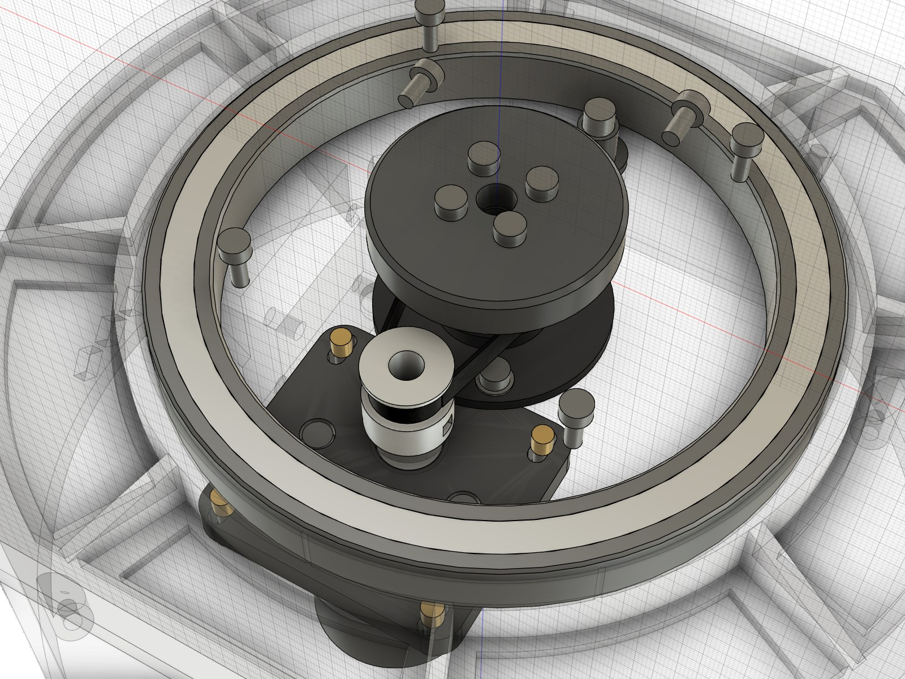
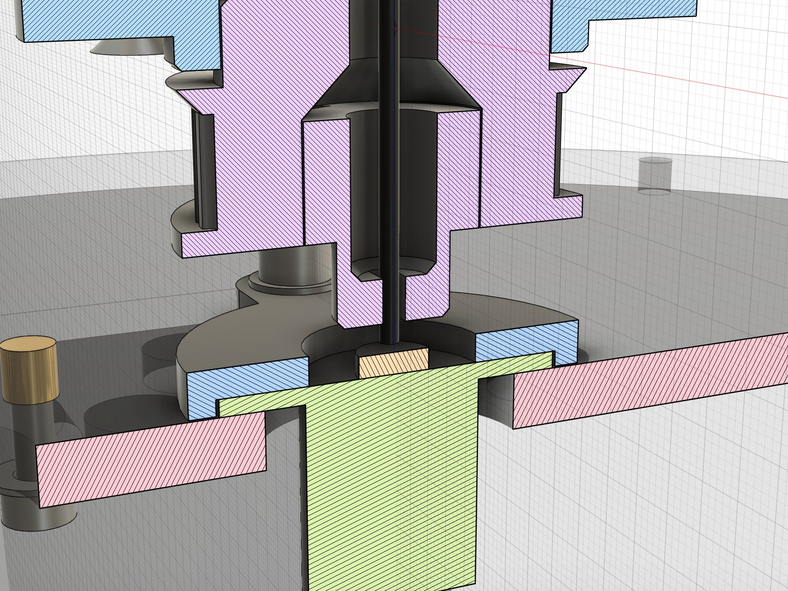
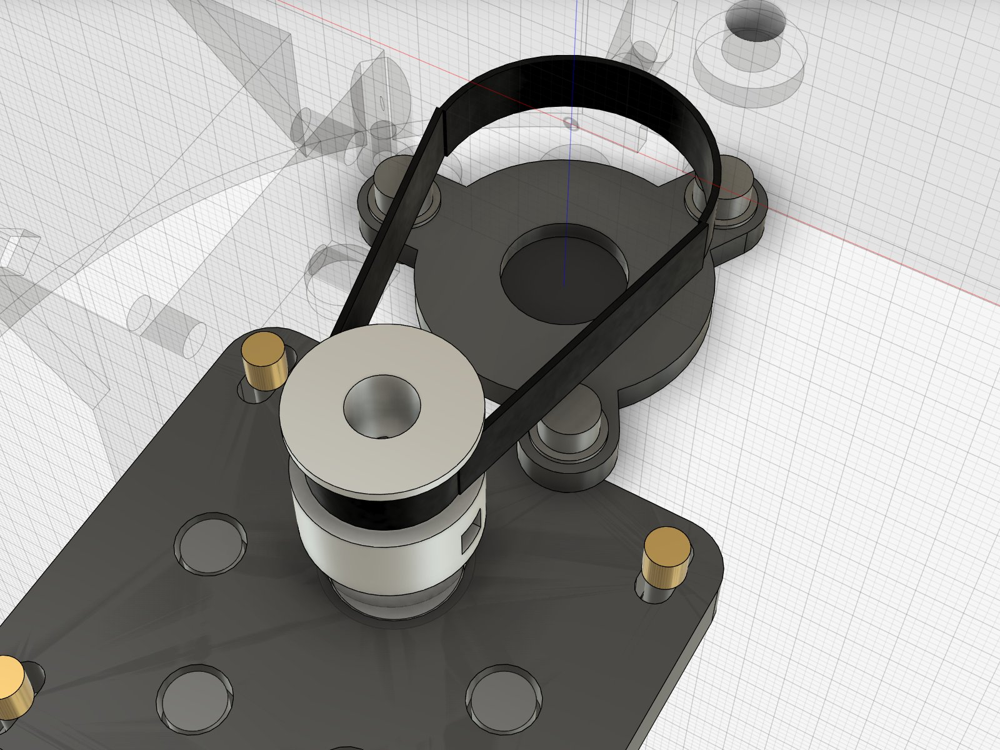

# POV LED Column rev m CAD: slip ring on the axis, belt drive, centred sled v2

**Prepared for Brian** · Claude (Opus 5.5), Fusion agent on the desktop PC · 2026-11-13
Inputs: the rev m spec (`docs/2026-11-13-rotor-power-and-wobble.md` §6, with item 6 "Centred sled v2" that you added today), the rev k report (`docs/2026-11-09-rev-k-rim-bearing.md`), the rev k animation report (document state), the SenRing SNM022A-06 datasheet (Core Electronics' copy), the wiring build guide's cut sheet, and the live Fusion document "POV LED Column v11" (rev j + rev k + the unsaved rev l sled).
Outputs: Fusion **"POV LED Column" v12** (rev m, saved as a new version; v11 = rev k is untouched in the history), scripts `fusionclaude/scripts/167-174_pov13_revm_*.py`, print files in `cad/print/rev-m_CURRENT/`, checks `calc/revm_checks.json` (+ `revm_checks_output.txt`), lead routes `calc/wiring_cad_routes_revm.json`, renders `docs/img/revm_*.jpg`. Nothing was sent to the printer, ordered or emailed.

> **Update, rev m.2 (Fusion v13, same day):** the slip ring is now the generic **12.5 mm 6-circuit capsule** (~$10) instead of the SNM022A-06. **§9 at the end** covers what changed: a printed clamp ring holds the flange, a lead guide drags the rotor leads, the deck keeps its d18 hole, and the checks were re-run (182 rows, 0 fail). Where §1-§8 talk about the SNM's flange, stub, fork or d23 hole, §9 supersedes them.

---

## Bottom line

1. **Every item in §6.3 is drawn and checked: 154 checks, 0 fail.** The motor sits 30.33 mm off-axis on a printed hanger and drives a printed 40T spool through a 20T pulley and the 122 mm GT2 belt. The SNM022A-06 takes the axis with its flange on the deck, and the bank is gone. Every rotating-vs-stationary gap is at least 1.5 mm. The two tightest gaps are where the motor pulley sits between the slip-ring flange and the rotor plate: 1.50 mm below it and 1.60 mm above it.
2. **The centred sled works and it balances.** The carrier's mid-plane moves from y −19 to **y −1.52**, and the buck stands behind it on a wall that also braces the two card-guide posts. The model rotor comes out at **889 g with U 51 g·mm**. That is 21 % of G6.3 (238) and 54 % of G2.5 (94) at 225 rpm. Pulling the bank without re-centring would have left **1,182 g·mm (5× G6.3)**. The sled + carrier + buck centre of mass is **0.45 mm** off the axis (target ≤ 0.5). It is deliberately offset to the side that cancels the hand-routed leads.
3. **Every lead gets 13-17 mm longer**, because the terminals moved toward the axis. Five wires need a ~10 mm extension at the terminal end: the S0 and S12 signal returns (3 wires) and the F18 pair. Most others still reach, with little slack left. The motor leads (base) need recutting. Nothing has to be redone at the strip end.
4. **What to print:** one PET-CF plate (spool + slip-ring driver + motor hanger, **1.38 h / 22.9 g**), the sled v2 in PETG (**1.55 h / 28.7 g**), and a PLA deck drill template (**0.66 h / 20.2 g**). You drill the base you have instead of reprinting the 8.3 h shell. A reprint file is there if you'd rather.
5. **Still assumed until the parts arrive:** the 20T pulley's hub size and the buck module's size, holes and mass. Script 169 re-solves the balance in one run once you've measured them.

## 1. What changed in the model

| Area | Rev k (v11) | Rev m (v12) |
|---|---|---|
| Rotor support | 6820ZZ rim bearing, collar, rotor ring, keys, riser | **unchanged** |
| Drive | motor on the axis (L-bracket on the deck post), flange coupling + printed Oldham | motor turned 90° and moved to (0, −30.33), on a **6 mm PET-CF hanger**; **20T → 40T GT2, 122 mm belt**, belt plane z −8.1; a **printed drive spool** where the Oldham dog was |
| Axis | flange coupling + Oldham | **SNM022A-06** slip ring: flange on the deck top, body through the deck, rotor stub driven by a loose fork in the spool |
| Rotor power | INIU bank (199 g) + USB pigtail into J1 | 12 V across the ring (3 + 3 circuits), **XL4015-class buck on the rotor**, its OUT into J1 |
| Sled | rev l: bank cradle, board at y −19 | **sled v2**: board at y −1.52, buck wall + standoffs, counterweight bosses moved to (0, ±42.5) |
| Deck | d18 centre hole, rev k inserts | d18 → **d23**, **d14** shaft hole, **7 × d4.0** insert holes (3 flange, 4 hanger) |
| Deleted | | flange coupling, steel L-bracket + screws, Oldham dog / disc / lug screws, dog nuts, bank, pigtail, the carrier-foot glue bead |

**Stack along the axis (model z, mm):**

| z | Part |
|---|---|
| +8 … +2 | hub core floor (d7 wire hole); the 4 old M3 × 10 coupling screws go down from its top |
| +2 … −2 | spool plug d22.2 in the core's d22.4 pocket, 4 × M3 × 4 heat-set inserts |
| −3.1 … −4.6 | spool top flange (45° cone, so it prints without support) |
| −4.6 … −11.6 | 40T teeth, belt 6 mm centred at **−8.1**; on the motor side, the 20T pulley's tooth zone at the same height |
| −13.1 | spool bottom (the driver's lugs ride in its two slots) |
| −7.1 … −16.1 | slip-ring rotor stub d7.8; the driver sleeve covers its top 6 mm |
| −16.1 … −21.1 | slip-ring neck (stationary), 3.0 mm below the spool |
| −21.1 … −23.5 | slip-ring flange on the deck top |
| −23.5 … −27.5 | deck (printed shell) |
| −27.5 … −33.5 | motor hanger; gearbox face at −33.5 |
| −35.1 … −39.1 | slip-ring stator end + lead cone |
| motor pulley | hub (down) −19.6 … −12.6, flanges −12.6 / −3.6; shaft tip −12.44 (7 mm in the hub) |

## 2. Decisions (and why)

- **Slip ring flange on the deck top, stator down through the deck.** The datasheet (SenRing SNM022A-06: flange Ø44, 2.4 thick, 3 × Ø5.2 on PCD 35, housing Ø22 = 5 mm above the flange + 11.6 below, rotor stub Ø7.8 × 9) puts the rotor stub on the flange side. So the flange sits on the deck, the stub points up into the spool, and the stator leads leave downward into the base. The flange screws (M3 × 6 + washers into inserts) are at 60/180/300°. That's the rotation with the most material (7.9 mm, centre to centre) next to the old motor-screw holes and head pockets under that part of the deck.
- **Loose fork, never a clamp.** A printed sleeve is CA'd onto the stub's top 6 mm. Its two lugs ride in two slots in the spool with **1.0 mm of float radially, sideways and in the bore**, plus 1.5 mm axially. The slip ring's own bearings set its stub's axis, and the 6820 sets the rotor's. The fork only carries the ring's ≤ 0.3 g·m drag torque. The float also covers hand-drilling the d23 hole off-centre.
- **Motor turned 90° with the gearbox outward.** Its centre goes to (0, −37.33) and the shaft to (0, −30.33): exactly the centre distance for a 122 mm belt on 20T/40T (pitch length 122.00 mm). The gearbox ends 8 mm from the slip-ring body and clears the PWM board, the pot and the pot cable by more than 20 mm.
- **A 6 mm PET-CF hanger instead of drilling motor holes in the deck.** The gearbox bolts to the hanger with 4 of its 6 holes. The two next to the boss would leave 0.15 mm of wall to the boss hole, so they stay empty. The hanger bolts to the deck with 4 × M3 × 10 from below through ±2 mm slots, so you **tension the belt from below with the bottom plate off and the rotor on**. The front two inserts go in from the top, inside the bearing's bore. The rear two sit under the collar's base plate, so they're drilled and pressed from below.
- **Pulley hub down, belt plane at −8.1.** The motor pulley has to clear the slip-ring flange below it and the rotor plate above it. With the hub down there is 1.50 mm below and 1.60 mm above (the assumed d16 hub sits right over the flange's edge). If the real hub is d13, the bottom gap goes to 1.8 mm radially. Set the pulley's height before tightening its set screws: its tooth zone must line up with the spool's (z −11.6 … −4.6, so the belt runs flat). That puts its top flange 1.6 mm under the plate and its hub 1.5 mm above the slip-ring flange. With a straightedge across both pulleys' top flanges, the motor pulley's flange sits 0.5 mm below the top of the spool's cone.
- **Centred sled: balance-driven position, not geometric centre.** The rest of the rotor isn't symmetric: the hand-routed strip leads all come up on the −y side. So I solved the board's y and the buck's x to put the **whole rotor's** first moment as close to zero as the 0.5 mm stack target allows. Result: board mid-plane y −1.52, buck x +3.58, stack CG (−0.14, +0.43) mm, rotor U 51 g·mm. Script 169 prints the solve, so the real buck's mass and size can be folded in with one re-run.
- **The buck wall is also the posts' brace.** It is 2.5 mm thick, 2.5 mm behind the carrier's pin tips, and joins the two card-guide posts into a portal (the rev j post snapped at its root). Its underside is a 45° arch over the hub hole, which is the wire channel: the slip-ring rotor leads come up the spool's d6 / the core's d7 hole on the axis, rise between the pin tips and the wall, pass under the arch and the buck's bottom edge, and land on the IN pads. The buck's OUT pair goes round the board's −x edge above the post into J1's screw terminal, so the board needs no soldering.
- **What stays from rev l:** the sled plate, the 4 screw holes, both lead-rise slots and tie holes. The under-plate lanes and the rise points therefore don't move, and the existing leads only change between their slot and their terminal.

## 3. Checks (154 rows, 0 fail; `calc/revm_checks_output.txt`)

**Clearances, rotating vs stationary (≥ 1.5 mm), §6.3 item 4:**

| Check | mm |
|---|---|
| motor pulley hub to the slip-ring flange | **1.50** (1.50 at +2 mm tension travel, 2.56 at −2) |
| motor pulley top flange to the rotor plate | **1.60** |
| motor pulley to the spigot / rotor ring | 8.67 (6.67 at −2 travel) |
| belt to the spigot | 9.93 |
| motor pulley / belt to the magnet riser | 58.4 / 23.9 |
| motor pulley / belt to the collar | 21.5 / 24.8 |
| spool to the slip-ring flange / neck | 3.00 |
| driver sleeve to the slip-ring neck | 3.00 |
| spool to the flange screw heads | 4.56 |
| motor pulley to the spool | 8.33 |
| slip-ring body to the PWM board | 37.6 |
| rotor ring to the collar (rev k, unchanged) | 2.00 |
| full sweeps: every rotor body vs every base body, and pulley / belt / shaft vs everything | min 1.50, all pass |

**Fits and contacts:**
- fork float 1.00;
- spool plug in the pocket, belt on both pulleys, flange on the deck, hanger on the deck, gearbox on the hanger: all 0 (contact);
- motor boss to the deck 1.01 (0.11 at the deck underside while the hanger slides);
- 0 mm³ overlap of the hanger, slip ring, motor, collar and riser with the base shell;
- board in its card slots: 0.3 per side, bottom edge on the slot floors.

**USB from the top:** the ESP32's micro-USB still faces up at z 80. A plug-plus-cable envelope (11 × 8 × 25 mm overmold, then a d5 cable straight up past the top-cap plane) clears every rotor part by **1.59 mm** (the carrier, as in rev h). With the top cap off you plug straight down.

**Wire channel on the axis:** a d2.6 bundle from the stub top to the core top clears everything by 0.6 mm. The modelled leads clear the carrier's pin tips by 1.1 mm, the wall by 2.4 mm and the coupling screw heads by 1.8 mm.

**Mass, U and the rocking mode (same mass model as rev i-k, so U is comparable):**

| | Rotor | CG (x, y) mm | U g·mm | G6.3 / G2.5 at 225 rpm |
|---|---|---|---|---|
| rev k + rev l (bank in) | 1,106 g | (0.00, −0.04) | 42.5 | 296 / 118 |
| bank + pigtail out, nothing else changed | 890 g | (0.00, −1.33) | **1,182** | 238: **497 %** |
| **rev m, centred sled v2** | **889 g** | (0.023, −0.052) | **50.6** | **21 % of 238 / 54 % of 94** |

Other model results:
- **Rocking mode: 41.4 Hz** (I_t about the bearing centre 1.81e−2 kg·m², k 1,225 N·m/rad, gravity −0.9). That is 11× the 3.75 Hz spin; the spec predicted 41.1.
- I_zz 3.89e−3 kg·m². Base 933 g, device 1.82 kg.
- Rotor share of the new parts: spool 6.9 g, slip-ring rotor + driver 3.5 g, buck 18 g (assumed), sled 31.8 g.

**Trim plan:**
- **Designed:** none needed. Split into the two trim planes, the model's residual is 27.9 g·mm at 133° on the trim flange (r 88, i.e. 0.32 g) and 25.8 g·mm at 94° on the top cap (r 72, 0.36 g). Both are below one trim screw (M3 × 8 + nut at r 88 = 79 g·mm).
- **As built:** the hand wiring, glue and tape will dominate (the spec assumes 1,000-2,000 g·mm), so run the **four-run balance** after install. Use the bottom plane first (the 24-hole trim flange, 79 g·mm per M3 × 8 + nut, 15° steps), then the top cap's nut pockets (~22 g·mm each). The sled's two M6 nut pockets, now at (0, ±42.5), add ~106 g·mm each along y if the bottom plane needs more.

## 4. Lead reach (moved board vs the cut sheet)

The leads were re-routed in CAD from their unchanged rise slots to the new terminals, using the original routing code (script 130 plus the hall-lead route). "Left" is the cut-sheet length minus the new route. About 8 mm of that goes on the stripped ends.

| Lead | Terminal | Route rev k → rev m (mm) | Cut | Left | Verdict |
|---|---|---|---|---|---|
| S0 5V / G / CLK / DATA | J3 | 143.9 → 158.1, 140.1 → 154.5, 139.4 → 154.0, 140.7 → 154.6 | 170/170/165/165 | 11.9 / 15.5 / 11.0 / 10.4 | reaches, tight (G has slack) |
| **S0 CR / DR (returns)** | J3 | 115.8 → 129.9, 114.7 → 128.4 | 135 | 5.1 / 6.6 | **extend 10 mm** |
| S12 5V / G / CLK / DATA / CR | J4 | +13.9 … +14.6 each | 165 / 135 | 11.3-14.5 | reaches, tight |
| **S12 DR (return)** | J4 | 115.8 → 129.5 | 135 | 5.5 | **extend 10 mm** |
| F3 + / − | J6 | 166.8 → 183.6, 170.7 → 187.5 | 200 | 16.4 / 12.5 | reaches / tight |
| F6, F9 pairs | J7, J8 | +16.8 | 235, 250 | 17.0-22.9 | reach |
| F15 pair | J9 | 128.5 → 145.3, 129.8 → 146.5 | 155 | 9.7 / 8.5 | tight |
| **F18 pair** | J10 | 95.8 → 112.4, 97.3 → 113.9 | 120 | 7.6 / 6.1 | **extend 10 mm** |
| F21 pair | J11 | 97.4 → 114.0, 100.2 → 116.8 | 125 | 11.0 / 8.2 | tight |
| hall OUT / GND / VCC | J5 | 134.0 → 148.9, 132.8 → 146.9, 132.4 → 145.5 | 160 | 11.1 / 13.1 / 14.5 | tight |
| motor M+ / M− (base) | PWM OUT | → 122 / 140 | 120 | — | **recut ~150 / 165** |
| slip-ring stator leads | PWM IN tap | → 104 / 102 | 250 (as supplied) | — | trim, keep a service loop |
| slip-ring rotor leads | buck IN | → 68 / 78 | 250 (as supplied) | — | trim to ~100 |
| buck OUT (new) | J1 | → 88 / 86 | — | — | cut 22 AWG red / black 110 |

The route lengths are CAD routes; your hand routes may have a little more or less slack. **Dry-fit the board in the printed sled before cutting anything.** If a lead won't reach its clamp without pulling, splice 10-15 mm of the same gauge at the terminal end (solder + 2 mm heat-shrink) rather than redoing the strip-end joint.

## 5. What to print (`cad/print/rev-m_CURRENT/`, sliced, not sent)

| File | Material, setup | Time | Mass | Note |
|---|---|---|---|---|
| `revm_drive_parts_PET-CF_plate_PET-CF` | Fiberon PET-CF, hardened nozzle, extruder 1, 6 walls, 6/6, 85 % (as the rev k parts) | **1.38 h** | **22.9 g** | the drive spool (plug up), the slip-ring driver sleeve, the motor hanger (gearbox face on the bed). Singles in `cad/revm_*.stl` |
| `rotor_sled_m_PETG` | Bambu PETG Matte, Structural PETG-PLA, extruder 1 | **1.55 h** | **28.7 g** | sled v2, plate down. PETG on purpose (rev l: it bends where PET-CF snaps) |
| `revm_deck_drill_template_PLA` | Bambu PLA Matte, PLA Fitcheck | **0.66 h** | **20.2 g** | drops into the 6820's bore with the rotor off, keyed by the notch over the magnet riser. Pilot guides for the 3 flange inserts, the 2 front hanger inserts and the shaft hole; a d23 window for the centre hole |
| `alternates/base_shell_m_PETG` | PETG, as the rev j shell | 8.34 h | 295.6 g | only if you'd rather reprint than drill |

All four STLs pass the floating-island check (0 starts). The flat down-facing areas are small: the spool has 45 mm² (5 mm slot tops and the bore ceiling) and the sled 29 mm² (insert-hole tops). The rev k parts still print as planned (collar, rotor ring, keys, riser). **Skip the Oldham dog + disc** if you go ahead with rev m.

**Install sketch:**
1. Rotor off. Template in the bore: drill the d4.0 pilots, step-drill the centre from 18 to 23 and the shaft hole to 14. Press in the 3 flange inserts and the 2 front hanger inserts from the top.
2. Hang the hanger on its two front screws, then drill + press the two rear inserts from below through its slots.
3. Motor onto the hanger (4 × M3 × 6), pulley on the shaft, hub down, its top flange 1.6 mm under where the plate will be (§2).
4. Slip ring: flange on the deck, 3 × M3 × 6 + washers. CA the driver sleeve onto the stub.
5. Spool into the core pocket from below (4 × M3 × 10 from the core top, sled off), rotor leads up the axis. Belt on, rotor down onto the bearing, then tension from below.

## 6. Open questions for you

| # | Question | Why |
|---|---|---|
| Q1 | When the parts arrive, measure the **20T pulley** (hub d and length, tooth-zone length) and the **buck** (PCB size, hole positions, mass). | Both are assumed; the pulley sets the 1.50 / 1.60 mm gaps, the buck sets the balance. Script 169 re-solves the board / buck position in one run |
| Q2 | Drill the existing base (template, 7 inserts, d23 and d14 holes) or reprint the shell (8.3 h)? | I recommend drilling: the shell is otherwise unchanged |
| Q3 | For the 5 short wires (S0 CR / DR, S12 DR, F18 ±): splice 10 mm at the terminal end, or remake? | Splicing keeps the strip-end joints; decide after the dry fit |
| Q4 | OK to leave the deck post (now unused) as it is? | It clears the hanger by more than 9 mm; removing it means a reprint |
| Q5 | Fuse value on the 12 V tap to the slip ring (2 A planned, §6.4)? | The ring is 2 A per circuit, 3 in parallel per pole |

## 7. How to explain it

**The 30-second version:**

> To power the rotor from the base I needed the centre of the axis, and the motor was sitting on it. So the motor moved 30 mm sideways onto a printed hanger and drives the column through a belt. The axis now holds a slip ring. The battery came out, and that let the electronics move onto the axis too. The board is 1.5 mm from the centre instead of 19, and the model's imbalance is a fifth of what's allowed at 225 rpm. Without re-centring, taking the battery out would have left five times the allowance.

**Numbers that read well:**
- belt pitch length 122.00 mm at a 30.33 mm centre distance;
- 1,182 → 51 g·mm by moving the board 17.5 mm;
- the sled + board + buck centre of mass is 0.45 mm off-axis, on purpose, to cancel the wiring;
- the rocking mode is 41 Hz, 11× the spin;
- the tightest gap in the base is 1.5 mm.

**Talking points:**
- "Free the axis": rotary joints compete for the centre line.
- Never clamp both ends of a slip ring. A fork with 1 mm of float lets each bearing set its own axis.
- Balance the whole rotor, not the sub-assembly: the wiring is asymmetric, so the "centred" board belongs a little off-centre.
- Re-run the original routing code with the new board position instead of guessing the lead lengths. That turned "will the leads reach?" into a table.

**Shots:** the section through the axis, the belt drive from above, the sled v2 turntable, the drill template dropping into the bearing bore.

## 8. Files and replay

| Path | What |
|---|---|
| `fusionclaude/scripts/167_pov13_revm_base.py` | deck holes, motor move, slip-ring stator, hanger, pulley, belt, hardware, base leads (not idempotent: undo first) |
| `…/168_pov13_revm_spool.py` | drive spool, slip-ring rotor + driver |
| `…/169_pov13_revm_sled_v2.py` | bank out, carrier move, sled v2, buck, rotor wiring, balance solve |
| `…/170_pov13_revm_leads.py` | re-runs script 130 with the new board position + the hall lead → `calc/wiring_cad_routes_revm.json` |
| `…/171_pov13_revm_checks.py` | the 154 checks → `calc/revm_checks.json` |
| `…/172_pov13_revm_export.py`, `173_…_renders.py`, `174_…_save.py` | exports (+ STEP `cad/pov_led_column_assembly_revm.step`), renders, the v12 save |
| `fusionclaude/lib/povlib.py` (rev m block), `lib/pov_revm.py`, `lib/pov_revm_shot.py` | parameters, mass model, display-only renders |
| `fusionclaude/designs/pov-led-column.md` | design note, rev m section |

---

## 9. Addendum, rev m.2: the 12.5 mm 6-circuit capsule slip ring (Fusion v13)

**Prepared for Brian** · Claude (Opus 5.5), Fusion agent on the desktop PC · 2026-11-13 (evening)
Inputs: your brief (swap to the generic 12.5 mm capsule you're buying, $10 vs $50; flange screwed to the deck; rotor side not rigidly coupled, driven by dragging its lead bundle through a loose slot; leads up the axis channel), the seller's drawing (the seller's drawing (not included here)), and Fusion "POV LED Column" v12.
Outputs: Fusion **"POV LED Column" v13** (saved as a new version; v12 = rev m with the SNM is untouched in the history), scripts `fusionclaude/scripts/175-180_pov14_revm2_*.py`, checks `calc/revm2_checks.json` (+ `revm2_checks_output.txt`), print files in `cad/print/rev-m_CURRENT/` (sliced, not sent), STEP `cad/pov_led_column_assembly_revm2.step`, renders `docs/img/revm2_*.jpg`. Nothing was ordered, printed or emailed.

### 9.1 Bottom line

1. **The new ring fits, and 182 checks pass with 0 fails.** All rotating-vs-stationary gaps are ≥ 1.5 mm. The tightest is unchanged: the motor pulley's top flange to the rotor plate, **1.60 mm**.
2. **The pulley-to-flange gap went from 1.50 to 10.68 mm**, as you expected from the Ø24 flange. The nearest stationary parts to the pulley are now the new clamp ring (5.07 mm) and its screw heads (6.02 mm). Even at +2 mm of tension travel they stay at 3.39 mm. **The 20T pulley's hub size no longer matters.**
3. **One deviation from the brief: a clamp ring instead of screws through the flange holes. Screws through the holes can't work here.** The holes sit on PCD 18 (r 9), only 2.75 mm from the Ø12.5 body. Anything wider than a bare M3 shank reaches the body: an insert (Ø4.2), a nut (5.5 AF), a head (Ø5.5) or a washer. Your deck also already has a **d18 hole**, whose edge sits exactly on that PCD. So a 2.2 g PET-CF ring now clamps the flange onto the deck. Three Ø2.8 pins on its underside drop into the flange's Ø3.2 holes so the ring can't turn. The ring screws down with **3 × M3 × 6 + washers into the 3 deck inserts at PCD 35**, the same positions the rev m template already drills. The flange is still held rigidly to the stationary deck, just from above.
4. **The deck keeps its existing d18 hole, so there's no centre drilling.** The Ø12.5 body passes through it with 2.75 mm per side. The **step drill now only has to make the d14 motor-shaft hole: get one that reaches ≥ 14 mm (9/16").** The v12 model's d23 hole was filled back to d18. The fill added exactly 644 mm³, the r 9-11.5 ring × 4 mm, so nothing else in the shell changed.
5. **The rotor is driven through its leads, never rigidly.** A 1.3 g PET-CF **lead guide** is CA'd into the spool's bore, keyed by the two old fork slots. Its nose ends **2.0 mm above** the Ø5 rotor boss. Through the nose runs a **flat 4.6 × 1.6 mm slot** on the axis. The six 30 AWG leads pass through it as a flat row, with **0.5 mm of play every way** (3.6 × 0.6 row; checked: 0.495 mm), and they are free axially. The spool turns the row, and the row turns the ring's rotor. Nothing touches the boss, and only the slip ring's own bearings locate its rotor.
6. **Balance and the rocking mode are unchanged:** rotor 889.0 g, U **51.6 g·mm** (rev m: 50.6). That is 22 % of G6.3 (238) and 55 % of G2.5 (94). Re-solving the balance moves the board by only 0.014 mm, so I kept the rev m values. Rocking mode 41.4 Hz. Trim plan as §3: 27.9 g·mm on the trim flange, 26.0 g·mm on the top cap, each below one trim screw.
7. **The 30 AWG leads are fine at 3 circuits per pole, with margin:**
   - 0.46 A per ring at the 1.39 A rotor load: 23 % of the ring's 2 A.
   - 0.14 V lost if you keep the full 225 mm leads on both sides; 0.08 V if you trim them to ~120 mm.
   - Keep the **2 A fuse**: it equals one ring's rating, so even if two of a pole's three leads come off, nothing is overloaded.

### 9.2 What changed in the model (v12 → v13)

| Part | v12 (rev m, SNM022A-06) | v13 (rev m.2, 12.5 mm capsule) |
|---|---|---|
| Slip ring `B15` | Ø44.5 × 2.4 flange, Ø22 body (5 above + 11.6 below the flange), Ø7.8 × 9 rotor stub | **Ø24 × 1.2 flange** on the deck top (z −23.5 … −22.3), 3 × Ø3.2 on PCD 18 at 0/120/240°. **Ø12.5 × 15 body** down through the deck to z −38.5 (stator leads out of its end). Rotor = **Ø5 × 1.5 boss** (z −22.3 … −20.8) |
| Flange fixing | 3 × M3 × 6 + washers through the flange into deck inserts at PCD 35 | **`B20` clamp ring** (PET-CF, 2.2 g): disc r 14 plus 3 lobes to PCD 35, z −23.4 … −20.3. Pocket Ø24.4 × 1.1 over the flange (**0.1 crush**), 3 × Ø2.8 × 1.0 pins in the flange holes (0.2 play), Ø12 opening. 3 × M3 × 6 + washers into the **same 3 inserts** (2.3 mm of thread in each). |
| Deck `B01` | centre hole d18 → d23 | **d18 kept** (the hole the deck already has). Insert holes, shaft hole and hanger holes as rev m. |
| Spool `R21` | fork: two 5 mm lug slots to z −6.5 + a bore for the driver sleeve | Same spool. The slots now run up to the bore ceiling (z −5.3) and serve as **keyways** for the lead guide. |
| Lead guide (new body in `R21`) | – | Tube Ø12.2 in the Ø12.4 bore, 2 keys 4.8 wide (0.1 per side), nose r 4 down to z −18.8. **Flat slot 4.6 × 1.6 × 3 deep** on the axis, then a 45° cone into the d6 wire hole. CA'd in: it is part of the rotor. |
| Slip-ring rotor `R22` | Ø7.8 stub + printed two-lug driver sleeve (CA'd) | Just the Ø5 boss. **Driver sleeve and fork deleted.** |
| Rotor leads `R24` | 2 × 3 × 28 AWG from the stub top (z −7.1) | 2 × 3 × **30 AWG** from the boss top (z −20.8), through the slot, up the axis channel to the buck IN. Routed 82 / 92 mm of the 225 mm supplied: **tie them to the sled with a slack loop.** Never pull them taut, or they lift the ring's rotor. |
| Stator leads `B08` | 28 AWG from the cone tip | 30 AWG from the body end. Routed 104 / 102 mm to the PWM IN tap and fuse holder (225 supplied). |
| Mass model | SNM 15 g | **ASSUMED 10 g**: 2 g rotor (on the axis, inside the body) + 8 g stator. Weigh it (§9.6). |

### 9.3 Checks (182 rows, 0 fail; `calc/revm2_checks_output.txt`)

Same sweeps and rows as §3: every rotor body vs every base body, and pulley / belt / shaft vs everything, at ≥ 1.5 mm. These rows are new or changed:

| Check | mm | Limit |
|---|---|---|
| motor pulley hub to the slip-ring flange | **10.68** (was 1.50) | ≥ 1.5 |
| motor pulley hub to the clamp ring / clamp screw heads | 5.07 / 6.02 | ≥ 1.5 |
| tension travel +2 / −2 mm: pulley to the clamp ring | 3.39 / 6.81 | ≥ 1.5 |
| tension travel +2 / −2 mm: pulley to the clamp screws | 4.32 / 7.78 | ≥ 1.5 |
| belt to the clamp ring | 9.20 | ≥ 1.5 |
| motor pulley top flange to the rotor plate (tightest in the model, unchanged) | **1.60** | ≥ 1.5 |
| lead-guide nose to the clamp ring / to the slip-ring flange | 2.83 / 3.50 | ≥ 1.5 |
| spool to the clamp ring / to the clamp screw heads | 7.20 / 3.78 | ≥ 1.5 |
| rotor boss to the clamp opening | 3.50 | ≥ 1.5 |
| rotor leads to the slip-ring stator (flange top) / to the clamp opening | 2.00 / 4.60 | ≥ 1.5 |
| lead row in the slot (stationary parts) | 3.00 | ≥ 1.5 |
| **lead slot play: 3.6 × 0.6 row in the 4.6 × 1.6 slot** | **0.495** | 0.45-0.55 |
| nose above the rotor boss (free axially) | 2.00 | 1.9-2.1 |
| lead guide in the spool (tube, keys, ceiling) | 0.10 | 0.10 |
| clamp on the flange / clamp to the deck / washers on the clamp | 0 / 0.10 / 0 | contact / crush |
| axis wire channel (d2.6 bundle from the slot top to the core top) | 1.31 | ≥ 0.5 |
| hanger to the slip-ring body / motor to the slip-ring body | 4.47 / 12.20 | ≥ 1.5 |
| overlap of the slip ring / clamp / hanger / motor / collar / riser with the shell | 0 mm³ | 0 |

Unchanged from §3: rotor ring to collar / riser 2.00, USB envelope 1.59, rotor leads to the carrier pins 1.07, belt to the spigot 9.93, motor boss to the deck through the ±2 mm travel 0.11.

### 9.4 Circuit pairing on 30 AWG (3 + 3)

| | Value |
|---|---|
| 30 AWG copper | 0.339 Ω/m → 76 mΩ per 225 mm lead |
| one circuit, stator + rotor lead at full length | 152 mΩ (+ ring contact, ~10 mΩ class) |
| one pole, 3 circuits in parallel | 51 mΩ; loop (+ and −) 102 mΩ |
| at the rotor's 1.39 A (12 V side) | **0.46 A per ring (23 % of 2 A)**, 0.14 V drop, 0.20 W in the leads |
| leads trimmed to ~120 mm per side | loop ~55 mΩ, 0.08 V |
| fuse | **2 A** (≥ 1.25 × 1.39 A, and equal to one ring's rating) |

Why it shares well: each lead (~76 mΩ) is far more resistive than the ring's contacts (~10 mΩ). So the three paths split the current within roughly ±10 %. That holds only if the three leads of a pole are the **same length**: trim them together, twist each set of three, and join them with one solder joint per end.

Which leads: beep each rotor lead to its stator lead first. The colours usually match side to side, but check. Then put any 3 circuits on + and the other 3 on −. Mark + on both sides with heat-shrink before trimming.

### 9.5 Print list (`cad/print/rev-m_CURRENT/`, sliced, not sent)

| File | Parts | Material, setup | Time | Mass |
|---|---|---|---|---|
| `revm2_drive_parts_PET-CF_plate_PET-CF` | drive spool (plug up), **lead guide** (top down, nose up), **clamp ring** (top down, pocket + pins up), motor hanger (gearbox face down) | Fiberon PET-CF, hardened nozzle, extruder 1, 6 walls, 6/6, 85 % | **1.55 h** | **26.0 g** |
| `rotor_sled_m_PETG` | sled v2 (unchanged from rev m) | PETG Matte, Structural PETG-PLA | 1.55 h | 28.7 g |
| `revm2_deck_drill_template_PLA` | template: same pilots (3 clamp inserts on PCD 35, 2 front hanger inserts, the shaft hole), d18 window over the existing centre hole | PLA Matte, PLA Fitcheck | 0.67 h | 20.6 g |
| `alternates/base_shell_m2_PETG` | base shell with the rev m.2 deck (d18 centre) | PETG | 8.36 h | 296.3 g |

- **Island check:** all six STLs show 0 island starts.
- **Flat down-facing area:** lead guide 9.6 mm² (the crescents where the slot meets the cone), clamp ring 0, spool 45 mm² (as rev m).
- **Superseded:** the rev m plate (it had the driver sleeve), template and shell are now in `cad/print/rev-m_superseded/`, with the old single STLs (`revm_sr_driver`, `revm_drive_spool`, …).

**Install sketch (replaces §5's):**
1. Rotor off. Drop the template into the bore. Drill the d3 pilots, open them to d4.0, and step-drill the shaft hole to 14. **Leave the centre alone** (d18 stays). Press in the 3 clamp inserts and the 2 front hanger inserts from the top.
2. Hanger, motor and pulley as in §5, steps 2-3.
3. Slip ring: stator leads down through the d18 hole, flange on the deck. Put the clamp ring over it with its pins in the flange holes, then 3 × M3 × 6 + washers. Snug only: it's PET-CF on a 1.2 mm flange.
4. CA the lead guide into the spool's bore (keys in the keyways, pushed up to the ceiling). Thread the six rotor leads as a flat row up through the slot and the spool and core wire hole **before** the spool goes into the core.
5. Spool into the core pocket (4 × M3 × 10 from the core top), belt on, rotor down onto the bearing. Then tension the belt from below. At the sled, leave a slack loop in the rotor leads, then tie them down and land them on the buck IN.

### 9.6 Measure when the ring arrives

| # | Measure | Model value | If different |
|---|---|---|---|
| 1 | flange thickness | 1.2 | clamp pocket depth = t − 0.1 (`CLAMP_POCKET` in the rev m.2 block of `lib/povlib.py`), re-run 175 (after an undo) + 179 |
| 2 | flange Ø, hole Ø, hole PCD and spacing (120°?) | 24 / 3.2 / 18 / 120° | pocket Ø24.4, pins Ø2.8 at r 9 |
| 3 | body Ø and length below the flange (the drawing's "15" may include the flange) | 12.5 / 15 | only the stator lead start moves; the d18 hole clears up to Ø16 |
| 4 | rotor boss Ø and height | 5 / 1.5 | the nose sits 2.0 above it (`GUIDE_NOSE_GAP`) |
| 5 | **lead OD** (30 AWG PTFE) | 0.6 | slot = 6 × OD + 1.0 long, OD + 1.0 wide (`GUIDE_SLOT`), re-run 176 + 179 (the guide is a 10-min reprint) |
| 6 | mass (with leads) | 10 g assumed | mass model `lib/pov_revm.py` (`sr_rotor_boss`, `sr12_stator`) |
| 7 | turning torque: hold the stator, twist the rotor leads | should turn with a light finger drag | if it's stiff, tell me before the install: the drag goes through the leads |
| 8 | continuity of each circuit, colour map rotor ↔ stator, ~0.15 Ω per circuit | §9.4 | pair 3 + 3 by that map |

### 9.7 Decisions (and why), for the video

- **Clamp the flange, don't bolt through it.** The holes are 2.75 mm from the body. That's room for a bare shank and nothing else, and the deck's d18 hole cuts across them anyway. A clamp ring with pins keeps the flange rigid and stops it turning, reuses the template's insert positions, and keeps the existing hole. A small part can solve a geometry conflict without reprinting the 8-hour shell.
- **Drive the slip ring through its own leads.** A capsule's rotor runs in the slip ring's own bearings. If the spool also held it rigidly, the two bearing systems would fight. A flat slot with 0.5 mm of play only pushes the lead row sideways. The rotor follows, and any misalignment between the two axes is taken up by 2 mm of free lead, not by a bearing.
- **A separate lead guide instead of a slotted nose on the spool.** The spool prints plug-up. A nose hanging below its bottom flange would need support, and flipping the spool turns its belt flanges into flat overhangs. Keying a 1.3 g insert into the old fork slots keeps the spool as it was, and makes the slot a 10-minute reprint once you've measured the real leads.
- **Numbers that read well:** $50 → $10 for the slip ring; pulley-to-flange gap 1.5 → 10.7 mm; U 51.6 g·mm (22 % of G6.3); 0.46 A per ring, 23 % of its rating; 182 checks, 0 fail.

### 9.8 Files and replay

| Path | What |
|---|---|
| `fusionclaude/scripts/175_pov14_revm2_slipring_base.py` | new B15 stator, B20 clamp ring, clamp screws, deck d23 → d18 fill, stator leads (not idempotent: undo first). Runs on v12. |
| `…/176_pov14_revm2_spool_guide.py` | spool with keyways, lead guide, rotor boss (idempotent) |
| `…/169_pov13_revm_sled_v2.py` | re-run for the rotor leads (now params `SR_LEAD_Y/OD/TAG`) + balance solve |
| `…/177_pov14_revm2_checks.py` | the 182 checks (`--ro`) → `calc/revm2_checks.json` |
| `…/179_pov14_revm2_export.py`, `178_…_renders.py`, `180_…_save.py` | exports (`--undo` after), renders, the v13 save |
| `fusionclaude/lib/povlib.py` (rev m.2 block at the end), `lib/pov_revm.py` | parameters, mass model (`30t` leads) |
