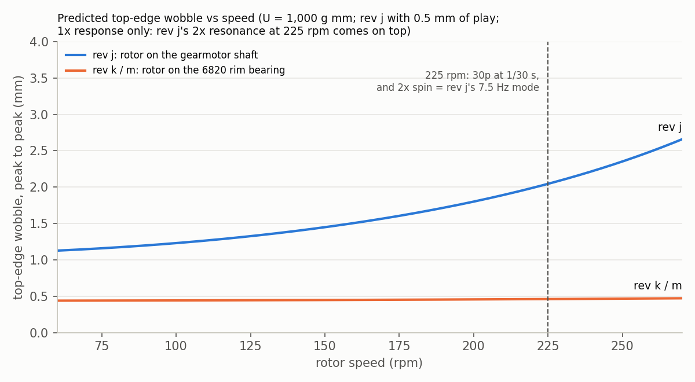

# POV LED Column rev m: Powering the Rotor from the Base and Reaching 225 rpm Without the Shake

**Prepared for Brian** · Claude (Opus 5.5), rotor-power agent on the desktop PC · 2026-11-13
Inputs: Brian's camera brain dump of 2026-11-13 (C0144: "we can't get to 225 RPM without the thing shaking itself to bits", "I don't know if a slip ring is the way to go, or have the whole thing powered through the base", "Obviously, I ordered the Lazy Susan"), the rev k report and its calc (`docs/2026-11-09-rev-k-rim-bearing.md`, `calc/revk_rim_bearing_calc.py`, `calc/revk_calc.json`, `calc/revk_checks.json`), the feasibility, electrical and product-study reports, `docs/measurements.md` (#1-#40), `fusionclaude/lib/povlib.py` (bank position), the integration-hell research report (W1, X3), vendor pages listed in section 10. **No CAD was driven** (the Fusion agent owns Fusion); the CAD changes are described in section 6.3. Nothing was bought.
Outputs: this report (+ `.html`), `calc/rev_m_power_calc.py` → `calc/rev_m_calc.json`, `calc/rev_m_calc_output.txt`, figure `docs/img/rev_m_wobble_vs_rpm.png`.

---

## Bottom line

1. **The shake at 225 rpm has a specific cause, and rev k already fixes it.** On today's rotor (rev j, hanging on the gearmotor shaft) the rocking mode sits at **7.5 Hz**. At 225 rpm the spin is 3.75 Hz, so **anything that happens twice per revolution lands exactly on that mode** (undamped amplification ×537 at 225 rpm, ×1.5 at the 125.7 rpm that ran fine). Rev k's 6820 rim bearing moves the mode to **~40 Hz** and cuts the predicted wobble from ~2 mm to under 0.5 mm peak to peak. Power from the base is **not** what stops 225 rpm; the bearing is.
2. **The battery doesn't cap the rpm; it caps balance, brightness and runtime.** It is 199 g (18 % of the rotor) that you take out and put back. **Every 1 mm it sits differently = 199 g·mm of unbalance, 68 % of the whole G6.3 budget at 225 rpm** (293 g·mm). Its USB port also stops at ~2.4 A, below the 3 A you'd want.
3. **For base power, use a capsule slip ring on the axis carrying 12 V, with a small buck converter on the rotor.** The catch: with rev k the axis under the rotor is taken by the motor and the Oldham coupling. So rev m **moves the motor 30 mm off-axis and drives the rotor with a 2:1 GT2 belt**. That frees the axis for a Ø22 mm, 6-circuit capsule (3 circuits per pole). The belt replaces the Oldham (a belt is already a flexible coupling) and puts the motor's own 37.5 Hz buzz safely away from the rotor's ~40 Hz mode. Everything else in rev k stays: bearing, collar, rotor ring, keys, magnet riser.
4. **Wireless is the right answer for a later product, not for this column next week.** Off-the-shelf 5 V modules give ~1.8 A continuous at a 3-6 mm gap, below today's 2.0-2.6 A cap. They need the axis free too, and they put a 100-200 kHz field next to the hall sensor and a steel gearbox. **DIY brushes on the bearing collar** are the fallback that keeps direct drive. **A through-bore slip ring** doesn't fit the stack.
5. **Order of work next week:** Mon-Wed, build **rev k as designed, still on the bank**, and balance it with the four-run method: that's the 225 rpm footage. Thu-Fri, **rev m power**: belt, slip ring, rotor buck, bank out, rebalance. Parts for rev m are about **$50-60** (section 6.1). **This weekend**, if you want a calmer spin on rev j: **24p at 1/24 s and 180 rpm** gives a full image in every frame, with the 2× amplification at ×2.8 instead of ×537.

**Q1, answered 2026-11-13: it is the 6820ZZ, so rev k proceeds as designed.** Original question: "I ordered the Lazy Susan". Rev k is designed around the **6820ZZ thin-section bearing** (100 × 125 × 13), which the rev k report recommended instead of an aluminium lazy susan. If what's coming is a **140 mm aluminium lazy susan (Ø89 bore)**, it won't pass the hall magnet column at r 42 without moving the hall sensor. Rev k's collar and rotor ring would also need redrawing. Everything in this report assumes the 6820.

---

## 1. Why 225 rpm (and what to shoot this weekend)

Each of the 42 rows is painted by 8 strips per revolution (24 strips, 3 interleaved sets), so the refresh is 8 × rev/s. A video frame shows a complete image when the shutter covers a whole number of refreshes:

| Camera | Shutter | rpm for exactly one refresh per frame | Note |
|---|---|---|---|
| **30p** | **1/30 s** | **225** | the target |
| 24p | 1/24 s | **180** | the calm option on rev j (2× amplification ×2.8) |
| 30p | 1/20 s | 150 | needs a movie shutter slower than the frame rate (check the ZV-E10's M-mode limit) |
| 30p | 1/15 s | 112.5 | same check; motion in the content smears |
| 60p | 1/60 s | 450 | out of reach |

Two caveats for the weekend:
- The image firmware is on the **simulated hall** (X3). `sim_rpm` must equal the real rpm, or the picture drifts around the column. Read the real rpm with the bench firmware or a phone strobe app first.
- Clamp or weigh down the base for any spin above ~150 rpm.

## 2. Why it shakes today, and what rev k changes

The rev k analysis (`docs/2026-11-09-rev-k-rim-bearing.md` §2-4) models the rotor as a rigid body rocking on its support. Rerun here with gravity included (`calc/rev_m_power_calc.py` §5):

| | rev j (on the gearmotor shaft) | rev k (6820, bank on) | rev m (6820, base power) |
|---|---|---|---|
| Rocking stiffness | 46 N·m/rad + bushing play | 1,225 N·m/rad | 1,225 N·m/rad |
| Rotor | 929 g | 1,097 g | **906 g** (bank, pigtail and Oldham out; ring, buck and spool in) |
| Rocking mode at rest | **7.5 Hz** | 39.2 Hz | **41.1 Hz** (I_t 0.0183 vs 0.0201 kg·m²) |
| 2 × spin at 225 rpm | **7.5 Hz: on the mode** | 7.5 Hz: 5× below | 7.5 Hz: 5.5× below |
| Top wobble from 1,000 / 2,000 g·mm at 225 rpm (elastic, amplitude) | 0.49 / 0.97 mm **+ 0.5-1.8 mm play** + the 2× resonance | 0.012 / 0.024 mm | 0.012 / 0.024 mm |
| Plus geometric runout (rev k §4) | — | ~0.22 mm amplitude | same |

**Why 125.7 rpm was fine and 225 isn't.** Going from 125.7 to 225 rpm, the unbalance force grows **×3.2** (ω²). More importantly, twice the spin frequency walks from 4.2 Hz up onto the 7.5 Hz mode. Several things push twice per revolution:
- the shaft's D-flat (unequal bending stiffness);
- the L-bracket's two stiffnesses (89 vs 213 N·m/rad), with the bushing play letting the lean flip;
- the coupling's set screw.

None of these needs to be big when the amplification is that high. On the 6820 the mode is far above every low harmonic, and the play is gone because gravity preloads the bearing.

## 3. Rotor power: the options

### 3.1 The axis problem

Any rotary power link (capsule slip ring, coaxial coil pair) has to sit on the rotation axis, and in rev k the axis under the rotor is full:
- from the deck top (z −23.5) to the plate underside (z −2): the flange coupling, the two lug screws, the Oldham disc and the dog;
- below the deck: the motor.

The top of the column is free, but a slip ring there needs a stationary arm over the column into every shot. So the real choice is:
- **(a)** free the axis by moving the motor (belt);
- **(b)** go around the axis (through-bore ring, annular coils, rim brushes);
- **(c)** keep the battery.

### 3.2 Comparison (5 V, 3 A peak = 15 W on the rotor)

| | Battery (today) | **Capsule slip ring on the axis, 12 V across, rotor buck (rev m)** | Through-bore slip ring around the drive line | DIY brushes on the bearing collar | Wireless coil pair (rotary transformer) |
|---|---|---|---|---|---|
| Where it sits | INIU bank in the sled cradle, pigtail to J1 | Ø22 capsule: flange on the deck top, body hanging into the base where the motor was; its rotor end driven by the belt spool | around the motor shaft line: motor lowered 35-50 mm, 6 mm shaft extension through a 12.7 mm bore | 2 face rings on the rotor ring's underside (r ~70 / 78), 2-4 carbon brushes on the collar | Tx coil on the deck, Rx coil under the hub, coaxial, 3-6 mm gap |
| Needs the axis free? | — | **yes → belt drive** | no, but needs a taller stack | **no** (keeps the Oldham) | yes (Ø~40 mm coils, small ID); or custom annular coils around the Oldham |
| Current at 5 V | 2.4 A port (label 3 A) | **6 × 2 A rings; 1.39 A at 12 V = 0.46 A per ring** (3 per pole) | 6 × 10 A | 3 A per brush (carbon, easy) | **1.8 A continuous** (vendor), 2 A peak |
| rpm rating | — | **250 rpm continuous** (SparkFun/Senring; VoltShop says 300): 225 = 90 % | 500-600 rpm | carbon brushes 10+ m/s; here 1.77 m/s | none (no contact) |
| Voltage drop / noise | 90 mΩ trunk, 0.19 V at 2.1 A | 88 mV loop drop, ≤ 28 mV contact noise, **all absorbed by the rotor buck** | small | 60+ mV contact noise at 3 A on 5 V; bounce at track seams | rectifier ripple at 100-200 kHz into the 5 V bus |
| EMI risk to the 8 MHz SPI / hall | none | **none**: DC only, no signal crosses the joint | none | brush sparking at seams (low) | **medium**: 100-200 kHz field next to the hall (r 42), ESP32, steel coupling and gearbox (eddy heating) |
| Drag, forces | 0 | ~1-2 mN·m (ASSUMED, small radius) | small | **~60 mN·m (×2.1 the motor load), 4 N uplift** vs 10.8 N gravity preload | 0 |
| Cost | $0 (have it) | **~$50-60** (ring ~$20-30, belt + pulley ~$15, buck ~$10) | $60-150 | $10-15 | $10-25 + belt as for the slip ring |
| Availability | — | Amazon / SparkFun-class resellers, days (section 6.1) | specialty sellers (VoltShop, ATO, Moflon), 1-3 weeks | Amazon carbon-brush packs | Amazon modules (DFRobot DFR0712 class; XKT-412 generics) |
| Print / CAD changes | none | drive spool (replaces the Oldham dog + disc), motor hanger, deck holes, buck cradle (6.3) | new taller base or motor tower, shaft extension, rotor raised | reprint collar + rotor ring with ring grooves and brush pockets (the 2 mm gap becomes ~8) | belt as rev m, coil seats, ferrite sheets |
| Balance / wobble | **199 g that moves: 199 g·mm per mm** | **−191 g on the rotor, axisymmetric, fixed: helps**; mode 39 → 41 Hz | neutral | rings symmetric: neutral; brush friction adds a small steady torque ripple | ~10 g on the axis: helps like the slip ring |
| Runtime | 2.8 h dense, 6.7 h typical | unlimited | unlimited | unlimited | unlimited |
| Verdict | **Phase A only** | **recommended (rev m)** | rejected: the bore can't pass the Ø22 flange, OD > 74 hits the magnet riser, 35-50 mm taller | **fallback** if the belt can't fit | **product path**, not this column |

Notes behind the rows (all in `calc/rev_m_power_calc.py` §3):
- **Slip ring scheme A vs B.** Sending 5 V through the ring works too (3.0 A, 1.0 A per ring, 189 mV drop, ≤ 60 mV contact noise). But scheme B (12 V across, buck on the rotor at 5.00 V) halves the current, makes the drop and noise irrelevant, and frees the brightness cap up to the buck's rating. B also keeps the **USB back-feed rule** (#40: never more than 5.00 V on the bus with USB in) under your control.
- **Wear.** At 225 rpm, 10 million revolutions (ASSUMED order of magnitude for capsule rings) is **740 h**, which is years of demos. 225 rpm is 90 % of the 250 rpm rating, so expect some extra contact noise (behind the buck) and shorter life than rated. A **2-circuit 10 A capsule** (Senring SNM022A-02) is a cleaner power-only part if you can get one fast.
- **The cheap 12.5 mm capsule** (Comidox/Goco-type, "300 rpm, 2 A") has a reviewer reporting 250 rpm and 1.5 A, signal-only. At 0.46 A per ring it would still work, but it's second choice.
- **Wireless.** At 1.8 A the LED cap would have to drop to **1.34 A** (today 2.0-2.6 A). Input power would be 12-15 W for 9 W out.

## 4. What else 225 rpm needs

**Balance.**
- Budget at 225 rpm: G6.3 = **293 g·mm** for the rev k rotor (1,097 g), **242 g·mm** for rev m (906 g). G2.5 (aim here) = 96 g·mm.
- One M3 × 8 + nut (0.9 g) in the rotor ring's trim flange (r 88) is **79 g·mm**; an M3 nut in a top-cap pocket (r 72) is ~22 g·mm.
- The as-built rotor, with tape, glue, hand wiring and the bank, is probably **1,000-2,000 g·mm (ASSUMED)**, so it **must** be balanced, in both planes. Rev k's four-run method (`calc/balance_4run.py`, phone on the collar) does it without a phase sensor.
- Rebalance after removing the bank. The design offset it 5.3 mm on purpose (1,055 g·mm, balanced by the carrier side), so taking it out leaves that much to trim.

**Stiffness and mode placement.**
- Rule of thumb: keep the first rocking mode **≥ 3× the top spin frequency** and **off 2×**. Rev k/m: 39-41 Hz, 10-11× the spin.
- The tube itself is far stiffer. As a cantilever with 0.6 kg lumped at the top (EI ≈ 5,100 N·m²), its first bending mode is ~180 Hz (hand calc).
- The rev k collar stiffness ignored hoop action, so the real mode is probably higher.

**Motor: the JGB37-520 (12 V, 600 rpm no-load, 1:10 ASSUMED from listings) is rated for it.**
- Load at 225 rpm: 27 mN·m air drag + 2 mN·m bearing = 29 mN·m, **0.68 W at the shaft**.
- Listings disagree on rated torque (15-108 mN·m); the estimated output stall is ~220 mN·m. Direct drive needs ~43 % PWM duty.
- Spin-up to 225 rpm: ~1.5 s at 60 mN·m net. Stored energy ~1.1 J.
- **Watch item:** in direct drive the armature turns at **37.5 Hz at 225 rpm, 4 % from rev k's 39 Hz mode**. The motor's small armature unbalance shakes the deck, and the deck can ring the rotor. If rev k shows a buzz right at 225 rpm, try 215 or 235 for a minute to confirm.
- The rev m belt (2:1) puts the armature at **75 Hz** and halves the motor torque (15 mN·m). The cost is that the motor runs at ~81 % duty, which leaves headroom to roughly 270 rpm on 12 V.

**Base and table.** At 225 rpm, 1,000 g·mm is 0.56 N rotating. On a soft or slippery surface the 2 kg device moves ~0.5 mm with it. Use a rigid table and a weight or clamp on the base. Damp the soft feet only if the phone spectrum shows a base mode.

**Belt loads (rev m).**
- Effective pull: 2.3 N. Static tension: ~4 N per strand (light finger tension).
- That puts **8 N sideways on the rotor at z −17**, 2.5 mm from the bearing centre. The resulting **20 mN·m** moment is constant, not rotating, so it gives a fixed lean of hundredths of a millimetre, not a wobble. It is well under the 300 mN·m that would unload the bearing.
- Tooth mesh at the rotor: 150 Hz, far from every mode.

## 5. How each option fits rev k, and its effect on the wobble

| Option | Fits rev k? | Wobble / balance |
|---|---|---|
| Battery | as designed | the bank is the single biggest balance uncertainty; key it (a printed shim on one side, always the same way round) until it goes |
| **Capsule ring + belt (rev m)** | **yes**: bearing, collar, rotor ring, keys, riser, tie rods unchanged; the Oldham dog + disc become a drive spool; the motor moves 30 mm | **better**: −191 g, mode 39 → 41 Hz, nothing removable on the rotor, armature off the mode |
| Through-bore ring | no (stack, OD vs magnet riser, flange vs bore) | — |
| DIY brushes | collar + rotor ring reprinted | neutral to slightly worse (drag ripple, brush forces) |
| Wireless | only with the belt as well (or custom coils) | better (like the ring) |

## 6. Recommendation: rev m

**Architecture:**
- **Support:** rev k's 6820 rim bearing, unchanged.
- **Drive:** the motor hangs 30.3 mm off-axis under the deck at θ 270° (opposite the hall magnet at θ 90°) and drives a **20T → 40T GT2 belt (122 mm closed loop)** onto a printed **drive spool** on the rotor's axis.
- **Power:** a **Ø22 6-circuit capsule slip ring** on the axis below the spool carries **12 V** from the base supply (3 circuits per pole) to a **5 A buck on the rotor**, set to **5.00 V**, into J1 where the bank's pigtail went. **The bank comes out.**

**Stack (model z, as rev k):**

| z (mm) | Part |
|---|---|
| −23.5 | deck top; slip-ring flange on it (Ø44.5, inside the collar's open centre, clear of the riser at r 37) |
| −23.5 … −43 | slip-ring body through a Ø23 hole, hanging into the base where the motor was |
| ~−21 | slip-ring rotor end, driven by a **loose fork** in the spool (never clamp both ends of a slip ring) |
| −21 … −13 | 40T rotor pulley on the spool (Ø25.5 pitch) and the 20T motor pulley at r 30.3, belt plane z ≈ −17 |
| −19 | spigot bottom (r ≥ ~47; the motor pulley's edge is at r 38.3) |
| −2 … +2 | spool's top flange in the hub core's coupling pocket, on the Oldham dog's 4 × M3 holes |
| the motor | gearbox face at ≈ −31 so the 15.2 mm shaft reaches the pulley; boss through a new Ø14 hole in the deck |

### 6.1 Parts list (nothing bought; prices are estimates, check the live listing)

| # | Part | Where | Est. | Why |
|---|---|---|---|---|
| 1 | **Senring SNM022A-06** capsule slip ring, Ø22 × 19.5, 6 × 2 A, 250 rpm, 28 AWG × 250 mm leads, Ø44.5 flange | Amazon (search "SNM022A-06"), SparkFun "Slip Ring - 6 Wire (2A)" resellers, [VoltShop](https://voltshop.net/senring-snm022a-6-channel-2a-capsule-slip-ring) | $20-30 | the axis link; 3 rings per pole |
| 1b | alt: Senring **SNM022A-02** (2 × 10 A) | [VoltShop](https://voltshop.net/senring-snm022a-2-channel-10a-capsule-slip-ring) | ~$25 | power-only, cleaner |
| 1c | alt: 12.5 mm 6-wire capsule (Comidox/Goco type, ASIN B07H2SRMXP per reseller mirrors) | Amazon | ~$10-15 | cheapest; speed/current ratings disputed |
| 2 | **GT2 20T pulley, 6 mm bore, 6 mm belt** (D-bore or 2 set screws) | Amazon / [Studica](https://www.studica.co/gt2-pulleys-and-belts) | $5-10 | motor pulley on the 6 mm D-shaft |
| 3 | **GT2 closed-loop belt, 6 mm, 122 mm (61 T)**; also a 110 / 112 mm as tension fallbacks (centres 24.2 / 25.2 mm) | Amazon multi-length packs | $8-12 | belt |
| 4 | **12 V → 5 V buck, ≥ 5 A, adjustable** (XL4015-class or the D-Planet 5 A 4-pack), ≤ 20 g | Amazon | $8-12 | rotor 5 V; set to 5.00 V on the bench |
| 5 | 12 V 3 A adapter (5.5 × 2.1) or the bench supply at 3 A | have / Amazon | $10 | motor + rotor share 12 V: ≤ 1.6 A peak + spin-up |
| 6 | inline fuse 2-3 A on the 12 V feed to the ring (the F4A 5 V fuse is no longer in the path) | have the holder | — | short protection for the ring and 28 AWG leads |
| 7 | 6820ZZ + M3 × 300 rods (rev k, if not already ordered) | rev k §6 | $28 | the bearing |
| from kits | M3 × 8/10 SHCS (motor face, hanger), 4 × M3 × 4 inserts (hanger), M3 nuts, 2 × 2-way screw terminals or JST for the ring leads, heat-shrink, CA | | | |

### 6.2 Prints (PET-CF, the rev k setup)

| Part | Replaces | Est. |
|---|---|---|
| **Drive spool**: top flange on the hub core's 4 × M3 dog holes, 40T GT2 teeth with flanges at z −21 … −13, Ø6 wire hole on axis, a loose 2-tine fork at the bottom for the slip-ring rotor end | Oldham dog + disc | ~0.6 h, 12 g |
| **Motor hanger**: 6 mm PET-CF plate under the deck; the gearbox face bolts straight to it (6 × M3 on PCD 30), 4 slotted holes (±2 mm along the belt) into new inserts in the deck | the steel L-bracket + deck post (no longer needed; leave in place if it doesn't clash) | ~1 h, 25 g |
| **Buck cradle insert** for the bank cradle (holds the buck on the axis side, wires to J1) | the bank | ~0.3 h |
| Rev k parts | collar, rotor ring, 4 hex keys, magnet riser: **unchanged**; skip the Oldham dog + disc if rev m is certain, they're 0.5 h | |

### 6.3 CAD changes for the Fusion agent (not done here)

**Done 2026-11-13 (all six items, 154 checks pass): `docs/2026-11-13-rev-m-cad.md`; Fusion "POV LED Column" v12.** One correction from the slip ring's datasheet: the housing has a 5 mm neck above the flange, so the stub runs z −16.1 … −7.1 and the belt plane sits at −8.1 (not −17).

1. Deck: **enlarge the centre hole to Ø23** (slip-ring body) with 3 flange screw holes; **new Ø14 hole at r 30.3, θ 270°** for the gearbox boss; 4 insert holes for the hanger.
2. Hanger and motor: position so the shaft reaches the pulley (gearbox face ≈ z −31). Check the gearbox (Ø36.7, shaft offset 7 mm, turn it outward), the can and the rear terminals against the PWM board, the pot cable (~4 mm under the deck near the wall) and the bottom plate.
3. Spool: 40T GT2 profile (pitch Ø25.46), its bottom fork vs the slip-ring rotor end (get the SNM022A drawing), and a wire path up through the hub core to the sled.
4. Clearance checks, rotating vs stationary, ≥ 1.5 mm:
   - motor pulley and belt vs the spigot (r ~47), the magnet riser (θ 90°, r 37-45) and the collar;
   - the spool vs the slip-ring flange;
   - the ring body vs the PWM board.
5. Mass properties with the bank out, then recheck U and the trim plan. Expect ~1,055 g·mm to trim (the bank's designed offset).
6. **Centred sled v2 (added 2026-11-13 by Brian):** with the bank gone, redesign and reprint the sled so the carrier board sits on the axis, removing the designed offset instead of trimming it. The buck goes on the axis too, or opposite the board's residual offset.
   - Keep a wire channel on the axis for the slip-ring leads coming up the hub core.
   - ESP32 micro-USB faces up, reachable with the top cap off.
   - Keep the sled guides/bosses compatible with the top cap (4 × M3×8), unless rev m changes them anyway.
   - Check the reach of the existing leads from the new board position: J3/J4 strip leads, the J6–J11 feeds and the J5 hall lead. List any that must be remade.
   - Target the sled + carrier + buck centre of mass within 0.5 mm of the axis. Report U before/after.

### 6.4 Electrical changes

- Supply: 12 V into the PWM board as now. A **tap from the supply's +/− terminals (before the PWM stage)** goes through the 2-3 A fuse to the slip ring's stator leads, 3 + 3 in parallel.
- **Rotor ground goes to the supply's −, never to M1/M2 or the board's OUT−** (electrical report §8).
- On the rotor, the ring leads go to the buck's input. The buck output (5.00 V) goes to **J1**, replacing the pigtail. C1 + C2 (2,000 µF) stay; they carry the column-rate current steps.
- First power-up on the bench, rotor stationary:
  - set the buck to 5.00 V, then check TP1 at the dense pattern;
  - then raise `CAP_MA` in steps (2600 → 3000) while watching TP1 ≥ 4.8 V and the buck's temperature.
- USB rule: unchanged. Bus ≤ 5.00 V whenever USB is in, which the buck guarantees.
- No signal crosses the joint, so the 8 MHz SPI, the hall line and OTA are untouched.

### 6.5 Order of work, week of Nov 16

| Day | Work | Done when |
|---|---|---|
| Mon | Confirm the part that arrived (Q1). Print the rev k collar + rotor ring + small parts (6.8 h, rev k §7). Order the rev m parts (6.1). | prints off the bed; parts ordered |
| Tue | Assemble rev k **with the bank** (rev k §8). Spin 100 → 150 → 180 → 225 rpm against a pointer at the top edge; phone spectrum on the collar. Measure Q5 (shaft play) with the rotor off: good B-roll. | 225 rpm with < 1 mm at the top before balancing |
| Wed | Four-run balance, bottom plane then top. **Film the 225 rpm image at 30p 1/30 s.** | phone 3.75 Hz peak down ≥ 70 %; footage |
| Thu | Fusion agent: rev m CAD (6.3) + checks. Print spool + hanger + cradle (~2 h). Bench-test the slip ring: motor-driven with no rotor, 30 min at 225 rpm into a 2 A load, scope the buck output. | ring + buck pass on the bench |
| Fri | Install rev m: motor to the hanger, belt, ring, buck, bank out. Rebalance (four-run again). 225 rpm on base power. | runs on base power, balanced |

### 6.6 Risks

| Risk | Likelihood / impact | Mitigation |
|---|---|---|
| Slip ring at 90 % of its 250 rpm rating: noise, wear | medium / low | behind a buck, noise doesn't matter; 740 h to 10 M rev; SNM022A-02 or a 300 rpm part as a swap |
| Phase A direct drive: armature 37.5 Hz near the 39 Hz mode | low-medium / medium | move ±10 rpm to confirm; the belt cures it |
| The belt and motor don't fit under the deck (PWM board, pot cable) | medium / medium | CAD check first; fallbacks: 110/112 mm belt (C 24-25), turn the gearbox, or the DIY-brush route |
| Bank removal leaves ~1,000 g·mm | certain / low | four-run balance; trim flange holds 24 × 79 g·mm |
| Belt over-tension tilts the rotor | low / low | finger tension; 20 mN·m at 4 N/strand, 15× below bearing unloading |
| "Lazy Susan" ordered ≠ 6820 | unknown / high for rev k | Q1 before printing |
| Fusion agent time | medium | the prints in 6.2 are simple; the collar and ring are unchanged |

## 7. Open questions for Brian

| # | Question | Why |
|---|---|---|
| Q1 | **Answered 2026-11-13: Brian confirmed the 6820ZZ.** Rev k proceeds as designed. Which part did you order: the **ACROPIX 6820ZZ** (100 × 125 × 13) or an **aluminium lazy susan** (140 mm, Ø89 bore)? | rev k is built for the 6820; a lazy susan means redrawing the collar and ring and moving the hall |
| Q2 | Go ahead with rev m (belt + slip ring + rotor buck), or keep the bank through the next video and decide after rev k runs? | sets what the Fusion agent draws next |
| Q3 | OK to move the motor off the deck post onto a printed hanger 30 mm off-axis (drilling 2 holes in the deck)? | the one change to the printed base |
| Q4 | For this weekend's spin: 24p / 1/24 s at 180 rpm acceptable for the shots? | rev j is calm there, violent at 225 |

## 8. How to explain it

**The 30-second version:**

> It didn't shake at 225 rpm because it was too fast. It shook because 225 rpm puts twice the spin frequency exactly on the column's rocking resonance, 7.5 hertz. The rim bearing moves that resonance to 40 hertz. Then, to power it from the base, I needed the centre of the axis for a slip ring, but the motor was sitting there. So the motor moves sideways and drives the column with a belt. The belt is the flexible coupling, the slip ring gets the axis, and the battery, the heaviest thing I kept taking in and out, comes off the rotor.

**Numbers that read well:**
- 7.5 Hz mode = 2 × 3.75 Hz spin, exactly at 225 rpm;
- 46 → 1,225 N·m/rad;
- the bank is 199 g, and 1 mm of it is 68 % of the balance budget;
- 12 V across the slip ring: only 0.46 A per ring, and the contact noise disappears behind the rotor's buck;
- armature 37.5 Hz → 75 Hz with a 2:1 belt.

**Talking points:**
- A symptom that appears at one speed: check the harmonics against the modes, not just the 1×.
- "Free the axis": rotary joints compete for the centre line, and a belt both frees it and acts as the coupling.
- Transmit at a higher voltage and regulate at the load, so a noisy contact stops mattering.
- Removable mass on a rotor is a balance problem before it is a power problem.

**Shots:** the wobble-vs-rpm chart; the phone spectrum before/after; the bank coming out; the slip ring in hand; the belt drive under the column.

## 9. Files

| Path | What |
|---|---|
| `calc/rev_m_power_calc.py` | all numbers in this report (camera, loads, options, balance, rocking response, motor, belt, figure) |
| `calc/rev_m_calc.json`, `calc/rev_m_calc_output.txt` | its outputs |
| `docs/img/rev_m_wobble_vs_rpm.png` | the figure |
| `docs/2026-11-09-rev-k-rim-bearing.md` | the bearing design this builds on |

## 10. Sources

- Senring SNM022A-06 specs (250 rpm continuous, 2 A, 22 × 19.5 mm, 44.5 mm flange, 28 AWG): [Core Electronics / SparkFun](https://core-electronics.com.au/slip-ring-6-wire-2a.html.plain.md), [datasheet](https://proto-pic.co.uk/content/SNM022A-06-update.pdf), [VoltShop (says 300 rpm)](https://voltshop.net/senring-snm022a-6-channel-2a-capsule-slip-ring), [SNM022A-02 2 × 10 A](https://voltshop.net/senring-snm022a-2-channel-10a-capsule-slip-ring)
- 12.5 mm capsule (300 rpm / 2 A claimed; review: 250 rpm, 1.5 A): [VXB](https://vxb.com/products/12-5mm-capsule-slip-ring-300-rpm-6-wires-circuits), [Core Electronics 12 mm](https://core-electronics.com.au/miniature-slip-ring-12mm-diameter-6-wires-max-240v-at-2a.html.md)
- Through-bore 12.7 mm, 6 × 10 A, 600 rpm: [VoltShop](https://voltshop.net/id12-7mm-6-channel--10a--through-bore-slip-ring), [Moflon MT1286 (OD 86)](https://moflon.com/pdf/mt1286.pdf), [ATO (OD 35/56)](https://www.ato.com/slip-ring)
- Wireless 12 V → 5 V 2 A (≤ 1.8 A continuous, 3-6 mm gap): [DFRobot DFR0712](https://www.dfrobot.com/product-2105.html); generic XKT-412 modules and gap-current derating: [PMD Way](https://pmdway.com/products/5v-1-5a-wireless-inductive-charging-power-modules)
- JGB37-520 12 V 600 rpm, 1:10: [OzRobotics](https://ozrobotics.com/shop/37mm-brushed-motor-micro-dc-deceleration-motor-jgb37-520-12v-600rpm/), torque spread: [Zbotic](https://zbotic.in/product/jgb37-520-dc12v-600rpm-min-miniature-forward-and-reverse-brushed-dc-speed-reducer-motor/), [Voltaat](https://www.voltaat.com/products/12v-high-torque-metal-dc-geared-motor-600-rpm-1-1-kg-cm.oembed)
- GT2 20T 6 mm D-bore pulley: [Studica](https://www.studica.co/gt2-pulleys-and-belts); 122 mm closed loop: [eBay listing](https://www.ebay.com/itm/283194907394)
- 5 A buck modules: [D-Planet 4-pack](https://www.desertcart.ni/products/58752409-d-planet-4-pack-5a-dc-dc-adjustable-buck-converter), [UCTRONICS 5 V 5 A](https://www.desertcart.tw/products/159790021-uctronics-dc-9v-12v-24v-to-dc-5v-5a-buck)
- Hologram-fan wireless rotor power, and the slip ring vs wireless product decision: a product study that is not in this repository

Amazon availability and prices were **not** opened live today. The search results surfaced manufacturer and reseller pages, not Amazon listings, so search the part numbers on Amazon before ordering.
