# POV LED Column rev n: a drive that drops together (drive and slip-ring interface redesign)

**Prepared for Brian** · Claude (Fable 5.2), rev n drive agent on the desktop PC · 2026-11-17
Inputs: your report of 2026-11-16 (the printed 40T spool sheared twice during assembly; too many things have to be done at once; don't reprint the shell; small parts are fine; you have spare metal pulleys), the rev m / m.2 CAD report (`docs/2026-11-13-rev-m-cad.md`), the rev k report, the rev m shopping list, and the Fusion document "POV LED Column" v13 (rev m.2).
Outputs: Fusion **"POV LED Column" v16** (rev n, saved as a new version; v14 and v15 are earlier saves of rev n from the same evening, v13 = rev m.2 is untouched), scripts `fusionclaude/scripts/185-190_pov15_revn_*.py`, checks `calc/revn_checks.json` (+ `revn_checks_output.txt`), load numbers `calc/revn_drive_calc.py`, print files in `cad/print/rev-n_CURRENT/` (sliced, not sent), STEP `cad/pov_led_column_assembly_revn.step`, renders `docs/img/revn_*.jpg`. Nothing was printed, ordered or bought.

---

## Bottom line

1. **The spool did not break from the drive torque. It was broken by its own four screws.** The 40T spool's plug held four heat-set inserts with 1.1 mm of wall around them. The M3 × 10 screws end exactly at the bottom of the inserts, and the 1 mm of spare hole below is full of plastic the insert pushed down. So each screw bottoms and pushes the plug off the pulley with 500-830 N. That load pulls the layers apart at the weakest plane in the part. Drive torque puts 0.26 MPa on that plane at motor stall; four bottomed screws put 17-29 MPa on it, against about 14-28 MPa of layer strength (section 1).
2. **Rev n takes the pulley off the rotor.** A new printed **drive hub** (40T, same belt, same belt plane) turns on its own small ball bearing in a **bearing cup** that sits on the clamp ring you already printed. The rotor carries only **four steel pins**: the four coupling screws, now M3 × 16, with nuts held in a 4 mm **nut plate** that fills the hub core's pocket. The pins drop into four notches in the hub. There are no inserts and no glue in the drive.
3. **The rotor now lifts off by hand.** Plug one connector, lower the rotor, turn it up to a quarter turn until the pins drop, push home. The belt is fitted and tensioned with the rotor off, where you can see it.
4. **The slip ring is no longer clamped to the deck. It hangs under the deck on its own six leads and works as a counterweight.** Lift the rotor to plug it in and the leads pull up through the hub. Lower it and the slip ring's weight pulls them back down. So there is never loose wire to tuck in where you can't see it. The price: the slip ring has to come out and go back in from below (section 3.7).
5. **Print today: one plate, 1.2 h, 15 g of PETG-CF** (2 hubs, cup, 2 nut plates, a stand-in bush), plus a centring jig (0.7 h). The shell is untouched: no drilling. **The bottom-cap plate file is unchanged**, so the one you printed or are printing is right.
6. **Buy two small things (both arrive the day after you order, about $14): 6802-2RS bearings and a JST-XH connector kit** (section 7). Until the bearing arrives, the printed bush lets you fit the drive and spin the rotor dark.
7. **Assembly: 9 steps instead of 11, none of them blind (rev m.2 had 3), with no heat-set inserts and no glue (rev m.2 had 4 inserts and a glued guide).** Taking the rotor off was four steps with tools; now it is one step without (section 5).
8. **Checks: 224 rows, 0 fail.** Every rotating-vs-stationary gap is at least 1.5 mm. Balance is unchanged: rotor 882.8 g, U 51.6 g·mm, 22 % of G6.3 at 225 rpm. Hall gap 5.0 mm, unchanged.
9. **Your metal pulleys: the spare 20T stays on the motor only.** The wires would fit through its 6 mm bore (six leads are a 2 mm bundle), but it has nothing to bolt to, and a 20T on the rotor makes the drive 1:1, which needs a 100 mm belt instead of your 122 mm ones (section 2).

## 1. What failed, and why

You reported that the part with the heat-set inserts separated from the pulley, twice, during assembly. That is the plane where the spool's Ø22.2 plug meets its Ø28 belt flange. Five things meet on that plane.

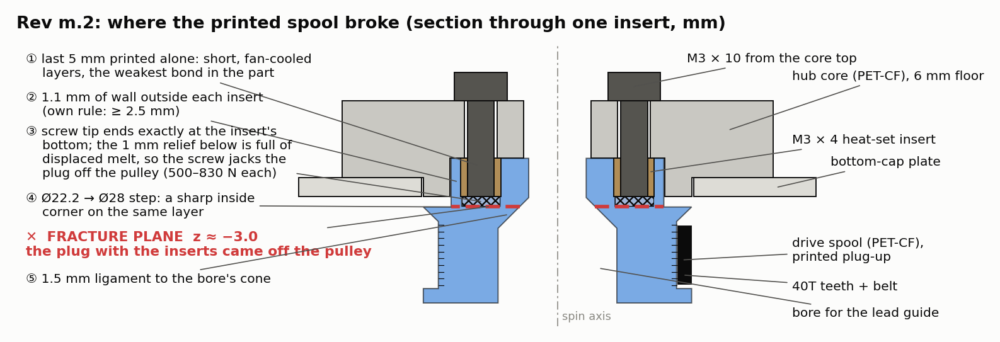

| # | What is on that plane | Number |
|---|---|---|
| 1 | The last 5 mm of the part, printed alone in short, fan-cooled layers | PET-CF bonds worst there; I assume half the datasheet layer strength, so about 14 MPa instead of 27.9 |
| 2 | Four insert holes with **1.1 mm** of wall outside them | this project's own rule since rev f is at least 2.5 mm |
| 3 | The screw tips | M3 × 10 through the 6 mm core floor reaches 4.0 mm: exactly the insert's length |
| 4 | The Ø22.2 to Ø28 step | a sharp inside corner, 0.08 mm below the hole bottoms |
| 5 | The bore's 45° cone | 1.5 mm of plastic between it and each hole bottom |

**It was not the torque.** The section has 287 mm² of plastic, and the service loads are small (`calc/revn_drive_calc.py`, part A):

| Load on the fracture plane | Stress | Margin |
|---|---|---|
| Running torque, 29 mN·m | 0.017 MPa shear | ×460 |
| Motor stall through the 2:1 belt, 0.44 N·m | 0.26 MPa shear | ×31 |
| Belt tension, 8 N at 5 mm | 0.05 MPa bending | ×290 |

**The screws did it.**

- **The relief under each insert is full.** An insert with a 4.2 mm knurl in a hole that prints about 3.75 mm displaces 11.2 mm³ of melt. The 1 mm of spare hole below it holds 11.0 mm³. So nothing is left under the screw tip.
- **A screw that bottoms pushes the plug off the pulley.** The screw pulls its insert up and pushes down on the bottom of the hole at the same time. That is direct tension between layers, on the plane of the hole bottoms.
- **The force is large.** An M3 gives 500 N at 0.3 N·m and 830 N at 0.5 N·m. A hex key reaches both easily.
- **The stress is at the limit.** One bottomed screw at 0.3 N·m puts about 7 MPa on its quarter of the section. With a stress concentration of 2.5 at the hole bottom and the step, that is 17 MPa, above the 14 MPa I assume for those layers. Four screws at 0.5 N·m give 29 MPa, above the datasheet's 27.9 MPa for perfect layers.
- **PET-CF does not forgive it.** It breaks at 0.8 % strain between layers. A crack that starts at one hole runs round the whole plane.

Two more things pushed the same way. The inserts leave about 0.4 % of hoop strain in a 1.1 mm wall that was heated through. And the belt had to be forced over the spool's Ø28 flange unseen: with the hanger slid in 2 mm the loop needs 124 mm and the belt is 122 mm.

It happened twice, so it is the design and not a bad print. I could not look at the broken parts. If the break is a flat layer at the bottom of the insert holes, with a mark from a screw tip in at least one hole, that confirms it (question Q1). The redesign does not depend on the answer: it removes all five items.

## 2. Options

I compared eleven ways to fix it against your three goals, in your order: robust, easiest assembly, then balance and clearances.

| # | Option | Robust | Assembly | Rotor off without tools | Needs | Verdict |
|---|---|---|---|---|---|---|
| A | Reprint the spool as it is | no | as now | no | 1 print | no |
| B | Spool v2 on the rotor: through-bolts and nuts, thicker neck, fillet | yes | unchanged: belt fitted blind, tensioned with the rotor on, rotor tied to the base by the leads | no | 1 print | fixes goal 1 only |
| C | Your spare **metal 20T** on the rotor, leads through its 6 mm bore | yes | still blind | no | a hollow 6 mm shaft to grip it, and a 100 mm belt (1:1 puts the centres at 41 mm for a 122 mm belt; the motor is at 30.3) | no |
| D | A bought metal 40T (8-12 mm bore) on the rotor | yes | still blind | no | the pulley, a hollow stub | no |
| E | Hub core and pulley printed as one part | yes: no joint at all | still blind; four inserts in the new core | no | 1 print, 4 inserts | no |
| F | Drive at the rotor ring's rim: internal ring gear and a pinion | fair | drops on, no belt | yes | a new rotor ring (3 h); the hall sensor and magnet riser sit at r 37-45, where the teeth would run; gear noise on camera | no |
| G | Printed spur gears on the axis (40T / 20T) | fair | drops on, no belt | yes | 2 prints; noise and tooth accuracy unknown until built | second choice |
| H | Friction wheel on a drum | fair | drops on | yes | rubber tyre; slip and wear, speed drifts | no |
| I | Motor back on the axis, through-bore slip ring | yes | simple | yes | 35-50 mm taller, $60-150, weeks (rejected in rev m) | no |
| **J** | **Drive hub on its own bearing on the base, pin drive to the rotor** | **yes: steel pins, plastic only squeezed** | **in view, rotor off** | **yes** | **3 small prints, a $6 bearing, a connector** | **chosen** |
| K | J with a power connector that mates by itself (spring pins on two rings) | as J | one step fewer, no plug to handle | yes | spring pins, contact rings, a floating mount; unproven | later, if you want it |

**Why J.** Options B to E keep the pulley on the rotor. Then the belt has to go round a pulley you cannot see, and the leads tie the rotor to the base. Only a drive that separates along the axis fixes that: gears, a friction wheel, or pins. Pins keep the belt, which is quiet and already bought.

**About the metal pulleys.** You were right that it would be nice to use one, and partly right about the wires: six 30 AWG leads are a 2 mm bundle and pass a 6 mm bore easily. Two other things rule it out. A 20T on the rotor makes the ratio 1:1, so the 122 mm belt no longer fits the motor position that is printed into the shell. And a set-screw pulley can only grip a shaft, so the rotor would need a hollow 6 mm metal tube fixed to it. The metal 20T stays where it works: on the motor's steel shaft.

## 3. The design

### 3.1 Principle

In rev m.2 the pulley was part of the rotor, so three jobs had to happen in the same blind move: seat the rotor, get the belt round the pulley, and feed the leads. Rev n puts everything that needs adjusting on the base. The rotor only has to bring four pins and one plug.

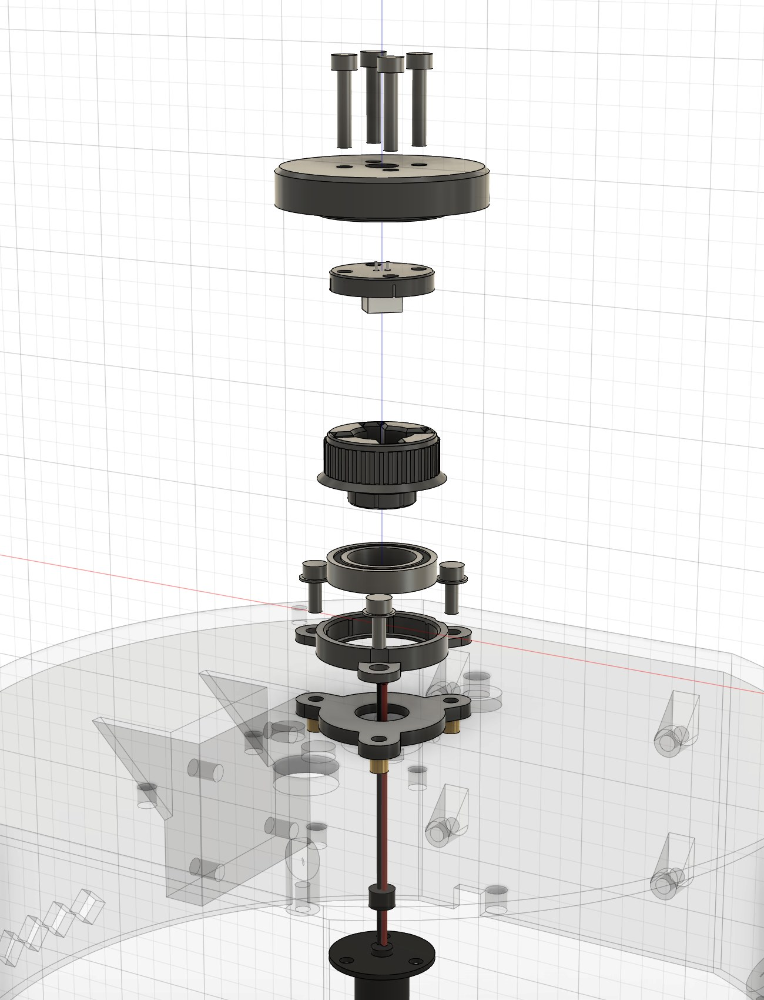

### 3.2 Parts

| Part | Status | What it does |
|---|---|---|
| **Drive hub** (R21, PETG-CF, 4.8 g) | new print | 40T GT2 teeth at the old belt plane (z −8.1); four notches in its top for the pins; a journal in the bearing; a neck in its bore that the slip ring's leads slide through |
| **Bearing cup** (B22, PETG-CF, 1.6 g) | new print | holds the 6802's outer ring; sits flat on the clamp ring and shares its three screws |
| **Nut plate** (R19, PETG-CF or PET-CF, 1.4 g) | new print | fills the hub core's Ø22.4 × 4 pocket; holds four M3 nuts and the XH header |
| Centring jig, stand-in bush | new prints, aids | section 3.6 and 3.5 |
| 6802-2RS bearing, 15 × 24 × 5 | buy | carries the hub |
| 4 × M3 × 16, 4 × M3 nuts | from your kit | the drive pins (replace the 4 × M3 × 10) |
| 3 × M3 × 8 | from your kit | replace the clamp ring's 3 × M3 × 6; the washers stay |
| 1 small zip tie | from your kit | the stop on the leads that carries the slip ring |
| Clamp ring | **kept**, new job | it no longer clamps anything; it is the cup's seat |
| Slip ring | **kept**, moved | goes in from below and hangs under the deck (section 3.7) |
| Hanger, motor, 20T pulley, 122 mm belt, hub core | **kept as they are** | |
| Base shell, collar, 6820, rotor ring, bottom-cap plate, sled | **unchanged** | no drilling, no reprint |
| Drive spool, lead guide, 4 spool inserts | removed | |

**Stack on the axis (model z, mm):**

| z | Part |
|---|---|
| +8 … +11 | heads of the four pin screws on the hub core's top |
| +2 … −2 | nut plate in the core pocket; nuts at −1.8 … +0.6; XH header base at +0.4 |
| −2 … −8.0 | the four pins, 6.0 mm below the plate |
| −2 … −3.1 | 1.1 mm gap: the rotor never rests on the hub |
| −3.1 | hub crown (Ø12.3 hole, four notches down to −10.8) |
| −4.6 … −11.6 | 40T teeth; belt centred at −8.1 (unchanged) |
| −11.6 … −13.1 | hub's lower belt flange |
| −14.7 … −19.7 | 6802 bearing; hub shoulder on its inner ring |
| −15.2 … −20.3 | bearing cup |
| −15.8 … −17.0 | lead neck in the hub's bore |
| −20.3 … −23.4 | clamp ring (kept) |
| −23.5 … −27.5 | deck; only the six leads pass its Ø18 hole |
| −62 … −66 | knot A on the leads |
| −76.0 … −93.7 | slip ring, hanging: boss top, flange at −77.5, body end |
| −106 | bottom plate |

### 3.3 The pin drive

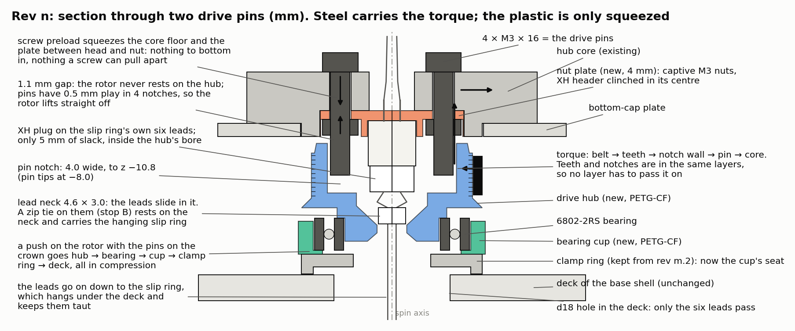

- **The pins are the four coupling screws.** They go through the hub core's existing holes at r 8, through the nut plate, and into nuts that sit in hex pockets on the plate's underside. The pockets keep the nuts from turning, so one hex key from the top tightens them.
- **Preload only squeezes.** Head and nut clamp the 6 mm core floor and 1.4 mm of plate between them. There is no blind hole for a screw to bottom in and nothing a screw can pull apart.
- **Steel carries the torque.** At stall, one pin alone would see 55 N. That is 4.5 MPa on the notch wall, and 172 MPa of bending in the screw against 450 MPa yield. Running, it is 3.6 N.
- **No layer has to pass torque to the next.** The hub's teeth span z −11.6 … −4.6 and its notches span −10.8 … −3.1. They are in the same layers, so torque crosses each layer in its own plane, which is the strong direction. In the old spool, torque had to climb from the pulley's layers up into the plug's.
- **The pins have 0.5 mm of play each way** in notches 4.0 mm wide. That lets the rotor's axis (set by the 6820) and the hub's axis (set by the cup) differ by up to 0.5 mm without binding. With 0.2 mm of offset I estimate the torque ripple at the pins at 5 mN·m, well under the 29 mN·m of drag, so the driving pin never lifts off its wall and the rotor's speed ripples by about ±0.13°.
- **Hall timing is untouched.** The sensor reads the rotor against the base magnet, so play in the drive does not reach the picture.

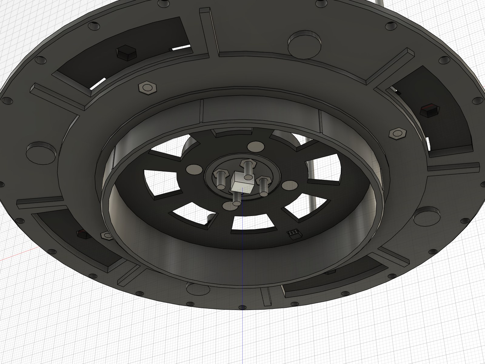

### 3.4 Drive hub

- **No belt flange on top.** The 20T pulley's two flanges already keep the belt on track. The hub's top is a slim cone, so the belt slides down onto the teeth from above once the motor is slid in by 0.5 mm or more. In rev m.2 the top flange was why the belt could not go on without force.
- **Notch walls.** The wall between a notch end and the tooth roots is 1.73 mm at four places. It is not in the torque path: the pins push sideways on the lands between notches, which are 8.6 mm wide at the pin circle.
- **Lead neck.** The bore narrows to a 4.6 × 3.0 mm slot fed by a 45° cone from each side. The six leads slide through it with 0.85 mm of side play. A knot or a zip tie on the leads cannot pass it. The two stops in section 3.7 rely on that.
- **It prints crown-down** with no supports. The only spans are the four 4 mm notch ceilings and two 0.8 mm ledges at the neck.

### 3.5 Bearing cup, bearing and the stand-in bush

- **A cup on top of the clamp ring.** The clamp ring is already on your deck and has the right height, so the cup sits on it and shares its three screws. The cup is flat underneath and open on top, so it prints with no overhang at all.
- **Fits.** The cup's bore is Ø24.4 with eight crush ribs to Ø23.85 (0.075 mm on the bearing's outer ring). The hub's journal is Ø14.6 with eight ribs to Ø15.10 (0.05 mm on the bore). These are the rev k collar and spigot numbers. If either is too tight for thumb pressure, scrape the ribs; do not force it.
- **Gaps inside the cartridge.** The turning inner ring runs 0.6 mm above the clamp ring. The hub clears the stationary outer ring by 1.6 mm, the cup's rim by 2.1 mm and the screw heads by 1.86 mm.
- **Loads.** The belt puts 8 N on a bearing rated 2,260 N static. If you push the rotor down while the pins sit on the hub's crown, about 100 N goes hub, bearing, cup, clamp ring, deck, all in compression.
- **Stand-in bush.** A plain printed ring, 15.5 × 24 × 5, takes the bearing's place until it arrives. With grease it adds about 12 mN·m of drag, 42 % more motor torque. Use it for the drive, the belt and a dark spin. Leave the slip ring and its leads out until the real bearing is in, because the cartridge cannot come off the leads once the plug is on them (section 5).

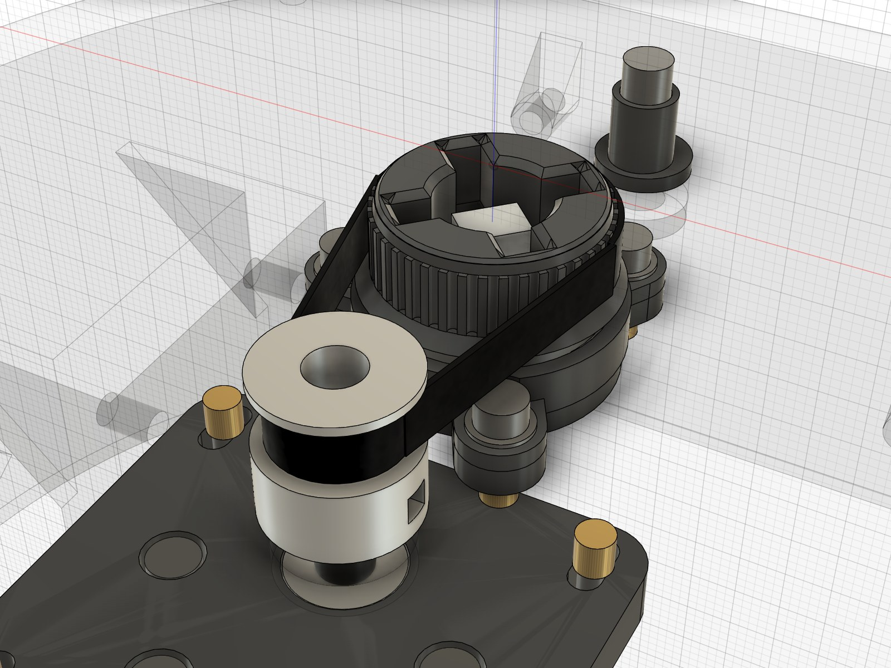

### 3.6 Centring jig

The hub and the rotor should share an axis to within about 0.2 mm. The cup's screw holes are Ø4.2, so it can float ±0.6 mm. The jig is a disc that drops into the 6820's bore with the rotor off; its centre hole sits on the hub's tooth tips. Tighten the three cup screws through the jig's three holes, then lift it out. It has a window over the motor pulley and a notch over the magnet riser, which also sets which way round it goes. Use it with the belt off.

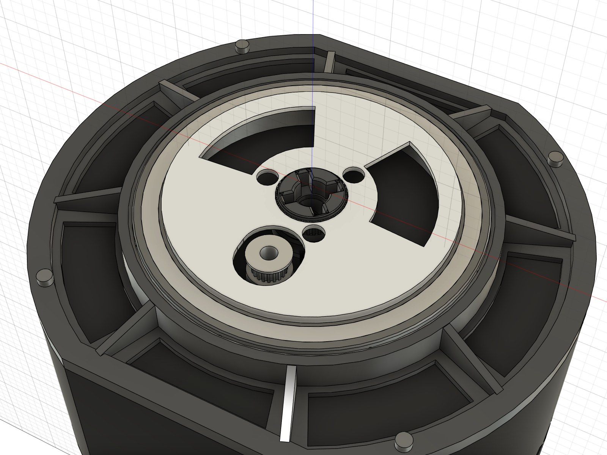

### 3.7 Rotor power: one plug, and a slip ring that hangs

**The plug.**

- **Connector.** A JST-XH 2-pin (2.5 mm pitch, 3 A, keyed so it cannot go in backwards). The rotor draws at most 1.4 A at 12 V.
- **Rotor side.** The XH header sits in a window in the nut plate. Its two tails go up through two holes in a 1.6 mm membrane and are bent over, the way a header sits on a circuit board. Two 26 AWG wires, about 110 mm, run from the tails up the core's centre hole and the existing channel to the buck's IN pads.
- **Base side.** The plug is crimped straight onto the slip ring's own six rotor leads, three per contact. That keeps your 3 + 3 pairing with no splice.
- **Do not use a 2-pin Dupont.** It goes in either way round, and 12 V backwards kills the buck.

**The problem a plug brings.** To plug in by hand, the rotor has to be held about 5 cm up. That needs 5 cm of lead between the hub and the plug, and all of it goes slack when the rotor comes down. With the slip ring clamped to the deck there is nowhere for it to go:

- there are 3.8 mm between the slip ring and the hub's neck;
- a 30 AWG PTFE lead is too springy to pile up in a hole. Below about 100 mm of length it bends by its stiffness, not its weight, so 5 cm of slack makes a loop up to 25 mm wide;
- the motor pulley's flange is 22 mm from the axis, and the loop forms under the rotor where you cannot see it.

My first version of rev n had exactly this fault. It drew the lead as a straight line, and passed every check.

**The fix: let the slip ring hang.** The slip ring is not clamped any more. It goes in from below and hangs under the deck on its own six rotor leads, which run up through the deck hole, the clamp ring and the hub's neck to the plug. Its weight keeps them taut. A lead in tension cannot loop.

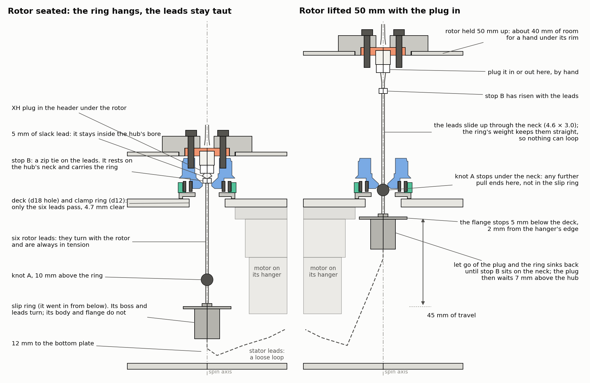

- **Stop B** is a small zip tie on the leads. It rests on the hub's neck and carries the slip ring, so the plug carries nothing. When you pull the plug off, the ring sinks back until stop B sits on the neck again, and the plug waits about 7 mm above the hub where you can pick it up.
- **Knot A** is an overhand knot in the six leads, 10 mm above the slip ring. When the rotor has been lifted 50 mm it stops under the neck. Any further pull ends there, so the slip ring never feels it. The flange is then still 5 mm below the deck.
- **Travel.** The slip ring moves 45 mm between the two stops. With the 5 mm of slack between stop B and the plug, the rotor lifts 50 mm with the plug in. That leaves about 40 mm of room for a hand under its rim.
- **Room.** At rest the slip ring's body ends 12 mm above the bottom plate, and the ring is 9 mm from the motor. At full lift it is 7 mm from the motor and 2 mm from the hanger's edge.
- **What turns.** The slip ring's boss, the six leads and knot A turn with the rotor: 59 mm of turning wire below the hub. The nearest fixed part is the clamp ring's opening, 4.7 mm away. The slip ring's body and flange do not turn; the stator leads hold them.

| Take-up number (`calc/revn_drive_calc.py`, B7) | Value |
|---|---|
| weight on the leads (slip ring assumed 10 g) | 0.10 N; 0.15 N with three M3 × 10 screws and six nuts in the flange holes |
| the hanging ring swings like a 68 mm pendulum | 1.9 Hz = 114 rpm; the rotor passes it on the way up |
| a neck 0.5 mm off-centre moves the ring, at 188 / 225 rpm | 0.29 / 0.17 mm |
| first string frequency of the six taut leads | 41 Hz, far above the 3.75 Hz spin |
| wind-up of the 59 mm of leads under 1 mN·m of slip-ring drag | 0.65 turn, steady |
| torque at which the taut bundle would kink | 4.1 mN·m, four times the drag |

**What it asks of you.**

- **The slip ring goes in from below.** Its Ø24 flange cannot pass the Ø18 hole in the deck. So it has to come out of where it is now, and its stator leads have to be free while you do it (question Q6).
- **Leave the stator leads a loose loop** of at least 60 mm, so the ring can move.
- **Keep other wires away from the centre.** Tie the pot cable and the motor leads to the shell wall, so nothing can come within 20 mm of the turning leads under the deck hole.

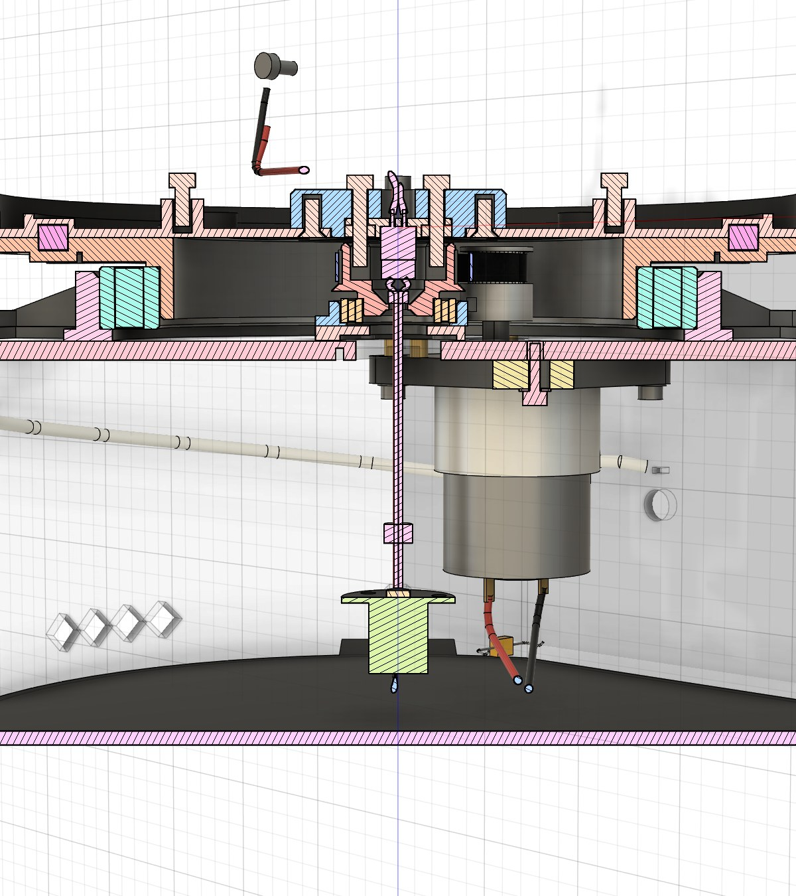

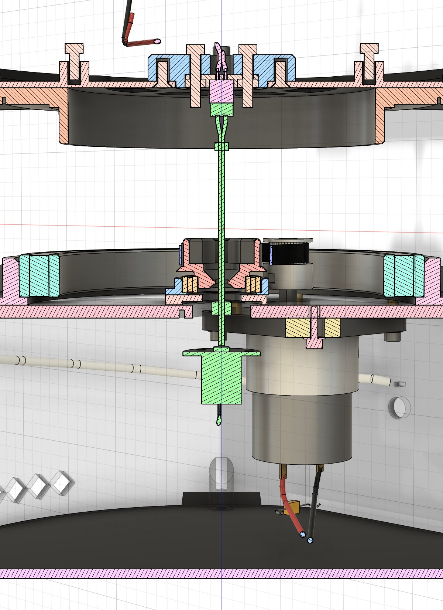

### 3.8 Materials

| Part | Material | Why |
|---|---|---|
| Hub, cup | PETG-CF | tougher than PET-CF between layers, and these parts have crush ribs and get handled; it is dry and on the printer |
| Nut plate | PETG-CF on the main plate; PET-CF file as an alternative | it is only squeezed (29 MPa under each nut at 0.3 N·m). PET-CF creeps less and takes soldering heat better; PETG-CF saves a filament change |
| Jig, bush | PETG-CF | same spool |

## 4. Checks (224 rows, 0 fail; `calc/revn_checks_output.txt`)

Same method as rev m.2: every rotating body against every stationary body, and the pulley, belt and motor shaft against everything, at 1.5 mm or more. The drive hub, the slip ring's boss, its six rotor leads and knot A count as rotating. The slip ring is checked at rest and raised 45 mm.

| Check | mm | Limit |
|---|---|---|
| motor pulley top flange to the rotor plate (tightest in the model, unchanged) | **1.60** | ≥ 1.5 |
| drive hub to the bearing's stationary outer ring | 1.60 | ≥ 1.5 |
| drive hub to the cup screw heads | 1.86 | ≥ 1.5 |
| drive hub (journal end) to the clamp ring / to the cup's rim | 2.00 / 2.10 | ≥ 1.5 |
| rotor ring to the collar / to the magnet riser (unchanged) | 2.00 / 2.00 | ≥ 1.5 |
| turning leads through the clamp ring's opening / the deck hole | 4.70 / 7.70 | ≥ 1.5 |
| turning leads and knot A to the nearest fixed wire in the model | 18.2 | ≥ 1.5 |
| hanging slip ring above the bottom plate / to the motor | 12.3 / 9.3 | ≥ 8 / ≥ 3 |
| slip ring raised 45 mm: flange to the deck underside / to the hanger's edge | 5.00 / 2.00 | ≥ 3 / ≥ 1.5 |
| slip ring raised 45 mm: knot A in the clamp ring's opening | 3.00 | ≥ 1.5 |
| motor slid fully in (+2 mm) to the hanging slip ring | 7.42 | ≥ 3 |
| motor pulley hub to the cup, at full tension travel toward the axis | 3.32 | ≥ 1.5 |
| belt to the cup / to the cup screw heads | 4.10 / 3.70 | ≥ 1.5 |
| drive pins in the notches: play each side and at the outer end | 0.50 | 0.45-0.60 |
| pin tips above the notch floors (M3 × 16) | 2.80 | ≥ 1.0 |
| pin engagement below the lead-in chamfer | 4.10 | ≥ 3.5 |
| axial gap, nut plate and hub core to the hub crown | 1.10 | 1.0-1.2 |
| XH header and plug inside the hub's crown hole | 1.17 | ≥ 1.0 |
| leads in the neck (side play) | 0.85 | ≥ 0.6 |
| bearing relief, inner ring above the clamp ring | 0.60 | 0.5-0.7 |
| cup screw thread in the deck insert (M3 × 8 + washer) | 2.30 | 2.0-4.0 |
| hall sensor face to the riser magnets (unchanged) | 5.00 | 4.9-5.1 |
| overlaps: hub, cup, clamp ring, nut plate, pins, wiring, deck (17 rows) | 0 mm³ | 0 |

**Balance and dynamics (same mass model as rev i to m.2):**

| | Rotor | CG (x, y) mm | U g·mm | G6.3 / G2.5 at 225 rpm | Rocking mode |
|---|---|---|---|---|---|
| rev m.2 | 889.0 g | (0.021, −0.054) | 51.6 | 22 % / 55 % | 41.4 Hz |
| **rev n** | **882.8 g** | (0.021, −0.055) | **51.6** | **22 % of 236 / 55 % of 94** | **41.4 Hz** |

The rotor lost the spool (8.2 g) and the slip ring's turning half with its leads (2.1 g, which hang from the hub now), and gained the nut plate, nuts, longer screws and header (4.1 g). All of it is on the axis. The hub (4.8 g) is on the base, on its own bearing, with its centre of mass on the axis. The trim plan is unchanged: 27.9 g·mm on the trim flange and 25.9 g·mm on the top cap, each less than one trim screw. Lead reach is unchanged because the board did not move: the same five leads need 10 mm.

**Print checks:** the floating-island check (script 151) finds 0 starts in all eight STLs and all four sliced files. A span audit of each part finds no unsupported region reaching more than 0.3 mm from support, except the hub's four 4 mm notch ceilings and two 0.8 mm ledges at the lead neck.

## 5. Assembly

**Before you start.**

- Take the four M3 × 10 screws and what is left of the spool out of the hub core.
- Take the slip ring out: undo the clamp ring's three M3 × 6 screws, lift the ring, free the stator leads under the deck and lift the slip ring out. Put the clamp ring back on the deck.
- Have ready: 4 × M3 × 16, 4 × M3 nuts, 3 × M3 × 8, a small zip tie, a little grease if you use the bush.

**If the bearing is not there yet.** Do steps 1 to 4 with the bush, then step 6 without any leads, then step 8. You can drop the rotor on and spin it dark to try the drive. When the bearing arrives, take the cartridge off (three screws), swap the bush for the bearing, and do steps 5 to 7. Do not put the plug on the leads while the bush is in: the cartridge cannot come off them afterwards without taking the plug apart.

### A. Rotor, on the bench (once)

1. **Socket.** Push the XH header into the nut plate's window from the side with the nut pockets, tails through the two small holes (open them with a 1 mm drill if the tails won't pass). Bend the tails flat. Solder a red and a black 26 AWG wire (110 mm) to them. Note which pin is +.
2. **Nut plate.** Press four M3 nuts into the plate's hex pockets. Feed the two wires up the hub core's centre hole and seat the plate in the pocket, nuts facing out. Put 4 × M3 × 16 down through the core's top and tighten them into the nuts. Snug is enough; add threadlocker on the screw threads if you have it. **Use M3 × 16, not × 20:** a × 20 would hit the bottom of the notches.
3. **Pigtail.** Run the two wires up the channel and land them on the buck's IN pads.

### B. Base, rotor off (once)

4. **Cartridge.** Press the bearing (or the greased bush) into the cup with your thumbs on its outer ring, until it sits on the ledge. Press the hub's journal into the bearing until the shoulder seats. In the bush the journal just slides in; grease it.
5. **Slip ring.** Tie one overhand knot in the six rotor leads (the ones on the flange side), about 10 mm above the slip ring, and pull it tight. Lay the base on its side with the bottom plate off. From below, push the lead ends up through the hole in the deck and through the clamp ring. Leave the slip ring lying in the base.
6. **Cartridge on.** Twist the lead ends together and feed them up through the cartridge from below; the cone under the hub steers them into the neck. Set the cartridge on the clamp ring with its three lobes over the screw holes. Start 3 × M3 × 8 with the washers. Drop the jig into the big bearing, notch over the magnet riser, tighten the three screws through its holes, and lift the jig out.
7. **Plug.** Stand the base upright. Pull the leads up until the knot stops under the hub. Mark them **32 mm** above the top of the hub and cut them **46 mm** above it. Pull a small zip tie tight on the leads at the mark and trim its tail. Sort the leads 3 + 3 (the colours match the stator side; beep them to be sure). Strip 2 mm, twist each three, crimp an XH contact on each, and click them into the plug so that + meets + on the header. Let go: the slip ring sinks until the zip tie sits on the neck, and the plug stands about 7 mm above the hub. Under the deck, reconnect the stator leads with a loose loop of 60 mm, and tie the pot cable and the motor leads to the shell wall.
8. **Belt.** Loosen the four hanger screws and push the motor toward the centre. Hook the belt over the motor pulley, then slide it down the hub's cone onto the teeth. Pull the motor out until the belt is snug and tighten the four screws from below, with the base on its side. Check that the motor pulley's teeth are level with the hub's. Run the motor: the hub, the leads and the plug turn together, and the slip ring's body hangs still. Measure the plug: 12 V, with + on the pin that meets the red wire.

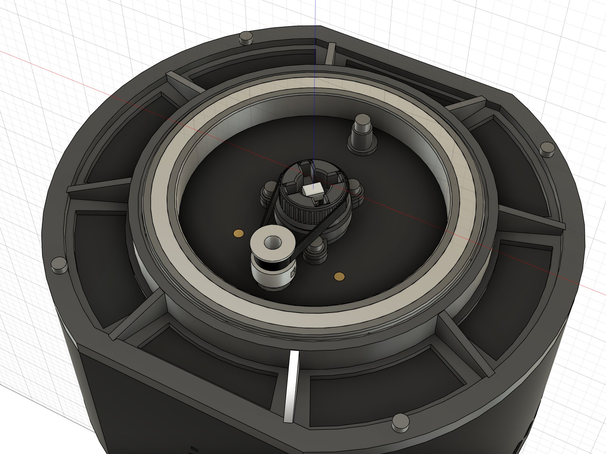

### C. Rotor on (every time, no tools)

9. **Plug and drop.** Hold the rotor 4 to 5 cm above the base and push the plug into the header under it. Lower the rotor into the big bearing, turn it up to a quarter turn until the four pins drop into the notches, and push it home. To take it off: lift 4 to 5 cm, pull the plug, lift away. The rotor will not go higher than 5 cm with the plug in. Never lower the rotor with the plug out: it stands in the way.

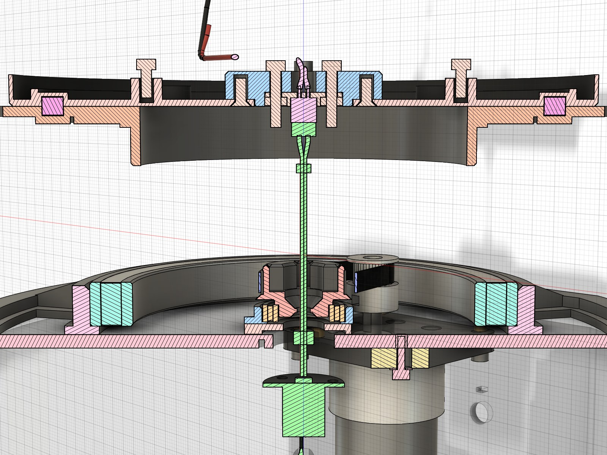

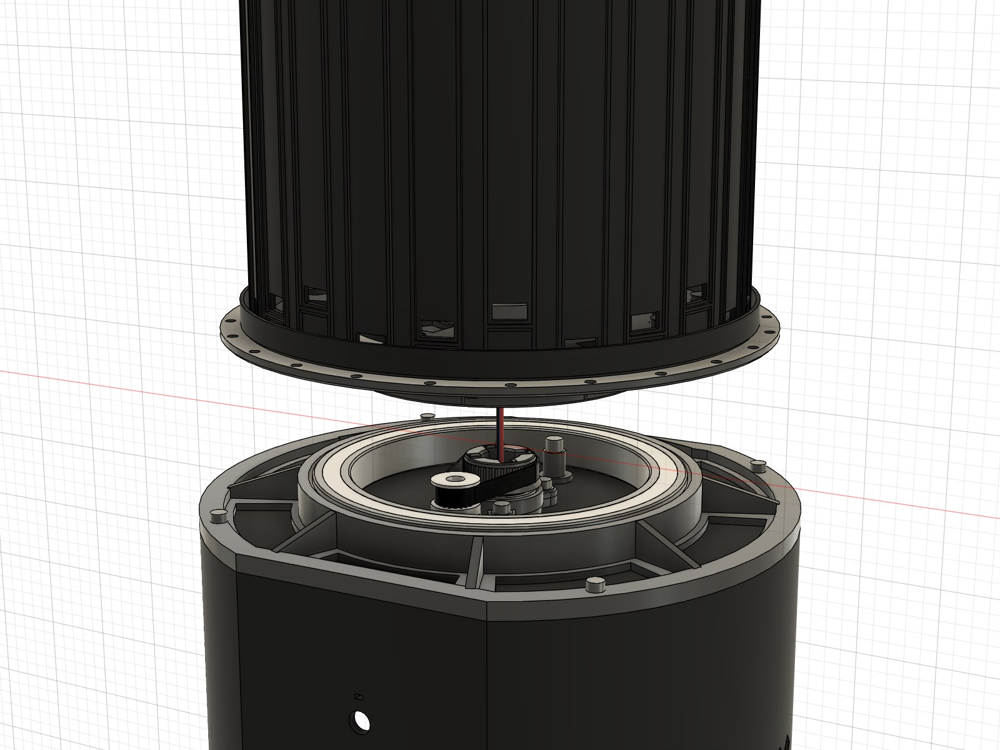

**Step count, drive and slip-ring interface only** (shell inserts, collar and the rest are the same in both):

| | rev m.2 | rev n |
|---|---|---|
| Steps, to a rotor that is on and powered | 11 | 9 |
| Blind steps (two things to line up that you cannot see together) | 3 | 0; the pins find their notches by feel |
| Heat-set inserts / glue joints in the drive | 4 / 1 | 0 / 0 |
| Belt tensioned | with the 1.1 kg rotor on, unseen | rotor off, belt in view |
| Loose lead to stow | a slack loop inside the rotor, top cap off | none: the slip ring takes it up |
| To take the rotor off and put it back | 4 steps, tools, top cap off | 1 step (step 9), no tools |

## 6. Print list (`cad/print/rev-n_CURRENT/`, sliced, not sent)

All on the H2D's **left (hardened) nozzle, extruder 1**, textured PEI, 0.2 mm layers, no supports, no brim.

| File | Parts | Material, settings | Time | Mass |
|---|---|---|---|---|
| **`revn_drive_parts_plate_PETG-CF`** | 2 drive hubs (one spare, crown down), bearing cup, stand-in bush, 2 nut plates (membrane down) | Bambu PETG-CF profile, 6 walls, 6/6, 85 % | **1.19 h** | **14.7 g** |
| **`revn_centring_jig_PETG-CF`** | centring jig (disc face down) | PETG-CF, 4 walls, 4/4, 20 % | **0.67 h** | **16.1 g** |
| `alternates/revn_nut_plate_x2_PET-CF` | 2 nut plates, same shape | Fiberon PET-CF, 6 walls, 6/6, 85 % | 0.29 h | 2.7 g |
| `alternates/revn_slipring_clamp_spare_PET-CF` | clamp ring, rev m.2 shape; only if yours is damaged | Fiberon PET-CF | 0.19 h | 2.1 g |

Each has a project `.3mf` to open in Bambu Studio, a sliced `.gcode.3mf` to send, and a `.plate_1.gcode`. Single STLs are in `cad/revn_*.stl`. If your PETG-CF is the Elegoo spool, the Bambu profile is the one you used for the shell.

**Total for today: 1.9 h and 31 g of PETG-CF.**

**From your kits:** 4 × M3 × 16 socket screws, 4 × M3 nuts, 3 × M3 × 8 socket screws, one small zip tie, two 110 mm lengths of 26 AWG wire, grease for the bush.

## 7. Buy list

Both pages were opened live on Amazon on 2026-11-17 at 18:08 ET. Nothing was put in a cart.

| # | Part | Link | Price | Delivery shown | Why |
|---|---|---|---|---|---|
| 1 | **6802-2RS bearings, 15 × 24 × 5 mm, 10-pack** (KABOBEARING, ABEC-5, 4.6★ from 29) | https://www.amazon.com/dp/B0D1P1BM4S | **$5.86** | **FREE, next day** (shown: Wed Nov 18 if ordered by about 23:00) | the hub's bearing; one needed |
| 1b | same size, XIKE 10-pack (4.8★ from 271) | https://www.amazon.com/dp/B09D33J78V | $9.99 | FREE, next day | the better-reviewed choice |
| 2 | **JST-XH 2.54 mm connector kit, 460 pcs**: 2-6 pin housings, headers, crimp contacts (4.6★ from 192) | https://www.amazon.com/dp/B0BZDCGJ32 | **$7.98** | **FREE, next day** (shown: Wed Nov 18 if ordered by about 23:00) | the rotor power plug; skip it if your kit already has XH 2-pin headers and plugs (Q2) |

Items 1 and 2 are $13.84 before tax.

## 8. Decisions I took, and what I need from you

**Decisions (you were asleep; each is easy to reverse):**

| Decision | Why |
|---|---|
| Driven pulley on the base, pins on the rotor | the only family of fixes that makes the rotor come off by hand and puts the belt in view |
| Steel pins and captive nuts, no inserts | removes the failure, and the plastic is only squeezed |
| Slip ring hangs under the deck as the take-up weight | the only way I found to plug in by hand without leaving 5 cm of loose lead under the rotor; it needs no extra parts |
| Keep your clamp ring, add a cup on top | it is on the deck and sets the height; the cup prints without supports |
| No top flange on the hub | the belt goes on from above |
| Hub and cup in PETG-CF, not PET-CF | tougher between layers; parts with crush ribs get handled |
| Spare metal pulleys not used on the rotor | 1:1 ratio, no bolt pattern (section 2) |
| A printed bush as a stand-in | you can fit the drive today without the bearing |

**Open questions:**

| # | Question | Why it matters |
|---|---|---|
| Q1 | Where did the two spools break? A flat layer at the bottom of the insert holes? A screw-tip mark in any hole? | confirms section 1; the redesign holds either way |
| Q2 | Does your connector kit have **JST-XH** 2-pin headers, plugs and contacts (white, 2.5 mm)? | if it only has Dupont, order item 2 |
| Q3 | Order the bearings today? | $5.86, next day |
| Q4 | Do you have M3 × 16 and M3 × 8 socket screws? | M3 × 20 is too long for the pins |
| Q5 | Are you happy with the slip ring hanging on its leads? | it is the unusual part of this design. The other way is a self-mating connector (option K), which needs parts and a test |
| Q6 | Are the slip ring's stator leads already soldered under the deck? | it has to come out and go back in from below |
| Q7 | What does the slip ring weigh? | I assumed 10 g; under 6 g, add the three screws and nuts to its flange |
| Q8 | Nut plate in PETG-CF (on the main plate) or PET-CF (alternate file)? | I'd print the main plate and use those |
| Q9 | After the first spin: any tick from the pins at start or stop? | 6 mm of thin heat-shrink on each pin quiets it |

## 9. Risks, and what to watch at the first spin

| Risk | How likely, how bad | What to do |
|---|---|---|
| Bearing too tight in the cup, or hub too tight in the bearing | medium / low | scrape the crush ribs; never press through force |
| Hub loose in the bearing | low / low | a drop of CA on the journal |
| The slip ring does not sink back when the rotor comes down | low / medium | lift and look: the knot or the tie may be caught. Add weight (three M3 × 10 screws with two nuts each in its flange holes) |
| A loose wire under the deck reaches the turning leads | low / medium | tie the pot cable and motor leads to the wall; check by hand before the bottom plate goes on |
| The hanging slip ring sways near 114 rpm | medium / low | it passes in a second on the way up; do not hold the speed between 100 and 130 rpm |
| Rotor lifted past 5 cm with the plug in | low / low | knot A stops it and the plug pulls off; with the stand-in bush the hub comes up too: push it back |
| Belt climbs off the top of the hub (it has no top flange) | low / medium | the motor pulley is not level or not square; set its teeth level with the hub's |
| Hub off-centre from the rotor | low with the jig / low | the notches take 0.5 mm; without the jig the rotor's speed ripples about ±0.3° |
| Stand-in bush drags or squeaks | medium / low | grease it; swap in the bearing when it arrives |
| XH contact crimped on three thin leads pulls out | low / medium | tug-test each one; in use it carries only the slack lead |
| Pins bottom in the notches | only with M3 × 20 | use M3 × 16 |

**First spin, in order:** bench-run the base alone and check the slip ring's body hangs still; fit the rotor; turn it by hand one revolution and listen; then 150 and 188 rpm, watching the belt on the hub.

## 10. How to explain it

**The 30-second version:**

> The pulley kept snapping, and it wasn't the motor doing it. Four screws went into brass inserts in a plug with a millimetre of wall, and the screws were exactly as long as the inserts. So when I tightened them, they bottomed out and pushed the part in half along a layer line. The fix wasn't a stronger pulley. I took the pulley off the rotor altogether. It lives on the base now, on its own bearing, and the rotor just carries four steel pins that drop into it. No inserts, no glue, and the rotor lifts off by hand. The slip ring hangs under the deck on its own wires, so its weight reels the wire in when the rotor comes down.

**Numbers that read well:**

- 0.26 MPa from the motor at stall against 17-29 MPa from the screws, on the same plane;
- 11.2 mm³ of displaced plastic into an 11.0 mm³ relief;
- 1.1 mm of wall where the rule said 2.5;
- 11 steps down to 9, 3 blind steps down to 0, and rotor removal from 4 steps with tools to 1 without;
- a 10 g slip ring takes up 45 mm of wire;
- 224 checks, 0 fail; balance unchanged at 22 % of G6.3;
- 1.2 hours and 15 grams to print the fix.

**Talking points:**

- **Find the load that actually broke it.** The obvious suspect (drive torque) was 60 to 100 times too small. Assembly loads are loads too.
- **A blind threaded hole needs room under the screw, and a heat-set insert fills that room.**
- **Design for the direction plastic is strong in.** Squeeze it, or load it within a layer; never ask one layer to hold on to the next. Putting the teeth and the notches in the same layers does that with no extra parts.
- **Move the adjustable things to where you can see them.** The belt did not get easier to fit; it moved to the side of the joint that is in view.
- **Separate along the axis.** Pins, splines and dogs let a rotor come off; a belt round the rotor never will.
- **Check flexible parts in the state they are really in.** My first version drew the lead as a straight line and passed 219 checks. The real lead would have gone slack and looped under the rotor. I found it by walking through the assembly steps, not from the model.
- **Use what is already there as the mechanism.** The slip ring's own weight is the retractor. No spring, no reel, no new part.
- **Keep what works.** The clamp ring, the belt, the pulley and the shell all stayed. The change is three small prints.

**Shots:** the broken spool beside the new hub; the section through the pins; four screws going through the core as pins; the rotor dropping on and clicking round into the notches; the belt sliding down the cone; the jig in the bearing; the slip ring rising and sinking under the deck as the rotor is lifted (bottom plate off).

## 11. Files and replay

| Path | What |
|---|---|
| `fusionclaude/scripts/185_pov15_revn_drive.py` | builds the cup, bearing, hub, nut plate, pins and nuts, XH pair, the hanging slip ring with its leads, knot A and stop B, the pigtail and the base wiring routes; rebuilds the kept clamp ring; idempotent |
| `…/186_pov15_revn_export.py` | STLs in print orientation, the plates, the jig and bush, the STEP (`--undo` afterwards) |
| `…/187_pov15_revn_checks.py` | the 224 checks (`--ro`) → `calc/revn_checks.json` |
| `…/188_pov15_revn_renders.py`, `lib/pov_revn_shot.py` | the renders, including sections at any angle through the axis and the lifted state |
| `…/189_pov15_revn_explode.py` | exploded view for the rev n model (replaces 184): `apply(frac, upto, only, dz_override, axial_only)` |
| `…/190_pov15_revn_save.py` | the save |
| `fusionclaude/lib/povlib.py` (rev n block), `lib/pov_revm.py` | parameters, mass model |
| `calc/revn_drive_calc.py` (+ `.json`, `_output.txt`) | section 1 and 3 numbers, the take-up (B7), the step counts |
| `calc/revn_figures.py` | the three section drawings |
| `cad/print/rev-n_CURRENT/` | print files and README |
| `fusionclaude/designs/pov-led-column.md` | design note, rev n section |

Replay on the saved v13 (rev m.2, assembled): `185` → `187 --ro` → `186` (+ `--undo`) → `188` → `190`.

The Fusion document is saved and assembled (not exploded). For a live exploded view of rev n, ask in the exploded-view tab: it uses script 189 (25 steps).

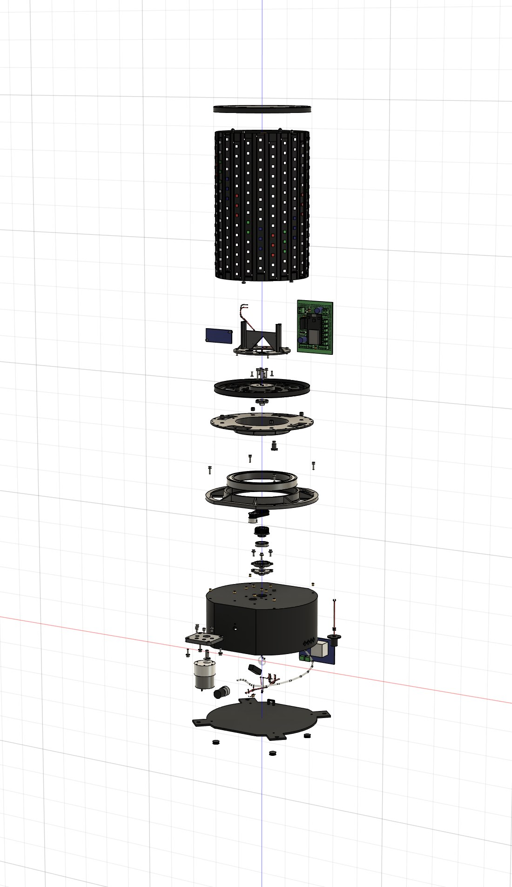
