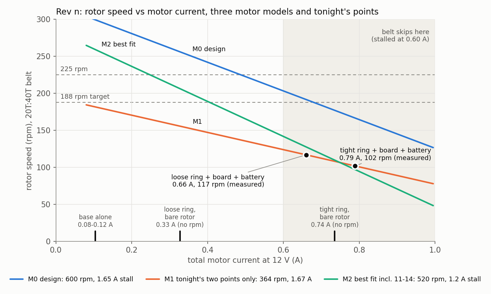

# POV LED Column rev n on the bench: why it ran badly, and what to do first

**Prepared for Brian** · Claude (Opus 5.5), rev n diagnosis agent on the desktop PC · 2026-11-19
Inputs: tonight's bench session (the laptop Main session's log, 11:44-15:54 ET: your readings, and the hall rpm read over Wi-Fi from `/api/status`), the rev n drive report (`docs/2026-11-17-rev-n-drive-redesign.md`), the rev m CAD report §9, the rev k rim-bearing report, the rotor power report, `docs/measurements.md`, `cad/print/rev-n_CURRENT/README.md` and `rotor_ring_refit/README.md`, the 11-18 fit-test result and the decision to epoxy the 6820 into the collar (desktop Main session, 11-18), `calc/revn_checks.json` and the rev n parameter block in `fusionclaude/lib/povlib.py`.
Outputs: this report (+ `.html`), `calc/revn_bench_diagnosis.py` (+ `.json`, `_output.txt`), `docs/img/revn_diag_speed_vs_current.png`, as-built notes in the two print READMEs. No CAD or print file was changed. Nothing was printed, ordered or emailed.

---

## Verdict

**You're half right.** The big bearing's seat was the main cause today. With the new Ø100.80 ring pressed into the 6820, the bare rotor drew 735 mA and stalled the belt. With the 6820 out, the load vanished. With the old loose ring, it fell to 327 mA. But this is not a "slightly too tight" problem that a slightly looser print will fix:

- the 6820's rings are about 3 mm thick and have only 0.012-0.036 mm of play inside;
- its outer ring is now epoxied, round, in the collar;
- a printed Ø100 ring is about 0.4 mm out of round.

Any spigot that grips on all eight ribs squeezes the inner ring oval and pinches the balls: 4-12 N across the ring is enough. Any spigot that doesn't pinch is loose on its short axis. For this bearing a sliding inner fit is the correct one anyway, because the load turns with the inner ring. So don't print a tighter ring. Run the old one tomorrow, then scrape the 100.80 ring until it slides in.

**The 6802 hub wobble is real, but it isn't what's slowing the column:** the whole base draws only 80-120 mA. The hub nods in its single 5 mm bearing under the belt's pull and the driving pin's push, and the nod grows with the rotor's drag.

**Three things you didn't name matter as much:**

1. **The board and battery added another 330 mA on the loose ring**, against only 50 mA on the tight one. That put the belt at its skip limit, which was the popping.
2. **The motor loses about 24 rpm at the rotor for every 0.1 A of load.** So 188 rpm on 12 V needs the total current under about 0.40 A.
3. **Even a perfectly fitted, greased 6820 costs about 30-60 mN·m**, 15-30 times the 2 mN·m the design allowed.

**The hanging slip ring can't work as built.** Nothing stops its body turning, so the rotor winds its leads up and they lift it. And as a pendulum it is tuned to about 115 rpm, the speed the column ran at all evening.

## First thing tomorrow (about an hour, no printing)

1. **Motor check, belt off (5 min).** Put 12.0 V from the bench supply straight on the motor and a tape flag on the 20T. Film 5 s in 240 fps slow-mo, count frames over 10 turns, and note the current (§5.2):
    - 30 frames or fewer per turn (480 rpm or more): the motor is as expected;
    - 36-40 frames (360-400 rpm): a slower motor, so plan on 15 V;
    - about 48 frames (300 rpm): it's the 300 rpm version, so order the 600 rpm one.

2. **Cup (10 min).** Swap the three cup screws for M3 × 6. With the clamp ring out, the CAD puts the tip of an M3 × 8 over the motor hanger 1.5 mm into the hanger, so it bottoms before it clamps. Centre the cup with the jig and snug the screws. Pass: the base alone draws 0.12 A or less at 12 V.
3. **Bare rotor on the old ring (10 min).** Pass: 0.35 A or less at 12 V, and 190 rpm or more by slow-mo (if step 1 passed).
4. **Board + battery (15 min).** Strap the battery as close to the axis as it goes, with nothing within 5 mm of the base. Pass: the current rises by 0.08 A at most over step 3. If it jumps by 0.3 A again, stop and find out why before anything else (§6, step 6).
5. **Leave the slip ring out.** Run on the battery until steps 1-4 pass.

## 1. What the bench showed

| Time (ET) | Setup | Supply | Current | Rotor rpm | Notes |
|---|---|---|---|---|---|
| 11:44 | hub loose in the 6802 | 12 V, PWM | - | - | hub rocks, noisy, belt skips; after CA on the journal, much better |
| 12:00 | **100.80 ring**, bare rotor | 12 V, PWM at full | **735 mA** | - | no board on the rotor, so no rpm |
| 12:29 | 100.80 ring + board + battery, 3 magnets | 12 V, PWM at full | **789 mA** | **101-103** | the reading flickers at the firmware's 100 rpm "stopped" gate |
| 12:33 | the same, PWM board bypassed | 13.5 V direct | - | 111-117 | +11 % speed for +12.5 % volts; one false 2,164 rpm reading |
| 12:38-12:44 | base alone (rotor off) | 12 V direct | 122 → 110 → **80 mA** (cup screws loose) → **104 mA** (snug) | - | screws loose: the belt pulls the cup over and skips |
| 13:27 | 100.80 ring, rotor on | 12 V direct | ~600 mA | **0** | rotor stalled, belt jumping teeth |
| 13:34 | 100.80 ring, belt off, by hand | - | - | - | even drag all round, no catch point, no coast |
| 14:28 | 6820 taken off | 12 V direct | - | "fast" | the load went away |
| 14:35 | **old ring** (rib tips 99.24-99.64), bare rotor | 12 V direct | **327 mA** | - | no board, so no rpm |
| 14:54 | old ring + board + battery, 3 magnets | 12 V direct | **660 mA** | **115-120** | 0 to 2 rejected pulses; popping and odd sounds |

**A correction to the brief:** 119 rpm was not measured at 327 mA. The 327 mA run had no board on the rotor, so there was no hall reading. The 115-120 rpm came with the board and battery on, at 660 mA.

**What the numbers already rule out:**

- **The base drive itself.** Motor, belt, hub and 6802 together draw 80-120 mA. The motor alone drew about 150 mA through the PWM board on 11-07. The power isn't going into the hub's bearing.
- **The PWM board.** Bypassing it at 13.5 V bought +11 % speed, about what the extra voltage alone gives. The board isn't eating volts.
- **The drive pins bottoming.** With the clamp ring out, the hub sits 3.2 mm lower, so your M3 × 20 pins are the right length (§3.2). The rev n report's "M3 × 16, never × 20" applies only with the clamp ring in.
- **The firmware's hall filter.** It reported what the sensor sent it. The 96 rejected pulses and 300-odd resyncs all piled up during the tight-ring runs, while the rotor was being stopped, restarted and jerked by the skipping belt. On the steady 14:54 run there were 0 to 2.

## 2. Fault tree, ranked

```
Column runs at 100-120 rpm (target 188), draws 0.33-0.79 A, belt skips and pops,
hub nods, hall misses, slip ring climbs
|
+-- A. Too much drag on the rotor
|   +-- A1  6820 pinched by the 100.80 spigot ............. CONFIRMED  ~0.40 A  (gone on the old ring)
|   +-- A2  extra drag once the board + battery go on ...... MEASURED   +0.33 A  (cause not pinned down)
|   |       +-- rotor and hub off-axis: loose spigot + cup re-snugged without the jig -> pins bind
|   |       +-- a rub: battery, strap, a lead under the plate, the taller 3-magnet stack
|   |       +-- the battery's imbalance
|   +-- A3  the 6820's own grease drag, 30-60 mN m ......... LIKELY     ~0.2 A   (design assumed 2 mN m)
|
+-- B.  Not enough motor: -24 rpm at the rotor per 0.1 A .. PROBABLE   (no-load speed never measured)
|
+-- C.  The drive cartridge passes the drag on badly
|   +-- C1  cup: M3 x 8 over the hanger bottoms; cup bends when tight, slides when loose
|   +-- C2  hub nods in one 5 mm bearing: belt pull + one driving pin at r 8 mm
|   +-- C3  belt skips above ~0.6 A ......................... consequence of A + B (the popping)
|
+-- D.  Hall: magnets ~2.5-3 mm further away than drawn ..... needs 3 magnets instead of 2
|
+-- E.  Hanging slip ring: wind-up + 115 rpm pendulum ....... design flaw, separate from the speed
```

| Rank | Cause | Evidence | Size | Confidence | Fix (§3) |
|---|---|---|---|---|---|
| 1 | **A1** 6820 pinched by the 100.80 spigot | 735 mA bare on the tight ring against 327 mA on the old one; 6820 out = load gone; even drag with no catch point; the outer ring was epoxied in after the 11-18 fit test | ~0.4 A, enough to stall the belt | confirmed | old ring now, then scrape the 100.80 ring to a sliding fit |
| 2 | **A2** board + battery penalty on the loose ring | +0.33 A on the loose ring, +0.05 A on the tight ring; popping | ~0.33 A (~85 mN·m at the rotor) | measured; cause open | re-centre the cup with the jig, battery onto the axis, rub hunt |
| 3 | **B** motor headroom | 117 rpm at 0.66 A and 102 rpm at 0.79 A tonight; 188 rpm on 5.07 V on 11-14 (rev j, direct) | 188 rpm needs ≤ 0.40 A at 12 V | probable | measure it; 15 V, or the 600/960 rpm version |
| 4 | **A3** 6820 grease drag | bare rotor on the old ring: 0.22 A over the base ≈ 56 mN·m; the SKF model predicts 36-63 at 188 rpm | ~0.2 A | likely | accept; run it in; oil instead of grease if needed |
| 5 | **C1-C3** cup, hub nod, belt | 80 mA with the cup screws loose against 122 mA tight; skips when loose; popping at 0.66 A, stall at 0.6 A | noise, skips | likely | M3 × 6, jig, epoxy dots; cup v2; two-bearing hub later |
| 6 | **D** hall gap | 1 magnet: no pulses; 2: about 1 pass in 4; 3: every pass | missed pulses only | likely | plasticine gap check, keep 3 magnets |
| 7 | **E** slip ring take-up | it climbed even at low rpm | blocks base power | certain (it's the design) | §4 |
| - | your "6802 wobble" | the base alone draws 80-120 mA | small | - | it is C2, a symptom of the drag |

### 2.1 Why a tighter ring can't fix A1

- **The inner ring is a 3 mm steel hoop.** Two opposite forces of 1 N make it 3 µm oval. Its internal clearance (12-36 µm, group N for Ø100) is gone at **4-12 N** across the ring (`calc/revn_bench_diagnosis_output.txt` §D).
- **The printed ring is 0.4 mm oval.** That's the old ring's rib tips, 99.24 to 99.64. It's 11-33 times the bearing's clearance. The rotor ring's flat web is several times stiffer in its own plane than the steel hoop, so when the two are pressed together, the steel gives.
- **So a ring that is snug on its short axis is 0.4 mm tight on its long axis.** It pinches the balls at two points, and you feel that as even drag all the way round, because 32 balls keep passing the two pinch points.
- **Before 11-18 the outer ring could follow the inner one a little.** Now it is epoxied round in the collar. That was the right move for keeping the bearing in the base, but it means both rings are held by printed parts of different shapes.
- **The fit test misled you, through no fault of yours.** The test ring is a 5 mm slice on a 0.8 mm flange and much springier than the full ring with its 5 mm hub and ribbed web. A two-thumb press on the test ring becomes a pinch on the real part.

**The textbook fit rule gives the same answer.** The ring that turns relative to the load gets the firm fit:

| Bearing seat | The load (unbalance, pin push, belt) turns relative to this ring? | Right fit | As built |
|---|---|---|---|
| 6820 outer ring in the collar | yes: the outer ring stands still while the rotor's loads go round | firm | epoxied: right |
| 6820 inner ring on the rotor spigot | no: the loads turn with the rotor | **sliding** | 100.80 ring: wrong; old ring: right, if sloppy |
| 6802 inner ring on the hub journal | yes: the belt pull is fixed in the base while the hub turns | firm | CA'd: right |
| 6802 outer ring in the cup | mostly no (the belt dominates; the pin push turns) | sliding, not squeezed; 3 dots of CA stop it creeping | crush ribs, and the cup bends when screwed down: wrong |

### 2.2 Why "it doesn't coast" told you nothing

A greased 100 mm thin-section bearing at almost no load has a running torque of about 30-60 mN·m. That is the viscous term of the SKF friction model, which the design's µ·P·d/2 estimate (2 mN·m) leaves out. With that torque the bare rotor stops within about **0.2 turn** of a 1 rev/s flick. So "a healthy rotor coasts several turns", the rule of thumb you were given tonight, doesn't hold for this bearing. **The motor current at 12 V is the test.**

### 2.3 The board + battery penalty (A2)

The same board and battery cost +0.05 A on the tight ring but +0.33 A on the loose one. Their mass and air drag don't change with the ring, so the difference lies in where the rotor sits:

- **The loose spigot lets the rotor sit up to 0.27 mm off-centre**, and the heavy, off-axis battery and the driving pin decide which way.
- **The drive pins have 0.5 mm of play each way.** The cup can float ±0.6 mm on its Ø4.2 screw holes, and its screws were loosened and re-snugged at 12:39-12:44, as far as the log shows without the jig. Off-axis by more than 0.5 mm, the pins bind and hand over from pin to pin: drag, plus a tick each time, which is consistent with the popping.
- **The other candidates:**
    - a rub from the re-mounted battery, strap or wiring, or from the 3-magnet stack, which now stands 3 mm taller than drawn;
    - the battery's imbalance: 199 g at an assumed 25 mm off-axis is about 5,000 g·mm, roughly 15 times the G6.3 allowance at 188 rpm.

§6, step 6 separates them in a few minutes.

### 2.4 The hub "wobble" (C2)

**The hub runs in one 5 mm bearing, with its load about 10 mm above the bearing's centre.**

- **Two forces act on it:**
    - the belt pulls it toward the motor: about 8 N of static tension, plus the effective pull (10 N at 130 mN·m);
    - the driving pin pushes it sideways with T / r = 0.13 N·m / 8 mm = **16 N**, and that push turns with the rotor.
- **So the resultant swings between about 8 and 30 N once per turn.** A 6802 has about 0.2-0.5° of free tilt inside it, so the hub nods visibly.
- **At the design drag (29 mN·m) the pin push is 3.6 N** and the nod is small.

**Gluing the hub was right:** it removed the gross looseness. What's left goes away with the drag. Check that the hub wasn't glued crooked (§6, step 2).

## 3. Fixes, by effort

### 3.1 Options

| Effort | Fix | Fixes | Expected result | Time / cost |
|---|---|---|---|---|
| **Quick (no print)** | F1: run the **old ring**, no tape | A1 | bare rotor ≤ 0.35 A | 0 |
| | F2: **scrape the 100.80 ring to a sliding fit**. Colour the 8 rib tips with a marker, push the ring into the 6820 by hand until it stops, pull it out, scrape the 2-3 ribs where the marker has gone, and repeat until it seats with a one-hand push at any angle and lifts out by hand. Use a fresh blade, square to the rib, a few strokes at a time | A1, and centring for A2 | bare current within 0.03 A of the old ring's; the rotor can't be shifted by pushing its rim | 45 min |
| | F3: **cup screws M3 × 6** (or × 8 with 2 mm of washers), centre with the jig, snug, then 3 dots of epoxy between the cup's rim and the deck | C1 | base ≤ 0.12 A; no skip with the rotor on | 15 min + cure |
| | F4: **battery onto the axis**, strapped flat; nothing within 5 mm of the collar, riser or shell; hall lead tied up under the plate | A2 | board + battery add ≤ 0.08 A | 20 min |
| | F5: **motor check** (§5.2); if it's slow, try **15 V** on the bench supply (check the PWM board's rating first) | B | 188 rpm within reach | 5 min |
| | F6: **run it in**: 30-60 min at ~150 rpm, then measure again | A3 | bearing drag down maybe 20-40 % (estimate) | 1 h, unattended |
| | F7: **hall gap check** with plasticine; keep 3 magnets if the gap is 4-5 mm | D | no misses, no rejected pulses | 10 min |
| | F8: **slip ring out**, rotor on the battery | E | - | 0 |
| **Small reprint** | R1: rotor ring **100.30** (already sliced, 3.0 h PET-CF), only if scraping fails; scrape to finish | A1 | as F2 | 3 h |
| | R2: **cup v2**: plain bore drawn Ø24.20 with no crush ribs (prints ~24.0-24.1: thumb push, then 3 dots of CA); 3 mm wall, no washer scallops; a continuous 4 mm flange instead of 3 lobes; 0.4 mm pads under the screw holes so clamping can't bend it; height as built (straight on the deck) | C1 | tightening the screws changes the base current by < 0.02 A | ~0.3 h |
| | R3: riser cap +2.5 mm, or just keep 3 magnets | D | 2 magnets work | 0.2 h |
| | R4: the spare hub from the plate, CA'd **square** into a new 6802 (they came as a 10-pack), only if step 2 of §6 finds > 0.3 mm runout | C2 | crown runout ≤ 0.1 mm | 15 min |
| **Bigger (CAD agent first)** | X1: **fixed slip ring + drop-on contacts** (§4) | E | base power, rotor still lifts off by hand | 1 evening CAD, ~1 h printing, ~$8 |
| | X2: **two-bearing hub**: a second 6802 under the deck on a longer journal, about 10 mm apart | C2 | the hub stops nodding | CAD + 1 h printing |
| | X3: **faster motor** (JGB37-520 12 V 600 or 960 rpm: same 6-hole face and 6 mm D shaft, so it drops straight in), only if §5 says so | B | 188 rpm on 12 V with margin | ~$12-16 (price not checked live) |
| | X4: **oil instead of grease** in the 6820 (shields off, flush, light oil) | A3 | roughly halves the bearing's drag | 1 h, messy now that it's epoxied |

### 3.2 Fit numbers

| Seat or feature | Rule | Number to aim for (as printed, measured) | Status, action |
|---|---|---|---|
| 6820 outer ring in the collar | firm | Ø125.00 in ribs that printed ~125.0-125.3, plus an epoxy film | done 11-18/19. Leave it. Don't reprint the collar. |
| **6820 inner ring on the rotor spigot** | sliding, **never interference** | measure all 4 rib pairs at mid-height: largest pair 99.90-99.95 in the 99.97 bore (0.02-0.07 clearance), smallest ≥ 99.6; seats with a one-hand push at any angle | old ring: 99.24-99.64, works but sloppy (up to 0.27 mm off-centre); 100.80 ring: pinches, so scrape it (F2) |
| 6802 inner ring on the hub journal | firm | glued | done (CA) |
| 6802 outer ring in the cup | sliding, not squeezed | bore 24.02-24.08 (thumb push, no rock) + 3 dots of CA; the cup must not bend when screwed down | cup v2 (R2) |
| Hub belt plane | teeth level with the 20T's teeth ±0.3 mm | **as built z −11.3** (clamp ring out, pulley lower on the motor shaft, where its set screws grip properly) | keep: it's the new baseline. Your call was right. |
| Drive pins | ≥ 3.5 mm engaged below the 0.8 mm chamfer, ≥ 1.0 mm off the floor | **M3 × 20**: 4.9 / 2.0 mm. M3 × 16: 0.9 mm engaged, so "barely reaching" | keep × 20 |
| Cup screws | tip ≥ 0.3 mm above the motor hanger, ≥ 2.5 mm in the insert | **M3 × 6**: 0.5 / 3.5 mm. M3 × 8: 1.5 mm *into* the hanger, so it bottoms | change to × 6 |
| Cup stiffness | clamping changes the base current by < 0.02 A | tonight 80 → 122 mA (+50 %) | F3 now, R2 later |
| Hall gap | sensor face to the top magnet 4-5 mm | as built ~7.5 mm with 2 magnets (inferred from the field: 1 magnet = nothing, 2 = 1 pass in 4, 3 = all) | F7 |

The z values are model coordinates (0 = top of the bottom-cap plate). The as-built column is the design minus 3.2 mm: the clamp ring is 3.1 mm plus its 0.1 mm gap.

### 3.3 Print tolerance strategy

- **Don't hold a thin-section bearing with a printed interference fit.** On Ø100 this process gives about ±0.2 mm in size from print to print and 0.4 mm of ovality, and the bearing tolerates a few hundredths. Make the ring the load turns with a sliding fit, and glue the other.
- **0.05 mm fit-test steps are fine on small seats and noise on big ones.** On Ø15-24 the ovality is about 0.05 mm, so step 0.05-0.1 mm there. On Ø100 the oval is 8 times a 0.05 step: scrape to fit, or use compliant features.
- **A fit coupon has to be as stiff as the real part.** A thin slice on a thin flange flexes, so it reads looser than the part will. For big rings, test on the real part (scrape it), or make the coupon a full-stiffness section.
- **Measure printed diameters properly:**
    - after at least 30 min of cooling (PET-CF keeps shrinking);
    - at mid-height of the ribs (the top 0.3 mm is lead-in);
    - across all 4 opposite pairs, writing down the largest and the smallest: that is the ovality.
- **Check whether the oval lines up with the printer's X or Y.** If it does, it's scale: compensate with separate X / Y scale in Bambu Studio, e.g. 100.2 % / 99.8 %. If it doesn't, it's shrink of a stiff ring, and only scraping fixes it.
- **Print orientation and walls:** keep bores and spigots with their axis vertical (round in XY), as they are now. Print the outer wall first on external fits so small ribs keep their shape.
- **PETG-CF / PET-CF shrink is about 0.2-0.5 %, more across the fibres than along them.** Ribs only 0.25 mm proud all but vanish: −0.67 mm on Ø100. Make ribs at least 0.6 mm proud and expect to scrape.

## 4. The slip-ring pass-through

### 4.1 Why it climbed

1. **The body isn't held.** Its six stator leads hang in a loose 60 mm loop, as the build notes asked, so that it could rise 45 mm. The brush drag inside the capsule therefore turns the whole slip ring with the rotor for the first turn or two. The stator leads twist into a rope, the rope shortens, and it pulls the ring up and toward wherever the leads are tied.
2. **Then the pair twists.** Once the body is held, the red/black pair above the splice has to turn the ring's boss by twisting.
    - The ring's ~10 g puts only 0.1 N of tension on the pair.
    - A 24 AWG silicone pair at 0.1 N buckles into a loop at about **0.9 mN·m** (the kink torque, 2√(EI·T)).
    - The capsule's drag was assumed to be 1 mN·m and was never measured (rev m.2 §9.6, item 7).
    - Each loop eats length, so the ring climbs. The design's six PTFE leads were about 4 times stiffer (kink at ~4 mN·m). Splicing to a soft pair, sensible for the plug, made the take-up worse.
3. **And it swings.** Hung about 68 mm below the hub's neck, it is a pendulum with a natural frequency of 1.9 Hz = **115 rpm**. That's the speed the column ran at all evening. The rev n report's own risk table says not to hold 100-130 rpm. Any offset at the neck drives it into a conical swing, which lifts it as well.

**It isn't a build error.** A 10 g weight can't both stop a ring turning and keep 60 mm of soft lead straight. Don't try to save it with more weight.

### 4.2 Options

| Option | What | Parts, prints | Rotor lifts off by hand? | Verdict |
|---|---|---|---|---|
| A. Battery on the rotor | tonight's setup | none | yes | **use it until the drive passes §6** |
| B. Hanging ring in a guide tube | a printed tube under the deck stops the swing and the turning; screws and nuts on the flange add weight | 1 print | yes | fixes causes 1 and 3, not 2: the pair still twists. Not recommended |
| C. Fixed ring, leads straight to the buck | slip ring fixed under the deck, the pair up the axis to the buck's IN, no plug | 1 small print (a bracket) | no: top cap off and unplug at the sled | robust; fine for filming days |
| **D. Fixed ring + drop-on contacts (recommended)** | slip ring fixed under the deck, boss up, on the axis; the pair runs up through the deck hole and the hub to a + pad and a − ring in the hub's crown; 2-4 pogo pins in the nut plate press on them when the rotor drops on | a new hub-crown insert, nut plate and slip-ring bracket (~1 h printing), pogo pins (~$8) | **yes, with nothing to plug** | robust: no slack, no plug, can't go in backwards |
| E. Coaxial DC barrel on the axis | a 5.5 × 2.1 jack floating in the hub's crown, the plug in the nut plate | parts you probably have | yes | works, but needs ±0.3 mm alignment, and its 5-20 N grip tries to lift the hub with the rotor |

### 4.3 Option D, for the CAD agent

- **Slip ring:** fixed under the deck, boss up, on the axis, so the body can neither turn nor swing. Its Ø24 flange can't sit tight under the deck: the motor hanger comes within ~11 mm of the axis there (rev m.2 check: 4.5 mm from the Ø12.5 body), and the flange reaches r 12. So either cut a Ø26 relief into the hanger's edge (a ~1 h reprint), or hang the flange just below the hanger on a printed bracket screwed to the deck's underside. Check the cup screw over the hanger either way.
- **Leads:** straight up through the deck hole and the hub's neck. The neck drives them. Keep the free lead between the boss and the hub's journal under ~15 mm, so the pair is too short to loop, and nothing slides.
- **Contacts on the base side:** in the hub's crown, live and recessed so a dropped tool can't short them. + is a Ø5 brass pad on the axis; − is a brass ring at r 3.5-5.5, or copper tape on a printed disc. The crown hole is Ø12.3 and the drive pins sit at r 8, so everything stays inside r 6. Size them so that ±1 mm of hub-to-rotor offset still lands.
- **Contacts on the rotor side:** pogo pins (each ≥ 1 A) in a new nut plate, where the XH header was: one or two small pins within r 1.5 for the centre pad, two at r 4.5 for the ring. Pick a free length that bridges the as-built 4.3 mm gap from the nut plate to the crown with about 1 mm of compression.
- **Protection:** keep the 2 A fuse on the 12 V tap and add the Schottky (SS34) on the buck's input, as suggested on 11-18.

## 5. Motor speed

### 5.1 What tonight's numbers say



Two runs give a speed and a current: 117 rpm at 0.66 A (12 V direct) and 102 rpm at 0.79 A (PWM board at full knob). Through the 2:1 belt that's 234 and 204 motor rpm. Three readings of the motor fit them:

| Model | No-load at 12 V | Stall | Fits tonight? | Fits 11-14 (188 rpm on 5.07 V, rev j direct)? |
|---|---|---|---|---|
| M0, the design (listing) | 600 rpm | 1.65 A | no: predicts 192 rpm at 0.66 A | yes |
| M1, tonight's two points only | 364 rpm | 1.67 A | exactly | **no**: it would top out at 140 rpm on 5.07 V |
| **M2, best fit to all three runs** | **~520 rpm** | **~1.2 A** | within 10 % | yes, just |

The best guess is M2: a 500-rpm-class motor whose speed falls steeply under load, at about **24 rpm at the rotor per 0.1 A**. It isn't a 300 rpm motor: that one couldn't have turned rev j at 188 rpm on 5 V. The 5-minute check below decides between them.

| Rotor rpm at 12 V for a total current of | 0.15 A | 0.25 | 0.33 | 0.40 | 0.50 | 0.66 | 0.79 |
|---|---|---|---|---|---|---|---|
| M0 design | 290 | 271 | 255 | 242 | 223 | 192 | 166 |
| M1 two points only | 176 | 165 | 155 | 147 | 136 | 117 | 102 |
| **M2 best fit** | **248** | **225** | **206** | **189** | **165** | **128** | **97** |

**What it means:**

- **On M2 at 12 V, 188 rpm needs a total current of 0.40 A or less, and 225 rpm needs 0.25 A**, which is less than the bare rotor already draws.
- **At 15 V the budgets become 0.68 A for 188 and 0.52 A for 225.** The bare rotor on the old ring (0.33 A) should do about 206 rpm at 12 V. With the board and battery added properly (≤ 0.41 A) it should be right at 188.
- **So plan on 15 V for margin**, or the 960 rpm motor if you want to stay on 12 V.
- **The motor's heating depends on the current, not the voltage,** so 15 V at 0.4-0.6 A is fine. The rotor's buck takes up to 36 V; the PWM board's label tells you its limit (Q9).

### 5.2 How to measure it (5 min)

1. **Set up:** belt off; bench supply at 12.0 V straight to the motor leads, PWM board out; current limit 1.5 A.
2. **Speed:** a flag of tape on the 20T. Film 5 s at 240 fps and count frames over 10 turns. **rpm = 144,000 / frames for 10 turns**: 240 frames = 600 rpm, 288 = 500, 360 = 400, 480 = 300. A strobe or tachometer app works too.
3. **No-load current:** read it off the supply (expect 0.06-0.15 A).
4. **Resistance:** unplug the motor and put the meter on Ω across its leads at 4 shaft positions; take the lowest steady reading, R (expect 3-12 Ω). Stall current ≈ 12 / R.
5. **Base speed:** belt on, rotor off, flag on the hub. Hub rpm = motor rpm / 2.

Then the rotor's speed at 12 V for any current I is about **(N0 / 2) × (1 − (I − I0) / (12/R − I0))**.

### 5.3 What to do with the answer

| No-load at 12 V | Means | 188 rpm at 12 V needs | Do |
|---|---|---|---|
| 480 rpm or more | the motor is as the best fit | ≤ ~0.40 A total | fix the drag (A1, A2); 15 V for margin, and for 225 |
| 360-420 rpm | slower than assumed | ≤ 0.05-0.25 A: not with a real 6820 | run it at 15-16 V (188 then needs ≤ 0.44-0.57 A), or fit a faster motor |
| about 300 rpm | the 300 rpm version | impossible on 12 V | JGB37-520 12 V 600 rpm (same face and shaft, a drop-in, ~$12-16). A 1:1 belt (40T on the motor, a 140 mm loop) is the fallback, but its pulley would pass within ~2 mm of the spigot |

## 6. Bench plan for tomorrow

**Have ready:**

- bench supply with the current limit at 1.5 A;
- phone with slow-mo;
- marker, plasticine (Blu-Tack), calipers;
- 3 × M3 × 6 with washers, the centring jig, 5-min epoxy or CA.

**Write every reading into `docs/measurements.md` (#41 on).**

| Step | Do | Pass | If it fails |
|---|---|---|---|
| 1. Motor alone | §5.2. 12.0 V direct, belt off | ≥ 480 rpm no-load, ≤ 0.15 A; note R | 360-420 rpm: plan on 15 V. ~300 rpm: order the 600 rpm motor |
| 2. Hub runout | rotor off, belt off. A screwdriver tip clamped 0.5 mm from the edge of the hub's crown; turn the hub by hand | the gap changes by ≤ 0.1 mm | ≥ 0.3 mm: the hub is glued crooked. CA the spare hub square into a new 6802 (vise, flat plates) |
| 3. Cup and belt | swap the cup screws for M3 × 6 + washers. Jig into the 6820, notch over the riser, snug the 3 screws, lift the jig out. Belt on, finger-snug (the span gives ~3 mm under a light push). Base alone at 12 V | ≤ 0.12 A; going from finger-tight to snug adds ≤ 0.02 A | more: the cup is bending. Shim under the lobes, or back off and fix it with 3 epoxy dots. Then epoxy-dot the cup's rim to the deck and let it cure |
| 4. Rotor fit, belt off | old ring, bare rotor. A blob of plasticine in one notch floor: seat the rotor, lift it, look. Turn the rotor by hand through two turns. A blob on top of the magnet stack: seat, turn over it slowly, lift, measure | no pin mark (or ≥ 1 mm left); smooth, with no tick each quarter turn; magnet gap 4-5 mm. **Don't expect it to coast: a healthy rotor stops within ~0.2 turn** | ticks: re-centre with the jig. Gap > 5.5 mm: riser cap or a 4th magnet. < 3 mm: take one off |
| 5. Bare rotor, belt on | 12 V direct. Speed by slow-mo of a tape mark on the rotor ring (rpm = 144,000 / frames for 10 turns at 240 fps) | **≤ 0.35 A**; ≥ 190 rpm (if step 1 passed) | > 0.40 A: loosen the 4 collar bolts one turn and measure again (the collar may be bent by the deck); pins out, spin by hand to compare |
| 6. Board + battery | battery flat and as close to the axis as it goes, strapped; nothing within 5 mm of the collar, riser or shell; the hall lead tied up under the plate. 12 V direct, rpm over Wi-Fi | **current ≤ step 5 + 0.08 A**; ≥ 185 rpm; 0 rejected and ≤ 1 resync in 60 s; no popping | ~+0.3 A again: power off, belt off. (a) Marker on the magnet top, the riser and the collar's inner rim; 5 turns by hand; look for wiped marker. (b) Feel for 4 ticks per turn: pins binding, so re-centre with the jig. (c) Move the battery to the axis or counterweight it. Measure after each |
| 7. 188 rpm | PWM board back in; set 188 rpm on the knob (read over Wi-Fi); hold 10 min | current steady ±10 %; motor warm but you can keep a finger on it | needs full knob or more: 15 V on the bench supply |
| 8. Scrape the 100.80 ring (optional, once 1-7 pass) | F2 in §3.1; then repeat steps 5 and 6 | current within ±0.03 A of the old ring; the rotor rim can't be shifted by hand | stay on the old ring |

**Only after that: decide the slip ring (§4).**

## 7. Open questions

| # | Question | Why it matters |
|---|---|---|
| Q1 | Which spacer did you take out: the 3.1 mm clamp ring under the cup? And which cup screws are in now? | §3.2 assumes the clamp ring. With it out, an M3 × 8 can't clamp the lobe over the motor hanger |
| Q2 | Was the cup centred with the jig, and again after you loosened its screws at 12:39? | the pins have 0.5 mm of play; the cup floats ±0.6 mm |
| Q3 | What do the 100.80 ring's rib tips measure across all 4 pairs (largest, smallest)? Was its land fully down on the inner ring? | decides between scraping (F2 in §3.1) and printing the 100.30 |
| Q4 | Did the old ring go back in bare at 14:35, or with the electrical tape from 11-18? | changes how loose "loose" was |
| Q5 | Where was the battery (radius, strapping)? Was the tube on? Was anything near the base? | the 0.33 A board + battery penalty |
| Q6 | How many magnets are in the riser's own pocket (design: 2), and how many on top? | pins down the hall gap |
| Q7 | Is the 6820 the ZZ (metal shields) you confirmed on 11-13? Tonight it was called a 2RS | rubber seals would add drag of the same order again |
| Q8 | Is this the motor that ran rev j at 188 rpm on 5.07 V on 11-14? Has anything happened to it since, like the stalls on the spool? | M1 against M2 |
| Q9 | What input voltage does the PWM board's label allow? OK to run the motor at 15 V if step 1 says it's slow? | the cheapest speed fix |
| Q10 | Slip ring: go with option D (fixed ring and pogo contacts) and stay on the battery until then? Is 188 rpm still the target, or 225? | what the CAD agent draws next, and how much speed margin to design for |

## 8. How to explain it

**The 30-second version:**

> I printed a tighter ring for the big bearing and the column nearly stalled. A thin bearing like that has a few hundredths of a millimetre of play inside it, and a printed 100 mm ring is four tenths out of round. Press one into the other and you squeeze the balls. The fix wasn't a better tight fit: for that bearing the inner ring should slide, because the load turns with it. The other half was the motor: it loses about 24 rpm for every tenth of an amp of drag, so every bit of friction in the machine shows up as a slower picture.

**Numbers that read well:**

- 735 → 327 mA by swapping one printed ring;
- 1 N of squeeze makes the bearing ring 3 µm oval, and 4-12 N eats all its play;
- 0.4 mm of ovality against 0.012-0.036 mm of clearance;
- the slip ring's pendulum: 115 rpm, exactly the speed the column ran at;
- 30-60 mN·m of grease drag against the 2 mN·m budgeted.

**Talking points:**

- **Use the motor current as a torque meter.** One reading per configuration located the drag: base alone 0.1 A, bare rotor 0.74 A, bearing out = gone, old ring 0.33 A.
- **Choose fits by rule, not by feel:** the ring the load turns relative to gets the firm fit. Here the rule said the opposite of the instinct.
- **A test coupon has to match the stiffness of the real part,** or it lies.
- **A weight used as a mechanism has to be checked for resonance and wind-up**, not only for geometry. This one passed 224 geometry checks.
- **An as-built change ripples:** taking out one 3 mm ring made the pins right and a screw wrong.

## 9. Files

| Path | What |
|---|---|
| `calc/revn_bench_diagnosis.py` (+ `.json`, `_output.txt`) | every number here: the bench table, the motor fits and speed tables, the 6820 friction estimate, ring ovalisation, the as-built stack (pins, cup screws), side loads, hall field against gap, the slip ring's pendulum, twist and kink |
| `docs/img/revn_diag_speed_vs_current.png` | the figure in §5.1 |
| `cad/print/rev-n_CURRENT/README.md` | as-built note: clamp ring out, pins M3 × 20, cup screws M3 × 6 |
| `cad/print/rev-n_CURRENT/rotor_ring_refit/README.md` | note: the 100.80 ring pinches the 6820 in the full part; the spigot must be a sliding fit |
