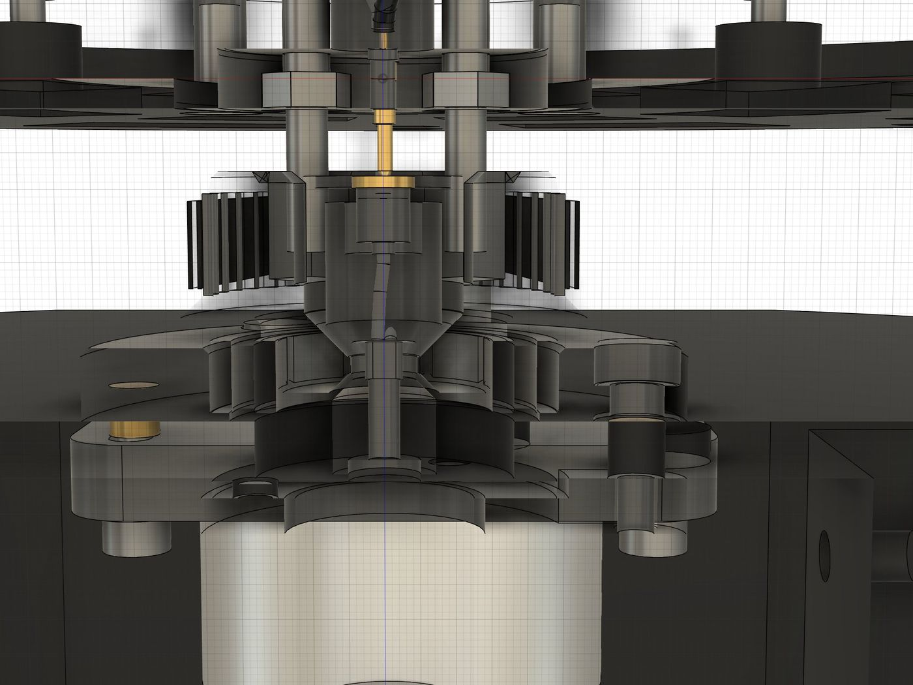
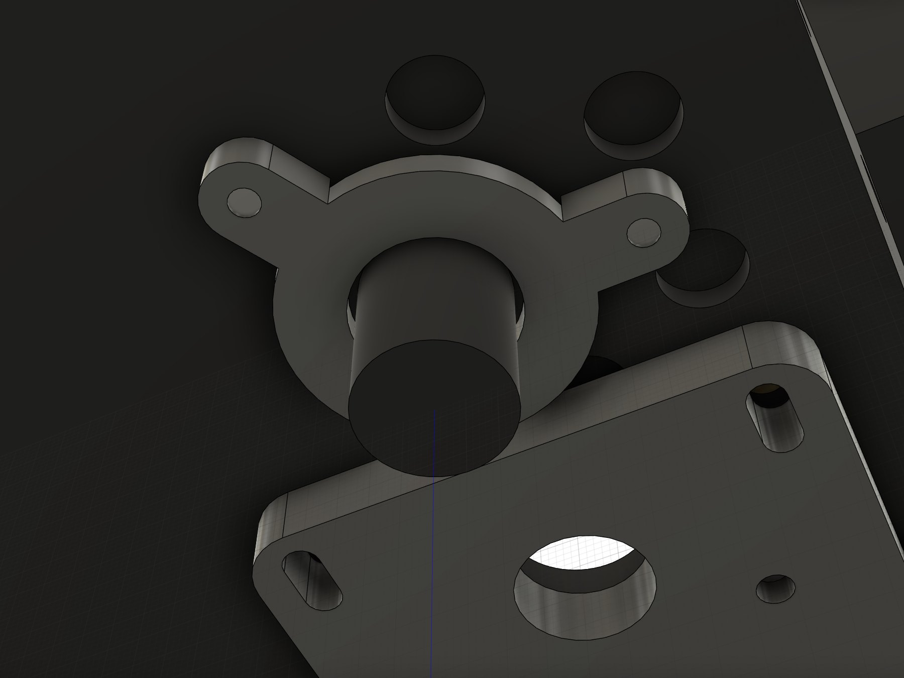
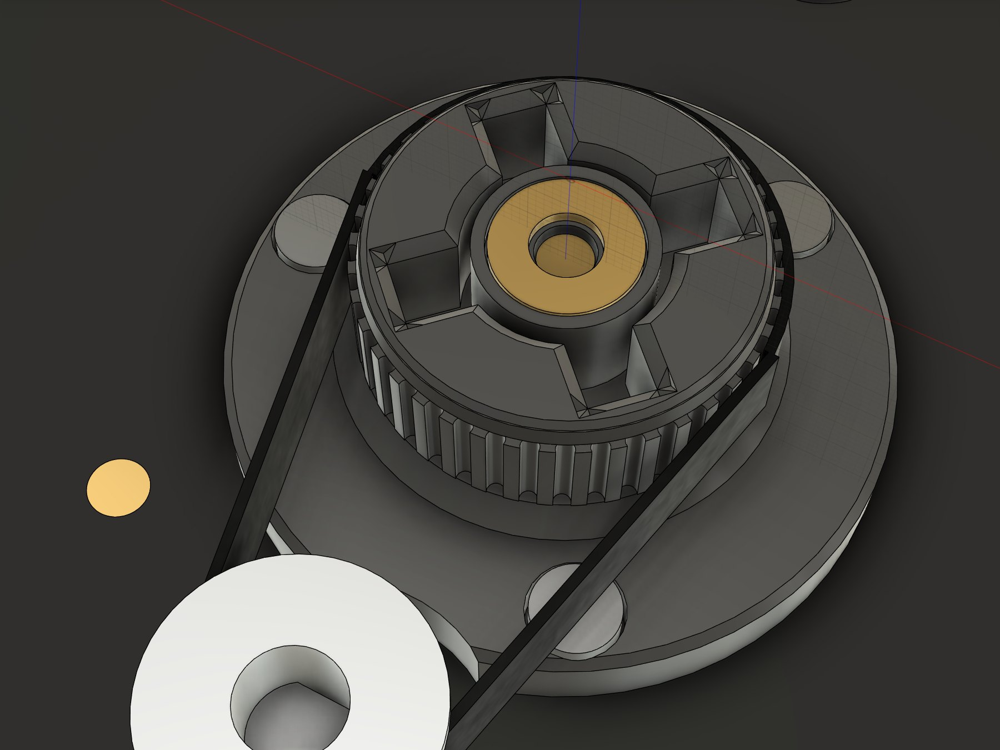
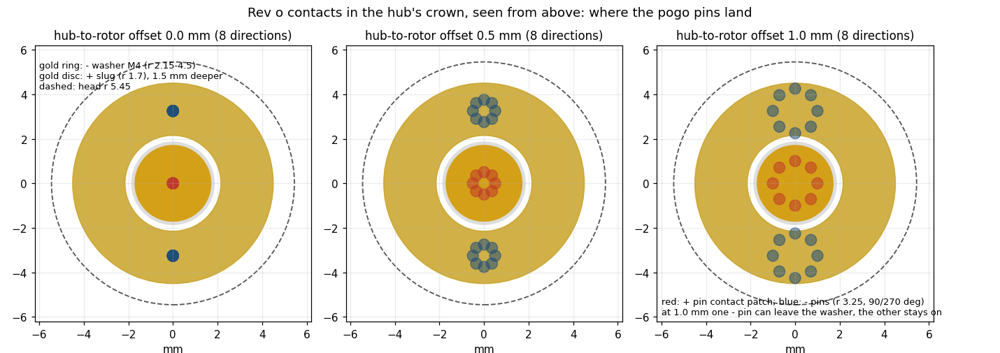
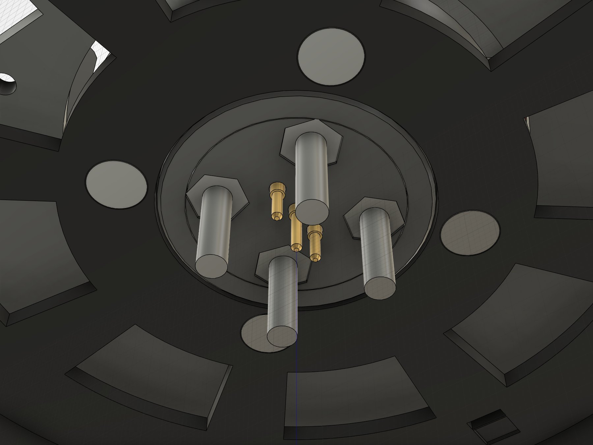
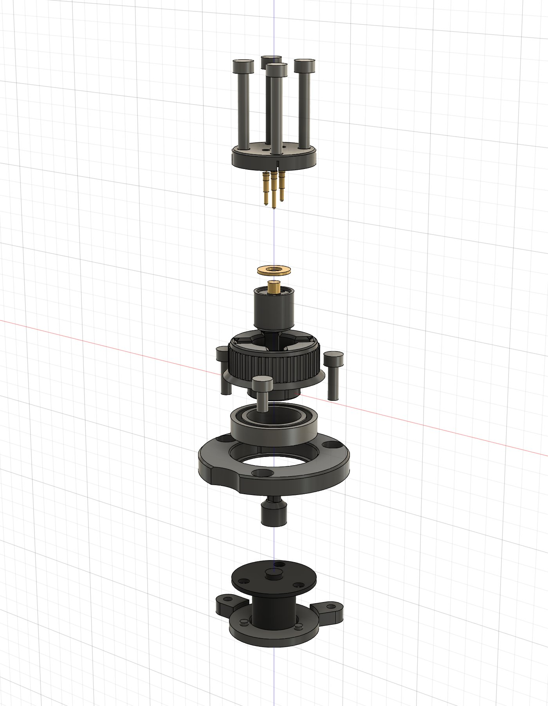
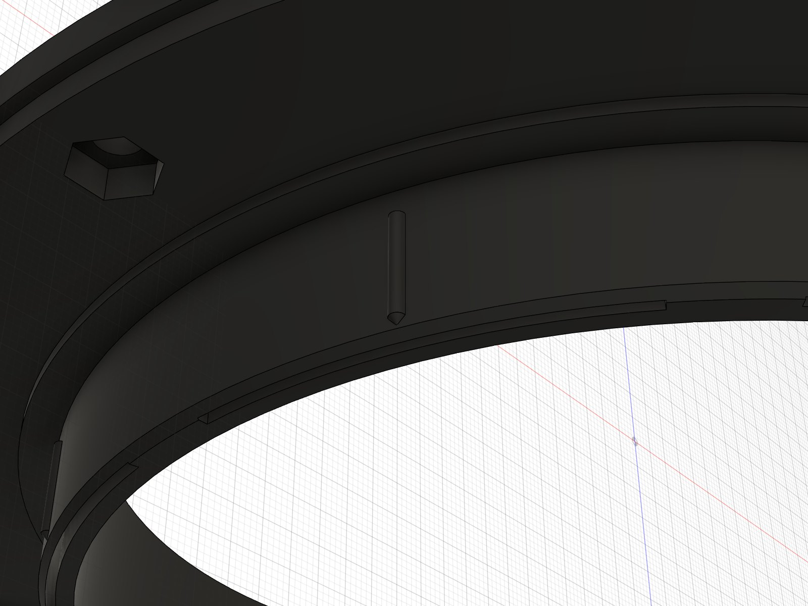

# POV LED Column rev o: the as-built drive in CAD, a stiffer cup, and a slip ring that stays put

**Prepared for Brian** · Claude (Opus 5.5), rev o CAD agent on the desktop PC · overnight 2026-11-19 → 20
Inputs: your brief of 11-19 (as-built baseline, Q1 clamp ring out, Q10 option D, 188 rpm), the bench diagnosis (`docs/2026-11-19-rev-n-bench-diagnosis.md` §3.1, 3.2, 3.3, 4.3, 7), the rev n report, `cad/print/rev-n_CURRENT/README.md` and its as-built notes, the Fusion document "POV LED Column" v16.
Outputs: Fusion **"POV LED Column" saved as a new version (v17)**, v16 untouched; scripts `fusionclaude/scripts/193-200_pov17_revo_*.py`; checks `calc/revo_asbuilt_checks.json` and `calc/revo_checks.json` (+ `_output.txt`); numbers `calc/revo_cad_calc.py` (+ `.json`, `_output.txt`); print files in `cad/print/rev-o_CURRENT/` (sliced, **not sent**); STEP `cad/pov_led_column_assembly_revo.step`; figures `docs/img/revo_*`. Nothing was printed, ordered or emailed.

---

## Bottom line

1. **The model now matches your bench.** Clamp ring out, the cup, 6802, hub, 20T and belt all 3.2 mm lower (belt plane z −11.3), drive pins M3 × 20, cup screws M3 × 6, 3 magnets on the riser. **153 checks, 0 fail.** The numbers agree with the diagnosis: pins 4.9 mm engaged and 2.0 mm off the notch floors; the M3 × 6 over the hanger ends 0.5 mm above it.
2. **A catch for tomorrow's bench plan: the rev n centring jig can't centre the as-built hub.** Its bore now sits 1.2 mm above the teeth, on the hub's lead-in cone, with 0.7-1.0 mm of play. **Print jig v2 first** (0.7 h, a collar that reaches the tooth tips: 0.22 mm of play), or centre by eye until it's done.
3. **Cup v2:** a plain Ø24.20 bore (expected to print 24.02-24.10: a thumb-push fit on the 6802), a 5.1 mm disc that is 17 times stiffer than the rev n lobes, counterbored screws, three CA grooves. I **left out the 0.4 mm pads** the diagnosis suggested (§3.3 says why) and made the cup too stiff to bend instead.
4. **Option D, with one change.** The slip ring is fixed under the deck in a small printed bracket held by two of the cup's own screws (M3 × 10 through the deck inserts). No drilling, no hanger reprint. But its rotor is **turned by a printed mast keyed into the hub's existing lead neck, not by its wires.** Catalogs give 5-50 mN·m of drag for these 12.5 mm capsules; a wire pair yields at about 1 mN·m. That is the mechanism that wound up the hanging ring.
5. **Contacts:** − is an M4 brass washer, + is an M2 brass heat-set insert used as a solder slug, 1.5 mm deeper. On the rotor, 3 **Mill-Max 0908** pogo pins (2 A each, 1.4 mm stroke) sit in a new nut plate, compressed 0.80 mm as drawn (0.37-1.23 over the whole tolerance stack). They land at ±1 mm hub-to-rotor offset, and no pin ever comes within 0.6 mm of the wrong pole.
6. **Hall: keep 3 magnets.** That gives ~865 G at the inferred 4.5 mm gap, against 644 G for the +2.5 mm riser cap with 2. No print.
7. **Rotor ring:** a compliant spigot is drawn as a sliding fit (8 bow-spring skins, 3-9 N/mm each, ribs Ø100.60). It's an **optional** 3.1 h print, only if scraping the 100.80 ring fails.
8. **Checks: 258 rows, 0 fail.** Rotor 883.6 g, U 51.6 g·mm (22 % of G6.3 at 225 rpm, the same as rev n), rocking mode 41.4 Hz.
9. **Print: 2.8 h and 59 g of PETG-CF** (fit coupons, jig v2, drive parts). The optional ring is 3.1 h of PET-CF.
10. **Buy: 3 Mill-Max pins (+3 spares) and M4 brass washers**, about $10. Everything else comes from your kits.

## 1. Brief, and what I assumed

| # | Item | Taken as |
|---|---|---|
| 1 | As-built stack | clamp ring out; cup on the deck; cartridge, 20T and belt −3.2 mm; pins M3 × 20; 6802 CA'd on the hub; 6820 outer ring epoxied in the collar; old rotor ring in use; 3 magnets; rotor leads spliced to one red/black 24 AWG pair (from your brief) |
| 2 | Diagnosis Q1 / Q10 | clamp ring out (yes); option D; target 188 rpm (your brief) |
| 3 | The 20T pulley's shape | hub Ø16 × 7, flanges Ø16 × 1, 7 mm teeth (ASSUMED since rev m). With the teeth at −11.3 its hub would end 0.7 mm above the deck: please look (Q3) |
| 4 | Slip ring drag | not measured. Catalogs say 5 mN·m (Moflon) to 50 mN·m (A2V CTC012-06S, the same 12.5 mm size); I designed for 50 |
| 5 | Slip ring rotor leads | at least 35 mm of the original 30 AWG leads usable from the boss (knot A untied or cut off). I use 2 of the 3 rings per pole (2 A each) |
|  | **Update 2026-11-20 evening** | Brian is fitting a NEW slip ring of the same type (225 mm 30 AWG PTFE leads, no splices), so all 3 + 3 leads run uncut through the mast v2 to the contacts (§4.2, §9 step 7) |
| 6 | Real hall gap | ~4.5 mm with 3 magnets (inferred from the field by the diagnosis). The model draws 2.0 because the missing 2.5 mm hasn't been located |
| 7 | Printing | PETG-CF drive parts take holes ~0.1-0.2 mm small at Ø24; rigid Ø100 ribs ~0.4-0.7 mm small; the coupons check both |

## 2. The as-built baseline (step 1)

Script `193` deletes the clamp ring and moves the cup, 6802, hub, 20T and belt 3.2 mm down (TBM copies, so every component stays at identity for the helper scripts; an attribute guards against doing it twice). It also rebuilds the pins as M3 × 20 and the cup screws as M3 × 6 + washers, and adds the third magnet. The rotor runs on the battery for now, so the hanging slip ring, its leads, the knot, the zip tie and the XH plug come out. The XH header and its pigtail stay in the nut plate.

| Z (model, mm; 0 = top of the bottom-cap plate) | rev n design | as built |
|---|---|---|
| hub crown | −3.1 | **−6.3** |
| belt plane (teeth −14.8 … −7.8) | −8.1 | **−11.3** |
| notch floors | −10.8 | −14.0 |
| 6802 | −19.7 … −14.7 | **−22.9 … −17.9** |
| cup bottom | −20.3 (on the clamp ring) | **−23.5 (on the deck)** |
| drive pin tips (M3 × 20) | (−8.0 with M3 × 16) | −12.0 |
| nut plate underside to the hub crown | 1.1 | **4.3** |

**Checks on the baseline (153 rows, 0 fail, `calc/revo_asbuilt_checks.json`).** The rows that matter:

| Check | mm | Limit | Note |
|---|---|---|---|
| drive pins: in the notch / below the chamfer / above the floor | 5.7 / **4.9** / **2.0** | ≥ 3.5 / ≥ 1.0 | M3 × 20 is right |
| cup screws (M3 × 6): thread in the insert / tip above the hanger | **3.5 / 0.5** | ≥ 2.5 / ≥ 0.3 | an M3 × 8 would bottom on the hanger |
| turning inner ring of the 6802 above the deck | 0.6 | 0.5-0.7 | the seat ledge; nothing else under it |
| hub to the cup screw heads / to the cup | 1.86 / 2.1 | ≥ 1.5 | |
| drive pins' play in the notches | 0.50 | 0.45-0.60 | |
| hall face to the 3rd magnet (drawn) | 2.0 | ≥ 1.5 | real gap ~4.5 by the field |
| 20T pulley hub to the deck | **0.7** | (flagged) | assumed pulley dims: look (Q3) |
| rotor | 883.5 g, U 51.6 g·mm | ≤ 236 (G6.3) | unchanged from rev n |

**The jig catch.** The rev n jig rests on the 6820's inner ring, and its Ø25.4 bore spans z −6.6 … −4.6. That used to be the top 2 mm of the hub's teeth. As built, the teeth end at −7.8, so the bore now meets only the hub's lead-in cone (r 11.7-12.0). The play is 0.7-1.0 mm, so the jig can leave the hub a millimetre off-centre, twice the drive pins' 0.5 mm play. Jig v2 adds a collar (r 12.7-14.6) down to z −10.0, which puts the bore back on the tooth tips with 0.22 mm of play (`calc/revo_cad_calc_output.txt` §H). Use it with the belt off, as before.

**Update (11-20 late): jig v2 doesn't seat; use jig v3.** Rev o's 3rd magnet stands to z −5.0 at 90°, under v2's solid disc (underside −6.6), so v2 stopped 1.6 mm short. Jig v3 (`cad/make_revo_jig_v3.py`, `cad/print/rev-o_CURRENT/revo_centring_jig_v3_PETG-CF`) opens 90° ± 45° and 270° ± 45°, swaps the rigid skirt for six self-centring flex fingers and lengthens the collar to z −12.0. It comes in three bores (25.15 / 25.30 / 25.45). Use and choice: the rev-o_CURRENT README.

## 3. Cup v2

### 3.1 What it is

| Feature | Value | Why |
|---|---|---|
| Body | Ø42 disc, 5.1 mm tall, flat on the deck (z −23.5 … −18.4), 4.35 cm³, **5.0 g PETG-CF, 0.39 h** | a disc instead of 2 mm lobes: (5.1 / 2.0)³ = **16.6×** the bending stiffness |
| Seat | 0.6 mm ledge, r 10.75-12.10, under the outer ring only | keeps the as-built bearing height, so the hub's belt plane stays at −11.3 |
| Bore | **Ø24.20 drawn, plain** (no crush ribs), 4.5 mm deep, 0.4 mm chamfer | expected 24.02-24.10 as printed: 0.02-0.11 mm of clearance on the ring (24.000 / 23.991) |
| CA grooves | 3 half-round grooves r 0.5 in the bore wall (30, 150, 270°) | "thumb push, then 3 dots of CA" (diagnosis §3.2) |
| Wall | 3.0 mm round the bore; 2.4 at the three counterbores | |
| Screws | counterbores Ø6.0 to z −21.0, holes Ø3.8 (±0.4 for the jig), Ø6 × 0.3 reliefs underneath for the insert lips | heads end at −18.0: 1.86 mm below the hub's flange |
| Pulley side | cut back to r 9.5 round the pulley at full +2 mm tension travel | pulley to cup 3.2 mm at the nominal position, 1.5 at +2 |
| Screw lengths | **M3 × 6 at 300°** (over the hanger: 3.5 in the insert, 0.5 above the hanger); **M3 × 10 at 60° and 180°** (4.0 in the insert, then 3.5 self-tapped into the slip-ring bracket's arms) | |
| Torque | **snug only, ~0.15 N·m** (two fingers on a short key) | the head bears on 12.4 mm²: 250 N = 20 MPa on PETG-CF; 0.3 N·m would be 40 MPa and creep. Friction then holds 225 N against the belt's 8-18 N, plus epoxy dots |

### 3.2 Fit size

The coupon plate has seven rings with the cup's own seat and wall, bored Ø24.05 to 24.35 in 0.05 steps. Pick the smallest ring the bearing enters with a thumb push and no rock. **Ring 4 = Ø24.20 is the cup on the main plate.** Every other size is already sliced as `cup_variants/revo_bearing_cup_v2_bore24pXX` (0.39 h each), so a different answer costs no CAD.

### 3.3 Why no 0.4 mm pads

The diagnosis suggested pads under the screw holes so that clamping can't bend the seat. They don't fit this part, for two reasons.

- **Height.** The as-built hub fixes the bearing 0.6 mm above the deck. A 0.4 mm relief under the cup would leave a 0.2 mm (one-layer) seat ledge.
- **Printing.** A 0.4 mm relief in the bed face is a ceiling 0.4 mm off the bed. Bridge strands that low land on the plate. Printing the cup upside down would make the seat ledge a drooping overhang, which is worse.

So the cup removes the reason for the pads instead: it is stiff, and it holds the ring with clearance. Bending it 0.05 mm takes ~300 N, and even that only changes the bore by microns, inside the 20-80 µm clearance. The rev n cup's crush ribs had 0.075 mm of interference, so any bending squeezed the ring. If clamping still changes the base current by more than 0.02 A, put a 0.2 mm shim (two layers of printer paper, with a hole for the screw) under the cup at each screw: that is the pad, made at the bench, and 0.2 mm stays inside the belt's ±0.3 tolerance.

## 4. Option D: the slip ring fixed under the deck

### 4.1 Where it goes, and how it's held (pick + justify)

| Option | Verdict |
|---|---|
| Cut a Ø26 relief into the hanger (1 h reprint) | not needed |
| Hang the flange below the hanger on a bracket | not needed: free lead and a long mast |
| **Flange right under the deck, in a bracket held by the cup's 60° and 180° screws (chosen)** | the flange (r 12) is **2.0 mm** from the hanger's edge (y −14) at the nominal motor position. The bracket ledge (r 12.8) is 1.2. Neither turns. No drilling and no reprint |

- **Bracket (B23, PETG-CF, 1.6 g).** A ledge r 7.0-12.8 under the flange (z −31.4 … −28.9), three Ø2.4 pins in the flange's Ø3.2 holes, and two arms to the 60° and 180° deck inserts. The 300° insert is over the hanger, so it gets no arm. The cup's M3 × 10 at those two angles runs down through the insert and **self-taps 3.5 mm into the arm** (Ø2.6 hole), so the arm needs no nut. Press the bracket up while the screw takes its first turns.
- **The flange floats ±0.4 mm on the three pins.** That lets the stator follow the mast. The pins only stop it turning.
- **What it costs:** the motor can now slide only ~1.2 mm toward the axis before its hanger touches the bracket. Fitting the belt needs 0.5 mm (rev n report §3.4), which leaves 0.7. Tensioning pulls the motor the other way.

| Clearance under the deck | mm | Limit |
|---|---|---|
| slip-ring flange to the hanger / bracket ledge to the hanger (both stationary) | 2.0 / 1.2 | ≥ 1.5 / ≥ 1.0 |
| hanger slid +0.5 (belt fitting) to the flange / bracket | 0.7 | ≥ 0.5 |
| slip ring / bracket to the motor | 8.4 / 6.5 | ≥ 3 |
| bracket / slip ring to the pot and motor leads | 50 / 42 | ≥ 1 / ≥ 2 |
| mast (turning) through the deck hole / the cup / to the bracket | 5.4 / 7.2 / 3.8 | ≥ 1.5 |
| slip-ring boss (turning) in the deck hole | 6.5 | ≥ 1.5 |

### 4.2 Why a mast, not the wires

The diagnosis's version of option D let the hub's neck turn the slip ring's rotor by its leads, with less than 15 mm of free lead. The numbers say the leads can't do that job (`calc/revo_cad_calc_output.txt` §C):

| Drag of the slip ring | Two twisted 24 AWG wires, fixed both ends: copper strain | Twist over 6 mm |
|---|---|---|
| 1 mN·m (rev m.2 / n assumption) | 0.11 % (≈ yield) | 20° |
| **5 mN·m (Moflon catalog)** | **0.32 %** | 34° |
| **50 mN·m (A2V CTC012-06S, same size)** | **1.48 %** | 74° |

A free 6-15 mm pair also buckles at 0.8-2.1 mN·m (Greenhill). And any offset between the ring's axis and the hub's bends the leads once per turn: 0.6 mm over 10 mm is 0.14 % strand strain per turn, above copper's endurance. So the leads would yield, fatigue or loop. That is what happened to the hanging ring: brush drag wound its leads up.

**The mast (R25, PETG-CF, 0.3 g)** carries the torque instead.

- **Bottom:** a socket Ø5.05 × 1.0 CA'd on the ring's Ø5 boss. Its bottom edge is 0.5 mm above the flange; the boss stands only 1.5 proud. **v2:** the socket's ceiling is a 45° cone (it was a flat 1.4 mm overhang that printed badly) and its mouth has a 0.3 chamfer. The 1.0 mm cylinder that centres the mast on the boss is unchanged.
- **Top:** a 45° taper and an obround key that slides into the hub's existing **4.6 × 3.0 lead neck** from below. **v2: 4.50 × 2.90** (was 4.4 × 2.7), 0.05 mm a side.
- **Inside:** **v2:** a Ø2.6 channel, a 45° cone, then a 3.2 × 1.6 slot through the key carry **all six** of the new slip ring's uncut 30 AWG PTFE rotor leads (3 + 3). They turn with everything round them, so they never twist, bend or slide.

**Mast v2 (2026-11-20 evening, after the fit checks; `fusionclaude/scripts/201_pov17_revo_mast_head_v2.py`).**

*Key size.* The rotation of an obround key in an obround slot is set by the side clearance e and the half-distance a between the slot's end centres: sin θ = e / a (a = 0.8 mm for the 4.6 × 3.0 neck).

| Key | Drawn e (a side) | Free turn, drawn | Measured |
|---|---|---|---|
| v1 4.4 × 2.7 | 0.15 | ±9.8° (the ±4° quoted before was wrong) | **±15°** → e ≈ 0.22 as printed |
| **v2 4.50 × 2.90** | **0.05** | **±3.5°** (Fusion: first contact at 3.5°) | ±8.6° if the extra 0.07 repeats |

- The coupons say the printer doesn't add 0.07 mm on its own. The cup bores (d24.10 → about 24.0) and journal stubs (d15.10 → about 15.0) both come out about 0.4 % small, which is under 0.02 mm at 3-5 mm.
- So most of the ±15° is the drawn ±9.8° plus some tilt of the mast in the 1.2 mm-tall neck, plus a few hundredths on the small key's corners.
- 0.05 a side is the smallest clearance that still slides by hand in a printed slot. The plate carries one mast each at **4.45 × 2.85 (1 notch), 4.50 × 2.90 (2 notches, ×2) and 4.55 × 2.95 (3 notches)**. That's the coupon, and every one of them is a usable mast.
- Even ±9° does no harm. The drive is one-way, the drag is < 1.6 mN·m, and the mast simply trails the hub at a fixed angle.

*Leads.* The new ring's 30 AWG PTFE leads are about Ø0.6 each, 0.28 mm² each, so six of them are 1.70 mm².

| Passage | Size | Fill (6 leads) | Wall |
|---|---|---|---|
| body channel | Ø2.6 | 32 % | 2.3 |
| slot through the key | 3.2 × 1.6 obround | 37 % (two rows of three fit with 0.05 to spare) | **0.65** (sides and ends) |

The 0.65 walls are below the 0.8 rule, which is fine at the measured drag:

- **Torsion** of the key's closed section: τ = T / (2 A_m t) = 0.16 MPa at 1.6 mN·m, and 4.9 MPa even at the 50 mN·m catalog worst case (PETG-CF: 20-30 MPa between layers).
- **Bearing** on the neck: about 1 N.
- **With 0.8 walls** the slot would be 1.3 wide, a 50 % fill with no room to thread, so 3 + 3 would have to drop to 2 + 2.

*Fallback at the bench:* if six won't thread through a printed slot, go 2 + 2. Cut the third lead of each pole (yellow on −, orange on +, by your stator map) off at the boss and insulate it.

*Checks (script 201):*

- key to the neck: 0.050 (min);
- socket on the boss: 0.01;
- mast to the flange / bracket / cup / head: 0.50 / 3.80 / 7.15 / 2.09;
- 0 mm³ overlap with the hub;
- island check (script 151): 0 on every STL.

| Load on the mast | at 5 mN·m | at 50 mN·m | Capacity |
|---|---|---|---|
| key torsion | 0.5 MPa | 5.1 MPa | PETG-CF ~20-30 between layers |
| key on the 1.2 mm neck (bearing) | 2.6 MPa | **26 MPa** | **the weak point at worst-case drag** |
| side load from the anti-rotation pin (one pin touches) | 0.56 N | 5.6 N | bending at the neck 0.7 / 7.0 MPa |
| socket CA on the boss | | | ~0.2 N·m |

**So measure the drag before you build it (bench step 0 in §9: 2 minutes, a stick and a few coins).** Below ~20 mN·m the mast is comfortable. Above that, tell me and I'll give the key a longer engagement (a hub v2 with a 4 mm neck).

### 4.3 Contacts and pogo pins

**Hub side, contact head (R26, PETG-CF, 0.6 g).** It is CA'd into the hub's Ø11 bore and seated on the hub's 45° cone.

**Head v2 (2026-11-20 evening):**

- **Ø10.9 → Ø10.8.** The printed one sat firm and flush in the printed d11 bore, so it never reached the cone. That put the washer 0.30 mm too high. With 0.10 mm radial clearance it now slides down onto the cone, and the washer ends up 0.30 below the crown as designed (Fusion: head to hub 0 at the cone, 0 mm³ overlap).
- **Lead holes Ø1.6 → Ø2.0**, so a 3-lead bundle (Ø1.3) threads.
- **The − hole moves r 3.35 → 3.5.** It's still fully under the washer, and the + well keeps its wall.

- **− contact:** an **M4 brass flat washer, DIN 125** (4.3 × 9 × 0.8), flush with the head's top at z −6.60, 0.30 mm below the crown.
- **+ contact:** an **M2 brass heat-set insert** (from your INCLY kit) used as a solder slug (Ø3.4 × 3) in a Ø3.7 well. Its top is at −8.12, 1.52 mm deeper, so a tool lying on the washer can't reach it.
- **Below them:** a cavity for the leads' slack.

The leads are soldered to the brass in free air, above the head; the brass then goes into the plastic. The head never sees a soldering iron.

**Rotor side, nut plate v2 (R19).** The rev n plate (Ø22.2 × 4, 4 nut pockets) with the XH window replaced by three stepped holes. Barrels go in Ø1.70, collars sit flush with the plate's top in Ø2.05 counterbores.

| Pin | Where | A (seating plane to free tip) | Compression as drawn |
|---|---|---|---|
| **Mill-Max 0908-9-15-20-75-14-11-0** (+) | on the axis | 10.92 | 0.80 of 1.40 |
| **Mill-Max 0908-6-15-20-75-14-11-0** (−) × 2 | r 3.25, at 90° and 270° (clear of the 4 nut pockets; the tails fit the hub core's Ø7 hole) | 9.40 | 0.80 of 1.40 |

Datasheet (Mill-Max catalog, through-hole spring-loaded pins):

- 2 A continuous, 3 A peak, 20 mΩ, 10⁶ cycles;
- Ø1.07 domed plunger, collar Ø1.83 × 0.71, tail Ø0.43 × 1.75;
- 25 g preload, 60 g at 0.70 mm.

With ±0.13 mm on the pin's length and ±0.3 mm on the printed stack, compression stays **0.37-1.23 mm**, never bottoming. Three pins push 1.9 N up on an 8.7 N rotor.

| Landing (`calc/revo_checks.json`) | Value |
|---|---|
| + pin on the slug: radius margin at 0 / 0.5 / 1.0 mm offset | 1.45 / 0.95 / **0.45 mm** |
| − pins on the washer, worst direction, at 0.5 / 0.85 / 1.0 mm | 2 / 2 / **1** of 2 (the opposite pin always stays on) |
| + pin to the − washer, 1.0 mm offset, 8 directions (no short) | ≥ **0.62 mm** |
| − pins to the + slug, same | ≥ 1.55 mm |
| drive pins to the head at 0.5 mm offset (their play) | 0.55 mm |
| drop-on: pins touch the contacts in the last 0.80 mm; nothing else touched at +0.85 / +2 / +5.75 (pins on the crown) / +12 mm, 1.0 mm offset | ≥ 0.55 mm |

**Electrical.** The rotor draws 1.4 A at most (rev m power report).

- **+ pin:** 1.4 A against its 2 A continuous rating.
- **Each − pin:** 0.7 A.
- **Drops at 1.4 A:** about 42 mV on +, 21 mV on −.
- **Slip ring:** 2 rings per pole at 2 A each.
- **Keep** the 2 A fuse on the 12 V tap and the SS34 on the buck's input (diagnosis §4.3).

### 4.4 Exploded

## 5. The small items

### 5.1 Hall: keep 3 magnets

| Field on the axis (G) | 3 mm | 4 mm | 4.5 mm | 5 mm | 7.5 mm |
|---|---|---|---|---|---|
| 2 magnets | 1449 | 947 | 777 | 644 | 286 |
| 3 magnets | 1578 | 1046 | **865** | 722 | 332 |

The A3144 switches somewhere between 70 and 350 G. Two magnets at the inferred 7.5 mm give 286 G (one pass in four: what you saw). Three at ~4.5 mm give 865 G, more than the +2.5 mm riser cap with two (644 G at 5.0). Nothing new turns within 3 mm of the stack top. **Decision: no riser cap; the model carries the 3rd magnet.** The bench plan's plasticine check (step 4) still tells us where the missing 2.5 mm went.

### 5.2 Rotor ring: a compliant sliding fit (optional print)

The diagnosis showed why a rigid spigot can't work: it is 0.4 mm oval, so it either pinches the 6820's balls or rattles. Script `197` keeps the rev k ring and changes only the spigot.

- **Ribs off:** the eight rigid ribs are removed.
- **Slots:** behind each rib position, an arc slot (r 48.4-49.2, ±18°, open at the free end, up to z −9.0) leaves a **0.6 mm skin**.
- **Why a skin:** it bends radially in the print plane. The ring prints hub-face down, so the stress runs along the layers (a vertical finger would bend across them).
- **New ribs:** a rib R 0.55 on each skin, tips drawn **Ø100.60**, with a pointed lead-in.

| Printed rib tips (6820 bore 99.97) | Radial preload | Force per rib (3-9 N/mm) | Push-on |
|---|---|---|---|
| 99.90 | 0 | 0 (sliding, centred by the others) | 0 |
| 100.10 | 0.065 | 0.2-0.6 N | ~1.4 N |
| 100.30 | 0.165 | 0.5-1.5 N | ~3.6 N |
| 100.40 | 0.215 | 0.7-2.0 N | ~4.7 N |

The 0.4 mm oval now changes each rib's force by only 0.3-0.9 N; the bearing's clearance would need 4-12 N across the ring. The skin's stress stays ≤ 21 MPa, against 70-80 MPa in the print plane. The ring loses 2.5 g, all symmetric, so **U is unchanged**. **Print it only if scraping the 100.80 ring (diagnosis F2) fails:** 3.1 h, 81 g of PET-CF, the rev k ring's process.

### 5.3 Fit coupons

There are 7 cup-bore rings (Ø24.05-24.35, notches 1-7) with the cup's own seat ledge and 5 mm walls. The 7 hub-journal stubs (Ø14.95-15.25, notches 1-7) have the hub's Ø7.6 bore inside them. Steps are 0.05 mm (diagnosis §3.3). For a clearance fit the coupon's stiffness matters less than for a press fit, but the 5 mm wall keeps it close to the cup's. Total 1.27 h, 31 g.

### 5.4 X2, the two-bearing hub: a concept note only

It was optional, so it's a written concept, not CAD: `fusionclaude/designs/pov-x2-two-bearing-hub-concept.md`.

- **No room above the bearing.** The belt plane starts 2.9 mm above it, so the second bearing can't stack there.
- **Below the deck it fits**, on a hollow journal through the deck's Ø18 hole. Its seat would be added to the slip-ring bracket, and the slip ring would move ~8 mm down.
- **What it buys:** a 10.6 mm span, which cuts the nod to ~0.1°. The hub v2 also gets a 4 mm neck for the mast.
- **When:** build it only if the hub still nods once the drag is down.

## 6. Checks (258 rows, 0 fail; `calc/revo_checks_output.txt`)

The method is the same as rev n: every rotating body against every stationary one (≥ 1.5 mm), and the motor-driven pulley, belt and shaft against everything. The hub group (hub, mast, head, slip-ring boss and rotor leads) counts as rotating. On top of that come named rows for every fit and designed contact, the landing and drop-on rows above, the tension travel, and the overlaps. Overlaps must be 0 within 0.01 mm³; a coincident-cone sliver of 0.002 mm³ is tessellation noise.

| Tightest rotating vs stationary | mm |
|---|---|
| hub to the cup screw heads (M3 at 180°) | 1.86 |
| hall sensor to the 3rd magnet (drawn) | 2.00 |
| rotor ring to the collar / to the riser | 2.00 / 2.00 |
| hub to cup v2 | 2.10 |
| tie-rod nut to the collar | 2.31 |
| hub to the deck | 2.81 |
| **mast to the bracket** | 3.80 |
| **slip-ring boss to the bracket** | 4.66 |
| belt to the drive pins / pulley to cup v2 / belt to cup v2 | 2.98 / 3.23 / 4.10 |
| pulley at +2 mm travel to cup v2 | 1.50 |

| Designed | mm | Limit |
|---|---|---|
| mast socket to the slip-ring flange (the boss is 1.5 proud) | 0.50 | ≥ 0.4 |
| mast key in the neck (play, co-rotating) | 0.10 | 0.05-0.25 |
| + slug to − washer (insulation) | 0.85 | ≥ 0.3 |
| slip-ring flange 0.2 below the deck; on the bracket ledge | 0.20 / 0 | |
| pogo plungers on the contacts; pogo pins to the hub / to the drive pins and nuts | 0 / 2.51 / 2.52 | |

**Mass and balance:**

| | Rotor (on the 6820) | U g·mm | of G6.3 / G2.5 at 225 rpm | Rocking | Hub group (on the 6802) |
|---|---|---|---|---|---|
| rev n (v16) | 882.8 g | 51.6 | 22 % / 55 % | 41.4 Hz | 4.8 g |
| as built | 883.5 g | 51.6 | 22 % / 55 % | 41.4 Hz | 4.8 g |
| **rev o** | **883.6 g** | **51.6** | **22 % / 55 %** | **41.4 Hz** | **8.3 g (U 0.01)** |

The rotor gained the longer pins and three pogo pins and lost the XH header, all on the axis. The compliant spigot is symmetric. The battery you run on now (199 g) is not in the model.

## 7. Retention and load path

| Part | Held by | Against | Capacity |
|---|---|---|---|
| 6802 outer ring in cup v2 | clearance bore + 3 CA dots, seat ledge | belt 8-18 N, pin push | ≫ 20 N |
| cup v2 on the deck | 3 × M3 snug + 3 epoxy dots | belt pull | 225 N friction |
| rotor drive | 4 × M3 × 20 pins, 4.9 mm in the notches | 30-130 mN·m → 4-16 N per pin | steel |
| slip-ring stator | ledge + 3 pins (±0.4 float) | drag → 0.6-5.6 N on one pin | pin shear ≤ 1.2 MPa |
| bracket | 2 × M3 × 10 through the deck inserts, 3.5 mm self-tapped | 0.1 N + pin reaction | ~400 N |
| slip-ring rotor | mast socket, CA | 5-50 mN·m | ~0.2 N·m |
| mast | key in the 1.2 mm neck | 5-50 mN·m | 2.6-26 MPa bearing (measure the drag) |
| contact head | cone seat + Ø11 slip fit, CA | pogo 1.9 N down | ≫ 10 N |
| washer / slug | recess / well + CA | 0.6-0.8 N each | seated on plastic |
| pogo pins | collar on its step + CA | 0.6-0.9 N up each | |
| rotor on the 6820 | its weight, 8.7 N | pogo 1.9 N up | net 6.8 N down |

## 8. Print files (`cad/print/rev-o_CURRENT/`, sliced, not sent)

All on the H2D's left (hardened) nozzle, textured PEI, 0.2 mm, no supports, no brim. Island check (script 151): 0 starts on all 9 STLs.

| Order | File | Parts | Process | Time | Mass |
|---|---|---|---|---|---|
| 1 | `revo_fit_coupons_PETG-CF` | 7 bore rings + 7 journal stubs | PETG-CF, 6 walls, 6/6, 85 % | 1.27 h | 31.3 g |
| 2 | `revo_centring_jig_v2_PETG-CF` | jig v2 | PETG-CF, 4 walls, 4/4, 20 % | 0.69 h | 16.7 g |
| 3 | `revo_drive_parts_plate_PETG-CF` | cup v2 (Ø24.20), bracket, 2 masts, 2 heads, 2 nut plates v2 | PETG-CF, 6 walls, 6/6, 85 % | 0.87 h | 11.3 g |
| 3b | `cup_variants/…bore24pXX…` | the cup at another coupon size | same | 0.39 h | 5.0 g |
| **3c** | **`revo_mast_head_v2_plate_PETG-CF`** (2026-11-20 evening) | **mast v2 × 4 (key sizes 1 / 2 / 2 / 3 = notches), contact head v2 × 2**: supersedes the masts and heads on plate 3 | same, no brim | **0.26 h** | **2.1 g** |
| opt. | `optional/revo_rotor_ring_compliant_PET-CF` | compliant rotor ring | Fiberon PET-CF, 5 walls, 6/6, 40 % | 3.13 h | 80.7 g |

Single STLs are in `cad/revo_*.stl` and the cup variants in `cad/revo_cup_variants/`. The STEP is `cad/pov_led_column_assembly_revo.step`. The print README lists the fits to check off the bed.

## 9. Build sequence for tomorrow

The diagnosis's bench plan (§6 there) stands. Rev o slots in round it.

1. **Step 0, slip-ring drag (2 min).** Hold the slip ring's body. Tape a 100 mm stick (a coffee stirrer) across its boss, then hang US pennies (2.5 g each) on the end one at a time. If 1 penny turns it, the drag is below 2.5 mN·m; 2 pennies, below 4.9; 4, below 9.8. Note the count in `measurements.md`. Above 8 pennies (20 mN·m), tell me before building option D.
2. **Start the prints:** coupons (1.3 h), then jig v2 (0.7 h), then the drive plate (0.9 h).
3. **Bench plan steps 1-2** (motor check, hub runout) while they print.
4. **Bench plan step 3 with jig v2, not the rev n jig.** Use the old cup, M3 × 6, snug, then epoxy dots.
5. **Bench plan steps 4-8** (rotor fit, bare rotor, board and battery, 188 rpm, scraping the 100.80 ring).
6. **Cup v2, once steps 1-7 pass.** Read the bore coupons first. Push the 6802 (with the hub CA'd in it) out of the old cup by its outer ring. Fit it into cup v2 with 3 dots of CA in the grooves. Put cup v2 on the deck with the jig v2 and snug the M3 × 6 at 300°. Snug the M3 × 10 at 60° and 180°; until the bracket goes on, they stick 3.5 mm out under the deck, where nothing is.
7. **Option D, when the pogo pins arrive** (rotor off, belt off, base on its side, bottom plate off):
    1. **Leads (new slip ring, v2 mast).** No splices anywhere: all six original 225 mm leads run uncut from the boss to the contacts. Group them by colour into the two poles (− black/red/yellow, + green/brown/orange by your stator map; check it on the new ring with a meter). **Cut nothing yet.**
    2. **Mast on the ring (bench).** Thread all six leads through the mast from the socket end, then out through the key's slot. Push the socket onto the boss with a drop of CA, square to the flange, and let it cure 10 min.
    3. **Slip ring on the bracket.** Sit the flange on the bracket's ledge with the three pins in its holes.
    4. **Mast into the hub, from below.** Push the mast up through the deck hole and the cup into the hub. Turn the slip ring until the key drops into the hub's neck; the leads come out of the crown.
    5. **Bracket screws.** Hold the bracket against the deck's underside with its arms under the 60° and 180° inserts. Take out those two cup screws and drive them back through the inserts until they've cut 3 turns into the arms, pressing the bracket up meanwhile. Snug them.
    6. **Spin the hub by hand.** The mast turns with it. The stator may turn a few degrees, then stops on its pins. Nothing may rub.
    7. **Contacts.** Pull the + three up through the head's centre hole and the − three through the hole under the washer seat (both Ø2.0). **Only now cut each pole to about 15 mm above the head**, then strip and tin 3 mm. Hold the brass in pliers, away from the plastic: solder the + three into the M2 insert so its bore fills, and the − three to the washer's underside. Trim stray strands after soldering. File the slug's face flat. Press the slug into its well and the washer into its recess (the slack folds into the cavity), and fix each with a drop of CA. Then push the head into the hub's crown until it sits on the cone, and CA it.
    8. **Pins (bench).** Solder red 26 AWG to the 0908-9's tail and black to each 0908-6's tail, and heat-shrink them. Bend the two − tails 0.8 mm inward. Push the pins into nut plate v2 from the top until the collars sit on their steps, and CA them. Feed the three wires up the hub core's Ø7 hole, seat the plate, refit the four M3 × 20 and nuts, and land the wires on the buck IN (red to +, both blacks to −).
    9. **Test before the rotor goes on.** Unpowered: more than 1 MΩ between the slug and the washer. Powered: +12 V on the slug. Then drop the rotor on (turn it until the pins fall into the notches) and read the buck's input. Do a short spin before the cover goes on.

## 10. Shopping list (nothing ordered)

| # | Part | Qty | Where | Price |
|---|---|---|---|---|
| 1 | **Mill-Max 0908-6-15-20-75-14-11-0**, spring-loaded pin, 9.40 mm, 2 A (the − pins) | 2 + 2 spare | [Digi-Key](https://www.digikey.com/en/products/detail/mill-max-manufacturing-corp/0908-6-15-20-75-14-11-0/1991679) | ~$1 each |
| 2 | **Mill-Max 0908-9-15-20-75-14-11-0**, spring-loaded pin, 10.92 mm, 2 A (the + pin) | 1 + 1 spare | [Digi-Key](https://www.digikey.com/en/products/detail/mill-max-manufacturing-corp/0908-9-15-20-75-14-11-0/1991682) | ~$1 each |
| 3 | M4 brass flat washers, DIN 125 (4.3 × 9 × 0.8) | 1 pack | Amazon or McMaster (search "M4 brass flat washer") | ~$5-8 |
| 4 | from your kits | | M3 × 10 × 2, M3 × 6 × 1 (SHCS kit), M2 brass heat-set insert (INCLY kit), 26 AWG red / black, CA, 5-min epoxy | |

**On the price and stock:** I couldn't read Digi-Key or Mouser live: both put up bot checks, and I didn't try to get past them. Search listings show about $1.09 each in ones (third-party listing) and $0.55 at 1,000 (Future Electronics). Digi-Key lists a 4-week standard lead time, which it shows whether or not the part is in stock. **Check stock on the Digi-Key page before ordering.** If either part is out, any 0908 length works: the nut plate's collar depth is one parameter (`O_POGO_SEAT_Z` / the pin's `A` in the rev o block of `fusionclaude/lib/povlib.py`), and I can re-export it in minutes. Nothing here blocks tomorrow's bench plan: it runs on the battery.

## 11. Open questions

| # | Question | Why it matters |
|---|---|---|
| Q1 | The slip ring's drag (step 0)? | decides whether the mast's 1.2 mm key is enough (≤ 20 mN·m: yes) |
| Q2 | Where is the splice on the slip ring's rotor leads, and is knot A still in them? | option D needs ~40 mm of the original 30 AWG leads from the boss |
| Q3 | Does the 20T's hub clear the deck? The model says 0.7 mm with the assumed pulley | if it rubs, the base current shows it; raise the 20T and the belt plane check follows |
| Q4 | OK to leave out the 0.4 mm pads (§3.3)? | they don't fit the as-built height or print; the stiff cup replaces them |
| Q5 | Which coupon ring did the bearing pick? | prints the matching cup variant |
| Q6 | Order the Mill-Max pins from Digi-Key (check stock), or should I find an Amazon pogo pin? | Mill-Max is the one I modelled to a datasheet |
| Q7 | Print the compliant rotor ring only if scraping fails? | 3.1 h of PET-CF otherwise wasted |
| Q8 | Motor check result (bench step 1): 15 V, or the 600 rpm motor? | carries over from the diagnosis; rev o doesn't change the drag budget |

## 12. How to explain it

**The 30-second version:**

> The slip ring kept winding itself up. It turned out that a capsule slip ring this size can take anything from 5 to 50 milli-newton-metres to turn, and a pair of wires yields at about one. So the wires were never going to drive it. Now a little printed mast does: it's glued to the slip ring's rotor and keyed into a slot the hub already had, and the wires just ride inside it. Power crosses to the spinning rotor through three gold pogo pins pressing on a brass washer and a brass slug. The rotor still lifts off by hand, with nothing to plug in.

**Numbers that read well:**

- 1 mN·m to yield the wires against 5-50 mN·m of drag;
- 3.2 mm: one removed spacer moved twelve parts in the model;
- 0.80 mm of compression, 1.40 of stroke, and 0.37-1.23 over every tolerance;
- the + pin keeps 0.45 mm on its pad with the hub 1 mm off-centre;
- 17× stiffer cup, 0 crush ribs;
- 258 checks, 0 fail, balance unchanged at 22 % of G6.3.

**Talking points:**

- **Let each part carry one kind of load.** Wires carry current, a key carries torque, a ledge carries weight, and the pins only stop the stator turning.
- **Put tolerance where it costs nothing.** The stator floats ±0.4 mm so that nothing has to be aligned. The pogo stroke absorbs the axial stack. Two − pins sit opposite each other, so one always lands.
- **An as-built change ripples into the tooling, not just the parts.** Removing the clamp ring made the old jig useless, and only a check on the jig itself showed it.
- **Say no to a suggestion when the numbers do.** The 0.4 mm pads didn't fit the height or the printer. The reason for them (a cup that bends) was removed instead.
- **Model the bought part to its datasheet, and order by part number.** The pin's length A and stroke set the whole contact stack.

**Shots:**

- the mast sliding into the hub's neck from below;
- the brass washer and slug before the head goes in;
- three pogo pins compressing as the rotor drops on;
- the two sections;
- the coupon ring that took the bearing.

## 13. Files and replay

| Path | What |
|---|---|
| `fusionclaude/scripts/193_pov17_revo_asbuilt.py` | as-built baseline (clamp ring out, −3.2, M3 × 20, M3 × 6, 3rd magnet; slip ring out of use) |
| `…/194_pov17_revo_checks.py` (`--ro`) | checks, both modes → `calc/revo_asbuilt_checks.json`, `calc/revo_checks.json` |
| `…/195_pov17_revo_cup_v2.py` | cup v2 + screws |
| `…/196_pov17_revo_slipring_d.py` | slip ring fixed, bracket, mast, contact head + brass, nut plate v2 + pogo pins, wiring |
| `…/197_pov17_revo_rotor_ring_compliant.py` | compliant spigot on the rotor ring |
| `…/198_pov17_revo_export.py` (then `pov_run.py --undo`) | STLs, plates, jig v2, coupons, cup variants, STEP |
| `…/199_pov17_revo_renders.py` | the figures in this report (display only) |
| `…/200_pov17_revo_save.py` | the save (v17) |
| `fusionclaude/lib/povlib.py` | rev o parameter block (`O_*`) at the end |
| `calc/revo_cad_calc.py` (+ `.json`, `_output.txt`) | every number in sections 3-7 |
| `cad/print/rev-o_CURRENT/` | print files, `README.md`, `_slice_log.txt` |

**Replay on v16 (rev n final, collapsed):** `193` → `194 --ro` → `195` → `196` → `197` → `194 --ro` → `198` (+ `--undo`) → `199` → `200`.
