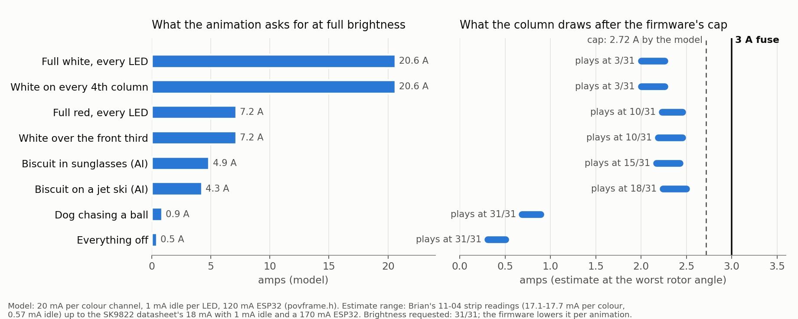

# POV LED Column: QA audit of the "check, pack, send" stage

**Prepared for Brian** · Claude (Opus 5.5), pov-checkpack-audit agent on the desktop PC · 2026-11-23

This audit covers storyboard section 5 (Part 3, "Pipeline 2: check, pack, send"). It covers every check between the AI's generated script and the LEDs, the 2.6 A current cap and whether its model matches the real strips. The worst-case animations were tested offline on the pipeline and on the firmware's own check code. A live bench test was prepared (section 7). It wasn't run: the column was off while its battery charged, and you chose to skip it.

## Summary

- **The current cap works, and it is checked twice.** The PC checks it, and the ESP32 checks it again with the same maths when it loads the file. The ESP32's check can't be skipped. A full-white request would draw **20.6 A** by the model. The firmware clamps it to brightness **3 of 31**, which comes to about **2.0-2.3 A** in reality.
- **Why 2.6 A:** the number comes from the power bank, not the fuse. The INIU's USB-A port is labelled 5 V 3 A. The firmware allows 2.6 A for the LEDs, and the ESP32's 0.12 A comes on top, so the total is 2.72 A, 9 % under the port's rating (electrical report rev e, 11-03). The design specified a **4 A** fuse, so 2.72 A would sit at 68 % of it. You only had 3 A fuses on 11-12, and the advice then was to use one, keep the brightness at or below 75 % and order the F4A. Your guess was half right: the 3 is the bank's 3 A, not the fuse's.
- **The estimate is per column at peak, not per frame.** For every frame the check simulates all 96 angles the column passes through in a turn and adds up all 336 LEDs at that instant. The worst instant of the worst frame sets one brightness for the whole animation. A check based on the average would let a striped picture pull about 8.9 A at every fourth angle (section 3.3).
- **The model matches the strips, and it overestimates.** The LEDs are SK9822 (5050, 60/m, BTF-LIGHTING black PCB), 24 strips × 14 = 336 LEDs, as the model has them. The model assumes 20 mA per colour channel. The datasheet says 18 mA, and your 11-04 bench strip gave 17.1-17.7 mA. Idle current is 1 mA per LED in the model against 0.57 mA measured. The ESP32 is the one number the model sets too low: 120 mA against about 170 mA with modem sleep off.
- **Real worst case under the cap: about 2.25-2.55 A**, or 75-85 % of the 3 A fuse. That is below the fuse's rating, but above the usual 75 % guidance for a long fuse life. Fitting the 4 A fuse brings back the margin the design intended. At your 11-22 brightness of 12/31, a typical AI animation draws about **1.5-1.9 A**.
- **16 findings: 3 major, 6 minor, 7 nits. None is a safety gap in the AI-animation path, and 5 were fixed today.** pov-pipeline-live fixed all 5 pipeline findings P1-P5 within the hour, in commit `802f9b7` (pushed): the misleading "no column" error, a crash on an undefined colour, the missing 64 KB fit, unchecked library and cache hits, and name collisions. I reran my tests on that commit and all 21 pass. In the firmware, 3 edge cases sit in modes the AI pipeline doesn't use (captions, live frames, text), plus 1 cosmetic error code. None of them is fixed, because a fix needs a flash and your go. One documentation point matters for the video: the status field `cap_mode` is about captions, not the current cap (section 5).

## On camera: the plain-English version

> Before anything reaches the LEDs, it gets checked like a part on a production line. First the AI's program runs in a sandbox. Then, for every frame, the check simulates all 96 positions the column passes through in one turn and adds up what all 336 LEDs would draw at that instant. The worst instant sets the brightness. If I ask for the whole column in full white, that's over 20 amps. The check turns it down to 3 brightness steps out of 31, about 2 amps. The PC isn't the only line of defence, either: the chip on the column does the same sums again every time it loads a file, so nothing gets past the limit. The limit is 2.6 amps for the LEDs, picked to stay under the battery's 3-amp output. On the worst animation I could build, the column stays under about 2.5 amps, below its 3-amp fuse. And the file has to fit the chip's 64 kilobytes of memory, so if the AI makes something too big, the pipeline shrinks it before sending it, rather than letting it fail.

Note: every sentence is true at `802f9b7` (section 4.2). The live test wasn't run, so "about 2 amps" and "about 2.5 amps" are calibrated estimates (section 3.4), not readings.

## 1. Scope and method

**Versions audited.** The firmware source and `povanim.py` at `0cf3f1f`. The pipeline (`pov_request.py`, `fastlane.py`) was first tested as pov-pipeline-live's uncommitted working copy (~10:35, while that agent was rebuilding it for the live demo). It was retested at `802f9b7` / `0b1a410` once the fixes were pushed. The pipeline rows below say which version they refer to. The column was off at 10:20, 10:32 and 10:36 (no answer on `/api/status`), so the build running on the board was not read.

**What was run** (all offline, with no Claude call and no board contact):

| Tool (new, committed with this report) | What it does |
|---|---|
| `software/tests/checkpack_cases.py` | 11 worst-case animations: full white, full red, white on every 4th column, white over the front third, all dark, 2 MB of noise, exactly 65,536 B, 65,537 B, 257 frames, 33 colours, an undefined colour number |
| `software/firmware/tools/cap_audit_host.cpp` | The firmware's **own** check code (`pova.h`, `povframe.h`, a verbatim copy of `valid_name`) compiled for the PC with the PlatformIO MinGW g++. It covers the streamed upload check, the name check and `do_load`'s current cap at brightness 31 / 23 / 12 / 4 |
| `software/tests/checkpack_audit.py` | Runs the cases and the 11 public animations through the pipeline's checks and the firmware harness, computes a calibrated real-current estimate, runs `pov_request.py --script --dry-run` end to end and uploads with the real `upload_and_play` to `tools/mock_board.py` on localhost. Output goes to `software/out/checkpack_audit/` |
| `software/tests/test_checkpack.py` | 21 regression tests built from the above (`py -m pytest software/tests/test_checkpack.py -q`): **all 21 pass** at `802f9b7`, including the fixes for P2, P3 and P5 |
| `software/tests/checkpack_fig.py` | The figure in section 4 |

**Existing suites, for a baseline.** Python: 79 pass and 1 fails. Firmware native: 47 of 50 pass. All 4 failures are the stale-vector issue T1 (section 5.4) and have nothing to do with the cap. The firmware's current-model tests all pass: `test_cap_matches_the_validator`, `test_current_model_all_white`, `test_current_model_matches_python_on_sparse_and_dog_frames` and `test_fit_gb`.

## 2. Every check between the script and the LEDs

In the order a request meets them. "Tested" means a worst case went through it today.

| # | Where | Check | What it stops | Tested | Result |
|---|---|---|---|---|---|
| 1 | PC, `lint_imports` | Allowed imports only. `open(`, `subprocess`, `socket`, `eval(`, `exec(`, `os.` and `sys.` are refused | Honest mistakes. It is not a security boundary, and the docstring says so | read | ok |
| 2 | PC, sandbox render | A fresh Python process (`-I` since `802f9b7`), 20 s timeout, temp folder. An exception sends the script to one repair round | A crashing or hanging script | yes | ok |
| 3 | PC, `check_indices` (**new, `802f9b7`**) | A colour number at or above the palette size becomes a repair-round error | Crash P2 | yes | fixed |
| 4 | PC, `povanim.validate` | Loop seam, **peak current** (all 96 angles × every frame, cap 2,600 mA counted with the ESP32's 120 mA inside), front-window framing, flicker, more than 32 colours, a loop under 0.5 s | Over-current, ugly loops, off-screen subjects | yes | ok (P6, P7) |
| 5 | PC, `auto_fix` (on by default) | Seam → ping-pong (since `802f9b7`: only if it still fits 64 KB / 128 frames); more than 32 colours → merged; over the cap → `meta["gb"]` | One model round trip | yes | ok. **The board ignores `meta["gb"]`** |
| 6 | PC, `board_limits` + `fit_size` in `upload_and_play` (**new, `802f9b7`**) | Every upload, library and cache hits included: over 65,536 B, over 256 frames or over 32 colours → a copy is fitted (every 2nd frame dropped, colours merged) and validated again | The 11-22 refusals (189 KB, 104 KB) | yes | fixed (P3) |
| 7 | PC, `board_name` (**`802f9b7`**) | 1-28 characters `[A-Za-z0-9_.-]`, timestamp prefix dropped; longer names become 23 characters + `_` + a 4-character hash | 404 on play; overwriting another animation | yes | fixed (P5) |
| 8 | PC, scope / IP / recording guard | Public scope refuses known characters; OBS recording forces public | Content, not safety | read | as documented |
| 9 | PC, `upload_and_play` errors | Each refusal reported with its HTTP code and the board's reason; exit 6 (upload or play refused), 7 (board load error) (since `802f9b7`) | "no column" for a 413 | yes | fixed (P1) |
| 10 | ESP32, upload (`on_upload_chunk`) | Token; `valid_name`; Content-Length over 67,584 → 413; **streamed** `pova_check`: ≤ 65,536 B, magic, version 1, 42 × 96, 1-32 colours, 1-256 frames, every RLE frame exactly 4,032 px, palette indices below the colour count, CRC-32; written to a temp file and renamed only when valid | Every malformed file | yes | ok (F4 cosmetic) |
| 11 | ESP32, `/api/play` | `valid_name`, the file exists | | read | ok |
| 12 | ESP32, `do_load` | Size 24-65,536 B; `pova_parse` with the CRC; decodes **every frame**, all indices below the colour count; `worst_column_ma` at gb 31 for every frame; `fit_gb(worst, brightness setting, 2600)`; the capped palette goes live **together with frame 0** | Over-current from any file, even one that never went through the pipeline | yes | ok |
| 13 | ESP32, brightness change | Re-fits from the cached worst case | | read | ok |
| 14 | ESP32, text / patterns / live frames / captions | A per-frame cap (captions have their own limiter at 2,720 mA including the ESP32) | | read | F1-F3 |
| 15 | ESP32, scheduler | Blank below ~50 rpm or with no hall signal: idle current only | | read | ok |

## 3. The 2.6 A cap

### 3.1 Where 2.6 A comes from

| Date | Decision | Source |
|---|---|---|
| 11-01 | Cap 2,000 mA for the bank's listed 2.4 A USB-A port | `docs/2026-11-01-parts-and-links.md` |
| 11-03 | You read the label: **5 V 3 A**. Cap → **2,600 mA** (LED drive + dark current); ESP32 0.12 A on top = 2.72 A, 9 % under the port. **F1 changed 3 A → 4 A** ("2.72 A is 68 % of 4 A; it would have been 91 % of 3 A") | electrical report rev e; `measurements.md` #16; `povframe.h:24-26` |
| 11-03 | QA-2 m-c: a 3 A fast fuse at 2.72 A "runs at 91 % in a 40 °C tube and will nuisance-blow or fatigue"; m-b: with modem sleep off the rotor draws 2.77 A | `docs/2026-11-03-qa-review-2.md` |
| 11-12 | "I only have a three, I don't have a four." → use the 3 A, keep brightness ≤ 75 %, avoid all-white tests, order a 5 × 20 mm F4A | the laptop session 11-12 08:10 |

So the 2.6 A protects the **bank's port**, and the fuse was meant to sit comfortably above it. With the 3 A stand-in fitted, the margin is thinner than designed but still positive (section 3.4).

### 3.2 What the number measures

- **Firmware** (`povframe.h` `worst_column_ma`, `fit_gb`; `main.cpp` `do_load`). For one rotor position it sums all 336 LEDs: 20 mA × gamma-corrected duty / 255 for each of the 3 colours, at brightness 31. It takes the worst of the 96 positions, then the worst frame. Then it picks the largest 5-bit brightness, never above your setting, for which `drive × gb / 31 + 336 mA idle ≤ 2,600 mA`. The ESP32's 120 mA is on top. That gives one brightness for the whole animation, applied together with frame 0.
- **Pipeline** (`povanim.validate` / `current_profile`). It uses the same LED map and the same model, and the native tests check that the two agree to within 1.5 %. But it counts the ESP32 **inside** the 2,600 mA, so its recommended brightness is 1-2 steps below the firmware's: 17 against 18 for the jet ski, 9 against 10 for full red, 24 against 26 for the 64 KB test file. This is harmless, because the board ignores the pipeline's number (P6).
- **Per column, not per frame.** One column lasts 2.78 ms at 225 rpm, and the SK9822's PWM runs about 13 cycles inside it, so the per-column sum is the real current during that slice of the turn.

### 3.3 Why it has to be the worst angle

Take a test picture that is white on every 4th image column (`white_stripes4`). Strip *s* shows column *c* + 4*s* when the rotor is at position *c*, so at every 4th position all 24 strips land on white together and all 336 LEDs are full white. At the other three positions everything is dark. The average is 25 %; the peak is 100 %.

| Check based on | Brightness it allows | Model current at every 4th angle |
|---|---|---|
| the worst angle (what the code does) | **3/31** | 2.41 A |
| the average | 13/31 | **8.9 A** |

So the per-angle check matters, and both the validator and the firmware do it.

### 3.4 Does the model match the real strips?

| Quantity | Model (`povframe.h`) | SK9822 datasheet | Your bench, 11-04 (1 MHz, field 4, one 14-LED strip) | Effect |
|---|---|---|---|---|
| LED type, count | SK9822, 24 × 14 = 336, 2 chains of 168 | | BTF-LIGHTING SK9822 5050, 60/m, black PCB (parts list; `measurements.md`) | matches |
| One colour at full, brightness 31 | 20 mA | 18 mA | red 2.29, green and blue 2.21 mA per LED at 4/31 → **17.7 / 17.1 / 17.1 mA** at 31/31 (the datasheet's table is linear in the field: 2.324 mA at 4/31) | model **11-15 % high** |
| White per LED at 31 | 60 mA | 54 mA | (94 − 8) / 14 = 6.14 mA at 4/31 → **47.6 mA** | model **21 % high** |
| Idle per LED | 1 mA | | 8 mA per 14 LEDs = **0.57 mA** | model 43 % high (336 against 192 mA) |
| ESP32 + radio | 120 mA | | about **170 mA** with modem sleep off (QA-2 m-b; not measured) | model ~50 mA **low** |
| Gamma | 2.2 lookup table | | the same table on the PC and the board (`povgamma.h`) | matches |
| Brightness field | linear in gb/31 | linear (table) | | matches |

At the cap, the model allows 2,264 mA of LED drive. Here is what that becomes in reality:

| Assumptions | LED drive | + idle | + ESP32 | Total | Share of the 3 A fuse |
|---|---|---|---|---|---|
| Your bench, green / blue content | 1.94 A | 0.19 A | 0.12 A | **2.25 A** | 75 % |
| Your bench, red content (the worst bench colour) | 2.01 A | 0.19 A | 0.12 A | **2.32 A** | 77 % |
| Datasheet 18 mA, model idle, ESP32 170 mA | 2.04 A | 0.34 A | 0.17 A | **2.54 A** | 85 % |

**Fuse.** A 5 × 20 mm fast-acting fuse is specified to open within 30 min at 2.1 × its rating (6.3 A for 3 A) and in 10 ms to 2 s at 2.75 ×. Below its rating it has no opening time at all ([a 5 × 20 mm fast-acting (5HF) fuse datasheet, melting-time limits](https://res.cloudinary.com/sonepar-fr/raw/upload/s--VAFbmLr4--/v1/documents/155/DS-Miniature-Fuse-Links-IEC-Fuses-5x20-5HF-250VAC-EN.pdf)). The usual guidance is to run a fuse at no more than 75 % of its rating so it doesn't age ([Littelfuse Fuseology guide](https://info.littelfuse.com/hubfs/Fuseology%20Design%20Guide.pdf)). The worst case is right at that line for the 3 A fuse and 56-64 % for the 4 A. As far as the logs show, the column has been run at 12/31 (the 11-14 reshoot, the 11-22 jet ski), well under the cap, so the cap has probably never been reached on the real column. The live test in section 7 would be the first time. **Recommendation: fit the F4A when it arrives. Don't lower the cap now**: a firmware change needs a flash, and the margin is positive.

**Your 75 % brightness rule doesn't limit the worst case.** For anything bright enough to reach the cap, the cap is what binds: full white plays at 3/31 and full red at 10/31 whatever the setting is above that. The setting only lowers animations that stay under the cap. At your 11-22 setting of 12/31, the meter would show (averaged over a turn): jet ski **1.46-1.69 A**, sunglasses 1.56-1.79 A, dog on a jet ski 0.75-0.96 A, dog and ball 0.42-0.61 A.

## 4. Worst-case tests

### 4.1 Current: through the pipeline and the firmware's own code

| Animation | Pipeline: peak at 31/31 (model) | Pipeline `auto_fix` | Firmware: plays at (setting 31 / 12) | Model total at that brightness | Real estimate, worst angle |
|---|---|---|---|---|---|
| Full white, every LED | 20,616 mA | gb 3 | **3 / 3** | 2,406 mA | 2.00-2.26 A |
| White on every 4th column | 20,616 mA | gb 3 | **3 / 3** | 2,406 mA | 2.00-2.26 A (average 0.73-0.94 A at 12) |
| Full red, every LED | 7,176 mA | gb 9 | 10 / 10 | 2,623 mA | 2.24-2.46 A |
| White over the front third | 7,176 mA | gb 9 | 10 / 10 | 2,623 mA | 2.19-2.46 A |
| Exactly 65,536 B (sparkles) | 3,151 mA | gb 24 | 26 / 12 | 2,712 mA | 2.26-2.54 A |
| Biscuit on a jet ski (public) | 4,274 mA | gb 17 | 18 / 12 | 2,674 mA | 2.25-2.50 A |
| Biscuit in sunglasses (public) | 4,871 mA | gb 15 | 15 / 12 | 2,593 mA | 2.17-2.43 A |
| Dog on a jet ski (public) | 1,983 mA | none needed | 31 / 12 | 1,974 mA | 1.64-1.87 A |
| Dog chasing a ball (public) | 888 mA | none needed | 31 / 12 | 887 mA | 0.69-0.89 A |
| All dark | 456 mA | none needed | 31 / 12 | 456 mA | 0.31-0.51 A |

Every file the firmware accepts stays at or under its 2,600 mA (LEDs + idle) at the brightness it picks, and the calibrated real current stays under 2.55 A. The `pov_request.py` dry runs (`--script`, the default `--fast` preset) gave the same numbers end to end. Full output: `software/out/checkpack_audit/results.json` (regenerate with `checkpack_audit.py`).

### 4.2 Files the board must refuse

| Test file | Firmware upload check (its own code) | Pipeline (b9abc7c) | Pipeline (`802f9b7`, retested against the mock board) |
|---|---|---|---|
| Exactly 65,536 B | **accepted**, loads | uploaded | uploaded |
| 65,537 B | **refused**: 400 "too big (max 65536 B)" (F4: 400 rather than 413) | uploaded, then reported as "no column at …" (P1) | fitted to 33 KB (22 frames at 10 fps → 11 at 5 fps), accepted (P8) |
| 2 MB of noise, 256 frames | **refused**: 413 | uploaded and refused, "no column" | fitted to 34 KB (8 frames, 4 colours), accepted |
| 257 frames (10 KB) | **refused**: 400 "bad header (… frame count)" | passed the validator, then refused | fitted to 129 frames, accepted |
| 33 colours | **refused**: 400 "bad header (… palette …)" | `auto_fix` merges to 32 (but `--classic` doesn't) | `fit_size` also enforces 32 |
| Undefined colour number | **refused**: 400 "palette index out of range" | **crash**: IndexError, no report, exit 1 (P2) | a clean error: one repair round for generated code; exit 5 with a report for a fixed `--script` |
| One flipped byte | **refused**: 400 "CRC mismatch" | "no column" | "upload refused: HTTP 400 … CRC mismatch (file damaged in transfer)" |

### 4.3 Names

`board_name` with prompts up to 70 characters, home and public scope: every name it makes is 1-28 characters and passes the firmware's `valid_name` (tested with the copied function). Before `802f9b7`, "Biscuit riding a jet ski at sunset" and "… at sunrise" both became `biscuit_riding_a_jet_ski_at`, so the second upload replaced the first on the board. Now a long name becomes its first 23 characters + `_` + a 4-character hash (P5, fixed): `biscuit_riding_a_jet_sk_6459` and `biscuit_riding_a_jet_sk_fa06`.

## 5. Findings

Severity: **major** = wrong or broken behaviour you would hit on camera; **minor** = an edge case or a latent gap; **nit** = cosmetic or documentation.

### 5.1 Pipeline (`pov_request.py`; owner pov-pipeline-live, messaged at ~10:45; P1-P5 fixed in `802f9b7` and retested)

| ID | Sev. | Finding | Status |
|---|---|---|---|
| P1 | major | Every HTTP refusal (413 too big, 400 bad name or file, 401 token, 409 busy, 507 full) came back as `no column at <url>: HTTPError`, and the run still exited 0 | **fixed in `802f9b7`**: "upload refused: HTTP 400 …" with the board's reason; exit 6 on an upload or play refusal, 7 on a board load error; "no column" now means only a connection error |
| P2 | major | A script that draws with a colour number it never defined crashed the validator (`IndexError` in `current_profile`): a traceback, no report or log line, nothing new on the column. `codegen_attempt` only catches `RuntimeError` | **fixed in `802f9b7`**: `check_indices` after every render makes it a repair-round error; the check step in `main()` is guarded too |
| P3 | major | No size, frame or colour fit before upload; the board refused the 11-22 scenes at 189 KB and 104 KB | **fixed in `802f9b7`**: `fit_size` inside `upload_and_play`, validated again after the fit (`meta["gb"]` recomputed); enforces 64 KiB, 256 frames and 32 colours; ping-pong only when the doubled loop still fits |
| P4 | minor | Library hits, cache hits and the placeholder skip the validator | **fixed in `802f9b7`** for the board's limits: `board_limits()` runs on every upload, hits included. Current is covered by the firmware cap. Seam, framing and flicker are still not checked on hits (taste, not safety) |
| P5 | minor | Name collisions on the first 28 characters silently replaced animations on the board | **fixed in `802f9b7`** (hash suffix) |
| P6 | nit | The validator counts the ESP32's 120 mA inside 2,600 mA, but the firmware doesn't, so `meta["gb"]` is 1-2 steps below what the board plays. The 11-11 process doc's "the two agree" and `auto_fix`'s "(what the firmware plays at)" are both slightly off. Harmless: the board ignores `meta["gb"]` | open (`povanim.py`: compare against `CAP_MA + I_ESP_MA`; I didn't change it under a pipeline that was being rehearsed) |
| P7 | nit | "current: plays at gb 17 (of 31)" assumes brightness 31. The board plays at the lower of that and your setting: at 12/31 the jet ski plays at 12. On screen, quote `/api/status` `gb_used` | open: pov-pipeline-live will point to `gb_used` in its report |
| P8 | nit | `fit_size` halves the frames first, even for a file only just over the limit: a 65,537 B scene went from 22 frames at 10 fps to 11 at 5 fps. Merging a few colours, or dropping 1 frame in 10, would keep the motion smoother | open (quality, not safety) |

### 5.2 Firmware (`main.cpp`, `captions.h`): none changed, because a fix needs a flash and your go

| ID | Sev. | Finding | Fix (small) |
|---|---|---|---|
| F1 | minor, latent | A captions config message can raise the captions current cap anywhere from 500 to **6,000 mA** (`captions.h:162`). Nothing sends `cap_ma` today | clamp to `CAP_MA + I_ESP_MA` (2,720) |
| F2 | minor, latent | Live-frame mode: a `{"live":…,"pal":…}` message publishes the new palette at the full brightness setting **with no cap**, over whatever frame is on screen, until the first live frame arrives (forever, if none comes). Used by `pov_live.py`, `pov_diag.py` and the captions transport fallback; not by the AI pipeline | stage a blank frame and publish the palette with it (`with_frame=true`) |
| F3 | minor | Text, pattern and live paths publish the palette **before** the frame. When the new frame allows a higher brightness than the old one, the old frame shows at the higher brightness for up to one refresh tick (33 ms at 225 rpm). Animations are not affected (one brightness per animation, swapped with frame 0) | `publish_palette(…, true)` where a frame is staged right after |
| F4 | nit | A file of 65,537-67,384 B gets 400 "bad file: too big" rather than 413: `pova_check_feed` refuses the piece without adding it to `chk.total`, so `UP_BIG` is never picked there | test `chk.err` or `total + len` |
| F5 | note | Captions ignore the brightness setting (`gb_max` 31; only their own 2,720 mA limiter applies), so the 75 % rule doesn't reach captions | by design; say so if it matters |

### 5.3 Documentation and claims (for the video)

| ID | Finding |
|---|---|
| D1 | **`cap_mode` is not the current cap.** In `/api/status`, `cap_mode`, `cap_gb` and `cap_peak_ma` belong to the live-captions module ("word" / "tick"). The current cap is `cap_ma` (2,600, the LEDs including idle), `gb` (your brightness setting) and `gb_used` (what the cap left). |
| D2 | The 11-11 process doc says "past 65,536 bytes the file is dropped with a 400" (a big upload gets 413, one just over gets 400) and "the two agree" (1-2 steps apart, P6). |
| D3 | Storyboard section 5: "Current cap checked per frame 2,600 mA (peak in jet ski test 1,983 mA)". Say **per rotor angle** (96 per turn, every frame). The 1,983 mA is the 11-11 dog-on-a-jet-ski (`dog_jetski_front`), under the cap. Biscuit's 11-22 jet ski asks for 4,274 mA and plays at 18/31 at full brightness. |

### 5.4 Tests (pre-existing)

| ID | Finding |
|---|---|
| T1 | Since `2dd3b38` (as-built rail shift, `SET_SHIFT = 2`), 3 firmware native tests (`test_frame_layout`, `test_column_indices_match_python`, `test_build_column_matches_python_vectors`) and 1 Python test (`test_odd_strips_are_inverted_and_sets_interleave`) fail. `vec_povmap.h` and two hand-written expectations still assume strip 0 in set A. Fix: rerun `test/gen_vectors.py` and update the two expectations. The current-model tests are unaffected. |
| T2 | Until today, nothing tested across the PC/board boundary: both of 11-22's failures (size and names) lived in that gap. `checkpack_audit.py` and `test_checkpack.py` now run the firmware's C++ checks on files the Python pipeline made. |

## 6. What I changed

- **Added:** `software/firmware/tools/cap_audit_host.cpp`; `software/tests/checkpack_cases.py`, `checkpack_audit.py`, `checkpack_fig.py`, `test_checkpack.py`; `docs/img/2026-11-23-checkpack-current.png`; this report (+ `.html`).
- **Not changed:** `pov_request.py`, `fastlane.py` and `pov_serve.py` (pov-pipeline-live fixed P1-P5 in `802f9b7` after my message; I retested and turned the two xfail tests into normal ones), the firmware and `povanim.py`. Nothing was uploaded to, played on or deleted from the column; no reboot, no OTA.

## 7. Live test: prepared, skipped (your call, 11-23)

The column didn't answer at 10:20, 10:32 or 10:36 (battery charging). You chose to skip the test that day. The procedure stays here for later: it would be the first time the cap is checked on the real column, so it's worth running once when the F4A goes in.

**The catch:** your bench supply only feeds the 12 V motor; the LEDs run off the power bank on the rotor, so the supply can't see their current. Ways to read it, with the rotor **stopped** and the LEDs driven by the simulated hall at 225 rpm (same current as spinning):

- **(a) Bench supply on the rotor's J1** at 5.00 V, current limit **2.8 A**, bank unplugged. My pick: the limit is a hard ceiling under the 3 A fuse whatever happens, and you have done "bench 5.00 V on J1" before (#39).
- **(b) Multimeter on the 10 A range** in series with the pigtail's 5 V wire, the bank powering it (F1 stays in).
- **(c) A USB power meter** between the bank and the pigtail plug, if you have one.

**Procedure** (about 10 min; the meter shows the average over a turn):

1. `GET /api/status`: note `mode`, `anim`, `gb`, `sim_rpm`; go ahead only if nobody else is playing.
2. Upload `cp_dark`, `cp_white_full` and `cp_red_full` (under 200 B each).
3. `POST /api/settings {"sim_rpm": 225}` (not saved).
4. Play each for 15 s and read the amps:

| Step | Plays at (setting ≥ 10) | Predicted reading | Stop if above |
|---|---|---|---|
| dark | 31/31 | 0.31-0.51 A | 0.8 A |
| biscuit_jetski | 12/31 at your 11-22 setting (18/31 if the setting is 31) | 1.46-1.69 A (2.04-2.29 A at 18/31) | 2.6 A |
| full white | **3/31** (the cap) | 2.00-2.26 A | 2.6 A |
| full red | **10/31** (the cap) | 2.24-2.46 A | 2.8 A |

5. Restore: play whatever was playing before (or stop), put `sim_rpm` back, delete **only** the three `cp_*` files, and leave the brightness untouched.

**Pass:** every reading inside or below its band. A reading above its band means the model is optimistic somewhere: stop and check before filming bright scenes. **Filming bonus:** the full-white step is a good on-camera beat: "it asked for 20 amps, the column draws 2".

## 8. Open questions for you

1. **Live test:** answered: skipped for now (11-23). Run section 7 once, ideally with the F4A fitted.
2. **Fuse:** fit the F4A when it comes (my pick), or lower `CAP_MA` to about 2,200 mA until then? That needs a flash.
3. **Firmware fixes F1-F4:** batch them into the next flash you approve?

## 9. How to explain it

- **Defence in depth around an untrusted generator.** The model's output is checked on the PC, where checks are fast, explain themselves and can be auto-fixed. It is checked again on the device, which has the final say and can't be skipped. The same physics model sits on both sides, and unit tests hold the two together.
- **Check the worst instant, not the average.** A spinning display lights different LEDs at every angle; a 25 % picture can light 100 % of the LEDs for a moment. The stripes test makes the point in one picture.
- **Conservative model, measured margins.** The model assumes 20 mA per colour; the datasheet says 18 and the bench measured 17-18. Being pessimistic costs a little brightness and buys margin. The one optimistic number, the ESP32, is the one to measure next.
- **Contract tests across a boundary.** Run the embedded C++ check code on the files the Python pipeline makes. Both of 11-22's bugs were boundary bugs.
- **Where 2.6 A came from:** a label on a power bank, read on 11-03 and carried through one constant into two codebases. A good example of a requirement with a paper trail.
