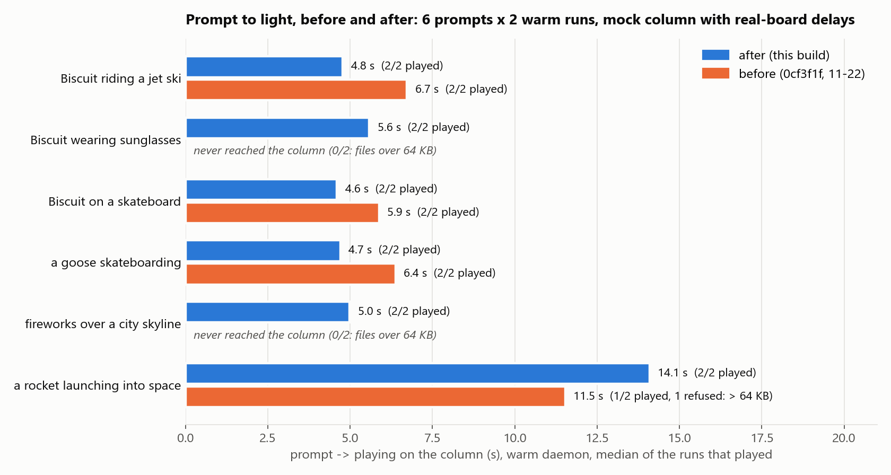
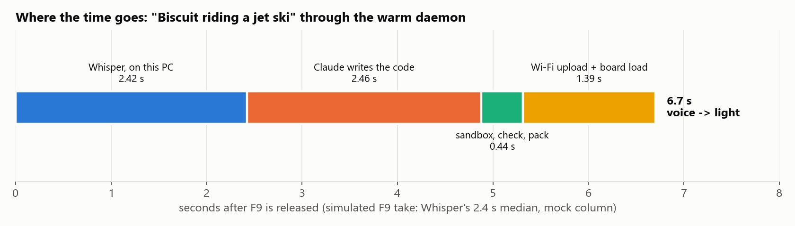

# Live demo pipeline: "Biscuit riding a jet ski" to light in about 4 seconds, with a live step view for the split screen

**Prepared for Brian** · Claude (Opus 5.5), pov-pipeline-live agent on the desktop PC · 2026-11-23

Inputs: your 11-23 brain dump (cold open: say the line on camera, the column shows it, a split screen shows the AI's
steps live; "30 seconds is too long, 5-6 seconds is really impressive"), the Part 3 storyboard, the 11-22 bench notes
and pipeline log, the 11-07 speed report and the 11-11 prompt-to-light report (gaps G1-G14). The column was off all
session (battery charging), so every number below was measured against **a mock column on this PC that adds the real
board's delays** (upload 0.30 s + 1 s per 50 kB, load 0.25 s + 2 ms per frame, both taken from the 11-22 log). The
model calls are real.

> **Status in one paragraph.** The 30-33 s that Main saw on 11-22 came from the *prompts*, not the pipeline: those were
> off-library requests (a caricature, a football joke, block text) where Sonnet wrote 2,100-3,600 tokens. The in-library
> Biscuit request that day took 6.2 s but never reached the LEDs. The bigger problem was reliability: in today's
> baseline **only 12 of 24 runs reached the column**, because half the files were over the board's 64 KB. With this
> build **24 of 24 play**, and the warm daemon takes **"Biscuit riding a jet ski" from words to light in 3.95-4.24 s**
> (median 4.14 s, 4 takes). From releasing F9 that is about **6.7-6.9 s**, of which 2.4 s is Whisper. `shoot.cmd` starts
> everything with one double-click: the warm daemon, the F9 listener and a dark, camera-ready step view. The real
> column still has to confirm the upload and load times (section 6).

## 1. The numbers

Same 6 prompts, 2 runs each, same mock column, prompt to *playing* (the board reports the animation loaded):

| | Runs that reached the column | Median prompt to playing (runs that played) | "Biscuit riding a jet ski" |
|---|---|---|---|
| Before (0cf3f1f), one-shot `pov_request.py --fast` (how Main runs it) | 6 / 12 | 7.9 s | 6.9, 7.1 s |
| Before, warm daemon `pov_serve.py` | 6 / 12 | 6.3 s | 6.3, 7.1 s |
| After, one-shot `--fast` | **12 / 12** | **5.8 s** (library prompts 5.4 s) | 5.8, 4.8 s |
| After, warm daemon | **12 / 12** | **5.0 s** (library prompts 4.8 s) | 5.1, 4.4 s |
| After + warm sandbox + primed cache (final build, 4 takes) | 4 / 4 | **4.14 s** | 3.95-4.24 s |
| Same, Opus 5.5 instead of Sonnet 5.5 (3 takes) | 3 / 3 | 5.03 s | 4.96-5.16 s |

Every "before" failure was a file the board refuses. "Biscuit wearing sunglasses" was 69-140 KB and fireworks
111-154 KB, and the old pipeline reported each one as "no column at ...". The off-library rocket is the outlier both
times (9.3-19.7 s). That is the model *planning* before it writes, 9-12 s of thinking at effort "low", which no
pipeline change touches (section 5).

Where one take's time goes, from releasing F9 (simulated F9 through a test inbox, Whisper set to its 2.4 s median):

| Step (server timestamps) | Time |
|---|---|
| F9 released, watcher sees the clip | 0.03 s |
| Whisper transcript (median of 121 short clips; your PC, CPU) | 2.42 s |
| Claude writes the program: first token 0.8 s, 336 tokens, 15 lines | 2.5 s |
| Sandbox render: 90 frames | 0.16 s |
| Check: current, framing, loop | 0.15 s |
| Pack: 27.5 KB of 64 KB | 0.16 s |
| Wi-Fi upload (mock, real-board rate) | 1.0 s |
| Board load: decode + current cap, then the next 1/8-turn tick | 0.53 s |
| **Voice to light** | **6.7-6.9 s** |

## 2. What was slow or broken, and what changed

| # | Finding | Effect | Change |
|---|---|---|---|
| G1 | **64 KB cap**: no size check before upload | half of all runs never played | `fit_size()`: every 2nd frame at half the fps (the loop keeps its duration), down to 3.75 fps, then fewer colours; also enforces 256 frames and 32 colours. `upload_and_play` fits library and cache files too |
| G3 | Ping-pong seam fix doubled loops up to 150 frames | 11-22's 105-frame scene became 208 frames / 189 KB | ping-pong only up to 128 frames and only if the doubled file still fits |
| N1 | **`claude -p` sent this project's auto-memory with every request** (it picks up the memory of the folder it starts in) | +3.1k uncached input tokens a call (6.4k to 3.4k now), slower first token, and bench notes in the generator's context | the CLI now starts in an empty folder, `%LOCALAPPDATA%\POVColumn\cli` |
| N2 | `claude.exe` takes **0.50 s to exit** after printing its result (3 of 3 measured) | +0.5 s a call | output is streamed; the pipeline returns at the result line and a thread collects the process |
| N3 | Codegen validated the file, then `main()` validated it again | +0.1 s | reused |
| G4 | Preview rendered before the upload | +11.5 s unless `--no-preview` | upload first, preview after |
| G5 | Placeholder uploaded synchronously before the model call | up to +2.6 s measured (a 150 KB fireworks placeholder) | background thread; the shoot uses "thinking dots" stored on the board once, so a request only sends `/api/play` |
| G12 | Cache hit on Jaccard >= 0.75 ("... at night" replayed the day scene) | wrong animation | a hit needs the same content words; the shoot runs `--no-cache` so every take really calls the model |
| G13 | No way to turn the placeholder off | | `--no-placeholder`, `--placeholder-kind thinking` |
| G14 | `-I` not passed to the sandbox; an HTTP 400/413 reported as "no column" | | `-I` passed; real status and board message; exit 6 (upload/play) or 7 (board load error) |
| N4 | Sandbox interpreter start + numpy/scenekit import on every render | 0.29 s render | pov_serve keeps one isolated interpreter pre-started (one script per process, like the warm `claude` pool): 0.13 s |
| N5 | Prompt cache cold on the first take | first token 1.7-2.6 s vs 0.85 s cached | the daemon primes the cache at start and again after 50 idle minutes (the CLI's cache lives 1 h) |
| N6 | The generator never heard of "Biscuit" | a bare "Biscuit riding a jet ski" relied on luck | one line in `generator_kit.md`: Biscuit = your white bichon, `bichon()`; also in the keyword and template vocabularies |

Already in before today: G2 (28-character names, Main's fix on 11-22, now with a 4-character hash when a name is
cut, so "... at sunset" and "... at sunrise" no longer overwrite each other), G6 (the column's IP in `pov_config.json`),
G7/G8 (resolved on the bench). Not touched: G9 (the F9 fast path's colour words; Brain-Dump-Button), G10 (Main's
routing; the shoot daemon goes around it, section 4), G11 (recording guard; the shoot forces public scope anyway).

The check-pack-send audit (pov-checkpack-audit, same day) found five more issues in this file; all five are fixed in
the same commit, and its suite runs 41 passed, 2 expected-failures now passing.

## 3. The step view

*[Figure omitted from the public release: The step view at the end of a take (mock column, simulated F9)]*

Six big steps, so a viewer can follow it in the 10 seconds it is on screen: **Heard** (the words, Whisper's time, "on
camera: original characters only") → **Claude writes the program** (the code streams in with syntax colours as the
model writes it, then shrinks to show the whole program) → **Runs it in a sandbox** (frames, loop length) → **Safety
check** (peak current against the 2.6 A cap under the 3 A fuse, brightness) → **Pack + send over Wi-Fi** (size against
the board's 64 KB) → **On the column** (big green PLAYING, seconds after the words and after your voice). A live
stopwatch runs top right; an LED-dot preview of the viewer's window plays the actual file sent to the board. It is not
an animation of a pipeline: every step is an event from the running code (server-sent events from `pov_serve.py`).

*[Figure omitted from the public release: While Claude writes]*

On a harder prompt the model plans before writing; the code box then says "Claude is planning the scene" instead of
sitting empty:

*[Figure omitted from the public release: Planning state]*

Keys (nothing is visible on screen until pressed): **R** reset to "Say it…", **Shift+R** reset and blank the column,
**T** type a prompt, **P** replay the last take with its real timings, **H** help, **F** fullscreen. Every take is saved;
`http://127.0.0.1:8790/?run=latest` (or `?run=<id>`) replays it in the page, so if the capture of a perfect take
glitches you can re-record the split screen from the same timings. A landscape window lays the code out on the right.
The orange "REHEARSAL · mock column" badge shows whenever the target is the mock, so a rehearsal can't be mistaken for
the real thing on camera.

## 4. How to run it on the shoot

1. Column on, at 225 rpm, on Wi-Fi (`<column-ip>`). Nothing else driving it: stop the Infinite Biscuit runner.
2. Double-click `software\pipeline\shoot.cmd` (or `py software\pipeline\pov_serve.py --shoot`). Wait for **READY: say
   it (F9)**. Before printing it, the daemon checks the column, stores the thinking dots on it, primes the prompt cache
   and opens the step view (960 × 1080).
3. OBS: a **Browser source** `http://127.0.0.1:8790/` at 960 × 1080 is the cleanest (or window-capture "POV step
   view"). Right half of the canvas.
4. One rehearsal take with the exact line, then **R** on the step view (Shift+R also blanks the column).
5. Roll. Hold F9, say "Biscuit riding a jet ski", let go. The thinking dots go up as soon as you release F9 (about
   half a second, est.), the steps light up, and Biscuit appears about 6.7 s after release.
6. Retakes: **R**, say it again. The cache is off, so every take is a real model call and the code differs a little
   each time.
7. Ctrl+C in the console window stops it.

`shoot.cmd --rehearse` does the same with the mock column, with the board off. `shoot.cmd --model claude-opus-5-5`
switches the writer (about +0.9 s). Outputs (each take's `.pova`, `.py` and events) go to
`%LOCALAPPDATA%\POVColumn\shoot\`. They are AI media, so they stay out of git and out of `content/public`.

**Read before filming:** while the shoot daemon runs, **every F9 line becomes a column request**, except lines that
start "Main, …" or "<name> agent, …", which are skipped (the column goes back to what it was playing). The panel's
voice router still types every line into Main as usual. The daemon writes `%LOCALAPPDATA%\POVColumn\shoot_mode.json`
while it runs, and Main has been asked not to run the pipeline for those lines. If Main posts the same line to the
daemon anyway, the daemon drops it as a duplicate for 90 s.

Prompts that come in at 4-6 s (they use the scene library): Biscuit (or a dog, cat or goose) riding a jet ski,
skateboard or surfboard; Biscuit in sunglasses (the face gag); chasing a ball, laser dot or butterfly; fireworks over
a city; sunsets, night skies, snow and the sea. Anything the library can't draw (a rocket, a dragon) takes 9-20 s
while the model plans. That shows honestly on the step view, but it is too long for a cold open.

## 5. Decisions and open questions

1. **Writer for the cold open:** Sonnet 5.5 (4.1 s, recommended) or Opus 5.5 (5.0 s). Opus added clouds and a sun to the
   same staging (rows 3-4 below); otherwise the scenes are the same.
   *[Figure omitted from the public release: Sonnet (rows 1-2) vs Opus (rows 3-4)]*
2. **F9 during the shoot:** "all" (the natural line, as built) or "prefix" (say "POV, Biscuit riding a jet ski";
   `shoot.cmd --f9 prefix`). Recommended: all, for the shoot only.
3. **Whisper is now the biggest single wait (2.4-3.0 s).** The F9 service runs faster-whisper `small`, beam 5, on the
   CPU. on the desktop PC's GPU, or with beam 1, it would probably drop by about 1 s (est., not measured). That service belongs to
   Brain-Dump-Button and serves every F9 line, so it is not changed here.
4. **Off-library prompts:** the CLI has no setting below effort "low", and `MAX_THINKING_TOKENS=0` is ignored (737-996
   thinking tokens anyway). Keep live prompts to the library, or grow the library.
5. **Real-board timings:** run `py software\pipeline\bench_live.py --target http://<column-ip> --serve
   http://127.0.0.1:8790 --modes warm --runs 2 --prompts "Biscuit riding a jet ski" --out <dir>` once the column is
   up and free. The step view also shows the board's own load time for every take.

## 6. What is not verified

- Nothing in this report ran on the real column (it was off). The board's API is the same one the 11-22 uploads used,
  and the mock is the firmware team's `mock_board.py` (the 0.4 API, 64 KB and name checks) with the 11-22 delays added.
- Whisper was simulated at its logged median. The F9 watcher was tested against a copy of the inbox format (wav at
  release, text + PTT log line), never the real inbox, which the voice router types into Main.
- The thinking dots' "about half a second" is an estimate (one `/api/play` plus the board's load of an 18-frame file).
- Verified: the live step view in Chrome over the real event stream (Playwright, mock column): all six steps, 4.3 s,
  correct bars, R resets, no console errors. The pipeline's own tests pass (41 passed, plus the audit's 2 open-finding
  tests, which now pass).

## 7. How to explain it

- **No image model.** A text model writes a 15-line Python program against a small scene library. That is about 340
  tokens; the first arrives in 0.8 s and the whole program in about 2.4 s. A 42 × 96 picture doesn't need an image
  generator; it needs a program.
- **Latency engineering is mostly removing waits, not making the model faster.** Keep the CLI warm (about −1 s of
  start-up), stream and stop at the result (−0.5 s of exit), don't send the model what it doesn't need (−3k tokens),
  keep the sandbox warm (−0.15 s), prime the prompt cache, and do the optional work (preview) after the light is on.
- **Reliability before speed.** On 11-22 the pipeline was "fast" but half the animations could never play: the ESP32
  holds the whole file in a 64 KB RAM arena. The fix is a fit step before sending. Drop every second frame and halve
  the frame rate, so the loop keeps its length, then merge colours, then check again.
- **The split screen is the real pipeline.** Each stage emits an event (server-sent events), and the page only draws
  what happened, with the code streaming in as it is written. Every take is saved, so the overlay can be re-recorded
  from the same timings.
- One line for the cold open: "6.7 seconds from my voice to light: 2.4 of them are my PC transcribing me, 2.4 are
  Claude writing the program, the rest is Wi-Fi."

## Appendix: files and commands

| File | What |
|---|---|
| `software/pipeline/pov_request.py` | the pipeline: events, streaming, `fit_size`, `check_indices`, `board_name`, `upload_and_play` / `wait_playing`, `RenderPool`, thinking dots |
| `software/pipeline/pov_serve.py` | warm daemon: step view server (SSE), F9 watcher, column poller, cache priming, saved takes, `--shoot`, `--rehearse` |
| `software/pipeline/stepview.html` | the step view (one file; `?demo` plays a built-in sample, `?run=` a saved take) |
| `software/pipeline/shoot.cmd` | one double-click before filming |
| `software/pipeline/mock_column.py` | the column with real-board delays (wraps `firmware/tools/mock_board.py`) |
| `software/pipeline/bench_live.py` | prompt-to-playing benchmark, one-shot and warm |
| `software/pipeline/live_demo_figs.py` | this report's two charts, from `docs/data/2026-11-23-live-demo/` |
| `software/pipeline/fastlane.py`, `prompts/*.md` | cache rule (G12), Biscuit in the vocabularies |

Benchmark data: `docs/data/2026-11-23-live-demo/` (baseline, after, final jet-ski takes, Opus takes, the simulated F9
take's events).
