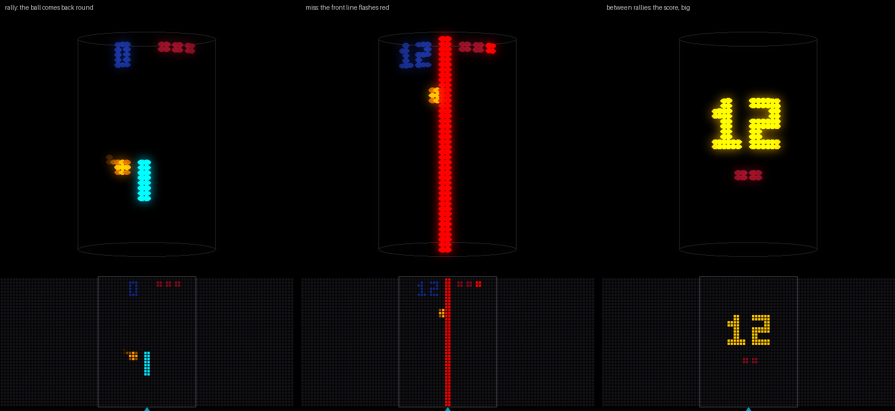

# POV LED Column: Orbit Rally, a paddle game on the column

**Prepared for Brian** · Claude (Opus 5.5), pov-solo-paddle agent on the desktop PC · 2026-11-24

Orbit Rally is a one-player paddle-and-ball game, our own design, played on the column. The paddle stands on the
front and moves up and down; the ball flies right round the cylinder and has to be met when it comes back round. The
PC runs the game and streams every frame to the column's live mode, and knob 4 on the Brain Dump panel moves the paddle.
The column was switched off the whole session, so everything was tested in the simulator, against the mock board and
through an emulated Wi-Fi link. Nothing was sent to the real column, and nothing was flashed.

## Summary

- **Start it:** `py software/games/orbit_rally.py --pot` (knob), `--keys` (arrow keys) or `--sim` (window only, no
  column). The window shows the simulated column and the link numbers. Esc ends the game and puts the column back the
  way it was.
- **Knob 4, the rightmost (firmware `pot1`).** No knob has a job outside music mode; in music mode knob 4 is also the
  synth's note release, which does no harm. The game doesn't open the COM port: `panel.py` owns it, and the game asks its
  UDP channel for the knob values (read-only, 120 times a second, ~0.1 ms per answer).
- **Live mode works as it is, but the link sets the frame rate.** A raw frame is 4,032 bytes. Through an emulated
  50 kB/s link (your 11-22 upload rate) the game gets **12.6 frames/s** with a 79 ms round trip; at 20 kB/s (the
  11-14 worst case) **5 frames/s** and 198 ms. That is playable but choppy, not the 20-30 frames/s we wanted.
- **The smallest firmware fix is ready but not flashed.** Firmware 0.4.1 on branch `fw-live-rle` accepts RLE-packed
  live frames (31 lines; builds; native tests 10/10). A game frame shrinks to ~130 bytes, and the game reaches the
  **30 frames/s cap with an 18 ms round trip on both links**. The game switches to RLE by itself once the board offers it.
  Your go is needed to flash it.
- **Current is no issue.** The worst rotor position of any game frame draws 0.89 A at full brightness (idle LEDs and
  the ESP32 included) against the 2.6 A cap, so the firmware never dims a game frame.
- **Still to do on the real column:** one `--bench 20` run for the real numbers, check that the paddle faces you, and
  check which way the knob turns the paddle (section 7).

## 1. How to play

| Command | What it does |
|---|---|
| `py software/games/orbit_rally.py --pot` | Knob 4 moves the paddle; the arrow keys still work and take over while held |
| `py software/games/orbit_rally.py --keys` | Up/Down or W/S in the game window; the panel isn't read |
| `py software/games/orbit_rally.py --sim` | Simulator window only, no column (knob if the panel answers, else keys) |
| `py software/games/orbit_rally.py --demo` | The bot plays (attract mode, b-roll); add `--sim` to keep it off the column |
| `py software/games/orbit_rally.py --bench 20` | The bot plays 20 s on an idle column and prints frames/s, round trip and the board's counters |
| `py software/games/orbit_rally.py --selftest` | 10 game minutes with a bot in ~2.5 s: frame format and current checks |
| `py software/games/orbit_rally.py --stills` | PNGs and a GIF of a bot game for b-roll (`software/out/orbit_rally/`) |

Keys in the game window: Space starts a new game, P pauses, Esc or Q quits. If the knob moves the paddle the wrong
way, add `--pot-invert`; if the paddle isn't facing you, `--front N` moves it (48 is the front column of the
front-mode animations; one column is 3.75 deg).

**Taking over the column.** Before it streams, the game reads `/api/status`. If an animation is playing, the game takes
over and plays that animation again when it ends; if the column was off, it switches it off again. It won't stream
while the display is paused for an OTA update, or while another program is sending live frames (unless `--force`).
`--bench` only runs on an idle column.

## 2. The game

- **Paddle:** 2 columns x 8 rows (10 x 44 mm) at columns 47-48, cyan. It turns white for 0.1 s on a return.
- **Ball:** 3 x 3 LEDs, amber, with dimmer corners so it reads round, and a fading trail behind it.
- **Flight:** the ball starts at 30 columns/s (3.1 s a lap) and goes right round the 96 columns, bouncing off the top
  and bottom rows. It reaches the paddle from one side, goes back round the other way, and reaches it from the other
  side next time.
- **Returns:** where the ball hits the paddle sets the new angle (Pong's "english": the middle sends it flat, the ends
  steep). Each return adds a point and 5 % speed, up to 80 columns/s. A ball one row past the paddle's end still counts,
  so link latency is forgiven.
- **Miss:** the whole front line flashes red for 0.9 s and the lost life blinks. Then the score shows big and gold for
  1.3 s, and the next serve leaves from the paddle. The ball rides on the paddle for 1.3 s before each serve, so you can
  aim it.
- **Game over** after 3 misses: the final score (red, then blinking gold) with `HI` and your best below it. A new game
  starts after 5 s.
- **HUD:** the score in dim blue left of the paddle and one dim red dot per life on the right, both at the top.

Everything but the paddle and the ball is dim, and the frame is at least 96.5 % dark. That keeps the current low and
gives the camera solid shapes on black.

## 3. The knob

`panel.py` (Brain-Dump-Button `breadboard/`, started at logon as the "Brain Dump Panel" task) holds the Nano's COM port,
and Windows lets only one program open a COM port. So the game asks the program that owns it: `panel.py` already
answers `POTS` on its UDP control channel 127.0.0.1:8767 (made for `music/preset.py`) with
`OK pot1=1,pot2=4,pot3=1023,pot4=1023`. Nothing in `panel.py` changed, and nothing is written to the panel.

| Knob (left to right) | Firmware name | Job today | For the game |
|---|---|---|---|
| knob 1, leftmost | pot4 | music mode: waveform | `--pot pot4` |
| knob 2 | pot3 | music mode: low-pass cutoff | possible |
| knob 3 | pot2 | music mode: echo; reads ~4-16 (README: bad 5V leg) | avoid |
| **knob 4, rightmost** | **pot1** | music mode: note release | **default** |

Measured on the desktop PC: 120 polls/s, no failures, pot1 = 1 and pot4 = 1023 at the time (both at an end stop). The
reading goes through three steps:

1. **Span:** the middle 70 % of the knob's turn (raw 15-85 %) covers the paddle's whole travel, so about 210 deg of the
   WH148's ~300 deg move the paddle from bottom to top. Past the ends the paddle just stays at the top or bottom.
2. **One Euro filter** (Casiez et al., CHI 2012): a low-pass whose cutoff rises with speed. A sudden full turn
   reaches 90 % in 24 ms; ±0.15-row jitter at rest comes out as 0.018 rows.
3. **Hysteresis:** the drawn paddle moves to the next row only once the filtered position is 0.7 rows away, so it never
   flickers between two rows.

## 4. Display path and latency

The firmware's live mode (0.4, `on_ws` in `src/main.cpp`) takes a palette message `{"live":1,"pal":[...]}` (14
colours here) and then one 42 x 96 palette-index frame per binary WebSocket message (4,032 bytes, row 0 = bottom).
After each frame the game sends `{"live":1,"ack":n}`; the board answers `{"live_ack":n}` once it has staged that frame.
The game keeps **one frame in flight at most** and renders the frame from the newest game state at the moment it can be
sent. So nothing queues in the link, and a frame is never older than one transfer. The board shows a staged frame at
its next refresh tick (1/8 turn: 33 ms at 225 rpm) and checks its current at each of the 96 rotor positions.
The game closes the socket without a WebSocket close handshake (the crash path found in the 11-14 review).

Measured with the mock board behind `software/firmware/tools/throttle_proxy.py` (8 ms each way, like the 16 ms ping of
11-14), 10 s bot runs:

| Link | Raw frames (firmware 0.4) | RLE frames (firmware 0.4.1) |
|---|---|---|
| 50 kB/s (11-22 upload rate) | 12.6 frames/s, ack 79 ms (p95 81) | 29 frames/s, ack 18 ms (p95 20), 129 B/frame |
| 20 kB/s (11-14 worst case) | 5.0 frames/s, ack 198 ms (p95 200) | 29 frames/s, ack 19 ms (p95 20), 3.2 kB/s |
| localhost (no limit) | 29 frames/s, ack 0.5 ms | |

With two frames in flight (`--window 2`) the raw rate stays the same and the round trip doubles (159 ms at 50 kB/s), so
one is the default. The board counted every frame (live_frames = sent, live_bad = 0) in every run.

Estimated knob-to-light time (not measured on hardware): knob poll and filter 10-25 ms, waiting for the send slot (half
a frame interval), the transfer, then half a refresh tick on average. That is **~140-170 ms** with raw frames on a
50 kB/s link, ~300 ms at 20 kB/s, and **~55-70 ms** with RLE frames. Physics runs at 120 Hz on its own thread, so the
game's timing doesn't depend on the link. The ball's trail covers ~1.6 frame intervals, so on a slow link it bridges the
jump between two frames like motion blur.

## 5. The firmware change (branch `fw-live-rle`, not flashed)

Raw live frames can't go faster than the link, so the smallest change is to make a frame smaller. Game frames are
96-99 % dark, and the `.pova` files already use run-length coding (run, index pairs). Branch `fw-live-rle`
(commit 36c80d6) lets a live frame be sent RLE-packed:

- **Format:** one binary message = `R` + (run, index) pairs filling exactly 4,032 pixels. Its length is always odd, so
  it can never be taken for a raw 4,032-byte frame. Limit 2,049 bytes; the game sends a raw frame if a packed one would
  be bigger.
- **`lib/povcore/pova.h`:** `pov_live_rle_decode()` rejects a missing `R`, an even length, runs that fall short or
  overflow, and anything over the limit.
- **`src/main.cpp` `on_ws`:** a 2 KB buffer; odd-length messages are decoded into the live frame buffer, then take
  the same cap, palette and staging path as raw frames. Raw frames are unchanged. `/api/status` reports
  `diag.live_rle: true`, which is what the game's `--rle auto` looks for.
- **Version** `0.4.1-2026-11-24`. `pio run -e pov` builds: RAM 26.7 %, flash 75.8 %. Native `test_pova` 10/10,
  including a round trip of the dog animation's first frame and the all-dark vector the game sends.

A game frame packs to 125-317 bytes (median 149, 5 minutes of bot play), 13-32 times smaller.

**To flash (your go needed):** merge `fw-live-rle` into main, then `py tools\ota_flash.py --env pov` from
`software/firmware` (it pauses the picture, flashes, checks the build id and restores the picture). Afterwards
`orbit_rally.py` uses RLE by itself; `--rle off` forces raw frames.

## 6. Tests and checks

| Check | Result |
|---|---|
| `py -m pytest software/tests/test_orbit_rally.py` | 15 passed: return and miss on both faces, grace row, wrap round the back, game over and restart, frame format and row order, knob parsing/mapping, a fake panel over UDP, keys overriding the knob, the 120 Hz loop keeping real time, streaming to the mock board (raw and RLE, nothing lost, column put back, no close handshake) |
| `--selftest 10` | 319 returns, 20 misses, 7 games; 3,000 frames checked; worst rotor position 889 mA at brightness 31 (cap 2,600); at most 3.5 % of pixels lit |
| Mock board, real CLI | busy column refused by `--bench`; `--force` took over `dog_ball_front`, streamed 139 frames (139 counted, 0 bad) and played it again at the end |
| Keys in the window | Up held 0.3 s moved the paddle 13.7 rows; P paused and resumed; Esc ended the game |
| Knob on the desktop PC | pot1 and pot4 read live through `panel.py`, 120 polls/s, 0 failures |
| Firmware (branch) | `pio run -e pov` builds; native `test_pova` 10/10 |
| `tools/mock_board_test.py` | 10/10 with the new `--live-rle` option; it is off by default |
| Real column | **not run**: it didn't answer (`/api/status`, ping) at 07:28 and 07:42 |

## 7. What's left, and questions for you

1. **Flash 0.4.1 (RLE live frames)?** It is the difference between ~5-12 and 30 frames/s. The board also has to be on
   for the real numbers either way.
2. **First run on the column:** with the column on and nothing else playing, `py software/games/orbit_rally.py --bench 20`
   prints the real frames/s and round trip. Then play with `--pot` and check:
   - **the paddle faces you.** If not, `--front N`, or tell me and I'll change the default.
   - **which way the knob moves the paddle.** Clockwise should mean up; if it means down, use `--pot-invert` and
     I'll make it the default.
3. **Knob 4 OK?** Or would you rather use knob 1 (leftmost, `--pot pot4`)? Knob 3 reads stuck near 16 (bad 5V leg),
   so it's best avoided until it's fixed.
4. **Difficulty** after a real game: paddle 8 rows, start at 30 columns/s, +5 % per return, cap 80. All are constants
   at the top of `orbit_rally.py`.

## 8. Notes for the video

- **Ask the owner, don't fight for the port.** Only one program can open a COM port, and `panel.py` already has it. So
  the game queries `panel.py` over a local UDP socket (~0.1 ms) instead of taking the knob away from the F9/music
  functions.
- **Latency over throughput.** One frame in flight, rendered at the last possible moment. The sender waits for the
  board's ack *before* drawing the next frame, so the picture is always the newest state; a queue would add a whole
  backlog of stale frames. Two in flight gave the same frame rate and double the delay.
- **One Euro filter + hysteresis.** The filter's cutoff rises with speed: steady when you hold the knob still, quick when
  you whip it. The hysteresis band stops the last half-row of noise from making the paddle flicker.
- **A cylinder has no edges.** The paddle check uses the ball's signed distance from the paddle, folded into -48..+48
  columns, so the jump from column 95 back to 0 behind the column can't count as a hit.
- **Motion blur sized to the link.** The trail covers ~1.6 frame intervals, so at 5-12 frames/s the ball still looks
  like it moves smoothly rather than jumping.
- **The current cap is a design input.** The column checks its current at each of its 96 rotor positions, and a bright
  frame gets dimmed. A dark game with a few solid shapes never hits the cap, and it reads best on camera too.
- **Measure, then change the firmware.** Emulating the measured link before touching hardware showed the frame size
  was the bottleneck. Run-length coding the frames (4,032 → ~130 bytes) is 31 lines of firmware and buys 30 frames/s.
- **B-roll:** `--stills` renders a bot game through the same simulator view (PNG sequence + GIF), and `--demo` lets the
  bot play on the real column while you film.
